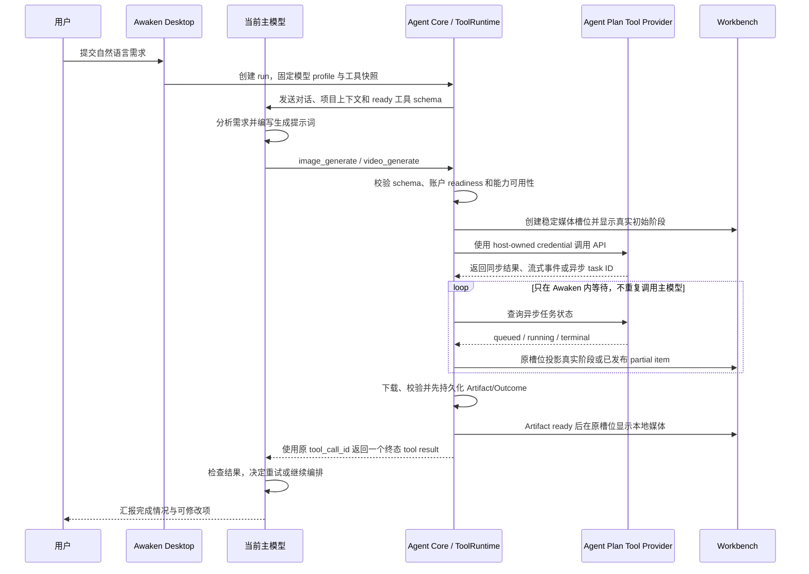

# 火山 Agent Plan 配置与工具编排开发设计

> 文档性质：实施草案，不是当前能力说明。本文描述的是待实现目标；当前支持、不支持和真实验收仍以 `docs/` 各功能域权威文档为准。实现完成后，改变的事实必须迁入对应权威文档，本草案不能成为第二套长期规范。

## 1. 目标

在 Awaken 中接入火山 Agent Plan 的两类首期能力：

1. **模型供应商**：用户可以在“设置 > 模型”中配置“火山 Agent Plan”，选择套餐内支持的火山、Kimi、DeepSeek、GLM、MiniMax 等模型作为当前主模型。
2. **独立工具服务**：用户可以通过独立的“火山 Agent Plan API”配置入口启用 Seedream 图片能力，以及 Seedance 视频生成、编辑、延长和多模态参考能力。当前选择的任何支持工具调用的主模型都可以编排这些工具，不要求主模型来自火山 Agent Plan。

用户只需要描述目标。当前主模型负责理解需求、拆解步骤、依据本次工具 schema 与 Provider 能力矩阵编写提示词和业务参数、检查结果并决定是否继续调用；Awaken 负责把 typed arguments 转换为供应商私有 API 请求、安全执行、持久化过程、恢复任务和交付媒体文件。

首期明确不接入 TTS、ASR、豆包搜索、专业数据集、Embedding、OpenViking、Supabase 和 Agent Evolve。它们仍属于 Agent Plan 套餐能力，但不进入本次 LLM、图片与视频闭环。

## 2. 核心决策

### 2.1 主模型与 Agent Plan 工具解耦

K3 只是主模型示例，不是架构绑定对象。以下两种运行方式都必须成立：

```text
火山 Agent Plan 模型（例如 K3）
  -> 分析和编排
  -> 调用火山 Agent Plan 工具

其他供应商模型（例如 Kimi CN、DeepSeek）
  -> 分析和编排
  -> 调用火山 Agent Plan 工具
```

前提只有两个：

- 当前模型 profile 已被证明支持稳定的 Function Calling；
- 火山 Agent Plan 工具服务已配置且对应能力在本次 run 中 ready。

不得以 `providerId === "volcengine-agent-plan"` 作为暴露工具的条件，也不得把生图、生视频状态写进某个聊天模型的输入能力字段。

### 2.2 一个账户，两种消费方式

新增独立的 `AgentPlanAccount`，统一拥有 Agent Plan API Key 和非敏感连接状态：

- 火山 Agent Plan 模型 profile 可以引用该账户进行聊天模型调用；
- 火山 Agent Plan Tool Provider 引用同一账户调用图片和视频 API；
- Key 只保存一次，模型 profile 和工具配置只保存 `accountId`；
- 删除某个模型 profile 不得删除仍被工具服务使用的账户凭据；
- 轮换账户 Key 时，引用该账户的模型与工具 credential revision 同步失效并重新建立 request identity。

### 2.3 稳定工具名与具体 Provider 分离

模型看到的是与供应商无关的稳定工具名；火山 Agent Plan 只是这些能力的一个具体 Provider：

| 模型可见工具 | Capability | 火山实现 Provider |
| --- | --- | --- |
| `image_generate` | `media.image.generate` | `volcengine-agent-plan/seedream` |
| `video_generate` | `media.video.generate` | `volcengine-agent-plan/seedance` |

未来增加其他图片或视频供应商时，只增加新的 `ProviderManifest` 和实现，不修改主模型、稳定工具名或 Agent loop。

多轮媒体回选另有一个 Awaken host-local 工具 `media_select_revision`。它不属于 Agent Plan、不会调用火山 API、不会产生费用，也不进入 `ProviderToolCapabilitySet`；它只把用户已经明确指认的历史媒体写成当前 thread 的工作版本。该工具仅在当前 thread 存在可选择的 ready 媒体且主模型支持工具调用时进入模型上下文。Agent Plan 图片/视频工具仍必须在账户、凭据、本地启用和 run capability snapshot 都 ready 后才暴露，不能因为存在历史媒体而绕过 Provider readiness。

视频查询、轮询和取消是 `DeferredToolExecution` 的 host-owned 控制操作，不作为普通模型可见工具重复暴露。用户在 Workbench 发起取消或停止等待时，由 Core 根据已持久化 job identity 执行；主模型只接收真实终态或 detached `JobCompletionReceipt`。火山当前只允许取消 `queued` 视频任务；`running` 任务不支持取消。停止 Awaken 本地等待是 run/job ownership 动作，不应伪装成上游取消成功。

### 2.4 模型能力与工具服务能力分层

必须分开保存和判断：

```text
ModelProfileCapabilities
├── supportsTools
├── supportsVision
├── supportsNativePDF
├── contextWindow
└── maxOutputTokens

ProviderToolCapabilitySet
├── media.image.generate
└── media.video.generate
```

`supportsTools` 决定当前模型能否消费工具 schema；`ProviderToolCapabilitySet` 决定本次 run 有哪些可执行工具。两者都满足时，工具才进入 `RunToolAvailabilitySnapshot`。

`entitlement=unknown` 不是拒绝。官方没有统一无消耗发现 API，因此当 `localEnabled && credentialReady && providerReachable && runtimeReady` 且 entitlement 不是 `denied` 时，工具可以以“本地已就绪、套餐权限待首次调用确认”的状态进入 snapshot；首次真实成功或明确拒绝再把 entitlement 更新为 `ready/denied`。否则如果要求 entitlement 必须先为 `ready` 才暴露工具，就会形成“必须真实调用才能确认、但确认前又不能调用”的死锁。

## 3. 用户入口

### 3.1 设置 > 模型 > 火山 Agent Plan

新增模型供应商：

```text
providerId: volcengine-agent-plan
displayName: 火山 Agent Plan
protocol: openai_chat
baseURL: https://ark.cn-beijing.volces.com/api/plan/v3
defaultModel: ark-code-latest
credentialSource: AgentPlanAccount
```

产品规则：

- 与现有“火山 Coding Plan”并存，不能改写或迁移现有 `volcengine` profile；
- Base URL 默认固定，普通设置不允许改成普通方舟或 Coding Plan 地址；
- 模型目录展示套餐当前支持的火山及第三方模型名称，不用 K3 代表整个套餐；
- `ark-code-latest` 可以作为自动选择项，精确模型作为高级选择；
- 每个模型必须有 `supportsTools=ready|unsupported|unknown` 状态；
- 连接测试只证明聊天端点可达，工具调用能力必须用最小 Function Calling probe 单独验证；
- Renderer 不读取 Agent Plan API Key 明文。

用户选择此处的模型时，该模型是本次 run 的主模型，但不会因为来自 Agent Plan 就自动获得尚未配置的工具权限。

官方把 `/api/plan/v3` 定义为 OpenAI-compatible AI 工具接入面，但未点名 Awaken。产品和文档只能表述为“基于官方兼容协议接入”，不能宣称“火山官方已适配或认证 Awaken”。Function Calling 的通用方舟文档也不能单独证明 Agent Plan 中每一个套餐模型都稳定支持工具调用，因此必须保留逐 profile probe。

### 3.2 设置 > 工具服务 > 火山 Agent Plan API

新增独立 API 配置入口，不嵌套在某一个模型 profile 下：

```text
火山 Agent Plan API
├── 账户名称
├── Agent Plan API Key
├── 地域与固定端点
├── 连接状态
├── 上游能力状态（可能未知）
└── 能力启用状态
```

能力页只配置账户连接和“是否允许模型使用”，不要求用户在任务前选择“生图模式”或“视频模式”，也不提供尺寸、比例、时长等生成参数控件。每次调用的创作参数优先由主模型根据用户需求、项目上下文和目标媒介决定；只有字段可选且用户与主模型都未决定时，Provider 才可使用官方默认值。

Awaken 不提供 Agent Plan 专属的调用次数、费用或余额上限，也不根据本地估算提前拦截调用。未开启超额后付费时，套餐额度耗尽由火山返回真实错误；已开启超额后付费时，火山会按官方规则自动转为后付费，Awaken 不得因为本地估算而阻断。余额、计费状态和上游限流均以火山 API 的真实响应为准，Provider 将其归一为结构化错误并返回主模型与 Workbench。Agent Core 自身用于防止无限工具循环的统一 run/tool budget 属于全局失败监督，不是 Agent Plan 配置项，也不能展示为火山账户余额或套餐限制。

每项能力展示以下状态：

```ts
type CapabilityReadiness = {
  localEnabled: boolean
  credentialReady: boolean
  providerReachable: boolean
  entitlement: "unknown" | "ready" | "denied"
  runtimeReady: boolean
  lastCheckedAt?: string
  lastError?: TypedProviderError
  recoveryAction?: string
}
```

Renderer 不自行组合字段，统一使用 host 派生状态：

```ts
type CapabilityDisplayState =
  | "disabled"
  | "needs_auth"
  | "unknown"
  | "ready_unverified"
  | "ready"
  | "denied"
  | "unavailable"
```

派生优先级固定为：本地关闭为 `disabled`；凭据未就绪为 `needs_auth`；entitlement 明确拒绝为 `denied`；本地 runtime 缺失，或已经检查且 Provider 不可达为 `unavailable`；尚未执行连接检查为 `unknown`；连接与 runtime 已就绪但 entitlement 未经真实调用证明为 `ready_unverified`；entitlement 已证明为 `ready`。只有 `ready_unverified/ready` 进入模型工具快照。

火山控制台中的套餐开通状态不能被 Awaken 本地开关冒充。本地开关仅表示是否允许 Awaken 暴露该能力。官方当前没有给出统一、无消耗的套餐能力发现 API，因此连接成功后仍应保持 `entitlement=unknown`；只有受控能力探测、首次真实调用或明确的上游拒绝才能转为 `ready` 或 `denied`。可能产生 AFP 消耗的探测必须明确告知且不能伪装成普通连接测试。官方页面对部分套餐的图片权益还存在相互不一致的描述，Awaken 不硬编码套餐等级与能力关系。

### 3.3 创作参数不进入设置 UI

Agent Plan 设置页不提供“高级生成参数”面板，以下内容都属于单次 tool call，而不是账户级用户配置：

- 图片生成模型、比例、分辨率、随机种子和生成数量；
- 视频生成模型、时长、比例、分辨率、参考素材、是否包含 MP4 同步音轨和是否返回尾帧。

参数责任固定为：

| 责任方 | 负责内容 |
| --- | --- |
| 用户 | 用自然语言描述目标；可以明确说“10 秒、竖屏、2K”，但不需要填写参数表单 |
| 当前主模型 | 结合用户明确约束、项目上下文和目标媒介，选择生成模型与素材，编写提示词，并生成本次调用的尺寸、比例、时长等工具参数 |
| ToolRuntime / Provider | 按本次 run 固定的能力矩阵校验、转换并调用 API；参数不受支持时返回结构化错误，让主模型修正后重试 |
| Host 配置 | 只拥有凭据、端点、能力启停和多 Provider 偏好，不拥有创作默认值或 Agent Plan 调用/费用上限 |

同一个稳定工具在不同 Provider、模型版本下可能有不同的允许值。`RunToolAvailabilitySnapshot` 必须把实际可用生成模型和参数约束物化到本次工具 schema 中；只有无法用 JSON Schema 结构化表达的补充限制才进入工具说明。主模型只能从该范围选择。不得为了复用一套 UI 默认值而把所有模型裁成最低共同能力，也不得对不兼容参数静默降级。

用户没有指定参数时，由主模型做创作判断；Provider 只可在可选字段缺失时使用官方默认值。用户已经给出硬约束而上游不支持时，必须准确返回冲突，不能悄悄改成别的尺寸或时长。

## 4. 数据与凭据契约

### 4.1 非敏感账户配置

建议新增独立 store，而不是在每个模型 profile 中复制 Agent Plan Key：

```ts
type AgentPlanAccount = {
  id: string
  displayName: string
  enabled: boolean
  region: "cn-beijing"
  inferenceBaseURL: "https://ark.cn-beijing.volces.com/api/plan/v3"
  hasKey: boolean
  keyLast4?: string
  credentialRevision: number
  capabilities: Record<string, CapabilityReadiness>
}
```

非敏感 metadata 原子保存在 `~/.awaken/config/` 下的独立 versioned JSON。具体文件名由实现阶段确定，但 owner 必须是 Electron Main；Renderer 只能接收脱敏 summary。

### 4.2 Secret owner

- Agent Plan API Key 由 Main 的 credential store 写入，文件权限、原子替换、恢复状态与现有模型 Key 契约保持一致；
- 模型 profile 保存 `accountId`，不保存或复制 Key；
- Core/headless 只通过受控 resolver 按 `accountId + credentialRevision` 读取；
- Key 不进入 Renderer、run body、SemanticJournal、AG-UI、工具参数、日志或 Artifact metadata；
- `AgentPlanAccount` 首期只保存 Agent Plan 专属 API Key。后置能力未来需要的其他凭据不得写入或复用本账户 Secret。

### 4.3 Profile 引用

目标模型 profile 增加稳定凭据引用：

```ts
type CredentialReference =
  | { kind: "profile_secret"; profileId: string }
  | { kind: "provider_account"; providerId: "volcengine-agent-plan"; accountId: string }
```

存量 profile 继续使用 `profile_secret`。只对新建的 Agent Plan profile 使用 `provider_account`，避免破坏现有模型凭据和 ACP selector。

## 5. 工具输入与主模型职责

图片和视频的尺寸、比例、时长、数量等必须出现在模型可见的工具 schema 中，而不是出现在 Renderer 设置表单中。官方 Function Calling 会让主模型生成函数 `arguments`；Awaken 再以 typed adapter 将这些业务参数转换为具体 API 字段或控制参数。

参数选择优先级为：

1. 用户在自然语言中明确给出的约束；
2. 主模型根据用途、目标平台、已有素材和前后步骤做出的判断；
3. 仅当字段为可选且前两层均未决定时，Provider 才可使用官方默认值。

工具 schema 由本次 run 的 Provider snapshot 生成或收窄。它必须描述允许的生成模型、枚举、数值范围、字段组合和参考素材限制，使支持工具调用的主模型能够直接作出合法选择。

### 5.1 图片生成

模型可见的输入应表达创作意图，不暴露 transport：

```json
{
  "generation_model": "本次工具 schema 允许的图片模型",
  "operation": "edit",
  "prompt": "由主模型结合用户需求、项目资料和历史结果编写的完整生成提示词",
  "mode": "single",
  "aspect_ratio": "9:16",
  "resolution": "2K",
  "source_image_artifact_id": "当前要修改的图片 artifact-id",
  "reference_image_artifact_ids": ["其他构图或风格参考 artifact-id"],
  "output_format": "png",
  "watermark": false,
  "use_web_search": false
}
```

以上是主模型产生的 tool arguments，不是 UI 表单值。主模型负责判断是否需要生成、选择 schema 允许的生成模型、编写提示词、选择尺寸/比例/数量和参考素材，并在拿到结果后决定接受、重试或继续生成视频。Provider 负责把语义参数映射为火山图片 API 的 `model`、`prompt`、`image`、`size`、`output_format`、`sequential_image_generation`、`sequential_image_generation_options`、`tools` 和 `watermark` 等字段，同时执行参数白名单、字段组合、输入文件、超时、下载和结果真实性校验。

图片参数必须遵守以下合同：

- `operation=generate` 创建新的媒体谱系；`operation=edit` 必须提供一个 `source_image_artifact_id`，输出与源图片属于同一谱系并形成新的不可变版本；
- `source_image_artifact_id` 表示本次修改的主对象，`reference_image_artifact_ids` 表示额外构图、人物、商品或风格参考。Provider 可以按具体模型限制把二者映射到官方 `image` 数组，但不能丢失主对象与辅助参考的语义；
- `operation=generate` 使用参考图时，输出是新的谱系根，但仍在 `derivedFromArtifactIds` 中记录参考来源；多图融合也不能篡改或覆盖任何输入 Artifact；
- `mode=single` 映射为关闭组图；`mode=group` 映射为官方组图模式；
- 组图数量是模型自动判断结果，`max_images` 只表达允许的上限，不能向用户承诺精确返回 N 张；
- 当前官方约束为“参考图数量 + 最终生成图片数量不超过 15”，具体模型的参考图数量与字段组合仍由 run capability snapshot 收窄；
- `aspect_ratio + resolution` 由 Provider 映射为官方 `size`。若使用精确像素尺寸，映射结果必须进入 `actual_parameters`，不能只回显语义输入；
- Agent Plan 当前图片输出格式为 `png`、`jpeg`，不得把 WebP 写成上游原生产物；
- 联网搜索是 Seedream 自身的可选生成工具，只在本次生成模型明确支持时暴露 `use_web_search`，不等于接入通用豆包搜索；
- `stream` 是 ToolRuntime 为过程反馈选择的 transport 行为，不是创作参数，不进入模型可见 schema；
- 当前图片模型只有“标准”提示词优化模式时，由 Provider 使用官方行为，不增加无意义的模型参数或 UI 选项；
- 随机种子、其他提示词优化等模型相关字段只在官方能力矩阵明确支持时进入本次 schema，不建立跨模型的虚假公共参数。

图片生成支持两种返回方式：

- 非流式：请求完成后一次返回图片 URL/Base64、尺寸和用量；
- 流式：通过 SSE 返回 `image_generation.partial_succeeded`、`image_generation.partial_failed` 和 `image_generation.completed`。

流式事件进入 Workbench 过程投影；只有请求完成后，ToolRuntime 才把成功 Artifact、失败序号、错误和用量汇总成一个 canonical tool result 返回主模型。单张成功/失败可以形成 `completed_items/total_items`，但上游没有提供时不得伪造生成百分比。

### 5.2 视频生成

`video_generate` 支持纯文本、首帧/尾帧、参考图片、参考视频、参考音频和官方允许的组合参考。模型提交创意提示词和受控生成参数，Awaken 创建外部任务并立即持久化任务 identity。

本节中的参考音频和同步音轨都属于 Seedance 视频能力：`reference_audio` 只是视频生成输入，`generate_audio` 只控制最终 MP4 是否包含同步声音。它们不注册独立音频工具、不产生独立音频 Artifact，也不代表首期接入 TTS/ASR。

模型可见输入至少表达：

```json
{
  "generation_model": "本次工具 schema 允许的视频模型",
  "operation": "generate",
  "prompt": "由主模型编写的视频提示词与镜头要求",
  "duration_seconds": 10,
  "aspect_ratio": "9:16",
  "resolution": "1080p",
  "references": [
    {"artifact_id": "artifact-id", "role": "first_frame"}
  ],
  "generate_audio": true,
  "return_last_frame": false,
  "watermark": false,
  "use_web_search": false
}
```

Provider adapter 必须优先使用官方当前推荐的强校验请求体字段，把 typed arguments 映射为 `resolution`、`ratio`、`duration`、`generate_audio`、`return_last_frame`、`watermark` 等 JSON 字段，并把文本与媒体引用映射为 `content[]`。不得把 `--ratio`、`--dur` 等旧式提示词控制参数作为正式实现或测试合同；旧方式只作为上游兼容历史，不进入主模型 schema。不同视频模型允许的时长、比例、分辨率、MP4 同步音轨、联网搜索、样片和参考素材组合必须来自本次能力矩阵。

视频参数必须遵守以下合同：

- `operation` 允许 `generate`、`edit`、`extend`，但只在所选模型及参考素材组合明确支持时进入 schema；
- `references[].role` 至少区分 `first_frame`、`last_frame`、`reference_image`、`reference_video`、`reference_audio`，模型不能通过字符串路径绕过 Artifact 授权；
- 多模态参考的图片、视频、音频数量和组合限制按生成模型收窄；不允许单独以音频作为唯一参考时，schema 和 Provider 都必须拒绝；
- `duration_seconds`、`aspect_ratio`、`resolution` 直接映射为官方字段。官方允许模型自动选择时，稳定工具使用语义化的 `auto`，由 Provider 转换为对应官方值，并在终态返回实际值；
- `generate_audio`、`use_web_search`、样片模式等只向明确支持的模型暴露；
- `use_web_search` 是 Seedance 生成模型内部工具，不等于接入通用豆包搜索；
- 视频原生输出格式为 MP4，不得把 MOV 写成 Agent Plan 原生产物；
- `return_last_frame=true` 且上游实际返回尾帧时，Awaken 将尾帧下载并发布为独立 `role=deliverable` 图片 Artifact：它取得自己的图片 `threadOrdinal`，建立以自身为根的图片谱系，并以生成的视频 Artifact 写入 `derivedFromArtifactIds`；它作为视频调用的辅助输出展示，但不自动覆盖 `activeByType.image`。上游仅用于 poster/preview 的派生帧不是交付物，不占图片编号；
- 编辑、延长或基于样片生成正式视频时，只能引用当前用户已授权的 Artifact 或已持久化 provider job identity，不能让模型任意构造上游 task ID。

视频是异步任务，必须支持：

- 创建任务并取得上游 task ID；
- 查询任务和查询任务列表；
- 仅在 `queued` 时请求取消；
- `queued`、`running`、`succeeded`、`failed`、`expired`、`cancelled` 阶段事件；
- 上游任务 ID 与本地 tool call/run/thread identity 绑定；
- 网络中断后的确定性状态；
- Core/Desktop 重启后的任务查询与恢复入口；
- 完成后下载、校验并生成 Artifact；
- 失败时保留稳定错误、上游 request ID 和恢复动作。

官方只支持查询最近 7 天的视频任务记录，本地恢复不能把上游查询能力视为永久存档。Awaken 必须在创建任务时保存 identity，在终态尽快下载产物，并在超过上游查询窗口后准确报告不可恢复，而不是继续承诺可从火山重新取得任务。

火山当前没有返回视频生成百分比。Workbench 只能准确展示已观察到的上游阶段和 Awaken 本地阶段，例如 `queued`、`running`、`downloading`、`validating`、`publishing`；不得根据等待时长伪造 `42%` 等数值。

取消语义必须与官方限制一致：

| 上游状态 | 上游 DELETE 语义 | Awaken 行为 |
| --- | --- | --- |
| `queued` | 取消排队，转为 `cancelled` | 可以展示“已取消生成” |
| `running` | 不支持 | 只能停止本地等待；任务继续由后台 job monitor 查询 |
| `succeeded` / `failed` / `expired` | 删除上游任务记录 | 默认不调用，避免丢失恢复依据 |
| `cancelled` | 不支持 | 保留已观察事实 |

成功返回的 `video_url` 官方有效期为 24 小时。Provider 必须在成功后立即下载和转存；signed URL 不得成为长期 Artifact 地址，也不得写入长期模型上下文、日志或最终回答。

Agent Plan 提供 callback，但本地 Awaken Core 默认只有 loopback 服务，不能假设火山云能访问。首版不发送 `callback_url`，只实现持久化轮询；只有未来存在明确公开、鉴权和防重放的回调入口时，才单独启用 callback，并且 callback 与轮询必须通过同一幂等状态归并器。callback 不属于本次实现或验收退出条件。

当前 Awaken 不保证 crash 后自动续跑 active run，因此实现视频工具时必须同时补充外部任务恢复合同，不能只在内存 goroutine 中轮询。

### 5.3 Awaken 本地媒体回选

自然语言中的“第八张很好”“还是第一版”“用刚才那段视频继续”不应直接触发图片或视频 Provider。主模型先用本地工具把明确目标设为当前工作版本：

```json
{
  "media_type": "image",
  "reference": {
    "kind": "thread_ordinal",
    "value": 8
  }
}
```

模型可见的 `reference.kind` 首期只允许：`thread_ordinal`、`lineage_revision` 和 `generation_batch`。`lineage_revision` 默认限定在当前 active lineage；`generation_batch` 返回多项时必须带具体 output ordinal，否则返回歧义。附件、媒体候选卡和 UI 选择动作使用 host 签发的结构化引用直接进入同一个 resolver，不要求主模型接触底层 Artifact ID。

`media_select_revision` 只接受结构化媒体类型与人类可见编号，不接受本地路径、远程 URL、上游 task ID 或模型任意构造的 Artifact ID。ToolRuntime 在当前用户、当前 thread 的耐久媒体索引中解析并复核目标，成功后返回：

```json
{
  "status": "selected",
  "media_type": "image",
  "artifact_id": "resolved-artifact-id",
  "display_label": "图片 8",
  "lineage_id": "lineage-id",
  "lineage_revision_ordinal": 5
}
```

固定语义如下：

- 用户只表达偏好或回选，例如“第八张的时候很好”，只调用 `media_select_revision`，不调用 Seedream；
- 用户说“基于第八张把颜色改深”，先解析并选中图片 8，再以它作为 `image_generate.operation=edit` 的 `source_image_artifact_id`；
- 用户直接对当前结果说“颜色再深一点”，由当前 thread 的 `activeByType.image` 解析源图片，不要求重新上传；
- 同一目标的重复选择是幂等操作；失败、歧义或越权选择不改变已有当前工作版本；
- 该工具是可逆的本地工作状态更新，不创建新媒体 Artifact，不进入普通交付物列表，也不能冒充 Agent Plan 工具成功。

系统提示与工具说明必须要求主模型在用户明确回选历史媒体时持久化选择，不能只用自然语言回答“好的”后仍让下一轮依赖易丢失的对话记忆。

### 5.4 首期后置能力

TTS、ASR、豆包搜索、专业数据集、Embedding、OpenViking、Supabase 和 Agent Evolve 本次不设计工具 schema、配置页、凭据或运行闭环。后续如单独立项，必须重新核对各自官方 transport 和凭据 owner；不得从本图片与视频方案推导它们共享同一种 Provider 或执行模型。

## 6. 端到端运行闭环



一次 run 的确定性顺序为：

1. Desktop 解析当前模型 profile；
2. Core 验证 `supportsTools`；
3. Tool Catalog 根据本地设置、账户 readiness 和策略建立 immutable run snapshot；
4. RequestBuilder 只暴露 snapshot 中 ready 且允许的稳定工具 schema；
5. 主模型依据用户约束和 snapshot 中的工具 schema 产生 Function Calling 与本次创作参数；
6. ToolRuntime 从同一 snapshot 取得固定 Provider 实例，校验参数兼容性并执行；
7. ToolRuntime 创建稳定媒体 narrative item；同步工具直接执行，流式工具由 runtime 汇总，异步工具进入 durable wait；
8. 真实阶段持续幂等更新同一媒体槽位，但不把每次无变化轮询反复发送给主模型；
9. canonical Outcome、任务和 Artifact 先耐久化，媒体 bytes 完成安全加载后在原槽位显示；
10. ToolRuntime 使用原 `tool_call_id` 把唯一终态结果交回主模型；
11. 主模型基于真实结果继续下一步，直到生成最终回答；同一媒体 Artifact 不在 turn 尾部重复追加通用交付物卡片。

主模型只提交业务参数，不能提交或覆盖 `provider_id`、base URL、API Key、HTTP header、超时上限、文件保存绝对路径或任务恢复 identity。

### 6.1 两条反馈通道

工具执行必须同时服务 Workbench 和主模型，但两者接收的信息粒度不同：

| 消费方 | 接收内容 | 不接收内容 |
| --- | --- | --- |
| Workbench | 排队、运行、流式 chunk、partial item、下载、校验、发布、耗时和恢复动作 | API Key、Authorization、原始敏感响应 |
| 主模型 | 最终/部分结果、Artifact identity、失败原因、用量、实际参数、观察到的阶段摘要和下一步建议 | 每次无变化轮询、原始 HTTP body、signed URL、秘密和虚假百分比 |

主模型需要知道工具发生了什么，但不需要参与 provider 轮询。重复把 `running` 发送给主模型会浪费 token、污染上下文，并可能诱发重复创建任务。

### 6.2 工具执行类型

| 类型 | 示例 | Runtime 行为 | 返回主模型时机 |
| --- | --- | --- | --- |
| 同步 | 非流式图片 | 等待单次请求完成 | 成功或失败后立即返回 |
| 流式 | 图片 SSE | 消费流并投影 partial item | 汇总完成或失败后返回一次 |
| 异步 | 视频生成 | 创建外部任务，持久化后轮询/恢复 | 上游进入终态且 Artifact/Outcome 已持久化后 |

### 6.3 Deferred Tool Execution

视频工具需要新增耐久的 `DeferredToolExecution`，它不是普通进度卡片，也不是 Renderer 私有状态：

```ts
type DeferredToolExecution = {
  id: string
  threadId: string
  runId: string
  toolCallId: string
  toolSnapshotId: string
  providerId: string
  upstreamJobId: string
  providerStatus: "queued" | "running" | "succeeded" | "failed" | "expired" | "cancelled"
  waitState: "attached" | "detached" | "interrupted" | "resuming" | "completed"
  createdAt: string
  lastObservedAt?: string
  nextPollAt?: string
  artifactIds: string[]
  errorCode?: string
}
```

`providerStatus` 与 `waitState` 是两套事实：前者描述火山任务，后者描述 Awaken 是否仍在等待。用户停止本地等待时，不能把仍为 `running` 的上游任务改写成 `cancelled`。

默认 attached 流程：

1. `video_generate` 创建任务并在返回创建成功前先持久化 `upstreamJobId`；
2. 当前 tool call 保持开放，run 进入 `waiting_external`，不产生假的 pending tool result；
3. job monitor 查询状态并投影 UI，主模型在此期间不被重复调用；
4. Core/Desktop 重建后从 durable record 恢复查询；
5. 上游终态后先下载并发布 Artifact，再为原 `toolCallId` 写入唯一终态 tool result；
6. Agent loop 自动继续调用当前主模型。

如果用户显式取消或停止等待：

- 上游仍为 `queued`：可以请求取消，记录真实 `cancelled`；
- 上游已为 `running`：当前 run 可以停止等待并将 job 标为 `detached`，但上游仍运行；
- detached job 继续由 thread-level monitor 查询，成功后下载并形成 Artifact；
- 已终止的原 run 不得补写第二个 tool result；Workbench 提供“让主模型继续处理”动作，以 `JobCompletionReceipt` 和 Artifact identity 创建新的 continuation run。

### 6.4 主模型终态结果

终态结果必须足够让主模型判断重试、继续生成、换工具或向用户汇报：

```json
{
  "status": "succeeded",
  "provider_status": "succeeded",
  "provider": "volcengine-agent-plan/seedance",
  "job_id": "provider-job-id",
  "observed_stages": ["queued", "running", "succeeded"],
  "requested_parameters": {
    "duration_seconds": 10,
    "resolution": "1080p",
    "aspect_ratio": "9:16"
  },
  "actual_parameters": {
    "duration_seconds": 10,
    "resolution": "1080p",
    "aspect_ratio": "9:16"
  },
  "artifacts": [
    {
      "id": "artifact-id",
      "type": "video",
      "display_label": "视频 3",
      "lineage_id": "video-lineage-id",
      "lineage_revision_ordinal": 1,
      "derived_from_artifact_ids": ["source-image-artifact-id"],
      "duration_seconds": 10,
      "resolution": "1080p",
      "ratio": "9:16"
    }
  ],
  "usage": {},
  "warnings": [],
  "next_actions": ["inspect_result", "extend_video", "revise_prompt"]
}
```

失败、过期、取消和 partial success 使用同一 canonical envelope，并保留稳定 error code、请求参数、实际参数、实际发生阶段、可用 Artifact 和 recovery action。`requested_parameters` 与 `actual_parameters` 必须分开，任何 Provider 默认值或上游归一化都要对主模型可见。模型不能从 UI 文案或路径字符串反向猜测工具成功。

## 7. 媒体结果与 Workbench

当前 Awaken 的新 Artifact 发布链和最终交付物列表主要支持 Office/PDF/Markdown 等文档格式，尚未拥有内建图片和视频生成合同。Agent Plan 实现必须同步扩展，而不能只在最终回答中返回远程 URL。

目标媒体链路：

```text
上游 API 结果
  -> 有界下载
  -> MIME / 扩展名 / 大小 / digest 校验
  -> runtime-owned 临时结果
  -> TaskScope output root 中的最终文件
  -> canonical ArtifactDescriptor
  -> SemanticJournal / AG-UI
  -> Workbench mediaGeneration 内嵌媒体项
```

至少增加：

- 图片：Agent Plan 原生产物 `.png`、`.jpg`、`.jpeg`；
- 视频：Agent Plan 原生产物 `.mp4`。

媒体 Artifact 除既有 identity、role、status、path、content type、byte size 和 digest 外，还必须耐久保存 `sourceTurnId`、`sourceToolCallId`、`mediaType`、`lineageId`、`rootArtifactId`、`derivedFromArtifactIds`、thread 内人类可见编号、谱系内版本号，以及已验证的 width/height/duration 等可用 metadata。`sourceToolCallId` 用于把 active-run 媒体预览严格绑定回产生它的 typed media tool；这些字段都由 Core 在发布时生成，不能由 Renderer、文件名或主模型直接声明。

`.webp`、`.mov` 可以在未来作为 Awaken 通用媒体 Artifact 格式单独评估，但不能在本方案中写成 Agent Plan 当前原生输出。

图片 tool result 可以通过现有 `model_content` storage key 在后续模型请求中水合，使支持视觉的主模型检查结果。视频若当前主模型无法直接理解，只回传结构化 metadata、预览/封面和 Artifact identity，不伪装成模型已看见视频内容。

Workbench 必须继续遵守现有中间区域 ownership 和安全打开边界。当前“通用交付物只在 final answer 后展示”的规则不能直接套到需要在主模型继续编排前出现的媒体结果；实现时必须在 01 域把 `mediaGeneration` 明确为内嵌媒体结果这一窄例外，同时保持普通文档交付物的终态位置不变。媒体预览属于新增产品契约，不能通过 Renderer 直接信任远程 URL 或任意本地路径。

这里的“内嵌媒体结果”只服务当前 typed media tool 产生的 Artifact，不把中间区域扩展成任意项目文件预览器。用户浏览项目内已有图片、视频和其他文件仍属于右侧文件工作区的独立产品边界；两者不能因为都能显示图片而合并 ownership。

### 7.1 核心交互：一个媒体槽位从生成中原位变为结果

参考对标产品“生成中占位、完成后同位置显示结果”的交互，但不复制其绿色渐变、品牌文案或页面结构。Awaken 的目标行为是：

1. `image_generate` 或 `video_generate` 开始执行时，当前 turn body 在该工具调用的时间位置立即创建一个媒体生成项；
2. 该项先渲染为具有稳定 identity 和预留几何的媒体占位画布；
3. 上游成功后仍保持占位画布，依次显示下载、校验和发布等真实本地阶段；
4. 只有本地 Artifact 已经 `ready`，且 Renderer 已完成图片解码或视频 metadata 加载后，才在同一个 DOM 槽位内把占位层替换为实际媒体；
5. 替换不创建第二张结果卡、不把媒体移动到另一处，也不在最终回答后重复展示同一个 Artifact；
6. 主模型的后续说明继续出现在媒体项之后，使用户先看到产物，再看到检查结果、修改建议或下一步。

`image_generate`、`video_generate` 不应先显示一条普通 `ToolTraceLine`，完成后又追加一张媒体卡。它们由专用 `mediaGeneration` narrative item 承担从工具运行到媒体交付的完整可见生命周期；provider、请求 ID 和诊断仍保存在 tool record/Outcome，需要时进入后续 Inspector，不平铺到媒体画布。

媒体项身份必须在 Artifact 出现前就确定，不能以最后生成的文件路径或远程 URL 作为 React key：

```ts
type MediaGenerationNarrativeItem = {
  kind: "mediaGeneration"
  id: `media:${string}` // 由 runId + toolCallId 稳定生成
  runId: string
  toolCallId: string
  mediaType: "image" | "video"
  phase:
    | "creating"
    | "queued"
    | "running"
    | "downloading"
    | "validating"
    | "publishing"
    | "partial"
    | "ready"
    | "detached"
    | "interrupted"
    | "resuming"
    | "failed"
    | "cancelled"
  requestedAspectRatio?: string
  actualAspectRatio?: string
  outputs: Array<{
    id: string // 上游 item identity 或稳定 output index
    status: "waiting" | "ready" | "failed"
    artifactId?: string
    lineageId?: string
    threadOrdinal?: number
    lineageRevisionOrdinal?: number
    width?: number
    height?: number
    durationMs?: number
    mimeType?: string
  }>
  observedStages: string[]
  canCancelUpstream: boolean
  canStopWaiting: boolean
  errorCode?: string
  recoveryAction?: string
}
```

该类型表达 Desktop 的目标投影，不允许保存 API Key、上游 signed URL、本地绝对路径或媒体 Base64。具体 semantic event 与 wire 字段实现时必须进入 03/09 域权威；Renderer 不通过工具名称、文案或 HTTP 响应内容猜测阶段。

### 7.2 生成中占位画布

占位画布位于 `ExecutionFeed -> execution-turn-section -> turn body`，属于 narrative，不属于 `RunStage.overlay`、composer stack 或右侧 Inspector。它遵守 turn 内容列宽和唯一滚动容器，不增加 fixed/absolute 页面层。

视觉合同：

- 使用 Awaken 中性 surface、受控边框和现有 running/waiting/error 语义 token，不复制对标产品的绿色品牌渐变，不增加 glow；
- 画布与同一 turn 的助手内容左侧对齐，最大宽度不超过当前内容列；横向媒体可使用完整内容宽度，竖向媒体按可视高度约束宽度，不能制造超长空白或把播放器撑入 composer safe area；
- 结果层以媒体本身为主体，不叠加第二层大标题卡、嵌套面板或常驻操作栏；操作只在 hover/focus 或播放器原生 controls 中出现，并且不得改变画布几何；
- 中央只显示图片或视频类型图标、一个真实阶段文案和可选的真实耗时，例如“正在生成图片…”、“视频排队中…”；
- loading 时允许低对比度的中性 shimmer 或图标呼吸动效；`prefers-reduced-motion` 下停用位移动效并直接切换状态；
- 不展示无法从上游取得的百分比、虚构剩余时间或循环增长的假进度条；
- 已知请求比例时按该比例预留媒体 viewport；`auto` 或比例未知时使用有界的通用 viewport，结果用 `object-fit: contain` 完整显示，不为填满容器裁掉图片或视频；
- 占位与结果共用外层尺寸、圆角、焦点边界和 React key。实际比例只能在收到可信 metadata 后更新，ResizeObserver 将其视为被动布局变化，不能恢复已暂停的 follow；
- 视频等待可能持续较久，状态文字只在真实阶段变化时更新，不把每次相同的轮询变成动画、通知或 narrative item。

真实阶段文案映射：

| Phase | 图片 | 视频 |
| --- | --- | --- |
| `creating` | 正在准备图片生成… | 正在创建视频任务… |
| `queued` | — | 视频排队中… |
| `running` | 正在生成图片… | 正在生成视频… |
| `downloading` | 正在下载图片… | 正在下载视频… |
| `validating` | 正在校验图片… | 正在校验视频… |
| `publishing` | 正在保存图片… | 正在保存视频… |
| `partial` | 显示已完成图片，其余继续生成 | — |
| `ready` | 原位显示图片 | 原位显示视频 |
| `detached` | — | 视频仍在后台生成 |
| `interrupted` | 图片状态暂时不可确认 | 视频状态暂时不可确认 |
| `resuming` | — | 正在恢复视频状态… |
| `failed` | 图片生成失败 | 视频生成失败 |
| `cancelled` | 已取消图片生成 | 已取消视频生成 |

文案可以附加结构化 recovery action，但不能直接展示 provider 原始错误、签名 URL、任务 ID 或请求正文。

### 7.3 结果原位覆盖

状态从占位切到结果必须满足两个门槛：

1. Core 已完成下载、内容与 digest 校验、最终文件写入和 Artifact `ready` 发布；
2. Renderer 已通过安全媒体 source 成功执行图片 `decode()`，或收到视频 `loadedmetadata`/可播放信号。

在第二个门槛到达前继续保留占位层，并显示“正在准备预览…”。加载完成后使用不超过现有 normal transition 的淡入替换；减少动态效果模式下立即替换。不得先清空占位造成白闪，也不得直接把火山临时 URL 填进 `` 或 `<video>`。

`previewLoadState = resolving | loading | displayable | failed` 是 Desktop 的局部展示状态，只描述本地媒体 handle 与浏览器解码，不是 Provider phase，也不写入 SemanticJournal。它不能把 Core 的 `ready` 改成失败；预览失败必须作为独立降级事实呈现。

结果形态：

- 单张图片：同一画布内显示完整图片；不默认裁切，不把图片再包装成传统文件列表卡片；
- 组图：以一个 tool-call 级媒体容器承载。初始不猜测图片数量；每个 partial item 只有在各自 Artifact `ready` 后才建立稳定子槽位并原位显示，失败项保留对应失败状态。上游有稳定 item identity 时直接使用；只有上游事件提供了可耐久重放的顺序号时才使用 output index，二者都没有时等待 Artifact identity，不能按事件到达时机临时编号；
- 视频：同一画布内显示本地 MP4 播放器，`preload=metadata`、默认不自动播放、保留键盘可达的原生播放/音量/全屏控制；只有上游或已发布 Artifact 提供真实 poster 时才显示封面，不依赖额外 FFmpeg 截帧；
- run 终态后的 ready 状态可提供“用默认应用打开”和“在 Finder/资源管理器中显示”，仍复用 `{threadId, runId, artifactId}` 的安全反查；run 未终态时只允许窄媒体预览，不把可信路径交给 Renderer；
- 结果下方最多显示一行真实 metadata，例如 `2048 × 2048 · PNG` 或 `10 秒 · 1080p · MP4`。用户未要求时不平铺 provider/model/request ID 等诊断信息；
- 图片需要可读的替代文本；工具结果未提供可靠描述时使用“本轮生成的图片”等中性文案，不让 Renderer根据文件名或提示词猜造图像内容。

媒体项本身就是该 Artifact 在 turn 中的交付展示。同一 `artifactId` 不再进入终态通用 `DeliverableList`；若安全媒体 source 或浏览器解码失败，则在同一媒体项内降级为可打开的媒体文件行，并明确区分“生成已成功，但内嵌预览失败”，仍不重复追加另一张卡片。

### 7.4 安全媒体 source

内嵌渲染需要读取本地 bytes，但不得放宽现有 Renderer 路径边界：

- Renderer 只提交 `{threadId, runId, artifactId}` 请求媒体 source；
- Electron Main 先按 durable transcript 折叠 Artifact，复核 sender、thread/run、`deliverable + ready`、媒体扩展名、source tool identity、realpath、output root、普通文件和 MIME；
- 验证通过后，由 Main 为当前窗口签发短生命周期、不透明的本地媒体 handle；handle 不包含绝对路径，切换 thread、窗口 reload 或组件卸载后可撤销；
- 图片和视频数据通过 Main-owned 自定义协议或等价受控本地通道读取，不进入 AG-UI、SemanticJournal、tool result 文本或 Renderer store；
- MP4 source 必须支持 byte range，保证本地播放器可以 seek，不能把完整视频编码为 Base64 后塞入事件或 React state；
- 上游 signed URL 只在 Provider 下载阶段使用，永远不传给 Renderer。历史重放时以 Artifact identity 重新签发本地 handle，而不是复用旧 handle。

现有通用交付物 open/reveal 要求 run 已终态，而内嵌媒体需要在主模型继续编排前显示，因此不能原样复用该终态门槛。实现时新增窄的 `ready_media_preview` 授权：只允许当前主窗口读取当前 thread/run 中由本次 typed media tool 发布且已经 `ready` 的图片/视频 Artifact；它不允许任意活跃 run 文件、不改变通用文档交付物的 terminal-only 规则。媒体在 run 终态前的系统 open/reveal 默认保持禁用；run 终态后再复用既有安全入口，除非 01/04 域另行明确一条同等严格的 active-run 媒体打开合同。

这里的 `deliverable` 是 Artifact 数据角色，不等于一定进入通用 `DeliverableList`。图片/视频仍以 `role=deliverable` 接受路径与打开安全校验，但由 `mediaGeneration` 消费后从通用列表 view model 去重；普通文档继续由 `DeliverableList` 展示。

### 7.5 Narrative、折叠、滚动与重放

- live 阶段，`mediaGeneration` 在工具原始时间位置出现，所有 phase 以 `runId + toolCallId` 幂等更新同一 item；
- ready 媒体属于持久结果，不属于终态后应被隐藏的执行过程。`projectNarrativeTurnBodySegments()` 必须扩展为“可折叠过程 + 持久媒体结果 + final answer”，不能把已生成图片/视频收进默认关闭的“执行过程”；
- process segmentation 改变时媒体 React key 仍只使用稳定 item id，不能因 segment/index 改变而重新挂载视频播放器；
- 占位高度、图片解码、组图增加和视频 metadata 变化都是被动布局事实。用户处于 `paused_by_user` 时不得被拉回底部；处于 `following_latest` 时继续跟随同一个 native tail；
- live、断线续传、切 thread 和完整重启走同一 projector。已 ready 的历史项直接解析本地 Artifact 并显示结果；未终态视频恢复真实 queued/running/detached/interrupted/resuming 状态；
- detached 视频完成后仍以 durable job identity 把原媒体项更新为 ready 并显示 Artifact，同时保留“让主模型继续处理”入口；不得向已经终止的原 run 补写第二个 tool result；
- 同一 phase 的重复轮询事件幂等归并，不制造重复媒体项、重复状态播报或滚动抖动；
- run 失败或取消时保留已经 ready 的 partial/最终媒体；尚无产物的占位按下表映射，不突然消失。

`DeferredToolExecution.waitState` 到媒体 UI 的映射固定为：

| durable wait / provider 事实 | 媒体 phase | 用户语义 |
| --- | --- | --- |
| `attached` | 保持真实 `queued/running/downloading/...` | 当前 run 正在等待 |
| `interrupted` | `interrupted` | 当前无法确认任务状态 |
| `resuming` | `resuming` | 正在用 durable job identity 恢复查询 |
| `detached` 且上游未终态 | `detached` | 原 run 不再等待，但后台继续查询 |
| `completed` + Artifact ready | `ready` | 显示本地媒体；`completed` 本身不作为 UI phase |
| `completed` + provider failed/expired | `failed` | 显示真实失败与 recovery |
| provider 明确确认取消 | `cancelled` | 显示“已取消生成” |

用户取消 run 与上游取消不是同一事实：视频仍为 `queued` 时只有 DELETE 已确认才显示 `cancelled`；视频已为 `running` 时取消 run 或停止等待都显示 `detached`，不能把上游任务伪装成取消；查询链中断但尚未确认后台继续时显示 `interrupted`。图片同步请求只有在 Provider/transport 明确确认未产生外部继续执行的任务时才可显示 `cancelled`，否则按真实失败或未知状态处理。

本节使用的 `paused_by_user`、`following_latest`、native tail、return-to-latest 和被动布局事实均沿用 [Workbench 交互状态机与滚动布局](docs/01_桌面工作台/中间交互区域/交互状态机与滚动布局.md) 的现有定义，不在本草案建立第二套滚动状态机。

### 7.6 Thread 媒体工作集与不可变版本图

长对话不能依赖“最后一张图”或让主模型从截断后的消息猜测当前对象。火山图片/视频 API 只消费本次请求中的提示词、参数与参考素材，官方并未替 Awaken 定义跨 thread 的“第八张”、当前工作版本或分支语义；这些都必须由 Awaken Core 自己耐久维护：

```ts
type MediaWorkingSelection = {
  artifactId: string
  lineageId: string
  selectedAt: string
  selectedBy: "generation_success" | "user_reference" | "user_action"
}

type ThreadMediaWorkingSet = {
  threadId: string
  activeByType: {
    image?: MediaWorkingSelection
    video?: MediaWorkingSelection
  }
  nextOrdinalByType: {
    image: number
    video: number
  }
  nextRevisionOrdinalByLineage: Record<string, number>
}

type MediaRevision = {
  artifactId: string
  mediaType: "image" | "video"
  lineageId: string
  rootArtifactId: string
  parentArtifactIds: string[]
  derivedFromArtifactIds: string[]
  threadOrdinal: number
  lineageRevisionOrdinal: number
  operation: "generate" | "edit" | "extend"
  sourceTurnId: string
  sourceToolCallId: string
  createdAt: string
}
```

`parentArtifactIds` 表示版本图中的直接父节点；`derivedFromArtifactIds` 还包含本次生成实际使用的额外参考素材。单图编辑沿用源图片的 `lineageId/rootArtifactId`；基于多张参考图进行新的融合创作时，新输出成为新谱系根，同时保留所有参考来源；图片生成视频时建立视频谱系，但在 `derivedFromArtifactIds` 中保留图片来源；视频编辑或延长则继续原视频谱系。

版本合同固定为：

- Artifact 和 `MediaRevision` 一旦 ready 就不可覆盖、改号或重写父关系；每次修改、编辑和延长都创建新的 Artifact；
- “原位覆盖”只指当前 tool call 内占位画布变为该次结果，不能覆盖上一轮已经完成的媒体项；
- 图片和视频分别使用 thread 内单调递增的人类可见编号。只有 canonical Artifact 已 ready 才占用编号，失败或取消的占位不计数；
- 只有向用户呈现且可继续引用的 `role=deliverable` 图片/视频进入编号索引；内部缩略图、poster、转码缓存和预览派生物不占号。`return_last_frame` 只有作为独立 ready 图片交付物展示时才取得图片编号；
- 组图中的每个 ready Artifact 各自取得一个编号；有稳定上游 output 顺序时按 canonical result 顺序分配，没有时按首次耐久发布顺序分配，不能按 Renderer 到达或 DOM 顺序编号。partial 阶段尚未取得稳定编号的结果只显示当前批次内临时位置，终态分配后才允许用户用“图片 N”跨轮指认；
- 编号一旦分配永不重排、复用或改指，即使本地文件后来缺失；
- `threadOrdinal` 回答“第几张图片/第几个视频”，`lineageRevisionOrdinal` 是同一谱系内单调递增且不复用的“第几版”；二者都不是版本图深度，不能混用；
- 第一个成功的单一输出成为对应媒体类型的 active；成功编辑或延长在 Artifact ready 时原子推进 active；Provider 失败、取消、参数拒绝和 Artifact 发布失败都不推进；
- 如果一次调用成功返回多张图，不能默认把第一张、最后一张或最晚到达的一张设为 active。保持原 active，直到用户明确指出其中一张；只有 Provider 具有可信的单一 primary 语义时才允许按 canonical result 选中；
- 全新创作建立新谱系并在单一结果 ready 后成为 active；从历史版本重新修改会从该节点创建分支，不删除原分支；
- 预览失败不改变 Artifact ready 事实。只要 Artifact 已安全发布，版本与编号仍然成立；UI 以文件降级行提示预览失败。

例如：

```text
图片 1 / 版本 1
├── 图片 2 / 版本 2
│   └── 图片 3 / 版本 3
└── 图片 9 / 版本 4   <- 用户回到图片 1 后形成的新分支
```

版本 4 虽然直接从版本 1 分支，但不会重新占用版本 2；父关系由版本图表达，版本号只提供谱系内稳定称呼。用户跨整条 thread 指认时优先使用不会重复的“图片 9”；只说“第一版”时默认限定在当前 active lineage，没有唯一 active 谱系或话语明确跨谱系时再澄清。

### 7.7 自然语言指代与历史回选

主模型负责理解用户话语，host 负责把结构化引用确定性解析为 Artifact。解析优先级固定为：

1. 用户通过附件、候选卡或“设为当前版本”动作提交的结构化媒体引用；
2. 明确的媒体类型与 thread 编号，例如“第八张图片”“视频 3”；
3. 明确的当前谱系版本号，例如“这一支的第一版”；
4. 明确的 turn、生成批次或当前消息内引用；
5. 对应媒体类型的 `activeByType`；
6. 当前谱系最近一个 ready 的单一媒体；
7. 仍有多个候选时进入 `ask_user`，展示稳定编号与缩略图候选，禁止猜第一张、最后一张或最近到达的一张。

常见话语的目标语义为：

| 用户话语 | 解析 | 是否调用生成 Provider |
| --- | --- | --- |
| “第八张的时候很好呢” | 选择 thread 中 `image.threadOrdinal=8` | 否 |
| “还是第一版” | 选择 active lineage 的根版本；没有唯一 active 谱系或语境跨谱系时澄清 | 否 |
| “基于第八张把颜色改深” | 选择图片 8，再从它创建编辑分支 | 是 |
| “这张领口再高一点” | 使用明确点击/附件引用；否则使用 active image | 是 |
| “视频再长 5 秒” | 使用 active video，`operation=extend` | 是 |
| “第八次生成的那张” | 先解析生成批次；该批次多图时要求用户选具体图片 | 视后续意图而定 |

因此，很多轮后用户说“第八张的时候很好呢”，正确闭环是：Core 解析并校验图片 8，`media_select_revision` 把它设为 active，Workbench 轻量提示“已切换到图片 8”，主模型确认即可；这一轮不应创建图片占位、不应消耗 Seedream，也不应复制 Artifact。下一轮用户只说“领口再高一点”时，`image_generate.operation=edit` 的源必须是图片 8，成功结果获得 thread 中下一个从未使用的图片编号，并从图片 8 形成新分支。

如果图片 8 已缺失、属于其他 thread、不是 ready Artifact 或当前用户无权访问，resolver 返回稳定错误且保持原 active。用户说“之前颜色更柔和的那张”这类描述性引用时，主模型可以结合已水合的候选进行判断；无法唯一确定就必须澄清，不能把语义相似度当作确定引用。

### 7.8 主模型上下文与按需视觉水合

Workbench 显示过媒体，不等于主模型在之后每一轮都自动拥有全部媒体 bytes。RequestBuilder 必须从耐久工作集生成一个紧凑、结构化的 `MediaContextManifest`：

```ts
type MediaContextManifest = {
  active?: {
    image?: {
      artifactId: string
      label: string
      lineageId: string
      threadOrdinal: number
      lineageRevisionOrdinal: number
    }
    video?: {
      artifactId: string
      label: string
      lineageId: string
      threadOrdinal: number
      lineageRevisionOrdinal: number
    }
  }
  referencedMedia: Array<{
    artifactId: string
    mediaType: "image" | "video"
    label: string
    lineageId: string
    threadOrdinal: number
    lineageRevisionOrdinal: number
    metadata: Record<string, unknown>
  }>
}
```

上下文合同如下：

- 每轮只注入 active 媒体和本轮用户明确指认、比较或即将编辑的媒体 identity/metadata，不把整条 thread 的所有图片、视频或 Base64 重发给主模型；
- `MediaContextManifest` 不是恢复数据库，也不负责重新推导编号；它在每轮开始时从耐久 `ThreadMediaWorkingSet + MediaRevision` 索引重新生成，显式携带两种 ordinal，避免主模型把“图片 8”与“版本 8”混为一谈；
- 精确编号由 host 索引解析，哪怕图片 8 已经不在最近消息窗口中，也不能因为上下文压缩而改指最近一张；
- 当前主模型支持视觉且任务需要检查、比较或修改图片时，RequestBuilder 才通过既有 `model_content` storage key 水合目标图片；比较“图片 8 和第一版”时只水合这两个目标；
- 当前主模型不支持视觉时，仍可接收 Artifact identity、真实 metadata 和谱系关系，并把已授权图片交给 Seedream 编辑，但不能声称自己已经看见、检查或比较了画面；必要时应告知限制或改用支持视觉的主模型；
- 视频默认只向主模型提供 metadata、可信 poster/封面和 Artifact identity。只有当前模型调用协议明确支持视频输入时才水合视频 bytes，不能因为 Workbench 能播放就推断 LLM 能观看；
- 上下文压缩只压缩对话文本和非必要模型输入，不删除 `ThreadMediaWorkingSet`、编号索引、版本图或 provider job identity；完整重启后也从 SemanticJournal/Artifact 投影恢复同一 active 与编号；
- 模型对已水合内容的分析只是一次 run 的上下文，不反写 Artifact metadata 为事实，除非另有经过校验的语义提取合同。

这使“LLM 知道现在改哪一张”和“LLM 每轮携带所有历史媒体”彻底分离：前者由耐久 identity/selection 保证，后者只在确有视觉理解需要时按需发生。

### 7.9 多轮 UI、选择与分支

- 每个历史 ready 媒体留在产生它的原 turn，不因成为 active、失去 active 或产生新分支而移动或被覆盖；
- 当前 tool call 仍使用“占位 -> 同槽位结果”，但对历史媒体的再次修改必须在新 turn 创建新的媒体槽位；
- ready 结果下方显示简洁、稳定且可访问的标签，例如 `图片 8 · 版本 5 · 基于图片 7`、`视频 3 · 基于图片 8`；诊断 ID 继续隐藏；
- active 媒体显示低干扰的“当前工作版本”状态。该状态来自 thread 工作集投影，不写入旧 Artifact，也不改变旧 turn 内容身份；
- hover/focus 可提供“设为当前版本”和“基于此继续修改”。前者直接调用本地选择操作；后者把结构化媒体引用送入 composer/下一轮，但仍由用户自然语言描述修改目标；
- 点击媒体主体默认仍用于查看或播放，不能同时暗中切换 active；选择动作必须有明确标签、键盘焦点和状态反馈；
- 用户不需要使用任何按钮。自然语言“用第八张继续”与 UI 选择动作必须落到同一个 `media_select_revision` 和版本解析合同；
- 多候选歧义通过现有 `ask_user` gate 的媒体候选扩展呈现，候选只使用 Main 签发的安全缩略图 handle 与稳定标签，不把路径或 signed URL 暴露给 Renderer；
- 选择成功只追加轻量状态回执或由助手确认，不创建生成占位、普通交付物卡或重复媒体项；选择旧版本后，后续新结果出现在最新 turn，并通过“基于图片 N”让用户看见分支来源。

### 7.10 组件与 owner

建议新增 UI-only 组件族：

```text
AwakenMediaGeneration
├── AwakenMediaPlaceholder
├── AwakenGeneratedImage
├── AwakenGeneratedImageGrid
├── AwakenGeneratedVideo
├── AwakenMediaRevisionMeta
└── AwakenMediaRevisionCandidates
```

- Design System 只拥有画布、状态视觉、图片/视频元素、metadata、可访问语义和回调，不读取 runtime、Electron、AG-UI 或文件系统；
- `run-narrative/projector.ts` 拥有 typed event 到稳定 `mediaGeneration` item 的幂等投影；
- runtime reducer 拥有 tool/job/artifact 的真实状态和历史恢复；
- Core 媒体索引拥有编号分配、版本图、指代解析和 active pointer，Renderer 不自行扫描 DOM 或 transcript 推导“第八张”；
- `App.tsx` 只把 item、短生命周期媒体 source 和 open/reveal/cancel/stop-waiting 回调传给组件；
- scroll controller 继续只测量真实 DOM，不理解媒体业务状态；
- Main/Core 拥有下载、校验、发布、路径安全、媒体 handle 与 MP4 range 读取。

该组件族应进入 Design System“中间交互区组件”的真实状态观测，至少覆盖图片生成中/ready/failed、组图 partial、视频 queued/running/downloading/ready/detached 和浅色/深色/减少动态效果；Gallery 只能使用 mock source，不能替代 Desktop 的真实下载、重放、滚动与安全验收。

## 8. 前端改动范围

### 8.1 Electron Main

- 新增 Agent Plan account store、credential resolver、原子写入和恢复状态；
- 在模型 catalog 中新增 `volcengine-agent-plan`，并与 Go registry 保持 parity；
- 新增保存、删除、测试账户和逐能力 probe 的 typed IPC；
- 新增 Tool Provider 设置与 active-run 修改门禁；
- API Key 永不返回 Renderer；
- 新增窄 `ready_media_preview` 授权、短生命周期媒体 handle 和 MP4 byte range；
- 新增 thread-scoped 媒体编号/版本查询与选择的 typed IPC，只接受当前窗口提交的结构化 media identity，不接受路径、URL 或自由文本 Artifact ID；
- 扩展媒体 Artifact 的终态安全 open/reveal 与支持格式，不放宽普通文档交付物规则。

### 8.2 Preload 与 shared types

- 只暴露脱敏账户 summary、readiness 和操作结果；
- 增加只接受 `{threadId, runId, artifactId}` 的媒体 source resolve/revoke 类型，不暴露路径、上游 URL 或通用文件读取接口；
- 增加媒体版本 summary、active selection、候选回选和 selection receipt 类型；Renderer 不能直接写 `activeByType` 或递增编号；
- 所有错误使用稳定 code、message、recovery action；
- 不向 Renderer 暴露可拼装任意 endpoint/header 的通用请求接口。

### 8.3 Renderer

- “设置 > 模型”增加“火山 Agent Plan”供应商卡片；
- 新增独立“设置 > 工具服务 > 火山 Agent Plan API”页面；
- 能力卡只展示 host 派生的 `disabled/needs_auth/unknown/ready_unverified/ready/denied/unavailable`；`ready_unverified` 明确表示“可尝试调用，但套餐权限待真实结果确认”，不能把本地 enabled 写成套餐已开通；
- 不增加图片尺寸/比例/数量、视频时长/比例/分辨率等生成参数控件；这些都由主模型在每次 tool call 中决定；
- 模型选择器只展示主模型，不增加“图片模型/视频模型”会话模式；
- Workbench 以稳定 `mediaGeneration` narrative item 展示媒体工具阶段，并在本地 Artifact ready 且媒体解码完成后原位替换为图片或视频；
- 新增 UI-only `AwakenMediaGeneration` 组件族，覆盖占位、单图、组图、视频和失败降级；
- 每个 ready 媒体显示稳定的“图片 N/视频 N”、谱系版本和来源摘要，并以低干扰状态标出当前工作版本；
- 提供键盘可达的“设为当前版本”和“基于此继续修改”，但不增加尺寸、时长等创作参数 UI；自然语言仍是默认入口；
- 历史媒体留在原 turn，新编辑在新 turn 创建槽位；Renderer 不移动、覆盖或重新编号旧媒体；
- 歧义回选通过带稳定标签和安全缩略图 handle 的 `ask_user` 候选展示，不在前端按最近 DOM 或数组下标猜测；
- 同一媒体 Artifact 不同时出现在内嵌媒体项和通用终态交付物列表；内嵌加载失败时只在原项降级为可打开文件行；
- 视频只显示上游阶段和本地下载/发布阶段；没有上游百分比时不展示百分比进度条；
- `running` 视频的“停止等待”和 `queued` 视频的“取消生成”使用不同动作与文案；
- detached job 完成后展示“让主模型继续处理”入口；
- Renderer 只通过 Main 签发的短生命周期本地媒体 handle 加载 bytes，不接收上游 signed URL 或可信文件路径；视频 handle 支持 byte range；
- 所有运行态来自 Core 事件，不由前端猜测。

## 9. Core 与 Provider 改动范围

### 9.1 模型调用

- 增加 `supportsTools` 的静态目录、动态覆盖、持久化和 Desktop -> Core 传播；
- Agent Plan 文本请求继续使用 OpenAI-compatible transport；
- 为 `/api/plan/v3` 增加精确 provider/request policy、usage identity 和错误分类；
- Function Calling probe 使用最小无副作用工具，不能用普通聊天连接测试代替；
- 不支持工具的模型可以继续纯聊天，但 run snapshot 不向其暴露 Agent Plan 工具；
- RequestBuilder 从耐久媒体索引注入紧凑 `MediaContextManifest`，并只对当前任务引用的图片执行按需 `model_content` 水合；
- 模型支持视觉、图片可授权读取和本轮确有视觉任务必须同时成立，不能把 Artifact 存在误判为模型已经看见；
- 对不支持视频输入的主模型只提供视频 metadata/poster/identity，不水合完整视频，也不允许模型宣称看过内容；
- 上下文压缩和 transcript 窗口裁剪不得改变 active media、稳定编号、版本图或解析结果。

### 9.2 Tool Provider

- 在 `src/tool` 注册新的 capabilities 和 provider manifests；
- 在 `src/tools` 增加 provider-neutral typed media tools；
- 每个生产内建工具达到 strict `ToolDefinition` v2；
- 网络/auth/side effect/readiness/dependency 必须真实声明；
- Provider transport 负责火山 endpoint、认证 header、模型 ID 映射、重试、限流和错误归一化；
- 工具必须返回 canonical Outcome，不能把业务失败只作为自由文本或 Go error。
- `image_generate.operation=edit` 的源图片和额外参考素材必须由 host 在当前 thread 授权 Artifact 中解析；Provider 只接收已验证 bytes/受控上传结果，不接收模型给出的路径；
- `video_generate.operation=edit|extend` 使用同一媒体版本合同，跨媒体引用保留 `derivedFromArtifactIds`；
- `media_select_revision` 作为无网络、可逆、thread-scoped 的 host-local 工具注册，不属于任何视觉 Provider，不建立 HTTP 请求或 usage 记录。

视觉 Provider 使用固定 Agent Plan 路由：

```text
POST   https://ark.cn-beijing.volces.com/api/plan/v3/images/generations
POST   https://ark.cn-beijing.volces.com/api/plan/v3/contents/generations/tasks
GET    https://ark.cn-beijing.volces.com/api/plan/v3/contents/generations/tasks/{id}
GET    https://ark.cn-beijing.volces.com/api/plan/v3/contents/generations/tasks?...filters
DELETE https://ark.cn-beijing.volces.com/api/plan/v3/contents/generations/tasks/{id}
```

这些路由和认证 header 都是 host-owned provider policy；模型只能提交稳定工具的业务参数，不能在 tool arguments 中覆盖 URL、HTTP method 或 header。

协议取证分为两层：自动化通过 transport spy 断言完整 URL、method 和 Authorization 注入位置；真实 Desktop 只验证成功的端到端行为，并可在验收构建中生成短期、脱敏的 `ProviderTransportReceipt`。该 receipt 只允许保存 operation、固定 endpoint ID、HTTP 终态和 provider request ID，不保存 API Key、Authorization、请求正文、媒体内容或 signed URL；它不进入 Renderer 产品状态、SemanticJournal、Artifact metadata 或普通日志，也不与业务恢复使用的 `JobCompletionReceipt` 共用类型或事件名。

### 9.3 持久化与事件

- SemanticJournal 保存 tool call/result、Provider identity、上游 request/job ID、状态、Artifact 和恢复信息，但不保存 Key；
- SemanticJournal 保存 `media_revision_created` 与 `media_working_selection_changed` 等耐久语义事实；编号分配、Artifact ready、版本节点创建和必要的 active 推进必须在同一幂等提交边界完成；
- projector 从耐久事实重建 `ThreadMediaWorkingSet`、媒体编号索引和版本图；切 thread、断线、上下文压缩和完整重启不得按消息顺序重新编号；
- 同一 `toolCallId + output identity` 重放不能再次占用编号；重复选择同一 Artifact 不能制造额外版本或噪声事件；
- 选择历史版本只更新 working selection 并产生轻量回执，不改写 Artifact、旧 turn 或媒体生成 tool result；
- 异步视频增加 `DeferredToolExecution`、`waiting_external` run 状态、job monitor 和重启恢复；
- 进度通过现有 Agent/AG-UI 投影扩展，不新增 Renderer 私有 Provider 通道；
- tool call 必须保持单一终态 tool result；轮询事件不能伪装成多个 tool result；
- crash 后按 durable job identity 恢复真实 provider 状态；只有无法查询时才标记 interrupted/unknown；
- run 取消与 provider job 取消分别记录，不得互相推断。

## 10. 错误与恢复

至少定义以下稳定错误类别：

| 类别 | 用户语义 | 恢复动作 |
| --- | --- | --- |
| `credential_missing` | 尚未配置 Agent Plan Key | 打开工具服务设置 |
| `credential_invalid` | Key 无效或已失效 | 更新 Key 并重新测试 |
| `model_tools_unsupported` | 当前主模型不能稳定调用工具 | 更换支持工具调用的模型 |
| `capability_not_entitled` | 当前套餐没有该能力 | 前往火山控制台核对套餐 |
| `capability_disabled` | Awaken 本地禁用了该能力 | 在工具服务设置启用 |
| `rate_limited` | 火山 API 返回速率或并发限制 | 按上游 retry 信息等待后重试 |
| `provider_quota_exhausted` | 未开启超额后付费且火山返回套餐额度耗尽 | 展示真实上游信息，提示等待额度刷新、升级套餐或开启超额后付费 |
| `provider_billing_unavailable` | 火山返回账户欠费或计费状态不可用 | 展示真实上游信息并提示用户前往火山控制台处理 |
| `generation_model_unavailable` | 主模型选择的生成模型在本次账户/run 中不可用 | 根据返回的允许模型重新选择 |
| `generation_parameter_unsupported` | 尺寸、比例、时长或字段组合不被所选生成模型支持 | 保留用户目标，依据允许值修正参数或更换生成模型 |
| `provider_rejected_input` | 提示词、媒体或参数被拒绝 | 由主模型调整输入后重试 |
| `media_download_failed` | 上游结果无法安全下载 | 重新查询任务或重试下载 |
| `media_preview_failed` | 文件已保存，但内嵌图片/视频无法加载 | run 终态后用默认应用打开或重新加载预览 |
| `media_reference_ambiguous` | 用户的“那张/第一版”等指代对应多个候选 | 展示带编号的候选并让用户确认 |
| `media_revision_unavailable` | 指定编号存在，但 Artifact 缺失、未 ready 或已不可读取 | 保持当前工作版本，提示重新生成或选择其他版本 |
| `media_reference_forbidden` | 指定媒体属于其他 thread 或不在当前授权范围 | 拒绝引用并保持当前工作版本 |
| `media_lineage_corrupt` | 版本父关系、编号索引或 Artifact identity 无法一致重建 | 停止从该版本继续生成，保留证据并提供修复/导出入口 |
| `job_running_not_cancellable` | 视频已运行，上游不支持取消 | 停止本地等待或继续等待 |
| `job_expired` | 上游任务超过有效执行时间 | 调整输入后重新创建任务 |
| `job_interrupted` | 视频查询因退出/网络中断未闭合 | 使用 task ID 恢复查询 |
| `job_resume_failed` | 重启后无法恢复查询 | 保留 job identity 并提供人工重试 |
| `job_result_url_expired` | 临时媒体 URL 已过期 | 重新查询任务；无法取得时准确报告缺失 |
| `artifact_publish_failed` | 结果已生成但未形成可交付文件 | 保留任务 identity 并重新发布 |

错误信息不得回显 Authorization、签名、完整请求体或包含密钥的 URL。

## 11. 示例体验

用户当前选择任意支持工具调用的主模型，然后输入：

> 根据项目里的 AIGLE 2026 新品资料，制作一张户外主题主视觉，再生成 10 秒竖屏宣传视频。

目标行为：

1. 主模型读取已授权的项目资料和商品图片；
2. 主模型提炼品牌、产品、场景、构图和禁用项；
3. 主模型编写提示词并调用 `image_generate.operation=generate`，首张 ready Artifact 获得标签“图片 1”并成为 active image；
4. 支持视觉的主模型按需水合图片检查结果；用户连续提出修改时，每次都以当时 active image 调用 `operation=edit`，生成图片 2、图片 3……，历史版本仍留在原 turn；
5. 多轮后已经存在图片 1–12，用户说“第八张的时候很好呢”；主模型调用本地 `media_select_revision`，Core 精确选择图片 8，Workbench 提示“已切换到图片 8”，这一轮不调用火山图片 API；
6. 用户接着说“领口再高一点，颜色深一点”；RequestBuilder 注入 active image=图片 8，支持视觉时只水合图片 8，主模型以图片 8 作为 `source_image_artifact_id` 调用编辑；
7. 新结果获得下一个未使用编号“图片 13”，其谱系父节点是图片 8，而图片 9–12 及原分支完全保留；
8. 如果用户说“前面两个方案的第一版”，但没有指出具体谱系，Awaken 展示带缩略图与编号的候选并要求确认，不猜最近一张；普通“还是第一版”则限定在当前 active lineage；
9. 用户确认图片 13 后，主模型引用其 Artifact 调用 `video_generate`；视频生成建立独立视频谱系，并记录 `derivedFromArtifactIds=[图片 13]`；
10. Awaken 持久化视频任务，按真实 `queued/running` 阶段等待并投影 Workbench；
11. 图片和视频工具启动时分别创建稳定媒体槽位，展示生成、排队、下载、校验和保存等真实阶段；
12. 每个产物完成后 Awaken 立即下载、校验和发布，并在本次调用的原槽位显示本地图片或视频，不追加重复文件卡片；
13. ToolRuntime 把唯一终态 tool result 返回主模型；
14. 用户继续说“视频再延长 5 秒”时，`activeByType.video` 精确提供源视频，Seedance 新任务形成下一视频版本；
15. 主模型根据真实视频 metadata/Artifact 说明已完成内容、使用素材、版本来源和后续可修改项。

整个过程用户始终与当前主模型对话，不需要手动切换生图或视频模式，也不需要重新上传上一轮产物。历史回选、当前工作版本和分支来源由 Awaken 的耐久媒体工作集保证；主模型负责理解意图和编写工具参数，但不靠自己的短期对话记忆维护媒体 identity。

## 12. 实施顺序

### 阶段一：账户、模型与工具能力合同

- 建立 `AgentPlanAccount` 与独立 API 配置入口；
- 新增火山 Agent Plan 模型 provider；
- 补齐 `supportsTools` 和 Function Calling probe；
- 建立 provider-neutral media capability/tool definitions，以及按 Provider/生成模型物化的参数能力矩阵；
- 明确设置页只管理账户、连接状态和能力启停，创作参数只进入模型可见 tool schema，不增加 Awaken 侧额度限制；
- 完成 TS/Go catalog parity。

### 阶段二：图片闭环

- 实现 `image_generate` 与 Seedream Provider；
- 支持生成/编辑、单图/组图、源 Artifact、额外参考 Artifact、联网搜索开关、流式结果、输出格式、下载校验和 model_content 回传；
- 建立 thread 媒体工作集、不可变 `MediaRevision`、稳定人类可见编号、active image、分支来源和幂等重放；
- 实现 host-local `media_select_revision`、自然语言结构化引用解析、歧义候选与 `MediaContextManifest`；
- 建立通用 `mediaGeneration` narrative、图片占位/原位替换、组图 partial、Main-owned 媒体 handle 与安全 open/reveal；
- 扩展图片 Artifact、Workbench 内嵌展示、版本标签、当前工作版本、终态去重和安全打开；
- 用 Agent Plan 模型和非 Agent Plan 模型各完成一次真实编排。

### 阶段三：视频闭环

- 实现 Deferred Tool Execution、视频 job monitor、阶段投影、排队取消、停止等待和重启恢复；
- 实现视频多模态参考、编辑/延长、MP4 同步音轨、模型内联网搜索和官方强校验 JSON 字段映射；
- 把同一版本图、稳定编号、active video 与跨媒体 `derivedFromArtifactIds` 扩展到视频；
- 在同一媒体槽位覆盖视频播放器，支持 metadata 预载、本地 range seek、detached/interrupted/failed 原位状态和历史重放；
- 实现终态 tool result 回灌和 detached job continuation run；
- 验证多工具串联和失败后的模型自我修正。

实现落地时，本草案中的媒体 UI 事实必须分别迁入其唯一权威，而不是继续把本文件作为当前规范：01 域更新中间区域产品、架构、滚动、叙事、最终交付物和验收；03 域更新媒体 bytes/Artifact/重放；04 域更新媒体工具 Outcome 与发布；09 域更新 semantic event 和 wire 字段。代码、权威文档、自动化与真实 Desktop 证据必须在同一变更集中闭合。

## 13. 自动化与真实 Desktop 验收

### 13.1 自动化

- Agent Plan account metadata/secret 原子写入、权限、轮换、删除引用和损坏恢复；
- Renderer 永远得不到 API Key；
- TypeScript catalog、Go registry、capability merge 和 `supportsTools` parity；
- `CapabilityReadiness -> CapabilityDisplayState -> RunToolAvailabilitySnapshot` 映射覆盖全部状态，`ready_unverified` 可暴露工具、`denied/unavailable/disabled/needs_auth/unknown` 不暴露；
- Agent Plan chat endpoint、Function Calling probe 和错误归一化；
- tool schema 与执行 Provider 来自同一 run snapshot；
- 主模型无法通过参数覆盖 Provider、endpoint、credential 或保存路径；
- 用户明确给出的尺寸、比例和时长约束进入 tool arguments；用户未指定时由主模型选择，不依赖 Renderer 默认值；
- 不同生成模型的参数枚举、数值范围和字段组合由 run snapshot 收窄，非法组合以结构化错误返回并允许主模型修正；
- 图片单图/组图、`max_images` 非精确数量语义、参考图与最终图片总数限制、`size` 映射、PNG/JPEG、联网搜索和流式 partial success；
- 图片 `generate/edit` 能区分主源图片与额外参考，Provider 只接收当前 thread 已授权 Artifact，不接收模型构造的路径、URL 或跨 thread ID；
- 图片/视频 ready 编号分别单调递增且永不复用：失败/取消占位不计数，组图每个 ready item 独立计数，同一 output 重放不重复占号；
- 视频显式返回的 ready 尾帧作为图片交付物取得图片编号但不自动切换 active image；内部 poster、thumbnail 和缓存不占号；
- `MediaRevision` 在连续编辑、从历史版本分支、多参考融合和图片生成视频时保持不可变父关系、谱系根与 `derivedFromArtifactIds`；
- 单一结果成功时 active 原子推进；组图无可信 primary、Provider 失败、取消或 Artifact 发布失败时 active 不被错误推进；
- `media_select_revision` 对精确编号幂等解析且不建立 Provider HTTP 请求、usage 或新 Artifact；歧义、缺失、越权和谱系损坏保持原 active 并返回稳定错误；
- “第八张”“第一版”“第八次生成”“刚才那张”等结构化指代按固定优先级解析，存在多个候选时进入 `ask_user` 而不是选择最近数组项；
- `MediaContextManifest` 只包含 active 与本轮明确引用，并分别携带 `threadOrdinal/lineageRevisionOrdinal`；视觉模型按需水合目标图片，非视觉模型不携带图片 bytes 且不能生成“已查看画面”的虚假结论；
- 视频 typed 参数被 Provider 正确转换为官方 `resolution`、`ratio`、`duration`、`generate_audio`、`watermark` 等 JSON 字段，不以 `--ratio`、`--dur` 作为正式合同；
- 视频首尾帧、图片/视频/音频组合参考、编辑、延长、MP4 同步音轨和模型内联网搜索按模型能力矩阵收窄；
- canonical Outcome 同时保存 requested/actual parameters，任何上游默认值或归一化均对主模型可见；
- 图片同步/流式、partial success、MIME、大小、digest、reference Artifact 和终态汇总；
- 视频 create/get/poll 状态归并、queued cancel、running not-cancellable、限流、过期、7 天查询窗口、URL 24 小时、Core 重建和 orphan job；
- `mediaGeneration` projector 以 `runId + toolCallId` 稳定 upsert，phase 更新不新增普通 tool line、第二张媒体卡或重复播报；
- 图片 `decode()`、视频 `loadedmetadata` 前占位保持可见，加载成功后同一 React key 原位替换；预览失败只降级当前媒体项，不改写 Artifact 成功事实；
- 单图、组图 partial、视频和失败/取消状态均不猜测输出数量、百分比、剩余时间或媒体内容；
- execution-process segmentation 保留 ready 媒体在折叠区外，同一 `artifactId` 不进入通用 `DeliverableList`；
- 媒体占位/结果尺寸变化被视为被动布局事实，覆盖 following/paused、return-to-latest、composer safe area 和窄窗口回归；
- Main-owned 媒体 handle 的 sender、thread/run/artifact、role/status、realpath、output root、MIME、撤销与重放重新签发校验；MP4 覆盖 byte range 和 seek；
- Renderer、AG-UI、Journal 和日志中不存在本地绝对路径、媒体 Base64 或上游 signed URL；
- `AwakenMediaGeneration` 覆盖浅色、深色、键盘、替代文本和 `prefers-reduced-motion` 的 Design System states/render smoke；
- Deferred Tool Execution 在轮询期间不重复调用主模型，并在终态使用原 tool call ID 继续；
- detached job 不向已终止 run 补写第二个 tool result，continuation run 只消费 `JobCompletionReceipt`；
- 文本、图片和视频 transport 的固定 endpoint、Authorization 注入、秘密脱敏和 `ProviderTransportReceipt` 字段白名单；
- 所有能力在上游未给出百分比时都不伪造百分比；
- Artifact、SemanticJournal、AG-UI、replay 和安全 open/reveal；
- context compaction、切 thread、断线和完整重启后稳定编号、版本图与 active selection 一致，历史图片 8 仍解析到原 Artifact；
- `git diff --check`、Markdown 链接和示例 JSON 解析。

### 13.2 真实 Desktop

必须使用根 README 的正式入口，在真实 Awaken Desktop 完成：

1. 配置 Agent Plan API，并在重启后保持 credential/runtime ready；没有执行受控探测或真实调用的能力继续显示 entitlement unknown；
2. 选择火山 Agent Plan 中任一支持工具的模型完成图片生成；
3. 选择另一个供应商的支持工具模型，调用同一个 Agent Plan 图片工具；
4. 证明不支持工具的模型不会收到这些 schema，并得到准确提示；
5. 只输入自然语言目标、不打开任何生成参数面板，完成图片 -> 视频的连续编排；
6. 分别验证图片单图、组图和参考图生成，证明返回数量、实际尺寸和输出格式来自真实结果；
7. 分别验证视频首帧、组合参考和包含同步音轨的 MP4，证明强校验 JSON 字段和模型能力矩阵生效；
8. 分别验证用户明确指定参数与未指定参数两种任务：前者遵守约束，后者由主模型根据用途选择并在终态结果中报告实际参数；
9. 在视频处于 `queued` 时真实取消一次，并证明状态为 `cancelled`；
10. 在视频处于 `running` 时停止本地等待一次，证明上游没有被伪装成取消，并在后台继续查询；
11. 在视频等待期间重启 Core/Desktop，恢复同一 job 并把终态结果交回主模型；
12. 确认视频 UI 只展示真实阶段，没有伪造百分比；
13. 验证上游成功后立即启动下载、校验和发布，不把 24 小时临时 URL 有效期当作等待窗口；随后在 Workbench 打开图片和视频交付物；
14. 重开线程后恢复工具过程、任务状态和最终 Artifact；
15. 检查 `.env`、配置、Journal、日志、AG-UI 和 Renderer state 中没有 Key/signed URL；
16. 使用验收构建的脱敏 `ProviderTransportReceipt` 确认文本/视觉使用 `ark.cn-beijing.volces.com/api/plan/v3`，没有误用普通方舟或 Coding Plan 地址；验收后不保留含请求正文或凭据的调试数据；
17. 从图片工具开始执行起连续录屏：占位画布在工具原始时间位置出现，生成、下载、校验、保存只更新同一槽位；本地 Artifact ready 且图片解码完成后原位出现图片，没有白闪、普通 tool 重复行或终态重复文件卡；
18. 生成组图并至少观察一个 partial item：不预造未知数量的空格，每个成功项只在本地 ready 后出现，失败项保留准确状态；
19. 从视频 `queued` 连续录到 ready：同一占位依次显示真实阶段，最终原位变为不自动播放的本地 MP4；验证键盘控制、音量、全屏和 seek，网络断开后已下载视频仍可播放；
20. 在图片解码、组图增加和视频 metadata 改变布局时分别验证 following 与 `paused_by_user`：follow 使用唯一 native tail，暂停阅读不会被拉回，return-to-latest 和 composer 不遮挡媒体；
21. 最终回答出现后确认 ready 图片/视频没有进入默认关闭的“执行过程”；切 thread 和完整重启后只恢复一份媒体项，并从 Artifact identity 重新取得本地 source；
22. 分别制造 provider 失败、下载失败和内嵌预览失败：前两者显示准确 phase/recovery，预览失败明确提示“文件已保存但预览失败”，并在 run 终态后的原槽位提供安全打开，不把成功生成改写为失败；
23. 在浅色、深色、窄窗口和减少动态效果下复核占位与结果；确认无虚假百分比、无绿色对标品牌样式、状态可被辅助技术读取且图片具有替代文本；
24. 在同一 thread 连续得到至少 12 个 ready 图片 Artifact，确认 UI 显示不重复的“图片 1–12”，失败生成不占号，历史媒体始终留在原 turn；
25. 输入“第八张的时候很好呢”，确认没有创建媒体占位、没有发起 Seedream transport、没有新增 Artifact，并把“当前工作版本”准确切到图片 8；
26. 随后只输入“领口再高一点，颜色深一点”，确认主模型以图片 8 为源调用编辑，新结果获得下一个编号并显示“基于图片 8”，图片 9–12 不被删除或覆盖；
27. 从图片 1 再生成一个分支，确认两个分支均可重放；普通“还是第一版”解析 active lineage 的版本 1，输入存在歧义的“前面两个方案的第一版”时出现带稳定编号和缩略图的候选，而不是自动选最近版本；
28. 生成组图后确认未选中任何单项时 active 保持不变；用自然语言或“设为当前版本”选中其中一张后，两条入口得到同一个 selection receipt；
29. 分别使用支持视觉与不支持视觉的工具调用主模型继续修改图片：前者只水合目标图，后者可传递 Artifact 给 Seedream 但不声称看见画面；
30. 在线程内容已足以触发上下文压缩后，再次说“用第八张继续”；随后完整重启 Desktop 重复一次，均确认解析到同一 Artifact 和谱系；
31. 模拟图片 8 文件缺失、跨 thread 引用和谱系索引损坏，确认分别得到 unavailable/forbidden/corrupt 恢复语义，原 active 不改变且不发起 Provider 调用；
32. 请求视频返回尾帧，确认尾帧作为独立图片交付物取得稳定图片编号并记录来源视频，但 active image 保持原值；普通视频 poster 不出现在图片编号序列中。

Gallery、mock、普通连接测试、直接调用 Provider API 和旧截图只能作为辅助证据，不能替代上述 Desktop 验收。

## 14. 当前明确不支持与非目标

在代码和验收落地前，下列首期目标都必须标记为目标设计而非当前能力：

- 火山 Agent Plan 模型 provider；
- 独立 Agent Plan Tool Provider 配置；
- `supportsTools` 统一能力；
- 内建图片与视频工具；
- 图片/视频 Artifact 与 Workbench 媒体交付；
- thread 媒体工作集、稳定人类可见编号、不可变版本图、历史回选与分支继续编辑；
- `media_select_revision`、`MediaContextManifest` 和按需视觉水合；
- Deferred Tool Execution、视频外部任务重启续查和主模型自动恢复。

下列 Agent Plan 能力明确不属于本次设计范围：

- TTS 和 ASR；
- 豆包搜索和专业数据集；
- Embedding 向量模型；
- OpenViking 原生记忆接入；
- Supabase 原生账户接入；
- Awaken Agent Evolve connector。

本次设计不要求把所有主模型改成火山模型，也不要求用户为了使用 Agent Plan 工具切换主模型；不以 Skill 脚本保存凭据，不允许主模型、Renderer 或 Bash 绕过统一 ToolRuntime 直接调用裸 API。

## 15. 官方参考

- [Agent Plan 快速开始](https://www.volcengine.com/docs/82379/2373738?lang=zh)
- [Agent Plan 能力总览（主模型与套餐范围）](https://www.volcengine.com/docs/82379/2366394?lang=zh)
- [其他 AI 工具（OpenAI-compatible 主模型接入）](https://www.volcengine.com/docs/82379/2373746?lang=zh)
- [工具调用 / Function Calling](https://www.volcengine.com/docs/82379/1958524?lang=zh)
- [视觉生成](https://www.volcengine.com/docs/82379/2375486?lang=zh)
- [创建视频生成任务 API](https://www.volcengine.com/docs/82379/1520757?lang=zh)
- [查询视频生成任务 API](https://www.volcengine.com/docs/82379/1521309?lang=zh)
- [取消或删除视频生成任务](https://www.volcengine.com/docs/82379/1521720?lang=zh)
- [图片生成 API](https://www.volcengine.com/docs/82379/1541523?lang=zh)
- [图片生成流式响应事件](https://www.volcengine.com/docs/82379/1824137?lang=zh)
