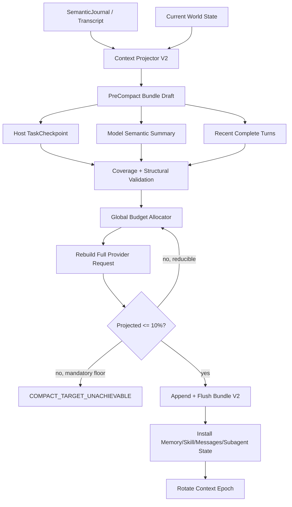

# 目标架构与数据契约

## 1. 架构原则

1. 完整 thread history 是耐久事实，压缩不删除它。
2. 模型上下文是从耐久事实和当前 World State 派生的投影。
3. `TaskCheckpoint` 由宿主持有；模型 summary 只补充语义叙事。
4. 压缩覆盖 conversation、Memory、Skill、Plan、Tool、Subagent 和 Instruction 的一致性边界。
5. 每次压缩只能产生一个原子的 `PostCompactContextBundleV2`。
6. 持久化前执行当前 Phase 已启用的校验 gate；随后 append、flush 并校验持久化 digest/sidecar 完整性；全部成功后才能安装内存状态并切 Context Epoch。未物化 section 不执行其业务 gate，具体启用矩阵见本文件“分阶段校验 gate”。
7. 重复压缩采用 rolling checkpoint，不从零总结。
8. exact provider native compaction 是优化，不是跨模型真相。
9. 用户要求的 10% 约束完整 provider-visible input。
10. 不可达时显式失败，不以语义丢失换取数字达标。

## 2. 总体数据流



## 3. `PostCompactContextBundleV2`

Phase 1 必须一次定义稳定的 provider-neutral v2 envelope；后续 Phase 2–5 只物化 section，不再发明临时 record、改变 envelope 外形或升级 schema。所有渐进字段使用显式 materialization state，不能用“字段缺失”同时表达未实现、不可用和损坏。

建议先定义以下概念，再做具体 Go 类型：

```go
type MaterializedSection[T any] struct {
    State  string // not_materialized | materialized | unavailable
    Value  *T
    Digest string
    Reason string // required only when State=unavailable
}

type CompactConversationProjectionV2 struct {
    Format   string // v1_messages | checkpoint_v2
    Messages []SemanticCompactedMessage
}
```

`v1_messages` 只用于 Phase 1 和旧投影兼容；`checkpoint_v2` 启用后，新的 bundle 不再依赖 `Messages` 作为任务状态唯一来源。两种 format 都属于 schema v2，不新增临时 schema version。

```go
type PostCompactContextBundleV2 struct {
    SchemaVersion       int
    BoundaryID          string
    ParentBoundaryID    string
    Generation          int
    Mode                string
    SourceSequenceStart int64
    SourceSequenceEnd   int64

    ConversationProjection CompactConversationProjectionV2
    TaskCheckpoint      MaterializedSection[TaskCheckpointV2]
    SemanticSummary     MaterializedSection[string]
    RecentTurns         MaterializedSection[[]CompactTurnV2]

    InstructionSnapshotRef SnapshotRef
    MemorySnapshot        MemoryRecallSnapshotRef
    RunPlanRef            VersionedRef
    SkillRefs             []SkillContextRef
    ToolSnapshotRef       SnapshotRef
    HookSnapshotRef       SnapshotRef
    ActiveGateRefs        []GateRef
    PendingSubagents      []SubagentHandoffRef
    ArtifactRefs          []ArtifactRef

    TranscriptLocator   MaterializedSection[TranscriptLocator]
    ProviderOpaqueState MaterializedSection[ProviderOpaqueCompactionRef]

    BudgetReceipt       MaterializedSection[CompactBudgetReceipt]
    CoverageReceipt     MaterializedSection[CompactCoverageReceipt]
    BundleDigest        string
}
```

约束：

- 所有引用必须包含 stable identity 与 digest/revision；
- `EMPTY_SECTION_DIGEST` 唯一定义为 `hex(SHA-256(empty byte slice))`，固定字面量 `e3b0c44298fc1c149afbf4c8996fb92427ae41e4649b934ca495991b7852b855`；section digest 只覆盖 section value，state/reason 由外层 `BundleDigest` 另行覆盖；
- `not_materialized` 必须有 `Value=nil`、`Digest=EMPTY_SECTION_DIGEST`、`Reason=""`；`materialized` 必须有可校验 value/digest、`Reason=""`；`unavailable` 必须有 `Value=nil`、`Digest=EMPTY_SECTION_DIGEST`，并携带稳定 lower-snake-case `Reason`；
- Phase 1 固定写 `ConversationProjection.Format=v1_messages`，保存当前 compact 产生的 summary+tail messages；其余后续 section 显式写 `not_materialized`；
- Phase 2 物化 `TaskCheckpoint`、`SemanticSummary`、`CoverageReceipt`，并可把 projection 切到 `checkpoint_v2`；
- Phase 3 物化 `RecentTurns`、`TranscriptLocator`；Phase 4 物化硬 10% `BudgetReceipt`；Phase 5 才允许物化 `ProviderOpaqueState`；
- `BundleDigest` 覆盖完整 canonical envelope，包括每个 section 的 state、`EMPTY_SECTION_DIGEST`、reason、projection format 和 messages；
- replay/install 必须按 section state 分支；未知 state、state/value 不一致或 digest 不匹配均 fail-closed；
- bundle 不复制 secrets、API key、完整 provider reasoning 或不必要媒体；
- `ProviderOpaqueState.State=not_materialized|unavailable` 不影响 provider-neutral replay；该 section 字段本身不得缺失；
- child bundle 与 root bundle 的 owner 和 sequence 必须明确；
- 旧 schema reader fail-closed，不能把损坏 bundle 当空 checkpoint。

## 3.1 分阶段校验 gate

| Phase | 持久化前必须通过 | 明确不要求 |
| --- | --- | --- |
| Phase 1 | v2 envelope/state/value/digest/reason 结构；`v1_messages` projection 合法；tool pairing；所有直接 refs（Instruction/Memory/Plan/Skill/Tool/Hook/active gates/Subagent/Artifact）identity/digest；当前 v1 summary 与 auto/block/min-reduction postcondition | Coverage、完整 turn、hard 10% Budget、ProviderOpaque 业务 gate |
| Phase 2 | Phase 1 全部 + TaskCheckpoint/SemanticSummary/Coverage 的 value/digest + critical/important fact coverage | 完整 turn、hard 10% Budget、ProviderOpaque 业务 gate |
| Phase 3 | Phase 2 全部 + RecentTurns 结构/pairing + TranscriptLocator authority/range | hard 10% Budget、ProviderOpaque 业务 gate |
| Phase 4 | Phase 3 全部 + BudgetReceipt + `ConservativeProjected <= CompactTarget`；此时替换 Phase 1 的 v1 auto/block/min-reduction 容量完成条件 | ProviderOpaque 业务 gate |
| Phase 5 | Phase 4 全部 + ProviderOpaque exact identity/digest/capability；该 section 为 unavailable 时仍走 provider-neutral bundle | 无 |

append/flush 后统一校验 record bytes、`BundleDigest`、sidecar digest 和 durable sequence；这些持久化完整性校验在所有 Phase 都必须执行。

## 4. `TaskCheckpointV2`

```go
type TaskCheckpointV2 struct {
    ActiveTask       string
    Goal             string
    PendingUserAsks  []CriticalFact
    Constraints      []CriticalFact
    UserCorrections  []CriticalFact
    Decisions        []CriticalFact
    CompletedActions []StateFact
    InProgress       []StateFact
    Blockers         []StateFact
    RemainingWork    []StateFact
    RelevantFiles    []FileStateFact
    Commands         []CommandFact
    Errors           []ErrorFact
    ToolFindings     []ToolFact
    SubagentStates   []SubagentFact
    MemoryRefs       []FactRef
    SkillRefs        []FactRef
    ArtifactRefs     []FactRef
}
```

每条关键事实至少包含：

```text
fact_id
kind
normalized_value
source_record_ids / sequence range
priority = critical | important | supporting
active = true | false
digest
```

宿主能够确定的事实不得让模型自由改写。例如文件路径、task ID、错误码、用户明确百分比、pending ask、Plan 状态都应从结构化来源提取。

## 5. Semantic Summary

summary prompt 输入应明确分为：

```text
<prior-checkpoint>...</prior-checkpoint>
<new-compacted-history>...</new-compacted-history>
<host-critical-facts>...</host-critical-facts>
```

并声明旧 checkpoint 会被替换，所有仍活跃事实必须迁移。

输出可以保持可读 Markdown，但必须携带 fact IDs 或在输出后由宿主映射覆盖。建议 summary 输出预算动态计算：

```text
SummaryBudget = min(4096, max(1024, RemainingBudget × 35%))
```

这是起始策略，不是永久常量；以真实模型矩阵验收为准。

## 6. Coverage Receipt

成功条件不能只看 section 非空：

```go
type CompactCoverageReceipt struct {
    CriticalFactTotal   int
    CriticalFactCovered int
    ImportantFactTotal  int
    ImportantFactCovered int
    MissingFactIDs      []string
    RepairAttempts      int
}
```

门禁建议：

- critical facts 覆盖率必须 100%；
- important facts 覆盖率不低于 95%；
- 所有 active pending asks、用户纠正、精确路径/错误/数字必须覆盖；
- 未消费 Subagent handoff 必须有 durable ref；
- fallback summary 不得成为成功 compact；
- coverage repair 最多两次，仍失败则保留旧 Epoch。

## 7. Recent Complete Turns

`CompactTurnV2` 应以用户任务边界组织，而不是单 message：

```text
user message
assistant reasoning summary（可选、provider-neutral）
assistant tool calls
tool results
assistant response
host notifications / gates
```

至少保留：

- 当前 user turn；
- 最近两个完整已闭合 turns；
- 所有未闭合 tool pairing；
- active permission/input gate；
- 未确认消费的 Subagent terminal handoff。

大工具结果、媒体和文件正文继续使用 storage key/digest/preview，不把完整 payload 重新水合进 tail。

## 8. 完整请求硬 10% 合同

```text
EffectiveInput =
  min(ContextWindow, explicit MaxInputTokens), if both are valid
  else explicit MaxInputTokens, if valid
  else ContextWindow

CompactTarget = floor(EffectiveInput × 0.10)
```

Awaken 的 `ContextWindow` 是用户配置的可用输入容量；`MaxTokens` 是独立输出上限，不从 `ContextWindow` 中再次扣减。

必须在 exact request projection 上计算：

```text
system
+ instructions / AGENTS snapshot
+ runtime/world state
+ tool and MCP schemas
+ Memory
+ RunPlan
+ Skill context
+ Hooks
+ TaskCheckpoint
+ semantic summary
+ recent turns
+ attachments/media stubs
+ protocol wrappers
```

使用 provider actual/local estimate 校准：

```text
CalibrationRatio = max(1, LastProviderInput / LastSentEstimate)
ConservativeProjected = LocalProjected × CalibrationRatio
```

成功 postcondition：

```text
ConservativeProjected <= CompactTarget
```

## 9. Global Budget Allocator

先计算不可删除的 mandatory floor：

1. system/safety；
2. current user input；
3. InstructionSnapshot 的强约束；
4. 未闭合 tool pairing；
5. active gate；
6. 最小工具路由器；
7. 最小 TaskCheckpoint。

若 `MandatoryFloor > CompactTarget`，返回：

```text
code = COMPACT_TARGET_UNACHIEVABLE
reason = mandatory_floor_exceeds_target
category_breakdown = {...}
```

剩余额度按优先级分配，而不是每个模块各持固定预算：

1. Critical TaskCheckpoint；
2. 最近完整 turns；
3. active Plan/Memory/Subagent state；
4. Skill refs/必要正文；
5. semantic narrative；
6. supporting facts；
7. 可 deferred 的工具 schema 和历史细节。

## 10. 每轮 World State 重注入

压缩后每个请求都从 host authority 重建：

- InstructionSnapshot/AGENTS；
- current RunPlan；
- frozen Memory recall snapshot；
- active Skill refs 与必要最小内容；
- canonical/dynamic tools；
- pending Subagent/interaction state；
- cwd、日期、模型/profile/protocol；
- hook receipts 与 active gates。

压缩不能直接拥有这些模块的业务状态，只持有版本化引用和压后投影。

## 11. Provider-native compaction

```go
type ProviderOpaqueCompactionRef struct {
    ProviderID          string
    ProfileID           string
    CredentialRevision uint64
    Protocol            string
    Model               string
    EndpointContractID  string
    Output              []json.RawMessage
    StateDigest         string
}
```

只有完整 identity 匹配时才能重放。切 provider/model/protocol、凭据 revision 变化、endpoint contract 变化时立即丢弃 opaque state，继续使用 provider-neutral checkpoint。

OpenAI Responses 原生 compaction 只能在 exact official capability 明确并实际接入 adapter 后启用；custom endpoint 不继承。

当前实现保存官方 compact response 的 canonical `output[]`（全部 user message items + 最后一个 encrypted compaction item），而不是只摘取 ciphertext；这样下一次 Responses `input[]` 可以按官方合同原样前置。section digest 与 `StateDigest` 都覆盖 canonical output，且完整 prepared body 仍必须通过相同硬 10% receipt。

## 12. 当前线程历史回读

建议增加 root-only typed 工具：

```text
thread_history_read(
  thread_id = current only,
  boundary_id?,
  sequence_from?,
  sequence_to?,
  query?,
  limit
)
```

安全约束：

- 默认只能读当前 thread；
- 分页、有 token/byte cap；
- 不暴露物理 store 路径；
- 返回 provider-neutral、已脱敏内容；
- 不自动整段回灌；
- 每次调用写审计 receipt。

## 13. 状态机与失败语义

```text
idle
→ preparing
→ generating_checkpoint
→ generating_summary
→ validating_structure
→ validating_coverage
→ allocating_budget
→ validating_postcondition
→ persisting
→ installing
→ compacted
```

任何失败：

```text
→ failed
→ keep old messages
→ keep old Memory/Skill/Subagent state
→ keep old Context Epoch
→ keep provider usage anchor
```

typed failure 使用稳定的 uppercase `code`；可聚合诊断使用 lower-snake-case `reason`。首版至少包括：

| code | 典型 reason |
| --- | --- |
| `COMPACT_SUMMARY_FAILED` | `summary_generation_failed` |
| `COMPACT_COVERAGE_FAILED` | `summary_coverage_failed` |
| `PROTECTED_TURN_TOO_LARGE` | `protected_turn_too_large` |
| `COMPACT_TARGET_UNACHIEVABLE` | `mandatory_floor_exceeds_target` |
| `COMPACT_STILL_ABOVE_TARGET` | `still_above_target` |
| `COMPACT_ESTIMATOR_MISMATCH` | `provider_tokenizer_mismatch` |
| `COMPACT_PERSIST_FAILED` | `bundle_persist_failed` |
| `COMPACT_BUNDLE_INVALID` | `bundle_digest_mismatch` |
| `PROVIDER_OPAQUE_INCOMPATIBLE` | `provider_opaque_incompatible` |

## 14. 向后兼容

- 旧 `context_compacted` record 继续由 v1 reader 重放；
- 新 record 使用明确 schema/version，不偷偷扩写旧 payload 语义；
- 新 reader 可以把旧 summary+tail 投影成最低能力 checkpoint，但必须标记 `coverage=unknown`；
- 不回写、重排或删除旧 Journal；
- feature flag 先只用于新 compact boundary；
- 回滚开关必须能恢复 v1 compact，而不破坏已经写入的 v2 records。
