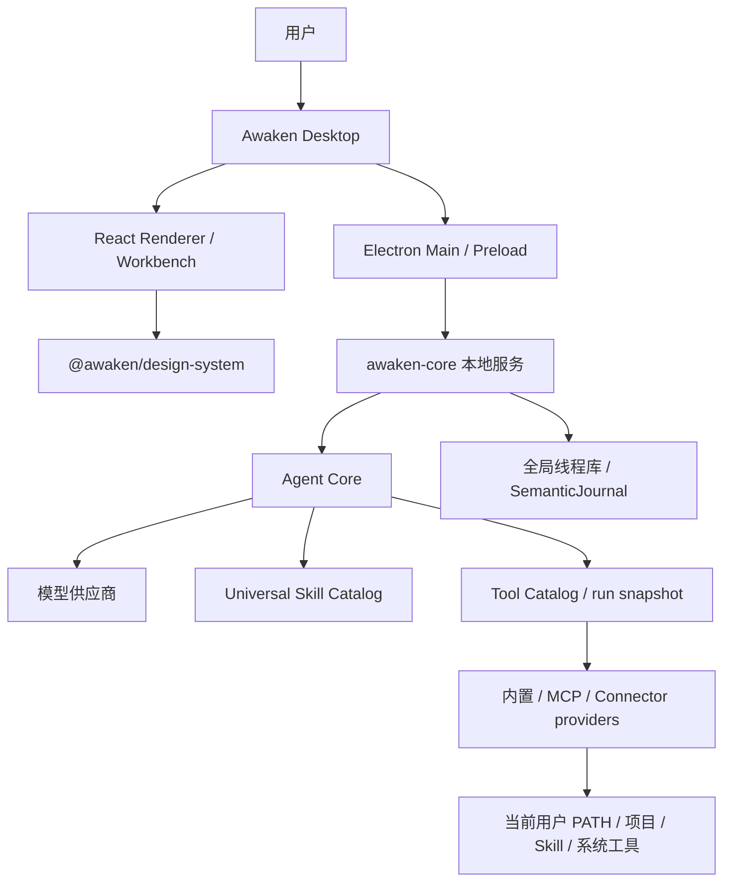

# Awaken

Awaken 是一个本地优先的桌面智能体产品。它以 Awaken Desktop 为唯一产品使用面，在用户选择的工作区中组织多轮任务，由本地 `awaken-core` 完成模型调用、工具执行、事件记录与恢复，再把可验证的过程和交付物投影到桌面工作台。

本仓库中的文档只描述当前实现、当前 Desktop 行为、仍有效的产品设计和当前验收结论。详细事实按功能域进入 `docs/`；本 README 只承担项目总入口。

## 当前产品形态

当前主产品是 Electron + React 的 Awaken Desktop，主界面为 Run Workbench：

- 左侧栏负责项目与线程入口；
- 中间工作区负责输入、运行叙事、状态反馈和最终交付物；
- 右侧 Inspector 当前提供项目文件工作区，以及当前 thread 存在原生 Subagent 记录时的子任务详情、状态、活动、结果、错误与单任务取消；文件内容预览和通用工具详情尚未接通；
- Settings 承载模型、搜索、长期记忆、外观、桌面宠物和 ACP runner 等配置面；
- Desktop 负责启动、监督和关闭本地 `awaken-core`，用户不需要单独运行 Core；
- `Awaken Design System` 是纯 UI 组件包和 Gallery，不拥有产品状态、后端策略或运行时协议。

当前没有 Awaken 原生的操作系统级 Computer Use。仓库保留了一份已确认但尚未实现的设计契约；它不是当前产品能力。

## 核心能力地图

| 功能域 | 当前能力摘要 | 权威入口 |
| --- | --- | --- |
| 桌面工作台 | 项目与线程导航、Workbench 输入和运行叙事、附件、交付物、外观、宠物与 Desktop 生命周期 | [01 桌面工作台](docs/01_桌面工作台/索引.md) |
| 主智能体闭环 | thread/run、多轮上下文、压缩、主动提问、取消和失败终止；原生只读 Subagent 支持 explore/review、每 run 8 个任务/4 并发、status/wait/cancel、耐久事件与 Desktop 任务组/Inspector | [02 主智能体闭环](docs/02_主智能体闭环/索引.md) |
| 运行时与本地服务 | Desktop 托管本地服务、SemanticJournal、工具媒体 blob、当前用户执行环境观察与历史回放 | [03 运行时与本地服务](docs/03_运行时与本地服务/索引.md) |
| 工具、权限与安全执行 | 七个模型基础工具、provider/capability/dependency、每 run 可用性快照、零审批、TaskScope/Trash，以及保留工具的窄 broker 合同 | [04 工具、权限与安全执行](docs/04_工具权限与审批/索引.md) |
| 模型与供应商 | 模型 profile、能力与余额、调用链、安全凭据存储及故障恢复 | [05 模型与供应商配置](docs/05_模型与供应商配置/索引.md) |
| MCP runtime | user/project/dynamic 配置、stdio/http/sse、动态工具直通、可选 Artifact metadata、认证与 prompt/resource Skill bridge | [06 MCP 运行时](docs/06_MCP运行时/索引.md) |
| 连接器 | MCP/CLI provider 目录、官方 CLI 安装与授权、生命周期、readiness 与重启 ownership 边界 | [07 连接器](docs/07_连接器/索引.md) |
| 技能 | 多来源 Universal Skill 发现、按需正文/资源、composer 当前选择的 run-scoped 确定性绑定、统一 catalog、inline/真实 child fork、MCP 动态来源与恢复，以及随 App 分发的 word/excel/ppt/pdf/code-search/PDF_Max 内置 Skill 包 | [08 技能](docs/08_技能/索引.md) |
| ACP Client/Agent | ACP Client（Phase 0–4）：runner 配置、probe 与 Desktop 设置页；`delegate_external_agent` 工具、会话生命周期与权限处理已在 Core 实现；Workbench 嵌套进度与 permission gate UI 已实现。ACP Agent（Phase 5）：`cmd/awaken-acp` 与 `src/acp/agentbridge` 已实现 stdio transport、launcher lease、authenticated control routes、Core 事件投影、模型 profile selector/default fallback 与 cancel/close；Desktop-owned 与 core-only 的真实 stdio prompt 已通过，第三方 client、headless 多进程验收与跨 Core 重启恢复仍是已知缺口 | [02 主智能体闭环](docs/02_主智能体闭环/索引.md) |
| AG-UI 与 A2UI | Awaken 自有事件到 AG-UI-compatible wire 的映射；A2UI 仅作参考 | [09 AG-UI 与 A2UI 协议](docs/09_AGUI与A2UI协议/索引.md) |
| Computer Use | 明确当前不支持的边界，以及实现时必须遵守的目标设计合同 | [10 计算机操作能力](docs/10_计算机操作能力/索引.md) |
| 长期记忆与 Dream | Markdown Memory、主模型相关性召回、受控工具、无正文事件、Settings 查看/删除、手动/空闲期 Dream、Workbench 紧凑回执与 Dream 重启恢复 | [11 长期记忆](docs/11_长期记忆/索引.md) |
| 定时任务 | 首版已支持：左侧一级入口、循环/日程任务、10 个内置模板、创建/编辑/启停/删除/立即执行/取消、专属线程、执行历史、Core 内调度器与 misfire 恢复、Agent 与固定提醒两类任务；Desktop 完全退出后不运行 | [12 定时任务](docs/12_定时任务/索引.md) |

各入口的 `索引.md` 只负责路由。产品行为、代码 owner、状态/数据/事件流、异常恢复和验收方法以索引指向的专项文档为准。

## 总体架构



责任边界：

- `apps/desktop` 拥有 Desktop 生命周期、Electron bridge、产品状态和真实交互投影；
- `src/agentcore` 拥有智能体运行循环、请求构建、工具调用编排和内部语义事件；
- `src/runtime`、`src/server` 和 `src/protocol/agui` 分别拥有会话/持久化编排、本地 HTTP/SSE surface 和 wire 映射；
- `src/tool`、`src/tools`、`src/mcpclient`、`src/skills` 与 `src/skillruntime` 拥有对应能力的定义、策略与实现；
- `Awaken Design System` 只接收 props/callbacks，不读取 Electron、runtime 或业务 store；
- `Bash` 与 Skill 复用当前用户、项目和 Skill 已有环境；缺少生成依赖时由 Agent 根据真实错误按正常包管理方式安装。Core 当前不提供 Office worker 或完整 Work runtime，生成文件后通过 `artifact_publish` 发布。

更细的模块协作、字段和状态机由相应功能域文档唯一拥有。

## 正式入口

先在仓库根目录安装依赖：

```bash
npm install
```

### Awaken Desktop

macOS 的正式开发使用入口：

```bash
npm run open:desktop
npm run close:desktop
```

`open:desktop` 会复用或建立受管理的 `awaken-dev-desktop` 会话，准备 renderer、Electron 和 `awaken-core`，并以真实 `Awaken Dev` 窗口作为成功标准。它不检查或安装 Python、LibreOffice、Poppler、FFmpeg；缺少 Work 依赖不会阻止 Desktop/Core 启动。开发版与安装版使用不同 identity、userData、凭据和单实例域，可以同时运行；`close:desktop` 只关闭开发入口拥有的进程。

Windows 当前使用前台入口：

```powershell
npm run dev:desktop
```

关闭时在该终端按 `Ctrl+C`。

该脚本是当前 Windows 开发入口，但本仓库当前可复核的真实 Desktop 验收基线只覆盖 macOS；脚本存在不能替代 Windows 实机与 CI 验收。

不要把以下路径当成独立产品入口：

- 单独启动 `cmd/awaken-core`；
- 单独打开 Vite renderer；
- 在普通浏览器中用 renderer 页面代替 Electron 验收；
- 直接运行旧的 `dist-electron` 产物。

### Design System Gallery

仅检查组件时使用：

```bash
npm run open:ui
```

Gallery 使用 mock state，只能证明组件渲染，不能替代 Awaken Desktop 的产品验收。

## 主要目录与 owner

| 路径 | 职责 |
| --- | --- |
| `cmd/awaken-core` | 本地 Core 可执行入口 |
| `apps/desktop` | Electron main/preload/renderer 与 Desktop 产品行为 |
| `src/agentcore` | Agent loop、上下文构建、工具编排和内部语义事件 |
| `src/runtime` | thread/run、journal、重放及本地运行时协作 |
| `src/server` | 本地 HTTP/SSE handlers 与服务装配 |
| `src/protocol/agui` | Awaken 语义事件到 AG-UI-compatible wire 的映射 |
| `src/tool`、`src/tools` | 工具合同、暴露、权限、Outcome 与内置工具 |
| `src/mcpclient` | MCP 配置、连接、认证和动态工具桥接 |
| `src/skills`、`src/skillruntime` | Skill 发现、激活和执行 |
| `scripts` | Desktop、构建与验收自动化 |
| `Awaken Design System` | UI-only 组件、tokens、资源和 Gallery |
| `docs` | 按产品功能域组织的确定性工程知识库 |

## Coding Agent 读档路径

任何任务按下面的顺序建立上下文：

1. 阅读本 README，确认产品形态、入口和项目级边界；
2. 阅读 [AGENTS.md](AGENTS.md)，确认协作与完成规则；
3. 从上面的能力地图进入对应功能域 `索引.md`；
4. 读取索引指定的唯一权威文档；
5. 核对文档指向的当前代码 owner 与测试；
6. 涉及真实产品行为时，按本 README 的正式入口在 Awaken Desktop 复核。

若任务跨域，应分别读取各域权威，不在临时文档中重新定义一套跨域事实。

## 项目级硬边界

- Desktop 是正式产品 consumer，并拥有 `awaken-core` 的本地生命周期；不得增加需要用户独立维护的第二套 Core 入口。
- Workbench 中间区域的 ownership、唯一滚动容器和 `center` / `dock` 形态不得绕过；具体规则只以 [架构契约](docs/01_桌面工作台/中间交互区域/架构契约.md) 为准。
- `Awaken Design System` 不得依赖 Electron、HTTP/SSE、Agent Core、MCP 或产品 store；Desktop 也不得从其源码内部路径建立私有耦合。
- `src/agentcore` 不依赖 `src/protocol/agui`；内部语义与外部 wire 由协议映射层隔离。
- Renderer 不拥有后端权限、路径安全、凭据或持久化策略；这些决策必须留在相应 Main/Core owner。
- Gallery、旧截图、旧验收摘要和绕过 Desktop 的 provider smoke 不能作为真实产品通过证据。
- `Bash` 以 Desktop 向 `awaken-core` 注入的当前登录用户身份和 login 环境直接执行，不经过 restricted/staging broker，也不声称 workspace 隔离、全部副作用可观测或任意删除可恢复；TaskScope、Trash 与 staging 只属于实际选用的 typed 工具及 `dependency_install`、`git_remote`、MCP Artifact bridge。消息发送不经过 Awaken 人工审核门。
- 不得把 A2UI、原生 OS Computer Use、MCP WebSocket、完整 OAuth/401 自动恢复、全平台强制 Shell overlay 等尚未实现或不完整能力写成当前支持。
- Memory/Dream 的已实现范围、child recall 后置约束和真实 Desktop/跨平台验收缺口只以 [11 长期记忆](docs/11_长期记忆/索引.md) 为准。
- 不提交 secret、userData、依赖目录或生成产物；不覆盖或清理与当前任务无关的本地改动。
- 代码改变产品事实时，必须在同一任务同步更新唯一权威文档和当前验收证据。

## 文档状态

正式知识库不得保存长期历史切片、修复流水账、完成记录或一次性实施计划。仍有效的设计背景必须改写为当前原因、约束或明确限制，进入对应权威文档后再删除旧载体。

发现代码、Desktop、测试与文档不一致时，以可复核的当前事实为依据停止错误声明：先记录差异并确认 owner，再决定修代码还是修文档，不能用文档掩盖产品缺口。
