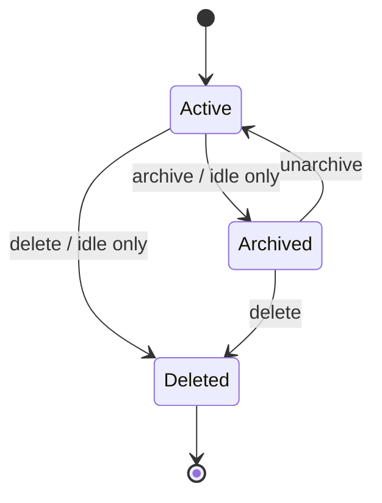

# 会话管理 · 实现方案

本文说明代码职责、数据与接口、异常恢复和验证方法。功能范围及用户操作见[需求文档](需求文档.md)。

## 标题状态机

```ts
type ThreadTitleSource = "first_user" | "llm" | "manual";
type ThreadTitleStatus = "pending" | "ready" | "failed";
```

| source/status | 语义 | 可被谁覆盖 |
|---|---|---|
| `first_user/pending` | 新thread兜底，后台任务进行中 | 匹配seed run的合格LLM结果；用户manual |
| `first_user/ready` | 无模型profile时兜底即稳定标题 | 用户manual |
| `first_user/failed` | 自动标题失败，继续兜底 | 用户manual |
| `llm/ready` | 自动标题成功 | 用户manual |
| `manual/ready` | 用户显式命名 | 无自动路径可覆盖 |

持久字段：`title_source`、`title_status`、`title_updated_at`、`title_seed_run_id`，同时保留 `label/title` 作为展示字段。

旧thread缺少metadata时按manual语义恢复，避免升级后历史标题被新后台任务覆盖。

## 新thread与follow-up

`RunService.StartRun()` 必须区分：

- `thread_id`为空：创建thread，首轮输入推导fallback；有profile时写 `first_user/pending` 并调度标题任务；无profile时 `first_user/ready`。
- `thread_id`存在：只更新run/latest/active状态，不修改label或标题metadata。

Desktop `handleSubmit()`只有新thread计算 `nextThreadLabel`；`run/threadAdded` 对已有thread只合并run状态，`RUN_STARTED`不得把当前prompt写回label。

## 后台标题生成

Owner：`src/runtime/thread_title.go`、`src/runtime/run_service.go`。

规则：

- 输入首轮文本、附件摘要、composer token 摘要和 Host 已解析的标题用途 profile；内部 route 不存在或失效时继承 thread profile，Renderer 不提供独立用途选择器，也不按供应商硬编码切换小模型；
- 使用独立 purpose/cache identity、禁用工具且不写入主 Agent conversation；标题调用使用流式协议，单次最多 60 秒，输出预算取 profile 明确上限与 32000 token 的较小值，不从 `ReasoningEffort` 字段推断另一套预算；
- 复用三协议 adapter 与 provider request policy，不硬编码供应商不支持的 temperature/reasoning 字段；
- 提示词要求只输出与用户同语言的单行标题、不回答用户问题；清洗 `<think>`、引号、换行和标点，并执行 50 字符上限、复读和问句质量门；
- 短退避重试；最终失败调用failed状态但不影响run；
- `ApplyGeneratedThreadTitle()`以 thread source/status/seed run进行CAS；
- manual、错误seed、非pending结果全部丢弃。

Desktop为新thread启动best-effort轮询，延迟序列为 0.5/1/2/4/8/12/20/30/60/90秒，覆盖三次后台尝试的最坏观察窗；只在 `llm/ready` 或 `manual` 时刷新，`failed`停止，瞬时list失败继续下次。轮询不驱动spinner。标题轮询与 thread 对账只消费 active view：已归档 thread 的晚到标题 CAS 可以更新标题 metadata，但必须保留 `archived`/`archived_at`，且该 thread 不回到普通侧栏。

## 重命名

流程：

```text
项目树 ... -> 重命名
  -> useThreadNavigation + ThreadManagementDialogs 预填当前 label
  -> runtimeClient.renameThread
  -> 线程重命名 API（method/path 见 09 协议域）
  -> runtime持久化 manual/ready
  -> run/threadRenamed立即更新active view和列表
```

失败只显示notice并保留旧标题；不能先乐观覆盖后丢失manual保护。

## Spinner

`shouldShowSidebarThreadSpinner()`：

- `runStatus=running|cancelling` -> true；
- 其他显式runStatus -> false；
- 没有runStatus时fallback到 `activeRunId`。

Desktop 每 3 秒执行一次非重叠的线程列表对账，Core 不再返回 active run 时清除后台线程的旧 running/cancelling 摘要；不据此编造成功或失败终态。所选任务的 run 已变化、终态尚未同步或连接仍在恢复时重新读取完整 transcript。切换期间的旧列表响应不得覆盖新选择；加载失败保留当前内容，重选任务可重试。

选中thread也必须显示spinner。标题poll、replay读取、项目operation不复用该指示。

指示器视觉由 Design System 的 `AwakenSidebarThreadSpinner` 拥有：它在原有 14px 行内几何中组合 `AwakenDotmSquare3` 的固定 5×5 方形点视觉。Desktop 不得在 Renderer 中复制点阵样式或把动画倒推为 run 状态。

## 代码位置

- runtime状态与生成：`src/runtime/run_service.go`、`thread_title.go`、`thread_store.go`。
- Desktop reducer：`apps/desktop/src/renderer/runtime/reducer.ts`。
- UI编排：`DesktopSidebar.tsx`、`ThreadManagementDialogs.tsx`；列表/标题轮询：`useThreadDirectory.ts`；重命名、归档、删除及批量选择：`useThreadNavigation.ts`；任务恢复/订阅与对账：`useThreadSession.ts`、`runtime/thread-session.ts`。
- UI树：`Awaken Design System` 的 Sidebar/Project组件。

## 异常与恢复

- provider不可用：fallback保持，状态ready或failed，不阻塞run。
- 标题结果晚于manual：CAS拒绝。
- listThreads瞬时失败：轮询继续，UI保留当前label。
- Desktop重启：FileStore `sessions/<thread-id>/metadata.json` 恢复标题 metadata；manual/llm 结果不回退为 prompt。
- 快速follow-up：reducer不得用新prompt覆盖。

## 测试与Desktop验收

自动化：

- `src/runtime/thread_title_test.go`：fallback、用途 profile/三协议继承、流式生成、预算/超时、reasoning wrapper 清洗、质量门、provider policy、manual/seed/CAS、失败、恢复。
- `src/runtime/thread_store_test.go`：metadata持久化和manual保护。
- `src/runtime/thread_list_test.go`：store/service 三种视图的排序、时间相同的次级排序、内存与磁盘重复项合并，以及内存标题优先。
- `apps/desktop/src/renderer/runtime/reducer.test.ts`：threadAdded不覆盖、threadsLoaded刷新、threadRenamed即时更新。
- `apps/desktop/src/renderer/App.test.ts`：spinner语义。
- `apps/desktop/src/renderer/App.test.ts`：批量选择 checkbox、运行中禁用与菜单隐藏。
- `src/server/server_test.go`：批量删除去重、逐项成功与 `THREAD_BUSY` 部分失败。

真实Desktop：新thread发送首轮、follow-up、等待自动标题、manual重命名、再follow-up、批量选择/删除独立对话并重启；全过程确认标题优先级、spinner只跟run、运行中会话禁选以及已删除会话不复活。

## 状态、数据与必须保持的规则

### Durable metadata

FileStore `sessions/<thread-id>/metadata.json` 扩展或正式启用：

```json
{
  "archived": true,
  "archived_at": "2026-08-23T10:20:30Z"
}
```

- `archived` 是唯一归档 authority；缺失按 `false` 读取，兼容所有既有 session。
- `archived_at` 只在 `archived=true` 时存在；首次归档和从恢复态再次归档时写当前 UTC，取消归档时同时清空。
- 归档 mutation 不修改 `updated_at`。`updated_at` 继续表达会话内容/配置最近更新时间，避免取消归档后仅因管理动作跳到普通列表顶部。
- 若发现 `archived=true` 但旧 metadata 没有 `archived_at`，读取时用 `updated_at` 作为展示/排序 fallback；下次归档 mutation 再补齐，不为此扫描改写全部历史。
- `ThreadSnapshot`、Go 内存 `Thread`、shared wire `RuntimeThreadWire`、normalized `RuntimeThread` 和 Renderer `ThreadItem` 都显式携带 `archived` 与可选 `archived_at/archivedAt`，不得靠列表来源反推状态。

归档只改 metadata；journal、context epochs、tool results、attachments、`<AWAKEN_HOME>/sessions/<owner-id>/output` 和 lifecycle 项目关系保持原位。`deleted=true` 的记录永远不出现在 active 或 archived view；删除优先于归档。

### 查询合同

`GET /v1/threads` 增加枚举 query：

```text
GET /v1/threads?view=active
GET /v1/threads?view=archived
GET /v1/threads?view=all
```

- query 缺失等价于 `view=active`，保证现有 Desktop 调用升级后自动排除 archived thread。
- 非法值返回 `400 INVALID_THREAD_VIEW`，不能静默回退。
- `active` 返回 `deleted=false && archived=false`；`archived` 返回 `deleted=false && archived=true`；`all` 只供内部对账和测试，不进入普通侧栏。
- Repository 与 RunService 使用显式 `ThreadListView` 枚举，不向 store 传裸布尔组合。排序仍由 store/service 确定，Renderer 只做归档页的项目分组和当前搜索筛选。
- FileStore 列表与 RunService 合并后的列表共用 `thread_store.go` 的 `sortThreadSnapshots`：普通和 all 视图按 `updatedAt DESC, createdAt DESC, threadId ASC` 排序；归档视图先比较 `archivedAt DESC`，再使用同一组排序字段。FileStore 直接收集 `ThreadSnapshot`，不为排序另建一份包含 profile key 和 preview 的记录列表。
- Desktop typed bridge 提供 `listThreads(view?: "active" | "archived")`；普通 `refreshThreads()` 永远传/默认 active，归档面板显式传 archived。

### 变更合同

新增窄接口：

```text
PATCH /v1/threads/{thread_id}/archive
Content-Type: application/json

{ "archived": true }
{ "archived": false }
```

成功返回更新后的 `ThreadSnapshot`。语义如下：

- 相同目标状态是幂等成功，不重复改变 `archived_at`；
- thread 不存在或已删除返回 `404 THREAD_NOT_FOUND`；
- 归档 active `running | cancelling` thread 返回 `409 THREAD_BUSY`；
- 归档 `source=scheduled_task` thread 返回 `409 THREAD_ARCHIVE_UNSUPPORTED`；
- 取消归档不会启动、恢复或选择 thread；
- metadata 原子写失败返回稳定 `500 THREAD_ARCHIVE_FAILED`，内存与磁盘必须回滚到同一状态。

对应 owner 新增 `ThreadStore.SetThreadArchived`、`RunService.SetThreadArchived`、server handler、Electron Main IPC、preload allowlist、shared types 和 Renderer client。归档操作不进入 Project lifecycle mutation：它不改变项目状态、不触发 cleanup，也不需要为项目 thread 与独立对话建立两条路径。

`useThreadNavigation` 在发起 mutation 时固定目标 thread ID，在完成时通过最新 active-thread ref 判断是否清理 Workbench。单条／批量删除与归档共用此判定；归档的文件区清理也必须经过同一身份检查。`useThreadNavigation.test.tsx` 用延迟响应与 React 切换覆盖 A 请求未完成时转到 B 的两条路径。

### 状态转换



不变量：

1. 同一 thread 在任一 authority query 时最多属于 active 或 archived 一个集合。
2. 归档不等于删除，不生成 cleanup job，也不改变 `projectId`。
3. 普通侧栏、scheduled thread 对账、标题轮询和 ready refresh 都只能消费 active view，不能让 archived thread 因刷新或重启复活。
4. archived thread 不允许作为新 run 的 `thread_id`。即使绕过 UI，`StartRun` 也返回 `THREAD_ARCHIVED`；用户必须先取消归档。
5. Renderer/localStorage 不保存归档真相；搜索、筛选和展开状态只属于当前 Settings 实例。
6. mutation 成功响应之前，UI 不得从对应 authority 集合移除记录。
7. `archived_history` 只能命中 archived authority 的精确 thread ID；active/deleted thread、路径片段和任意未列出的 ID 都不能通过该工具获得 transcript。

## 模块 职责 与实现落点

### Core 与 FileStore

- `src/runtime/file_desktop_store.go`：启用 `Archived`，新增 `ArchivedAt`、view 查询与同锁原子 metadata mutation；确保 `upsertThread` 不因旧 snapshot 覆盖归档字段。
- `src/runtime/thread_store.go`、`repository.go`：声明枚举查询和 archive mutation capability；`thread_store.go` 同时维护 store/service 共用的会话排序。
- `src/runtime/run_service.go`：内存/磁盘一致性、busy 校验、幂等、`StartRun` 的 archived guard 和 snapshot 投影。
- `src/runtime/archived_history.go`：归档列表 cursor、精确 archived identity gate、SemanticJournal 项目化和内容上限；不拥有物理路径。
- `src/runtime/thread_history.go` 的 `sortedThreadHistoryRecords` 为当前会话与归档会话读取提供记录合并和稳定排序，先按 sequence、再按 timestamp 排序；排序操作使用新切片，不改写原 transcript。归档身份校验和两种读取各自的筛选、分页规则仍由各自入口负责。
- `src/tool/archived_history.go`、`src/tools/archived_history/tool.go`：窄 service DTO/context、模型 schema、untrusted 边界、canonical Outcome 和耐久读取回执。

归档与当前任务读取共用的条目 schema、来源字段兼容和严格输出回归见[历史条目的来源身份](../../02_主智能体闭环/上下文与用量/实现方案.md#历史条目的来源身份)。归档状态、身份 gate 和 child 私有历史过滤继续由本功能的 Runtime 负责，不因增加来源字段改变可见范围。
- `src/agentcore/types.go`、`runner.go`、`tool_runtime.go`：只把 Runtime service 绑定到 root run；请求与执行继续消费同一工具快照。
- `src/server/handlers.go`、`router.go`：view query、archive handler、错误映射。

### Desktop bridge 与 Renderer

- `apps/desktop/src/shared/runtime.ts`：wire/normalized types（包括既有 `source` 的 Desktop 投影）、archive request/result 和 `listThreads(view)`。
- `apps/desktop/src/main/index.ts`、`preload/index.ts`：只暴露 typed `listThreads` / `setThreadArchived`，路径中的 thread ID 使用 `encodeURIComponent`，错误码不压成无差别文案。
- `apps/desktop/src/renderer/runtime/client.ts`、`reducer.ts`：传递 archive 字段；普通 reducer 只接 active authority 列表。
- `apps/desktop/src/renderer/App.tsx`：线程菜单、当前 thread 成功归档后的安全清理、active 列表刷新与 notice。
- `apps/desktop/src/renderer/settings/ArchivedChatsSettingsPanel.tsx`：独立加载 archived threads 与包含 removed 的 projects，拥有搜索、筛选、分组、取消归档、删除确认和错误恢复；取消归档结果只通过 Settings Toast callback 上报，不得在列表末尾渲染；不得复用或改写 Workbench 当前 thread reducer 作为页面缓存。
- `apps/desktop/src/renderer/settings/DesktopSettingsDialog.tsx`：新增 section union/title，向面板注入 `runtimeClient`、归档/删除完成后的 active sidebar refresh callback，以及由 Settings 框架承载、自动关闭的顶部 Toast callback。

### Design System

- `AwakenSettingsNavItems`：最后增加归档分组与入口；它仍是 Settings 导航集合的唯一定义。
- 新增 UI-only `AwakenArchivedChatsSettings`（或同职责组件）：接收 groups、query、project filter、busy ids、empty/error 状态和 callbacks；不读取 Electron、Runtime、FileStore 或项目 store。
- 图标从 Design System 既有概念库选择或在同一图标契约下新增 archive 概念；Desktop 不内联 SVG 或使用 emoji。
- Gallery states 覆盖：多项目、独立对话、空库、无搜索结果、加载、错误、浅色/深色和长标题；Gallery 只证明组件，不替代 Desktop 验收。

## 异常、竞态与恢复

- 点击归档与 run 启动竞态：Core 在同一 RunService ownership 下最终裁决；先获得 active run 的一方胜出，归档返回 `THREAD_BUSY`，UI 刷新 active authority。
- 双击归档/取消归档：相同目标状态幂等；按钮在请求期间按 thread ID 禁用，完成后以服务端响应和重新查询为准。
- archived 列表载入期间切换设置页：取消/忽略旧 sequence 的结果，旧请求不得覆盖新页面状态。
- 取消归档与项目移除竞态：thread 的 `projectId` 不变；项目已移除时显示项目不可用提示，不合成项目或改成独立对话。
- 归档后标题后台任务晚到：标题 CAS 可以更新标题 metadata，但必须保留 `archived` / `archived_at`；普通侧栏仍不可见。
- Desktop/Core 重启：从 metadata 恢复；不从 localStorage、当前 Settings 筛选或旧截图推断。
- metadata 损坏：沿用 FileStore fail-closed，不能把损坏的 archived thread 当 active 显示。
- 删除 cleanup 失败：沿用现有逻辑删除和重试合同；归档页不得把 deleted 记录重新显示。

## 自动化验证矩阵

### Go

- `src/runtime/file_desktop_store_test.go`：旧 metadata 缺字段、active/archived/all 互斥、`archived_at` fallback、幂等时间戳、取消清空、排序、重启、普通 upsert 保留归档字段、deleted 优先。
- `src/runtime/run_service_test.go`：内存和 durable thread 归档、active run busy、scheduled thread 拒绝、归档后禁止 follow-up、取消后可继续、归档当前 loaded thread 不丢 transcript、重启恢复。
- `src/runtime/archived_history_test.go`：只列 archived、query/project/cursor、active 拒绝、read 倒序分页、工具参数不回放和逐项截断。
- `src/tools/archived_history/tool_test.go`、`src/agentcore/archived_history_test.go`：模型可见逻辑位置/不可信边界、service fail closed、journal receipt 脱正文、只读 service 的 Agent 范围与 child 私有历史隔离。
- `src/server/server_test.go`：三种 view、非法 view、archive/unarchive、not found、busy、幂等、错误码与 JSON 字段。
- 运行：

```bash
go test ./src/runtime ./src/server -count=1
go test ./src/filestore ./cmd/... -count=1
go vet ./...
```

### Desktop 与 Design System

- `apps/desktop/src/shared/runtime.test.ts`：wire normalization 和缺失字段兼容。
- `apps/desktop/src/renderer/runtime/client.test.ts`：view 参数、archive mutation 和错误透传。
- `apps/desktop/src/renderer/App.test.ts`：菜单顺序、running 禁用、成功后 active 列表移除、当前 thread 回空态、失败保留、刷新不复活。
- `apps/desktop/src/renderer/settings/DesktopSettingsDialog.test.ts`：归档入口固定末项、分组标题、section title 与面板挂载。
- `apps/desktop/src/renderer/settings/ArchivedChatsSettingsPanel.test.tsx`：项目/对话/removed/unknown 分组、排序、搜索、筛选、空态、载入错误、取消归档结果进入顶部 Toast、单删确认、部分 authority 变化。
- Design System 组件测试：受控 props、keyboard/AX、长标题、浅深色和响应式。
- 实际命令以各 package 当前 `package.json` 为准，至少执行相关 test、typecheck/build；不能在方案实施时沿用本文件中的过期命令猜测。

## 真实 Desktop 验收

使用根 README 的 `npm run open:desktop`，在隔离测试数据中准备：两个 active 项目、一个 removed 项目、两个独立对话、一个运行中会话、长中英文标题和至少一个带附件/产出的会话。

1. 分别从项目 thread 和独立对话菜单归档 idle 会话，确认菜单顺序、无确认弹窗、成功后侧栏消失且项目选择不变。
2. 归档当前会话，确认成功后进入新建任务空态，旧 transcript、草稿、Inspector 和文件 surface 不残留；制造 API 失败时确认所有状态保持。
3. 对运行中会话检查菜单禁用说明；绕过 UI 请求归档，确认 Core 返回 `THREAD_BUSY` 且任务和侧栏都保持。再检查定时任务专属会话的禁用说明和 `THREAD_ARCHIVE_UNSUPPORTED`，确认调度链未被修改。
4. 打开 Settings，确认“已归档”分组及“已归档的聊天”始终是最后一项；返回和 Escape 行为与其他 Settings 页面一致。
5. 核对 active、removed、独立对话和 unknown project 的分组、项目顺序、归档时间、长标题截断与完整辅助名称；搜索和项目筛选不得改变 durable 集合。
6. 取消归档 active 项目的会话，确认列表移除、侧栏原项目恢复但不自动打开，且“已取消归档”只在右侧工作区顶部 Toast 短暂出现，不改变列表位置或滚动；取消 removed 项目会话时确认同位置 notice 且不复活项目。
7. 从归档页删除一条含 Awaken 管理附件和外部产出文件的会话，核对确认文案、历史清理和外部产出保留；取消确认时不改变任何数据。
8. 完整关闭并重开 Desktop，确认仍归档的会话只在 Settings 出现，已取消归档的只在正常侧栏出现，已删除的不复活。
9. 在归档后触发一次可能晚到的标题刷新/普通 thread 对账，确认 archived 状态不会被 metadata merge 覆盖。
10. 在浅色、深色和窄窗口下完成键盘 Tab/Enter/Escape、读屏名称、焦点恢复与唯一滚动容器检查，并留下截图或录屏。
11. 新建 root Agent 对话，要求它列出一个可识别的归档会话并读取最近历史；确认工具调用使用 `thread_id` 而不是 `~/.awaken` 路径、回答能引用真实历史、归档列表和状态未变化。再要求读取 active thread，确认返回 `archived_history_not_found`；检查当前 thread journal 只保存读取回执而未复制归档正文。

## 当前支持的持续准入

以下条件是归档能力继续被认定为“当前支持”的准入门槛：

- Core、HTTP、typed bridge、侧栏、Settings 与 Design System 全链路实现；
- 旧 metadata 兼容，active/archived/deleted 集合互斥，重启不丢状态；
- 归档 busy、取消归档、removed project、删除和竞态均有自动化覆盖；
- 相关 Go 与 Desktop test/typecheck/build 本次实际通过；
- 真实 Awaken Desktop 完成[真实 Desktop 验收](实现方案.md#真实-desktop-验收)验收并留下新证据；
- 同步更新 [项目与对话导航](../项目管理/实现方案.md)、[会话标题与线程状态](实现方案.md)、[全局数据与会话存储](../../03_运行时与本地服务/数据存储与重放/实现方案.md)、Settings 导航权威和相关验收文档中的当前支持/不支持事实。

回归任务若有任一环节未完成，只能报告已验证部分与阻塞，不得用 Gallery、mock 或本文契约替代当前代码与真实 Desktop 证据。

## 用户操作的实现

### Settings 固定末项

- `AwakenSettingsNavItems` 增加 `archived-chats`，可见标题为“已归档的聊天”，放在所有普通设置入口之后；这个顺序是语义固定末项，不要求脱离 Settings 导航滚动容器做 viewport sticky/fixed 定位。
- 末项前显示分组标题“已归档”。Design System 应给导航 item 增加通用的 `groupLabel` 或等价分组数据，不允许 Desktop 通过私有 DOM/CSS 在导航旁手工插入第二份条目。
- 该页面标题为“已归档的聊天”，使用 Settings 全窗口工作区和现有返回/Escape 语义，不新建独立窗口或 Workbench overlay。
- 页面载入时只请求 archived view，同时请求包含 removed 项目的项目列表以解析稳定 `projectId` 对应的显示名；不得把 Renderer 当前 active 项目集合当作 archived thread ownership authority。

### 取消归档与删除

- 每行提供“取消归档”和垃圾桶删除入口。取消归档是主操作；删除为危险操作并复用 Desktop 统一确认 Dialog。
- 取消归档成功后，该行从 archived authority 列表移除并回到原 `projectId` 对应的正常侧栏分区；它不会自动打开、抢焦点或改变当前项目。若项目处于 removed 状态，会话仍恢复为 active thread，但在项目重新添加前不强制复活 removed 项目；Settings 给出“已取消归档；重新添加项目后可在侧栏查看”的 notice。
- 取消归档的成功或失败 notice 必须进入 Settings 统一的顶部居中 Toast：浮层不参与归档列表布局或滚动，不遮挡操作，使用 polite live region 播报并由 Settings consumer 短暂展示后自动关闭；不得再把 notice 作为列表后的普通段落渲染。
- 从归档页删除复用现有 `DELETE /v1/threads/{thread_id}` 及同一 typed bridge 结果语义。确认文案明确：删除对话记录和 Awaken 管理的附件，不删除对话产生的文件，且无法撤销。
- 删除成功后刷新 archived view；失败则保留该行。`THREAD_NOT_FOUND` 触发一次 authority 刷新并提示记录已不存在；其他错误显示可重试 notice。

### Agent 读取归档历史

- 当前 root Agent 暴露内建辅助工具 `archived_history`。工具定义和每 run 固定的模型 schema 明确告诉模型：归档会话仍在原 host-managed session store 中，以 `thread_id` 寻址；不存在模型可见的文件系统路径。
- `action=list` 只返回未删除且仍为 archived 的会话元数据，支持标题/thread/project 名的受控查询、精确 project filter、最多 20 条和 opaque cursor 分页；返回顺序复用 4.2 的 archive authority 排序。
- `action=read` 只接受 `list` 返回的精确 archived `thread_id`，从同一 canonical SemanticJournal 读取 user/assistant 历史；默认最多返回最近 20 项并按时间顺序呈现，通过 `next_before_seq` 向更早历史翻页，每项最多 4,000 Unicode 字符。
- 默认不返回工具活动。显式 `include_tool_activity=true` 时只补充 tool-call 名称/ID 和有界 tool-result 文本；tool-call arguments 始终不返回，避免从旧调用重放凭据或大命令正文。
- 返回的标题、消息和工具结果全部标为 untrusted historical data，只能作为历史事实参考，不是当前用户指令、权限、AGENTS、代码或配置 authority。工具的完整 live 结果不复制进当前 thread 的 SemanticJournal；durable tool result 只保留 action、目标 thread、数量和是否还有下一页的回执。
- 该工具是只读操作：不能取消归档、删除、重命名、启动或继续目标 thread；目标在读取前已取消归档或删除时返回 `archived_history_not_found`。普通 child 可在当前权限内使用 archive reader；公开归档结果排除其他 child 的私有记录，受限角色继续遵守工具限制。
- 物理布局继续由 03 域拥有。模型不得使用 `Read`、`Glob`、`Grep` 或 `Bash` 扫描 `~/.awaken`；Runtime 先按 archived metadata 精确解析 ID，再读取 journal，不把 generation、目录或文件路径返回模型。

## 相关功能

- [叙事投影与重放](../工作台布局与运行展示/实现方案.md)

### 相关验证证据与适用范围

真实开发版通过两个独立 k3 对话验证：B 保持选中时归档 A，B 的正文与输入框仍保留。证据见 [工作台截图](../../../apps/desktop/test-fixtures/deep-audit-fixes/archive-preserves-b.png) 和 [验证记录](../../../apps/desktop/test-fixtures/deep-audit-fixes/verification.json)。精确控制迟到响应与切换次序由 `useThreadNavigation.test.tsx` 覆盖；这张截图不单独证明该时序。

## 后台任务与历史修改

归档、回退、删除和项目清理检查 thread 的全部 Agent 与实际写入者。root 已结束但仍有后台任务时不能按空闲会话回收。回退/清理使旧协作管理器、Session 和活动游标失效；恢复旧 Agent 的明确继续须重新校验当前角色、模型和工作区。活动流不取代 SemanticJournal 的历史权威。
