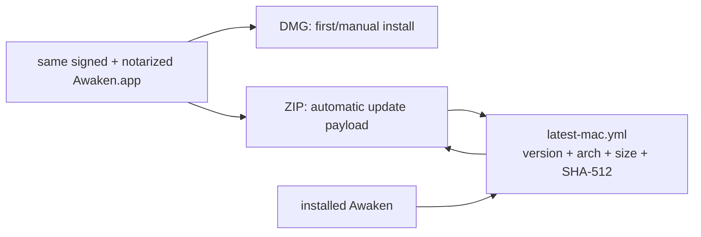
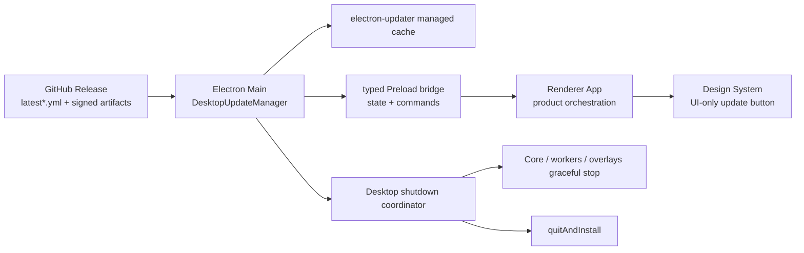
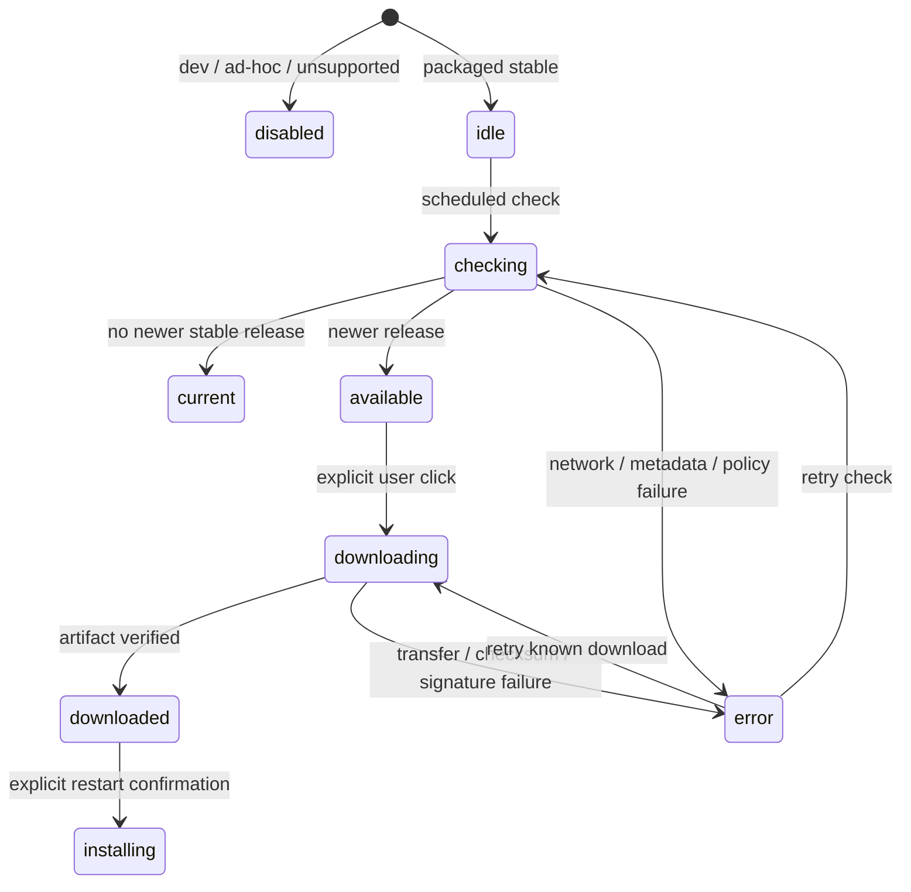

# 应用生命周期与更新 · 实现方案

本文说明代码职责、数据与接口、异常恢复和验证方法。功能范围及用户操作见[需求文档](需求文档.md)。

## 当前产品目标

同一OS用户会话中，安装版 `Awaken` 与源码版 `Awaken Dev` 各自只能有一个实例，但两者可以并行。`apps/desktop/dist-electron`是生成物，不是开发入口；Design Gallery也不是产品窗口。

## 单实例职责

1. Electron Main 在 ready 前根据 launch mode 固定 identity。安装版使用 `com.awaken.desktop`、`Awaken`、`@awaken/desktop`；源码版使用 `com.awaken.desktop.dev`、`Awaken Dev`、`@awaken-dev/desktop`。
2. 两个身份分别拥有 userData 和单实例域，但按当前产品合同共享用户级业务根 `~/.awaken`。同身份第二进程不得初始化窗口、runtime supervisor、project trash worker 或 pet window，只激活已有实例；不同身份不得互相关闭或复用进程、窗口和 userData。
3. README 开发入口只管理 `awaken-dev-desktop` 会话及其 Electron/Core；安装版运行与否不影响开发入口 ready。前台 `dev:desktop` 可以在进入内部开发链前清理旧开发进程，但托管会话必须直接运行不带该 preflight 的内部开发链，禁止在 `awaken-dev-desktop` 内调用 `close:desktop` 关闭自身。
4. macOS 激活现有开发窗口时只能按已经识别的 Electron PID 激活。禁止通过 `open -a Electron.app` 激活，因为该调用在没有匹配实例时可能启动一份无项目参数的 Electron。
   CoreGraphics 未返回窗口标题时，开发入口可在已识别 Electron PID 范围内按 onscreen 状态和主窗口几何判定就绪；不得将菜单栏等小窗口误认为产品窗口。
5. 生命周期脚本只能停止进程，不能删除 `/Applications`、用户自行安装的应用或其数据。安装副本的物理清理由用户或明确授权的维护任务负责。

旧版本不一定实现当前单实例协议，但开发入口不得以兼容为由主动终止安装版。当前各自的单实例锁只隔离进程 identity；开发版和安装版并行时会共享 FileStore。当前不支持两个 Core 同时写同一活动 thread，真实验收和日常操作必须避免这种并发。

## Runtime与窗口清理

- renderer不感知runtime URL；Electron Main supervisor负责随机loopback启动、health、stop。
- 退出时先标记quitting，停止project worker，abort subscriptions，stop supervisor，dispose pet window，再 `app.exit()`。
- Windows/Linux关闭主窗口触发quit；macOS关闭窗口保留应用惯例，退出时仍执行完整清理。
- 生命周期脚本只能停止明确识别的进程，不能删除安装包或userData。

## macOS 窗口控制区几何

macOS 主窗口的 native traffic lights 与 Renderer 顶栏必须消费 `apps/desktop/src/shared/window-chrome.ts` 的同一组几何事实：44px chrome 高度、traffic light 原点 `(18, 14)`、88px 左侧保留区和 `-1px` 顶栏控制偏移。控制偏移必须保持整数 CSS 像素：分数偏移（如历史的 `-0.75px`）把 22px 按钮与 1.2px 描边图标钉在设备像素网格之外，Retina 下任何重栅格化都会以边缘灰度漂移的形式表现为按钮“轻微跳动”。Main 只把 native 坐标传给 `BrowserWindow`，Renderer 只通过 `AwakenAppShell` CSS variables 投影保留区和按钮位置；不得分别硬编码两套数值。Electron Main 在 macOS、Windows 和 Linux 的主窗口都必须把 Chromium 页面缩放恢复并锁定为 100%，拦截主窗口缩放快捷键与视觉缩放请求；文件/PDF/Office/网页预览的内容级缩放不受该约束。Awaken Desktop 不提供浏览器式焦点轮转：Renderer 在 capture 阶段统一消费未修饰的 `Tab` 和 `Shift+Tab`，Main 的 `before-input-event` 同时为主窗口与项目 HTML webview 提供窗口级兜底；带 Control、Command 或 Alt 的系统组合键不由该规则消费。该组数值是 100% 页面缩放下的当前源码窗口视觉基线，修改时必须使用修改后的真实源码窗口截图，而不能从旧 DMG、历史 per-host zoom 或另一台机器的旧构建反推。该契约用于抵抗 Main/Renderer 构建版本不一致和机器本地缩放漂移，但最终仍须在真实 macOS 窗口逐像素核对红黄绿按钮与侧栏按钮中心线。

## 干净打包

`npm run dist:desktop` 是当前工作区的跨平台本地打包入口。macOS 尚无 Developer ID 时，只允许通过 `npm run dist:desktop:adhoc` 生成完整 ad-hoc 签名的可手动放行包；`npm run dist:desktop:release` 是正式 Developer ID 签名发布入口，并必须在找不到有效签名身份时失败。三个入口都必须先运行 `clean-desktop-package.mjs`，清除：

- `apps/desktop/dist`
- `apps/desktop/dist-electron`
- `apps/desktop/resources/bin`

清理后必须重新构建 UI 和目标平台/架构所需的 `awaken-core`，并通过 `scripts/prepare-officecli.mjs` 重新准备对应 OfficeCLI。构建顺序固定为 `clean:package -> build:binary -> prepare:officecli -> prepare:runtime -> build -> electron-builder`；其中 `prepare:runtime` 只准备 Computer Use 所需的锁定 Node runtime 与 CUA Host，不是 Work runtime。打包不得运行 Work 依赖准备脚本，也不得把 Python、Node Work runtime、LibreOffice、Poppler、FFmpeg 或用户机器环境放入 App。

ad-hoc 发布入口必须显式传入 electron-builder 的 `mac.identity=-`，使 App、Electron Framework、Helper 与嵌套可执行文件形成可通过 `codesign --verify --deep --strict` 的完整签名；同时关闭只适用于正式签名链的 Hardened Runtime，避免预签名 Electron Framework 与 ad-hoc Team ID 不一致而启动失败。它仍没有 Apple Team ID、Developer ID 或公证票据，Gatekeeper 不会把它当作受信任发布；README 必须保留首次手动允许教程。禁止用 `CSC_IDENTITY_AUTO_DISCOVERY=false` 直接跳过整个 bundle 签名后上传，因为 Safari 下载来源会让 Gatekeeper 把 Electron linker 的局部签名判为损坏。

OfficeCLI 不以源码或用户级安装器进入 Awaken。仓库保存 `resources/officecli-release.json` 固定版本、官方资产和 SHA-256，准备脚本只下载待打包目标对应的一份预编译二进制，验证 checksum、`--version` 和 DOCX/XLSX/PPTX `view html` smoke 后放入 `resources/bin/<platform>-<arch>/officecli[.exe]`。运行时只解析 App resources 内的该路径，不回退用户 `PATH`，并固定禁止自更新/自安装。开源许可文件从 `resources/licenses/officecli/<version>/` 同步发布。Office 预览运行时、`awaken-preview` 协议与资源上限见 [文件预览架构契约](../文件浏览与评论/实现方案.md)。

`apps/desktop/resources/system-skills` 是产品源资源，不是生成目录：清理脚本必须保留它，Electron `extraResources` 必须把它发布到 `<resourcesPath>/system-skills`。当前资源根随附 `word` / `excel` / `ppt` / `pdf` / `code-search` / `PDF_Max` / `skill-creator` / `plugin-creator` 八个 Skill 包；Office 包仍依赖用户机器上的 LibreOffice、Poppler 等系统能力，`code-search` 只编排现有 `WebSearch`，`PDF_Max` 不随 App 打包 Typst CLI，而是由 Agent 在任务开始时检查或安装到 Awaken toolchain 根。Creator 只编排 Core typed 导出、校验、安装/替换和 Plugin 授权在线修改 commit 合同；把目录打入应用不等同于完成各 Skill 的模型实机验收。

`apps/desktop/resources/cli-connectors/manifest.json` 同样是产品源资源，Electron `extraResources` 发布到 `<resourcesPath>/cli-connectors`。manifest 只列经过官方资产与固定 checksum 复核的 provider/platform/arch/version 条目；当前 DWS `1.0.32`、Lark CLI `1.0.71`。目标条目缺失必须显示 `unsupported`，打包和运行时都不得在线解析 latest 或回退包管理器/安装脚本。`AWAKEN_HOME/runtime/cli` 和 `runtime/auth` 是用户运行时数据，绝不能打入 App 或 release staging。

macOS 与 Windows 发布任务必须在各自平台的全新 checkout / CI workspace 中运行。禁止把旧 `dist-electron`、旧 archive、另一架构的手工 App 或用户机器中的安装目录复制进 staging。Developer ID 签名和公证属于正式发布检查要求；本地未签名或 ad-hoc 签名产物都不能标记为正式安装包。

## macOS 签名、公证与更新产物流程

签名配置通过 `mac.signIgnore` 排除 JSON、locale PAK、图片、字体与 PDF 数据资源的单独签名。这些资源仍由外层 App/Framework 的资源封印保护；Mach-O 程序、动态库和 `.node` 模块仍必须签名并取得安全时间戳。时间戳服务故障仍会阻止发布，不得关闭时间戳或 Hardened Runtime。

本机系统代理可能导致 Apple 时间戳请求失败，而 GitHub 下载又需要代理。可使用 `bash scripts/release/build-local-macos.sh`：从环境变量读取签名和公证参数，记录并临时关闭各网络服务已启用的 HTTP/HTTPS/SOCKS 代理，让 `codesign` 直连；Node 下载使用调用者设置的 `HTTP_PROXY`/`HTTPS_PROXY`。脚本在正常结束或失败时恢复原代理开关，不修改服务器或凭据。不要在运行期间手动改变代理设置。异常杀死进程或关机可能使恢复未执行，需手动恢复系统设置。脚本构建当前工作区、不拉取代码，也不发布 GitHub Release。

DMG 外壳在封装后可能尚未签名，不能据此将正式构建判为本地包。DMG hook 在显式提供 `AWAKEN_CODESIGN_IDENTITY=Developer ID Application: ...` 时要求公证变量并执行签名、公证和 staple。更新元数据检查允许双架构 ZIP，或双架构 ZIP 加双架构 DMG，严格核对所有引用文件的大小和 SHA-512；不允许单架构或其他文件混入。

本地构建脚本验证签名、公证和更新校验和，不表示公开分发检查完成。当前真实包内容审计仍发现依赖目录中的 source map、测试文件及疑似 secret 标记；需进一步区分误报与真实风险并清理禁入资源，不能宣称公开发布审计通过。真实安装/升级 smoke 仍须另行执行。

本节用于在 macOS 上从干净的 `main` 一次构建 arm64 和 x64 两份正式 DMG、两份自动更新 ZIP 与 `latest-mac.yml`。命令均在仓库根目录执行。流程使用本机 Developer ID Application 证书和 App Store Connect API Key（`.p8`），不需要 Apple ID 专用密码，也不要求把公证凭据保存到 Keychain。

自 `0.1.0` 起，`apps/desktop/electron-builder.yml` 配置 `mac.notarize: true` 并注册 release hooks：electron-builder 在 App 签名后完成 App 公证；`afterSign` hook `scripts/release/staple-macos-app.mjs` 对已公证 App 执行 staple/validate/spctl；`afterAllArtifactBuild` hook `scripts/release/notarize-macos-artifacts.mjs` 对两份 DMG 外壳签名、公证、staple 和 validate；构建结束后 `scripts/release/finalize-macos-feed.mjs` 从最终文件重新计算 `latest-mac.yml` 的 SHA-512 和大小。因此下面的手工步骤只保留构建与验证检查要求，不再手工 codesign/notarytool DMG；ad-hoc 与本地构建由 hook 内的签名身份检测自动跳过该链路。版本、更新源与发布编排由 [应用版本与自动更新设计契约](实现方案.md) 拥有。

### 前置条件

- Xcode Command Line Tools 可用：`xcrun --find notarytool`、`xcrun --find stapler`；
- Keychain 中已安装带私钥的 `Developer ID Application` 证书；
- 已从 App Store Connect 获得 API Key 的 `.p8` 文件、Key ID 和 Issuer ID；
- `.p8` 位于仓库外，不得提交、打包或复制到 App resources。

先确认签名身份可用：

```bash
security find-identity -v -p codesigning
```

输出必须包含目标 `Developer ID Application: <NAME> (<TEAM_ID>)`，且结尾为有效 identity，不能用 `Apple Development` 证书代替。

### 同步代码并运行发布前检查

工作区存在未提交改动时先停止，不要 reset、restore 或 clean 用户文件。工作区干净后再以 fast-forward 方式更新：

```bash
git status --short --branch
git fetch origin main
git pull --ff-only origin main

npm install
npm run test:desktop-lifecycle
npm run test:desktop-release
npm run typecheck:desktop
```

### 设置本次终端会话变量

下列值只对当前 shell 会话有效。`AWAKEN_CSC_NAME` 必须省略 `Developer ID Application:` 前缀；`AWAKEN_CODESIGN_IDENTITY` 则必须保留前缀（afterAllArtifactBuild hook 用它签名 DMG 外壳）。`APPLE_API_KEY*` 是 electron-builder `mac.notarize` 与 hooks 共同消费的标准环境变量。

```bash
export AWAKEN_CSC_NAME='<NAME> (<TEAM_ID>)'
export AWAKEN_CODESIGN_IDENTITY='Developer ID Application: <NAME> (<TEAM_ID>)'
export APPLE_API_KEY='/absolute/path/to/AuthKey_<KEY_ID>.p8'
export APPLE_API_KEY_ID='<KEY_ID>'
export APPLE_API_ISSUER='<ISSUER_UUID>'

chmod 600 "$APPLE_API_KEY"
```

不要把上述真实值写入仓库文件、npm script 或 shell 的持久配置。Key ID 和 Issuer ID 用于 API 定位，`.p8` 文件本身仍必须按私密凭据保护。

### 执行双架构 Developer ID 构建

```bash
CSC_NAME="$AWAKEN_CSC_NAME" npm run dist:desktop:release
```

如果 Electron 官方下载站在当前网络不稳定，可仅对本次命令设置可信镜像：

```bash
CSC_NAME="$AWAKEN_CSC_NAME" \
ELECTRON_MIRROR='https://npmmirror.com/mirrors/electron/' \
npm run dist:desktop:release
```

该命令会先清理旧生成物，然后重新准备两种架构的 Core、ACP、OfficeCLI、锁定 Node runtime 和 CUA Host。构建期间 Electron Builder 使用 Developer ID、Hardened Runtime 和安全时间戳签名两份 `.app` 并完成 App 公证，`afterSign`/`afterAllArtifactBuild` hooks 依次完成 App staple 与两份 DMG 的外壳签名、公证、staple、validate；任一环节失败都会 fail closed 中断构建。产物为两份 DMG、两份更新 ZIP 和 `latest-mac.yml`：

```bash
export AWAKEN_DESKTOP_VERSION="$(node -p "require('./apps/desktop/package.json').version")"
export AWAKEN_DIST_DIR="$PWD/apps/desktop/dist-electron"
export AWAKEN_ARM_DMG="$AWAKEN_DIST_DIR/Awaken-$AWAKEN_DESKTOP_VERSION-arm64.dmg"
export AWAKEN_X64_DMG="$AWAKEN_DIST_DIR/Awaken-$AWAKEN_DESKTOP_VERSION-x64.dmg"
export AWAKEN_ARM_ZIP="$AWAKEN_DIST_DIR/Awaken-$AWAKEN_DESKTOP_VERSION-arm64.zip"
export AWAKEN_X64_ZIP="$AWAKEN_DIST_DIR/Awaken-$AWAKEN_DESKTOP_VERSION-x64.zip"

test -f "$AWAKEN_ARM_DMG"
test -f "$AWAKEN_X64_DMG"
test -f "$AWAKEN_ARM_ZIP"
test -f "$AWAKEN_X64_ZIP"
test -f "$AWAKEN_DIST_DIR/latest-mac.yml"
```

### 验证更新元数据与包内容

```bash
node scripts/release/verify-update-artifacts.mjs \
  --version "$AWAKEN_DESKTOP_VERSION" \
  --dir "$AWAKEN_DIST_DIR" \
  --receipt "$AWAKEN_DIST_DIR/update-artifacts-receipt.json"

node scripts/release/audit-package-contents.mjs \
  --dir "$AWAKEN_DIST_DIR" \
  --receipt "$AWAKEN_DIST_DIR/package-audit-receipt.json"
```

前者严格校验 `latest-mac.yml` 的版本、双架构 ZIP 引用、大小与 SHA-512；后者解开 ZIP/DMG 与 `app.asar` 执行禁入/secret 审计并比较同架构 DMG/ZIP 中的 `Awaken.app`。任一失败都不得继续发布。

### 执行最终检查要求（全部验证性，不再改写产物）

```bash
codesign --verify --strict --verbose=2 "$AWAKEN_ARM_DMG"
codesign --verify --strict --verbose=2 "$AWAKEN_X64_DMG"
xcrun stapler validate "$AWAKEN_ARM_DMG"
xcrun stapler validate "$AWAKEN_X64_DMG"

codesign --verify --deep --strict --verbose=2 \
  "$AWAKEN_DIST_DIR/mac-arm64/Awaken.app"
codesign --verify --deep --strict --verbose=2 \
  "$AWAKEN_DIST_DIR/mac/Awaken.app"

spctl -a -vv -t open --context context:primary-signature "$AWAKEN_ARM_DMG"
spctl -a -vv -t open --context context:primary-signature "$AWAKEN_X64_DMG"
spctl -a -vv -t exec "$AWAKEN_DIST_DIR/mac-arm64/Awaken.app"
spctl -a -vv -t exec "$AWAKEN_DIST_DIR/mac/Awaken.app"

hdiutil verify "$AWAKEN_ARM_DMG"
hdiutil verify "$AWAKEN_X64_DMG"
unzip -t "$AWAKEN_ARM_ZIP"
unzip -t "$AWAKEN_X64_ZIP"
shasum -a 256 "$AWAKEN_ARM_DMG" "$AWAKEN_X64_DMG" "$AWAKEN_ARM_ZIP" "$AWAKEN_X64_ZIP"
```

四次 `spctl` 都必须返回 `accepted`、`source=Notarized Developer ID` 和预期 Developer ID origin；两次 `hdiutil verify` 都必须返回 `VALID`；两份 ZIP 都必须完整解压校验。staple/公证已在构建 hooks 内完成，此处只做只读验证；终止时的 SHA-256 才是可交付文件的最终校验和。

### 交付边界

完成上述命令只能证明构建、签名、公证、更新元数据和 Gatekeeper 检查要求通过。正式发布仍必须按 [应用版本与自动更新设计契约：GitHub Release 和版本契约](实现方案.md#github-release-和版本契约) 的 workflow 先 draft 收齐并验证全部资产再公开；发布前按本文“真实 Desktop 验收”安装对应架构 DMG，使用安装后的 `Awaken.app` 完成发布 smoke，不能用 `dist-electron` 中未安装的 App 代替。

## 当前不支持/不等同正式发布

- 本地未签名或 ad-hoc 签名产物不等同正式安装包。
- `dist-electron/Awaken.app`截图不等同README开发实例验收。
- 不允许跨平台复制staging产物。
- 自动更新客户端链路（更新管理器、IPC、侧栏入口、重启安装编排）与发布工具链已实现并经聚焦自动化验证，但真实安装版升级验收未完成；auto-update 不由本文宣称已支持，事实分层以 [应用版本与自动更新设计契约](实现方案.md) 为准。
- 本地生命周期测试不替代签名、公证、Gatekeeper或Windows安装/卸载检查要求。

## 自动化验收

```bash
npm run test:desktop-lifecycle
npm --workspace @awaken/desktop test -- desktop-instance.test.ts
npm run typecheck:desktop
```

测试必须覆盖：

- macOS 安装版主进程识别，不把 Electron Helper、dev Electron 或 `awaken-core` 当作竞争实例。
- Windows `Awaken.exe` 主进程识别。
- 安装版运行时开发入口仍可独立启动并 ready。
- README 托管入口不触发前台 `dev:desktop` 的关闭 preflight，且前台入口仍保留启动前清理。
- 清理旧 package output，不创建 runtime archive staging。
- 清理不删除 `resources/system-skills`，打包配置包含该 `extraResources` 路径。
- dev / packaged 使用不同 application id、名称和 userData，并共享同一个 `~/.awaken` 业务根。
- macOS native traffic light 与 Renderer 顶栏从同一共享几何常量取值，自动化锁定该常量，真实窗口核对中心线。
- 主 Renderer 在 capture 阶段消费未修饰 `Tab` / `Shift+Tab`，Main 同时拦截主窗口与项目 HTML webview，不触发页面焦点跳转；带 Control、Command 或 Alt 的组合键继续交给系统或现有快捷键。
- CLI manifest 被打入 app、JSON 可解析、每个条目 provider/platform/arch 唯一且 checksum 为固定 SHA-256；运行时 auth/staging/installations 不进入 package。
- OfficeCLI release manifest 完整覆盖 darwin/win32 的 arm64/x64，资产 checksum 固定，许可文件完整；清理后必须重新准备待打包架构，且引擎不从用户 `PATH` 解析。
- macOS ad-hoc 入口显式签名整个 bundle 并关闭 Hardened Runtime；正式 release 入口在没有 Developer ID 时 fail closed。发布候选必须通过 `codesign --verify --deep --strict`，不得把 Gatekeeper 的“已损坏”归为可接受的普通未签名提示。

## GitHub 持续集成

`.github/workflows/ci.yml` 在推送到 `main`、打开或更新 pull request，以及手动 `workflow_dispatch` 时运行。它不在 tag 上运行。`main` 上 macOS 与 Windows 打包都成功后，安装包发布到本仓库的 prerelease，tag 为 `ci-<commit>`，不标成 Latest，也不使用其他仓库。pull request 只保留 workflow artifact。正式签名、公证和稳定更新仍只由 [跨平台、跨仓库发布流程](实现方案.md#跨平台跨仓库发布流程) 的 `desktop-release.yml` 负责；该流程的 `upgrade-smoke` 继续主动失败，发布保持阻断。

检查顺序与 kun 的 PR 门禁对应，但只覆盖 Awaken 当前交付的 macOS 与 Windows 客户端：

1. **Unit tests**（`ubuntu-latest`）：安装锁定依赖后执行 Design System 与 Desktop typecheck、`smoke:ui`、Desktop vitest、Design System 单测、`scripts/tests` 的 Node 测试、内置插件完整性、文档结构与链接、供应商资料校验，以及 `go test -count=1 ./...`。Python 测试先安装 `lxml==6.1.3` 与 `openpyxl==3.1.5`，供 Word/Excel 技能脚本导入。`scripts/tests/composer-layout.test.mjs` 会启动 Electron。Electron 二进制不在 `npm ci` 时下载，所以单元测试先运行 `node node_modules/electron/install.js`，再把 `node_modules/electron/dist/chrome-sandbox` 设为 root 且 mode `4755`。否则 Linux 的 SUID sandbox helper 会直接退出。需要真实 API key、本机用户目录或网络安装的用例按原有条件跳过。
2. **Functional acceptance**（`macos-latest` 与 `windows-latest`）：在隔离 Electron 窗口运行 `npm run test:mermaid-electron`。这证明 Design System 的 Mermaid 交互能在这两个系统的真实 Electron 中完成，不代替工作台产品验收。
3. **Package macOS**：在全新 checkout 中运行 `npm run dist:desktop:adhoc`，一次生成 arm64/x64 的 ad-hoc DMG 与 ZIP。两份 `Awaken.app` 都必须通过 `codesign --verify --deep --strict`。随后审计包内容，并只启动当前 runner 架构的 App，等到日志出现 `desktop_main_window_created`。
4. **Package Windows**：同样使用 ad-hoc 入口生成未签名的 x64 NSIS，用 `7z` 审计包内容，并启动 `win-unpacked/Awaken.exe` 做同一启动检查。
5. **Publish installers**（仅 `main`）：下载两份安装包，用本仓库 `GITHUB_TOKEN` 创建或补传 `ci-<commit>` prerelease。资产是 DMG、ZIP、NSIS 和 blockmap。
6. **CI gate**：以上任一应运行的 job 不是 success 时失败。pull request 不发布时，publish job 必须是 skipped。

ad-hoc 与普通 `dist` 都显式传入 `--publish never`。GitHub Actions 会设置 `CI=true`，electron-builder 在未显式关闭发布时会按 tag 或 draft 策略尝试上传；持续集成产物只能留在 workflow artifact。这些包的 `awakenUpdateChannel` 仍是 `disabled`，不能当作可更新的正式安装包。启动 smoke 使用临时 `HOME`/`APPDATA`，看到主窗口创建后结束进程树。它不安装 DMG/NSIS，不证明 Core 健康、签名、公证、Gatekeeper、Windows 安装卸载或真实升级。

## 真实Desktop验收

1. 按根 README 正式入口关闭 Desktop，确认托管会话、dev Electron 和 dev `awaken-core` 均停止。
2. 按同一入口启动 Desktop，确认只出现一个 README 开发实例和一个窗口。
3. 再次按同一入口启动，确认只激活已有 PID，Electron PID 不变。
4. 安装版存在时，按 README 入口的状态检查确认其显示为 independent，且两者 PID、窗口与 userData 不互相复用；同时确认二者读取同一 `~/.awaken` 项目/会话，并避免并发写同一 thread。
5. 不把 `dist-electron/Awaken.app` 的窗口或截图作为源码入口验收证据。
6. macOS 先确认主窗口页面 zoom 为 100%，再在源码窗口截图中核对红黄绿按钮与左侧栏按钮处于同一视觉中心线；同时在至少两台存在差异的开发机上复验，若 native 系统外观仍有偏差，记录 macOS 版本、显示缩放和截图，不得再次只改单侧硬编码。

发布验收还需核对目标平台、架构、签名和 App 内容；必须证明不存在 runtime archive/installer。macOS执行签名、公证、Gatekeeper，Windows执行安装、卸载、代码签名。任何未执行项必须明确标为未验收。

## 发布机本地执行模板

> 具体证书主体、Team ID、Key ID、Issuer ID、私钥路径和开发机绝对路径只保存在受控发布环境/secret manager，不进入仓库文档。以下占位符必须由发布人在临时 shell 中注入，不能原样执行或提交真实值。

下面是一个完整子 shell；任一步失败都会停止后续步骤，不会退出当前终端。发布必须来自干净 tag checkout，不允许排除某份已修改文档后继续构建。

```bash
(
  set -euo pipefail

  cd /absolute/path/to/clean/Awaken

  if [[ -n "$(git status --porcelain)" ]]; then
    echo '工作区存在未提交改动，已停止。' >&2
    exit 1
  fi

  git fetch origin main
  git pull --ff-only origin main

  npm install
  npm run test:desktop-lifecycle
  npm run test:desktop-release
  npm run typecheck:desktop

  export AWAKEN_CSC_NAME='<NAME> (<TEAM_ID>)'
  export AWAKEN_CODESIGN_IDENTITY='Developer ID Application: <NAME> (<TEAM_ID>)'
  export APPLE_API_KEY='/absolute/path/outside/repository/AuthKey_<KEY_ID>.p8'
  export APPLE_API_KEY_ID='<KEY_ID>'
  export APPLE_API_ISSUER='<ISSUER_UUID>'

  chmod 600 "$APPLE_API_KEY"
  test -f "$APPLE_API_KEY"
  security find-identity -v -p codesigning | grep -F "$AWAKEN_CODESIGN_IDENTITY"

  CSC_NAME="$AWAKEN_CSC_NAME" \
  ELECTRON_MIRROR='https://npmmirror.com/mirrors/electron/' \
  npm run dist:desktop:release

  export AWAKEN_DESKTOP_VERSION="$(node -p "require('./apps/desktop/package.json').version")"
  export AWAKEN_DIST_DIR="$PWD/apps/desktop/dist-electron"
  export AWAKEN_ARM_DMG="$AWAKEN_DIST_DIR/Awaken-$AWAKEN_DESKTOP_VERSION-arm64.dmg"
  export AWAKEN_X64_DMG="$AWAKEN_DIST_DIR/Awaken-$AWAKEN_DESKTOP_VERSION-x64.dmg"
  export AWAKEN_ARM_ZIP="$AWAKEN_DIST_DIR/Awaken-$AWAKEN_DESKTOP_VERSION-arm64.zip"
  export AWAKEN_X64_ZIP="$AWAKEN_DIST_DIR/Awaken-$AWAKEN_DESKTOP_VERSION-x64.zip"

  test -f "$AWAKEN_ARM_DMG"
  test -f "$AWAKEN_X64_DMG"
  test -f "$AWAKEN_ARM_ZIP"
  test -f "$AWAKEN_X64_ZIP"
  test -f "$AWAKEN_DIST_DIR/latest-mac.yml"

  node scripts/release/verify-update-artifacts.mjs \
    --version "$AWAKEN_DESKTOP_VERSION" \
    --dir "$AWAKEN_DIST_DIR" \
    --receipt "$AWAKEN_DIST_DIR/update-artifacts-receipt.json"

  node scripts/release/audit-package-contents.mjs \
    --dir "$AWAKEN_DIST_DIR" \
    --receipt "$AWAKEN_DIST_DIR/package-audit-receipt.json"

  codesign --verify --strict --verbose=2 "$AWAKEN_ARM_DMG"
  codesign --verify --strict --verbose=2 "$AWAKEN_X64_DMG"
  xcrun stapler validate "$AWAKEN_ARM_DMG"
  xcrun stapler validate "$AWAKEN_X64_DMG"

  codesign --verify --deep --strict --verbose=2 \
    "$AWAKEN_DIST_DIR/mac-arm64/Awaken.app"
  codesign --verify --deep --strict --verbose=2 \
    "$AWAKEN_DIST_DIR/mac/Awaken.app"

  spctl -a -vv -t open --context context:primary-signature "$AWAKEN_ARM_DMG"
  spctl -a -vv -t open --context context:primary-signature "$AWAKEN_X64_DMG"
  spctl -a -vv -t exec "$AWAKEN_DIST_DIR/mac-arm64/Awaken.app"
  spctl -a -vv -t exec "$AWAKEN_DIST_DIR/mac/Awaken.app"

  hdiutil verify "$AWAKEN_ARM_DMG"
  hdiutil verify "$AWAKEN_X64_DMG"
  unzip -t "$AWAKEN_ARM_ZIP" > /dev/null
  unzip -t "$AWAKEN_X64_ZIP" > /dev/null

  echo '可交付安装包与更新产物：'
  ls -lh "$AWAKEN_ARM_DMG" "$AWAKEN_X64_DMG" "$AWAKEN_ARM_ZIP" "$AWAKEN_X64_ZIP"
  shasum -a 256 "$AWAKEN_ARM_DMG" "$AWAKEN_X64_DMG" "$AWAKEN_ARM_ZIP" "$AWAKEN_X64_ZIP"
)
```

## 可行性结论与技术选型

方案可行，推荐使用与现有 `electron-builder` 配套的 `electron-updater`，不直接使用 Electron 内置 `autoUpdater`，也不自建下载和替换程序。原因是当前 Windows 打包已是 NSIS，`electron-updater` 可同时消费 GitHub Releases、生成的 `latest.yml` / `latest-mac.yml`、SHA-512 和 blockmap，并提供下载进度与平台签名校验。

上游约束：

- [electron-builder Auto Update](https://www.electron.build/docs/features/auto-update/) 要求 macOS 应用已签名，且 macOS 必须同时生成 ZIP 才能产生 `latest-mac.yml`；Windows NSIS 是支持目标。
- [Electron autoUpdater](https://www.electronjs.org/docs/latest/api/auto-updater) 确认更新安装必须在下载完成后触发，且 macOS 自动更新要求签名应用。
- `electron-updater` 版本必须与锁定的 `electron-builder` 通过实际包验收，更新元数据固定使用 `files[]` 格式，不回退到只依赖旧 `sha2` 字段的兼容配置。

### macOS 为什么同时需要 DMG、ZIP 和 `latest-mac.yml`

三者不是三份重复安装包，而是三种不同职责：

| 文件 | consumer | 用途 |
|---|---|---|
| `Awaken-X.Y.Z-arm64.dmg` / `Awaken-X.Y.Z-x64.dmg` | 首次安装或手工升级的用户 | Finder 打开后把 `Awaken.app` 拖入 Applications；它是人类安装介质。 |
| `Awaken-X.Y.Z-arm64.zip` / `Awaken-X.Y.Z-x64.zip` | `electron-updater` / Squirrel.Mac | 后台下载后解压出已签名 `Awaken.app`，在重启边界替换当前 App；它是机器更新介质。 |
| `latest-mac.yml` | 已安装的 Awaken | 版本索引，包含 version、arm64/x64 ZIP 文件名、大小、SHA-512 和发布时间等信息；它不包含 App 本身。 |

检查时客户端先取 `latest-mac.yml`，比较其 `version` 与 `app.getVersion()`；用户点击更新后，更新器再按 `process.arch` 从 `files[]` 选择对应 ZIP，下载并核对 SHA-512。当 macOS target 被显式配成只有 `dmg` 时，electron-builder 没有 Squirrel.Mac 需要的 ZIP 更新输入，因而不能构成可用的 `latest-mac.yml` feed。

一次正确发布的关系应是：



DMG 不是不可用，而是不适合单独承担这条自动更新协议。两个架构的 DMG 和 ZIP 必须由同一次干净构建中的对应 `Awaken.app` 产生，不能手工混合旧产物。

### 工程原则

以下原则是 Awaken 当前自动更新设计的内部依据；仓库外的本机 checkout、历史参考项目或其私有路径都不构成本契约的当前事实权威。

1. **单一进行中操作**：检查、下载和安装共用一个互斥 guard，任意早退或异常都必须在 `finally` 释放，防止重复点击竞争缓存和退出流程。
2. **缓存不是信任边界**：已下载更新位于用户可写目录，不能因为下载时验过就在稍后安装时盲信。跨进程恢复后必须重新核对版本、平台、架构、SHA-512 与平台代码签名。
3. **进度必须节流**：下载 chunk 不逐个跨 IPC 广播；最快每 200ms 发送一帧，并在结束时强制发送 100% 终帧。UI 通过最近 5 秒滚动窗口计算速度，不让瞬时 chunk 大小造成闪烁。
4. **错误按阶段和类型传递**：底层先分出 `check` / `download` / `install` 和 network / metadata / signature / app-location / disk / shutdown，不让 Renderer 依赖英文错误字符串判断产品文案。
5. **版本产物先完整、最新指针后提升**：每个平台只生成带版本且不可变的产物；所有构建、签名和验收成功后，最后一步才把 GitHub draft Release 转为公开稳定版。任一 job 失败时旧 latest 仍是唯一客户端可见版本。

Awaken 不在 Renderer Context 维护第二份更新 authority，所有状态由 Electron Main snapshot 统一投影；也不自行持久安装器字节或手写平台替换逻辑，优先使用 `electron-updater` 已有缓存、checksum 和安装边界。

## owner 与依赖方向



- `apps/desktop/src/main/desktop-update-manager.ts` 拥有 updater 初始化、检查节流、下载、进度归一化、同一操作内的事件去重、错误归类和安装请求。Main 是网络、文件缓存、平台安装器和更新状态的唯一 owner。
- `apps/desktop/src/shared/desktop-update.ts` 拥有状态、命令、错误码和 IPC channel 的共享类型；`preload/index.ts` 只暴露定型的 `getDesktopUpdateState`、`checkDesktopUpdate`、`downloadDesktopUpdate`、`restartAndInstallDesktopUpdate` 和 `onDesktopUpdateStateChanged`。
- `apps/desktop/src/renderer/useDesktopUpdate.ts` 订阅状态并控制动作，`DesktopUpdateDialog.tsx` 呈现确认框，App 将受控 props/callbacks 注入侧栏；Renderer 不请求 GitHub、不比较版本、不选择下载文件、不持有签名或发布凭据。
- `Awaken Design System` 拥有 `AwakenSidebar` 底部几何和专用更新按钮的视觉/可访问性状态，但仍是 UI-only；状态通过 props 输入，行为通过 callback 输出。Gallery 使用 mock state，不启动真实更新。
- `src/agentcore` 不参与应用更新；应用更新不是 Agent 工具，不进入 thread/run/SemanticJournal。`src/runtime` / `src/server` 只为重启 gate 提供一个只读活动快照，不知道 GitHub、版本、下载或安装器。

## 状态、命令与必须保持的规则

```ts
type DesktopUpdatePhase =
  | "disabled"
  | "idle"
  | "checking"
  | "current"
  | "available"
  | "downloading"
  | "downloaded"
  | "installing"
  | "error";

type DesktopUpdateSnapshot = {
  operationId: string;
  phase: DesktopUpdatePhase;
  currentVersion: string;
  availableVersion?: string;
  target?: "darwin-arm64" | "darwin-x64" | "win32-x64";
  releaseName?: string;
  releaseDate?: string;
  percent?: number;
  transferredBytes?: number;
  totalBytes?: number;
  bytesPerSecond?: number;
  errorCode?: DesktopUpdateErrorCode;
  errorMessage?: string;
  retryFrom?: "check" | "download";
  checkedAt?: string;
};
```

状态流固定为：



不变量：

1. `autoDownload = false`；检查到更新不得代替用户点击下载。
2. `autoInstallOnAppQuit = false`；只有明确的“立即重启”命令进入安装，避免用户普通退出时意外更新。
3. 任一时刻最多一个 update operation；check、download、install 共用 Main 内的单一 mutex/guard。重复命令返回当前 snapshot，不发起第二份请求；guard 必须在 `finally` 释放，不得因异常将更新器永久卡在 busy。
4. Main 主动广播的 snapshot 与 `getDesktopUpdateState` 返回同一内存 authority；Renderer 不使用 localStorage 伪造持久状态。已下载文件只交给 `electron-updater` 管理缓存与再校验。
5. 下载进度不等于可安装；只有 updater 发出已下载且验证成功的事件才能进入 `downloaded`。
6. 新版本不得修改 `appId` (`com.awaken.desktop`)、product identity 或 helper identity，否则单实例、Windows 升级 GUID、macOS 签名/TCC 和更新路径都不再可证。
7. 每次转入 `checking`、`downloading` 或 `installing` 都生成新 `operationId`。当前 Main 只以 active operation 的 stage 接受 updater 事件，Renderer 直接接受后到的 push snapshot；因此“回调绑定 operation id，且迟到事件不覆盖新状态”是发布前必须补齐的安全不变量，不是当前已实现事实。
8. 下载进度最快每 200ms 广播一次，且 `percent` 在下载中单调不减、限制在 0–99；只有验证成功才发终帧 100 并进入 `downloaded`。`bytesPerSecond` 用最近 5 秒样本计算，未知 `totalBytes` 时只显示已下载大小和速度，不伪造百分比。

### 已下载更新的恢复与再验证

`electron-updater` 管理实际更新文件和缓存目录，Awaken 只在 Electron `userData` 下保存一份不含绝对路径的提示 receipt，用于说明上次看到过哪个版本：

```ts
type DesktopUpdateReceipt = {
  schemaVersion: 1;
  version: string;
  target: "darwin-arm64" | "darwin-x64" | "win32-x64";
  releaseTag: string;
  downloadedAt: string;
};
```

receipt 不是“已验证”凭证，也不存 artifact path、URL、checksum 或 GitHub Token。新进程启动后按以下顺序对账：

1. receipt 不可解析、target 与当前 `process.platform/process.arch` 不一致、或 receipt version `<= app.getVersion()` 时，删除 receipt，并只通过 `electron-updater` 提供的窄 API 清理本产品的过期更新缓存；不递归清理 userData 根或其他产品数据。
2. receipt 指向更高版本时重新执行 GitHub update check。只有远端仍提供同一 stable version/target，且 updater 对缓存文件重做 SHA-512 和平台代码签名验证后，才恢复 `downloaded`。
3. Release 已撤回、元数据已变更、缓存缺失或验证失败时，删除 receipt 与该 updater cache，回到 `idle/current/error`；不安装一份无法再证明的用户可写文件。
4. 同一进程中下载完成后点击“立即重启”不重复下载，但在启动安装器前仍要求 updater 完成最终 checksum/签名检查要求。

**当前锁定版本无法提供可测的缓存再验证，因此跨 App 重启不恢复已下载状态，必须重新检查并下载。上述缓存复验流程是后续实现约束。**

## 重启安装与 Desktop 生命周期

现有 `before-quit` 异步清理最终调用 `app.exit()`，不能原样套在 `quitAndInstall()` 上，否则可能绕过或抢跑安装器。实现时必须把现有清理抽成可等待、幂等的 shutdown coordinator，并分开普通退出与更新退出：

1. Renderer 只发送 `restartAndInstallDesktopUpdate`。
2. Main 确认状态为 `downloaded`、请求来自当前主窗口，再请求 Core 的只读 `GET /v1/runtime/activity`。该响应至少包含 `active_run_count`、`cancelling_run_count` 和 `observed_at`，并把普通主 run、定时任务 run 与 ACP 启动的 run 都纳入同一 runtime authority；原生子任务由所属 active 主 run 覆盖，不重复计数。任一 count 非零或快照不可达时都 fail closed 为 `active_runs`，不相信 Renderer 传入的布尔值。
3. shutdown coordinator 停止 project worker、scheduled event stream、Computer monitors、Dream timer、subscriptions、preview/media manager、network observers，再等待 supervisor/Core、CLI connector、pet/computer overlay 关闭。
4. 清理成功后把退出模式切换为 `update-install`，再调用 `quitAndInstall(false, true)`；该路径不得被普通 `app.exit()` 截断。
5. 清理超时或失败时不强制退出，恢复到 `downloaded` 并告知用户重试；不丢弃当前任务或 userData。

macOS 关闭主窗口仍保留平台惯例，只有确认更新才退出并重启。Windows 的 per-machine NSIS 安装阶段可显示 UAC；用户取消 UAC 后旧版本仍须可重新打开。

`GET /v1/runtime/activity` 是为退出/维护类操作提供的通用运行时事实，实现该 route 时必须在同一任务同步 [Desktop 本地服务生命周期](../../03_运行时与本地服务/本地服务管理/实现方案.md) 与 09 域 HTTP 契约。它不接受 mutation，也不能被 Renderer 直接调用绕过 Main。

## GitHub Release 和版本契约

### 版本唯一来源

- 正式版本使用 SemVer `X.Y.Z`，由 `apps/desktop/package.json#version` 唯一拥有。不从 Git commit 数、Release 名、文件名或 Renderer 常量推导版本。
- Git tag 为 `vX.Y.Z`，GitHub Release 标题可人类可读，但 tag、应用版本和更新元数据中的 version 必须一致。
- stable 客户端不消费 prerelease。已发布版本不得替换资产内容；修复必须发布更高版本。

### electron-builder 可执行配置

`apps/desktop/package.json` 将与当前 `electron-builder` 兼容并经验收的 `electron-updater` 加入 **dependencies**，不放在 devDependencies，因为安装后的 Main 进程需要它。不使用浮动 `latest`，两者版本由 `package-lock.json` 锁定并在升级时一起验收。

`apps/desktop/electron-builder.yml` 的目标配置应等价于：

```yaml
appId: com.awaken.desktop
productName: Awaken
electronUpdaterCompatibility: ">=2.16"
publish:
  provider: github
  owner: NolanGrant556
  repo: Awaken-Releases
  releaseType: release

mac:
  notarize: true
  artifactName: "Awaken-${version}-${arch}.${ext}"
  target:
    - target: dmg
      arch: [arm64, x64]
    - target: zip
      arch: [arm64, x64]

win:
  artifactName: "Awaken-Setup-${version}-${arch}.${ext}"
  target:
    - target: nsis
      arch: [x64]

nsis:
  oneClick: false
  perMachine: true
  allowToChangeInstallationDirectory: true
  allowElevation: true
```

`${version}` / `${arch}` / `${ext}` 是 electron-builder macro，不是 shell 环境变量。显式带 `${arch}` 可避免 macOS arm64/x64 ZIP 同名，也让 `latest-mac.yml#files[]` 可被人工和自动化确认为两个唯一资产。实际构建后必须用锁定版 electron-updater 分别在 arm64/x64 安装版上证明架构选择，不只根据文件名猜测。

macOS 正式构建使用 electron-builder 已支持的 App Store Connect API Key 环境变量：`APPLE_API_KEY`、`APPLE_API_KEY_ID`、`APPLE_API_ISSUER`，并保留 Developer ID Application 签名身份。`mac.notarize: true` 在 App 签名后、DMG/ZIP 封装前完成 App 公证；`afterSign` hook `scripts/release/staple-macos-app.mjs` 再对公证成功的 `Awaken.app` 执行 `xcrun stapler staple/validate`，确保 ZIP 中的 App 就是已 staple 对象。`afterAllArtifactBuild` hook `scripts/release/notarize-macos-artifacts.mjs` 负责对两份 DMG 执行现有的外壳签名、公证、staple 和 validate；随后 release 脚本调用 `scripts/release/finalize-macos-feed.mjs` 更新最终元数据，验证通过后不得再改写产物。

Windows 构建机必须提供正式 Authenticode 签名材料，使 NSIS EXE 和应用主程序具有稳定 publisher。`forceCodeSigning: true` 或等价的发布脚本检查要求必须在缺失证书时失败；不得上传未签名 NSIS 后再依赖 SHA-512 冒充 publisher 信任。

### Release 资产

每个 stable GitHub Release 必须一次性提供完整集合，先以 draft 上传和验证，全部通过后再发布：

| 平台 | 用户安装资产 | 更新资产 | 元数据 |
|---|---|---|---|
| macOS arm64 | notarized/stapled DMG | 包含已签名且通过公证校验 App 的 ZIP | `latest-mac.yml` |
| macOS x64 | notarized/stapled DMG | 包含已签名且通过公证校验 App 的 ZIP | 同一 `latest-mac.yml` 必须能正确解析当前架构 |
| Windows x64 | 已签名 NSIS Setup EXE | 已签名 NSIS Setup EXE 与 blockmap/package 资产 | `latest.yml` |

macOS 不能继续使用“先生成 ZIP，只公证后续 DMG”的顺序。更新 ZIP 内部的 App 必须在压缩前完成 Developer ID 签名并通过公证/Gatekeeper 检查要求；DMG 与 ZIP 必须来自同一份已验证 App，不得跨 workspace 拼装。Windows 产物必须在 Windows 构建机上生成和签名。

两份 macOS ZIP 都必须作为同一 GitHub Release 的资产上传，且 `latest-mac.yml#files[]` 只能引用这些已上传资产。ZIP 中是完整的 `Awaken.app`，包括 Electron 可执行文件、Frameworks、`Resources/app.asar` 和运行所需 `extraResources`；它不是源代码压缩包，但属于可公开分析的完整客户端交付物。DMG 内包含同一 App，因此不能把“不上传 ZIP”当作代码保密措施；这只会破坏自动更新，不会消除已公开 DMG 的逆向面。

`electron-builder.yml` 的 publish provider 固定为 GitHub `owner: NolanGrant556` / `repo: Awaken-Releases`。发布用 Token 只存在 CI 或发布机密钥环境，不写入仓库、App resources、`app-update.yml` 或客户端日志。Awaken 源码仓库的默认 `GITHUB_TOKEN` 不应被假设可写另一个仓库；跨仓库发布使用只对 `NolanGrant556/Awaken-Releases` 具有 Contents: write 的 fine-grained token 或受限 GitHub App installation token，CI secret 稳定命名为 `AWAKEN_RELEASES_TOKEN`。

### 跨平台、跨仓库发布流程

新增 `.github/workflows/desktop-release.yml` 作为唯一自动发布编排，手工命令仍可用于本机复核，但不能另行上传一套 latest 资产。工作流以推送 `vX.Y.Z` tag 触发；`workflow_dispatch` 只允许选择一个已经存在的 tag 进行受控重跑，不代替创建或移动 tag。固定顺序为：

1. **prepare**：把触发 ref 解析为不可变的目标 tag/commit 并 checkout；核对 tag = `apps/desktop/package.json#version` = lockfile workspace version，拒绝 `0.0.0`、非 SemVer、目标提交不能从 `origin/main` 到达、目标 tag 已被移动、目标 Release 已公开或已有 draft 的 source SHA 不匹配。手工重跑只能复用同一 tag commit 和尚未公开的同一 draft Release，不覆盖已公开 Release。
2. **create-draft**：用 `AWAKEN_RELEASES_TOKEN` 在 `NolanGrant556/Awaken-Releases` 创建 draft Release `vX.Y.Z`，并把 Awaken 源码 commit SHA 写入机器可校验的 provenance 字段/Release body marker；受控重跑若发现同 tag、同 source SHA 的未公开 draft 则复用并先核对其资产白名单，其他同 tag Release 一律失败。记录 release ID，不设 prerelease，不让客户端可见。
3. **build-macos** (`macos` runner)：在全新 checkout 中一次构建 arm64/x64；对两份 App、ZIP 和 DMG 完成签名/公证/staple/Gatekeeper；运行本机安装 smoke；上传带版本 artifact 到 workflow artifact，不直接改为公开 Release。
4. **build-windows** (`windows` x64 runner)：在全新 checkout 中构建 x64 NSIS，完成 Authenticode 签名、安装/启动/卸载 smoke，上传带版本 artifact。
5. **assemble** (`ubuntu` runner)：下载所有 workflow artifacts；要求资产白名单恰好为预期集合；解析 `latest-mac.yml` 和 `latest.yml`，逐个验证 `files[].url`、size、SHA-512、version、唯一文件名和平台/架构；解开安装/更新产物与 ASAR，执行[安全、隐私与恢复](实现方案.md#安全隐私与恢复)的 inventory/secret/禁入审计并比较同架构 DMG/ZIP App；计算额外 SHA-256 作为人工下载校验证据。
6. **upload-draft-assets**：将完整白名单上传到刚创建的 draft；读回 GitHub asset list 并重新下载抽样，确认 GitHub 上的大小/hash 与 workflow artifact 一致。
7. **upgrade-smoke** (`macos` + `windows` matrix)：使用与生产 provider 同格式的受控 draft fixture/feed，从上一个正式安装版执行“发现→下载→稍后→重启安装→新版启动”。GitHub 正式 provider 默认不向普通客户端显示 draft，因此 fixture 只用于发布 job，不将 Token 放入产品包。
8. **publish**：前述 job 全部成功后，以一次 API 更新将 draft 转为 public stable Release；再用未认证公网请求读取 Release 和资产，确认客户端不需 Token。
9. **post-publish-observe**：在一台上一版真实安装机上完成首次生产 feed 检查。该步只报警和阻止完成声明，不通过覆盖同版本资产修复；发现问题发更高 patch。

workflow 任一发布前步骤失败时保留 draft 供诊断或由明确维护操作删除，但绝不 publish。不用 GitHub 仓库 `main/assets` 中的可变 `latest` 文件作 updater authority；GitHub Release 的不可变带版本资产与其 `latest*.yml` 是唯一 authority。

当前 workflow 尚未实现第 7 步的真实 installed-app driver，并在 `upgrade-smoke` 主动失败；这是当前不支持项，不得删除该阻断或换成只打印成功文案。只有 macOS/Windows 两个真实升级 job 按[自动化与真实 Desktop 准入](实现方案.md#自动化与真实-desktop-准入)留下证据后，才能让 `publish` job 可达。

### 发布原子性与回滚

- draft 阶段检查所有平台/架构资产、元数据引用、文件大小、SHA-512、签名和公证；任一失败都不将 Release 转为公开。
- 公开后不覆盖同名资产。需要撤回时先标记 Release 不再可用，再发布更高的修复版；不向已更新客户端推送降级。
- GitHub 不可达、限流或元数据不完整时 fail closed，继续运行当前版本。

### 首个可自更新基线的迁移

`0.0.0` 用户不会看到新按钮，因为旧应用中没有这段代码。首个基线版本（具体版本号由发布人在实现任务中按 SemVer 确认，不在设计文档硬编）必须：

1. 先把 `electron-updater`、Main/Preload/Renderer/Design System 状态链、新打包目标和发布检查要求全部打入基线包。
2. 作为普通手动安装包发布并在 `Awaken-Releases` README 中清楚说明“这一次需手动安装，从此版起支持应用内更新”。
3. 验证从 `0.0.0` 手动安装覆盖到基线版本时，`appId`、Windows 安装位置/GUID、macOS bundle ID、`~/.awaken` 数据、凭据和 TCC 不丢失。
4. 在基线版本再发布一个临时高版本候选到受控验收 feed，完成真实自更新后，才能对外宣称后续自动更新链路可用。

## 安全、隐私与恢复

- 更新管理器只允许 electron-builder 生成的 HTTPS GitHub provider，不接受 Renderer、Core、模型、Hook、MCP 或环境配置传入的任意 URL。
- 公开 Release 检查不上传 Awaken 项目、thread、模型、用户文件或 userData；不新增更新遥测。GitHub/CDN 仍会获得普通 HTTPS 请求所必需的 IP、User-Agent 和时间信息，应在面向用户的隐私说明中如实披露。
- 元数据解析、版本、checksum、代码签名或 macOS 签名验证失败都属于安全错误，不自动重试安装；仅允许重新检查/下载新的已发布资产。
- 下载中断、断网、磁盘空间不足可显示可重试错误；不得删除当前 App、安装目录或 userData 来腾空间。
- 更新后首次启动沿用当前安装版 identity 和 `~/.awaken` 业务根。任何数据 schema 迁移都必须由对应数据 owner 另行定义可恢复契约，不由 updater 直接修改用户数据。

### 客户端分发与代码披露边界

- Awaken 源码仓库可以继续私有；公开 Release 只分发构建产物，不公开 Git history、未打包源码或 CI secret。但所有进入 DMG、ZIP 和 NSIS 的内容都视为已向下载者披露。
- [electron-builder Application Contents](https://www.electron.build/docs/contents/) 定义的 `app.asar` 只是默认启用的归档和完整性载体，不是加密或商业秘密边界。编译/压缩后的 JavaScript、HTML、CSS、字符串和协议仍可被提取分析；Core/ACP/OfficeCLI 等原生二进制也可被逆向。
- minify、符号裁剪或可选混淆只能降低体积或提高分析成本，不能用于证明机密性，也不能补救硬编码 Token、私钥或服务端秘密。
- Renderer、Main、Preload、原生二进制、Skill、脚本、配置和默认资源均不得包含 GitHub 发布 Token、Apple/Windows 签名材料、第三方服务私钥、生产管理凭据或可绕过服务端授权的长期 secret。客户端需要的公开标识符与非秘密 endpoint 必须和秘密凭据明确区分。
- 若未来产品要求“只有授权用户能取得安装包”，则公开 GitHub Releases 不再满足需求，必须另立带身份认证和短时签名 URL 的更新分发契约。不得通过把 GitHub PAT、长期 Bearer Token 或私有仓库凭据写入客户端来访问 private Release。

### 发布包内容最小化检查要求

正式包使用正向运行时白名单和显式禁入规则，不把开发目录整体打进 App。`apps/desktop/electron-builder.yml#files` 至少排除：

```yaml
files:
  - dist/**/*
  - package.json
  - "!dist/**/*.test.js"
  - "!dist/**/*.spec.js"
  - "!dist/**/*.map"
  - "!dist/**/__tests__/**"
  - "!dist/**/fixtures/**"
```

仅写排除 glob 还不构成证明；构建流程必须在打包前拒绝 `dist` 中的测试、fixture、source map、`.env`、私钥和凭据文件。`extraResources` 必须逐项证明运行时 consumer，并使用精确 filter；Node headers、man page、README/CHANGELOG、调试符号、开发样例和不被产品读取的脚本/文档默认禁入，第三方许可证和真实运行时依赖保留。任何资源删减都先通过 macOS arm64/x64 和 Windows x64 安装版 smoke，不能为减小披露面破坏离线运行。

CI 必须对最终产物而非仅对源码目录执行审计：

1. 解开 macOS ZIP、挂载或展开 DMG、展开 Windows 安装包，并提取 `app.asar` / `app.asar.unpacked`；不能因为 ASAR 存在就跳过内部检查。
2. 生成按相对路径、大小和 SHA-256 排序的 machine-readable inventory；与仓库中的最小允许规则比较，新增可执行文件、脚本、文档或大文件必须明确 review。
3. 阻止 `*.map`、`*.test.*`、`*.spec.*`、`__tests__`、fixture、`.env*`、`.git`、私钥格式、签名证书、凭据文件和已知 secret pattern；扫描日志只报告脱敏位置/规则，不回显秘密正文。
4. 对 `app.asar`、外置 resources 和原生二进制分别检查。原生二进制在 release 模式构建并裁剪不需要的调试符号，同时保留符号化崩溃所需的私有符号文件到受控 CI artifact，不上传公开 Release。
5. 比较同架构 DMG 与 ZIP 中 `Awaken.app` 的 inventory 和签名 identity，证明二者来自同一已验证 App；平台封装差异不得掩盖内容漂移。
6. 审计通过后才允许上传 draft；draft 资产再次下载并复验 inventory/hash 后才允许 publish。

错误码至少区分：`network_unavailable`、`rate_limited`、`metadata_invalid`、`unsupported_platform`、`artifact_missing`、`download_failed`、`insufficient_space`、`checksum_mismatch`、`signature_invalid`、`active_runs`、`shutdown_failed`、`install_launch_failed`。用户文案不暴露本机绝对缓存路径、Token 或签名内部细节；可诊断信息进入 Desktop 日志并对敏感 header 脱敏。

## 可执行文件级实施合同

[可执行文件级实施合同](实现方案.md#可执行文件级实施合同)–[可执行文件级实施合同](实现方案.md#可执行文件级实施合同) 的应用代码、打包脚本和静态检查要求已实现并通过聚焦自动化（见 [范围与实现状态](需求文档.md#范围与实现状态) 当前支持）；workflow 的真实 upgrade-smoke、[自动化与真实 Desktop 准入](实现方案.md#自动化与真实-desktop-准入) 发布资产检查要求与 [自动化与真实 Desktop 准入](实现方案.md#自动化与真实-desktop-准入) 真实 Desktop 验收尚未完成。在这些缺口关闭前，publish 保持阻断，目标状态不得转为“当前支持”的自动更新能力。

### 依赖、配置与发布脚本

| 文件 | 必须实现的变更 |
|---|---|
| `apps/desktop/package.json` / 根 `package-lock.json` | 锁定 `electron-updater`；增加聚焦 updater test 和 release verify script；把正式版本从 `0.0.0` 提升为已确认 SemVer。 |
| `apps/desktop/electron-builder.yml` | 增加 GitHub provider、DMG+ZIP 双架构、Windows x64 NSIS、稳定 artifact name、`electronUpdaterCompatibility`、release hooks，以及测试/source map/fixture 禁入和最小化 `extraResources` filter。 |
| `scripts/release/staple-macos-app.mjs` | electron-builder `afterSign` hook；只处理 hook context 给出的确定 `.app`，执行 staple/validate/spctl，绝不用递归 glob 碰旧产物。 |
| `scripts/release/notarize-macos-artifacts.mjs` | `afterAllArtifactBuild` hook；对本次 build result 列出的 DMG 签名、公证、staple、validate，之后由 finalize-macos-feed.mjs 重算最终元数据。 |
| `scripts/release/verify-update-artifacts.mjs` | 严格解析 YAML，按白名单检查 version/arch/files/size/SHA-512/重复名/额外资产；生成可追溯 JSON receipt 供 CI 附件保留。 |
| `scripts/release/audit-package-contents.mjs` | 解开各平台最终产物与 `app.asar`，生成路径/大小/SHA-256 inventory，执行禁入/secret 规则并比较同架构 DMG/ZIP App；发现未审核内容即失败。 |
| `.github/workflows/desktop-release.yml` | prepare→draft→多平台 build→assemble/upload 已实现；当前 upgrade smoke 明确失败并阻断 publish。后续必须用真实 installed-app driver 替换阻断，跨仓库只读 `AWAKEN_RELEASES_TOKEN`。 |

`electron-builder.yml` 需同时注册：

```yaml
afterSign: ../../scripts/release/staple-macos-app.mjs
afterAllArtifactBuild: ../../scripts/release/notarize-macos-artifacts.mjs
```

两个 hook 的路径相对 `apps/desktop` projectDir，实现时必须用本次实际 electron-builder context 测试路径解析。发布脚本不把「未设置签名 secret」当作跳过理由；正式 workflow 必须 fail closed。

### Electron Main 与退出编排

`apps/desktop/src/main/desktop-update-manager.ts` 实现一个单例 `DesktopUpdateManager`，对外面只提供：

```ts
interface DesktopUpdateManager {
  initialize(): void;
  check(reason: "startup" | "interval" | "resume" | "activate" | "retry"): Promise<DesktopUpdateSnapshot>;
  download(): Promise<DesktopUpdateSnapshot>;
  restartAndInstall(): Promise<DesktopUpdateSnapshot>;
  getSnapshot(): DesktopUpdateSnapshot;
  subscribe(listener: (snapshot: DesktopUpdateSnapshot) => void): () => void;
  dispose(): void;
}
```

`initialize()` 只在 app ready、身份和平台检查要求后注册 updater 事件，并显式设置 `autoDownload=false`、`autoInstallOnAppQuit=false`、`allowPrerelease=false`、`allowDowngrade=false`。ESM 工程按 electron-builder 官方的 CommonJS interop 形式获取 `autoUpdater`，不在多个模块各自 import 并重复绑定 listener。

Main 初始化后固定绑定 `checking-for-update`、`update-available`、`update-not-available`、`download-progress`、`update-downloaded`、`error` 和 `before-quit-for-update`；每个 listener 都必须可在 `dispose()` 中成对移除。下载完成时使用事件中的 update info 生成 receipt，不从文件名反推版本。

`apps/desktop/src/main/desktop-shutdown-coordinator.ts` 从当前 `index.ts#before-quit` 抽取：

```ts
type ShutdownMode = "normal" | "update-install";

interface DesktopShutdownCoordinator {
  stop(mode: ShutdownMode): Promise<{ ok: true } | { ok: false; reason: string }>;
}
```

同一 `stop()` promise 处理重入，而不并发关闭两次。`normal` 成功后可调用 `app.exit()`；`update-install` 成功后只能将控制权交给 `quitAndInstall(false, true)`。`before-quit-for-update` 只记录/校验当前 mode，不再发起第二次清理或调用 `app.exit()`。

`src/runtime` / `src/server` 增加不变的只读 activity snapshot 和 route；其单元测试必须覆盖普通 run、scheduled run、ACP run、cancelling 和终态移除。Main 的安装命令在调用 shutdown coordinator 前现查该 snapshot，不复用几秒前的 Renderer 状态。

### Shared / Preload IPC

`apps/desktop/src/shared/desktop-update.ts` 集中定义 snapshot、receipt、error code 和 channel：

```ts
const DESKTOP_UPDATE_CHANNELS = {
  getState: "awaken:desktop-update:get-state",
  check: "awaken:desktop-update:check",
  download: "awaken:desktop-update:download",
  restartAndInstall: "awaken:desktop-update:restart-and-install",
  stateChanged: "awaken:desktop-update:state-changed",
} as const;
```

Preload 扩展 `AwakenBridge`，不暴露原始 `ipcRenderer`：

```ts
getDesktopUpdateState(): Promise<DesktopUpdateSnapshot>;
checkDesktopUpdate(): Promise<DesktopUpdateSnapshot>;
downloadDesktopUpdate(): Promise<DesktopUpdateSnapshot>;
restartAndInstallDesktopUpdate(): Promise<DesktopUpdateSnapshot>;
onDesktopUpdateStateChanged(handler: (snapshot: DesktopUpdateSnapshot) => void): () => void;
```

Main 的四个 handle（get/check/download/restart-and-install）必须用当前 `mainWindowRef.webContents.id` 验证 sender；不接受任何 URL、path、version、asset name 或 `force` payload。广播前复制不可变 snapshot，窗口销毁后移除订阅，防止旧 webContents 收到新窗口状态。

### Renderer 与 Design System

`useDesktopUpdate.ts` 先建立 `onDesktopUpdateStateChanged` 订阅，再异步读取 `getDesktopUpdateState()`；若读取完成前已收到 push，`pushReceived` 会丢弃这份初始读取，避免它覆盖更新的 push。Renderer 当前不比较 `operationId`，因此跨重试 snapshot 排序仍是已知缺口。Renderer controller 只拥有确认框开关，不拆出另一套 phase reducer、不把 snapshot 写入 localStorage。用户点击“稍后”只关闭确认框；Main 仍是 `downloaded` authority。

Design System 新增 `AwakenSidebarUpdateButton` 作为 `AwakenSidebar` 组件族成员，不建立独立业务页。`AwakenSidebarProps` 新增可选受控配置：

```ts
type AwakenSidebarUpdateAction = {
  state: "available" | "downloading" | "downloaded" | "error";
  label: string;
  progress?: number;
  disabled?: boolean;
  onClick: () => void;
};

profileUpdateAction?: AwakenSidebarUpdateAction;
```

`AwakenSidebar` 只在该 prop 存在时渲染，按钮使用真实 `<button type="button">`、可见 label、`aria-busy` 和至少 44px 点击高度；确定百分比时在按钮内用独立 `role="progressbar"` 元素承载 `aria-valuemin/max/now`，不把 range ARIA 属性错放在 button 上。点击处理是独立 DOM sibling，不依赖 `stopPropagation()` 修复嵌套按钮。忙碌态不改鼠标指针；长期不可用才使用 disabled 语义。

`AwakenSidebar.states.ts` 和对应 Gallery demo 覆盖 available、未知总大小下载、37%、100%/downloaded 和 error；Gallery 的 callback 只写 mock notice。当前 `desktopUpdatePresentation.test.ts`、Main manager 测试与 preload 测试覆盖状态映射、active run 拒绝和窄 bridge；App 级真实点击、profile popover 隔离与确认框交互仍须由安装版验收证明，不能由 Gallery 替代。

### 日志和可观测性

Main 日志使用结构化字段 `component=desktop-updater`、`operation_id`、`phase`、`current_version`、`target_version`、`target`、`reason`、`error_code`；不记录 release response 全文、GitHub header、缓存绝对路径或 Token。下载进度日志最多每 5 秒一条，IPC 仍可每 200ms 更新 UI。

发布 workflow 保留 updater artifact verification receipt、Apple notarization submission ID、`codesign/spctl/stapler`、Windows signature publisher/hash、upgrade smoke 版本前后值和失败截图/日志；不把签名私钥、API key 或未脱敏 CI 环境作为 artifact。

## 自动化与真实 Desktop 准入

### 自动化

实现后至少覆盖：

- 版本契约：`apps/desktop/package.json` 版本、tag、Release 和 `latest*.yml` 一致，拒绝 `0.0.0`、降级、同版本覆盖和 prerelease 泄漏。
- Main 状态机：检查节流、`autoDownload=false`、显式下载、进度、完成、去重、错误分类和重试路由。
- 操作隔离：上一次 check/download 的迟到回调不得在新的同阶段操作中生效，Renderer 不得接受旧 `operationId` snapshot；该组用例当前尚未通过，是发布前检查要求。
- IPC 边界：只允许主窗口调用 get/check/download/restart-and-install 四个 handle，payload 不包含 URL/路径/Release asset 选择，窗口销毁后清理订阅。
- Renderer 与 Design System：只在可操作状态显示按钮，下载进度和错误可达，更新点击不打开 profile popover，运行中任务阻止立即重启。
- shutdown coordinator：普通退出仍完整清理，更新退出先等待同一组 owner 停止再启动安装器，超时/失败不调用 `app.exit()` 抢跑。
- 包内容：正式包含 `app-update.yml` 且不包含发布 Token；macOS 同时生成 DMG/ZIP/`latest-mac.yml`，Windows 生成已签名 NSIS/metadata/blockmap；最终解包后不存在测试、fixture、source map、`.env`、私钥、签名证书、凭据文件、Git 元数据或未审核 extraResources。
- 静态安全：Release note 作为纯文本渲染，Renderer 无任意 feed URL 或文件执行能力，更新失败不改写 userData。

相关命令应在实现时纳入现有验收入口，至少包括聚焦 updater tests、`npm run test:desktop-lifecycle`、`npm run typecheck:desktop`、Design System typecheck/smoke 与 `git diff --check`。

### 发布资产检查要求

1. 在 draft Release 中用上一个正式安装版分别解析 macOS arm64、macOS x64 和 Windows 元数据，确认每个客户端选中本平台/架构的唯一资产。
2. 下载后在安装前断网，确认已校验缓存仍可安装；下载中断网则进入可重试错误。
3. 修改一份资产或元数据 checksum，确认客户端 fail closed 且当前 App 仍可启动。
4. 公开 Release 前完成签名、macOS 公证/staple/Gatekeeper、Windows 签名和安装升级验证，并保留对应证据。
5. 分别解包 ZIP、DMG 和 NSIS 并提取 ASAR，确认 inventory/secret scan 通过；同架构 DMG 与 ZIP 的 `Awaken.app` 内容和签名 identity 一致，公开资产中没有私有调试符号。
6. 用未认证请求下载公开 Release 的 ZIP，确认它只含预期客户端交付物；把“任何人可下载并分析”作为发布前明确接受的产品安全边界，而不是发布后的意外发现。

### 真实 Desktop 验收

不得用 Gallery、未安装 `dist-electron` App、mock feed 或单独 provider 请求代替。每个发布平台/架构至少执行：

1. 安装上一个已发布稳定版，确认无新版本时侧栏不显示更新入口。
2. 发布更高版本后启动/激活 App，确认不阻塞 Core 和窗口，并在 `aw-sidebar-profile` 显示正确目标版本。
3. 点击更新，确认只下载一次、界面进度可用、个人菜单未被打开，期间普通任务继续运行。
4. 下载完成后选“稍后”，确认 App 不退出且重启入口仍在；存在 active run 时确认不会强制重启。
5. 所有 run 结束后选“立即重启”，确认 Core、worker、subscriptions 和 overlays 先正常停止，安装器随后接管。
6. 重新打开后确认 `app.getVersion()` 为目标版本，单实例、窗口、Core、项目/thread、Settings、凭据、宠物与 Computer readiness 均没有回归。
7. macOS arm64/x64 分别验证签名与 Gatekeeper；Windows 验证 UAC 接受和取消两条路径、签名 publisher、原安装位置、快捷方式和卸载项。

只有上述自动化、真实安装版升级和发布资产检查要求都有本次证据时，才能把本文的目标状态转为“当前支持”。

## 范围与实现状态的实现

### 当前支持

- 当前源码中的 Desktop 包版本为 `0.1.0`（首个可自更新基线候选，尚未完成签名发布与升级验收），`apps/desktop/package.json` 是 Electron `app.getVersion()` 的唯一来源。
- `electron-updater@6.8.9` 已锁定在 `apps/desktop/package.json` dependencies；`electron-builder.yml` 已配置 GitHub publish provider（`NolanGrant556/Awaken-Releases`）、macOS DMG+ZIP 双架构 target、Windows x64 NSIS、稳定 artifactName、`electronUpdaterCompatibility`、`afterSign`/`afterAllArtifactBuild` release hooks、测试/source map/fixture 禁入规则和最小化 runtime resource filter。普通/adhoc 包内 `awakenUpdateChannel=disabled`，只有 `dist:release` 显式写入 `stable` 并启用更新器。
- Main/Preload/Renderer/Design System 更新状态链已按 [可执行文件级实施合同](实现方案.md#可执行文件级实施合同) 实现：`desktop-update-manager.ts`（单一 operation guard、检查节流、进度节流与单调归一、错误分类、receipt 对账）、`desktop-shutdown-coordinator.ts`、`shared/desktop-update.ts`、preload 五个定型方法、`DesktopUpdateDialog.tsx` 重启确认框、`AwakenSidebarUpdateButton`；vitest 聚焦覆盖上述状态机、IPC 边界与 UI 映射。
- Core 提供只读 `GET /v1/runtime/activity`（普通/定时/ACP run 统一计入 active/cancelling 计数），Go 测试覆盖；Main 的安装命令在调用 shutdown coordinator 前现查该快照并 fail closed。
- `scripts/release/`（staple-macos-app、notarize-macos-artifacts、verify-update-artifacts、audit-package-contents）与 `.github/workflows/desktop-release.yml` 的 prepare/build/assemble/draft 资产阶段已实现；静态发布契约、更新状态机、类型和 Core route 的聚焦自动化已通过。
- `.github/workflows/ci.yml` 已接入 `main` 与 pull request：单元测试、macOS/Windows Electron 功能验收，以及 ad-hoc macOS 与未签名 Windows 打包、包内容审计和主窗口启动 smoke。`main` 打包成功后把安装包发到本仓库 `ci-<commit>` prerelease。workflow 结构由 `scripts/tests/ci-workflow.test.mjs` 锁定。该 workflow 尚未在 GitHub Actions 上实际跑通，不能把本地契约测试写成客户端打包或功能验收已经通过。
- [Awaken-Releases](https://github.com/NolanGrant556/Awaken-Releases) 仍是 README 直接指向仓库内 `assets` 的 `0.0.0` 安装包；它尚未形成本契约要求的 GitHub Release + `latest*.yml` 更新源。

### 当前不支持或已知缺口

- [自动化与真实 Desktop 准入](实现方案.md#自动化与真实-desktop-准入) 发布资产检查要求与 [自动化与真实 Desktop 准入](实现方案.md#自动化与真实-desktop-准入) 真实 Desktop 验收均未执行：当前没有带更新器的签名发布构建、没有真实 `latest*.yml` feed、没有真实安装版升级证据，因此不得宣称自动更新链路已可用；已实现部分只有代码与聚焦自动化证据。
- 已安装的 `0.0.0` 不包含更新客户端，无法自行迁移到新链路。首个带更新器的基线版本必须先由用户手动安装；只有从该基线开始的后续版本才能自动更新。
- 跨 App 重启不保留 `downloaded` 状态：当前锁定的 `electron-updater` 不提供可测的“缓存再验证”公开 API，按 [状态、命令与必须保持的规则](实现方案.md#状态命令与必须保持的规则) 降级为重启后重新检查并下载；receipt 仅作为“上次见过哪个版本”的线索，不存路径/URL/checksum。
- `operationId` 已进入 snapshot，但 updater 事件回调当前只按操作阶段校验，Renderer 也不比较 `operationId` 新旧；“同阶段旧回调与跨重试迟到 snapshot 绝不覆盖新操作”尚未形成可证不变量。
- Windows 真实代码签名、安装/更新/卸载矩阵尚未实际执行；`perMachine: true` 的 NSIS 更新安装可能触发 Windows UAC，因此“后台下载”不等于“无提示安装”。workflow 的 `upgrade-smoke` 仍没有真实驱动上一安装版完成“发现→下载→稍后→重启安装→新版启动”，当前实现会在该 job 明确 `exit 1`，因此 `publish` 被 fail closed 阻断，不能把打印日志或人工口头确认当成发布检查要求。
- `ci.yml` 的打包 smoke 只证明 ad-hoc/未签名包能创建主窗口。它没有执行真实安装、上一版本升级、产品路径或 Linux 安装包；Awaken 当前不提供 Linux 客户端 target。不能用这份 CI 通过记录代替 [真实 Desktop 验收](实现方案.md#真实desktop验收)。
- [安全、隐私与恢复](实现方案.md#安全隐私与恢复) 的禁入规则与解包审计脚本已实现并经 fixture 测试，但尚未对真实发布构建执行解包 inventory/secret 审计，因此仍不能把现有包内容视为已完成最小披露审计。

## 产品行为与界面契约的实现

### `aw-sidebar-profile` 更新入口

下载完成后打开 App 级确认框，展示当前版本、目标版本和“立即重启”/“稍后”。发布说明只能作为短文本并按普通文本渲染，禁止把 GitHub Release HTML/Markdown 直接注入 DOM。“稍后”只关闭框，不删除已校验的缓存更新；更新按钮继续显示重启入口。

## 退出结果交给更新协调器

RuntimeSupervisor.stop 等待真实 child exit，并把超时、信号升级或非零退出作为错误返回。DesktopShutdownCoordinator 继续共用幂等 stop promise 与 15 秒外层期限；更新安装只有所有 owner 正常收尾才继续。Core 与 Desktop 内层期限集中遵守[本地服务退出合同](../../03_运行时与本地服务/本地服务管理/实现方案.md#core-总期限与-worker-drain)，不在 updater 重新累计时间。普通退出、更新退出、失败阻止安装分别由 supervisor/coordinator 测试覆盖；真实 Windows/Linux 与第三方更新安装需独立验收。

### 运行可靠性的验证范围

macOS 正式 Desktop 的独立正常退出样本在按下退出后 4.403 秒观察到 Core 退出；挂起所属 Core 的无响应样本在 11.036 秒观察到进程结束，coordinator 返回清理失败，重启恢复为 interrupted/unknown。[进程计时与结果](../../../apps/desktop/test-fixtures/run-reliability/verification.json)区分正常关闭和强制终止。该样本未执行真实签名更新安装；安装失败门禁另由 coordinator 自动化覆盖，不能据此宣称发布升级已验收。
## 共享依赖与执行路径

`build-binary.mjs` 可通过 `AWAKEN_DEPENDENCY_CATALOG` 接收完整的发行清单，严格校验后使用 Go overlay 嵌入，不覆盖工作区内的开发目录。依赖资源流程只生成 `deps-*` 预发布，不写 Desktop 的 latest.yml。开发验收根仅在未打包的开发入口生效；安装版保持正常用户路径。目录、来源、安装和回收规则见[共享环境实现](../../03_运行时与本地服务/依赖与路径管理/实现方案.md)。
