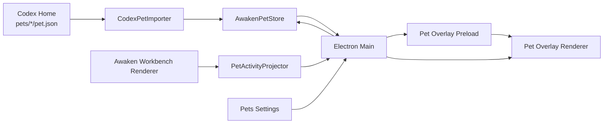

# Awaken Desktop 宠物功能完整实现方案

## 1. 文档目标

本文给出在 Awaken Desktop 中实现 Codex 风格桌面宠物的完整可执行方案，目标包括：

1. 复刻 Codex 宠物的动画状态、独立浮窗、拖拽、缩放、唤醒和收起体验。
2. 兼容 Codex 当前自定义宠物包格式。
3. 自动发现并导入本机 Codex 已配置的自定义宠物。
4. 在 Awaken 设置页的“宠物”Tab 中独立选择当前宠物。
5. 保持 Awaken 的 Electron main/preload/renderer 分层和 Desktop 全局数据目录契约。
6. 不侵入 `RunStage`、`ExecutionFeed`、`ComposerDock` 等中间工作区布局契约。

本文基于 2026-07-09 本机安装的 Codex `26.623.19656.0` 和当前 Awaken 工作区进行验证。

本次修订还参考了 `C:\Users\frankzhang\Downloads\Awaken实现Codex兼容宠物功能方案.md`。该文档提到的 `/Users/nolangrant/Codex 源代码/` 与 BitFun 源码切片不在本机，因此其中关于公开源码、CDN、legacy `avatar.json` 和扩展 manifest 的内容只作为线索，不作为本方案的实现契约。可执行契约只采纳以下可在本机复核的证据：

- Codex 安装包内置 `hatch-pet` skill 及其 `codex-pet-contract.md`。
- Codex Desktop 安装包内的实际 renderer/main 构建产物。
- 本机 `${CODEX_HOME:-$HOME/.codex}` 的目录和状态文件。
- Awaken 当前代码、README 与功能域架构约束。

Codex 官方手册没有公开宠物包或浮窗的稳定产品 API；本方案将兼容目标锁定为上述版本的本机可验证行为，并通过版本化 importer 隔离未来变化。

## 2. 结论摘要

Codex 宠物不是普通 GIF，而是由以下部分组成：

- 一张固定规格的透明 PNG 或 WebP sprite atlas。
- 九种固定动画状态。
- 固定的行、列、帧数和帧时长。
- `${CODEX_HOME:-$HOME/.codex}/pets/<pet-name>/` 下的自定义宠物包。
- Electron 独立透明浮窗中的宠物、通知托盘、拖拽和缩放交互。
- 会话运行状态到宠物动画状态的映射。

Awaken 应采用“兼容输入格式，内部规范化存储，独立浮窗渲染”的架构。

本功能只导入 Codex 自定义宠物，不导入、不下载、不识别为候选项、不展示 Codex 内置宠物。Awaken 也不读取或同步 Codex 的当前选择；导入只扩充 Awaken 宠物目录，唯一生效选择由 Awaken 用户在 Settings > Pets 中明确设置。

## 3. 已确认的 Codex 实现事实

### 3.1 自定义宠物目录

Codex 从以下目录读取自定义宠物：

```text
${CODEX_HOME:-$HOME/.codex}/pets/<pet-name>/
├── pet.json
└── spritesheet.webp
```

Windows 默认路径：

```text
%USERPROFILE%\.codex\pets\<pet-name>\
```

macOS 和 Linux 默认路径：

```text
~/.codex/pets/<pet-name>/
```

如果设置了 `CODEX_HOME`，必须优先使用 `CODEX_HOME`。

### 3.2 Codex 宠物清单格式

`pet.json` 的当前格式为：

```json
{
  "id": "pet-name",
  "displayName": "Pet Name",
  "description": "One short sentence.",
  "spritesheetPath": "spritesheet.webp"
}
```

字段规则：

| 字段 | 必填 | 规则 |
|---|---:|---|
| `id` | 是 | 宠物稳定标识，建议使用小写字母、数字和连字符 |
| `displayName` | 是 | 设置页展示名称 |
| `description` | 是 | 一句简短说明 |
| `spritesheetPath` | 是 | 相对 `pet.json` 所在目录的图片路径 |

Codex 使用宠物所在文件夹名发现包。Awaken 导入时应同时校验文件夹名和 `id`，但不应因二者不同直接拒绝导入；应记录 warning，并以清单中的 `id` 作为源 id。

Codex 在应用内部为自定义宠物增加 `custom:` 前缀，例如：

```text
custom:my-pet
```

Awaken 必须保留源 id，同时用自己的命名空间消除冲突。

### 3.3 Sprite atlas 固定规格

Codex 当前使用固定图集：

| 项目 | 值 |
|---|---|
| 格式 | PNG 或 WebP |
| 总尺寸 | `1536 x 1872` |
| 网格 | 8 列 x 9 行 |
| 单元格 | `192 x 208` |
| 背景 | 透明 |
| 未使用单元格 | 必须完全透明 |

不得在图集中加入标签、边框、网格线、额外间距或单元格外阴影。

### 3.4 九种动画状态

| 行 | 状态 | 使用列 | 帧时长 |
|---:|---|---|---|
| 0 | `idle` | 0-5 | 280、110、110、140、140、320 ms |
| 1 | `running-right` | 0-7 | 前 7 帧 120 ms，最后一帧 220 ms |
| 2 | `running-left` | 0-7 | 前 7 帧 120 ms，最后一帧 220 ms |
| 3 | `waving` | 0-3 | 前 3 帧 140 ms，最后一帧 280 ms |
| 4 | `jumping` | 0-4 | 前 4 帧 140 ms，最后一帧 280 ms |
| 5 | `failed` | 0-7 | 前 7 帧 140 ms，最后一帧 240 ms |
| 6 | `waiting` | 0-5 | 前 5 帧 150 ms，最后一帧 260 ms |
| 7 | `running` | 0-5 | 前 5 帧 120 ms，最后一帧 220 ms |
| 8 | `review` | 0-5 | 前 5 帧 150 ms，最后一帧 280 ms |

状态语义：

- `idle`：空闲、呼吸、眨眼。
- `running-right`：拖拽或移动时朝右。
- `running-left`：拖拽或移动时朝左。
- `waving`：首次唤醒欢迎通知，约 8 秒；不是普通完成态。
- `jumping`：指针悬停宠物时的本地临时状态；不是普通成功完成态。
- `failed`：运行失败。
- `waiting`：等待审批、回答、授权或其他用户输入。
- `running`：智能体正在工作，不是字面上的奔跑。
- `review`：任务已完成但结果尚未查看。

状态覆盖优先级分为两层：

1. 本地交互临时态：水平拖拽 `running-left/right` > hover `jumping`。
2. 业务态：`waiting` > `failed` > `review` > `running` > `idle`。

首次唤醒的 `waving` 由一条独立的 `first-awake` 通知驱动。若此时已有 waiting、failed、review 或 running 通知，更高优先级业务通知可以压过欢迎动画；临时态结束后恢复最新业务态，不要写回或破坏业务状态。

### 3.5 动画播放行为

Codex 的当前渲染方式是：

- 用 CSS `background-image` 渲染整张 spritesheet。
- 用 `background-position` 切换行列。
- `background-position-x = column / 7 * 100%`。
- `background-position-y = row / 8 * 100%`。
- 非 `idle` 状态重复播放三轮，再回到低频 `idle`。
- `idle` 帧时长在浮窗中按 6 倍放慢。
- `prefers-reduced-motion` 开启时只显示当前状态第一帧。

Awaken 应复用相同播放规则，避免仅兼容图片格式但动画节奏不同。

### 3.6 可观测但不接入的 Codex 选择与浮窗状态

Codex 当前选择写在：

```toml
[desktop]
selected-avatar-id = "fireball"
```

文件位置：

```text
${CODEX_HOME:-$HOME/.codex}/config.toml
```

浮窗开关、尺寸和位置属于 Codex 自己的应用状态，当前可观测字段包括：

```text
electron-avatar-overlay-open
electron-avatar-overlay-bounds
avatar-overlay-mascot-width-px
first-awake-pet-notification-avatar-ids
```

这些字段位于 `.codex-global-state.json` 的内部持久化结构中，不属于稳定公开格式。Awaken 不应直接复用或修改它们，只能将其作为交互行为参考。

`selected-avatar-id` 也不属于本功能的导入输入。Awaken 不读取该值，不根据其自动选择宠物，Codex 后续切换当前宠物也不得改变 Awaken 的选择。

### 3.7 Codex 浮窗行为

当前 Codex 桌面宠物具备：

- 独立透明浮窗。
- 始终置顶。
- 不显示在任务栏。
- 宠物主体拖拽。
- 拖拽方向触发 `running-left` 或 `running-right`。
- 宠物宽度缩放。
- 点击宠物唤起主窗口。
- 宠物旁显示任务通知托盘。
- 等待用户输入时可以直接在托盘处理部分动作。
- 首次唤醒显示约 8 秒欢迎消息。
- 按显示器保存位置。
- 窗口超出屏幕后自动恢复到可见区域。
- 支持 reduced motion。
- hover 触发 `jumping`，离开后恢复业务态。
- 首次唤醒触发 `waving` 和 8 秒欢迎通知。
- 任务通知按 `waiting > failed > review > running` 排序。
- 运行通知约 3 分钟过期，失败约 1 小时，等待约 24 小时，待查看约 7 天。

### 3.8 本机实现审计结论

以下结论来自 Codex `26.623.19656.0` 安装包构建产物，用于防止实施时遗漏或凭印象映射：

| 构建产物 | 已核对行为 |
|---|---|
| `codex-avatar-*.js` | 8 x 9 图集、九状态帧表、逐帧时长、非 idle 三轮、idle 六倍慢速、reduced motion |
| `avatar-mascot-button-*.js` | hover 临时态为 `jumping`，resize handle 和通知 badge |
| `avatar-overlay-pill-dismiss-button-*.js` | first-awake 为 `waving`；loading/warning/danger/success 映射到 running/waiting/failed/review；waiting request 类型 |
| `use-avatar-overlay-selection-*.js` | 通知优先级、排序、过期时间、first-awake 8 秒 |
| `avatar-overlay-native-page-*.js` | 点击聚焦主窗口、4 px 拖拽阈值、左右方向动画、拖拽采样、缩放、通知展开/关闭/动作 |
| `pets-settings-*.js` | 自定义宠物目录、Refresh、Create your own pet、Wake Pet、Tuck Away Pet |

审计确认的九状态没有第十种隐藏动画状态。`first-awake` 是通知 kind，不是新的 sprite state；dragging、hover、resize 是交互状态，其中 dragging 和 hover 分别映射到已有动画，resize 不切换新的 sprite state。

## 4. 范围与非范围

### 4.1 第一版必须实现

- Codex 自定义宠物格式加载。
- 本地宠物仓库。
- 启动时自动扫描并导入全部 Codex 自定义宠物。
- Settings > Pets 一级 Tab、宠物列表和 Awaken 独立选择。
- 独立透明浮窗。
- 九状态动画渲染。
- 运行状态自动切换动画。
- 拖拽、方向动画、缩放、点击唤起主窗口。
- 多显示器位置恢复。
- reduced motion。
- 格式校验、错误隔离、导入报告。
- 通知托盘。
- 在宠物浮窗中处理 Awaken 已支持的提问、审批和 review 动作。
- 运行、失败、等待输入、待查看和首次唤醒通知。
- 通知展开、收起、关闭、点击聚焦对应 thread。
- 透明区域穿透与交互命中区域切换。

### 4.2 可后续增强但不影响行为兼容

- 惯性拖拽、投掷和边缘回弹。
- Quick Chat / voice orb。它们属于 Codex avatar overlay 的语音/快捷输入能力，不属于宠物包、九状态动画或桌宠选择行为；若 Awaken 以后建设相应产品能力，应单独立项，不能塞进宠物 importer。

### 4.3 不应在第一版实现

- 从 Codex 安装包中抽取内置宠物图片作为正式产品依赖。
- 导入、下载、缓存或展示任何 Codex 内置宠物。
- 读取、同步或写入 Codex `selected-avatar-id`。
- 修改 Codex 的 `config.toml`、`.codex-global-state.json` 或宠物目录。
- 让宠物状态进入 Go runtime 或 AG-UI 协议。
- 把宠物 UI 塞进 `RunStage` overlay。
- 让 `Awaken Design System` 直接依赖 Electron。

## 5. Awaken 目标架构



职责边界：

| 层 | 职责 |
|---|---|
| Electron main | 文件发现、导入、校验、持久化、窗口生命周期、屏幕定位 |
| preload | 暴露最小 IPC 接口，隔离 Node/Electron 权限 |
| Workbench renderer | 将当前运行状态投影为宠物状态 |
| Pet overlay renderer | 只负责动画、拖拽、缩放和通知 UI |
| Go runtime | 不感知宠物，不新增宠物 API |
| Design System | 可提供纯 UI 组件，但不持有 Electron 或文件系统逻辑 |

## 6. Awaken 数据模型

在 `apps/desktop/src/shared/pets.ts` 新增：

```ts
export type PetAnimationState =
  | "idle"
  | "running-right"
  | "running-left"
  | "waving"
  | "jumping"
  | "failed"
  | "waiting"
  | "running"
  | "review";

export type PetSource =
  | "awaken-builtin"
  | "awaken-local"
  | "codex-custom";

export type PetManifest = {
  schemaVersion: 1;
  id: string;
  sourceId: string;
  displayName: string;
  description: string;
  spritesheetFile: string;
  source: PetSource;
  sourcePath?: string;
  sourceFingerprint?: string;
  importedAt?: string;
};

export type PetSummary = {
  id: string;
  sourceId: string;
  displayName: string;
  description: string;
  source: PetSource;
  spritesheetUrl?: string;
  available: boolean;
  warning?: string;
};

export type PetSettings = {
  schemaVersion: 1;
  selectedPetId: string | null;
  overlayOpen: boolean;
  mascotWidthPx: number;
  importCodexPets: boolean;
  welcomedPetIds: string[];
};

export type PetSessionStatus =
  | "idle"
  | "running"
  | "waiting"
  | "failed"
  | "review";

export type PetQuestionOption = {
  id: string;
  label: string;
  description?: string;
};

export type PetWaitingRequest =
  | { type: "question"; requestId: string; prompt: string; options: PetQuestionOption[] }
  | { type: "command-approval"; requestId: string; summary: string }
  | { type: "file-approval"; requestId: string; files: string[] }
  | { type: "permission"; requestId: string; summary: string }
  | { type: "mcp-elicitation"; requestId: string; summary: string }
  | { type: "implement-plan"; turnId: string; summary: string };

export type PetSessionActivity = {
  key: string;
  status: PetSessionStatus;
  runId?: string;
  threadId?: string;
  turnKey?: string | null;
  title: string;
  subtitle?: string;
  updatedAtMs: number;
  waitingRequest?: PetWaitingRequest | null;
};

export type PetActivitySnapshot = {
  sessions: PetSessionActivity[];
  emittedAtMs: number;
};
```

不要只发送一个已经聚合好的 `state`。通知托盘、优先级、过期、关闭和 thread 导航都需要会话级输入；overlay 再从 `sessions` 派生当前业务动画和通知列表。拖拽、hover、resize 等瞬时交互状态只存在 overlay renderer 内，不进入持久化 snapshot。

Awaken 内部 id 规则：

```text
awaken:<id>
codex-custom:<source-id>
```

示例：

```text
codex-custom:my-pet
```

不要直接使用 Codex 的 `custom:` 作为 Awaken 主键，以免未来与其他来源冲突。

## 7. Awaken 存储布局

沿用 Desktop 全局目录：

```text
%APPDATA%\@awaken\desktop\
```

新增：

```text
config/
└── pets.json

data/
├── pets/
│   ├── index.json
│   └── codex-custom_my-pet/
│       ├── pet.json
│       └── spritesheet.webp
└── migrations/
    └── codex-pets-v1.json
```

macOS 对应：

```text
~/Library/Application Support/@awaken/desktop/
```

Linux 对应：

```text
~/.config/@awaken/desktop/
```

`pets.json` 只保存用户偏好和浮窗状态。宠物包放在 `data/pets/`。

建议的 `pets.json`：

```json
{
  "schemaVersion": 1,
  "selectedPetId": "awaken:default",
  "overlayOpen": false,
  "mascotWidthPx": 112,
  "importCodexPets": true,
  "welcomedPetIds": [],
  "placementByDisplay": {}
}
```

`selectedPetId` 的默认值应根据 Awaken 是否随包提供自有宠物决定：

- 有 Awaken 自有默认宠物：默认 `awaken:default`。
- 没有自有默认宠物：默认 `null`，浮窗保持关闭，直到用户在 Settings > Pets 明确选择。

自动导入不得修改 `selectedPetId`。即使当前选择的包在 Codex 侧更新、删除或新增，Awaken 也只更新 catalog 和可用性，不替用户切换。

位置数据至少包含：

```ts
type PetOverlayPlacement = {
  displayId: string;
  workArea: Electron.Rectangle;
  windowBounds: Electron.Rectangle;
  mascotWidthPx: number;
  updatedAt: string;
};
```

## 8. Codex 自动导入设计

### 8.1 Codex Home 探测

按以下优先级：

1. `process.env.CODEX_HOME`
2. `path.join(app.getPath("home"), ".codex")`

不要使用硬编码用户名或平台路径。

### 8.2 启动导入流程

在 `app.whenReady()` 完成 Awaken 数据目录初始化后执行：

```text
detectCodexHome
  -> scanCodexCustomPets
  -> validatePackages
  -> importChangedPackages
  -> reconcileCatalogWithoutChangingSelection
  -> writeImportReport
```

导入失败不得阻塞 Awaken 主窗口和 runtime 启动。

### 8.3 扫描自定义宠物

只扫描：

```text
<codex-home>/pets/*/pet.json
```

不要无限递归。

不扫描以下位置：

```text
<codex-home>/cache/
<codex-home>/avatars/
Codex app.asar 或安装目录
任何 CDN
```

不需要解析 `config.toml`，也不需要引入 TOML parser。目录中每个合法 `pet.json` 都视为已配置的 Codex 自定义宠物候选，无论 Codex 当前是否选中它。

每个候选包：

1. 读取 `pet.json`，上限 64 KiB。
2. 校验 JSON 对象和必填字段。
3. 将 `spritesheetPath` 解析到宠物目录内。
4. 拒绝绝对路径。
5. 拒绝 `..` 路径逃逸。
6. 拒绝符号链接最终指向宠物目录外的资源。
7. 图片上限建议 16 MiB。
8. 解码图片并校验尺寸。
9. 校验 MIME 和实际解码格式。
10. 计算清单和图片的 SHA-256 指纹。

### 8.4 导入策略

采用“复制到 Awaken 仓库”，不要运行时长期直接引用 Codex 目录。

原因：

- Codex 卸载或清理后宠物仍可用。
- Awaken 能保证加载时格式已验证。
- 可避免 Codex 写入过程中读取半成品。
- 可独立管理更新、删除和回滚。

使用临时目录和原子替换：

```text
data/pets/.import-<uuid>/
  -> 完整复制
  -> 完整校验
  -> rename 到正式目录
```

同一个源包指纹未变化时跳过复制。

自动导入结果只改变 catalog：

- 新包：加入 Settings > Pets 列表。
- 更新包：保持同一个 Awaken 内部 id，原子更新副本。
- 删除包：保留 Awaken 副本并标记源缺失；不自动取消当前选择。
- 损坏包：保留上一次成功副本，在导入报告中展示新版本失败。
- 任意导入结果：不得打开浮窗、不得改变 `selectedPetId`。

### 8.5 自动刷新

第一版提供：

- 启动时扫描。
- 设置页“刷新”按钮。

第二版可增加 `fs.watch`，但必须做 500 ms 防抖，并在文件变化后重新做完整校验。不要依赖单个 watch 事件判断包已完成写入。

### 8.6 冲突处理

| 冲突 | 处理 |
|---|---|
| 多个文件夹声明同一 `id` | 按规范化绝对路径排序，导入第一个，其余报告冲突 |
| 与 Awaken 内置 id 重名 | 使用 `codex-custom:` 命名空间，不覆盖内置 |
| 导入包更新 | 新指纹原子替换旧副本 |
| 导入包被删除 | 标为 source missing，不立即删除 Awaken 副本 |
| 当前选择的新版本损坏 | 继续使用上一次成功副本并提示 |
| 当前选择的 Awaken 副本也损坏 | 关闭浮窗并要求用户重新选择，不静默切换到其他宠物 |

## 9. Codex 内置宠物排除边界

Codex 安装包包含若干内置 avatar id，但它们明确不属于本功能的输入。实现中不要维护内置 id catalog，以避免将“识别 id”逐渐演变为下载或抽取素材。

以下路径和行为必须排除：

- 根据 Codex 安装版本硬编码 `app.asar` 路径。
- 运行时解包 Codex 安装包。
- 将 Codex 内置素材复制进 Awaken 安装包。
- 依赖 Codex 私有 chunk 文件名或 hash。
- 读取 Codex TUI 内置宠物 cache。
- 访问 Codex 宠物 CDN。
- 根据 `selected-avatar-id` 创建不可用占位项。

Awaken 未来可以随包提供自己的内置宠物，但其 id、版权和资源必须属于 Awaken，不应伪装成 Codex 内置宠物。

## 10. Sprite atlas 校验器

新增：

```text
apps/desktop/src/main/pets/pet-validator.ts
```

建议使用 Electron `nativeImage` 做基础解码和尺寸校验。若要严格校验透明空单元格，可使用 `sharp` 作为 Desktop 构建依赖。

校验级别：

### 10.1 阻断错误

- 图片无法解码。
- 尺寸不是 `1536 x 1872`。
- 格式不是 PNG 或 WebP。
- 必需单元格完全透明。
- 文件超过大小限制。
- 清单字段缺失。
- 路径逃逸。

### 10.2 警告

- 未使用单元格存在非透明像素。
- 文件夹名与 `id` 不一致。
- `displayName` 或 `description` 过长。
- 动画有效区域贴近单元格边缘。

### 10.3 必需单元格

```ts
export const PET_ROWS = {
  idle: { row: 0, frames: 6 },
  "running-right": { row: 1, frames: 8 },
  "running-left": { row: 2, frames: 8 },
  waving: { row: 3, frames: 4 },
  jumping: { row: 4, frames: 5 },
  failed: { row: 5, frames: 8 },
  waiting: { row: 6, frames: 6 },
  running: { row: 7, frames: 6 },
  review: { row: 8, frames: 6 }
} as const;
```

## 11. Electron 独立浮窗

### 11.1 新增文件

```text
apps/desktop/src/main/pets/
├── codex-pet-importer.ts
├── pet-store.ts
├── pet-validator.ts
├── pet-window-manager.ts
└── pet-protocol.ts

apps/desktop/src/preload/pet-overlay.ts

apps/desktop/src/renderer/pet-overlay/
├── PetOverlayApp.tsx
├── PetSprite.tsx
├── pet-animation.ts
├── pet-overlay.css
└── main.tsx
```

新增独立 HTML 入口：

```text
apps/desktop/pet-overlay.html
```

Vite 配置需要同时构建主 renderer 和宠物 renderer。

### 11.2 BrowserWindow 参数

```ts
new BrowserWindow({
  width: 384,
  height: 400,
  minWidth: 240,
  minHeight: 240,
  frame: false,
  transparent: true,
  backgroundColor: "#00000000",
  alwaysOnTop: true,
  skipTaskbar: true,
  resizable: false,
  hasShadow: false,
  show: false,
  focusable: true,
  webPreferences: {
    preload: petOverlayPreloadPath,
    contextIsolation: true,
    nodeIntegration: false,
    sandbox: false
  }
});
```

macOS：

```ts
window.setVisibleOnAllWorkspaces(true, {
  visibleOnFullScreen: true
});
window.setAlwaysOnTop(true, "floating");
```

Windows：

```ts
window.setAlwaysOnTop(true, "floating");
```

Linux 根据窗口管理器能力做 best effort。

### 11.3 透明区域穿透

默认让透明区域穿透鼠标：

```ts
window.setIgnoreMouseEvents(true, { forward: true });
```

当指针进入宠物或托盘命中区域时，由 renderer 通知 main：

```text
awaken:pet-pointer-interactivity
```

main 切换：

```ts
window.setIgnoreMouseEvents(!interactive, {
  forward: true
});
```

这样不会让 384 x 400 的透明窗口阻挡桌面操作。

### 11.4 自定义资源协议

注册：

```text
awaken-pet://asset/<pet-id>/spritesheet
```

main 根据已验证的 pet id 返回 Awaken 仓库内文件。

要求：

- renderer 不能传任意磁盘路径。
- 协议处理器只允许访问 pet store 中已登记文件。
- 设置 CSP，禁止远程脚本。
- 不使用 `file://` 暴露任意路径。

## 12. 动画播放器

`PetSprite.tsx` 只渲染一个固定比例元素：

```css
.pet-sprite {
  width: var(--pet-width);
  aspect-ratio: 192 / 208;
  background-repeat: no-repeat;
  background-size: 800% 900%;
  image-rendering: auto;
  pointer-events: auto;
  user-select: none;
}
```

帧位置：

```ts
function framePosition(row: number, column: number): string {
  return `${(column / 7) * 100}% ${(row / 8) * 100}%`;
}
```

播放器规则：

1. 状态改变立即切到新状态第一帧。
2. `idle` 无限循环，帧时长乘 6。
3. 其他状态播放三轮。
4. 三轮后播放并停留在 `idle` 循环。
5. 新状态到达时取消旧 timer。
6. reduced motion 时只显示状态第一帧。
7. 页面隐藏时暂停 timer，恢复时从当前状态第一帧开始。

不要使用 CSS steps 动画，因为各帧时长不同。

## 13. 运行状态映射

新增：

```text
apps/desktop/src/renderer/pets/pet-activity-projector.ts
```

业务状态映射：

| Awaken 状态 | 宠物状态 |
|---|---|
| 主动提问等待回答 | `waiting` |
| 命令、文件修改、网络、文件系统审批等待 | `waiting` |
| MCP elicitation、Connector 授权、插件/连接器启用等待 | `waiting` |
| plan 等待实施、群发消息 review 等待决策 | `waiting` |
| runtime missing/prepare 且需要用户处理 | `waiting` |
| run `error` | `failed` |
| 云任务 `cancelled` | `failed` |
| run `running` 或 `cancelling` | `running` |
| run 完成且 thread/turn 未读 | `review` |
| run 完成且已读 | `idle` |
| 无活跃任务 | `idle` |

当同时存在多个 thread/run 时，通知和宠物业务态按以下优先级选择：

```text
waiting > failed > review > running > idle
```

同一优先级默认按 `updatedAt` 新到旧排序；稳定 key 作为最终 tie-breaker，避免列表跳动。通知过期时间与本机 Codex 当前实现对齐：

| 状态 | 通知级别 | 默认文案 | 过期时间 |
|---|---|---|---:|
| `running` | info/loading | Running / Thinking | 3 分钟 |
| `failed` | danger | Blocked | 1 小时 |
| `waiting` | warning | Needs input | 24 小时 |
| `review` | success | Ready | 7 天 |
| `idle` | info | 不创建会话通知 | 不适用 |
| `first-awake` | info | Hi, I'm {petName} | 8 秒 |

本地交互期间由浮窗临时覆盖：

```text
pointer hover -> jumping
horizontal drag delta >= 4 px -> running-right
horizontal drag delta <= -4 px -> running-left
pointer leave / drag end -> 恢复最新业务状态
```

首次打开：

```text
waving -> 8 秒后恢复最新业务状态
```

“首次”按 Awaken 内部 pet id 记录到 `welcomedPetIds`。同一只宠物后续 Tuck Away / Wake 不重复欢迎；首次 Wake 另一只宠物时仍显示欢迎。删除宠物时可清理对应记录，普通刷新不得清理。

Workbench renderer 在状态变化时调用：

```ts
window.awaken.updatePetActivity(snapshot);
```

Electron main 保存最新 snapshot，并广播给宠物窗口。宠物窗口晚于 run 启动时创建也能立即得到当前状态。

### 13.1 九状态触发完整性矩阵

| 动画状态 | 触发源 | 结束条件 | 必须验收 |
|---|---|---|---|
| `idle` | 无更高优先级业务态 | 新业务态或临时态到达 | 是 |
| `running-right` | 有效拖拽且本次水平增量 `>= 4 px` | 松手、取消或方向反转 | 是 |
| `running-left` | 有效拖拽且本次水平增量 `<= -4 px` | 松手、取消或方向反转 | 是 |
| `waving` | 某个宠物首次被 Wake，且欢迎通知是当前最高可见通知 | 8 秒过期、欢迎通知关闭或更高优先级业务通知到达 | 是 |
| `jumping` | 指针进入宠物主体 | 指针离开、开始拖拽或开始缩放 | 是 |
| `failed` | 最高优先级有效通知为失败/取消 | 通知关闭、过期、已处理或被更高优先级覆盖 | 是 |
| `waiting` | 存在待回答、审批、授权、elicitation 或实施计划 | 请求处理、关闭、过期或状态更新 | 是 |
| `running` | 存在进行中的本地 run 或云任务 | 完成、失败、等待用户或过期 | 是 |
| `review` | 存在未读完成结果 | 打开对应 thread/turn、关闭或过期 | 是 |

禁止把 `jumping` 当作“任务成功”，也禁止用 `waving` 替代任意普通通知；这两处是旧方案最容易产生的语义偏差。

### 13.2 通知托盘和动作

首版需要实现与 Awaken 当前能力能对应的通知行为：

- 最小态展示最高优先级通知；展开态展示稳定排序后的通知栈。
- 点击普通通知：聚焦主窗口并导航到对应本地 thread 或云任务。
- waiting 通知可承载已有动作：回答问题、允许/拒绝命令、文件修改、权限请求、MCP elicitation，以及开始实施 plan。
- running 通知在 Awaken 已有中止能力时提供 Stop；普通会话通知在 Awaken 已有追问能力时提供 follow-up 输入。
- 某类动作若 Awaken 当前没有对应 API，通知仍需导航到主窗口处理，不得伪造成功。
- 支持单条关闭、托盘展开/收起和隐藏 activity pills。
- 通知关闭以 `notification id + turn key` 记录；同一 thread 新 turn 到达后允许重新出现。
- 托盘和宠物主体是鼠标命中区域，其余透明区域保持穿透。
- 显示 loading、warning、danger、success 的视觉层级，并提供屏幕阅读器文本。

活动副标题至少覆盖：读取/搜索/列出文件、运行命令、编辑文件、调用 MCP 工具和 Web 搜索。拿不到细粒度事件时回退到 `Thinking`，不要让副标题为空导致布局跳动。

### 13.3 行为覆盖边界

本机 Codex avatar overlay 还包含 Quick Chat、语音听写、voice orb 和云任务 follow-up 等能力。它们与宠物共用浮窗基础设施，但不是宠物包格式或九状态动画本身。本项目按以下规则判断是否属于本次“宠物行为完整性”：

| 能力 | 本次是否实现 | 判断 |
|---|---:|---|
| 宠物选择、Wake、Tuck Away | 是 | 宠物核心生命周期 |
| 九种动画及触发/恢复 | 是 | 宠物核心状态机 |
| 点击宠物聚焦主窗口 | 是 | 宠物核心交互 |
| 通知托盘、排序、过期、关闭、导航 | 是 | 宠物可见行为 |
| Awaken 已有的 waiting 动作、Stop、follow-up | 是 | 可从现有 runtime 能力闭环 |
| Quick Chat 独立编辑器 | 否，单独立项 | Awaken 当前没有对应宠物内输入产品契约 |
| 语音听写和 voice orb | 否，单独立项 | 属于语音能力，不属于 pet 包 |
| Codex 云任务专用 API | 否 | Awaken 不应伪造不存在的云任务后端 |

因此，“全部实现”指 Codex 当前可验证的宠物状态、生命周期、窗口和通知行为全部覆盖；共享 overlay 中依赖另一个产品域的语音/云端功能明确隔离，而不是无声遗漏。

## 14. 拖拽、缩放和定位

### 14.1 拖拽

拖拽由 renderer 捕获 pointer，发送屏幕坐标给 main：

```text
awaken:pet-drag-start
awaken:pet-drag-move
awaken:pet-drag-end
```

main 使用 `BrowserWindow.setPosition()` 移动窗口。

阈值：

- 4 px 内视为点击。
- 超过 4 px 视为拖拽。
- 点击宠物调用 `showMainWindow()`。

第一版不做惯性。第二版可参考 160 ms 采样、320 px/s 起始阈值和 1600 px/s 最大速度。

### 14.2 缩放

建议范围：

```text
最小 80 px
默认 112 px
最大 224 px
```

缩放只改变宠物宽度，不改变 atlas 规格。

缩放结束后写入 `pets.json`。

### 14.3 多显示器定位

保存：

- display id。
- display work area。
- window bounds。
- 宠物宽度。

恢复顺序：

1. 原 display id 仍存在时恢复。
2. 否则按分辨率和最近 work area 匹配。
3. 否则放到主屏右下角。
4. 最终 clamp 到 work area，至少保留宠物主体完全可见。

监听：

```text
display-added
display-removed
display-metrics-changed
```

## 15. Settings > Pets

当前 Awaken 设置对话框由 `ModelSettingsDialog.tsx` 承载，左侧导航只有 `Models`。本功能应将其整理为通用设置壳，而不是再开一个互不相干的弹窗：

```text
DesktopSettingsDialog
├── Models
└── Pets
```

推荐文件拆分：

```text
apps/desktop/src/renderer/settings/
├── DesktopSettingsDialog.tsx
├── ModelsSettingsPanel.tsx
└── PetsSettingsPanel.tsx
```

打开设置时保留当前默认 `Models` Tab；从宠物相关入口打开时可直接定位 `Pets`。Tab 使用现有 `.settings-dialog-nav` 视觉和键盘模式，必须具备 `role="tablist"`、`role="tab"`、`aria-selected` 和方向键切换。

Pets Tab 内容：

- 当前宠物预览。
- 已导入 Codex 自定义宠物列表。
- 宠物来源标签。
- 单选选择控件；只有被选中的宠物可以驱动浮窗。
- Wake Pet / Tuck Away Pet。
- 刷新 Codex 宠物。
- 打开 Awaken 宠物目录。
- 打开 Codex 宠物目录。
- 自动导入 Codex 宠物开关。
- 创建自己的宠物。
- 导入错误列表。

列表排序：

1. 当前选择。
2. 可用的 Awaken 自有宠物。
3. 可用的 Codex 自定义宠物，按 `displayName` 稳定排序。
4. 源缺失但仍有可用副本的宠物。

不要在列表中自动删除损坏包；显示错误并允许刷新。

选择与显隐必须解耦：

- 选择某只宠物只更新 `selectedPetId`；若浮窗已打开则原位热切换。
- Wake Pet 只打开当前选择；没有选择时禁用并提示先选择。
- Tuck Away Pet 只关闭浮窗，不清空选择。
- 自动导入和刷新只更新列表，不改变选择、不自动 Wake。
- 当前选择不可用时关闭浮窗并在 Pets Tab 显示错误，不静默改选列表中的第一只。

“创建自己的宠物”应复用同一 Codex v1 契约，但输出到 Awaken 自己的 staging 目录。推荐行为：

1. 创建一个 Awaken 本地任务，附带固定图集、九状态、透明度和 manifest 约束。
2. 生成结果写到 `userData/data/pets/.create-<uuid>/`，不得写入 Codex 目录。
3. 通过同一个 `pet-validator` 校验后原子迁入 `data/pets/`，来源记为 `awaken-local`。
4. 成功后刷新列表但不自动选择、不自动 Wake。
5. 当前模型或工具无法生成图片时，保留任务错误并提供“打开宠物目录”，不创建半成品 catalog 项。

这样生成的包仍可按 `pet.json + spritesheet.webp/png` 复制到 Codex 使用，但 Awaken 不主动写 Codex 配置。

## 16. IPC 接口

在 `AwakenBridge` 中新增：

```ts
export type PetBridge = {
  listPets(): Promise<PetSummary[]>;
  getPetSettings(): Promise<PetSettings>;
  selectPet(petId: string): Promise<PetSettings>;
  refreshCodexPets(): Promise<PetImportReport>;
  createPet(): Promise<{ threadId: string }>;
  setPetOverlayOpen(open: boolean): Promise<PetSettings>;
  setPetImportPreferences(input: {
    importCodexPets?: boolean;
  }): Promise<PetSettings>;
  updatePetActivity(snapshot: PetActivitySnapshot): void;
  onPetCatalogChanged(callback: () => void): () => void;
};
```

宠物 overlay preload 只暴露：

```ts
export type PetOverlayBridge = {
  getBootstrap(): Promise<PetOverlayBootstrap>;
  onActivityChanged(callback: (value: PetActivitySnapshot) => void): () => void;
  beginDrag(point: ScreenPoint): void;
  moveDrag(point: ScreenPoint): void;
  endDrag(point: ScreenPoint): void;
  setPointerInteractive(interactive: boolean): void;
  resizeMascot(width: number): void;
  finishResize(width: number): void;
  activateNotification(notificationId: string): Promise<void>;
  performNotificationAction(input: PetNotificationActionRequest): Promise<void>;
  dismissNotification(input: { notificationId: string; turnKey: string | null }): Promise<void>;
  openMainWindow(): void;
  closeOverlay(): void;
};
```

所有 IPC 参数必须在 main 层再次校验。

## 17. 推荐实施顺序

### 阶段 0：建立档案和契约

- 保留本文作为主实施方案。
- 增加 `验收清单.md`。
- 确认 Awaken 默认宠物素材。

完成标准：确认只导入 Codex 自定义宠物，内置宠物和 Codex 当前选择均不在范围内。

### 阶段 1：纯数据层

新增：

```text
apps/desktop/src/shared/pets.ts
apps/desktop/src/main/pets/pet-store.ts
apps/desktop/src/main/pets/pet-validator.ts
apps/desktop/src/main/pets/codex-pet-importer.ts
```

实现：

- Awaken pet store。
- Codex Home 探测。
- 自定义包扫描、校验、复制。
- 指纹和导入报告。

完成标准：无需 UI 即可通过测试导入 fixture。

### 阶段 2：动画组件

新增 `PetSprite` 和纯动画状态机。

完成标准：

- 九状态均按精确帧时长播放。
- reduced motion 正确。
- 状态切换不残留 timer。

### 阶段 3：独立浮窗

实现 `pet-window-manager.ts`、独立 preload 和 renderer。

完成标准：

- 透明、置顶、不进任务栏。
- 透明区可穿透。
- 可拖拽、点击、缩放。
- 重启恢复位置。

### 阶段 4：运行状态联动

实现 `pet-activity-projector.ts`。

完成标准：

- 普通运行显示 `running`。
- 主动提问显示 `waiting`。
- 失败显示 `failed`。
- 未读完成结果显示 `review`。
- hover 显示 `jumping`，首次 Wake 显示 `waving`。
- 多会话业务状态遵守 `waiting > failed > review > running > idle`。

### 阶段 5：设置页

将现有设置壳扩展为 `Models / Pets` 一级 Tab，实现宠物选择、导入状态和开关。

完成标准：用户无需编辑文件即可完成选择、刷新、创建、打开和收起；刷新、创建成功和自动导入都不会改变选择。

### 阶段 6：通知托盘

实现任务通知和浮窗内处理入口。

完成标准：通知不阻挡宠物拖拽，关闭托盘后透明区恢复穿透。

## 18. 测试方案

### 18.1 单元测试

`codex-pet-importer.test.ts`：

- 使用 `CODEX_HOME`。
- 使用默认 `~/.codex`。
- 无目录时返回空结果。
- 一次扫描正常导入多个合法自定义包。
- `config.toml` 和 `selected-avatar-id` 的任何变化都不影响导入结果或 Awaken 选择。
- cache、avatars 和 Codex 安装目录不会被扫描。
- 重复 id。
- manifest 非法。
- spritesheet 路径逃逸。
- 图片尺寸错误。
- 指纹未变化时跳过。
- 更新时原子替换。

`pet-validator.test.ts`：

- 正确 WebP。
- 正确 PNG。
- 错误尺寸。
- 透明空帧。
- 必需帧为空。
- 未使用帧非透明 warning。

`pet-animation.test.ts`：

- 每行帧数。
- 每帧时长。
- background position。
- 非 idle 三轮后回 idle。
- reduced motion。
- timer 清理。

`pet-activity-projector.test.ts`：

- 状态优先级。
- waiting 高于 running。
- waiting 高于 failed，failed 高于 review，review 高于 running。
- 已读完成回 idle，未读完成进入 review。
- hover 临时覆盖为 jumping，离开后恢复业务态。
- 首次 Wake 进入 waving，8 秒后恢复业务态。
- first-awake 对同一个 pet id 只出现一次，切换到新宠物后可再出现一次。
- 首次 Wake 时若已有 waiting 通知，waiting 压过 waving。
- running/failed/waiting/review 的通知过期时间。

`pet-window-manager.test.ts`：

- 屏幕 clamp。
- 显示器移除恢复。
- 保存和恢复 bounds。
- 点击与拖拽阈值。

### 18.2 集成测试

使用临时 `AWAKEN_USER_DATA_DIR` 和临时 `CODEX_HOME`：

1. 写入 Codex fixture。
2. 启动 Electron main 测试入口。
3. 调用刷新。
4. 验证 Awaken pet store 内容。
5. 验证刷新前后的 `selectedPetId` 完全不变。
6. 修改 Codex `selected-avatar-id`，验证 Awaken 不跟随。
7. 验证损坏包不影响其他包和上一次成功副本。

### 18.3 Desktop 真实验收

必须按根 `README.md` 在 Windows 前台运行：

```powershell
npm run dev:desktop
```

验收任务：

1. 打开 Settings > Pets。
2. 验证 `Models / Pets` Tab 可点击、键盘切换且布局不溢出。
3. 验证能看到自动导入的全部 Codex 自定义宠物，看不到 Codex 内置宠物。
4. 记录当前 Awaken 选择，切换 Codex 当前宠物并刷新，验证 Awaken 选择不变。
5. 选择一只导入宠物并点击 Wake Pet，验证 8 秒 `waving` 欢迎通知。
6. hover 宠物观察 `jumping`，移出后恢复 `idle` 或当前业务态。
7. 将宠物向左右拖到第二块显示器，分别观察 `running-left/right`。
8. 将宽度缩放到 80、112、224 px 边界，重启 Awaken。
9. 验证位置、尺寸、选择和开关恢复。
10. 在 Desktop UI 发起真实普通任务，观察 `running`。
11. 发起需要主动提问、命令审批、文件审批或 MCP elicitation 的任务，观察 `waiting` 并处理动作。
12. 制造失败任务，观察 `failed`。
13. 完成任务但不打开结果，观察 `review`；打开对应 thread 后恢复 `idle`。
14. 同时构造 waiting、failed、review、running，验证优先级和通知排序。
15. 点击通知验证主窗口聚焦并导航到正确 thread；关闭通知验证同一 turn 不重复出现。
16. Tuck Away 后选择仍保留；再次 Wake 恢复同一宠物和位置。
17. 开启系统 reduced motion，验证每个状态只显示静态首帧。
18. 验证透明浮窗空白区域不阻挡桌面点击。

视觉证据：

- 主屏右下角宠物截图。
- 第二显示器宠物截图。
- 九种动画状态录屏，其中左右拖拽可合并在同一段。
- 通知展开、关闭、waiting 动作和点击导航录屏。
- 设置页导入列表截图。

## 19. 验收标准

功能验收：

- Codex 合法自定义包无需转换即可导入。
- 启动扫描会导入 `pets/*/pet.json` 下全部合法包。
- 导入后 Codex 目录被删除，Awaken 副本仍可使用。
- Codex 内置宠物不会被导入、下载或显示。
- Codex 当前选择不会被读取或同步。
- 自动导入、手动刷新和 Codex 侧切换均不会改变 Awaken 当前选择。
- 只有 Settings > Pets 中明确选择的宠物能驱动浮窗。
- 九种动画状态与 Codex 契约一致。
- hover、首次 Wake、左右拖拽、运行、等待、失败、未读完成和空闲都有明确触发与恢复路径。
- 通知优先级、过期、关闭、展开、导航和可支持的 waiting 动作通过验收。
- 浮窗独立于主 Workbench。
- 重启、多显示器变化后仍可见。
- 错误宠物不会导致 Desktop 启动失败。

安全验收：

- 不读取宠物目录外资源。
- 不执行宠物包中的任何代码。
- 不允许 HTML、JS、SVG 成为 spritesheet。
- 不通过 renderer 暴露任意文件路径。
- 不修改 Codex 配置和文件。

工程验收：

```bash
npm run typecheck:desktop
npm run build:desktop
npm --workspace @awaken/desktop test
git diff --check
```

涉及真实产品路径时，还必须完成 Awaken Desktop UI 验收。

## 20. 风险与应对

| 风险 | 应对 |
|---|---|
| Codex 私有格式未来变化 | importer 版本化，未知字段忽略，固定校验当前 v1 |
| 误把 Codex 内置宠物带入产品 | importer 只允许 `pets/*/pet.json`，测试断言不访问 cache、安装目录或 CDN |
| 自动导入覆盖用户选择 | catalog 更新与 `selectedPetId` 写入分离，刷新测试断言选择不变 |
| 透明窗口阻挡桌面 | 动态 `setIgnoreMouseEvents` |
| 多显示器坐标失效 | 按 display 和 work area 恢复并 clamp |
| 大图或恶意包耗尽内存 | 文件大小、尺寸、格式、路径和数量上限 |
| 动画 timer 泄漏 | 单一播放器状态机，状态变化和卸载清理 |
| Workbench 状态与宠物不一致 | renderer 发送完整 snapshot，main 保存最新快照 |
| Codex 正在写包时导入 | 指纹前后复核、临时目录、原子替换 |
| 自定义包 id 冲突 | 来源命名空间 |
| 打包后资源协议失效 | 对开发和 packaged 路径分别做集成测试 |

## 21. 文件改动清单

预计新增：

```text
docs/01_桌面工作台/桌面宠物/
├── 实现方案.md
└── 验收清单.md

apps/desktop/src/shared/pets.ts

apps/desktop/src/main/pets/
├── codex-pet-importer.ts
├── codex-pet-importer.test.ts
├── pet-store.ts
├── pet-store.test.ts
├── pet-validator.ts
├── pet-validator.test.ts
├── pet-window-manager.ts
├── pet-window-manager.test.ts
└── pet-protocol.ts

apps/desktop/src/preload/pet-overlay.ts

apps/desktop/src/renderer/pets/
├── pet-activity-projector.ts
├── pet-activity-projector.test.ts
├── pet-notifications.ts
└── pet-notifications.test.ts

apps/desktop/src/renderer/settings/
├── DesktopSettingsDialog.tsx
├── ModelsSettingsPanel.tsx
├── PetsSettingsPanel.tsx
└── PetsSettingsPanel.test.tsx

apps/desktop/src/renderer/pet-overlay/
├── PetOverlayApp.tsx
├── PetSprite.tsx
├── PetSprite.test.tsx
├── pet-animation.ts
├── pet-animation.test.ts
├── pet-overlay.css
└── main.tsx

apps/desktop/pet-overlay.html
```

预计修改：

```text
apps/desktop/src/main/index.ts
apps/desktop/src/preload/index.ts
apps/desktop/src/shared/runtime.ts
apps/desktop/src/renderer/App.tsx
apps/desktop/src/renderer/ModelSettingsDialog.tsx
apps/desktop/src/renderer/styles.css
apps/desktop/vite.config.ts
apps/desktop/package.json
package-lock.json
```

`ModelSettingsDialog.tsx` 的模型表单内容迁入 `ModelsSettingsPanel.tsx` 后，应删除旧壳或保留一个短期兼容 re-export；不要长期同时维护两套 Settings dialog。

## 22. 最终实施建议

推荐按以下原则落地：

1. 先完成格式兼容和导入测试，再做浮窗。
2. 自定义宠物以 Codex v1 包格式作为外部兼容协议。
3. Awaken 内部始终使用带来源命名空间的 id。
4. 导入后复制到 Awaken 全局数据目录，不长期引用 Codex 文件。
5. 宠物属于 Desktop 展示能力，不进入 Go runtime 和 AG-UI。
6. 独立浮窗使用独立 renderer，不改变中间工作区契约。
7. 自动导入只更新 catalog，用户选择只由 Settings > Pets 写入。
8. 九状态、通知托盘和可映射的 waiting 动作都属于首版完成条件。
9. 不读取 Codex 当前选择，不导入内置宠物，不把安装包逆向抽取作为产品能力。

按本文实施后，Awaken 可以对 Codex 自定义宠物做到直接兼容和自动迁移，同时把宠物选择权完整留在 Awaken 设置中，并在不破坏现有 Workbench 架构的前提下覆盖 Codex 当前可验证的全部宠物动画与桌面交互行为。
