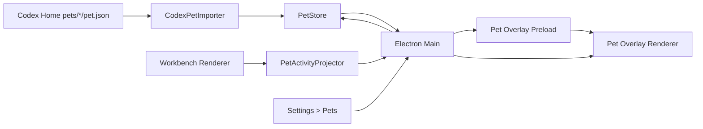

# Awaken 桌面宠物实现方案

## 1. 文档目标

本文记录 Awaken Desktop 桌面宠物功能的实现契约、当前落地状态、Codex 兼容范围、关键设计决策和验收方式。它用于后续维护、回归验证、继续扩展“创建宠物”功能，以及排查桌面宠物窗口、动画和导入问题。

当前实现目标是：

1. 兼容导入 Codex 自定义宠物包，包含 v1 与 v2 sprite atlas。
2. 只导入 Codex 自定义宠物，不导入、不展示 Codex 内置宠物。
3. 不读取、不同步 Codex 当前选择的宠物。Awaken 只使用用户在 Settings > Pets 中明确选择的宠物。
4. 在 Awaken Desktop 中提供独立透明桌面宠物浮窗，支持点击、拖动、缩放、位置持久化、通知气泡和点击穿透。
5. 实现 Codex 当前可观察到的 9 个标准动画状态与状态优先级。
6. 在关闭 Awaken 时正确销毁宠物浮窗，避免主窗口关闭后宠物仍留在屏幕上。

## 2. 当前实现状态

截至 PR #11 当前实现，桌面宠物已经包含：

- Codex v1 宠物兼容：8 列 x 9 行，`1536x1872`，默认 `spriteVersionNumber = 1`。
- Codex v2 宠物兼容：8 列 x 11 行，`1536x2288`，manifest 需要 `spriteVersionNumber: 2`。
- Codex 自定义宠物导入：扫描 `${CODEX_HOME:-$HOME/.codex}/pets/*/pet.json`。
- Awaken 本地宠物仓库：导入后复制到 Awaken `userData/data/pets/`，不长期引用 Codex 源文件。
- Settings > Pets：宠物列表、当前宠物选择、Wake/Tuck Away、刷新 Codex 宠物、自动导入开关、打开目录。
- 独立宠物浮窗：Electron frameless transparent window，置顶、跳过任务栏、透明区域点击穿透。
- 通知气泡：AI 工作中和回答结束后一段时间出现，点击主窗口后隐藏。
- 动态窗口几何：无气泡时窗口收缩到实际宠物附近，气泡出现/消失不移动宠物锚点。
- 关闭生命周期：Windows/Linux 关闭主窗口时进入应用退出流程，退出前 dispose 宠物窗口；macOS 保持系统惯例。
- 测试覆盖：导入、存储、校验、动画定位、v2 渲染、窗口几何、设置页预览。

仍未实现或暂不进入本次范围：

- 不实现点击“创建宠物”后调用 `hatch-pet` 生成宠物。
- 不把生成结果写入 Codex 目录。
- 不支持 Codex 内置宠物提取、下载或转换。
- 不把宠物状态放进 Go runtime 或 AG-UI 协议。

### 2.1 证据来源和保留结论

本功能的 Codex 兼容目标不是公开 API，而是本机可验证行为。当前方案的依据包括：

- 本机 Codex 自定义宠物目录：`${CODEX_HOME:-$HOME/.codex}/pets/`。
- Codex `hatch-pet` skill 对 v2 包的输出契约。
- Codex Desktop 当前可观察的宠物浮窗行为。
- Awaken 当前 Electron main/preload/renderer 分层和 Workbench 契约。

需要长期保留的结论：

- Codex 宠物不是 GIF，而是透明 sprite atlas + 固定状态机 + Electron 透明浮窗。
- `first-awake` 是通知 kind，不是新的 sprite state。
- hover、dragging、resize 是 overlay 本地交互状态，不进入持久化业务 snapshot。
- Quick Chat、语音听写、voice orb 属于另一个输入产品域，不属于宠物包兼容和九状态动画的必需范围。
- Codex `selected-avatar-id`、`.codex-global-state.json` 中的 overlay bounds 和 open 状态只能作为行为参考，不能作为 Awaken 输入或持久化来源。

## 3. Codex 宠物包兼容契约

### 3.1 自定义宠物目录

Awaken 只扫描 Codex Home 下的自定义宠物目录：

```text
${CODEX_HOME:-$HOME/.codex}/pets/<pet-id>/
├── pet.json
└── spritesheet.webp 或 spritesheet.png
```

Windows 默认：

```text
%USERPROFILE%\.codex\pets\<pet-id>\
```

macOS/Linux 默认：

```text
~/.codex/pets/<pet-id>/
```

如果设置了 `CODEX_HOME`，优先使用 `CODEX_HOME`。

### 3.2 manifest 字段

Awaken 支持的 `pet.json`：

```json
{
  "id": "my-pet",
  "displayName": "My Pet",
  "description": "A short sentence.",
  "spriteVersionNumber": 2,
  "spritesheetPath": "spritesheet.webp"
}
```

字段规则：

| 字段 | 必填 | 说明 |
|---|---:|---|
| `id` | 是 | 只允许小写字母、数字和连字符 |
| `displayName` | 是 | 设置页展示名称 |
| `description` | 是 | 简短说明 |
| `spriteVersionNumber` | 否 | 缺省为 `1`；支持 `1` 或 `2` |
| `spritesheetPath` | 是 | 相对 `pet.json` 所在目录的图片路径 |

`spritesheetPath` 必须是相对路径，不能逃逸宠物目录，不能通过符号链接指向宠物目录外部。

### 3.3 sprite atlas 规格

| 版本 | `spriteVersionNumber` | 尺寸 | 网格 | 用途 |
|---|---:|---|---|---|
| v1 | 缺省或 `1` | `1536x1872` | 8 列 x 9 行 | Codex 标准 9 状态 |
| v2 | `2` | `1536x2288` | 8 列 x 11 行 | 9 状态 + 16 个 look direction |

单元格固定为 `192x208`。Awaken 当前只播放标准 9 个动画状态，也就是第 0-8 行。v2 的第 9-10 行作为 Codex 方向视线扩展被完整保留和导入，但当前 Awaken 不主动使用这些 look direction。

### 3.4 动画行语义

| 行 | 状态 | 帧 |
|---:|---|---|
| 0 | `idle` | 0-5 |
| 1 | `running-right` | 0-7 |
| 2 | `running-left` | 0-7 |
| 3 | `waving` | 0-3 |
| 4 | `jumping` | 0-4 |
| 5 | `failed` | 0-7 |
| 6 | `waiting` | 0-5 |
| 7 | `running` | 0-5 |
| 8 | `review` | 0-5 |

v2 额外行：

```text
row 9:  000, 022.5, 045, 067.5, 090, 112.5, 135, 157.5
row 10: 180, 202.5, 225, 247.5, 270, 292.5, 315, 337.5
```

Awaken 导入 v2 时必须保存 `spriteVersionNumber`，渲染时必须按 11 行计算 `background-position-y` 和 `background-size`。否则第 0-8 行的取帧位置会偏移。

### 3.5 已确认的 Codex 行为审计

以下行为用于防止后续维护时遗漏或凭印象映射：

| 行为 | Awaken 对齐方式 |
|---|---|
| 九种标准 sprite state | `PetAnimationState` 只包含 9 个状态 |
| 非 idle 状态播放三轮后回 idle | `pet-animation.ts` 负责 |
| idle 慢速播放 | 当前实现保持 6 倍慢速 |
| reduced motion | 每个状态显示首帧 |
| hover 映射 `jumping` | overlay 本地状态覆盖 |
| 水平拖动映射 `running-left/right` | 根据 pointer 水平增量切换 |
| 首次 Wake 映射 `waving` | welcome notification 驱动 |
| AI 工作中映射 `running` | activity projector 驱动 |
| 等待用户输入映射 `waiting` | waiting request 驱动 |
| 失败映射 `failed` | run failed/cancelled 驱动 |
| 完成未查看映射 `review` | completion review 状态驱动 |
| 点击宠物聚焦主窗口 | overlay IPC 通知 main |
| 宠物旁展示任务通知气泡 | pet overlay renderer 渲染 |

状态优先级分两层：

1. 本地交互态：拖动方向动画优先于 hover。
2. 业务态：`waiting > failed > review > running > idle`。

禁止把 `jumping` 当作“任务成功”，也禁止用 `waving` 替代普通通知。

## 4. Awaken 数据模型

核心类型位于 `apps/desktop/src/shared/pets.ts`。

### 4.1 架构边界



职责边界：

| 层 | 职责 |
|---|---|
| Electron main | 文件发现、导入、校验、持久化、窗口生命周期、屏幕定位 |
| preload | 暴露最小 IPC 接口，隔离 Node/Electron 权限 |
| Workbench renderer | 将当前运行状态投影为宠物 activity snapshot |
| Pet overlay renderer | 动画、拖动、缩放、通知气泡和本地交互状态 |
| Go runtime | 不感知宠物，不新增宠物 API |
| Design System | 提供纯 UI 组件，不持有 Electron 或文件系统逻辑 |

关键字段：

```ts
export type PetSpriteVersion = 1 | 2;

export type PetManifest = {
  schemaVersion: 1;
  id: string;
  sourceId: string;
  displayName: string;
  description: string;
  spriteVersionNumber: PetSpriteVersion;
  spritesheetFile: string;
  source: "awaken-builtin" | "awaken-local" | "codex-custom";
  sourcePath?: string;
  sourceFingerprint?: string;
  importedAt?: string;
};
```

设计要求：

- 旧 catalog 或旧 Codex 包缺少 `spriteVersionNumber` 时按 v1 归一化。
- `PetSummary` 和 `PetOverlayBootstrap` 必须透传 `spriteVersionNumber`。
- Settings 预览、列表缩略图和桌面浮窗均按版本动态设置行数。
- Codex 自定义宠物的 Awaken `id` 保持与 Codex `id` 一致，不再加 `codex-custom:` 前缀；来源信息由 `manifest.source` 表示。

## 5. 导入与存储流程

相关文件：

```text
apps/desktop/src/main/pets/codex-pet-importer.ts
apps/desktop/src/main/pets/pet-store.ts
apps/desktop/src/main/pets/pet-validator.ts
apps/desktop/src/main/pets/png-utils.ts
```

导入流程：

1. `detectCodexHome()` 根据 `CODEX_HOME` 或用户 home 推导 Codex Home。
2. `scanCodexCustomPets()` 只扫描 `pets/*/pet.json`，不递归。
3. `validatePetPackage()` 校验 manifest、路径、图片格式和图片尺寸。
4. `PetStore.importOrUpdatePet()` 计算 fingerprint，并将合法包复制到 Awaken 数据目录。
5. 复制采用 staging 目录和原子替换，避免半导入状态污染 catalog。
6. Codex 源目录删除后，Awaken 保留本地副本，并在设置页展示 source missing warning。
7. 自动导入和手动刷新都不得修改 `selectedPetId`。

### 5.1 导入边界和异常策略

必须扫描：

```text
<codex-home>/pets/*/pet.json
```

必须排除：

```text
<codex-home>/cache/
<codex-home>/avatars/
Codex app.asar 或安装目录
任意 CDN 或远程下载入口
```

异常处理：

| 场景 | 行为 |
|---|---|
| `CODEX_HOME` 不存在 | 返回空列表，不报启动错误 |
| 单个宠物 manifest 非法 | 放入 failed report，不影响其他宠物 |
| `spritesheetPath` 逃逸目录 | 拒绝导入 |
| 图片不是 PNG/WebP | 拒绝导入 |
| 图片尺寸与版本不匹配 | 拒绝导入 |
| 多个目录声明同一 `id` | 保留排序靠前的候选，其余报告 conflicts |
| 源目录删除 | 保留 Awaken 副本并标记 source missing |
| 新版本损坏 | 保留上一份成功副本 |
| 自动导入成功 | 只更新 catalog，不自动选择，不自动 Wake |

安全边界：

- 不执行宠物包中的任何代码。
- 不允许 HTML、JS、SVG 成为 spritesheet。
- 不通过 renderer 暴露任意本地文件路径。
- 不修改 Codex `config.toml`、`.codex-global-state.json` 或宠物目录。

Awaken 本地布局：

```text
<userData>/data/pets/
├── index.json
└── <pet-id>/
    ├── pet.json
    └── spritesheet.webp 或 spritesheet.png
```

## 6. 渲染与动画

相关文件：

```text
apps/desktop/src/renderer/pet-overlay/PetSprite.tsx
apps/desktop/src/renderer/pet-overlay/pet-animation.ts
apps/desktop/src/renderer/pet-overlay/pet-overlay.css
apps/desktop/src/renderer/settings/PetsSettingsPanel.tsx
apps/desktop/src/renderer/styles.css
```

渲染规则：

- 使用 CSS `background-image` 渲染整张 atlas。
- X 轴始终按 8 列计算：`column / 7 * 100%`。
- Y 轴按版本计算：
  - v1：`row / 8 * 100%`
  - v2：`row / 10 * 100%`
- CSS `background-size` 使用动态变量：

```css
background-size: 800% calc(var(--pet-sheet-rows, 9) * 100%);
```

动画规则：

- `idle` 低速播放，当前实现保留 6 倍慢速。
- 非 idle 状态播放 3 轮后回到 idle。
- `prefers-reduced-motion` 开启时显示当前状态首帧。
- 拖动时根据水平移动方向切换 `running-left` / `running-right`。
- hover 映射 `jumping`。
- 首次唤醒映射 `waving`。
- AI 工作中映射 `running`。
- 等待用户输入映射 `waiting`。
- 失败映射 `failed`。
- 已完成但未查看映射 `review`。

## 7. 独立浮窗与窗口几何

相关文件：

```text
apps/desktop/src/main/pets/pet-window-manager.ts
apps/desktop/src/main/pets/pet-window-geometry.ts
apps/desktop/src/renderer/pet-overlay/PetOverlayApp.tsx
apps/desktop/src/renderer/pet-overlay/pet-overlay.css
```

浮窗要求：

- Electron `BrowserWindow`。
- `frame: false`。
- `transparent: true`。
- `alwaysOnTop: true`。
- `skipTaskbar: true`。
- `resizable: false`。
- `showInactive()` 显示，避免抢主窗口焦点。
- Windows/Linux 使用 `setShape()` 收窄可点击区域。
- 不支持 shape 的平台使用 `setIgnoreMouseEvents(..., { forward: true })` 做穿透。

窗口几何原则：

- 窗口大小跟随实际内容尺寸，空闲宠物不再长期占用固定大窗口。
- 内容尺寸有最小值和最大值，防止 renderer 异常测量导致窗口膨胀。
- 气泡出现或消失时，使用右下锚点调整窗口边界，避免宠物本体跳动。
- 拖动时使用稳定窗口尺寸和底部锚点计算，避免宠物向下滑移。
- clamp 使用 display bounds，允许拖到屏幕四周；只保证可交互区域在显示器内。
- 位置保存时归一化窗口尺寸，恢复时兼容历史异常大 bounds。

当前已将几何纯函数从 `pet-window-manager.ts` 拆到 `pet-window-geometry.ts`，对应测试位于 `pet-window-geometry.test.ts`。

## 8. 通知气泡

气泡目标是对齐 Codex 的桌面宠物通知行为：

- 出现在宠物左上方。
- 包含标题、当前回答或状态摘要。
- 左上关闭按钮在气泡边框外侧。
- 右上展开按钮小尺寸、无边框。
- 右下回复按钮。
- 气泡下方无阴影。
- 只在 AI 工作过程中、等待用户输入、失败、待查看结果和回答结束后一小段时间出现。
- 用户打开 Awaken 主窗口后隐藏当前气泡。
- 气泡出现和消失不得移动宠物位置。

通知来源由 renderer 将运行状态投影为 `PetActivitySnapshot` 后发送给 main，再由 pet overlay 渲染。

### 8.1 通知优先级和动作

业务通知优先级：

```text
waiting > failed > review > running
```

同一优先级按 `updatedAtMs` 新到旧排序，稳定 key 作为最终 tie-breaker，避免列表跳动。

建议 TTL：

| 状态 | 通知级别 | 过期时间 |
|---|---|---:|
| `running` | loading/info | 3 分钟 |
| `failed` | danger | 15 秒 |
| `waiting` | warning | 30 分钟 |
| `review` | success | 15 秒 |
| `first-awake` | info | 8 秒 |

当前 action 策略：

- 点击普通通知：聚焦主窗口并导航到对应 thread。
- waiting 通知：如果 Awaken 当前有对应 API，可处理回答、审批、授权、MCP elicitation 或 plan 实施；否则聚焦主窗口处理。
- running 通知：如果存在中止能力，允许 Stop；否则聚焦主窗口。
- 关闭通知：以 `notification id + turn key` 记录，避免同一 turn 重复出现。
- 新 turn 到达后允许重新出现通知。

## 9. 设置页行为

Settings > Pets 负责唯一生效选择：

- 显示当前选择的宠物预览。
- 列出已导入的宠物。
- 选择宠物只写 Awaken `selectedPetId`。
- 如果浮窗已打开，切换选择后热更新浮窗宠物。
- Wake Pet 只打开当前选择的宠物。
- Tuck Away 只关闭浮窗，不清空选择。
- 刷新 Codex 宠物只更新 catalog，不自动选择，不自动 Wake。
- 自动导入开关只控制启动时是否扫描 Codex 自定义宠物。
- 打开 Awaken 宠物目录和 Codex 宠物目录用于用户排查。

明确不做：

- 不读取 Codex `selected-avatar-id`。
- 不跟随 Codex 当前选择。
- 不导入 Codex 内置宠物。

### 9.1 Settings > Pets 必备体验

- 当前宠物预览。
- 已导入宠物列表。
- 单选当前宠物。
- Wake Pet / Tuck Away Pet。
- 刷新 Codex 宠物。
- 自动导入 Codex 宠物开关。
- 打开 Awaken 宠物目录。
- 打开 Codex 宠物目录。
- 导入错误列表。

列表排序建议：

1. 当前选择。
2. Awaken 本地宠物。
3. Codex 自定义宠物，按 `displayName` 稳定排序。
4. 源缺失但仍有可用副本的宠物。

当前选择不可用时，应关闭浮窗并提示用户重新选择，不应静默切换到列表第一项。

## 10. 应用生命周期

问题背景：宠物浮窗也是 Electron `BrowserWindow`。如果只依赖 `window-all-closed`，Windows/Linux 关闭主窗口后宠物窗口仍存在，`window-all-closed` 不会触发，应用进程也不会退出。

当前策略：

- 非 macOS：主窗口 `close` 时调用 `app.quit()`。
- `before-quit` 中统一停止 runtime、dispose 宠物窗口、清理订阅。
- 清理完成后调用 `app.exit()` 结束应用，避免再次触发同一套 quit 拦截。
- macOS 保持系统惯例，关闭主窗口不等于退出应用。

## 11. 创建宠物功能的后续方案

本次不实现创建宠物。后续如要对齐 Codex `hatch-pet`，需要先补齐：

1. Awaken 内置或 vendored `hatch-pet` workflow，不依赖用户本机 `.codex/skills`。
2. image generation 能力、引用图片上传、进度展示、失败恢复和 QA artifact 管理。
3. Awaken 自己的 staging 目录，例如 `<userData>/data/pets/.hatch-runs/<runId>/`。
4. 完成后输出 Awaken 本地包并走同一 `pet-validator` 导入。
5. 默认产出 v2：`spriteVersionNumber: 2`、`1536x2288`、`spritesheet.webp`。
6. 不写入 Codex 宠物目录，不修改 Codex 配置。

最小可行阶段可以先实现“创建任务入口 + staging + 完成后导入”，生成流程再接入。

### 11.1 `hatch-pet` 对接边界

Codex `hatch-pet` 当前生成的是 v2 包：

```text
pet.json
spritesheet.webp
spriteVersionNumber: 2
atlas: 1536x2288
grid: 8x11
```

Awaken 不能直接依赖用户本机 `.codex/skills/hatch-pet` 是否存在。若要产品化，需要：

- 将 workflow 或必要脚本作为 Awaken 能力发布。
- 为 imagegen、引用图、QA 产物和失败恢复建立 Awaken 自己的运行目录。
- 明确生成过程的用户可见进度。
- 生成完成后走同一套 `validatePetPackage()`，不要绕过导入校验。
- 不写 Codex 配置，不把生成物自动复制到 Codex。

## 12. 测试与验收

已覆盖的自动化测试：

- `pet-validator.test.ts`
  - manifest 必填字段。
  - 默认 v1。
  - 接受 v2。
  - 拒绝非法 sprite version。
  - 路径逃逸、绝对路径、非法 id。
- `codex-pet-importer.test.ts`
  - 扫描 Codex pets。
  - 忽略非宠物目录。
  - 导入多个合法包。
  - 导入 v2 自定义宠物。
  - 源目录缺失后保留 Awaken 副本。
  - 重复 id 冲突。
- `pet-store.test.ts`
  - 选择、开关、持久化。
  - v2 版本持久化。
  - 本地模板宠物。
- `pet-animation.test.ts`
  - 帧定位、非 idle 三轮回 idle。
  - v2 11 行 atlas 的 Y 轴百分比。
- `PetSprite.test.ts`
  - v2 渲染时设置 `--pet-sheet-rows: 11`。
- `pet-window-geometry.test.ts`
  - 窗口尺寸收缩。
  - 异常测量 clamp。
  - 底部/右下锚点。
  - 屏幕边界 clamp。
- `pet-window-manager.test.ts`
  - 窗口创建、路径解析、置顶恢复。

最近一次验证命令：

```powershell
npm.cmd --workspace @awaken/desktop run typecheck
npm.cmd --workspace @awaken/desktop run test
npm.cmd --workspace @awaken/desktop run build
git diff --check
```

结果：

- typecheck 通过。
- test 通过：25 files，305 tests。
- build 通过。
- `git diff --check` 无格式错误，仅 Windows CRLF 提示。

需要真实 Desktop UI 验收的项：

1. 打开 Settings > Pets，确认只显示 Codex 自定义宠物。
2. 导入 v1 与 v2 宠物，各自预览正常。
3. 选择 v2 宠物并 Wake，9 个标准动画状态取帧正确。
4. 拖动到屏幕四周，宠物不下滑，且不会被限制在屏幕中间。
5. 气泡出现、消失时宠物不移动。
6. 空闲宠物窗口不再占用大面积透明区域。
7. 关闭 Awaken 主窗口后，Windows/Linux 下宠物随应用退出。
8. macOS 下关闭主窗口保留应用驻留行为，退出应用时宠物销毁。

### 12.1 详细 Desktop UI 验收清单

真实产品路径验收必须按根 `README.md` 启动 Awaken Desktop。

建议逐项检查：

1. 打开 Settings > Pets。
2. 验证 Models / Pets tab 可点击，布局不溢出。
3. 验证只展示 Codex 自定义宠物，不展示 Codex 内置宠物。
4. 记录 Awaken 当前选择，切换 Codex 当前宠物后刷新，确认 Awaken 选择不变。
5. 导入一个 v1 宠物和一个 v2 宠物，确认列表缩略图和顶部预览都正常。
6. 选择 v2 宠物并 Wake，确认标准 9 状态取帧正确。
7. hover 宠物观察 `jumping`，移出后恢复业务态。
8. 首次 Wake 时观察 `waving` 和欢迎气泡。
9. 左右拖动宠物，分别观察 `running-left` 和 `running-right`。
10. 拖到屏幕四周，确认不会被限制在屏幕中间。
11. 缩放到 80、112、224 px 边界，重启后确认尺寸恢复。
12. 触发普通 AI 工作任务，观察 `running`。
13. 触发需要用户输入或审批的任务，观察 `waiting`。
14. 触发失败任务，观察 `failed`。
15. 完成任务但不打开结果，观察 `review`。
16. 同时构造 waiting、failed、review、running，确认优先级。
17. 点击通知，确认主窗口聚焦并导航到对应 thread。
18. 关闭通知，确认同一 turn 不重复出现。
19. 气泡出现和消失时，确认宠物本体不移动。
20. 空闲状态下检查宠物周围透明区域不会挡住桌面点击。
21. 关闭 Awaken 主窗口，Windows/Linux 下确认宠物随应用退出。
22. macOS 下确认关闭主窗口保留应用驻留，退出应用时宠物销毁。

建议保留的视觉证据：

- Settings > Pets 截图。
- v1/v2 宠物预览截图。
- 宠物拖到屏幕边缘截图。
- 气泡出现/消失录屏。
- 左右拖动动画录屏。
- 关闭 Awaken 后宠物消失录屏。

## 13. 维护风险

| 风险 | 应对 |
|---|---|
| Codex 私有宠物格式继续变化 | 保留版本字段，未知字段忽略，未知 sprite version 拒绝导入并报告 |
| v2 look direction 被误播放 | Awaken 当前仅映射 0-8 行标准状态，后续若要使用第 9-10 行必须单独设计输入语义 |
| 自动导入覆盖用户选择 | importer 不写 `selectedPetId`，设置页选择是唯一生效来源 |
| 透明窗口挡住桌面点击 | Windows/Linux 使用 `setShape()`，其他平台使用 `setIgnoreMouseEvents` 穿透 |
| 窗口膨胀导致空白区域挡点 | renderer 上报真实 bounds，main 侧 sanitize 并动态缩小窗口 |
| 拖动时宠物漂移 | 使用稳定窗口尺寸和底部/右下锚点，不使用膨胀后的瞬时窗口尺寸作为拖动基准 |
| 主窗口关闭后宠物还在 | 非 macOS 主窗口 close 触发 quit，退出前 dispose 宠物窗口 |

### 13.1 工程和安全验收标准

工程验收：

```powershell
npm.cmd --workspace @awaken/desktop run typecheck
npm.cmd --workspace @awaken/desktop run test
npm.cmd --workspace @awaken/desktop run build
git diff --check
```

安全验收：

- 宠物导入不读取宠物目录外资源。
- 宠物包不能执行任何代码。
- renderer 只拿 `awaken-pet://asset/<petId>/spritesheet` 形式的受控资源 URL。
- main 层重新校验所有 IPC 参数。
- 自动导入不修改 Codex 任何文件。
- 错误宠物包不能导致 Desktop 启动失败。

## 14. 当前文件索引

主要实现文件：

```text
apps/desktop/src/shared/pets.ts
apps/desktop/src/main/index.ts
apps/desktop/src/main/pets/codex-pet-importer.ts
apps/desktop/src/main/pets/pet-store.ts
apps/desktop/src/main/pets/pet-validator.ts
apps/desktop/src/main/pets/pet-window-manager.ts
apps/desktop/src/main/pets/pet-window-geometry.ts
apps/desktop/src/main/pets/png-utils.ts
apps/desktop/src/preload/pet-overlay.ts
apps/desktop/src/renderer/pet-overlay/PetOverlayApp.tsx
apps/desktop/src/renderer/pet-overlay/PetSprite.tsx
apps/desktop/src/renderer/pet-overlay/pet-animation.ts
apps/desktop/src/renderer/pet-overlay/pet-overlay-state.ts
apps/desktop/src/renderer/pet-overlay/pet-overlay.css
apps/desktop/src/renderer/pets/pet-activity-projector.ts
apps/desktop/src/renderer/pets/pet-notifications.ts
apps/desktop/src/renderer/settings/PetsSettingsPanel.tsx
apps/desktop/src/renderer/styles.css
```

主要测试文件：

```text
apps/desktop/src/main/pets/codex-pet-importer.test.ts
apps/desktop/src/main/pets/pet-store.test.ts
apps/desktop/src/main/pets/pet-validator.test.ts
apps/desktop/src/main/pets/pet-window-manager.test.ts
apps/desktop/src/main/pets/pet-window-geometry.test.ts
apps/desktop/src/renderer/pet-overlay/PetSprite.test.ts
apps/desktop/src/renderer/pet-overlay/pet-animation.test.ts
apps/desktop/src/renderer/pet-overlay/pet-overlay-state.test.ts
apps/desktop/src/renderer/pets/pet-activity-projector.test.ts
apps/desktop/src/renderer/pets/pet-notifications.test.ts
apps/desktop/src/renderer/settings/PetsSettingsPanel.test.ts
```
