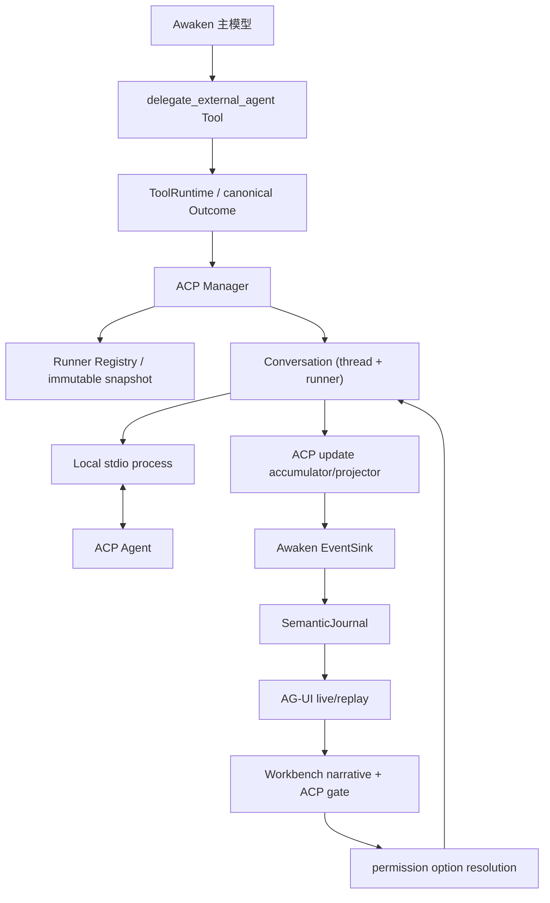

# ACP协作 · 实现方案

本文说明代码职责、数据与接口、异常恢复和验证方法。功能范围及用户操作见[需求文档](需求文档.md)。

## 参考实现结论

### QwenPaw 可复用的设计

| QwenPaw 设计 | 位置 | Awaken 采用方式 |
| --- | --- | --- |
| 每个业务 Agent 一份 `ACPService`，会话按 `(chat_id, agent)` 绑定 | `agents/acp/service.py:56-69` | 改为 Core 单例 `acp.Manager`，会话按 `(threadID, runnerID)` 绑定 |
| stdio spawn 后严格执行 initialize/version check/new session | `agents/acp/service.py:290-340` | 原样保留协议顺序，并增加 capability snapshot 与启动超时 |
| 同一 ACP session 仅允许一个 prompt turn | `agents/acp/service.py:78-116` | 使用 conversation `turnMu` 与 active turn identity 保证串行 |
| permission request 暂停 prompt，按精确 option ID 恢复 | `agents/acp/client.py:94-143`、`service.py:117-150` | 复用 Awaken run await/resolve 机制，但建立 ACP 专用 typed resolution |
| `SessionAccumulator` 合并 tool update，避免 start/update 丢字段 | `agents/acp/client.py:39-66`、`client.py:145-182` | 在 `src/acp/projector.go` 建 `toolCallID -> snapshot` 累加器 |
| cancel 多次通知并等待 prompt 收口 | `agents/acp/service.py:178-212` | 遵守 ACP v1 cancel 语义，发送一次 cancel，等待有界终态后 kill tree；不把 transport kill 等同于无副作用取消 |
| 关闭会话时先 `session/close`，再杀完整进程树 | `agents/acp/service.py:407-435` | 复用 Awaken 已有跨平台 process-group 模式，加入 graceful/force 两阶段 |
| 模型工具提供 list/status/start/message/respond/close | `agents/tools/delegate_external_agent.py:122-154` | 保留动作式单工具，但增加 `cancel`，并用结构化 output schema |
| Node/npx 探测与 npm cache 隔离 | `agents/acp/node_runtime.py` | 不把 Node 当 ACP 必需依赖；runner 自报 command dependency，npx runner 才探测 Node/npx |
| QwenPaw 同时可作为 ACP Agent over stdio | `agents/acp/server.py:247-1380` | 作为第二阶段参考，不与首期 Client 生命周期混做 |

### 不应照搬的部分

1. QwenPaw 的 Python SDK/asyncio/AgentScope 类型不能进入 Go Core；Awaken 需要保持 `src/agentcore`、`src/runtime`、`src/protocol/agui` 的 ownership。
2. QwenPaw 的 `_runner_states` 是进程内状态，无法满足 Awaken 的 SemanticJournal 和 thread replay 要求。Awaken 必须把已完成的委派摘要耐久化，把活跃进程状态明确标为非耐久。
3. QwenPaw 的 `trusted` 配置在调研到的 ACP client 路径中没有形成可验证的授权分支，Awaken 不引入语义不清的同名布尔值。
4. QwenPaw 通过正则 hard-block 命令并用路径字符串前缀判断越界。Awaken 必须复用 TaskScope/protected roots 的规范化路径判断，禁止 `C:\work2` 被误认为 `C:\work` 的子路径。
5. QwenPaw 把 runner 输出渲染成文本 ToolChunk。Awaken 应先形成 typed internal event/canonical outcome，再分别生成 model、journal 和 AG-UI projection。
6. QwenPaw client 每次新会话启动一个进程，配置刷新时替换 service。Awaken 配置刷新只能影响后续会话；活跃会话使用启动时的 immutable runner snapshot，避免 command/env 中途漂移。
7. QwenPaw server 提供 bypass-permissions session mode。Awaken 不提供可由 ACP client 切换的全局安全绕过模式。

## 方案比较与结论

| 方案 | 优点 | 缺点 | 结论 |
| --- | --- | --- | --- |
| A. Electron Main 使用官方 TypeScript SDK | 官方 SDK、开发快 | 进程、权限、cwd 和会话落入错误 owner；Core 无法统一取消、journal 和工具快照 | 否决 |
| B. Go Core 手写全部 JSON-RPC 与 ACP schema | 无社区 SDK 依赖 | schema 漂移和 union 类型维护成本高，容易偏离协议 | 不作为首选 |
| C. Go Core 使用社区 Go SDK，外包一层内部 adapter | 类型化、同时覆盖 client/agent、与现有 Go 生命周期一致 | SDK 非 ACP 官方组织维护，需要 pin、parity test 和替换边界 | 选定 |
| D. 独立 Node ACP sidecar | 可用官方 TS SDK | 新增 sidecar 打包、监督和第二套 RPC，故障面大 | 仅作为 Go SDK 无法满足协议时的后备 |

选定方案：在 Go Core 中使用 `github.com/coder/acp-go-sdk`，首个实现版本固定到经测试的确切 release（调研时为 `v0.13.5`），所有第三方类型只允许出现在 `src/acp/protocol` adapter 内。业务层只依赖 Awaken 自有接口和类型。升级 SDK 时必须重新跑官方 schema JSON golden/parity、四个真实 runner smoke 和跨平台进程清理测试。

该 Go SDK 是社区库，不是 ACP 官方 SDK。若 Phase 0 发现它无法满足固定 v1 schema 或取消/permission 并发要求，替换方案是从固定官方 v1 schema 生成 `src/acp/protocolgen`，保留相同内部接口；不得把 SDK 类型扩散到 Agent、runtime、server 或 Desktop。

## 总体架构



责任边界：

| 模块 | 新增/修改位置 | 职责 |
| --- | --- | --- |
| ACP protocol adapter | `src/acp/protocol/` | SDK 封装、v1 capability、content/union 转换、extension 拒绝 |
| ACP manager/runtime | `src/acp/` | runner 配置、spawn、conversation、turn、permission、cancel、close、诊断 |
| 模型工具 | `src/tools/delegate_external_agent/` | 输入校验、调用 manager、canonical outcome、模型可见摘要 |
| Agent Core | `src/agentcore/` | ACP 内部事件、专用 permission await 接口、工具进度接线 |
| Runtime | `src/runtime/` | run-bound wait/resolve、active session 取消、SemanticRecord 和恢复封口 |
| Server | `src/server/` | ACP 配置/状态 route 与 permission resolve route |
| AG-UI | `src/protocol/agui/` | ACP semantic record 的唯一 wire 投影 |
| Desktop | `apps/desktop/src/shared`、`renderer` | typed consumer、Workbench gate、设置页；不持有进程和策略 |

## 核心数据模型

### Runner 配置

新增 `src/acp/config.go`：

```go
type RunnerConfig struct {
    ID                    string            `json:"id"`
    Enabled               bool              `json:"enabled"`
    Command               string            `json:"command"`
    Args                  []string          `json:"args,omitempty"`
    Env                   map[string]string `json:"env,omitempty"`
    PermissionMode        PermissionMode    `json:"permission_mode"`
    StartupTimeoutSeconds int               `json:"startup_timeout_seconds"`
    TurnTimeoutSeconds    int               `json:"turn_timeout_seconds"`
    MaxFrameBytes         int               `json:"max_frame_bytes"`
}
```

约束：

- `ID` 使用稳定的 `[a-z0-9][a-z0-9_-]{0,63}`；显示名可另设，不能用 command 代替 identity。
- `command` 必须是单个 executable；禁止把整条 shell command 塞入字符串再交给 shell 解析。
- `args` 逐项传给 `exec.CommandContext`，不经 shell。
- `env` 只能覆盖显式键；启动环境基于 Desktop 注入给 Core 的当前用户环境构造。日志、API、journal 不返回 env value。
- `PermissionMode` 首期支持 `ask` 和 `deny`。不提供 `allow_all`；后续若增加 `auto_allow_safe`，必须先定义安全分类和单独验收。
- 默认 `startup_timeout_seconds=15`、`turn_timeout_seconds=600`、`max_frame_bytes=8 MiB`；最大值在解析时封顶，避免恶意配置造成无界内存。

配置 authority：

- user：`$AWAKEN_HOME/config/acp-agents.json`（维护位置位置）；
- project：不再支持项目级 ACP runner 配置；`<workspace>/.awaken/acp-agents.json` 不再被加载或合并；
- 当前 run/session 固定 `RunnerSnapshot`；文件变化只影响新 session，不热改活跃进程。

首期建议内置模板但默认不执行安装：

```json
{
  "schema_version": 1,
  "runners": [
    {"id":"opencode","enabled":false,"command":"opencode","args":["acp"],"permission_mode":"ask"},
    {"id":"qwen_code","enabled":false,"command":"qwen","args":["--acp"],"permission_mode":"ask"},
    {"id":"claude_code","enabled":false,"command":"npx","args":["-y","@zed-industries/claude-agent-acp"],"permission_mode":"ask"},
    {"id":"codex","enabled":false,"command":"npx","args":["-y","@zed-industries/codex-acp"],"permission_mode":"ask"}
  ]
}
```

内置模板在 Desktop ACP 设置页中默认展示，且默认 `enabled:false`，避免在未安装依赖时自动启动外部进程。模板中的包名和启动参数在启用前必须用各 runner 当前官方说明重新验证；模板不是自动安装合同。

### Conversation 与 Turn

```go
type ConversationKey struct {
    ThreadID string
    RunnerID string
}

type Conversation struct {
    Key             ConversationKey
    ACPSessionID    string
    WorkspaceRoot   string
    RunnerSnapshot  RunnerSnapshot
    Capabilities    AgentCapabilitiesSnapshot
    Process         ProcessHandle
    State           ConversationState
    ActiveTurn      *TurnState
    PendingPermission *PermissionRequest
    LastErrorCode   string
    LastErrorMessage string
}
```

conversation 只存在 Core 内存中。耐久化的是 session receipt 和已完成 turn 摘要，不是可复用的 pipe/process handle。

状态机：

```text
absent -> starting -> ready -> prompting -> ready
                     |          |
                     |          +-> waiting_permission -> prompting
                     |          +-> cancelling -> ready|failed
                     +-> closing -> closed
any non-closed state -> failed (process exit / protocol error)
```

不变量：

- 一个 `(threadID, runnerID)` 最多一个 live conversation。
- 一个 conversation 最多一个 active prompt。
- 相同 runner 可同时服务多个 thread，但每个 thread 使用独立进程/session，首期不在进程内复用多 session。
- `cwd` 在创建 session 后不变；`message` 不允许用新 cwd 偷换 workspace。需要改变 cwd 必须 `close` 后 `start`。
- `start` 遇到已存在 live session 返回 conflict；不会隐式丢弃旧上下文。`restart=true` 不放进首期模型 schema，避免模型轻易销毁会话。
- ACP process/pipe 生命周期由 Manager-owned context 持有，不继承某一次 `start` 工具调用的 context；工具调用返回不能终止需要跨 turn 复用的 runner。
- transport/process 退出会立即清除 active turn 与 pending permission，把 conversation 标记为 `failed` 并保存安全的 `last_error_code/message`；failed conversation 的 `message` 不得再次写旧 client，后续只能检查外部状态后重新 `start` 或 `close`。
- Core 重启后所有 live conversation 均为 `interrupted`；模型必须重新 `start`。

### PermissionRequest

```go
type PermissionRequest struct {
    InteractionID string
    ThreadID      string
    RunID         string
    RunnerID      string
    ACPSessionID  string
    ToolCallID    string
    Title         string
    Kind          string
    Paths         []string
    Command       string
    Options       []PermissionOption
    ExpiresAt     time.Time
}
```

只保留 UI 和决策所需的已净化字段。原始 ACP payload 可以保留在进程内 pending request 中用于回包，但不得进入 model result、journal、AG-UI 或日志。

## 模型工具合同

工具名使用 `delegate_external_agent`，避免与 Awaken 原生 subagent 混淆。

### 输入

```json
{
  "action": "list | status | start | message | cancel | close",
  "runner": "codex",
  "message": "任务或后续消息",
  "cwd": ".",
  "max_runtime_seconds": 600
}
```

规则：

- `list` 不需要 runner；只返回 enabled/ready runner，不返回 env。
- `status` 可指定 runner；返回 session state、active turn、pending permission 的安全摘要。
- `start` 必须有 runner 和非空 message；`cwd` 缺省为当前 run workspace root，相对路径按 workspace 解析并必须落在 TaskScope readable root 内。
- `message` 必须绑定已有 session，不接受 cwd。
- `cancel` 取消 active turn但保留 session；无 active turn 返回幂等状态。
- `close` 先取消 active turn，再 close session 和 process tree；返回是否实际关闭。
- permission 选择不通过模型工具的 `respond` action 回传。用户直接在 Workbench gate 选择，Core 用 run/interaction identity 回应 ACP。这样主模型不能替用户批准外部 Agent 权限。QwenPaw 的 `respond` 仅作为参考，不在 Awaken 首期采用。

### 输出

输出必须是 canonical `ExecutionOutcome`，`details.action` 是必填判别字段，并由严格 `oneOf` 为不同 action 选择固定 schema：

```json
{"action":"list","runners":[{"id":"codex","command":"codex-acp","args":[],"permission_mode":"ask"}]}
{"action":"status","thread_id":"thread-1","runner_id":"codex","session_state":"failed","last_error_code":"acp_transport_closed","last_error_message":"broken pipe"}
{
  "action": "start",
  "runner_id": "codex",
  "session_state": "ready",
  "acp_stop_reason": "end_turn",
  "assistant_text": "...",
  "tool_summary": {"completed": 3, "failed": 0},
  "permission_state": "none",
  "truncated": false
}
{"action":"cancel","runner_id":"codex","session_state":"cancelling"}
{"action":"close","runner_id":"codex","session_state":"closed"}
```

- `list`、指定 runner 的 `status`、当前 thread 全会话 `status`、`start`、`message`、`cancel`、`close` 各自拥有封闭字段集；不得以 `additionalProperties=true` 掩盖实现与合同漂移。
- runner/session/pending-permission 通过带 snake_case JSON tag 的安全 DTO 投影；不得把 Go 字段名或 runner env 写入 details。
- `assistant_text` 有独立大小上限，超限复用 ToolResultOffloadStore；AG-UI 只投影稳定 preview/storage receipt。
- ACP protocol/transport/process 错误映射到 `failed`，给出稳定 error code、retryable 和 recovery；不把 stderr 全量返回模型。
- permission 等待不是工具成功或失败。ToolRuntime 保持当前 tool call 未完成，直到用户选择、取消或超时。

`PermissionAwaiter.AwaitPermission` 先注册有截止时间的请求，再同步调用 `ready` 发布 pending 状态和事件，最后等待 channel。回应在锁内领取并移除记录，避免快速回应被判过期、同一回应被接受两次；取消后不再接受选项。`permission_registration_test.go` 覆盖发布时立即回应、重复回应和取消。
- 外部 Agent 已修改文件但 transport 中断时，`sideEffectState=unknown`，禁止主 Agent原样自动重跑。

## 协议与进程生命周期

### 启动

1. 从当前 run 的 workspace 和 runner registry 创建 immutable snapshot。
2. readiness probe 使用 `exec.LookPath`；若 command 为 `node`/`npx`，额外记录 Node/npx version，但不自动安装。
3. 按平台创建新的 process group/job；process 使用独立的 Manager-owned lifecycle context，不绑定 `start` tool-call context；stdin/stdout 专用于 ACP，stderr 进入有界诊断 ring buffer。
4. 创建 SDK client-side connection。
5. 在 15 秒内发送 `initialize(protocolVersion=1)`；client capabilities 首期为空，不谎报 fs/terminal。
6. 响应协议版本非 1 时关闭 connection 和 process，返回 `acp_protocol_version_mismatch`。
7. 保存 agent capability snapshot；只调用对方已声明的可选方法。
8. 调用 `session/new(cwd=<absolute workspace scoped path>, mcpServers=[])`。
9. 成功后发内部 `ACP_SESSION_STARTED` receipt；失败走统一 close。

### Prompt 与 update

1. `start/message` 获取 conversation `turnMu`，创建 `turnID`。
2. 仅在对方 prompt capability 允许时发送对应 block；首期只有 text。
3. `session/update` 进入 `UpdateAccumulator`：
   - agent message chunk：按 message/content 顺序累加文本并做增量去重；
   - thought chunk：只生成活跃状态，不保存正文到 journal；
   - tool call/start/update：按 `toolCallID` merge 缺省字段，形成外部工具快照；
   - plan update：保留当前 plan 快照，首期仅显示简洁进度；
   - available commands/config/mode：保存 capability 状态，不直接暴露为 Awaken command；
   - usage update：可保存为 ACP runner usage，但不得混入 Awaken 主模型 usage/cost。
4. 收到 prompt response 后校验 stop reason，flush 文本，形成 terminal receipt 和 canonical outcome。
5. 正常响应或已确认的 cancel/timeout 释放 active turn，session 回到 ready；`acp_transport_closed`、进程退出或协议 I/O 失败则清除 active/pending、关闭并分离 client、把 session 置为 failed，不能回到 ready。
6. lifecycle-aware client 在空闲期发现子进程退出时也执行同一 failed 转换；`status` 返回 failed 与最后错误，而不是仅凭旧内存状态报告 ready。

### Cancel 与 close

- Awaken run cancel 必须向所有由该 run 正在等待的 ACP turn 发送 `session/cancel`，并以 2 秒 grace 等待原 prompt 返回 `cancelled`。
- cancel 时所有 pending permission 必须回应 ACP `cancelled` outcome，Workbench gate 立即移除。
- grace 超时后关闭 pipe 并终止完整 process tree；记录 `transport_forced_closed` 与 `sideEffectState=unknown`。
- `close` 在无 active turn时调用对方已声明支持的 `session/close`；未声明时直接关闭 connection/process，不发送未知方法。
- Core shutdown 按 conversation 并发关闭，但设置总预算；最后统一 force kill，不能遗留 Node wrapper 的孙进程。

## 权限与安全模型

### 两层决策

第一层是 Awaken 是否允许启动该 runner：由 runner enabled、command readiness、TaskScope、protected roots 和 ToolRuntime 固定快照决定。

第二层是外部 Agent 在 ACP prompt 内发出的 `session/request_permission`：这是 ACP 协议要求的外部执行选择，不扩展为 Awaken 所有工具的通用人工审批。

### ACP permission gate

新增 `ACPPermissionAwaiter`，不要把 option ID 塞进现有 `ExternalInteractionResolution=completed|cancelled|...`。可以复用 `ExternalActionGate` 的 composer-stack 布局与一次性等待机制，但需扩展为 typed variant：

```go
type ACPPermissionResolution struct {
    InteractionID string
    OptionID      string
    Cancelled     bool
}
```

route：

```text
POST /v1/runs/{run_id}/acp-permissions/{interaction_id}/resolve
{"option_id":"allow-once"}
```

约束：

- Core 只接受原 permission request 中精确存在的 option ID；不接受 label 或任意文本。
- Renderer 显示 option name/kind，但提交 option ID。
- run cancel、超时、thread 终止统一返回 ACP `cancelled` outcome。
- permission request 不跨 run 恢复；Core 崩溃后旧 gate 不 replay。
- `allow_always` 仅表示把当前 option 原样返回该 ACP Agent；Awaken 首期不把它保存为自己的长期授权规则。
- `PermissionMode=deny` 自动返回 cancelled/拒绝结果并记 receipt；`ask` 进入 gate。

### 路径与命令净化

- ACP tool locations 仅作展示，不能证明真实副作用范围。
- 路径使用 `filepath.Clean/Abs/EvalSymlinks` 和 TaskScope root containment 检查；越界路径在 UI 中标红并默认仅提供 reject option。是否允许外部 Agent 越界不能由 ACP 自报 option 决定。
- 命令只显示长度受限、去控制字符的 preview；stderr、env、token、credential、device code 不进入 projection。
- 对明显灾难性命令保留 host hard-block，但规则属于 04 安全域并需要独立测试；hard-block 时直接返回拒绝，不让模型或用户通过 option 绕过。
- runner process 使用当前登录用户执行，与 Awaken Bash 一样不声称操作系统级 sandbox。产品必须明确显示这一边界。

## 事件、Journal 与 Desktop 投影

### 新增内部语义

建议新增 SemanticKind：

- `acp_session_started`、`acp_session_closed`、`acp_session_interrupted`；
- `acp_turn_started`、`acp_turn_finished`；
- `acp_tool_snapshot`；
- `acp_permission_requested`、`acp_permission_resolved`。

其中 active process/pending permission 不耐久恢复；requested/resolved record 用于当前 run live 顺序和事后只读说明，replay 时不得恢复按钮。thought 正文、raw JSON-RPC、stderr 和 env 不写 journal。

### AG-UI event family

新增 Awaken 扩展事件：

- `AWAKEN_ACP_SESSION_CHANGED`；
- `AWAKEN_ACP_TURN_CHANGED`；
- `AWAKEN_ACP_TOOL_CHANGED`；
- `AWAKEN_ACP_PERMISSION_REQUESTED/RESOLVED`。

所有字段先在 `src/protocol/agui/events.go` 定义，再实现 mapper 与 semantic projector，最后同步 `apps/desktop/src/shared/agui.ts`。live 与 replay 对同一 durable record 必须产生相同 frame/identity；permission requested 在 replay 只能成为 resolved/interrupted 的只读历史卡，不恢复交互。

外部 tool snapshot 必须带：`runnerId`、`acpSessionId`、`acpTurnId`、`acpToolCallId`、title/kind/status、净化的 locations/summary。不得复用 Awaken 本地 `toolCallId` 作为唯一 identity。

### Workbench

- ACP turn 作为当前 `delegate_external_agent` 工具的嵌套进度展示，不新增第二滚动容器。
- ACP permission variant 放入既有 `composer-dock-stack`，保留 draft/focus/follow/marker/return-to-latest 不变量。
- 切到其他 thread 不显示当前 gate；切回 active run 可从内存 active state 恢复显示。
- 完成后的外部 tool calls 为只读，不提供“重跑”按钮。
- 第一阶段不新增右侧 Inspector；runner/tool 元数据先保留在 reducer，后续再消费。

实现 UI 前必须完整执行中间区域《架构契约》《复核清单》《验收规范》。

## 配置与本地 API

新增 route：

```text
GET    /v1/acp/runners
POST   /v1/acp/runners
PATCH  /v1/acp/runners/{runner_id}
DELETE /v1/acp/runners/{runner_id}
POST   /v1/acp/runners/{runner_id}/probe
GET    /v1/acp/sessions
POST   /v1/acp/sessions/{runner_id}/close
POST   /v1/runs/{run_id}/acp-permissions/{interaction_id}/resolve
```

规则：

- CRUD 只修改 user scope 配置；project scope 的 ACP runner 配置已移除，不再加载或合并。
- probe 只执行 `command --version` 或 runner-specific non-interactive readiness，不启动业务 session，不自动下载 npm package。
- session list 只返回内存安全视图，不返回 PID、env、raw command line 或 stderr。
- route 是否注册由 ACP manager 是否成功建立决定；配置损坏时 list 返回明确 diagnostics，不阻止 Core 其他能力启动。
- Desktop 通过 Main/preload typed bridge 调用，不在 Renderer 拼 base URL。
- bridge 方法：`getACPRunners`、`createACPRunner`、`updateACPRunner`、`deleteACPRunner`、`probeACPRunner`、`resolveACPPermission`。

### AI 可调用配置工具 `configure_acp_runner`

除 Desktop 设置页外，AI 可通过内置工具 `configure_acp_runner` 在用户级配置中增删改 ACP runner。该工具：

- 只写 `$AWAKEN_HOME/config/acp-agents.json`，不触碰任何项目级路径；
- 不经过 TaskScope 文件桥，因此不需要放开 protected root；
- 支持 `create`、`update`、`upsert`、`delete` 四种动作；
- 输入字段包括 `runner_id`、`enabled`、`command`、`args`、`env`、`permission_mode`、`startup_timeout_seconds`、`turn_timeout_seconds`、`max_frame_bytes`；
- 输出为规范 `ExecutionOutcome`，details 包含 `runner_id`、`action`、`status`、`message`。

典型用例：

```json
{"action":"upsert","runner_id":"claude_code","command":"claude","enabled":true}
{"action":"delete","runner_id":"opencode"}
```

实现位置：`src/tools/configure_acp_runner/tool.go`；registry 在 `cmd/awaken-core/main.go` 启动时注入。

## Awaken 作为 ACP Agent 的目标设计

本章包含 Phase 5 已实现的设计约束和仍待完成的外部验收项。transport、runtime discovery、lease、session/control route、模型 selector 与默认 profile prompt 已实现；headless/第三方 client 正式验收尚未完成，不能把整章概括为全部验收通过。

### 形态选择

候选形态：

| 形态 | 优点 | 问题 | 结论 |
| --- | --- | --- | --- |
| Desktop 内直接实现 stdio ACP | 进程少 | Desktop 无法被外部 client 直接当作 stdio command；协议与 UI 生命周期耦合 | 否决 |
| 每个 client 启动独立完整 Core | 与 QwenPaw 接近、实现直观 | 多 Core 可能同时写同一 userData，状态与 Desktop 分裂 | 否决无约束版本 |
| `awaken-acp` launcher/bridge，复用或受管启动 Core | 对外是标准 stdio；可复用 Desktop Core，也支持无 Desktop 的 headless 场景 | 需要 discovery、runtime lock 和 lease | 选定 |

新增小型 stdio 入口 `cmd/awaken-acp`，协议实现放在 `src/acp/agentbridge`，不得把 Agent-side SDK 类型放入 Agent Core、runtime、server 或 Desktop。`awaken-acp` 不执行模型与工具，只负责：

1. 建立或发现一个受管 `awaken-core`；
2. 对外实现 ACP `initialize`、`session/new`、`session/prompt`、`session/cancel`、`session/close`；
3. 把 ACP session 映射到 Awaken project/thread/run；
4. 把 Core 的 durable/live semantic event 转成 ACP session update；
5. 把 ACP client 的 exact permission option 回写 Core；
6. 在 stdio EOF、client cancel、Core 退出和 launcher 退出时完成有界清理。

### thread 可见性与保留权

- 默认创建可见 thread，并写入 `source=acp_bridge`、`acp_client_name`、`acp_client_version`、`acp_session_id` 和 canonical cwd；用户可在 Desktop 中查看和继续该 thread。
- `session/new` 先用 canonical cwd 调用现有 project upsert 语义：workspace root 已存在时复用其 `project_id`，不存在时创建正常 project；不得创建只存在于 bridge 内存中的影子 project。并发 new session 对同一 canonical cwd 必须收敛到同一 project。
- client 可在 `session/new._meta["awaken.ephemeral"]` 传 `true` 请求临时 thread；未知或类型错误的 meta 忽略并按可见 thread 处理。
- 可见 thread 的保留与删除权归用户。`session/close` 只结束 ACP session 和 active run，不删除可见 thread。
- ephemeral thread 在 session close 后进入删除队列；仅在没有 active run、没有其他 lease 且 journal terminal 已落盘后删除。
- bridge 内存保存 `acp_session_id -> project_id/thread_id/current_run_id/visibility/cwd`；Core thread metadata 是可见 thread 的 durable identity owner，bridge 重启不得凭内存伪造恢复。

### cwd 信任模型

Phase 5 明确采用**信任本地 ACP client cwd、无需 Desktop 授权**的模型：

- `session/new.cwd` 必须是非空绝对目录；Core 执行 `Clean/Abs/EvalSymlinks`、存在性和目录类型校验，但不弹授权窗口、不要求该目录预先在 Desktop 打开，也不查 workspace allowlist。
- 规范化后的真实 cwd 直接成为该 ACP session 的 workspace root 和单 root TaskScope。信任只决定“可把哪个目录作为 root”，不代表后续工具可越出 root。
- 后续相对路径基于该 root；文件工具、artifact、protected roots 和敏感路径仍使用 04 域的路径组件级判断，禁止使用字符串前缀 containment。
- cwd 在 session 生命周期内不可改变；要切换 workspace 必须 close 后 new session。
- 该模型不提供 OS sandbox。安全边界是“能够以当前用户身份配置并启动 `awaken-acp` 的本地 client，与该用户具有相同文件权限”。文档和设置示例必须明确这一点。
- client 传入不存在路径、文件路径、无法规范化路径或 NUL/非法平台路径时，`session/new` 返回 invalid params；这属于输入有效性检查，不是用户授权。

### runtime discovery、身份与认证

每个 Awaken userData identity 最多有一个可发现 Core。discovery 不能放在开发版与安装版共享的业务数据根 `$AWAKEN_HOME/runtime/core.json`；应放在该 identity 自己的 `<AWAKEN_USER_DATA_DIR>/runtime/core.json`。`awaken-acp` 默认选择 packaged identity，并提供仅供开发/测试入口使用的显式 identity 参数；不得通过扫描并任选一个 manifest 猜测 identity。目录和文件使用当前用户专属权限，Windows 使用用户 ACL，Unix 目录 `0700`、文件 `0600`。

manifest 固定 schema：

```json
{
  "schema_version": 1,
  "runtime_identity": "packaged:<canonical-user-data-digest>",
  "instance_id": "core_<uuid>",
  "pid": 12345,
  "owner_mode": "desktop",
  "base_url": "http://127.0.0.1:<random-port>",
  "control_token": "<256-bit-random>",
  "started_at": "RFC3339Nano"
}
```

规则：

- Core 只监听 `127.0.0.1` 的随机端口；不接受 `localhost`、LAN 地址或固定 `8787` 作为 Phase 5 discovery contract。
- token 在每次 Core 启动时轮换，生命周期与 `instance_id` 相同；它是 instance-scoped token，不是会中短 TTL token，避免长 turn 因续期失败中断。
- 新增 bridge 专用 control routes，并全部校验 `Authorization: Bearer <control_token>`；至少包括 runtime identity、lease、ACP session/run/event/permission。token 不进入日志、journal、Renderer 或 ACP `_meta`。现有 Desktop route 是否统一鉴权属于独立安全迁移，不能因此让 bridge route 无鉴权上线。
- bridge 读取 manifest 后必须校验 schema、预期的 `runtime_identity`、loopback URL、PID 存活，并调用 authenticated `/v1/runtime/identity` 比对 `runtime_identity + instance_id`；任一失败都把 manifest 当 stale。
- manifest 用唯一临时文件原子 replace；Core 正常退出删除，异常残留由下一 launcher 在持有 runtime lock 后清理。
- `<AWAKEN_USER_DATA_DIR>/runtime/core.lock` 串行化发现与启动。lock 只覆盖“二次发现—spawn/launch—ready 或失败”的临界区，不被长期持有。多个 `awaken-acp` 可以并发存在，但必须复用同一 identity 的可发现 Core，不能各自启动一个写同一 userData 的 Core。

#### 入站 run 的模型 profile ownership

ACP client 可以选择 Awaken 已配置的模型，但选择值只是 opaque profile ID；provider、Base URL、运行参数和 credential 始终由 Awaken 本地配置拥有：

- Core 只读解析 `~/.awaken/config/models.json` 与 `~/.awaken/.env`，复用 Desktop 的 profile ID、enabled/default、配置顺序和 `AWAKEN_API_KEY_<profileId>` 合同；
- authenticated `GET /v1/control/acp/model-profiles` 只返回 enabled + ready profile 的 ID、provider ID、展示名、model ID 和默认项，不返回 Base URL、auth scheme、运行参数、key 尾号或 API key；
- `session/new` 把上述列表作为标准 ACP `SessionConfigOption(category=model)` 返回；支持的 client 通过 `session/set_config_option` 设置 model profile ID，不支持 selector 的 client 直接使用默认值；
- session 建立时选择 enabled + ready 默认 profile；没有可用默认时选择配置顺序中的首个 enabled + ready profile。选择固定在 session 内，不能在 active prompt 中改变；
- create-run wire 只额外接受 `model_profile_id`。Core 必须再次确认该 ID 当前仍 enabled + ready，再在本地解析完整 `ModelProfileConfig`；client 不能提交 provider、model、Base URL、capability、参数或 API key；
- profile 在 prompt 前被删除、禁用或失去 key 时返回 `ACP_MODEL_PROFILE_UNAVAILABLE`，不能静默换到另一付费 provider；只有 session 初始未选择时才执行默认/首项回退；
- API key 不进入 manifest、thread metadata、journal、日志、Renderer 或 ACP wire。

该方案的代价是本地 ACP client 能知道当前配置了哪些 provider/model，并可选择可能具有不同价格或额度的 profile。边界接受这一点：`awaken-acp` 是当前用户主动配置的本地 Agent，选择范围只包含用户已经启用且凭据可读的配置；custom Base URL 和凭据仍不可由 client 注入。profile 文件在 session 建立后变化时，旧 selector 可能失效并得到 typed error，client 应重新建立 session 获取新列表。

### Desktop 未运行时的启动策略

`awaken-acp` 支持 `--startup=desktop|core|fail`：

- `desktop`：默认。没有有效 manifest 时通过已安装应用的正式平台入口拉起 Awaken Desktop，等待 manifest + identity endpoint ready，默认预算 30 秒。Desktop 已运行时只 attach，不重复拉起窗口。
- `core`：headless。没有有效 manifest 时由 launcher 启动打包内的 `awaken-core`，使用随机 loopback 地址、同一 userData identity 和 `owner_mode=headless`。这不是用户手工维护的第二套服务，而是 `awaken-acp` 持有 lease 的受管子进程。
- `fail`：只 attach；没有 ready Core 时快速返回明确错误，适合禁止自动拉起 UI/后台进程的宿主。

launcher 的确定性状态机为：解析 identity 与 userData → 无锁验证 manifest → 若有效则 attach → 获取 runtime lock → 二次验证 → 按 startup 策略启动 → 等待带匹配 identity 的 ready manifest → 获取 lease → 释放 lock。等待 lock 或 ready 超时都返回结构化错误，不回退到另一个 identity，也不无限重试。`desktop` 通过安装包登记的正式平台入口启动；二次启动命中 Electron single-instance 时，既有 Desktop 必须确保 Core ready 并发布 manifest。

headless 生命周期：

1. launcher 获得 runtime lock，二次检查 manifest，仍不存在才 spawn；
2. Core ready 后发布 manifest，launcher 通过 authenticated lease route 创建 `bridge_id` lease；lease 由 Core 记账并带 30 秒 TTL，bridge 每 10 秒 heartbeat，不能由各 launcher 修改 manifest 中的共享计数；
3. stdio EOF 或 bridge 退出显式释放 lease；bridge 崩溃则由 TTL 回收。最后一个 lease 释放/过期后，headless Core 等待 30 秒 idle budget；期间若无 Desktop lease、active run 或新 bridge lease，则 graceful shutdown；
4. Desktop 后续启动时，其 runtime supervisor 必须先执行同一 discovery/identity 校验；发现 headless Core 后进入 external-attached 状态并登记可续期的 Desktop lease，不 spawn 第二个 Core。Desktop 是否显示已有 ACP thread 由正常 project/thread store 决定；
5. 启动失败必须清理自己创建的进程、lock 和 manifest；不得杀死 identity 不匹配的进程。

Core 是 lease 与 idle 判定的唯一 owner。manifest 只做发现，不保存动态 lease 列表。Desktop-owned Core 由 Desktop 进程所有，不因 bridge lease 归零退出；headless Core 没有 lease 但仍有 active run 时不退出，run terminal 后重新开始 idle budget。Desktop 从 headless Core detach 只释放 Desktop lease，不把并非自己 spawn 的 Core 当子进程强杀。

`--startup=core` 不需要 credential broker。模型 key 的当前权威是 `~/.awaken/.env` 明文文件而非 Electron `safeStorage`；launcher 会把正式 `~/.awaken` 作为 canonical `AWAKEN_HOME` 注入 headless Core，并移除 client 继承环境中同名覆盖。Core 使用与 Desktop 相同的文件身份只读解析 profile/key，因此只启动 `awaken-core`，不创建 Desktop 或 Electron helper。`.env` 损坏、权限拒绝或无 enabled + ready profile 时 fail closed，返回 `ACP_MODEL_PROFILE_UNAVAILABLE`。

实现 Phase 5 时必须同步修改 README 与 03 域的 Desktop 唯一入口契约：允许 `awaken-acp --startup=core` 作为机器调用入口，但仍禁止用户直接运行和长期维护裸 `awaken-core`。

### capability 与内容边界

- 首版只声明 text prompt，以及实际实现的 session close/list/resume capability；未实现前不得提前声明。
- 不声明 ACP client-side fs/terminal capability，也不实现对应 callback。Awaken 内部工具产生的进度通过 ACP tool call/update 投影。
- image、audio、embedded resource 和未知 content block 返回 capability unsupported，不静默丢弃。
- Core event 只投影 allowlist 字段；raw JSON-RPC、模型 thought 正文、stderr、env、token、credential 和 device code不得进入 ACP update。

### `ask_user`、工具决策与 ACP permission

首版只有一个可操作 gate owner：外部 ACP client。

- Awaken 内部 finite-choice approval/recovery 转成一次 ACP `session/request_permission`，option ID 必须与 Core pending record 精确一致；client 的 selected/cancelled 回写同一 interaction。
- `initialize` 时 bridge 必须读取 client capability。client 不支持 `request_permission` 时，不得自动批准或把 gate 转交 Desktop：需要审批的工具在执行前得到 canonical denied/unsupported terminal，assistant 可在本 turn 解释限制；session 仍可继续无审批的 text turn。
- 入站 ACP run 不向模型暴露 free-text `ask_user` 工具。模型需要补充信息时在 assistant text 中结束当前 turn，client 通过下一次 `session/prompt` 回复，避免用 permission API伪装自由文本输入。
- Desktop 若同时打开同一可见 thread，只显示只读“等待外部 ACP client”状态，不生成第二组可操作按钮；Renderer 不能替外部 client 批准。
- cancel、deadline、stdio EOF 或 Core shutdown 必须让每个 pending permission 得到 cancelled 或 transport-closed terminal；迟到/重复 option 返回 expired，不恢复 gate。
- 不提供 `bypassPermissions` 或 client 可切换的 allow-all 模式。

### cancel、退出与 ownership

- `session/cancel` 只取消该 ACP session 当前 run，不关闭 thread；`session/close` 先 cancel active run，再等待 terminal，最后释放 session mapping。

Prompt 创建 run 的 HTTP context 同时关联调用方和 session 取消。Core 在创建前检查取消；已创建但请求取消或响应写出失败时取消对应 run，等待终态后才释放关联。bridge 通过受 control token 保护的 session GET 同时读取 `run_starting` 和 `current_run_id`，等待创建占位释放，或取回响应丢失的 run 并取消；这段确认最多等待 6 秒，无法确认时返回错误。取消确认期间保留本地 prompt 占位，不自动重发创建请求。`prompt_cancellation_test.go`、`control_acp_run_test.go` 和 runtime 的 `acp_session_test.go` 覆盖创建阶段取消、未启动模型、终态前保留关联及取消后立即继续。
- Desktop 退出不被 bridge 无限阻止。Desktop-owned Core 使用 5 秒总预算完成 cancel、permission cancelled、terminal flush 和连接关闭，超时后强制退出；bridge 向 client 返回 cancelled 或 transport closed。
- headless Core 不因 Desktop 窗口退出而关闭，只服从 lease/idle 规则；最后一个 lease 退出时仍按有界预算清理。
- bridge 不拥有外部 ACP client 进程，也不尝试杀 client；只关闭自己的 stdio、HTTP subscription 和自己启动的 headless Core。

### event 映射与审计

- 每个 inbound prompt 创建一个 Awaken run；同一 ACP session 的多轮 prompt 复用 thread，不复用已 terminal 的 run。
- Core durable semantic record 是事实 owner。bridge 从带 cursor 的 SSE 读取，并按 `(instance_id, run_id, seq)` 去重；重连从最后确认 cursor 继续。
- assistant text 映射 agent message chunk；工具 started/update/result 映射 ACP tool call/update；run terminal 映射 prompt response stop reason。

文本增量原样追加；只有携带 `recordId` 或 `semanticSeq` 的耐久全文投影，才与已输出正文协调并补出未发送的后缀。传输重放由 cursor 去重，不能根据两个片段的文字相同推断重放；耐久全文与已输出前缀冲突时失败，不继续拼接矛盾正文。`session_test.go` 覆盖重复文字、空格、全文重放和冲突。
- audit 至少记录 client implementation name/version、bridge version、ACP session ID、thread/run ID、canonical cwd digest、source、permission option kind、cancel/close reason；不记录 cwd 之外的 secret、token 或 raw payload。
- replay 只用于恢复只读上下文和 bridge cursor；历史 permission requested 不重新发起 request_permission。

### Phase 5 失败码与降级

| 场景 | 行为 |
| --- | --- |
| Desktop/Core 启动超时 | 返回 `awaken_runtime_start_timeout`，清理本次创建的 owner，不自动重试无限次 |
| manifest stale/identity mismatch | 持 lock 清理 stale manifest，再按 startup 策略重试一次 |
| cwd 无效 | `session/new` invalid params，不创建 thread |
| Core 中途退出 | 当前 prompt transport closed，side effect unknown；不静默启动新 Core 重放 prompt |
| client stdio EOF | cancel active run、关闭 session、释放 lease |
| unsupported content/capability | 返回明确 unsupported；保留 session 可继续 text turn |
| permission client 不响应 | 到期回 cancelled，run 形成单一 terminal |

## 模块依赖与验证顺序

当前 Client 和 Agent bridge 的代码职责、协议、配置及启动路径见前文。持续验证仍需补齐：

- OpenCode、Qwen Code、Claude Agent ACP、Codex ACP 的真实 runner 启动与能力矩阵，至少两个 runner 完成文本轮次。
- 大文本接入 ToolResultOffloadStore；raw protocol/stderr 不进入模型和 journal。
- 外部副作用未知时的重试监督与 failure supervisor 测试。
- 脱敏审计包含 runner snapshot、ACP identity、permission option kind 与副作用不确定性。
- ACP compatibility suite、Zed 和另一真实 client，分别验证 Desktop attach、Desktop auto-start、受管 headless Core；补齐多 bridge、TTL 和 Desktop 接管证据。

取消、超时、崩溃、重连和关闭都应产生单一终态；不能重放外部任务，也不能遗留可操作的旧 permission gate。

## 测试矩阵

### Go 单元测试

- config：schema、merge、disable override、unknown field、secret redaction、immutable snapshot；
- process：command/args 不经 shell、cwd、env、startup timeout、stderr ring、process group/tree kill；
- protocol：initialize version、capability omission、unknown extension、frame limit、malformed JSON、EOF；
- accumulator：chunk 去重、out-of-order update、partial tool fields、terminal flush；
- manager：多 thread 隔离、同 conversation turn serialization、start conflict、message without session；
- permission：exact option ID、deny mode、timeout、cancel、late response、path outside TaskScope；
- outcome：stop reason、transport error、unknown side effect、large result offload；
- delegate output contract：list、两种 status、start、message、cancel、close 的成功 details 全部经过 strict output schema；未知字段必须产生 `tool_output_schema_mismatch`；
- process ownership：结束 `start` 调用 context 后 runner 仍可接受下一 prompt；进程/pipe 退出后 session 立即 failed，旧 client 不得再次 Prompt；
- recovery：open turn/tool/permission 在启动扫描时封口且不执行进程。

### Core 集成测试

仓库新增 `testdata/acp/mock-agent`，支持环境/参数脚本化以下情形：

- 正常 text + tool update + end_turn；
- permission allow/reject/cancel；
- initialize mismatch；
- prompt refusal/max_tokens/cancelled；
- prompt 永不返回；
- malformed/oversized frame；
- parent 退出但 child 存活；
- permission 后修改文件再断线，用于验证 unknown side effect。

建议命令：

```bash
go test -count=1 ./src/acp ./src/tools/delegate_external_agent ./src/agentcore ./src/runtime ./src/server ./src/protocol/agui
npm --prefix apps/desktop test -- --run src/renderer/runtime/reducer.test.ts src/renderer/run-narrative/projector.test.ts
npm --prefix apps/desktop run typecheck
git diff --check
```

### 真实 runner 矩阵

| Runner | macOS | Windows | 必验 |
| --- | --- | --- | --- |
| OpenCode ACP | smoke | smoke | init/new/two prompts/tool update/cancel/close |
| Qwen Code `--acp` | smoke | smoke | 同上 + permission |
| Claude Agent ACP | smoke | smoke | npx readiness、Node wrapper tree kill |
| Codex ACP | smoke | smoke | npx readiness、tool progress、permission、cancel |

每次验收记录 runner/version、启动命令、ACP protocolVersion、capability snapshot 和未通过项。runner 未安装不能写成通过。

### 真实 Desktop 验收

1. 从 README 正式入口启动 Awaken Desktop。
2. 设置页确认 runner 列表在宽窗口中紧凑居中；新增和编辑均从触发器打开居中模态表单，长内容只滚表单，取消、Escape、遮罩和关闭按钮均关闭并把焦点恢复到触发器；保存后 probe 成功再开始新 thread。
3. 委派纯只读分析，验证文本和工具进度嵌套显示。
4. 委派文件修改，验证 workspace 中真实变更、外部工具 identity 和主 Agent 收到的结果。
5. 触发 permission，验证精确 option、拒绝、等待期间取消、迟到提交。
6. 切换 thread 再切回，active gate 只在正确 thread 显示；完成后 replay 只读。
7. 运行中关闭 Desktop，确认 Core、runner 与 Node wrapper 子孙进程均退出；重开后历史显示 interrupted，不自动重做。
8. 验证 composer draft/focus、follow/paused、marker、return-to-latest 与 native bottom。

### Phase 5 入站 ACP Agent 验收

Phase 5 必须在 packaged identity 下用 ACP compatibility suite、Zed 和另一个真实 ACP client 执行，不能只用直接 HTTP 或 mock bridge 代替：

1. Desktop 已运行：client 启动 `awaken-acp` 后只 attach；确认没有第二 Core，visible thread 出现在 canonical cwd 对应 project。
2. Desktop 未运行、默认策略：client 启动 `awaken-acp` 后由正式入口拉起 Desktop，30 秒内完成 initialize/new/prompt；第二个 bridge 并发启动时复用同一 `instance_id`。
3. Desktop 未运行、`--startup=core`：只启动受管 headless Core，不出现 Desktop/Electron helper；确认 Core 从 canonical `~/.awaken` 解析默认或 client 选择的 profile，真实 prompt 成功。随后启动 Desktop，确认 supervisor attach 同一 Core、已有 thread 可见且没有重复进程。
4. `--startup=fail`：无 Core 时快速失败；有 Core 时成功 attach，且不得隐式拉起任何进程。
5. cwd：传入一个 Desktop 从未打开过的绝对目录，无授权弹窗即可创建/复用 project；相对、不存在、文件和非法路径被拒绝；工具仍不能越出该 cwd TaskScope。
6. thread：默认 visible session 多轮复用同一 thread；ephemeral session close 会先取消并等待 active run 进入 terminal，再删除临时 thread，不删除 project 或可见 thread。bridge lease 管理 Core 进程存活，不作为单个 ephemeral thread 的删除条件。
7. permission：支持 capability 的 client 完成 allow/reject/cancel；不支持 permission 的 client 得到 denied/unsupported，不在 Desktop 产生可操作 gate，也不自动批准。
8. 恢复：bridge 断线重连按 cursor 去重；历史 permission 只读且不重新请求；Core 中途退出不自动重放可能已有副作用的 prompt。
9. lease：bridge 正常退出立即释放；强杀 bridge 后 lease 在 TTL 内回收；active run 阻止 headless idle exit，terminal 后按预算退出且不留孤儿。
10. identity/security：开发版与安装版 manifest 互不串用；stale PID、错误 instance、非 loopback URL、错误 token 均被拒绝，日志/journal/UI 不出现 token。
11. model profile：`session/new` 只暴露非敏感 ready selector；显式 profile ID 生效，未选择使用默认/首个 ready；未知、disabled、missing-key ID 被拒绝；任何 provider/Base URL/参数/credential 注入均无效；`.env` 损坏或无可用 profile 时返回 `ACP_MODEL_PROFILE_UNAVAILABLE`。

开发版的真实 stdio 证据见 [验证记录](../../../apps/desktop/test-fixtures/deep-audit-fixes/verification.json)：自带 protocol client 启动实际 `awaken-acp --startup=fail`，接入已运行的 Desktop Core，使用保存的 k3 配置完成重复文本、创建阶段取消及立即继续。它覆盖该路径，不代表 packaged identity、Zed、第三方 runner 或完整 permission 矩阵已验收。

验收证据至少保存 client/version、启动参数、runtime identity、instance ID（可脱敏）、thread/run ID、关键进程树、协议结果和 Desktop 截图；token 与 cwd 原文不进入共享报告。

## 错误码与恢复

| Error code | 含义 | Retryable | 恢复 |
| --- | --- | --- | --- |
| `acp_runner_not_configured` | runner 不存在/被禁用 | false | 配置或选择其他 runner |
| `acp_runner_not_ready` | command/依赖不可用 | true | probe 并按官方方式安装 |
| `acp_start_timeout` | 进程或 initialize 超时 | true | 检查 runner 日志/命令 |
| `acp_protocol_version_mismatch` | 未协商到 v1 | false | 升降 runner/adapter |
| `acp_capability_unsupported` | 请求内容或方法未声明 | false | 使用已支持内容/方法 |
| `acp_session_conflict` | session/turn 已存在 | true | message/status/cancel/close |
| `acp_session_missing` | message/cancel 无绑定 session | true | start |
| `acp_permission_denied` | 用户或 policy 拒绝 | false | 改变方案，不原样重试 |
| `acp_permission_expired` | 等待超时 | true | 新 prompt 重新发起 |
| `acp_turn_timeout` | prompt 超过预算 | true | 先检查外部状态，再继续或新建 |
| `acp_transport_closed` | pipe/进程异常退出；当前 session 已失效 | false | 先检查 workspace/外部副作用，再新建 session；不得原样重放旧 message |
| `acp_output_limit_exceeded` | frame/result 超限 | false | 缩小任务或升级兼容限制 |

## 风险与回滚

| 风险 | 控制 | 回滚 |
| --- | --- | --- |
| 社区 Go SDK 漂移 | exact pin、内部 adapter、official schema parity | 替换为 schema-generated adapter，不改业务层 |
| 外部 Agent 越权修改 | TaskScope 展示/校验、默认 ask、protected roots hard-block、明确当前用户执行边界 | 全局 disable ACP tool/runner，不影响其他工具 |
| 孤儿进程 | process group/job、close grace、tree kill、shutdown 总预算 | 配置禁用该 runner并清理已知 PID tree |
| 输出淹没上下文/UI | frame/result limit、accumulator、offload、preview | 降低 runner limit，仍保留 terminal diagnostic |
| permission 双重决策/死锁 | 单 pending identity、typed route、cancel 必回 cancelled | deny mode，关闭交互 permission |
| replay 伪造活跃状态 | active state 不耐久、startup sealing、只读历史 | 隐藏 ACP live cards，仅保留 tool terminal |
| runner 已修改文件后断线 | sideEffectState unknown、禁止自动原样重试 | 用户检查 diff/状态后新任务恢复 |
| Desktop ownership 回归 | Core 管进程/策略，Renderer 仅 typed projection | 删除 UI/route，Core feature flag 关闭 |

功能开关建议：`AWAKEN_FEATURE_ACP_CLIENT=1` 仅用于开发阶段；发布后由 runner 配置是否 enabled 决定可用性。开关关闭时不注册模型工具、不启动 manager 会话，但已写的历史 record 仍可只读回放。

## 相关功能的同步要求

ACP 变更同时核对对话取消、本地服务、Journal、工具决策、路径安全、HTTP/SSE 和 Workbench 展示。Desktop、headless Core 与 bridge 必须遵守同一套随机 loopback、control token 和 identity 约束。

## 完成条件

只有同时满足以下条件，才能声明“Awaken 支持作为 ACP Client 与外部 Agent 协作”：

- `delegate_external_agent` 的六个 action、配置、probe、session、permission 和取消均实现；
- ACP v1 negotiation/capability/content 边界有自动化证明；
- live/replay、SemanticJournal、AG-UI 和 Desktop identity 一致；
- runner 崩溃、Core 重启、permission 超时、run cancel 不死锁、不伪成功、不留孤儿进程；
- TaskScope/protected roots、secret redaction、unknown side effect 和大输出边界通过；
- macOS 与 Windows 至少各完成两个真实 runner smoke；
- 真实 Awaken Desktop 完成 [测试矩阵](实现方案.md#测试矩阵) 并留下本次视觉与进程证据；
- [相关功能的同步要求](实现方案.md#相关功能的同步要求) 的权威文档已更新，当前实现与尚未完成的验证范围分开说明。

“Awaken 可被其他 ACP client 当作 Agent 调用”是独立完成声明，必须等 Phase 5 的 bridge、安全 discovery 和真实外部 client 验收完成后才成立。

## 参考资料

本地参考：

- `D:/project/QwenPaw/src/qwenpaw/agents/acp/client.py`
- `D:/project/QwenPaw/src/qwenpaw/agents/acp/service.py`
- `D:/project/QwenPaw/src/qwenpaw/agents/acp/server.py`
- `D:/project/QwenPaw/src/qwenpaw/agents/acp/permissions.py`
- `D:/project/QwenPaw/src/qwenpaw/agents/acp/node_runtime.py`
- `D:/project/QwenPaw/src/qwenpaw/agents/tools/delegate_external_agent.py`
- `D:/project/QwenPaw/tests/integration/fixtures/acp_mock_runner.py`

上游：

- [ACP 官方仓库](https://github.com/agentclientprotocol/agent-client-protocol)
- [ACP v1 初始化](https://agentclientprotocol.com/protocol/v1/initialization)
- [ACP v1 Session Setup](https://agentclientprotocol.com/protocol/v1/session-setup)
- [ACP v1 Prompt Turn](https://agentclientprotocol.com/protocol/v1/prompt-turn)
- [ACP v1 Tool Calls 与 Permission](https://agentclientprotocol.com/protocol/v1/tool-calls)
- [社区 Go SDK](https://github.com/coder/acp-go-sdk)

## 实现状态的实现

- 当前支持：
  - `github.com/coder/acp-go-sdk@v0.13.5` 已固定并封装在 `src/acp/protocol`，SDK 类型不越界；
  - `src/acp` 提供 runner registry、conversation、turn、permission、cancel/close 和错误码；
  - `delegate_external_agent` 工具支持 list/status/start/message/cancel/close；六种 action 使用带 `action` 判别字段的严格 `oneOf` 输出合同，成功结果必须通过同一 ToolRuntime output schema 验证；
  - ACP 生命周期与工具进度事件（`ACPSessionStarted/Closed/Interrupted`、`ACPTurnStarted/Finished`、`ACPToolSnapshot`、`ACPPermissionRequested/Resolved`）已接入 `agentcore.EventSink`，并经 `src/protocol/agui/mapper.go` 投影为 AG-UI 事件；
  - run cancel 通过 `acp.Manager.CancelAllForThread` 传播到活跃 ACP turn；
  - Server routes：`/v1/acp/runners`、`/v1/acp/sessions`、`/v1/acp/sessions/{runner_id}/close`、`/v1/runs/{run_id}/acp-permissions/{interaction_id}/resolve`。
- 当前支持（新增）：
  - Desktop Settings 已增加 ACP runner 配置页，支持内置/自定义 runner 的启用、编辑、probe、新增与删除；列表在 820px focused content column 中居中并使用紧凑卡片，新增与编辑复用居中模态表单及其内部滚动、底部操作、Escape/遮罩关闭和焦点恢复；
  - Main/preload/renderer typed bridge 已暴露 `getACPRunners`、`createACPRunner`、`updateACPRunner`、`deleteACPRunner`、`probeACPRunner`、`resolveACPPermission`；
  - Workbench 已展示嵌套 ACP turn/tool progress（`acpSession`/`acpTool` narrative item）和 ACP permission gate（精确 option 按钮）；
  - 新增 AI 可调用工具 `configure_acp_runner`，用于在用户级 ACP 配置中增删改 runner，不经过 TaskScope 文件桥，不触碰项目级路径。
- 当前支持（Phase 5）：
  - `cmd/awaken-acp` 入口与 `src/acp/agentbridge` 实现 stdio ACP Agent；
  - launcher 支持 `--startup=desktop|core|fail`，复用或受管启动 awaken-core，通过真实 HTTP control routes 创建/heartbeat/release lease；
  - ACP `initialize`、`session/new`、`session/prompt`、`session/cancel`、`session/close` 已映射到 Core；`session/new` 返回标准 model config option，client 可通过 `session/set_config_option` 选择 Awaken 已配置的可用 profile；
  - client 不选择时使用 session 建立时的 enabled + ready 默认 profile；没有可用默认时回退到配置顺序中的首个 enabled + ready profile；
  - Core 运行时事件经 AG-UI 常量正确投影为 ACP `session/update`（text delta、tool call/update、permission request），RUN_ERROR 不再伪装成成功；
  - 权限选择通过 `/v1/control/acp/sessions/{session_id}/runs/{run_id}/permissions/{interaction_id}/resolve` 回写到 ACP permission awaiter，支持 `allow_once/allow_always/reject_once/reject_always`；
  - Core 在创建 run 时原子保留并绑定 ACP session；`session/cancel`、stdio EOF/signal 通过精确的 session/run identity 传播，并触发 5 秒有界清理；
  - 同一 Core 实例内的 SSE 瞬时断线会从最后确认的 `streamCursor` 有界重连并去重；未收到 terminal 的 EOF 不再被视为成功；
  - Desktop 在启动前发现并 attach 已有 headless Core，避免重复 spawn；manifest 使用 CAS 与 instance-owned 删除防止多 Core 竞争；
  - bridge 的 run/event/cancel/permission 全部走 authenticated `/v1/control/acp/sessions/...` 控制面。
- 当前不支持：
  - 真实 runner（Codex、Claude Code、OpenCode、Qwen Code）的端到端 smoke 与 Desktop 视觉验收（依赖本机安装与 Windows Desktop 环境，本次未执行）；
  - 跨 Core 重启的 ACP 会话恢复（活跃 session 在重启后标记为 interrupted，不重放外部任务）；
  - 跨 Core 重启后的 stream/session 恢复、长 turn 中 ACP live event 的独立 durable append；
  - `fs`/`terminal` client capability、image/audio/resource prompt block、任意 ACP extension method；
  - ACP compatibility suite 与 Zed 等第三方 client 的正式验收（需外部 client 环境）。
- 已确认的目标：先让 Awaken 作为 ACP Client 委派本地外部 Agent；Awaken 作为 ACP Agent 的 bridge 也已实现，第三方客户端和跨重启恢复仍需补齐验收。

- Awaken：提交 `0732190b1806a90e8c6c19fa33efb344d43aeb79`，分支 `main`。
- QwenPaw：提交 `9bd03ef550a9a13de256da70f8be9c0ae0f41472`，重点参考 `D:/project/QwenPaw/src/qwenpaw/agents/acp` 和 `agents/tools/delegate_external_agent.py`。
- ACP：协议版本以 `initialize.protocolVersion` 协商；本方案首期只接受稳定协议 v1。实现时应固定一版官方 v1 schema artifact，不根据 SDK 包版本猜测 wire 兼容性。
