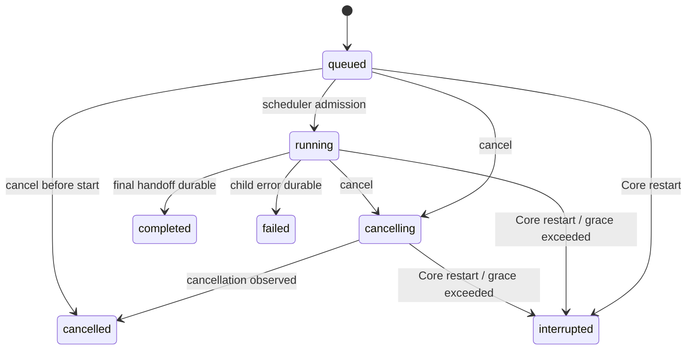

# 原生 Subagent 产品与架构契约

## 1. 状态、权威范围与术语

本文是 Awaken 原生 Subagent 的当前产品行为、架构边界、状态/数据/事件流、前端交互、恢复方式、后续扩展顺序和验收门禁的唯一权威。第 1 节是当前可用范围的判定入口；后文未明确标为“当前支持”的扩展行为仍是已确认但尚未实现的设计约束。

**当前支持：**

- `src/agentcore/spawner.go` 已能从父 `AgentConfig` 创建 child config；
- `src/agentcore/subagent` 已实现 workspace、writable roots、ExecutionProfile 的继承与 no-escalation 校验；
- `ToolRuntime` 会把 `SubagentOrigin` 带入 execution intent，并在执行前复核 child boundary；
- `context: fork` Skill 已能通过 `Runner.startSkillChild` 同步运行真实 child，child 的模型消息、工具调用和压缩记录带 `agent_id`，父模型历史恢复会排除 child records；
- 父 run 的取消上下文可以终止当前同步 Skill child。
- 正式模型工具 `subagent(action=spawn|status|wait|cancel|message)` 已注册；host-owned 角色为 `explore` / `plan` / `review` / `general`。只读角色强制 `shared_readonly` 且隐藏 mutation 工具；`general` 默认 `shared` 可写父工作区，或可选 `git_worktree`。child 不暴露 Subagent、主动提问、ACP 或 Hook 配置工具；
- 已启用、完整性有效的 Claude Code/Cursor Plugin Agent 可经 host resolver 追加为 `plugin__<plugin>__<agent>` 角色；插件明确声明的 `maxTurns`/`timeoutSeconds` 原值进入 role，未声明时保持 unset，不再叠加 Plugin 专属 8 turn/32 tool/5 分钟限制；它仍服从所有原生 child 共用的 32 turn/128 tool、4 并发、root-only、取消和 terminal barrier。Plugin prompt、read-only、tool allowlist/denylist 也只收窄 child，digest/logicalId 在 Composer 或 invoke 时复验；后台/隔离/model hint 不扩大父边界；
- child 模型由 Host 解析：默认继承父 Agent profile；Host 内部存在有效 `subagent` route 时可先解析该 route，Renderer 不提供用途模型选择器；模型可见 spawn schema 不含 `model_profile_id`、endpoint 或凭据；
- `src/subagentruntime` 提供 run-scoped task registry、事件驱动 wait、单任务取消、每 run 最多 8 个任务和最多 4 个并发执行；父 run 终态前会收敛非终态 child；
- child 使用独立 conversation、agent/task identity 和取消上下文，生命周期与有界结果写入 SemanticJournal；live Agent event 与 durable reasoning/message/tool frame 都携带同一 `subagentTaskId/subagentAgentId`，Renderer 将它们路由到 child 自己的 narrative，不再混入 root；
- child 的每个耐久 `tool_call` 与 `model_usage` 会按稳定 ID 去重后生成 `subagent_progress`，累计工具次数、provider-reported input/output/total tokens；中心 group 与右侧 Inspector 同时显示工具数、token 与按耐久起止时间计算的耗时；
- `wait` 到期属于中性检索结果：返回 `retrieval_status=timeout` 和当前 snapshots，不产生失败 Outcome，也不取消 child；
- child terminal 先耐久，再进入 manager 的一次性交接队列；若 root 未通过成功 `wait` 或 terminal `status` 显式消费，Runner 会在下一模型请求边界自动注入有界结构化终态。若 child 在 root 模型生成期间完成，旧响应不能直接成为 run final，Runner 会保留该响应并追加一次带终态的新模型边界；
- root 产生候选最终回答时只要仍有 queued/running/cancelling child，Runner 就保留该回答为上下文并注入 host-owned wait 指令，要求下一模型边界通过 status/wait 等待并整合 terminal handoff；不得先结束 root run 再由 terminal barrier 取消尚未完成的 Plugin Agent。Composer 精确 Agent token 同样携带“等待 child terminal 后再回答”的 host 指令，并由 Core 按已复验 role 明确指定只读 `shared_readonly` 或可写 `shared`，不让模型猜测 workspace mode。上游 Skill 按 manifest Agent 名称调用同包 Agent 时，runtime 仅在该裸名称对所有已启用 Plugin Agent 唯一时解析到 `plugin__<plugin>__<agent>`；同名冲突必须拒绝，不能任意选择插件；
- child 已经耐久的 tool/model usage 进度使用脱离 producer cancel signal、最长 2 秒的持久化上下文更新 task summary，避免 root terminal/cancel 与 provider usage 回调竞态产生 `subagent_persistence_failed: context canceled`；这不让尚未完成的模型或工具绕过取消，只保护已经形成的耐久事实；
- Core 已提供 run-scoped Subagent list/detail/cancel/message route；message 先写 `subagent_message_queued` 再入队，child 只在下一模型轮次边界 drain，终态任务返回 `subagent_not_running` 且不复活；
- Desktop reducer 已以 `subagentsById/subagentOrder` 独立保存 task truth；当前 turn 显示 Subagent group，点击 row 在 dock Composer 上方打开可关闭/重开的独立执行详情浮层，卡内按 child semantic 顺序展示思考、工具与 Markdown 结果并有独立滚动和单任务停止，且不改变主对话流布局；右侧 Inspector 继续提供任务切换、统计和控制；
- root/child 的 tool text/media blob 使用 agent/task + run + turn + tool-call 复合命名空间；超过 32 KiB 的文本只在 journal 留 digest/size/preview 票据，下一次 provider request 在 Core 内校验并水合完整内容，Renderer 与模型都不需要读取 `~/.awaken` 路径；
- queued cancel 在 scheduler admission 后会再次检查，不能回跳 `running`；取消宽限期后写 `interrupted`；terminal append/flush 失败保留最后一份已耐久的非终态 snapshot 并让 root barrier fail closed，不发布伪成功；
- Core 重启时，journal 恢复会把没有 `subagent_terminal` 的已创建 task 补写 `interrupted`，不重跑模型或工具；
- 正式 child 继承父 run 已召回且冻结的 `MemoryRecallSnapshot` 子集，不运行 user-scope selector，也不把临时 worktree 当成新 project；
- Desktop reducer 已投影 `plan`/`general` 与 workspace mode；Inspector 和中心执行卡只提供查看、关闭与单任务取消，不向用户提供追加指令输入。Core 内主 Agent 仍可使用 `message` action。AC-SA 的完成声明必须依验收表逐项留下当前 Desktop 证据，不能由自动化或单一旧截图替代。

**当前不支持：**

- 不支持递归 Subagent、省略类型的隐式 full-context fork、由模型或 child prompt 任意指定 profile、detached/cross-run worker；
- 不支持任意用户自定义 markdown/JSON agent 目录；只支持 Plugin Store 已归一化并签名的 Plugin Agent。仍不支持 teammate 广播、自动 merge worktree；
- 两个并发 `shared` 可写 child 若 writable root 重叠会被拒绝；不会静默共享同一可写根；
- root/child 原子共享 token/tool/cost 预算和 child 完整 cost 统计尚未接通；provider 未报告 usage 时不伪造 child token；
- 窄屏专用 Subagent sheet、跨重启 Inspector selection、review 的 `/tmp` 写例外尚未提供；
- 真实 Desktop AC-SA-01～17 本次不执行，不能用自动化或旧截图代替。

本文使用下列术语：

- **主 Agent / root Agent**：拥有当前 thread/run 用户交互的 Agent；
- **Subagent / child**：由主 Agent 在同一 run 内创建的本地 child Agent；
- **子任务 / SubagentTask**：host-owned 的 child 生命周期与持久身份；
- **Skill fork**：由 `context: fork` Skill 触发的专用 child；它复用本文底座，但不是独立产品入口；
- **外部 Agent / ACP**：由 `delegate_external_agent` 启动的进程外协议会话，不属于原生 Subagent；
- **后台并发**：child 与父 Agent 或其他 child 在同一个尚未终态的 run 中并行；不表示 child 可以脱离 run 在终态后继续执行。

## 2. 目标与非目标

### 2.1 目标

首个完整版本必须让主 Agent 可以：

1. 创建一个或多个独立 child，明确分配任务、角色和只读/隔离写入模式；
2. 在同一 run 内并发执行互不依赖的子任务；
3. 由主 Agent 查询或等待 child、向运行中的 child 追加指令、取消单个 child；Desktop 用户界面只提供查看和取消；
4. 只把结构化进度与最终 handoff 返回父上下文，不把 child 原始 transcript 全量灌入父模型；
5. 在 Workbench 看到稳定的子任务摘要、状态、进度、结果和控制入口；
6. 切换 thread 或重启 Desktop 后重放已完成事实，并把崩溃时仍运行的 child 显式恢复为 `interrupted`；
7. 保证 child 不扩大父 run 的 workspace、工具、权限、Memory 或模型凭据边界。

### 2.2 非目标

首版不提供：

- 跨 thread、跨 Core 或终态后的 detached worker；
- 平级 teammate/team mailbox、共享任务看板或多 Agent 自治组织；
- child 直接向用户提问；child 遇到信息缺口时必须返回父 Agent，由父 Agent 使用 `ask_user`；
- 多层递归 Subagent；只有 root Agent 可以 spawn，child 的模型可见工具中不暴露原生 Subagent 工具；
- 自动合并 worktree、自动解决冲突或把 child commit 直接写回主 workspace；
- 把 ACP runner、Skill fork 和原生 Subagent 合并成同一种用户身份；
- 原始 reasoning、完整命令输出、秘密、完整 tool result 或内部 prompt 的无界 UI 展示。

## 3. `/sourcecode` 参考结论

参考基线为 `sourcecode` 仓库提交 `ce417bd1be81487125e4355246f385e52cda8c6a`。采用的是可验证的产品/运行时模式，不复制其 TUI、Anthropic 专用 message 结构或实验 gate。

| 参考实现 | 可复用结论 | Awaken 的落地方式 |
| --- | --- | --- |
| `sourcecode/src/tools/AgentTool/AgentTool.tsx` | spawn 输入应包含短描述、完整任务、agent type、模型和前台/后台语义；并发 child 要尽早取得稳定 ID | 使用单一 `subagent` action tool，`spawn` 先耐久创建 task identity，再启动 goroutine |
| `sourcecode/src/tasks/LocalAgentTask/LocalAgentTask.tsx` | 生命周期、进度、AbortController、pending messages 和 completion notification 应由 host task registry 管理 | 新建 run-scoped `SubagentManager`，不把 task 状态放进 Renderer 或 tool local closure |
| `sourcecode/src/tools/AgentTool/runAgent.ts` | child 应拥有独立 agent identity、conversation、取消链和 transcript | 复用 `CreateSubagent` 与 `Runner`，每个 task 建立独立 conversation/context/cancel |
| `sourcecode/src/tools/AgentTool/forkSubagent.ts` | 完整 fork 与 fresh child 是不同上下文语义；递归 fork 必须显式阻止 | 首版只开放 fresh/isolated child；Skill fork 保持专用 handoff；正式 full-context fork 后置 |
| `sourcecode/src/tools/AgentTool/agentToolUtils.ts` | 进度应是有界摘要，终态应先提交，再做非关键 embellishment | task terminal 先 journal+flush+状态切换，再生成 UI preview/统计 |
| `sourcecode/src/tools/SendMessageTool/SendMessageTool.ts` | 追加消息应按 child ID 路由，并在安全边界点消费 | 消息 append-before-queue，child 只在模型轮次边界 drain，不中断正在执行的工具 |
| `sourcecode/src/tools/TaskOutputTool/TaskOutputTool.tsx` | `status` 与 `wait` 都需要超时和取消语义 | `subagent(action=status|wait)` 返回结构化 snapshot；wait 使用事件通知而非 100ms 轮询 |
| `sourcecode/src/tools/TaskStopTool/TaskStopTool.ts` | 单 task cancel 与主任务 cancel 必须分开 | child cancel 只取消目标 task；run Stop 向 manager 广播取消并等待有界收敛 |
| `sourcecode/src/tools/AgentTool/UI.tsx`、`sourcecode/src/components/AgentProgressLine.tsx` | 默认显示少量最近活动、工具数、token 和完成统计，完整 transcript 按需展开 | 中心叙事只显示 compact group；右侧 Subagent Inspector 按选中 task 展示详情 |
| `sourcecode/src/components/CoordinatorAgentStatus.tsx` | 需要始终可见的任务入口和显式主/child 选择 | Workbench 右栏增加“子任务”入口和 badge；不替换主 thread identity |
| `sourcecode/src/state/teammateViewHelpers.ts` | “正在查看哪个 child”和“child 是否还在运行”是两种状态 | Renderer 使用 `selectedSubagentTaskId`，选择变化不改变 runtime task state |

以下参考行为不直接采用：

- 不用进程内 AppState 作为 task authority；Awaken 以 Core + SemanticJournal 为真相；
- 不用 output file/symlink 或高频 polling 让父模型轮询；耐久 terminal 默认通过 manager 的一次性交接队列进入父模型，结构化 `wait/status` outcome 仍是显式检索与恢复入口；
- 不允许后台 child 在 root run 终态后继续；
- 不让 child 重新组装更宽的工具池；它只能继承或收窄父 run 的固定 snapshot；
- 不默认让两个可写 child 共享同一 writable root；`general` 默认可写父 cwd，`git_worktree` 才隔离；host 不自动 merge；
- 不以 UI retention/eviction 决定持久事实是否存在。

## 4. 产品流程

### 4.1 单个只读子任务

1. 主模型判断任务需要独立探索或复核，调用：

   ```json
   {
     "action": "spawn",
     "description": "检查认证边界",
     "prompt": "只读检查认证链路，列出入口、状态流和风险，不修改文件。",
     "agent_type": "explore",
     "workspace_mode": "shared_readonly"
   }
   ```

2. Core 在 transport 前写 `subagent_spawned`，返回 `task_id`、`agent_id`、`status=running`。
3. Workbench 当前 turn 出现“1 个子任务运行中”，右栏“子任务”入口出现 badge。
4. child 使用独立 conversation 和 read-only profile 运行；其最近活动、工具计数、provider-reported token 累计与耗时以有界事件更新。
5. 主 Agent 可继续处理不重叠工作，也可调用 `wait/status` 显式查询。
6. child terminal 先耐久，再进入一次性交接队列；成功 `wait` 或 terminal `status` 消费同一份 handoff。若未显式消费，Runner 在 root 下一模型请求边界自动注入结构化终态；child 在当前模型生成期间完成时，当前响应不得直接结束 run，而要追加一次整合边界。
7. 主 Agent 验证并整合结论，最终回答仍由主 Agent 给用户；自动 handoff 不生成用户可见的伪 user message。

### 4.2 多个并发子任务

- 同一 assistant response 可以连续发出多个 `spawn` call；每个 spawn 只负责注册并快速返回；
- manager 默认最多同时运行 4 个 child、每 run 最多创建 8 个；超过并发上限进入 `queued`，超过总量返回 `subagent_limit_reached`；
- 主模型用 `wait(task_ids=[...], return_when="any"|"all", timeout_ms<=60000)` 等待；
- `return_when=any` 返回本次新到达的 terminal tasks；已消费的 completion 不能重复冒充新通知；
- UI 按创建顺序展示，状态更新不得重排正在阅读的列表。

### 4.3 主 Agent 追加指令

- 主模型使用 `message` action；Desktop 不向用户暴露 message 输入面或发送按钮；
- message 必须先写 `subagent_message_queued` 并 flush，再进入 child queue；
- child 只在一次模型响应结束、下一次 provider request 构建前 drain；
- 已开始的 tool call 不被 message 抢占；
- terminal task 返回 `subagent_not_running`，不自动复活；
- message receipt 不自动进入父 conversation；child terminal handoff 会总结它实际处理过的追加指令。

### 4.4 取消

- 取消单 child：状态 `running|queued -> cancelling -> cancelled`；
- queued child 取消后不得启动；
- running child 取消传播到 model call、tool process 和该 child 派生的 Skill fork；
- 主 run Stop：先把 root run 置 `cancelling`，再取消全部非终态 child，最后按现有 run terminal 规则结束；
- child 已发生的 side effect 仍按 canonical Outcome 记录 `none/applied/partial/unknown`，不能因 child 被取消而抹去。

### 4.5 Thread 切换与重启

- thread 切换只改变展示订阅，不取消 run；
- 已完成 child 的摘要与活动通过同一 transcript projector 重放；
- Core 重启时，任何没有 `subagent_terminal` 的已创建 task 补 `interrupted` terminal，不重新执行模型或工具；
- interrupted child 可以由主 Agent重新 spawn 一个新 task；首版不复用旧 `task_id` 恢复执行；
- run terminal 后不存在 running/queued/cancelling child。若 manager 无法在取消宽限期内收敛，run terminal 仍记录 child 为 `interrupted`，并保留可能的 unknown side effect。

## 5. 前端 UI 与交互

### 5.1 信息架构

UI 使用“三层表达”：

1. **中心叙事摘要**：属于当前 turn 的 `subagentGroup` narrative item，只表达有多少 child、各自状态和最近活动；
2. **中心执行详情浮层**：点击 child row 后在 dock Composer 上方独立打开，展示该 child 自己的思考、工具、结果与停止控制；
3. **右侧 Subagent Inspector**：从右栏入口主动打开后查看任务切换、统计、结果和控制。

这样既保留 Workbench 的主叙事，也让 child 执行过程与 root 隔离。详情使用既有 `RunStage.overlay` owner，卡片 body 可以有界内滚；它不进入 narrative、不建立第二个 RunStage，也不是新的 composer owner。

### 5.2 中心叙事摘要

新增 UI-only 组件：

```text
Awaken Design System/src/components/AwakenSubagentGroup/
Awaken Design System/src/components/AwakenSubagentRow/
```

`AwakenSubagentGroup` 接收纯 props：

```ts
type SubagentRowView = {
  taskId: string;
  description: string;
  agentType: "explore" | "plan" | "review" | "general";
  status: "queued" | "running" | "completed" |
          "failed" | "cancelling" | "cancelled" | "interrupted";
  activity?: string;
  toolUseCount: number;
  estimatedTokens?: number;
  totalTokens?: number;
  elapsedMs?: number;
  selected?: boolean;
};
```

显示规则：

- group header：`3 个子任务 · 2 运行中 · 1 已完成`；
- row 主行：状态图标、description、agent type；
- row 次行：running 时显示最近 activity，terminal 时显示结果首行或稳定错误摘要；下方 compact metrics 显示已有的工具数、token 和耗时；
- 最多在中心区显示最近 3 条 activity，不显示 tool args、完整结果、绝对路径或内部 ID；
- 单击 row：在 dock Composer 上方打开对应 `taskId` 的中心执行详情浮层；打开/关闭只改变 Desktop 局部 UI state，不取消 child，也不自动打开右侧 Inspector；
- 键盘：row 是 button，Enter/Space 打开详情；状态用可见文本与 `aria-label`，不能只靠颜色；
- terminal 后仍保留在所属 turn；最终 answer 出现后随其他 process items 进入现有“执行过程”折叠段；
- replay 使用 durable task identity upsert，不重复增加 row；
- group 的展开/选择是 Desktop 局部 UI 状态，不写 Journal，不改变 follow、anchor 或 run 状态。

### 5.2.1 中心执行详情浮层

`AwakenSubagentExecutionCard` 是 Design System 纯组件，接收 task 展示 props、children 与 close/cancel callbacks；RuntimeClient、SSE、task reducer 和取消权限仍由 Desktop/Core 拥有。

- header 只有一条主信息行：左侧按“中文 agent type：assignment description”显示，右侧依次显示工具数、provider-reported token、耐久时间戳计算出的耗时和末尾中文状态，关闭按钮只收起卡片；
- 卡片 surface、border、text、shadow、hover 和 status 颜色只消费 Design System 浅色/深色语义 token，不得回退到固定浅色背景或深色文字；
- summary 只在存在非终态 activity 时显示；task terminal 后必须清除陈旧 activity，不能为 metrics 保留空白或独立行；
- body 消费 `SubagentTaskView.narrative`，按 child 自己的 semantic identity 渲染 reasoning、tool 与 answer；不得扫描 root narrative 或 DOM 拼出 child 详情；
- 浮层由 `App.tsx` 编排进 `RunStage.overlay`，定位在实测 dock Composer 完整内容上方 12px，不覆盖 runtime panel 或专用 gate；透明外层 pointer-through，只有卡片本体响应交互；
- 卡片最大宽度 680px、最大高度 560px，并继续受 RunStage 顶部 28px 与 Composer 上沿共同限制；body 使用独立纵向滚动与 `overscroll-behavior: contain`，滚动条只显示 thumb，track、track-piece、corner 和稳定 gutter 均不可见；打开、关闭和内容增长都不得改变 narrative 高度、anchor 或 follow；
- terminal result 使用 Markdown renderer，不使用无界 `<pre>`；错误显示稳定 code/message；
- queued/running/cancelling 显示明确的单任务停止入口；关闭卡片、切换 task 和停止 task 是三种不同动作；
- 运行中/排队中的 child 在卡片与 Inspector 中只提供单任务停止入口，不显示追加指令输入。Core 内主 Agent 的 `message` action 不创建新的 thread/run/user_message，也不投影为用户消息。

### 5.3 右侧 Subagent Inspector

Workbench 右栏顶部从单一“文件”入口扩展为：

```text
文件    子任务 <running badge>
```

约束：

- 只有当前 thread 存在 Subagent records 时显示“子任务”；不能用 feature 占位展示空壳；
- 打开后使用 420px 首选宽度，并继续服从现有 Inspector min/max、手动折叠和窄窗口自动折叠；
- 文件工作区的 720px 临时宽度、目录状态和关闭恢复逻辑保持独立；
- Subagent Inspector 的选择按 `threadId + taskId` 保存在 Renderer 内存；首版不跨重启保存 UI selection；
- 关闭右栏不取消 child；取消必须点击明确按钮；
- 子任务详情不读取 DOM/narrative 文案反推 identity，只消费 reducer 中的 `SubagentTaskView`。

当前详情布局：

1. 顶部：description、中文 agent type、中文状态和耗时；
2. task switcher：按创建顺序切换同一 thread 的 task；
3. activity：显示非终态最近活动、工具数与 provider-reported token；
4. result：terminal 后渲染 child final handoff Markdown；失败显示稳定 error code/message；
5. 控制区：
   - running/queued：`取消子任务`；
   - cancelling：按钮禁用并显示“正在取消…”；
   - terminal：不显示取消。

Core `message` 服务继续供主模型使用；Desktop Inspector 和中心卡不提供用户输入，不复用主 composer，也不创建新的 thread/run/user_message。

窄窗口当前沿用现有 Inspector 自动折叠，中心执行详情仍使用同一 RunStage 浮层并服从左右安全边距。专用全屏 Subagent sheet 尚未提供；未来 sheet 只能消费同一详情 props，不能复制 runtime state 或新增第三种 composer variant。

### 5.4 运行中反馈

- child `running` 使用独立旋转图标，不复用主 turn 的 Thinking ownership；
- activity 更新不抢焦点、不自动打开 Inspector、不改变用户当前滚动意图；
- running badge 只计 `queued/running/cancelling`；
- child completion 不弹 toast；中心 row 更新并在右栏 badge 上体现；
- 如果所有 child 都 terminal，但主 Agent仍在整合，主 turn 继续显示主 Thinking；
- 用户取消 child 后，中心叙事使用中性“已取消”，不伪造失败；
- interrupted 必须明确显示“运行中断，未自动重试”。

### 5.5 Workbench ownership

- `subagentGroup` 是位于对应 `execution-turn-section` 的 narrative；选中的执行详情不是 narrative，而是 `RunStage.overlay`；
- Inspector 仍由 `WorkbenchShell.inspector` 拥有，不进入 `RunStage`；
- 子任务详情只进入 `RunStage.overlay`，不得进入 `composer-dock-stack`；执行详情卡的有界 body scroll 不接管 RunStage follow；
- 不改变 `center/dock` 判定、prompt anchor、marker、return-to-latest 或 composer 测量；
- Design System 组件只收 props/callbacks，不读取 runtime client、SSE、Electron 或 store。

## 6. Core 架构

### 6.1 模块与 owner

当前模块：

```text
src/subagentruntime/
  types.go          # task/status/request/result/controller interface
  manager.go        # run-scoped registry、queue、并发、wait、cancel
  context.go        # root/child run context 与任务身份
  roles.go          # agent role 注册与工具边界
  manager_test.go

src/tools/subagent/
  tool.go           # action schema 与 canonical Outcome
  tool_test.go

src/pluginagents/
  agents.go         # Normalized AgentSpec -> host Role；不创建第二套 task runtime
```

主要集成点：

- `src/agentcore/runner.go`：向 tool execution context 注入 run-scoped controller；启动 child Runner；在 root terminal 前执行 child barrier；
- `src/agentcore/spawner.go`：补齐明确的 child budgets、Memory snapshot、tool exposure 和 context identity复制；
- `src/agentcore/types.go`：定义 `SubagentController`、parent/child 边界和父 `MemoryRecallSnapshot` 相关 hook；
- `src/runtime/run_service.go`、`session.go`：每个 run 创建/销毁 manager，把 Desktop control route 绑定到精确 session；
- `src/agentcore/semantic_record.go`、journal restore：增加稳定 child kinds 与 orphan recovery；
- `src/protocol/agui`、`src/server`：wire 和 control route；
- Desktop reducer/projector/App/Design System：消费并展示。
- `src/subagentruntime/roles.go`：内置角色优先、`plugin__` resolver 扩展、workspace 组合校验；resolver 不允许覆盖内置角色；
- `src/plugins/agents.go`：只从 enabled + digest-valid + switchable component 提供 Plugin Role。

不得：

- 在 `src/tools/subagent` 内直接 new `Runner`；
- 让全局 tool registry 持有可跨 run 串用的 manager pointer；
- 在 Renderer 维护第二份 task authority；
- 建立独立 Core 服务或独立用户启动命令。

### 6.2 Controller 注入

沿用 Skill fork 的 context 注入模式：

```go
type Controller interface {
    Spawn(context.Context, SpawnRequest) (TaskSnapshot, error)
    Status(taskID string) (TaskSnapshot, error)
    List() []TaskSnapshot
    Wait(context.Context, WaitRequest) (WaitResult, error)
    DrainTerminalNotifications() []TaskSnapshot
    AcknowledgeTerminal(taskID string)
    Message(context.Context, taskID, content string) (MessageReceipt, error)
    Cancel(context.Context, taskID, reason string) (TaskSnapshot, error)
    Close(context.Context) error
}
```

`Runner` 在执行 `subagent` tool 前用 `subagentruntime.WithController` 注入当前 run controller。缺少 controller 时返回 `subagent_runtime_unavailable`，不能同步降级成 Skill fork 或 ACP。

### 6.3 Child 启动

Manager 的 starter callback 固定执行：

1. 校验 root-only、限额、agent type、workspace mode 和 prompt 大小；
2. 生成 `task_id` 与 `agent_id`；
3. 写并 flush `subagent_spawned`；
4. 通过 `CreateSubagent` 复制父 immutable snapshots；
5. 强制应用 child role profile：
   - `explore`、`plan`、`review`：`read_only + network <= parent`；
   - `general`：`shared` 继承不超过父 profile 的写能力；`git_worktree` 先由 host 建隔离 worktree 再重锚 writable roots；
6. 创建独立 `Conversation`，只注入 host handoff 和父 `MemoryRecallSnapshot` 的合法子集；
7. 使用 `context.WithCancel(rootRunContext)` 再派生单 task cancel；
8. 进入 scheduler；取得 slot 后写 `running` 并启动 child runner；
9. child terminal 时先 append+flush terminal record，再发布状态、唤醒 waiters并进入一次性交接队列；append/flush 失败时保留最后一份已耐久 snapshot，不能在内存伪造 terminal 或通知 root；
10. child 的 `tool_call`/`model_usage` 先耐久，再由 manager 写并 flush 累计 `subagent_progress`；terminal 使用最后一份累计值；
11. 终态 handoff 最大 32 KiB；更大结果按 `thread/task-or-agent/run/turn/tool-call` 写入 offload store，journal 只留 preview + storage metadata；父模型下一请求由 Core 校验 digest/byte size 后在内存水合完整 handoff。

### 6.4 Agent types

首版使用 host-owned 内置定义，不开放用户目录：

| type | 用途 | profile | tool exposure |
| --- | --- | --- | --- |
| `explore` | 代码搜索、资料定位、事实梳理 | 强制 read-only | 父 snapshot 的只读子集 |
| `plan` | 只读规划实现路径，输出 Critical Files | 强制 read-only | 父 snapshot 的只读子集 |
| `review` | 独立复核、风险和测试缺口 | 强制 read-only | 父 snapshot 的只读子集 |
| `general` | 独立实现 | 不超过父 profile；默认 shared，可选 worktree | 父 snapshot 去除 subagent/ask_user/外部交互 gate 后的子集 |

定义正文作为 host-owned prompt section 进入 child request，并计入 `subagent_definitions` context contribution。模型不能通过 input 提交任意 system prompt、permission profile 或工具名。

### 6.5 Tool schema

模型只看到一个 `subagent` 工具：

```json
{
  "action": "spawn | status | wait | message | cancel",
  "task_id": "status/message/cancel 使用",
  "task_ids": ["wait 使用"],
  "description": "spawn 使用，1-80 字符",
  "prompt": "spawn/message 使用，最大 32 KiB",
  "agent_type": "explore | plan | review | general",
  "workspace_mode": "shared_readonly | shared | git_worktree",
  "return_when": "any | all",
  "timeout_ms": "0-60000"
}
```

action 使用严格互斥字段校验。稳定错误码至少包括：

- `subagent_invalid_input`
- `subagent_runtime_unavailable`
- `subagent_limit_reached`
- `subagent_concurrency_queue_full`
- `subagent_not_found`
- `subagent_not_running`
- `subagent_cancelled`
- `subagent_interrupted`
- `subagent_workspace_mode_unsupported`
- `subagent_worktree_failed`
- `subagent_boundary_violation`

tool Outcome 的 `side_effect_state`：

- spawn/status/wait/message/cancel 本身为 `none`；
- child 工具的副作用记录在 child 自己的 canonical tool results；
- terminal handoff 汇总 child observed/applied/partial/unknown，但不能把汇总当成新的副作用。

`wait` 成功结果额外包含 `retrieval_status=completed|running|timeout`。`timeout` 是中性成功结果，必须同时返回当前 task snapshots；历史 `subagent_wait_timeout` 只作为旧记录兼容错误码保留，新调用不再产生。

### 6.6 并发与当前预算边界

默认门禁：

```text
max tasks per run       8
max concurrent children 4
max depth               1
child max turns         32
child max tool calls    128
Plugin Agent declaration preserved when present
Plugin Agent undeclared limits inherit ordinary child boundaries
wait timeout            60s/call
cancel grace            2s
```

当前 root 与每个 child 由各自 `Runner` 内的 `FailureSupervisor` 独立计数，尚未接通 run-scoped 的共享原子预算：

- root 仍按现有默认值独立受限于 128 turn / 512 tool execution；
- 每个 child 的 32 turn / 128 tool execution 是单 task 上限，但尚不会从同一个 root + children 全局计数器原子扣减；
- Plugin Agent role 不再额外设置固定 8 turn / 32 tool / 5 分钟；厂商声明的 `maxTurns`/`timeoutSeconds` 继续作为 role 收窄条件，未声明时沿用普通 child 的 32/128 与父 run 取消边界；
- root 调用 spawn/status/wait/message/cancel 工具仍计入 root 自身的 tool execution；排队和等待不会额外消耗 child 的 model/tool 预算；
- 任一 child 达到自身上限只终止该 child，不直接伪造 root run error；root 终态 barrier 仍负责收敛未终态 child；
- “root 与所有 child 共享 token / tool / cost 预算”仍是明确已知缺口，不得从并发上限、child 子上限或 terminal barrier 推导为已实现。

### 6.7 Workspace 与写隔离

`shared_readonly`：

- canonical workspace 与父完全一致；
- child profile 强制 read-only；
- 可以并发；
- 不创建 worktree。

`shared`：

- 仅 `general` 可请求；
- canonical workspace 与父完全一致，profile 不超过父写能力；
- 两个并发 shared 可写 child 的 writable root 相交时 spawn fail closed；
- 不创建 worktree。

`git_worktree`：

- 只对有 Git repository 的 workspace 开放；
- host 用 direct argv 创建 `awaken/subagent-<task-short-id>` 分支和私有 worktree；
- child 的 WorkspaceRoot/WritableRoots 重锚到 worktree，对父的 readable external attachments 只保留只读 identity；
- child 完成后返回 worktree path、branch、base commit、head commit 和 dirty state；
- 没有修改时 host 自动清理 worktree；有修改时保留，主 Agent负责审查并显式整合；
- 取消/失败时若存在改动也保留并标记 `needs_review`，不得自动删除未知工作；
- 首版不支持非 Git workspace 的写 child，返回 `subagent_workspace_mode_unsupported`。

任何情况下都不允许两个 write-capable child 共享同一 writable root。

## 7. 上下文、Memory 与模型

### 7.1 Fresh child 上下文

首版 child 不复制父完整 conversation，只接收：

1. 基础 system prompt；
2. host-owned child role/不可递归规则；
3. canonical workspace/environment 摘要；
4. 精确 assignment；
5. 父 run 已激活且显式允许继承的 Skill context；
6. 合法的父 `MemoryRecallSnapshot` 子集；
7. child 自己后续产生的 conversation。

父 conversation 中的原始用户消息、其他 child transcript、完整 tool results 和 provider opaque state 默认不进入 child。主 Agent必须在 `prompt` 中给出完成任务所需的上下文。

### 7.2 Memory

正式 Subagent 上线必须同时完成 [长期记忆与 Dream 设计契约 §5.3](../11_长期记忆/长期记忆与Dream设计契约.md)：

- root 第一次成功召回形成不可伪造的 run-scoped `MemoryRecallSnapshot`；
- child 默认只继承父已召回且与 child canonical workspace 相容的 identity/content；
- child 不运行 user-scope selector，不扩大 project scope；
- child Memory mutation 仍经 `memory` service，并带 root/child source identity；
- child 新写内容只从下一 run 成为自动召回候选；
- worktree child 的 project Memory scope仍绑定原 project canonical workspace，不把临时 worktree 当成新 project。

### 7.3 模型选择

- Host 默认继承父 run 的 model profile；内部存在有效 `subagent` route 时可先解析，route 已删除/停用时仍继承父 profile；
- 模型工具 schema 不暴露 `model_profile_id`。只有 Desktop/Main 构造的非敏感 purpose routing 可以引用当前已配置且可运行的 profile；
- host 解析完整 profile 和凭据，不接受 root/child prompt 注入 endpoint/key/model；
- child 走用途 profile 自己保存的 Chat/Responses/Messages 协议，协议原始 SSE 不进入 Subagent runtime；
- child 的 `model_request/model_usage/context_snapshot` 带 `agent_id`、`task_id`；
- root Context Usage 面板的“当前请求”不混入 child 请求；新增子任务聚合行只展示 child 累计 token/cost，并保持现有六项总和契约不被改写；
- child usage 计入 thread/run 总成本统计，但不能覆盖 root 的 latest provider usage。

## 8. 状态、数据与持久化

### 8.1 状态机



追加消息队列不引入独立 task 状态。child 在模型轮次边界 drain queue 时仍为 `running`，避免把内部调度细节误投影成用户可理解的“等待”。

### 8.2 SubagentTask

Core authority shape：

```go
type TaskSnapshot struct {
    TaskID            string
    AgentID           string
    ParentAgentID     string
    ParentToolCallID  string
    ThreadID          string
    RunID             string
    TurnID            string
    Description       string
    AgentType         string
    WorkspaceMode     string
    ModelProfileID    string
    Status            TaskStatus
    CurrentActivity   string
    ToolUseCount      int
    EstimatedTokens   int
    InputTokens       int
    OutputTokens      int
    TotalTokens       int
    ResultPreview     string
    ResultStorageKey  string
    ErrorCode         string
    SideEffectState   string
    Worktree          *WorktreeReceipt
    CreatedAt         time.Time
    StartedAt         *time.Time
    FinishedAt        *time.Time
}
```

Renderer DTO 必须脱敏：不返回完整 model credential、raw tool args、环境变量、内部 prompt、任意 storage filesystem path 或未净化 stdout/stderr。

### 8.3 SemanticKind

新增稳定 kinds：

```text
subagent_spawned
subagent_status_changed
subagent_message_queued
subagent_progress
subagent_terminal
```

普通 child records 继续使用现有 `reasoning_summary`、`assistant_message`、`tool_call`、`tool_result`、`context_compacted`、`model_request`、`model_usage`，但必须同时带：

```text
agent_id
parent_agent_id
subagent_task_id
```

写入顺序：

1. `subagent_spawned` flush；
2. scheduler admission 后 `status_changed=running`；
3. message 先 `message_queued` flush，再入内存 queue；
4. 每个新 `tool_call_id` 与 `model_request_id` 在对应事实耐久后按 ID 去重并写 `subagent_progress`；terminal 前最后一份计数必须耐久；
5. `subagent_terminal` flush；
6. manager 更新内存状态、唤醒 waiters，并登记未消费的一次性 terminal notification；
7. root 成功 `wait`、terminal `status` 或 Runner 自动 drain 三者只允许一个消费者取得该 handoff；显式 tool result 按原规则耐久，自动 drain 作为 `origin=synthetic` 的 host notification 只进入 root 内存 conversation，不伪造 SemanticJournal 用户消息；
8. child 在 root provider 生成期间完成时，旧响应先进入历史，再由 terminal notification 触发 `subagent_notification` continuation；
9. 所有 child terminal 后才允许 root `run_terminal`。

`subagent_progress` 不保存 reasoning 正文、完整命令或 tool result，只保存当前活动类型、净化标题和累计计数。`estimated_tokens` 是兼容字段；当前新记录同时写 provider-reported `input_tokens`、`output_tokens`、`total_tokens`，provider 缺字段时保持缺省而不是估算。

### 8.4 重放与恢复

- `messagesFromSemanticRecords` 继续排除带 `agent_id` 的 child messages；
- 新 `subagentTasksFromSemanticRecords` 按 task ID/seq 重建 task views；
- transcript projector 把 child tool/message records路由到对应 task detail，不投影成 root 顶层 tool row；
- child `ToolRuntime` 的即时 progress、command output、patch 与交互事件必须先经过 `runEventEmitter` 的 identity-scoped sink，补齐与耐久 tool call/result 相同的 task/agent/run/turn identity；不得把原始 sink 直接交给 child ToolRuntime；
- 缺 terminal 的 task 在启动恢复阶段追加 `interrupted` terminal；只读读取 transcript 时不得临时伪造并写回；
- 坏 task transition fail closed：保留最后合法状态，并产生 bounded unknown diagnostic；
- terminal result blob 缺失时 UI 保留 metadata，显示 `subagent_result_blob_missing`，不得把 storage key 当正文。

## 9. Wire、HTTP 与 Desktop 数据流

### 9.1 AG-UI

新增 event family：

```text
AWAKEN_SUBAGENT_CHANGED
AWAKEN_SUBAGENT_ACTIVITY
AWAKEN_SUBAGENT_MESSAGE_QUEUED
```

Subagent lifecycle event 使用以下公共字段；普通 child text/reasoning/tool frame 也必须携带前三项身份字段：

```text
subagentTaskId
subagentAgentId
subagentParentAgentId
subagentParentToolCallId
subagentAgentType
subagentDescription
subagentStatus
subagentWorkspaceMode
subagentModelProfileId
subagentActivity
subagentToolUseCount
subagentEstimatedTokens
subagentInputTokens
subagentOutputTokens
subagentTotalTokens
subagentResultPreview
subagentErrorCode
subagentSideEffectState
subagentStartedAt
subagentFinishedAt
```

Go `events.go` 仍是 wire authority；TypeScript shared type只同步消费。live mapper 与 semantic projector 必须产生相同 frames/cursor。

### 9.2 HTTP control routes

新增：

```text
GET  /v1/runs/{run_id}/subagents
GET  /v1/runs/{run_id}/subagents/{task_id}
POST /v1/runs/{run_id}/subagents/{task_id}/messages
POST /v1/runs/{run_id}/subagents/{task_id}/cancel
```

route 规则：

- run/task 不匹配返回 404，不泄露其他 thread 的存在；
- message body 只接受 `{content, idempotency_key}`；
- cancel body 接受 `{reason, idempotency_key}`；
- Main/preload 暴露 typed bridge，Renderer 不拼任意 Core URL；
- active session 不在内存时，GET 可从 transcript返回 terminal view；POST message/cancel 返回 409；
- control mutation 复用 manager service，不直接改 journal 或 session map；
- idempotency key 同 key/同 body 返回原 receipt，同 key/不同 body 返回 conflict。

### 9.3 Renderer

`runtime/reducer.ts` 新增：

```ts
subagentsById: Record<string, SubagentTaskView>;
subagentOrder: string[];
```

`selectedSubagentTaskId`（右侧 Inspector）与 `openSubagentTaskId`（中心执行详情浮层）属于 `App.tsx` 两份互不替代的局部 UI state，不进入 durable runtime reducer；reducer 只存 task truth 和每个 task 的独立 narrative。

`run-narrative/projector.ts`：

- `AWAKEN_SUBAGENT_CHANGED` 首次创建所属 turn 的 `subagentGroup`；
- 后续 event 按 task ID upsert；
- 带 `subagentTaskId` 的 child reasoning/text/tool frame 只更新 `SubagentTaskView.narrative`，不新增 root thinking/answer/tool item，也不修改 root assistant/reasoning/tool records；
- `TOOL_PROGRESS` 与 command output 只是已有 tool-call identity 的增量，不能创建新 root tool；缺少对应 root `TOOL_CALL_START/ARGS` 的孤立帧必须 fail closed；
- terminal/replay 保持创建顺序；
- run final 后 group 进入现有 execution process segment。

## 10. 安全与不变量

1. child 的 workspace、writable roots、ExecutionProfile、tool/environment snapshot 只能继承或收窄。
2. root-only spawn 同时由 tool exposure 和 runtime origin check 防守。
3. child 不暴露原生 Subagent、`ask_user` 和需要直接 Desktop gate 的工具。
4. `shared_readonly` 永远不能执行 mutation；模型描述或 Skill 文本不能改变该事实。
5. 只读角色永远不能执行 mutation。`general` 默认可写父 workspace；两个并发可写 child 不得共享同一 writable root。`git_worktree` 的写入只落在 host 创建的 worktree，host 不自动 merge。
6. child message append-before-delivery；child terminal append-before-notify；terminal persistence 失败时不允许自动交接。
7. root `run_terminal` 是 run 最后一条生命周期事实，之前必须封口全部 child。
8. child records 不进入父 conversation；只有显式 `wait/status` 或一次性 terminal handoff 的有界结果进入父模型。自动 handoff 使用 host-owned synthetic origin，不得替代最后一条真实用户输入或创建第二个用户 turn。
9. Renderer 不判权限、不生成 task identity、不从文案反推 task。
10. child 不自行扩大 Memory scope或重新运行 user-scope selector。
11. ACP、Skill fork、原生 Subagent 保持不同 identity/event family。
12. 不持久化 secret、完整 system prompt、provider opaque state的明文投影或原始外部交互材料。

## 11. 异常、恢复与降级

| 场景 | 行为 |
| --- | --- |
| child provider失败 | task `failed`，handoff含稳定 error code；root run继续决定恢复 |
| child tool partial/unknown | task可完成但必须汇总 side-effect warning；父不得盲重放 |
| 并发已满 | task `queued`；队列也满则 spawn失败且不写伪 task |
| wait超时 | tool 返回成功 Outcome、`retrieval_status=timeout` 与当前 snapshots；不取消 child，也不污染失败监督 |
| wait超时后child完成 | 耐久 terminal 进入一次性交接队列；root 不需再次轮询，下一模型边界自动取得终态；若随后显式 status/wait 已消费，则不重复注入 |
| 单 child取消超时 | task `interrupted`，保留 unknown side-effect提示 |
| root取消 | 广播 child cancel；已有事实保留；最终 root `cancelled` |
| Journal append/flush失败 | fail-stop；spawn/message/terminal不得先对外可见 |
| Core崩溃 | 未闭合 tasks恢复为 `interrupted`，不自动重启 |
| child result过大 | 按 agent/task 隔离原子 offload；journal/UI只收 preview/metadata，provider request在 Core 内校验后水合完整结果 |
| result blob缺失 | 显示稳定 warning，task identity/status仍可重放 |
| worktree创建失败 | task不进入 running；terminal `failed/subagent_worktree_failed` |
| worktree有未合并改动 | 保留路径/branch receipt；不自动清理或合并 |
| Desktop断开SSE | cursor续传；同 task events幂等 upsert |
| 用户切thread | child继续，UI订阅目标thread后重放 |

## 12. 分阶段实施顺序

每个阶段都必须保持代码可编译、当前非 Subagent旅程不回归。不能先在 UI 做 mock“运行中子任务”再补 Core。

### Phase 0：契约与测试骨架（当前已完成）

1. 在 `src/subagentruntime` 定义 status、DTO、controller、限额和纯状态机；
2. 为合法/非法 transition、并发队列、wait 唤醒、idempotent cancel 写单测；
3. 在 agentcore/protocol/Desktop shared type中先增加 compile-time types，但不暴露模型工具或 UI入口；
4. 为旧 journal/未知 event 写兼容测试。

完成门禁：没有产品入口；现有全部测试通过。

### Phase 1：只读任务闭环（当前已完成并扩展到 4 并发）

1. 将现有 `startSkillChild` 的通用 child 构造抽为 runner-owned starter；
2. 实现 `subagent(action=spawn|status|wait|cancel)`；
3. scheduler 当前并发上限为 4、每 run 总量为 8；只读角色开放 `explore/plan/review + shared_readonly`，`general` 开放 `shared` 或 `git_worktree`；
4. 增加 SemanticKinds、live/replay projector；
5. root terminal barrier 与 run Stop取消 child；
6. 自动化证明 child不能调用 mutation/subagent/ask_user；wait 超时后完成的 child 会在 root 下一模型边界自动交接且只交接一次。

完成门禁：模型可创建只读 child，通过自动 terminal handoff 或 status/wait 取得结果，并可 cancel；当前实现已同时提供并发和 Desktop 基础 UI。

### Phase 2：消息与完整 Desktop UI（Core 已完成；Desktop 真机未走查）

1. 已完成：并发上限 4、run tasks 上限 8；
2. 已完成：事件驱动 `wait(any/all)` 与 `message` boundary queue；
3. 已完成：list/detail/cancel/message HTTP 与 typed bridge；
4. 已完成：projector、中心 group、右侧 Inspector，以及用户侧只查看/取消的控制边界；未完成：窄屏专用 sheet；
5. 已完成：单 child cancel、选择与错误终态；草稿只留在 Renderer 内存；
6. 已完成：tool activity/result preview、工具次数、provider-reported token 累计与耗时的有界投影；未完成：完整 cost 统计。

完成门禁：Go/Desktop 自动化必须通过。AC-SA-01～10 真机走查本次不执行。

### Phase 3：写 child 与 worktree（Core 已完成；Desktop 真机未走查）

1. 已完成：host-owned Git worktree service；
2. 已完成：开放 `general + shared` 与 `general + git_worktree`；
3. 已完成：child workspace/snapshot 重锚、分支/commit/dirty receipt；
4. 已完成：无改动自动清理，有改动/取消/失败保留；
5. 主 Agent 审查和显式整合仍由父模型负责，host 不自动 merge；
6. 已完成：重叠写拒绝、非 Git unsupported、worktree 不污染父树的自动化。

完成门禁：相关 Go 测试必须通过。AC-SA-11～13 真机走查本次不执行。

### Phase 4：Memory 与 orphan 恢复（部分完成）

1. 已完成：父 `MemoryRecallSnapshot` 与 child 继承门禁；child 不跑 user-scope selector；
2. 已完成：journal 启动恢复把无 terminal 的 task 补 `interrupted`，不重跑；
3. 未完成：让 `context: fork` Skill 通过同一 manager/starter 运行；
4. 未完成：删除旧 `Runner.startSkillChild` 中重复 lifecycle 代码。

完成门禁：child Memory 不扩域的自动化必须通过。Skill fork 统一底座与 Desktop 重启验收仍是后置项。

### Phase 5：可选 full-context fork

只有 fresh child稳定后才评估：

- 使用已准备、已脱敏、tool-pairing合法的父 context snapshot；
- 不复制 provider opaque state；
- 不包含其他 child transcripts；
- 明确 context budget和prompt-cache收益；
- fork child仍 root-only，且不能再 fork。

该阶段不是首个原生 Subagent完成条件。

## 13. 自动化门禁

### 13.1 Go

至少新增并通过：

```bash
go test -count=1 \
  ./src/subagentruntime \
  ./src/agentcore \
  ./src/runtime \
  ./src/server \
  ./src/protocol/agui \
  ./src/tool \
  ./src/tools/subagent \
  ./src/memory \
  ./src/skillruntime
go vet ./...
```

必须覆盖：

- parent/child identity、depth=1、root-only；
- profile/tool/workspace/environment snapshot no-escalation；
- read-only child 的 mutation拒绝；
- spawn append+flush早于 goroutine，message早于queue，terminal早于wait wakeup；
- 4并发/8总量、queued取消、wait any/all/timeout/cancel；timeout 后 terminal 自动交接、显式检索去重、terminal persistence 失败不通知；
- root 与 child 各自预算上限的独立生效与耗尽行为；共享原子 tool/model/cost 预算未实现前，测试不得把独立计数伪装成全局预算；
- root cancel传播和 terminal barrier；
- child message只在轮次边界消费；
- child records不进入父 model history；
- child compact按 `agent_id/task_id` 隔离；
- live/replay同 frame、cursor中途续传、未知 event兼容；
- orphan child重启为interrupted且不重执行；
- Memory snapshot不扩scope；
- worktree创建/清理/保留/逃逸/冲突；
- ACP与Skill fork event不被误归类为原生 Subagent。

### 13.2 Desktop 与 Design System

```bash
npm --workspace @awaken/desktop run test
npm run typecheck:desktop
npm run typecheck:ui
npm run smoke:ui
git diff --check
```

测试 owner：

- reducer：task upsert、顺序、terminal、replay、跨thread隔离；
- projector：child events只形成 subagent group，不污染 root tool narrative；
- App：Inspector入口/badge/选择、cancel、无用户 message 输入、文件工作区状态互不覆盖；
- workbench presentation：final后进入 execution process、group展开不改变 turn/anchor；
- Design System：所有 status、长文本、键盘、浅/深主题和窄宽度；
- Main/preload：typed route、run/task绑定、idempotency和错误映射。

## 14. 真实 Desktop 验收

按根 README 正式入口运行。动态行为必须录屏或连续关键帧；Gallery/mock 只能辅助组件检查。

**本次对齐任务明确不执行真实 Desktop 验收。** 下表仍是目标手工步骤，不得把未走查结果写成已通过。

| ID | 级别 | 操作 | 预期 |
| --- | --- | --- | --- |
| AC-SA-01 | P0 | 让主 Agent创建一个 explore child | 当前 turn出现子任务 group；右栏入口和 running badge出现 |
| AC-SA-02 | P0 | child运行时继续观察主 turn | child activity更新不抢焦点、不拉回暂停滚动、不改变prompt anchor |
| AC-SA-03 | P0 | 打开子任务右栏并选择child | 显示同一 task identity、assignment、activity、模型、耗时；不显示原始秘密/args |
| AC-SA-04 | P0 | 打开运行中 child 的中心详情与右侧 Inspector | 两处都不显示追加指令输入或发送按钮；查看、关闭、取消可用，主 composer 不受影响；主 Agent 的内部 `message` action 仍按 Core 自动化验证 |
| AC-SA-05 | P0 | 取消一个child | 目标child cancelling→cancelled；其他child和root继续 |
| AC-SA-06 | P0 | 同时spawn 4个read-only child | 实际并发，状态/计数独立；第5个queued且slot释放后启动 |
| AC-SA-07 | P0 | root调用wait(any/all) | any只返回新完成项，all等待全部；超时不取消 |
| AC-SA-08 | P0 | root 的 wait 先超时，child 随后在 root 模型生成期间完成；不再手动调用 status/wait | child terminal 耐久后自动进入 root 下一模型边界且只进入一次；旧“仍在执行”响应不能直接结束 run；自动交接不冒充用户可见消息、不替代原用户请求；root验证并给出 final |
| AC-SA-09 | P0 | child运行中点击主Stop | root与全部child收敛取消；已有工具/side-effect事实保留 |
| AC-SA-10 | P1 | 切thread、重开Desktop | 已完成child不重不丢；未闭合child显示interrupted且不自动重跑 |
| AC-SA-11 | P0 | Git项目启动general worktree child | child只改worktree；父workspace不被并发写；结果显示branch/commit/dirty receipt |
| AC-SA-12 | P0 | worktree child无改动/有改动/取消 | 无改动清理；有改动或未知状态保留待审查 |
| AC-SA-13 | P1 | 非Git项目请求写child | 明确unsupported，不回落共享写 |
| AC-SA-14 | P1 | 3+ turn后从旧turn打开child详情 | 详情固定在Composer上方独立浮层，主对话流不增高；marker/current/latest身份不变，return/follow状态不变 |
| AC-SA-15 | P1 | 缩窄窗口、折叠/展开Inspector、切文件工作区 | 详情浮层服从RunStage安全边距且不遮挡Composer；文件树状态和Inspector宽度策略不串扰 |
| AC-SA-16 | P1 | child使用父已召回Memory | 只继承相容父snapshot；无新增user/project扫描或扩域 |
| AC-SA-17 | P1 | Skill fork与原生Subagent各运行一次 | identity/event/UI文案清楚区分，父结果均正确 |

同时复验 Workbench [AC-002、AC-007～AC-010、AC-014～AC-016、AC-021、AC-025](../01_桌面工作台/中间交互区域/验收规范.md)。

## 15. 完成定义与文档同步

原生 Subagent 只能按第 1 节列出的子集声明“当前支持”。要把本契约的完整首版改为无保留支持，仍需满足：

- Phase 0～2 完成，若声称写能力则 Phase 3 也完成；
- 原生 tool、manager、durable event、live/replay、control route、Desktop UI 均落地；
- root terminal barrier、取消、预算、no-escalation 和 orphan recovery通过；
- 11 域 child Memory约束随正式 child同时落地；
- 自动化来自本次工作区实际执行；
- macOS真实 Desktop AC-SA-01～17 本次未执行，保持未走查；
- Windows/Linux未实机时继续明确标记平台缺口；
- 同步更新根 README 能力地图、02 当前事实、01 Workbench/右栏/叙事/验收、03 SemanticJournal/存储、04 工具与权限、08 Skill fork、09 wire/routes、11 Memory；
- 不保留第二份实施计划、旧 route/schema副本或把 `/sourcecode` 行为写成 Awaken 当前事实。
