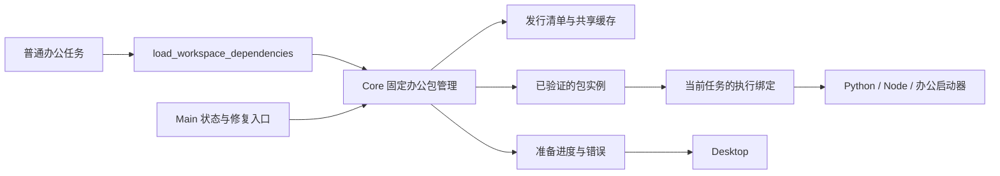

# 依赖与路径管理 · 实现方案

Core 负责固定办公包的准备、验证、共享引用与回收；Main 和 Renderer 通过控制接口展示状态及修复操作；模型与 Skill 消费宿主返回的实际路径。常用办公依赖随整包交付，第三方扩展单独按需准备。用户行为见[需求文档](需求文档.md)。

## 当前代码与已知缺口

[managedenv](../../../src/managedenv/manager.go) 管理共享目录、下载、实例、索引、绑定及使用记录；[Bash](../../../src/tools/bash/bash.go)、[AgentCore](../../../src/agentcore/request_builder.go)、[MCP](../../../src/mcpclient/managed_transport.go)、[ACP](../../../src/acp/registry.go) 和 [Main 控制通路](../../../apps/desktop/src/main/runtime-control.ts) 已接入。

- 官方 Office/PDF/Creator Skill 和基础指令使用 `load_workspace_dependencies`；旧调用和绑定继续兼容，不改写历史执行记录。通用扩展使用 `ensure_environment`。
- `load_workspace_dependencies` 的失败回执说明未取得可执行引用，要求报告原因并暂停办公步骤，原因处理后重试。这是模型行为约束，不是任意 Shell 命令拦截。
- Office helper 在 Awaken 上下文缺少绑定时不扫描系统软件；脱离 Awaken 的脚本保留外部执行语义。非办公组件的外部软件发现由各自安装策略决定，不能用外部程序冒充完整办公包。
- 源码清单的 `office_bundle.assets` 尚未配置公开资源。已有健康实例可以复用；没有兼容实例且需要安装时明确失败。三个平台的本地候选已构建，验证范围集中在[验证方法与交付条件](#验证方法与交付条件)。
- 压缩预算与耐久环境引用的职责见[上下文与用量](../../02_主智能体闭环/上下文与用量/实现方案.md#压缩预算预检与环境绑定)。公开下载、Windows 实机以及未覆盖的外部 Agent 登录流程不由本地成功推导通过。

### 当前固定包基础实现

[office_bundle.go](../../../src/managedenv/office_bundle.go) 复用原管理器的共享等待、下载锁、准备操作、绑定和使用记录，增加整包版本、布局与资产哈希的匹配。旧 Python/Node 细分环境不能满足整包身份；同一任务已有健康整包绑定时保留原版本。新入口为 [load_workspace_dependencies](../../../src/tools/load_workspace_dependencies/load_workspace_dependencies.go)，严格接受 `{}`，通过 `tool_find` 延迟发现，并声明首次准备的写入与网络副作用。

整包部署代码只校验、解包、修正路径和执行验证，不运行 pip/npm。归档内 `office-runtime.json` 必须与产品版本及布局一致；程序与资源必须留在实例目录。Python/Node 包、Word/PPT 转 PDF、Excel 公式重算、Poppler 和 Typst 的探针均成功才写完整清单并激活。ARM64 候选已经实际通过上述探针，也验证了 MarkItDown 的 XLSX/PPTX 读取和中文空格验证目录。macOS x64 与 Windows x64 已做静态原生检查，不能由 ARM64 成功推导其实际执行通过。

办公包健康指纹只排除 Python `__pycache__/*.pyc` 和明确的 Python/Node 开发头文件、Python/Node/Poppler 手册目录。源码、原生库、启动器、字体、DOCX/PPTX 模板、JSON/XML 配置、模型及 LibreOffice RDB/XCD 仍校验；不按通用后缀批量排除。该规则同时用于新清单生成与旧清单读取。同一任务已有健康绑定时保留原实例。`EnsureOfficeBundle` 再次被调用时进行新一轮完整检查；确认原绑定损坏或实例消失后，先查找已选中的兼容健康实例，没有可用副本才进入现有 `ensureSpec` 安装流程。成功后用 `superseded_by` 标记被替代的旧绑定，后续模型上下文、只读工具和子 Agent 只使用有效绑定；旧执行描述、历史快照与进程使用记录保留。直接恢复旧引用仍返回 `environment_binding_stale`，不会把旧命令自动指向新程序。准备失败不替换原记录，也不重放业务操作。

`office/current.json` 保存各平台当前实例、上一实例及回退截止时间；选择与回收共用注册表锁。缺失或格式损坏时，`office_selection.go` 在选择锁与注册表锁内从兼容、健康的完整清单重建，损坏文件先保存为 `.invalid-*`。可读选择不会因目录中存在更新实例而被替换。切换失败不会让新任务选中未激活实例，后续准备可再次激活已完成清单。注册表写 schema 4，兼容读取 schema 1、2、3 并在原子写入时迁移；旧 Core 不支持新版本时拒绝修改。索引只保存实例根、最近使用时间和退休时间；完整版本、启动入口和指纹仅保存在实例清单中。当前/回退实例受回收保护；Office 的遗留未完成目录纳入现有维护逻辑。返回绑定带 `bundle_version`、库资源路径与 override/fallback 变量，不改变全局进程环境。

[发行检查脚本](../../../scripts/check-managedenv-catalog.mjs) 校验整包必须覆盖的既定路线、精确版本、入口、相对路径及体积预算。`--office-release` 要求 macOS arm64/x64 与 Windows x64 均有有效资产描述；源码清单未激活公开资产，因此该项仍失败，本地候选 overlay 已通过。该检查只证明清单约束，不能证明 URL 已发布可下载。

受管办公环境采用稳定默认版本；系统软件只属于明确允许的外部执行路线，不能替代缺失办公包并被标成整体 ready。

## Codex 参考及适用边界

设计参考了研究时已安装 Codex Desktop 的固定办公包、宿主路径入口和平台分别处理的方式：统一 Python/Node 基础依赖，减少模型临时组合；由宿主提供实际启动描述，避免包状态与执行路径不一致。研究快照为运行包 `26.909.12148`，开源 CLI 参考版本为 `5b1d6560181680f95cde95c14ed042acc02248ed`；两者不是同一实现来源。

参考对象不是 Awaken 的运行依赖，也不证明 Awaken 的 Windows 实机行为。Awaken 自行构建公开依赖，不复制 Codex 专有库；任务引用、准备副作用、并发取消和回收期限由本项目需求及实现决定。已安装应用的压缩模块名称和本机路径不作为维护接口。

## 职责与入口

Core 继续是唯一共享环境写入者，Main 不新增一套独立安装器。Main 从系统用户目录确定 `AWAKEN_HOME`，传入产品资源；Core 负责包状态、准备、激活、绑定与回收。Renderer 展示状态和恢复操作，不计算下载 URL 或执行包管理命令。



### 模型工具与宿主接口

已接入模型工具 `load_workspace_dependencies`，输入为 `{}`，无安装位置、包列表、URL、版本选择或命令参数。产品兼容清单决定办公包版本；同一 Agent 已绑定的健康包优先保留，不因调用工具升级在用环境。

它是宿主固定包准备的薄入口：已有实例时立即返回，缺失时请求 Core 创建或加入共享准备，等待完成再返回。由于首次调用可能下载和创建文件，工具必须声明对应副作用和网络需求，**不能伪装为只读工具**或放进只读并行批次。这一点与观察到的 Codex 只读路径工具不同，是 Awaken 保留“任务中自动准备”的接口选择；模型不能自行编排安装步骤。

成功返回 `state`、`bundle_version`、`instance_id`、`environment_ref`、`reused`、支持能力、Python/Node 的 executable 与 argv、库位置、override/fallback 目录和必要的非敏感变量。Skill 根仍由技能运行时提供。安装器完整环境、账号配置和凭据不能进入模型结果。

Core 的 `InspectOfficeBundle` 读取已选整包，`OfficeBundleStatus` 为设置提供状态，`EnsureOfficeBundle` 准备并绑定，`RepairOfficeBundle` 显式创建修复副本。状态读取可能按原索引恢复规则重建索引，但不会下载、安装或绑定任务。Main 的查看、准备、取消和修复复用 [authenticated control](../../../src/server/environment_control.go)，扩展 DTO 与 [协议域](../../09_AGUI与A2UI协议/本地接口与事件协议/实现方案.md)同步。Core 不可用时明确失败，不回退为 Main 下载。

`environment_ref` 归属当前 Agent，不能跨项目或 Agent 直接复制。各自调用准备入口取得独立引用，底层兼容实例共享；宿主负责子 Agent 的重新绑定。`Bash.environment_ref` 和内置工具上下文继续绑定具体实例；省略引用保留一般 Shell 的原有行为，但官方 Office helper 在 Awaken 执行时必须消费宿主描述，缺失或不完整时返回 `needs_runtime` 与新准备入口。Read 等只读工具不隐式下载，返回 typed next action，由正常非只读调度准备后再重试尚未执行的读取。环境绑定不更换已固定的工具注册、provider 或权限快照。

## 固定办公包的内容与交付

### 系统要求与启动器

`office_bundle.minimum_os` 声明 `darwin: 13.3` 和 `windows: 10.0`；`minimum_core_protocol` 当前为 1。Core 在准备前读取宿主系统版本，不满足时返回 `environment_platform_unsupported`，不进入下载。PDFium 当前原生库要求 macOS 13.0，ONNX Runtime 要求 macOS 13.3，已按用户确认调整办公环境基线；参考 [PDFium 平台要求](https://pypdfium2-team.github.io/pypdfium2/platforms.html)和 [ONNX Runtime 构建要求](https://onnxruntime.ai/docs/build/inferencing.html)。

[awaken-office-launcher](../../../cmd/awaken-office-launcher/main.go) 编译为各平台程序，按包内命令名读取 `office-runtime.json` 的相对入口。Unix 使用 exec 替换进程，Windows 通过原生 `.exe` 启动并保留标准流和退出码。Python 排除外部解释器变量，Node 固定包内模块解析，Typst 编译禁用系统字体回退。启动器、字体及原生库均位于受管包；不依赖用户安装 npm、pip 或编译器。

### 基础包与扩展

| 分组 | 基础内容及要求 |
| --- | --- |
| Python | 固定版本的独立解释器；python-docx、openpyxl、pandas、python-pptx、Pillow、pypdf、pdfplumber、reportlab、markitdown 的 XLSX/PPTX extras 及传递依赖 |
| Node | 固定解释器、docx、pptxgenjs 与完整传递依赖；提供 CJS/ESM 都可用的模块启动描述 |
| 原生办公 | LibreOffice、Poppler 的转换/重算/读取入口及所需动态库；中文字体和字体配置 |
| PDF_Max | Typst 与默认模板需要的字体，使既定 PDF_Max 路线不另装基础组件 |
| 运行描述 | 整体版本、平台、布局版本、能力清单、实际入口、包来源、许可证、哈希与验证描述 |

最终精确版本来自产品锁文件和发布验证，不从 Codex 版本抄取；上述内容必须同时就绪才标记办公包 ready。基础包变大意味着首次下载成本增加，应公布实际下载体积、落盘体积与准备时间，不能用开发机缓存掩盖。

Chrome、OCR 数据、FFmpeg、图像扩展库及任意第三方包单独按需准备。扩展不能向已发布办公包执行 pip/npm 安装；可以通过明确组件引用复用解释器，但有冲突时使用独立实例。应用内 Core、Electron、OfficeCLI、CUA Host/Node 等继续随 App 管理，不复制为办公包。Git、ripgrep、CLI、stdio MCP 与 ACP 的自定义命令不因普通 Office 任务安装或切换版本。

### 平台与公开资源

发行使用公开 `Awaken-Releases` 的独立依赖版本，不进入 Desktop 稳定更新通道。每个包版本和目标平台对应不可变资产及 SHA-256；普通用户无需 GitHub 凭据。清单必须包含下载字节数、解包大小预算、布局版本、最小应用协议、最低系统版本和能力集合。必需平台的资源未发布或不通过校验，不得标为可自动准备。

| 平台 | 目标交付与启动 |
| --- | --- |
| macOS arm64/x64 | 分别制作完整归档；所有 Mach-O、动态库和启动器匹配目标架构；完整办公包最低 macOS 13.3，Desktop 自身原有启动要求保持。必须验证签名、加载路径与中文空格目录 |
| Windows x64 | 提供用户级解包可用的完整归档，带所需 DLL、数据和原生 `.exe` 入口；不要求用户安装 Python、Node、编译器或管理员权限。不照搬 Codex 的 MSIX framework，继续兼容 Awaken 当前分发形式 |
| Windows 启动细节 | executable 与 argv 分开；Node 使用 `node.exe` 加 JS 入口，Python 按包布局解析 `python.exe`；不能把 `.cmd` 当作 Go 可直接启动的程序。排除 WindowsApps 假入口，原生清单验证解析后路径仍在受管根 |

Windows 路径使用平台库，PATH 用分号，比较时处理大小写和尾斜杠；支持用户目录和业务目录不同盘符、中文及空格。文件占用时延后清理，更新指针失败不先删除旧文件。Windows 实机验收延期只改变证据范围，不降低实现要求。

维护者使用现有 [资源构建器](../../../scripts/build-managedenv-resources.py)、[组件归档构建器](../../../scripts/build-managedenv-bundle.py)、[Git 构建器](../../../scripts/build-managedenv-git.py)、[PE 检查](../../../scripts/check-managedenv-pe.py)和[资源发布流程](../../../.github/workflows/dependency-resources.yml)制作来源组件，再组装办公包。[办公组装器](../../../scripts/build-managedenv-office.py) 读取这些组件与独立的 `office-package-locks.json` 组装每个平台的完整包；[锁构建器](../../../scripts/build-managedenv-locks.py) 的 `--office` 模式生成该锁，cryptography 固定为有 Intel macOS wheel 的 46.0.7。旧细分环境锁不变。Conda、uv/npm 与编译器可以存在于维护者构建环境，普通用户部署固定包时不运行包求解或源码编译。

构建工作目录在仓库和业务项目之外，统一一个任务工作根；原始下载按哈希复用，过期候选和失败解包及时回收。每个平台只保留必要候选及发布所需材料，不复制多套完整桌面安装包验证同一依赖变化。公开发布是单独确认的交付动作；确认前完成实际候选包和审计清单，不仅提交一个发布计划。

## 目录、版本与持久化

继续使用 `<AWAKEN_HOME>/runtime/environments`，不再增加平行运行根。当前布局如下；现有 `components/`、`environments/`、`bindings/` 等保留给旧任务和扩展：

```text
runtime/environments/
  registry.json
  office/current.json
  office/instances/<target>/<bundle-version>/<instance-id>/
    manifest.json
    dependencies/python/
    dependencies/node/
    dependencies/native/
    dependencies/fonts/
    dependencies/bin/override/
    dependencies/bin/fallback/
  components/
  environments/
  bindings/
  operations/
  attempts/
  leases/
  locks/
  cache/downloads/<sha256>
  resolved/
  staging/<operation-id>/
```

办公包逻辑键由平台、整体版本、布局版本和归档内容摘要决定；实例 ID 区分同内容的修复副本。项目、会话、Agent、Skill 文本及模型选择的生成语言不进入安装键。扩展继续按规范 Spec 匹配子集；办公包已包含的 Python/Node 请求直接复用。Python 的 uv 是安装工具，不隐式进入运行时匹配条件，只在新建扩展时准备；显式请求 uv 仍要求它存在。通配版本按全部前缀段比较，`!=3.1.*` 排除整个 3.1 系列。不能将两个旧细分环境合并后冒充完整办公包。

| 记录 | 内容与恢复规则 |
| --- | --- |
| 办公包发行 manifest | 产品随包携带的可信版本选择、平台资源、完整依赖锁、能力、入口和验证合同；模型不能覆盖 |
| 实例 manifest | kind、逻辑键、实例 ID、bundle/layout 版本、平台、来源、相对入口、内容指纹、实际验证结果及使用时间；只有验证完成才能 ready |
| `office/current.json` | 每个平台的 current、previous、previous_until；原子切换，只影响新使用者。回退期限和恢复规则见下文，不能选择未完成验证的包 |
| `registry.json` | schema 4 紧凑索引：实例 ID → root、last_used_at、retired_at；运行时从实例清单补齐元数据。兼容迁移 schema 1/2/3，拒绝未知版本 |
| 操作与执行代次 | operation/request/attempt/core 身份、阶段、组件、真实字节/部署次数、错误分类；拒绝旧代次迟到提交 |
| 绑定与使用记录 | thread/Agent 的 environment_ref 对应固定实例，run/后台进程/服务各持有自己的 lease；不保存业务正文或账号凭据 |

相对入口在使用时以实际实例根解析，校验真实路径不逃逸。新模型结果返回绝对路径，但历史恢复靠实例身份重新解析，不能只信任旧文本中的绝对路径。旧实例记录结构和绑定读取必须保持兼容，无法安全恢复时明确报告，不静默切到新版本重放业务命令。

## 准备、激活与故障恢复

启动只读取状态和兼容清单，不阻塞无关对话，也不自动恢复上次失败任务。首次办公请求或明确的更新/修复入口才产生准备操作。后台自动更新不是首版前提；不能因每个项目打开而联网比较最新版本。

1. 校验根与调用身份；已绑定健康实例优先，其次当前/回退适用包。新会话先按版本、布局和依赖合同查找已安装实例；发行描述给出哈希时也必须一致，下载 URL、归档入口和体积预算只在需要安装时校验。原办公绑定损坏时自动进入同一准备流程，成功后更新当前任务的有效绑定。成功复用不下载，取得使用记录后返回。
2. 缺失时按包逻辑键合并等待者并取得跨进程准备锁；锁内再次查找，防止排队者各自部署。
3. 固定发行清单和执行代次，复用已校验的哈希缓存，必要时下载。校验归档路径、软硬链接、文件类型及解包大小预算，拒绝逃逸或未声明入口。
4. 在新的最终实例目录准备，但不标 ready。相对布局允许用户目录变化；必要的受控前缀修正完成后再验证。失败只删除本次未发布实例，不改旧版本或外部软件。
5. 验证包内 Python/Node 导入、CJS/ESM、Word/PPT 转换、Excel 重算、PDF 页图及中文字体最小样本。验证进程只使用包内解释器和原生工具，不能借系统软件通过。
6. 持久写入完整 manifest，再在提交锁内核对执行代次并原子更新当前/回退指针和索引。提交失败保留旧选择；完整实例但索引丢失时可恢复，不能重新下载健康包。
7. 为仍在等待的使用者记录绑定并返回，各任务继续自己的业务步骤。取消方不继续执行。

基础包不得直接搬运带构建机绝对路径的 Python venv。采用可定位的独立 Python 和安装到包内的库，命令入口由启动器解析；用不同长度、中文空格路径验证实际导入及 CLI。必要的原生前缀修正使用有界描述，超过容量返回明确错误，不截断或转到项目目录。修正 Mach-O 后按发布与本地验证规则处理签名。扩展若使用 venv，仍在最终实例路径创建，不能从 staging 重命名已有 venv。

安装器使用最小子进程环境，保留平台必需值和当前网络代理，排除项目包管理配置、用户虚拟环境及模型凭据。Bash 正常业务执行仍保留所需账号环境；安装环境的收缩不能误用于业务 CLI。

绑定、实例健康检查和 lease（使用记录）获取在一次注册表事务中完成。同一 Core、同一 run 重复取得同一绑定时，不改写绑定、执行描述、lease 或索引；新 run、新 Core 和后台服务仍各自取得使用记录。执行描述仅为兼容旧读取方式在缺失时生成；工具返回值由当前清单构造。`Bindings` 一次读取实例映射，子 Agent 继承在一个事务中取得自己的绑定。

### 并发、取消与占用

进程内合并和跨 Core 内核锁继续使用现有实现，锁文件不随包替换或释放被删除。索引锁仅保护短事务，不能持有它等待下载、其他锁或子进程结束。激活、绑定、修复和回收遵守同一锁顺序。

共享准备不继承第一个任务的取消信号，每个等待者独立退出；其他 Core 的等待也计入需求。最后一个使用者退出后停止可取消步骤，等待安装子进程收口并保留校验缓存。正常关闭停止新准备、清理本 Core 进程和等待，其他 Core 可接管。

Core 异常退出时，接管者须确认旧安装进程已结束，取得新执行代次，再续做未完成步骤。不能只凭文件锁已释放或 PID 存在认定安全；旧代次提交必须被拒绝。Unix 进程组/存活管道、Windows Job Object 或对应归属实现都要各自验证，交叉编译不代替进程清理实测。

当前 run、子 Agent、后台命令和 stdio/ACP 服务持有具体实例，更新只影响新选择。子任务收尾在进程清理后释放；父任务或创建服务的 run 结束，不能提前释放仍活跃服务的使用记录。绑定与回收标记必须互斥，防止检查无人使用之后又发出绑定。

### 错误分类

| 情况 | 处理 |
| --- | --- |
| 404、平台无资源或版本不可取得 | 标记资源不可用、停止同地址自动重试；能力别名不能换出不存在的包；与临时网络错误区分 |
| 超时、429、可重试 5xx | 沿用网络域有界退避与总期限，保留有效缓存，提供重试/取消 |
| 哈希不符、解包越界、布局不支持 | 不激活、不执行不可信入口；保留旧包，按具体错误处理 |
| 最小操作失败或必需组件缺失 | 整体不 ready，报告验证阶段，不用系统软件补齐后隐藏错误 |
| 磁盘不足、权限或文件占用 | 保留旧指针与健康环境；按空间/访问/占用恢复，不要求系统全局安装 |
| 实例损坏或绑定失效 | 路径可恢复时重新解析；真实损坏时准备修复副本，不原地修改在用环境 |
| 业务脚本、格式、公式或授权失败 | 保留环境就绪事实，按业务错误处理，不反复重装 |

现有 `environment_*` 业务码、canonical Outcome 和 `AWAKEN_RUNTIME_*` 投影继续复用；资源不可用与临时下载失败需在接口实现时明确区分 retryability。准备记录包含实际下载/部署次数，不能用同一个 operation ID 隐藏重复安装。百分比只有总量可知时显示。

下载的网络读取错误按既有策略重试；文件写入或同步失败直接保留系统错误，交由统一分类器报告 `environment_disk_full` 或权限错误，不重新下载。新 `.download-*` 文件名携带资产哈希和 Core 身份；维护确认 Core 已退出并取得同一资产锁后回收。旧随机文件名等待 30 天且没有活跃准备操作才清理。

## Desktop 办公环境管理

设置 → 环境管理由 `OfficeEnvironmentPanel.tsx` 管理读取、当前等待者和迟到响应；Design System 的 `AwakenOfficeEnvironment` 只渲染状态、体积、进度和按钮。打开页面只检查，不启动安装。没有本页操作但其他任务正在准备时，页面每三秒读取一次；空闲时不持续轮询。已知下载总量才显示百分比，解包和验证保持阶段进度。旧进程退出留下的活动操作显示为中断，允许显式重试。

界面标题和导航为“环境管理”，保留内部 `office` 标识及既有控制通路。Design System 只显示 Python/Node.js 两行（名称、版本、状态）和底部一个修复按钮；不显示办公组件目录、安装工具、宣传说明或常驻体积信息。正常行带文字与勾，缺失/异常/检查中分别呈现，不只依赖颜色。全部正常时按钮禁用；缺失时调用 prepare，异常且有原实例时调用 repair，共享同一部署操作。执行期间该按钮切为取消，不额外保留刷新按钮。

`OfficeStatus.runtimes` 增加按 `python`、`node` 排序的独立状态，字段为 `id/state/version`。Core 检查当前受管实例相应解释器、库和启动器的健康指纹，然后在各自最多五秒的检查上下文运行版本探针与对应库导入校验；不使用系统或应用内部的其他解释器替代。一个解释器损坏不污染另一行；共享办公组件异常仍保留整体 damaged 和简短修复提示。检查不下载、不安装、不创建任务绑定。Renderer 等待真实检查结果才打勾，旧响应缺少 runtimes 时显示未能检查，不能用整体 ready 伪造两个成功状态。检查失败清除旧快照，避免保留过期勾。

单个修复按钮调用现有 prepare/repair，不改变安装时机或旧实例保护。原会话再次请求环境时自动恢复；设置操作本身不启动或重放业务任务。面板测试覆盖独立行状态、正常时禁用、缺失时准备、取消、失败重试、迟到结果和旧协议降级；Core 测试覆盖实际解释器检查及状态查询不安装。真实界面的验证范围集中在下文。

`office-environment-ipc.ts` 校验主窗口及主 frame，Main 保管 Core token。Renderer 只能提交准备/修复动作、等待者标识和从状态返回的当前实例比较标识，不能提交路径、包版本、下载 URL 或安装命令。每个窗口最多一个等待请求；关闭页面、窗口、Renderer 崩溃、页面重新导航或应用退出，Main 中止相应 HTTP 请求。取消只解除该等待者，不取消其他任务共享的操作。失败后的再次点击是新等待请求，不重放原业务任务。

Core 通过现有 authenticated control 注册以下接口：

- `GET /v1/control/environments/office`：返回状态、当前/目标版本、下载/解包预算、可用动作及最近准备操作；不返回启动路径或任务引用，不安装。
- `POST /v1/control/environments/office/prepare`：严格接受 `{}`，返回 progress/ready/error NDJSON。
- `POST /v1/control/environments/office/repair`：严格接受 `expected_instance_id`。比较当前实例后强制新副本准备；重复/并发请求发现兼容的当前实例已切换时复用完成结果。成功仅返回 ready，设置不持有长期任务绑定。

`office_control.go` 的修复请求绕过健康实例快速返回，以“目标整包身份 + 被修复实例”区分修复操作；同一目标整包的普通准备与修复共享等待者目录和跨进程锁。取消设置页修复时，仍有普通任务等待就继续当前准备；所有等待者取消才中断，不能因请求类型不同重复解包。新清单记下 `repair_of`，使激活前中断后可继续提交已验证副本；未完成的修复不能被识别为 ready。只有验证并持久化后才切换 current。损坏的 current 不挤掉仍健康的 previous；正常修复保留旧 current 作为健康回退。旧会话仍解析原 environment_ref，新会话使用新选择。控制请求结束后仅移除临时控制使用记录和绑定。

准备状态仍由 `AWAKEN_RUNTIME_*` 投影到当前任务及 SemanticJournal，`projector.ts` 和 `reducer.ts` 使用同一字节格式。历史重放只生成文字，不触发任何准备或修复。设置完成不自动恢复已中止的业务操作；健康旧绑定继续复用，损坏旧绑定在原任务再次请求办公环境时自动取得健康副本。

## 执行路径、Skill 与模型上下文

官方 Office Skill 在执行前取得一次办公包描述，后续生成、转换、重算和校验使用同一实例。基础指令、子 Agent 指令和 Word/Excel/PPT/PDF/PDF_Max/Creator helper 同步改为新入口，不再要求普通任务区分 `word.create_python`、`word.visual_qa`、`excel.recalc` 等安装组合。这些名称仍可用于说明文件操作及验证范围。

- Python 使用包内绝对解释器和固定库目录，排除外部 PYTHONHOME/PYTHONPATH、用户 site-packages 和其他 venv 混入。
- Node 复用现有固定解析器，使用支持其 API 的锁定 Node 版本；CJS 和 ESM 必须验证。不能只设 NODE_PATH，也不向项目写 node_modules。NODE_OPTIONS 只对选定包的命令生效，不全局污染用户开发任务。
- Office 的 override 启动器直接执行包内 LibreOffice/Poppler/Typst 等程序；PATH 中前置包内办公入口，后置明确的 fallback。脚本自己的解释器、资源路径和 argv 必须来自同一描述。
- doctor 保留最低版本、路线诊断和实际操作检查，但不安装、不拼另一套环境。包缺失或执行描述不完整时给出新准备入口；独立脚本的外部模式必须显式区分，不能默认替代受管执行。
- LibreOffice 独立 profile、超时、原子输出、完整 JSON 检查和逐页视觉检查规则保留。运行缓存与可写数据放任务临时目录或明确组件数据目录，不写共享只读安装树。

新增绑定成功后先耐久记录，再更新后续工具上下文和模型可见路径。run 开始时的 `ExecutionEnvironmentSnapshot` 保持历史观察，不反向改写旧 missing 状态，也不替换工具实现 pin。ContextBundle、模型切换、父子交接和重启恢复保留具体实例身份；每个使用者取得自己的绑定和 lease，不复制父 Agent 授权身份。纯历史重放不安装、不升级或启动业务进程。

固定路径不是操作系统沙箱，Bash 仍可执行用户明确的外部命令；相关权限由[命令执行](../../04_工具权限与审批/命令执行/实现方案.md)拥有。宿主内置办公工具的来源检查与普通用户 Shell 行为不能混为一谈。

## 非办公入口与旧环境迁移

| 入口 | 目标边界 |
| --- | --- |
| 旧 Office capability | 从新模型 schema 枚举、示例和未知能力错误提示中收起；解析器和能力清单保留旧调用兼容，旧 environment_ref 不改写执行关系 |
| 旧细分 Python/Node 环境 | 保留在用实例，不能合并目录或重命名为新包；新任务取得整包，旧实例失去引用后按原规则回收 |
| Git、ripgrep | 优先显式配置或应用指定入口，再使用其 resolver 允许的系统/受管 fallback；具体策略由相应工具拥有，不能全局套用办公 override |
| CLI 与账号 | Main 保留登录、注销、官方 Skill；Core 保留二进制准备、卸载预约和使用记录。账号注销不等于删除组件，外部安装不能被管理器删除 |
| MCP/ACP/插件 | 已识别 npx/uvx 启动继续固定包版本和入口；任意 Shell、外部二进制、远端浏览器等保留用户配置语义，不猜测替换。授权失败不报成缺依赖 |
| 浏览器/OCR/音视频 | 保留独立扩展适配；明确浏览器 executable/config 时尊重用户选择。语言数据、字体、FFmpeg 配套程序随各自扩展验证 |
| Typst 旧安装 | 为旧任务保留 legacy 路径；新默认 PDF_Max 使用整包内版本，不原地 force 更新旧路径 |
| 应用资源与项目依赖 | OfficeCLI、CUA Host/Node、Core 跟随应用更新；软件项目按自身依赖约定执行，不改为办公包版本 |

### CLI 安装归属与旧记录迁移

`cli_ownership.go` 是钉钉/飞书二进制归属的统一入口。`InspectCLIInstallation` 从 Core 组件清单投影路径、版本和健康状态；不存在返回空值，不能从 Main 提供的路径或历史 readiness 推断受管安装。安装、宿主进程持有、卸载预约和删除使用同一份组件登记与占用检查。

迁移读取旧 `runtime/cli/installations.json`，只接受原 Awaken 受管记录及受控 provider 根内路径；已登记的旧 `awaken-legacy` 实例保留 ID 和使用记录，统一转成 `awaken-managed`。原二进制不移动、不重新下载，实例清单的 `owned_files` 保存原文件及确认内容相同的旧稳定入口的哈希。不接管外部路径、重定向目录或未知副本；删除前再次检查身份，发生变化时停止。迁入实例在显式卸载前保留，不被普通缓存回收丢失所有权。schema 4 防止不认识该归属的旧 Core 修改索引。

Main 改写 `runtime/cli/connector-state.json`，只保存启停、Skill 版本/名称/摘要、卸载进度及用户外部路径偏好，不持久保存受管 CLI 路径、版本或 ownership。两个 provider 都从 Core 成功恢复且新状态落盘后，将旧文件改名为 `installations.json.migrated` 备份，日常不再读取它。任一步失败保留旧来源，重试按实例身份去重；索引丢失从完整组件清单恢复。Main 的状态写入串行化，内容未变化时不重复写盘。

Core 查询可以恢复归属记录，但不执行登录、下载或任务命令。Main 初始化早于 Core 时显示暂时无法检查；Core 就绪后再读取、迁移和探测。卸载预约保护整个注销/Skill/组件删除过程；删除响应不确定时 Main 保留进度，重启重试只收尾，不重新注销。相关 Core 回归在 `cli_ownership_test.go`，Main 与接口测试在连接器域维护；实际 CLI 验证范围见[连接器管理](../../07_连接器/连接器管理/实现方案.md#共享-cli-的实际验证范围)，Windows 实机仍未验证。

新旧 Core 共享数据根时必须有 schema/协议门控；旧版不认识办公包记录时保守拒绝写入。不能在新 Schema 发布后依靠旧 Core 的目录扫描推测删除新实例。旧 `<userData>/runtimes/primary-runtime` 清理仍只由原 owner 处理，不指向新的用户级根。

[health.go](../../../src/managedenv/health.go) 按实例清单文件的大小、修改时间和模式缓存解析结果；清单删除或替换会使缓存失效。普通绑定和复用查询每次检查解释器、启动脚本等入口文件，其余文件的完整元数据检查结果最多复用 30 秒。显式调用准备入口清空健康缓存，设置诊断和安装验证继续做完整检查。这样减少短时间内重复遍历几万条库文件，代价是普通重复查询对非入口库文件损坏的发现最多延迟 30 秒；程序实际运行错误仍会原样返回，不能把缓存当作业务执行成功。缓存只在进程内存在，不改变安装时的归档哈希、最小运行验证、跨进程锁或在用保护。解析缓存最多保存 64 个实例，健康缓存最多保存 256 项，达到上限清空后按需重建。

## 更新、回收和索引恢复

当前实例及全部在用实例和引用组件始终受保护。Office 的 previous 从切换日起保护七天，老记录第一次维护时补齐期限；到期后退出回退选择，再进入普通七天退休期。因此无使用者时通常在切换约十四天后可回收，实际维护时间可能更晚。Office 不再叠加“同族最新两个”永久保留；非办公环境维持原同族保留策略。活跃使用记录优先于所有期限。下载缓存按独立的未使用期限清理，沿用现有 30 天默认值并在命中时刷新。失败暂存及时清理，不能积累多份完整包。Windows 占用删除失败保持待回收状态，外部安装、应用资源及用户文件永不进入此集合。

Core 记录清理在无效 lease 清理之后进行；仍被 lease、组件使用记录、等待者或准备标记引用的 Core 记录保留，避免“找不到 Core 就保守判活跃”留下永不回收的 lease。

`Manager.ForgetThread` 由 Runtime 的会话删除流程调用，按记录中的 thread 身份及 owner 目录摘要核对后，删除该会话各 Agent 的绑定目录（包括旧 execution 快照）。运行结束只释放 lease，仍保留续行绑定；永久删除才移除绑定。删除失败返回现有清理流程重试，进程 lease 和共享实例不在此处删除。项目历史清理与独立会话删除使用相同方法。

新的办公包只有完整验证后才切换当前指针，强制修复也创建新实例。旧包仍健康且兼容时，更新失败不影响其使用；不兼容的旧包不能为让任务成功而强行回退。关闭、取消、项目删除及插件卸载分别释放自己的使用记录，不触发共享包整体删除。

正常索引查询不扫描整个实例目录。索引缺失、损坏，或兼容实例查询未命中时才扫描受管清单，恢复已完成但索引未提交的实例；损坏索引先保留异常文件。恢复时检查根归属、内容身份、布局和健康状态后重建。当前指针仍有效则保留；丢失时保守选择已确认兼容且完成验证的实例并保留其他候选，不在恢复事务中推测回收。未完成目录或无清单目录不是 ready。

项目移动不改变包根。若整个 AWAKEN_HOME 被用户移动，按新根重解析并验证可定位布局；不能仅替换旧绝对路径就宣布健康。确需重建时保留原数据，说明原因，不转移到项目目录。

## 验证方法与交付条件

聚焦回归位于 `recovery_regression_test.go`、`lifecycle_regression_test.go`、`office_control_test.go` 和 `scripts/tests/system_skills_office_test.py`：覆盖办公包的 Python 子集复用、缺下载描述的新会话复用、损坏选择重建、ENOSPC 原因保留与不重试、遗留下载清理、通配版本排除、重复绑定零改写、模板/配置/库损坏恢复、回退到期及活跃任务保护、Core 清理顺序，以及 doctor/helper 路径一致性。磁盘错误使用故障注入，文件与生命周期使用隔离夹具；不把它们记为真实断网、磁盘耗尽或 Desktop 验收。

`reuse_profile_test.go` 是可选的本机耗时检查：`AWAKEN_REUSE_PROFILE_MANIFEST` 指向实际清单，仅对原文件做只读元数据检查，索引、绑定和 lease 全部写入测试临时根。分别测完整健康检查、绑定和办公入口，不启动真实办公程序；结果不等于模型工具或界面端到端延迟。

保留现有自动化，围绕改变的合同补充验证；不用测试文件数量证明产品完成。已补充整包匹配、清单完整性、越界路径、失败激活、索引恢复、旧任务版本保留及工具输入/副作用测试。下表为最终必须覆盖的范围，不能从这些基础测试推导完整资源验收。

| 检查 | 必须证明 |
| --- | --- |
| 基础包完整性 | Python/Node 常用库、原生工具、字体和 Typst 同时可用；缺一项不 ready；发布包内锁、哈希、许可证和真实入口相符 |
| 路线切换与复用 | Python→Node Word、Excel→PPT/PDF、新项目、子 Agent、重启复用相同适用实例，新增基础部署为零 |
| 来源与路径 | 系统 PATH 放不同版本不影响受管 Office；缺包不借系统通过；中文空格和 Windows 非系统盘正常 |
| 并发与故障 | 多 Core 一次准备、取消首个等待者、执行者退出接管、旧代次拒绝提交、404与超时区别、错误哈希/磁盘不足/验证失败/提交中断 |
| 生命周期 | 更新不改在用实例，后台和 stdio 使用记录持续，索引丢失可恢复，旧绑定兼容，Windows 占用不强删 |
| 模型与界面 | 真实模型能发现新入口并使用返回路径；失败/重试/取消与历史重放一致；三类模型协议、压缩及子 Agent 交接不丢实例 |
| 现有入口回归 | Office 发布与实际页图、CLI 安装注销卸载、MCP/ACP 连接、插件生命周期、文件权限和 Desktop 启停 |

适用的检查命令：

```bash
go test -race ./src/filestore ./src/managedenv ./src/tools/ensure_environment ./src/tools/load_workspace_dependencies
go test ./src/tool ./src/tools/bash ./src/tools/read ./src/tools/glob ./src/tools/grep ./src/tools/dependency_install
go test ./src/agentcore ./src/runtime ./src/subagentruntime ./src/mcpclient ./src/connectors ./src/acp ./src/server
npm --workspace @awaken/desktop run test -- src/main/office-environment-ipc.test.ts src/main/runtime-control-environment.test.ts src/renderer/settings/OfficeEnvironmentPanel.test.tsx
npm --workspace @awaken/desktop run test -- src/main/cli-connectors/manager.test.ts src/main/runtime-supervisor.test.ts src/main/legacy-runtime-cleanup.test.ts
npm run test:system-skills
npm run typecheck:desktop
npm run build:binary
node --test scripts/tests/managedenv-office-catalog.test.mjs
node scripts/check-managedenv-catalog.mjs
# 当前缺少整包资产，以下发行门控应失败；不能忽略后发布。
node scripts/check-managedenv-catalog.mjs --office-release
node scripts/check-docs.mjs
git diff --check
```

### 候选资源验证

`build-managedenv-office.py --verify-only` 调用 `TestOfficeBundleCandidate`，以显式构建根和本地资源验证候选。归档包括相对入口、来源、许可证、锁和原生审计。Windows 裁剪项须随包记录，保留 Python CPU API 及无界面转换；静态检查不替代实机执行。

资源体积从当前构建描述读取，区分归档大小、解包大小和多个版本共存时的实际占用，不用候选包体积推算用户稳定磁盘占用。校验通过不代表 URL 已公开可下载，也不意味着已进入 Desktop 稳定更新通道。

### 真实 Desktop 验收

macOS 后台运行由 `office_background.go` 在办公包解压与路径重定位后、实际程序验证和文件指纹登记前准备。LibreOffice 的 `Info.plist` 设置 `LSUIElement=true`；Awaken 附带的许可证与来源记录移入该应用的 `Contents/Resources/Awaken`，避免应用根目录中的额外文件阻止签名；随后对 `Contents/MacOS/soffice` 重新签名。其他平台不执行这些步骤。健康检查把缺失后台配置的旧 macOS 办公副本交给现有恢复机制，不原地改写正在使用的实例，也不新增一套迁移登记。后台标记的含义见 [Apple LSUIElement](https://developer.apple.com/documentation/bundleresources/information-property-list/lsuielement)。自动化检查位于 `office_background_test.go`；真实部署、转换和 Dock 表现须分别验证，不能只用 `--headless` 或 plist 字段证明桌面体验通过。

使用 [README 正式入口](../../../README.md#正式入口)启动本项目 Awaken，使用真实 LLM，从普通输入框提出 Word、Excel、PPT、PDF/PDF_Max 任务。模型不接受人工指定包路径或安装命令；开发者不得在任务失败后手工补包，再将后续成功算作首次安装通过。

本地候选验收经用户确认，可以把已核对 SHA-256 的归档预置到日常 Awaken 的下载缓存，再由真实模型调用正常入口完成部署；不得预置 ready 实例、索引或绑定。此方式只证明本地缓存输入下的真实部署、任务继续与复用，不能算公开下载或空缓存首次使用通过。候选清单通过构建 overlay 嵌入验收 Core，源码清单不因本地验证而激活未发布资源。

日常环境用于复用与已有任务回归；首次安装用测试专用数据根和空缓存，仍运行真实产品，且不能通过绝对系统路径、已有 Python/Node、LibreOffice 或 Poppler 获得假通过。需要隔离时使用产品已有 `AWAKEN_DESKTOP_ACCEPTANCE_ROOT` 开发入口，并确认实际 Core 根；只改 Shell 的 AWAKEN_HOME 不等于隔离。保护日常配置和凭据，不批量复制私人环境或生成多套桌面包。

先完成普通 Word 生成、页面检查和 Excel 公式重算，再切换 Python/Node 路线、项目和重启。核对真实解释器、原生程序、实例、部署次数与实际文件；环境就绪、进程成功、结构正确、页面检查及 artifact_publish 各自有完成条件。手动停止后继续不能充当自动网络恢复；有界网络失败恢复和真实压缩后续行单独验证。

按[数据存储规则](../数据存储与重放/实现方案.md#thread-与-semanticjournal)回读精确会话的工具结果、绑定、操作和交付物，文档只保留有效方法及限制，不复制几千行一次性模型记录。清理测试目录后不再用其中的失效路径作当前证据。

macOS arm64 本机真实流程与 macOS arm64/x64 发布构建分别记录；Windows x64 执行实现、交叉编译、测试编译及资源清单检查，实机延期不得写成已通过。公开发布单独交付；完成声明必须列出代码、资源可下载性、产品验证和平台限制，不以文档检查替代它们。

### 已验证范围与未完成项

以下是当前共享环境实现已有的验证范围。真实模型、真实程序故障注入和自动化分别说明；不以累计测试数、手动重试或预置缓存替代首次公开下载。

| 验证层级 | 已观察到的结果 | 适用边界 |
| --- | --- | --- |
| macOS 真实 Desktop 与模型 | Word、Excel 公式修改与重算、PPT、PDF/PDF_Max 完成并核对交付预览；跨项目、目录移动、主/子 Agent、Python/Node 路线和重启复用 | 本地候选通过归档缓存部署；没有预置 ready 实例，不代表全新电脑公开下载 |
| 真实压缩与续行 | 长文档任务产生 `context_compacted_v2`；重启后原 Excel 会话继续使用压缩前实例与引用，公式和重算值正确，未新增安装 | 证明已执行的压缩和重启场景，不覆盖所有模型或所有故障时点 |
| 设置与扩展 Skill | 缺失、仅 Node 损坏、状态读取失败的展示正确；用户目录测试 Skill 使用共享 Python，独立新任务不加载 Skill 也能用包内 Node 交付 Word；项目历史删除清除对应绑定并保留共享环境和文件 | 第三方写死安装路径的脚本仍按其自身约定执行 |
| 真实管理器、文件和进程 | HTTP 503 后重试、404/410、错误哈希、受限磁盘 ENOSPC、权限错误、全部取消、解包/校验阶段强杀后复用缓存、运行资源损坏恢复、旧新绑定共存、后台保护及过期清理通过 | 多数为隔离根和可控故障注入，并非全部由模型在界面触发 |
| 混合等待者 | 设置页修复与独立 Core 准备请求共享一次实际准备；取消设置等待后另一请求仍成功 | 界面与控制接口的组合验证，独立请求不等于另一条真实模型任务 |
| MCP 与 ACP | 实际 npx/uvx MCP 完成握手及工具调用；ACP 初始化、新会话及既有授权下的只读任务完成；显式项目虚拟环境路径保留 | 未覆盖所有 server/runner；既有授权成功不代表从零登录通过 |
| macOS 后台转换 | 真实转换和重算完成，用户观察到 LibreOffice 不再反复出现 Dock 图标 | Dock 结论包含用户观察，不由 plist 字段单独证明 |
| 自动化与构建 | managedenv/runtime 的 race 回归、准备工具、Desktop CLI/设置/IPC、Office Skill 脚本、类型检查与 macOS Core 构建通过 | Windows 交叉构建、测试编译及静态资源检查不等于 Windows 实机通过 |

未完成项：Office 资源尚未公开发布，全新电脑空缓存公开下载和 Windows 实际安装运行仍未验收。CLI 授权与卸载的结果及供应商异常注入边界由[连接器管理](../../07_连接器/连接器管理/实现方案.md#共享-cli-的实际验证范围)维护。

准备失败后的模型绕行单独判断：仅有错误原因时曾出现系统 Python 绕行；增加具体失败指引后，同模型新任务停止并报告原因。该指引不保证所有模型都不会忽略规则，也没有新增任意 Shell 拦截机制。

## 受影响功能的同步规则

| 功能域 | 实现时必须同步 |
| --- | --- |
| 本机依赖与文件生成、技能管理 | 新准备入口、固定工具路径、doctor 的诊断职责；文件质量合同保持 |
| 工具发现、命令执行、文件路径安全 | 工具副作用、environment_ref、只读批次与原有权限边界 |
| 对话运行、上下文、子 Agent | 已绑定包、耐久引用、恢复与交接，不修改旧快照 |
| 本地服务、应用生命周期、协议、工作台 | Core/Main 控制、准备状态、取消/修复、历史投影与 schema 门控 |
| CLI、MCP、ACP、插件 | 非办公依赖和账号职责、长期进程使用记录与旧配置兼容 |

相邻文档只链接本功能的环境定义，不复制一套包选择规则。目标尚未落地时继续说明当前代码和差异；实施完成后同步契约、代码及适用验收，不保留“未实现”和“已支持”互相冲突的描述。
