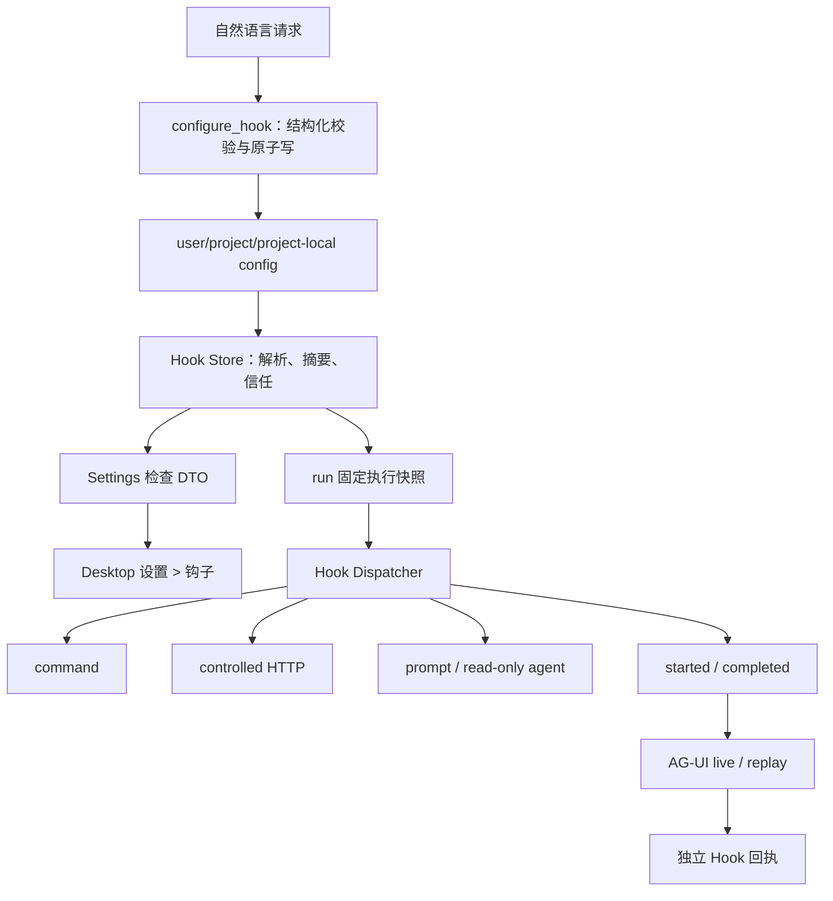

# 钩子 · 实现方案

本文说明代码职责、数据与接口、异常恢复和验证方法。功能范围及用户操作见[需求文档](需求文档.md)。

## 配置、来源与信任

### 配置来源

| 来源 | 路径 | 默认行为 |
| --- | --- | --- |
| user | `~/.awaken/config/hooks.json` | schema 和文件约束有效时启用；Unix 要求不授予 group/other 权限 |
| project shared | 每个项目文件夹的 `<folder>/.awaken/hooks.json` | 未信任时只允许检查，不进入执行快照；适合随项目共享 |
| project local | 每个项目文件夹的 `<folder>/.awaken/hooks.local.json` | 未信任时只允许检查，不进入执行快照；AI 写入时使用 `0600`，适合本机差异 |

Plugin Hook 不属于上述持久配置文件：它来自 immutable installed package，由 Plugin Store 的 digest、component override 和 run generation lease 授权，只进入新 run snapshot，也不写入用户/项目 `hooks.json`。

项目按已保存文件夹顺序发现，主文件夹在前；每个文件夹内 shared 先于 local。不向父目录递归搜索，不从 cwd 猜项目，不扫描独立对话或 managed session workspace。symlink、非普通文件、超过 1 MiB、非 UTF-8、JSON/schema 错误均 fail closed。

信任记录位于 `~/.awaken/config/hook-trust.json`。信任精确绑定 project、canonical config path 和规范化内容摘要；正文、realpath 或项目成员关系变化后，后续检查立即回到待信任。信任不是一次工具审批，也不会扩大 TaskScope、工具快照或模型凭据。

### 自然语言配置工具

`configure_hook` 是主智能体唯一可以修改受保护 Hook 配置的路径，支持：

- `list`：查看某一来源的规范化静态详情；
- `upsert`：按全来源唯一 `id` 新增或替换一条 Hook；
- `delete`：删除指定 `id`，空 matcher/event 自动收敛；
- `set_enabled`：启用或停用整个来源。

scope 只允许 `user | project | project_local`。项目 scope 默认使用当前项目主文件夹，也可选择当前 TaskScope 中一个精确的已绑定可写文件夹；不接受父目录、相对逃逸、独立会话目录或任意外部路径。工具不接受整段 JSON 覆盖，不覆盖 invalid/unsafe 旧文件，不接受 shell 字符串或 secret 明文，并且不能调用 trust API。写入前必须完整经过 version 1 normalization；写入使用同目录临时文件、fsync 和原子替换。成功只产生下一 run 可见的配置事实，不改变当前 run 的 Hook snapshot。

sourcecode 的用户、项目共享、项目本地三层持久配置语义已对应；Skill frontmatter 对应其临时 frontmatter 注册。Awaken 仍以 Desktop 为唯一产品入口，因此没有 `--settings` 配置层；managed policy、Plugin 自动注册、SDK callback 和任意内存 function Hook 尚未实现，不能写成已经完全兼容 sourcecode。

### version 1 形状

```json
{
  "version": 1,
  "enabled": true,
  "hooks": {
    "PreToolUse": [
      {
        "matcher": { "toolNames": ["Write", "Edit"] },
        "hooks": [
          {
            "id": "validate-generated-files",
            "type": "command",
            "command": ["./scripts/check-hook.sh"],
            "cwd": "project_root",
            "timeoutMs": 10000,
            "maxOutputBytes": 65536,
            "onFailure": "block"
          }
        ]
      }
    ]
  }
}
```

共同约束：

- `id` 在单来源内唯一，格式为 `[a-zA-Z0-9._-]{1,128}`；
- `timeoutMs` 为 100～120000，默认 10000；
- `maxOutputBytes` 为 1～1 MiB，默认 64 KiB；
- `onFailure` 只允许 `continue | block`，且事件必须允许阻断；
- 工具事件 matcher 是 canonical tool name 精确列表或 `*`，不接受 regex；非工具事件不接受 `toolNames`；
- 未知 version、event、executor、字段或越界值使整个来源 invalid，不能忽略后继续运行其余条目；
- 来源按 user、项目主文件夹 shared/local、其余文件夹 shared/local 的顺序合并，同一来源保持声明顺序，不以 key override。

### 执行器字段

- `command`：`command` 必须是非空 argv；不接受隐式 shell 字符串。`cwd` 只允许 `workspace_root | project_root`；
- `http`：只接受 `http/https` URL、可选 `allowLoopback` 和 `secretHeaders`。header 值是 Core secret store 引用，不是明文；
- `prompt`：接受 1～32768 bytes prompt 和可选同 profile 内 model selector；
- `agent`：在 prompt/model 外接受 `maxTurns=1..8`，默认 8。

不同执行器的字段不能混用。执行器不能选择 profile、凭据或任意环境变量。

## 事件与控制结果

| 事件 | 边界 | matcher | 可以改变控制流 |
| --- | --- | --- | --- |
| `RunStart` | run 启动、首个模型请求前 | 无 | context、block run |
| `UserPromptSubmit` | 用户消息已耐久后 | 无 | context、block run |
| `PreToolUse` | tool call/原 decision 已耐久、executor 前 | tool name | context、block tool、update input |
| `PostToolUse` | 成功 terminal outcome 已耐久后 | tool name | context |
| `PostToolUseFailure` | 非成功 terminal outcome 已耐久后 | tool name | context |
| `PreCompact` | compact 计算前 | 无 | context、阻止本次 compact |
| `PostCompact` | compact boundary 已耐久后 | 无 | context |
| `SubagentStart` | root 创建 child 边界 | 无 | context、阻止启动 |
| `SubagentStop` | child 终止边界 | 无 | context |
| `BeforeFinish` | 无 tool call 的候选回答形成后 | 无 | context、最多两次阻止结束 |
| `RunEnd` | 唯一 terminal 已 flush/publish 后 | 无 | 仅观测 |

stdout 是一个 UTF-8 JSON 对象；空 stdout 等价 `continue`：

```json
{
  "protocolVersion": 1,
  "action": "continue",
  "reason": "optional bounded text",
  "additionalContext": "optional bounded text",
  "updatedInput": {}
}
```

`additionalContext` 是 host-owned、current-run-scoped 的不可信数据块，不伪造 user/assistant/tool message。`updatedInput` 必须重新经过工具 schema、canonicalization、TaskScope、敏感路径、snapshot/provider readiness 和 journal-before-transport 校验。Post/RunEnd 不能改写既有 terminal outcome、Artifact 或 FileChange。

## 代码位置、数据流与不可绕过边界



代码 owner：

| 路径 | 职责 |
| --- | --- |
| `src/hookruntime` | schema、配置检查、信任、matcher、dispatcher、command/HTTP executor、secret resolver |
| `src/tools/configure_hook` | 主智能体自然语言配置的结构化工具、TaskScope source 选择和 canonical Outcome |
| `src/agentcore` | run/tool/compact/Subagent/BeforeFinish 接入，prompt/agent 执行与模型 usage |
| `src/runtime` | project roots、run snapshot 装配、Journal 与恢复 |
| `src/server/handlers_hooks.go` | 本地 status/trust/revoke API 和检查 DTO |
| `src/protocol/agui` | 耐久语义到安全 Hook wire 的映射 |
| `apps/desktop` | Main/Preload transport、设置页和 Workbench 展示 |
| `src/skillruntime` | composer 激活后的 Skill Hook 注册 |
| `src/pluginhooks` | Plugin Hook 方言事件、handler、argv 与 protocol 编译；不执行 |
| `src/plugins` | installed digest、component state 与新 run Plugin Hook entry 供给 |

`Store.BuildSnapshot` 只产生执行所需的 immutable snapshot；`Store.Inspect` 在相同解析和信任结果上附加 `ReviewHook`。`ReviewHook` 不参与 snapshot digest，也不进入 `hook_snapshot` Journal。设置 DTO 可以包含静态命令、URL、matcher 或 prompt 供当前用户审查，但不得包含 secret 引用值、环境、运行输入、stdout/stderr 或模型/provider credential。

Renderer 不能读取配置文件再自行拼详情；否则会绕过 canonical path、strict schema、默认值归一化和信任摘要。Settings 中的详情也不能复用为运行 authority。

`configure_hook` 不能暴露给只读 Subagent 或 Hook agent，不能在 input 中接收 trust/digest，也不能用用户自然语言授权推导永久项目信任。模型选择何种字段不是 authority；Core 对 action-specific 字段、完整 config、目标来源和 exact writable project root 的复核才是落盘检查要求。

## 执行安全

### command

command 不复用模型 `Bash` tool，不生成伪 tool card。进程使用固定 argv、host 解析 cwd 和最小环境；不继承模型/MCP/connector secret。最小环境固定写入 `PYTHONDONTWRITEBYTECODE=1`，避免 Python handler 在 immutable Plugin package 内生成 `__pycache__` 并触发 digest drift；需要缓存或业务状态的 Hook 必须写入获准的数据目录。Hook 与 Bash 一样以当前登录用户 OS 权限运行，其副作用不保证受 TaskScope 完整观测、可回滚或可恢复。

timeout/cancel 必须收敛进程树：Unix 使用独立进程组；Windows 创建新进程组并优先调用 `taskkill /T /F`。Windows 路径只有交叉编译证据时不能声明实机通过。

### HTTP

HTTP 固定 POST JSON、TLS 最低 1.2、最多五次重定向和受限响应体。默认拒绝 loopback、private、link-local、metadata、CGNAT、ULA、multicast、benchmark、documentation 和 reserved 地址；`allowLoopback` 只额外允许 loopback，不允许其他私网。直连在 dial 前重新解析并固定到已校验地址；每个 redirect URL 都重新执行目标校验。跨 origin redirect 删除所有配置的 secret header。

代理来自 03 域统一 `networkroute`。当前实现的 proxy-only、逐跳 route/`NO_PROXY` 和代理端 DNS 安全缺口见[当前不支持或未完成验证](需求文档.md#当前不支持或未完成验证)；在这些缺口解决并完成真实矩阵前，不能写成“兼容所有企业代理环境”。

### prompt 与只读 agent

两者使用 Host 解析的用途 profile、独立 usage purpose 和有界输出。agent 最多 8 turn/32 次工具执行，工具范围只读且不宽于父 run，禁用 Subagent、ACP、Computer 和 mutation 工具。内部 lifecycle、tool、compact 和 Hook 事件全部抑制，不进入 root narrative。

### 预算与递归

同一事件的 Hook 按确定顺序同步执行。每 run 最多 64 次 invocation、单事件最多 16 个、累计墙钟预算 120 秒；BeforeFinish 最多阻止两次。Hook 内部动作、更新输入的重校验和 model executor 内部事件不递归触发 Hook。

## Skill Hook

只有 composer 明确选择并成功耐久激活的 Skill 才能向当前 run 动态注册 Skill Hook。命令入口必须是包内相对路径，经 realpath 固定后不能逃出 package root。授权绑定当次激活的 catalog identity/source/root/entrypoint，不是永久项目信任，也不延续到下一个 run。Plugin package-level Hook 则由 Plugin Store 在 run start 编译进 snapshot，两条路径都复用同一个 Dispatcher。

目录发现、预览、安装、bundled 同步、模型调用 `skill` 和 fork Skill 当前都不注册 Hook。Skill Hook复用同一 schema、dispatcher、Outcome、Journal、预算和递归检查要求，不能建立第二套执行器或扩大权限。

## 耐久、展示与恢复

Journal 使用：

- `hook_snapshot`：snapshot identity、schema version、启用/诊断数量及来源状态/摘要；
- `hook_invocation_started`：在真正 spawn/model/HTTP transport 前 append+flush；
- `hook_invocation_completed`：保存状态、action、reason code、duration、digest 和有界 preview。

Journal 不保存完整配置、静态详情、secret、完整输入或完整 stdout/stderr。live 和 replay 都由同一 projector 产生 `AWAKEN_HOOK_STARTED/COMPLETED`。Workbench 只显示对用户有价值的独立回执，不显示完整命令或秘密。

Core 在 started 后崩溃时，恢复只把 invocation 封口为 interrupted、side effect unknown；不自动重跑。RunEnd failure 不改变已耐久 terminal；Post failure 不改写原工具结果。配置或 trust store 损坏均 fail closed，不当作空配置覆盖。

## 异常与降级

| 异常 | 当前行为 |
| --- | --- |
| user config 缺失 | 正常空快照 |
| user config invalid | 新 run fail closed |
| project config 未信任/摘要变化 | 允许 Settings 检查，跳过执行 |
| spawn/DNS/proxy/model 失败 | canonical failed outcome；按事件和 `onFailure` 决定继续或阻断 |
| timeout/cancel | 终止执行，记录 timed_out/cancelled；已启动时不声称无副作用 |
| stdout 非法或超限 | protocol failure，不注入部分结果 |
| update input 非法 | 工具不启动，side effect none |
| Post/RunEnd Hook 失败 | 保留原 terminal 事实，附加非阻断诊断 |
| Journal 在执行前 flush 失败 | fail-stop，不启动外部执行 |
| started 后 Core 崩溃 | 恢复封口 unknown，不重跑 |

## 验收

聚焦自动化至少覆盖：

- schema、默认值、unknown field、边界、UTF-8、稳定摘要和多根顺序；
- shared/local 同根顺序、local 独立摘要信任、AI 工具 exact writable root、session workspace 拒绝、invalid 旧文件不覆盖和原子写；
- trust 精确绑定、变更失效、symlink/realpath 和 session workspace 不扫描；
- Settings 检查 DTO 在未信任时仍返回归一化详情、隐藏 secret 引用和值，并且不改变执行 snapshot/digest；
- argv/cwd/minimal environment、timeout/cancel、进程树和输出协议；
- matcher、budget、递归抑制、block/update input 重校验和 Post/RunEnd 不变量；
- Journal-before-spawn、orphan recovery、live/replay 等价；
- HTTP 地址分类、redirect、secret stripping/redaction、DNS rebinding、代理和 `NO_PROXY`；
- prompt/agent 独立 usage、只读工具边界和 Skill 显式激活；
- Windows test binary 编译。

真实 Desktop 按根 README 正式入口执行，并使用隔离 `AWAKEN_HOME` 和专用 fixture 项目：

1. 设置导航与标题均显示“钩子”；
2. 无配置、invalid、disabled、untrusted、enabled 状态均有确定展示；
3. 待信任项目配置可以先展开审查详情，secret 值不出现；
4. 信任后只在下一 run 执行，修改摘要后重新待信任，撤销后下一 run 停止执行；
5. command/HTTP/prompt/agent 和 Skill Hook各完成至少一条真实旅程；
6. 用自然语言分别创建 user、project shared 和 project local Hook，核对模型调用 `configure_hook`；项目写入后设置页先显示待信任，用户信任后只在下一 run 生效；删除/停用也只影响下一 run；
7. block、update input、timeout、cancel、BeforeFinish 重入和 Core 重启恢复符合本文；
8. 重开 Desktop 后 Hook trace 不重复，live/replay 顺序一致；
9. macOS/Windows 分别验证进程树、路径、配置权限/ACL、系统代理和 `NO_PROXY`。

Gallery、mock、直接 Core API 和交叉编译只作辅助证据，不能替代真实 Desktop 或 Windows 实机。当前已完成和未完成的本次验证记录只写入交付结论，不在本文维护历史勾选。

## 经典实用示例

### run 启动时加载项目规则

使用只读 `agent` 检查项目文件，并把规则摘要作为当前 run 的额外上下文：

> 请调用 configure_hook，为当前项目创建一个 project_local Hook。ID 为 `load-project-rules`，事件为 `RunStart`，使用 agent 执行器。只读检查 README.md、AGENTS.md 和与当前项目相关的文档，总结必须遵守的项目约束；不要修改文件，始终返回 ok=true，并把摘要放进 additionalContext。maxTurns 设为 2，失败时继续。

`agent` 可以使用不宽于父 run 的只读工具，但每个新 run 都会增加模型调用、时延和用量。稳定且已经由 Awaken prompt 提供的规则不应重复加载。

### 写入前保护敏感文件

这是典型的 `PreToolUse + command + block_tool`。先由用户审查并创建项目脚本：

```javascript
// scripts/hooks/protect-sensitive-files.mjs
let raw = "";
process.stdin.setEncoding("utf8");
process.stdin.on("data", (chunk) => (raw += chunk));
process.stdin.on("end", () => {
  const event = JSON.parse(raw);
  const path = String(event.subject?.input?.path ?? "");
  const blocked = [".env", "production.json", ".pem", ".key"].some((value) =>
    path.includes(value),
  );

  process.stdout.write(
    JSON.stringify({
      protocolVersion: 1,
      action: blocked ? "block_tool" : "continue",
      reason: blocked ? `禁止自动修改敏感文件：${path}` : undefined,
    }),
  );
});
```

再发送：

> 请调用 configure_hook，为当前项目创建 project_local Hook。ID 为 `protect-sensitive-files`，事件为 `PreToolUse`，精确匹配 `Write` 和 `Edit`，使用 command 执行器，argv 为 `["node", "scripts/hooks/protect-sensitive-files.mjs"]`，cwd 使用 project_root，超时 5 秒，失败策略为 block。

Hook command 的 stdin 是 version 1 `InputEnvelope` JSON；`subject.input` 是原工具输入。command stdout 必须为空或只包含一个 version 1 `Response` JSON。command 只接受 argv，不接受隐式 shell 字符串。

### 修改文件后自动格式化

项目已经提供稳定格式化命令时，可以发送：

> 请调用 configure_hook，为当前项目创建 project_local Hook。ID 为 `format-after-edit`，事件为 `PostToolUse`，匹配 `Write` 和 `Edit`，使用 command 执行器，argv 为 `["npm", "run", "format"]`，cwd 为 project_root，超时 30 秒，失败时继续。

大型项目不宜在每次写入后全量格式化。更合适的做法是让脚本读取 `subject.input.path`，只格式化本次涉及的文件。`PostToolUse` 不能改写已经完成的工具 outcome。

### 任务结束后发送本机通知

macOS 用户可以创建对所有项目生效的本机通知：

> 请调用 configure_hook，创建一个 user Hook。ID 为 `notify-run-ended`，事件为 `RunEnd`，使用 command 执行器，argv 为 `["osascript", "-e", "display notification \"Awaken 任务已结束\" with title \"Awaken\""]`，超时 5 秒，失败时继续。

`RunEnd` 只观察已经耐久化的终态，失败不会改变任务结果。该命令是 macOS 专用示例；当前 Windows Hook 尚无实机准入结论。

### 向外部服务发送结束事件

需要团队通知或审计时，可以使用 `RunEnd + http`。目标服务会收到固定 POST JSON `InputEnvelope`，并且必须返回空 body 或合法 Hook `Response` JSON。例如：

```json
{
  "protocolVersion": 1,
  "action": "continue"
}
```

配置请求示例：

> 请调用 configure_hook，为当前项目创建 project_local Hook。ID 为 `notify-run-service`，事件为 `RunEnd`，使用 http 执行器，URL 为 `https://hooks.example.com/awaken/run-ended`，超时 10 秒，失败时继续。不要在 URL 或配置中写入 secret 明文。

HTTP 默认拒绝 loopback 和私网地址；只有确需本机服务时才显式请求 `allowLoopback`。企业 proxy-only、重定向后的 proxy/`NO_PROXY` 重算和完整真实代理矩阵仍是已知缺口，不应把关键交付只绑定在 HTTP Hook 上。

## command 与 HTTP 输出协议

command stdout 和成功 HTTP response body 使用同一严格协议：

```json
{
  "protocolVersion": 1,
  "action": "continue",
  "reason": "optional bounded text",
  "additionalContext": "optional bounded text",
  "updatedInput": {}
}
```

常见 action：

- `continue`：继续原流程，可附加当前 run 上下文；
- `block_run`：仅用于 `RunStart`、`UserPromptSubmit`；
- `block_tool`、`update_input`：仅用于 `PreToolUse`；
- `block_compact`：仅用于 `PreCompact`；
- `block_subagent`：仅用于 `SubagentStart`；
- `block_finish`：仅用于 `BeforeFinish`。

空 stdout 等价于 `continue`。未知字段、错误 version、多个 JSON、非法 action 或超限输出都会使本次 Hook 形成 protocol failure。

## 当前支持与当前缺口的实现

### 当前支持

- user、project shared、project local 三类持久配置，version 1 严格 schema；
- 主智能体 `configure_hook` 工具支持查看、upsert、删除单条 Hook 和启停来源，可从自然语言请求生成配置；
- project 配置按 `project_id + canonical path + normalized digest` 显式信任；
- 每个新 run 固定不可热更新的可用性快照；
- `command`、`http`、`prompt`、只读 `agent` 四类同步执行器；
- Run、工具、compact、Subagent 和最终回答共十一类事件；
- `add_context`、受限前置阻断和 `PreToolUse.update_input`；
- invocation 预算、递归抑制、timeout/cancel、command 进程树终止；
- `hook_snapshot`、`hook_invocation_started`、`hook_invocation_completed` 耐久事实；
- live/replay 共用的独立 Hook trace，不伪造模型 tool call；
- composer 明确激活 Skill 后注册包内 Hook，discovery/预览/模型侧激活不注册。
- 安装后完整性有效、已启用且映射可运行的 Plugin Hook 以 `SourcePlugin` 进入后续新 run snapshot；stable identity 绑定 plugin name/digest/logicalId/revisionId；
- Plugin command 的 Claude/Codex/Cursor 输入输出 adapter、包根变量、argv 拆分与隐式 shell 拒绝；
- Plugin `mcp_tool` handler 只能调用同一插件已注册、ready 且未被逐 tool 停用的 MCP tool；
- Plugin Hook 回执继续写既有 started/completed Journal，并有当前 Core 进程内的有界查询缓存和无原 run 上下文的诊断性重试。
