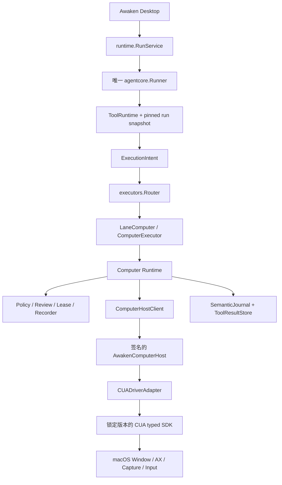
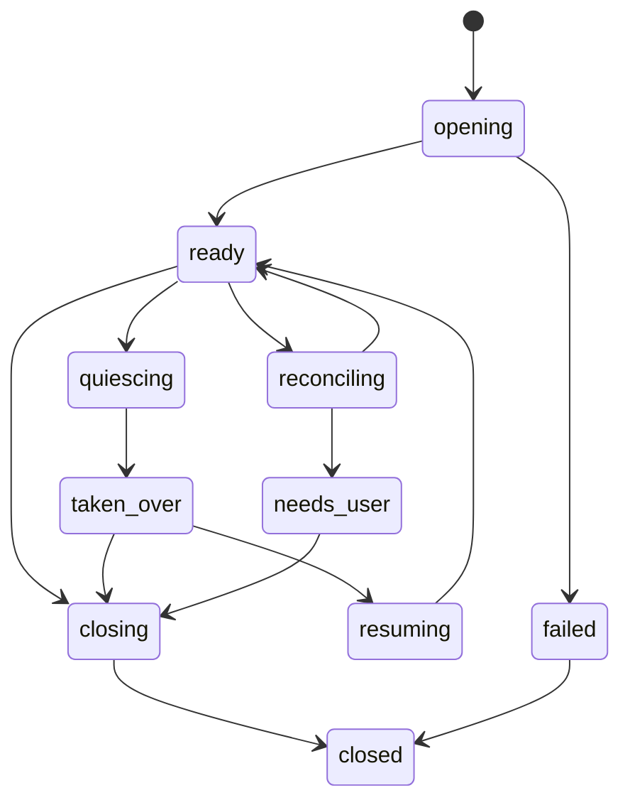
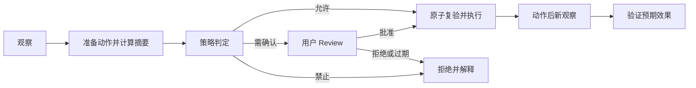

# 桌面观察与操作 · 实现方案

本文说明代码职责、数据与接口、异常恢复和验证方法。功能范围及用户操作见[需求文档](需求文档.md)。

## 当前产品事实

截至当前代码，Awaken 已具备可工作的原生 Computer Use 开发产品链：启用后，具备视觉能力的模型 run 会在 CUA Host、Screen Recording 与 Accessibility 均 ready 时同时看到 `Bash`、`computer_observe`、`computer_act`、`computer_verify`，并通过 run-bound Runtime 完成观察、受策略约束的动作、复核、结果验证、暂停、接管、交还和终止。`ComputerEnabled` 只表示三个 Computer 工具已就绪，不改变 Bash 可见性；正式发布仍以打包签名与真实 Desktop 准入结果为准。

### 已实现的产品链

当前开发构建通过以下模块提供 GUI 观察、动作与控制。是否向模型开放工具，取决于设置、模型视觉能力、Host 和系统权限。

- `src/computer`：模型无关的 Computer domain 类型，包括 `Binding`、`Session`、`Observation`、`PreparedAction`、`Review`、`Lease/Fence`、`PolicySnapshot`、`Runtime` 和最小 `Driver` 合同，以及一个 `fake` driver 用于测试；
- `src/tool/profile`：新增 `LaneComputer`、`ToolKindComputer` 和 Computer capability class 路由；
- `src/agentcore/executors`：新增 `ComputerExecutor` 和 `Router.WithComputerExecutor`，允许 `ToolRuntime` 注入 run-bound Computer runtime；未注入时计算机工具返回 `needs_runtime`/`unsupported`；
- `src/tools/computer`：注册 `computer_observe`、`computer_act`、`computer_verify` 三个 strict-v2 工具定义；当 run 未启用 Computer 时直接执行返回 `computer_unsupported`，启用但无 Host 时返回 `computer_needs_runtime`；
- **Runtime/Server 接线**：
  - `ModelProfileConfig.SupportsComputerUse`、`ModelCapabilities.SupportsComputerUse` 和 model profile store 已支持该能力位；
  - `RunService.StartRun` 在全局开关开启且模型支持图像时创建 run-scoped `ComputerBinding` 与 `computer.Runtime`；真实 Driver readiness 决定工具是否进入该 run 的固定工具快照，run 结束或启动失败时关闭；
  - 打开无活跃 run 的 thread 时，`RefreshThreadContextSnapshot` 使用全局 `ComputerHostProbe` 读取同一 Host 的健康与两项 TCC 状态，只向下一请求投影注入 `ComputerEnabled`，不创建 binding、session 或可执行 Runtime；在全局开关、模型视觉能力、Host 和 TCC 未变时，切换 thread 必须保留三个 `computer_*` 工具；
  - `ExecutionEnvironmentSnapshot.ComputerEnabled` 由 runtime 在 probe 时注入，`computer_*` 工具通过 `ProviderReadiness` 按该标志进行可用性门控；
  - `AgentConfig.ComputerRuntime` 注入后，`RefreshRunAvailabilityWithReason` 会生成 `ComputerEnabled=true` 的环境快照，`Runner` 会把 `ComputerExecutor` 装配进 `ToolRuntime`；该刷新不会自动修改 `ToolExposure.ExtraHidden`，因此 Bash 保持可见，调用方显式隐藏仍有效；
  - `src/server` 新增受 `ControlTokenMiddleware` 保护的 `/v1/control/computer/sessions/{run_id}`、`/v1/control/computer/sessions/{run_id}/pause|takeover|return|terminate` 和 `/v1/control/computer/reviews/{review_id}/resolve` 控制 route；
- 基础域与集成测试：session 状态机、action digest、lease/fence、fake driver observe-act-verify 闭环、RunService 创建/关闭 ComputerBinding、控制 route 注册与 token 保护。
- **CUA SDK 与产品 Host adapter**：
  - `src/computer/cua`：Go 端的 `HostClient` JSON-RPC 合同、`stdioHostClient` 子进程通信、`cuaDriverAdapter` 实现 `computer.Driver`；
  - `apps/desktop/resources/cua-driver/host.mjs`：产品 Node Host，加载精确锁定的 `@trycua/cua-driver@0.22.0`，通过私有 stdin/stdout protocol v2 暴露 health/session/observation、prepared-action 注册、`performChecked`、`quiesce`、`resume` 与关闭；capture/action 主链继续使用 Awaken run-bound 的显式命名 session。只有无显式 session 参数的 `list_windows` 使用隔离的 discovery driver；其 CUA 隐式 session 到期时 Host 重建 discovery driver 并只读重试一次，不影响活动命名 session。Desktop 动作使用逐动作 `ActionTarget.Desktop(display_id="primary")`；window observation 使用 desktop discovery 返回的精确 `pid:<pid>/window:<window_id>`，后续截图与输入绑定 `ActionTarget.Window(pid, window_id)`，不按标题重建目标。0.22.0 继承了 0.19.0 修复 Windows 键盘输入后的基线，并替换已实测会在 Windows 上把 `type_text` 误报成功但不产生输入的 0.12.5；
  - `computer_act` 在 Executor、Runtime 和 CUA adapter 三层执行 action-specific 参数预检：background window click/double-click 必须使用同一 observation 返回的精确 `element_token`；只给截图 `x/y` 的 background click/double-click 会在调用 CUA Driver 前失败，避免把 `synthetic_events` 的“已投递”误报为目标已处理。foreground click/double-click 与其余 scroll/move 要求完整非负整数 `x/y`，drag 要求完整起止坐标，键盘与文本动作要求对应非空字段；`x=0`/`y=0` 是合法屏幕边缘坐标。预检失败不会创建 prepared action、调用 Driver 或注入 OS 输入；
  - Host 的 `performChecked` 在消费 prepared action、调用 CUA Driver 之前再次预检。该处确定性参数错误返回 `status=failed`、`error_code=invalid_action_parameters`、`error_category=validation`，不再误记为 `unknown_outcome`；只有 CUA 调用开始后无法证明输入未发生的异常才进入 unknown；
  - Windows desktop route 当前不能可靠触发 `win`/`windows`/`meta`/`cmd`/`command` 参与的系统 Shell 全局快捷键。0.19.0 基线的真实 Desktop journal 与动作后截图证明 `Win+R`/`Win+S` 会出现“已发送但 Shell 无状态变化”；升级到 0.22.0 后仍保留 Host 的输入前确定性 validation failure，只有新的 0.22.0 真实 Desktop 证据能证明 Shell 实际发生状态变化时才可移除。模型工具说明要求改用新截图中的可见系统 UI，不能把上游“已发送”误写为产品动作成功；普通按键、文本输入和不含 Windows 键的应用快捷键仍在支持面内；
  - Windows window route 在设置“允许后台窗口动作”开启时默认注入 `delivery_mode=background`，关闭时默认 `foreground` 并拒绝显式 background。background 只接受 observation 已绑定的精确窗口；其中 click/double-click 还必须携带该 observation 的 `element_token`，因此可靠路径为 `route=accessibility`。截图坐标的 `synthetic_events` 不作为后台点击成功证据。上游返回 `background_unavailable` 时保持失败，Awaken 不自动抢前台重试；只有模型显式发起新的 foreground 动作才允许降级。动作结果向模型返回实际 `cua_delivery_mode`、`cua_route` 与 `cua_effect`；
  - `src/computer/cua/adapter_test.go`：直接针对产品 Host 的聚焦测试，验证 Health、window/desktop observe、checked perform、参数预检的零输入失败与后续合法动作恢复、pause/takeover 屏障、resume 与关闭；
- **RunService 集成**：
  - `RunService` 增加 `SetComputerDriverFactory`，`cmd/awaken-core/main.go` 在 `AWAKEN_CUA_ENABLED=true` 时通过环境变量实例化 CUA driver；
  - CUA Host 启动失败时回退到 `NewUnavailableDriver()`，不阻断 run 启动；
  - `ComputerExecutor.executeObserve` 把可读截图文件转换成 `ExecutionOutcome.ModelContent`，并把请求到的结构化 accessibility 状态连同 `element_token` 写入模型可见的工具输出；成功动作后的自动 observation 也通过 `post_action_observation` 返回 replacement observation 的完整结构化 AX tree 与 fresh token，模型无需再次观察即可继续下一动作。`stale_element_token` 与参数 validation 等确认零输入失败不再触发隐藏 AX 刷新；两类媒体读取均通过 `runtime.ReadMedia` 校验当前 session ownership 并记录访问审计；
  - `computer.Runtime` 内新增 Observation store，`computer_act` 必须通过 `observation_id` 绑定到当前 session/fence/epoch/freshness 内的真实 Observation，否则返回 `computer_stale_observation`；
  - CUA observation 的默认 freshness window 为 5 分钟。真实 Windows 任务中，截图进入约 33k token 上下文后两次模型续轮分别耗时 3 分 20 秒与 2 分 52 秒，旧的 2 分钟默认值会在没有窗口变化、takeover 或 session 切换时错误拒绝当前 observation；5 分钟仅修正模型往返预算，session/fence/epoch/target generation 与 Host token 复验仍全部生效；
  - 未设置环境变量时 `RunService` 仍使用 `NewUnavailableDriver()`，行为与 一致。
- **复核、接管与运行记录**：
  - `agentcore.SemanticKind` 新增 `computer_*` 系列语义 kind；
  - `computer.Runtime` 新增 `RequestReview`/`ResolveReview`/`GetReview`/`WaitForReview` 与运行期 review ledger；
  - `ComputerExecutor.executeAct` 按 `PreparedAction.Risk` 分路：`low` 直接执行，`review` 创建 review 并等待 Desktop 决策，`handoff` 调用 `Takeover` 并等待用户交还控制后捕获新 observation 再继续，`forbidden` 返回失败；等待受 run context 取消约束；
  - `Runtime.Takeover`/`Return` 实现 session 控制 epoch/状态与 Journal 链路，`Runtime.Perform` 在 `SessionTakenOver` 时拒绝执行；但当前 CUA Host 没有能确认旧 epoch 输入已排空的 quiesce primitive，因此生产 adapter 的 takeover 会失败关闭，不会向 UI 虚报“用户已接管”；
  - `src/server/control_computer.go` 的 review resolve route 真实调用 `Runtime.ResolveReview`，因当前 route 缺少 `run_id`，临时从请求体读取；
  - `RunService.StartRun` 在创建 `computer.Runtime` 后注入 `RecordComputerFactFunc`，Computer 事实经 session recorder 写入 `SemanticJournal` 并进入 live stream。
- **Phase 4：AG-UI / Desktop 控制面与媒体策略（当前支持）**：
  - AG-UI 事件：`src/protocol/agui/events.go` 新增 `EventAwakenComputerReviewRequested`、`EventAwakenComputerReviewResolved`、`EventAwakenComputerHandoffStarted`、`EventAwakenComputerHandoffEnded`、`EventAwakenComputerPointerHint`，并携带 `ComputerEvidenceRefs`、`ComputerHandoff` 与视觉用 `ComputerPointer*` 字段；`semantic_projector.go` 将 `computer_review_*` / `computer_control_transfer_*` / `computer_action_started` 语义记录投影为 AG-UI 事件；
  - Desktop 控制面：Renderer 维护 review、handoff 与 session state；`ComputerReviewGate.tsx` 渲染批准/拒绝，handoff 使用专用交还 gate。`ComputerOverlayManager` 在 Main 中独立订阅活动 run：首次收到 `computer_observe`、`computer_act` 或 `computer_verify` 后创建跨应用置顶透明窗口并渲染完整深色胶囊与唯一停止按钮，同时创建第二枚始终点击穿透的虚拟鼠标窗口（黑底白边箭头，与用户系统光标分离）。虚拟鼠标在 Computer 活动阶段保持可见，收到 `AWAKEN_COMPUTER_POINTER_HINT` 后移动到本次动作的屏幕 DIP 坐标；带 `element_token` 的 accessibility 点击若 observation 提供了该元素的 `frame` 或窗口局部几何，则移到控件中心。keyboard/wait，以及既没有坐标、也没有可用几何的 token 点击，不移动该鼠标，保留上次位置。handoff 期间隐藏虚拟鼠标、交还后恢复；后续 Computer 调用及其间模型推理连续显示，`TOOL_CALL_END` 和 tool result 均不清除，session close、run terminal 或事件流关闭时自动隐藏。窗口在 renderer 与样式加载完成后显示，并使用自己的置顶恢复 watchdog；它与 `PetWindowManager`、宠物 IPC、placement 和 activity state 完全独立。停止按钮经 overlay 专用 IPC 中断正在执行的 GUI 动作并终止当前 run 的 Computer session，但不取消 run 或停止模型回答；同一 run 后续 Computer 调用返回用户已停止错误且不能自动重开 session。Workbench 与定时任务 Agent 编辑器的 `@` palette 都提供内置 `Computer Use` capability token，输入面和 prompt bubble 只显示带显示器图标的 token；Core 校验 `capabilityId=computer-use` 后只向 model-facing effective input 加入固定引导，用户正文、SemanticJournal 和 replay 不暴露该引导。`/` palette 只保留 Skill。该 token 不改变 Computer 工具 readiness；定时 run 的 review/handoff 仍需用户在 timeout 内处理，绝不自动批准或自动授权。设置页只保留“启用计算机操作”和“允许后台窗口动作”，页面最底部的状态区把 CUA Host 与 Node runtime 聚合为“Computer Use 安装状态”：两者均正常时显示绿色已安装，任一异常时显示红色错误且不显示独立侧链名称、版本或 Node 路径；屏幕录制和辅助功能权限仍分别展示；开启总开关或恢复已开启但缺权限的状态时，Desktop 经 bearer-authenticated Core control route 要求真实 CUA Host 同时发起 macOS Screen Recording/Accessibility 请求，缺失项旁提供“去授权”，返回 Awaken 后自动复查并在第一项就绪时继续打开下一项设置页。window/desktop 默认全部允许；风险复核规则由产品安全策略固定拥有，不是用户偏好；媒体策略固定为 24 小时与 500 MiB；
  - 权限发起不变量：进入“计算机操作”页面只读取和展示状态，不准备运行时、不请求权限，也不打开系统设置。上文“恢复已开启但缺权限的状态”只允许由用户点击“继续授权”、单项“去授权”或“准备 CUA 运行时”发起；窗口重新获得焦点仅在本次用户已发起授权且 Desktop 确实打开过权限页时复查和续接下一项；
  - 控制 route：`src/server/router.go` 注册 `POST /v1/control/computer/runs/{run_id}/reviews/{review_id}/resolve`（同时保留旧 body 字段兼容）与 `POST /v1/control/computer/permissions/request`；前者优先从 path 取 `run_id`，后者只让 Desktop Main 经 ControlToken 触发 Host 自有权限请求并返回同一 Host 身份测得的 TCC 状态；
  - 媒体存储：`src/computer/media_vault.go` 实现 session-scoped 私有文件存储（历史接口名仍为 `MediaVault`）；文件与目录分别使用 `0600`/`0700`，读取时校验 session 与 SHA-256 并写入 `SemanticKindComputerMediaAccessed` 审计记录；`Runtime.Close` 在 session 结束时清理本 session 媒体，后台按年龄/容量淘汰旧文件并保留 1 分钟活跃文件安全期。这里不再叠加 AES-256-GCM：截图进入模型上下文后仍会由通用 `ToolResultStore` 以同用户私有文件持久化，单独加密前置副本不能形成端到端 at-rest 边界；
  - CUA Host 管理器：`src/computer/cua/host_manager.go` 实现共享的 `HostManager`，在 `cmd/awaken-core/main.go` 生命周期内自动发现 host 脚本（`AWAKEN_CUA_HOST_SCRIPT`、bundled resources、`apps/desktop/resources/cua-driver`、PoC workspace）、懒启动 CUA Host、后台健康检查与失败重启、应用关闭时清理；`buildCUADriverFactory` 不再要求 `AWAKEN_CUA_ENABLED`，Host 不可用时回退到 `NewUnavailableDriver()`；CUA Host 脚本与 `package.json` 已迁入 `apps/desktop/resources/cua-driver`，`scripts/prepare-cua-driver.mjs` 在构建/开发准备阶段安装依赖；
  - Node runtime 打包：`apps/desktop/resources/node-runtime.json` 锁定 Node.js LTS 版本与各平台 checksum；`scripts/prepare-node-runtime.mjs` 按目标平台下载、校验并解压 Node runtime 到 `apps/desktop/resources/bin/<target>/node`；`scripts/ensure-desktop-runtime.mjs` 自动调用它；`HostManager.resolveNodePath` 优先在 app bundle `Contents/Resources/bin/<target>/node`、binary 旁 `resources/bin/<target>/node` 或仓库根 `apps/desktop/resources/bin/<target>/node` 发现 Node 二进制，不再依赖目标机器已安装 Node.js；`apps/desktop/electron-builder.yml` 的 `extraResources` 已将 `resources/bin/${platform}-${arch}` 与 `resources/cua-driver` 纳入打包；`apps/desktop/package.json` 的 `dist`/`dist:release` 已调用 `prepare:runtime`（`prepare-node-runtime.mjs` + `prepare-cua-driver.mjs`），因此 Desktop 安装包会携带对应平台的 Node runtime 与 CUA Host；
  - CUA 适配器：`src/computer/cua/adapter.go` 接入 session media store；`src/agentcore/executors/computer.go` 的 `executeObserve` 通过 `runtime.ReadMedia` 校验 session ownership、摘要并记录访问审计。

上述链路已经是当前开发构建中的真实实现，不再是只有类型的 PoC。Host protocol v2 将 observation token、action digest、fence token、control epoch 和单次消费的 prepared action 一起校验；`quiesce` 与 perform 共用串行队列，只有旧输入排空后才确认暂停或接管。首次 observation 默认建立 Awaken 显式命名的 desktop session；0.22.0 提供的隐式 session、Computer History、raw MCP、release channel 与运行时更新能力都不进入 Awaken 产品链。坐标策略按平台分离：CUA 0.22.0 的 Rust Windows native runtime 在普通 `node.exe` Host 内仍必须按实测处理 DPI virtualization，截图、`screen_width` 和 CUA 进程内 `scale_factor` 不能替代 Electron Main 提供的权威倍率；Electron Main 因此把主显示器的 `scaleFactor` 作为 Windows 专用环境传给 Core/Host，Host 以截图逻辑像素作为模型画布，并只在 `ActionTarget.Desktop` 输入边界乘该值。不能用 `screen_width == screenshot_width` 或 CUA 进程内的 `scale_factor=1` 推断无需转换。macOS 不设置该环境，继续由 adapter 把 Retina 原始截图归一化成系统屏幕点大小，Host 再按原有 backing scale 恢复成 Driver 输入坐标。当前 0.22.0 Windows 聚焦自动化已验证 2048×1152 逻辑画布、1.25 scale 和逻辑 `(100,100)` 到物理 cursor `(125,125)` 的真实落点；更多缩放比例、多屏排列及完整 Desktop 准入仍需继续补证。Windows Shell 全局快捷键仍是明确不可靠项，不能用通用键盘输入证据替代。CUA opaque session 到期后，下一次只读 observation 会安全重建同 scope session 并重试一次，动作绝不自动重放。仍未完成的发布证据是 Node/Host 随 Desktop 的签名分发和 CI 多平台产物。

上文“隐式 session 不进入产品链”特指 capture/action authority；CUA 0.22.0 的 `list_windows` 没有显式 session 参数，其内部隐式 session 是 desktop discovery 的上游实现细节。Host 已将它隔离到独立 discovery driver，明确到期时只重建该 driver 并只读重试一次，不关闭或重开活动的 Awaken 命名 session。

desktop observation 同时返回 Host 枚举的 `available_windows`；调用方只能选取其中未改写的 `target_ref` 打开 window session。window observation 返回窗口局部 screenshot、模型可见的结构化 AX 元素（含 observation-bound `element_token`）、`window_pixel` 坐标空间和绑定到该 pid/window 的 observation token。background click/double-click 只接受该 observation 的元素令牌；坐标合成投递不会被当成已生效。成功动作自动生成 replacement observation，并在同一 `computer_act` 结果的 `post_action_observation` 中返回新 AX tree 和 fresh token；确认零输入的 stale/validation 失败不再额外刷新 AX。background 动作把 target、delivery mode 与 action digest 一起固定，实际投递结果通过 `cua_delivery_mode/cua_route/cua_effect` 暴露，失败时不自动切换 foreground。

### 运行行为与发布缺口

- CUA Host 脚本与 `package.json` 已进入 `apps/desktop/resources/cua-driver` 产品资源目录；`scripts/prepare-cua-driver.mjs` 在构建/开发准备阶段为该目录安装 `@trycua/cua-driver` 依赖；`scripts/ensure-desktop-runtime.mjs` 自动调用它；awaken-core 的 `HostManager` 已能在运行时自动发现 `apps/desktop/resources/cua-driver`（开发从仓库根启动）、macOS app bundle `Contents/Resources/cua-driver` 或 binary 旁 `cua-driver`；
- Node runtime 已由 `scripts/prepare-node-runtime.mjs` 下载并放入 `apps/desktop/resources/bin/<target>/node`，`HostManager` 启动 CUA Host 时优先使用 bundled Node；Node runtime 与 CUA Host 已通过 `apps/desktop/electron-builder.yml` 的 `extraResources` 与 `apps/desktop/package.json` 的 `prepare:runtime` 进入 Desktop 打包清单，但尚未在 CI/构建机交叉准备所有目标平台的 runtime，也尚未完成签名分发与真实 Desktop 任务验收；
- 启用后首次 `computer_observe` 会懒创建 run-bound desktop discovery session，返回桌面截图与始终存在的 `available_windows` 数组；Host 对瞬时 `list_windows` 失败重试一次，仍失败时整个 observation 明确失败，不再静默省略字段。显式 `window` scope 必须携带其中一个未改写的 `target_ref`，否则明确失败。请求 accessibility 的 window observation 会把结构化元素及令牌直接返回给模型。窗口动作默认按 run binding 选择 background 或 foreground；background click/double-click 缺少同源元素令牌时失败，且 background 不可用时不自动升级。`computer_act` 必须基于同一 session 内真实 Observation。截图与 accessibility tree 使用同用户私有、session-scoped 文件并附带摘要校验和访问审计；session 结束时自动清理，后台固定按 24 小时与 500 MiB 上限淘汰旧文件；
- Computer session、lease/fence、action review 与 Host `performChecked` 已有双层守卫；pause/takeover 先通过 Host 串行屏障排空旧输入，再切换状态和 epoch；return 使用新 fence/epoch 恢复并作废旧 observation/action；
- window scope 目前没有逐 run 应用/窗口 allowlist 的授权 UI 与 Host 侧强制执行，不能据此声称已限制到用户批准的目标；
- `computer_verify` 会自行捕获新 screenshot/AX observation，并从该 AX 内容求证 element present/absent 与 text contains 断言，不信任模型传入的 `actual`/`matched`。只有全部断言都可由宿主证据计算时才返回 `verified` 或 `not_verified`；缺少可计算 AX 语义时返回 `inconclusive`，同时把新截图交给模型继续判断；
- Computer 工具已通过生产 `src/tools` 聚合注册，只有真实 Driver 与两项 TCC 权限 ready 时才会出现在模型工具快照中；Bash 不受 Computer readiness 影响。

`/v1/control/computer/*` route 已真实连接 Runtime；session 尚未打开时 pause/takeover/return 会返回冲突，terminate 幂等成功。AG-UI live/replay 会投影 session state、review 与 handoff，Desktop 可发起全部四种 session 控制。CUA Host 或 TCC 未就绪时工具不暴露，产品应展示具体 readiness，而不是让模型试错。

## 当前可复用底座

以下能力已存在，但只是 Computer 实现的基础，不构成 Computer Use：

| 当前能力 | Computer 实现应如何复用 |
| --- | --- |
| `ToolDefinition` v2、工具 catalog 与 run 固定快照 | Computer 工具进入同一注册与暴露链，不建立第二套 registry |
| `ExecutionIntent`、`executors.Router` 和现有 execution lanes | 新增 `LaneComputer` 与 `ComputerExecutor`，不从 Renderer 或 provider adapter 旁路 |
| `ExecutionOutcome.ModelContent`、`ToolResultStore` 和 provider 图像投影 | 截图复用现有 tool-result media 链；补充 Computer 的 session 隔离、摘要校验、保留和访问审计 |
| `SemanticJournal` 与 live/replay 共用 projector | 结构化 Computer 事实写入 Journal，大媒体只写受控引用 |
| `RuntimeIdentity`、`ControlToken`、`/v1/control/*` 与 Desktop Main control client | 用户 review/takeover route 复用现有控制身份，不把 bearer token 交给 Renderer |
| `ask_user`、`interaction_required`、ACP permission 的 typed wait 范式 | 只借鉴等待、取消和恢复方式；Computer review 必须是独立语义 |

已新增 `SupportsComputerUse` 模型能力位并贯穿 model profile 解析与 `ModelCapabilities`，但当前 Desktop 模型配置面尚未提供该位的完整编辑/同步链，因此 Runtime 现阶段以“Computer 全局开关已开启 + 模型支持图像”创建 binding，再用真实 Driver health 决定三个工具在 run 固定快照中是否为 `ready`。这是一项明确的 interim 限制，不表示任意 vision 模型都已完成 Computer conformance。Computer 截图最终复用通用 `ToolResultStore` 的模型媒体链，因此当前统一采用同用户私有文件、最小权限、session ownership、摘要校验、短保留和删除策略，不声称截图 at-rest 加密。

Computer runtime 在每次 run 的公共启动路径绑定；新建、内存续接和冷恢复都遵守相同初始化顺序。隔离回归 `src/runtime/run_service_computer_restore_test.go` 用注入 driver 验证三条路径，不把该测试作为真实桌面观察、点击或权限验收的证明。

## 当前验证

### 静态检查

```bash
rg -n "LaneComputer|ComputerExecutor|computer_observe|computer_act|computer_verify" src apps/desktop
rg -n "SemanticKindComputer|computer_session_opened|computer_observation_captured|computer_action_prepared|computer_review_requested|computer_control_transfer" src/agentcore src/computer
rg -n "RequestReview|ResolveReview|GetReview|Takeover|Return" src/computer/runtime.go
rg -n "HostManager|NewHostClient|cua-driver|CuaDriver" src/computer/cua cmd/awaken-core
rg -n "trycua|cua-driver" go.mod go.sum package.json package-lock.json
```

上述类型/工具名与 `/v1/control/computer/*` route 均应命中。静态检查后还必须核对：三个 Computer 工具只在 readiness 满足时暴露、调用被路由到 `ComputerExecutor`、Bash 在 Computer-ready run 中仍独立可见且不被展示为 Computer 动作、Host protocol 为 v2，以及 Desktop/打包验收是否完成。

CUA 相关代码当前在 `src/computer/cua`、`apps/desktop/resources/cua-driver` 和生产启动路径 `cmd/awaken-core` 中命中。CUA SDK 是 Host 的锁定 Node 依赖，不进入 Go module 或 Desktop Renderer 依赖。

### 本地开发启用 CUA（非产品路径）

在开发机器上满足以下条件时，`RunService` 会自动使用真实 CUA driver：

1. 终端已授予 Screen Recording 与 Accessibility TCC；
2. 已运行 `node scripts/ensure-desktop-runtime.mjs`（或分别运行 `scripts/prepare-node-runtime.mjs` 与 `scripts/prepare-cua-driver.mjs`），为当前平台准备 bundled Node runtime 与 CUA Host 依赖；
3. 从仓库根启动 `awaken-core`：

```bash
node scripts/ensure-desktop-runtime.mjs
./awaken-core
```

`scripts/prepare-node-runtime.mjs` 默认准备 `darwin-arm64` 与 `darwin-x64`；其他平台可传 `--targets=linux-x64,linux-arm64,win32-x64,win32-arm64`。Node runtime 会下载到 `apps/desktop/resources/bin/<target>/node`，`HostManager` 启动 CUA Host 时优先使用它。

验证：在 bundled Node 与 CUA Host 依赖已准备、终端已授予 Screen Recording 与 Accessibility TCC 后，启动一个同时声明 `SupportsComputerUse` 与 `SupportsVision` 的模型 run，调用 `computer_observe` 应返回包含截图引用的成功结果，而不是 `computer_needs_runtime`。`AWAKEN_CUA_ENABLED` 不再需要。

### 真实 Desktop

输入发送场景须同时核对 `computer_observe` / `computer_act` 的执行记录、目标应用实际收到的内容和耐久 run 终态。驱动层 `unverifiable` 回执不能单独证明成功，应以操作后的观察或目标应用结果补充确认；已有权限下的输入发送验证不代表首次权限、接管或取消流程已经验收。

仅进入“计算机操作”页面或普通窗口聚焦不得弹出系统设置；只有开启总开关或点击明确的准备/授权按钮后，才进入下述权限引导。

按根 README 的正式入口打开 Awaken，在设置页“计算机操作”分区中确认：状态检测展示 CUA Host、Node runtime、屏幕录制和辅助功能权限状态；只可配置全局启用/禁用和后台窗口动作；页面说明范围全部允许、媒体固定保留 24 小时且最多 500 MiB，但不为范围、复核规则和媒体策略提供编辑控件；开启后自动准备 Node runtime 与 CUA Host，由 Host 同时请求两项系统权限，未授权项提供准确的系统设置跳转；从系统设置返回 Awaken 后自动复查，屏幕录制已就绪而辅助功能缺失时自动继续辅助功能设置页，拒绝或稍后授权时保留“继续授权/去授权”恢复入口。Workbench 与定时任务 Agent 编辑器输入 `@` 时都应出现 Computer Use 选项，选择后只显示带显示器图标的原子 token，`/` 菜单中不再出现该选项；提交、定时保存、重开与 prompt replay 都不得显示隐藏引导。启动真实 GUI 任务后，还须验证模型同时看到 Bash 与三个 Computer 工具、收到与屏幕点画布同尺寸的截图并执行准确输入；在 Computer 调用之间插入 Bash start/result 时，独立置顶控制条与虚拟鼠标保持连续显示且不重建、不把 Bash 标成 Computer 动作。切换到计算器等 Awaken 外部应用时，控制条和虚拟鼠标从首次 Computer 调用开始连续显示，observe/act/verify 之间不闪退；desktop 点击应看到虚拟鼠标移到目标点，且用户自己的系统光标仍可独立移动。点击唯一停止按钮后当前 GUI 动作立即中断、Computer session 关闭且提示与虚拟鼠标消失，但 run 与模型回答继续，后续 Computer 调用不能重开 session；session/run 正常结束也会自动消失，review/handoff 专用交互仍可达。handoff 期间虚拟鼠标必须隐藏。定时 run 触发 review/handoff 时不得自动批准，用户未在任务 timeout 前处理则必须取消并形成唯一终态。

本次 Windows 开发构建验收已完成真实模型闭环：正式 `npm run dev:desktop` 入口重启最新 Core/Host 后，Workbench 任务 `thread_1787661704548453400_2` 的 desktop observation 返回始终存在的 `available_windows` 数组并选定精确记事本窗口；window observation `obs_7280db6fef80a8f15210afc70c533db9` 返回“设置”按钮 token `s00000001:17`。第一次 `computer_act` 以 `background/accessibility` 打开设置页，并在同一结果的 `post_action_observation` 中返回 replacement observation `obs_153d619f839ee0bd3b6aeda86c617c93`、新 snapshot `s00000002` 和“返回”按钮 fresh token `s00000002:43`；模型没有插入额外 observe，直接以这组新 observation/token 完成第二次 `background/accessibility` 动作，得到 `obs_6d2df0ad2530829cc51f262c6c479e47`，最终 fresh screenshot/AX 确认回到编辑器，全程未出现 `stale_element_token`、`synthetic_events` 或 foreground 降级。这证明 post-action fresh-token 传递已在真实 Desktop 产品链可用。`TestWindowsCalculatorBackgroundAcceptance` 本次找不到“清除”元素是上游 [trycua/cua#1601](https://github.com/trycua/cua/issues/1601) 已确认的 Windows UIPI/uiAccess 平台边界：普通 medium-integrity 调用者下 Calculator 会稳定地只暴露根 `CoreWindow`，并非通用 CUA observation 回归或偶发不稳定。Calculator 因此不作为 AX 准入目标；后台 AX 连续动作使用现代记事本等正常暴露 UIA 的应用，Calculator 只适合作为 vision/pixel 条件 smoke，除非产品未来采用签名 `uiAccess=true` 与 elevation。签名发布包准入、以及本次未重新采集的物理鼠标位置/前台句柄双重证据仍需单独完成。

## 迁入“当前支持”的门槛

只有同时满足以下条件，才能修改本文结论：

1. CUA 已按目标架构进入锁定依赖、构建、签名、打包、启动和 readiness 链；
2. Computer Tool/Runtime、session、policy、review、lease/fence、takeover 和持久化真实存在；
3. Bash 与 Computer 的工具暴露、事件、Outcome 和安全声明保持独立；原始 CUA MCP/CLI 不进入模型上下文，终端 GUI 行为不得冒充 Computer review/fence 证据；
4. 聚焦自动化、相关 Go/Desktop 构建与故障注入在本次工作区通过；
5. 正式打包 Desktop 完成真实任务、TCC、取消、接管、崩溃恢复和重启验收；
6. 01/02/03/04/09 域的当前权威同步更新；
7. [目标测试与准入门](实现方案.md) 的发布门全部有可追溯证据。

## 目标架构与CUA集成说明

本节说明 Computer Use 的模块边界、执行主链、CUA 集成形态、Driver 合同和依赖发布策略。状态与 wire 见 [目标状态、数据与事件契约](实现方案.md)，安全不变量见 [目标安全、审计与恢复契约](实现方案.md)。

## 已确认技术选择

Awaken 首个本机 Computer Driver 采用 MIT 许可的开源 [trycua/cua](https://github.com/trycua/cua)。目标是把 CUA 的桌面采集、accessibility、窗口定位和输入能力纳入 Awaken 现有 Agent/Tool/Runtime 主链，不是把 CUA 当作用户自行安装的普通 MCP Connector。

CUA 只拥有设备层事实和动作执行。以下能力始终由 Awaken 拥有：

- 唯一 Agent loop、任务规划和模型调用；
- Tool Catalog、run 快照和模型可见工具面；
- app/window/action policy 与风险分类；
- action review、human takeover 和控制身份；
- session lease、fencing、幂等与未知结果恢复；
- SemanticJournal、媒体策略、只读 replay 和产品 UI。

原始 `cua-driver mcp`、`cua-driver call` 和完整 SDK 方法不注册为 Awaken Tool，也不向模型暴露。CUA 自带 recording 只能作为底层诊断证据，不能替代 Awaken 真相。

## 当前上游事实与采用范围

设计依据是 CUA 官方公开合同：

- [Process Model](https://cua.ai/docs/reference/cua-driver/process-model)：同进程 `CuaDriver.create()`、daemon 和下游 CLI/MCP 的关系；
- [SDK Reference](https://cua.ai/docs/reference/cua-driver/sdk-reference) 与 [Interface Contracts](https://cua.ai/docs/reference/cua-driver/contracts)：session、window/desktop scope、state 和 action；
- [Platform Support](https://cua.ai/docs/reference/cua-driver/platform-support) 与 [Known Limits](https://cua.ai/docs/reference/cua-driver/limits)：平台能力与降级；
- [Permission Modes](https://cua.ai/docs/reference/cua-driver/permission-modes) 与 [Permission Policies](https://cua.ai/docs/reference/cua-driver/permission-policies)：CUA 自身的风险和授权层；
- [Browser Profile Attachment](https://cua.ai/docs/reference/cua-driver/browser-profile-attachment) 与 [Browser Semantic Snapshots](https://cua.ai/docs/reference/cua-driver/browser-semantic-snapshots)：浏览器 generation 和 snapshot 生命周期；
- [Electron app hosting](https://cua.ai/docs/how-to-guides/driver/expose-mcp-from-desktop-app) 与 [Install](https://cua.ai/docs/how-to-guides/driver/install)：macOS TCC、可执行文件、签名和打包要求。

首版采用 CUA Driver 的本机能力，不采用 CUA Sandbox/Lume 作为产品运行环境。CUA 当前没有公开保证 Awaken 需要的 lease/fence、原子 `perform_checked`、quiesce/takeover、通用动作幂等或 unknown-outcome 自动恢复；这些必须由 Awaken Host/Runtime 补齐。

上游文档描述不能直接升级为 Awaken 当前支持。实现时必须把实际采用的 commit、包版本、原生二进制 checksum 和本地 conformance 结果写入依赖清单。

## 目标主链



唯一允许的模型执行入口是 `ToolRuntime -> executors.Router -> LaneComputer`。Renderer、LLM adapter、Skill、Connector、MCP server 和 CUA 本身都不能直接触发输入。

## 本机进程模型

### 首选形态

首版 macOS 目标采用由 Desktop Main 管理、随 Awaken 一起签名和发布的 `AwakenComputerHost`：

- Host 是 Awaken app bundle 内的专用 helper/sidecar，拥有稳定 bundle/code-sign identity 和 TCC 权限；
- Host 使用锁定版本的 CUA typed SDK 同进程创建 Driver；
- Desktop Main 负责安装完整性、启动、健康检查、崩溃重启、权限引导和停止；
- Core 的 `ComputerHostClient` 只调用 Awaken 自有最小 IPC，不连接公开 CUA daemon；
- Host 的 IPC 只接受当前 Runtime 身份和 run-bound capability，不监听公网；
- CUA 需要 protected consent 时，Host 只接受从 Desktop Main 的已认证 review 控制链回传的决定；模型消息、MCP prompt、TTY、环境变量或文件都不能充当同意；
- Renderer 只能经 typed Electron IPC 调用 Main，再由 Main 调用已认证的 `/v1/control/computer/*`，不能拿到 Host 地址或密钥。

选择专用 Host 而不是把 CUA native runtime 直接装入 Electron Renderer，是为了稳定 TCC 身份、隔离 native crash、限制调用面并在输入注入处执行 fence/precondition 检查。实现 POC 可以比较“Electron Main 内嵌”和“签名 helper”两种托管方式，但发布形态必须满足上述身份、隔离和原子检查不变量；不得退化为用户手工启动的无认证 daemon。

### 当前 interim 实现

Phase 4 的当前实现把 CUA Host 作为 Core（`cmd/awaken-core`）管理的 Node.js 子进程：

- `src/computer/cua/host_manager.go` 在 awaken-core 生命周期内持有单一 `HostManager`；
- 启动时自动发现 host 脚本（`AWAKEN_CUA_HOST_SCRIPT`、bundled resources、`apps/desktop/resources/cua-driver`、PoC workspace），不再要求 `AWAKEN_CUA_ENABLED`；
- CUA Host 脚本与 `package.json` 已迁入 `apps/desktop/resources/cua-driver`，`scripts/prepare-cua-driver.mjs` 在构建/开发准备阶段为该目录安装 `@trycua/cua-driver` 依赖；
- Node runtime 由 `scripts/prepare-node-runtime.mjs` 按目标平台下载并解压到 `apps/desktop/resources/bin/<target>/node`，`HostManager.resolveNodePath` 优先发现 bundled Node，不再要求目标机器已安装 Node.js；
- `RunService.StartRun` 通过 `computerDriverFactory` 获取 driver；Host 不可用时回退到 `NewUnavailableDriver()`；
- 后台健康检查与失败重启由 Core 负责，应用关闭时 `HostManager.Close()` 停止子进程；
- Desktop Main 当前不直接管理 Host 子进程，只通过现有 `/v1/control/computer/*` 控制面转发用户 review/handoff 决定。
- macOS 权限请求由 Node Host 内锁定的 CUA native SDK 发起，确保检查、弹出请求与真正执行 capture/input 的进程身份一致；Desktop Main 只经 authenticated Core route 触发该调用并负责打开精确的系统设置页，不再用 Electron 主进程代替 Host 请求 TCC；

这是向 4.1 首选形态迁移的 interim 步骤：Core 直接 spawn Node host 并把 Host 脚本放入产品资源目录，简化了开发验证与资源分发；但生产发布仍需把 Node runtime 与 Host 一起打包签名，并最终由 Desktop Main 管理 TCC/生命周期，把 Core-Host IPC 约束为 Awaken 自有最小合同。

### 不采用的形态

- 不要求用户全局安装 `/Applications/CuaDriver.app` 才能使用 Awaken 核心能力；
- 不把 `cua-driver mcp` 加到 Connector 列表后直接宣称集成完成；
- 不允许 Core/Bash 通过环境变量、磁盘 token 或公开端口访问原始 CUA surface；
- 不让 CUA daemon 自行更新、改变 policy 或发送未由 Awaken 明示的遥测；
- 不允许 Renderer 加载 native CUA SDK 或直接拥有 Screen Recording/Accessibility 调用权。

CUA 的 permission mode 和低层 policy 按 Host/Driver generation 固定，模型 tool call 不能切换。Awaken policy 变化若需要改变 CUA 低层 policy，必须先 quiesce 并重建 Host/Driver generation；不能在活动 session 中悄悄放宽。

## 目标模块 职责

命名可在实现时按仓库惯例微调，但职责和依赖方向不能变化。

| 目标模块 | 唯一职责 |
| --- | --- |
| `src/computer` | 模型无关 domain 类型、Runtime、policy、lease/fence、review、recorder 和 Driver contract |
| `src/agentcore/executors/computer.go` | 把 `ExecutionIntent` 交给 run-bound Computer Runtime，并转成 `ExecutionOutcome` |
| `src/tools/computer` 与 `src/tool` profile/capability | 三个 strict-v2 工具、capability class、`LaneComputer` 和 run availability 事实 |
| `src/runtime` | 为 root run 创建/恢复/关闭 `ComputerBinding`，将语义记录纳入正式 session |
| `src/server` | 实现状态契约定义的 review/takeover/session 控制 route 和安全契约定义的鉴权；不得承载 raw Driver API |
| `src/protocol/agui` | 从 SemanticJournal 投影 Computer live/replay 事件 |
| `src/computer/cua` | CUA SDK 适配层、HostClient JSON-RPC 和 `HostManager`（当前 interim 由 Core 持有） |
| `apps/desktop/src/main` | 目标：Host lifecycle、TCC/readiness、control token 调用和 Renderer 隔离；当前还由 `ComputerOverlayManager` 独立订阅 run event、管理跨应用置顶提示、独立点击穿透的虚拟鼠标，以及自身可见性恢复，并从专用 overlay IPC 终止 Computer Use 而不取消 run；不得借用 `PetWindowManager` 的窗口、IPC 或状态 |
| `apps/desktop/src/shared` | Main/Renderer 共享的判别联合与 typed IPC contract |
| `apps/desktop/src/renderer` | 主窗口只消费 review、takeover 和只读 replay，不拥有 policy，也不拥有跨应用 Computer 调用提示 |
| `AwakenComputerHost` | 验证调用身份/fence/precondition，适配 CUA 并注入输入 |

`executors.Router` 必须改为可注入 Computer executor，不能继续在 `ToolRuntime` 内用不可替换的默认实例掩盖 run binding。

进程级构造和 run 注入顺序当前实现为：

1. `cmd/awaken-core/main.go` 构造 `MediaVault`（`computerMediaVault`）和 `HostManager`（`cuaHostManager`），并通过 `buildCUADriverFactory` 把二者绑定为 run-bound Driver factory；
2. `RunService.SetComputerDriverFactory` 与 `RunService.SetComputerMediaVault` 把 factory 和 vault 注入 runtime；
3. `RunService.StartRun` 在模型声明 `SupportsComputerUse` 与 `SupportsVision` 时创建 `ComputerBinding` 与 `computer.Runtime`，调用 factory 获取 driver（CUA Host 不可用时回退到 `NewUnavailableDriver`）；
4. `Runtime` 绑定 session recorder，Computer 事实写入 `SemanticJournal`；
5. Agent 的 `ToolRuntime` 通过注入的 `ComputerExecutor` 处理 `computer_*` 工具；
6. run cancel/terminal 和 Core shutdown 关闭 `ComputerRuntime`（revoke binding、quiesce Host、提升 fence、释放 lease、`PurgeSession`），并调用 `HostManager.Close()` 停止共享 Host。

目标形态（4.1）应把第 1 步中的 Host 管理从 Core 移到 Desktop Main，Core 只通过 Awaken 自有 IPC 调用 Main 托管的 Host。当前 interim 实现允许 Core 直接 spawn Node host，作为向目标形态迁移的中间状态。

## `ComputerDriver` 与 Host 合同

Awaken-facing 最小合同至少包含：

```text
Health()
OpenSession(binding, policy_snapshot, fence_token)
Observe(session, scope, target, options)
Prepare(session, observation, action)
PerformChecked(session, prepared_action, precondition, fence_token, control_epoch)
Quiesce(session, next_control_epoch)
Resume(session, policy_snapshot, fence_token, control_epoch)
CloseSession(session, reason)
```

语义要求：

- `OpenSession` 固定 capture scope、policy/version 和资源身份；
- `Observe` 返回 CUA 原始状态经 Awaken 规范化后的 `Observation`；
- `Prepare` 只解析目标和生成前置条件，不产生外部副作用；
- `PerformChecked` 必须在输入注入的同一可信进程内复验 session、fence、control epoch、target generation、freshness 和 action digest；
- 任一复验失败都必须在发送鼠标/键盘事件前 fail closed；
- `Quiesce` 返回后不得再有旧 epoch 输入在途；
- `Resume` 必须要求 fresh observation；
- Host crash、IPC timeout 或 response 丢失不能被包装成明确失败，必须返回 `unknown_outcome`；
- CUA opaque session 自然到期时，下一次只读 `Observe` 可以关闭旧 session、重新建立同 scope session 并重试一次；任何可能已经注入输入的 `PerformChecked` 都不得自动重放。

CUA 上游若没有单个原子 primitive，`CUADriverAdapter` 必须在 Host 内把复验与最后一次输入调用放进同一串行 critical section。仅在 Core 检查后再通过网络调用 CUA 存在 TOCTOU，不满足发布要求。

## CUA 语义映射

### Capture scope

- 当前锁定的 `@trycua/cua-driver@0.22.0` 把 session 生命周期与逐动作 capture/input target 分离。Awaken 的 capture/action 主链继续创建与 run/fence/control epoch 绑定的显式命名 session；desktop 输入传 `ActionTarget.Desktop(display_id="primary")`，window observation 与输入传 desktop discovery 选定的 `ActionTarget.Window(pid, window_id)`，不再依赖 deprecated `DesktopScope` 动作字段。CUA 的 `list_windows` 接口没有显式 session 参数，内部仍使用会空闲到期的隐式 session，因此 Host 必须用独立 discovery driver 调用它，并仅在明确的 session-ended 错误后重建该 discovery driver、只读重试一次；不得以重开 capture/action 命名 session 冒充恢复，也不得让 discovery 重建作废活动动作 session。Host 只通过受限 `callTool` 代理 `list_windows`、`get_window_state` 与白名单输入动作，raw MCP/daemon 不进入产品面。desktop 坐标转换必须按平台隔离：Windows Awaken Host 运行于普通 `node.exe`，CUA 返回的 primary-display 截图宽高、`screen_width/screen_height` 和进程内 `scale_factor` 都可能是 DPI 虚拟化结果；Electron Main 必须从 `screen.getPrimaryDisplay().scaleFactor` 提供 Windows 专用权威倍率，Host 返回 `unit=logical_pixel`，模型和 adapter 保持截图尺寸不变，仅在 `ActionTarget.Desktop` 输入边界乘该倍率转为 `SendInput` 使用的物理屏幕像素。window target 使用 CUA 返回的窗口局部截图与 `window_pixel` 坐标，不套用 desktop DPI 放大。`screen_width == screenshot_width` 或 CUA 内部 `scale_factor=1` 不能作为 DPI-aware 或无需转换的判断。macOS 不提供 Windows 倍率，继续返回系统屏幕点、原始截图 backing pixels 和 backing scale，adapter 在进入模型媒体链前把截图降采样到屏幕点尺寸，Host 在输入注入时再按同一 scale 换回 Driver 输入坐标。不得用 Windows DPI scale 改写 macOS 路径，也不得把 macOS 的 point/backing-pixel 转换套到 Windows；0.22.0 是当前 Windows 键盘输入、高 DPI desktop 点击与后台 window delivery 的精确升级基线，不能回退到已知会误报输入成功的 0.12.5；
- Windows desktop session 的普通 key、`type_text`、不含 Windows 键的应用 hotkey 与 pointer route 仍按上述 Driver 合同执行；`win`/`windows`/`meta`/`cmd`/`command` 参与的 Shell 全局快捷键在上游虽然可解析，但 desktop route 只保证向前台窗口发送且 effect 为 `unverifiable`，当前不在可靠支持面内。Host 必须在注入前确定性拒绝，调用方必须从 fresh observation 选择可见系统 UI；
- `WINDOW` 是显式 scope，必须携带 Host 枚举并由 desktop observation 返回的精确 `target_ref`。background 设置在 `PolicySnapshot -> Binding -> PreparedAction digest` 中固定：开启时 window 动作默认 `background`，关闭时默认 `foreground` 并拒绝显式 background；desktop background 一律拒绝。background click/double-click 的 target 必须是同一 observation 的 `element_token`，坐标 `synthetic_events` 不能越过 adapter 进入 Host。CUA 返回 `background_unavailable` 时保持结构化失败，不自动重试 foreground；
- `AUTO` 只可用于探测/兼容，正式 session 建立后必须记录解析出的不可变 scope；
- macOS 无 Screen Recording 时可降级为 accessibility/tree-only 观察，但不得伪造截图已获取；缺少 Accessibility 时禁止动作。

### Target 与 observation

`get_window_state` 的截图与 accessibility tree 进入同一 observation。元素引用必须绑定：

- CUA session；
- PID/window identity；
- target generation；
- observation ID 与 capture time；
- accessibility locator 或 window-local pixel fallback；
- 内容摘要和坐标空间。

优先 accessibility 动作：window click/double-click 可直接使用同一 observation 返回的 `element_token`；无法稳定定位时才允许窗口局部像素动作。当前 CUA adapter 的默认 observation freshness window 为 5 分钟，以覆盖真实模型在截图与大工具目录下超过 2 分钟的往返；任何 session、fence、control epoch 或 target generation 变化仍立即作废 observation。Host 注册 prepared action 时保存 observation 的 exact target，perform 时忽略模型重构的窗口身份，只能向该 target 投递。

### 浏览器能力

现有 profile attachment 是附加能力，不是首版桌面控制的必需入口。采用时必须保留 CUA 的 generation 语义：新 snapshot、navigation、reconnect、进程替换或 session 结束会使旧 browser refs 失效。Awaken action 还必须同时绑定自己的 observation、fence 和 control epoch。

首版不能把 Chromium typed mutation 能力宣传为 Safari/Firefox 等价支持；不支持时降级为普通 accessibility/像素路径并明确风险。

## Run binding 与工具暴露

Computer readiness 必须在 run 创建时进入 `ExecutionEnvironmentSnapshot` 和 `RunToolAvailabilitySnapshot`，至少记录：

- Driver/Host 版本、协议版本和健康状态；
- OS、TCC 权限和 capture/action capability；
- 允许的应用、窗口、scope 和 action classes；
- policy snapshot ID；
- session resource key、fence 和 root-agent ownership；
- provider 是否支持 tool calling 与所需图像输入；
- Computer media policy readiness。

任何硬依赖不满足时，三个 Computer 工具都不得暴露。运行中 Host 崩溃只能把当前 binding 标为不可用并进入恢复，不能从全局 registry 偷换 Driver 或临时开启原始 MCP。

当前模型能力只有 vision/native-PDF 等媒体位，尚无统一 `supports_tools`。`SupportsComputerUse` 已进入 Go model profile，但 Desktop capability sync 与编辑面仍未闭环；interim Runtime 使用全局开关、vision 与真实 Driver health 共同门控，不能据此宣称任意 vision 模型已经过 Computer conformance。目标实现仍须把显式能力贯穿用户配置、Desktop capability sync、run config 和 profile cache key。

## 媒体与 Provider

截图必须复用 `ExecutionOutcome.ModelContent -> ToolResultStore -> context.Message.ModelContent -> provider adapter`。不得引入 Computer 私有 Base64 message 通道。

目标实现扩展现有媒体存储的 `computer` policy namespace，提供按 session/thread 访问、摘要校验、保留期、删除和访问审计；Journal 只记录 `storage_key`、MIME、尺寸、hash、redaction 和 policy metadata。当前模型媒体最终由通用 `ToolResultStore` 持久化，故不对 Computer 前置副本单独声称 at-rest 加密；未来若采用加密，必须统一覆盖整条持久化/水合链并使用 OS keychain 管理密钥。模型不支持图像或媒体策略未 ready 时，Computer 工具不暴露。

## 依赖、更新与发布

CUA 作为产品内开源依赖管理：

1. 锁定 upstream commit、语言包版本、native artifact checksum 和许可证清单；
2. 维护 Awaken adapter conformance，不直接依赖未锁定的 `main`；
3. 需要补 `PerformChecked`、身份验证或 quiesce 时，补丁保持最小、可审阅，并记录对应 upstream issue/PR；
4. 上游更新先在独立验证矩阵通过，再随 Awaken 发布；禁止运行时自更新；
5. CUA 遥测和 release check 在产品构建中默认关闭，任何外发必须进入 Awaken 隐私设置和文档；
6. native/helper 文件必须位于 ASAR 外、保留 executable bit，先签 helper/native library，再签/notarize app；
7. helper identity 在升级中保持稳定，避免无理由丢失 TCC 授权；
8. 开发模式与正式签名模式分别验收，未签名 POC 不能证明正式包可用。

上游 0.22.0 的隐式生命周期不进入 Awaken 的 capture/action authority；唯一例外是没有显式 session 参数的 `list_windows` 在隔离 discovery driver 内将其作为实现细节使用。Computer History、raw MCP、stable/nightly release channel 和运行时更新不进入 Awaken 产品能力：session 与 replay 继续由 Awaken Runtime/SemanticJournal 唯一拥有，更新只随锁定依赖和 Awaken 发布发生，Computer History 保持关闭，避免形成第二套轨迹、媒体保留或安全 authority。

Windows/Linux 是同一 Driver 合同的后续平台实现。不得用 macOS 验收结果替代其 capture、background delivery、权限和完整性边界验证。

## 目标状态、数据与事件说明

本节说明 Computer Use 的目标实体、状态机、持久化顺序、控制 route 和 AG-UI 投影。通用 session/Journal 与 wire 规则继续由 [03 运行时与本地服务](../../../README.md#03_运行时与本地服务) 和 [09 AGUI 与 A2UI 协议](../../../README.md#09_agui与a2ui协议) 拥有。

本文件的 route/payload 是 schema 权威；用户可见 review/handoff 含义由 [目标产品与交互契约](需求文档.md) 拥有，鉴权、digest 有效性、fence 和 fail-closed 条件由 [目标安全、审计与恢复契约](实现方案.md) 拥有。

## 事实层级

Computer 事实分三层：

1. `SemanticJournal`：session、observation、action、review、control transfer、verification、恢复和 terminal 的 durable truth；
2. Computer policy namespace 下的 `ToolResultStore`：截图、局部图像和可选底层诊断文件，只通过稳定引用关联；
3. AG-UI/Desktop view state：由 Journal projector 生成的 live/replay 投影，不是第二真相。

CUA recording、daemon 日志、Renderer state 和模型自然语言都不能决定“动作是否已授权/执行/验证”。

## 核心实体

### `ComputerBinding`

在 root run 创建时固定：

- `binding_id`、`thread_id`、`run_id`、`root_agent_id`；
- `environment_id`、`resource_key`、Driver/Host/protocol version；
- `policy_snapshot_id`、允许的 app/window/scope/action；
- `fence_token`、初始 `control_epoch`；
- capability/readiness 和媒体策略；
- created/expires 时间。

Binding 不存入全局 Tool 实例，不能被 subagent 或另一个 run 复用。

### `ComputerSession`

至少包含：

- `session_id` 与 `binding_id`；
- CUA opaque session reference；
- `capture_scope` 与当前 target identity/generation；
- `state`、`fence_token`、`control_epoch`；
- policy/driver/media version；
- last observation/action/heartbeat；
- close/recovery reason。

不得把 CUA opaque handle 当作跨重启稳定 ID；Awaken ID 才是持久化关联键。

### `Observation`

至少包含：

- `observation_id`、session/fence/control epoch；
- target PID、app、window、generation、scope 和 coordinate space；
- capture timestamp、fresh-until 与完整性状态；
- screenshot/tree refs、hash、redaction 和缺失原因；
- 可引用元素及其 locator；
- browser capability/snapshot generation（采用时）。

Observation 不可修改。导航、窗口替换、权限变化、takeover、session 恢复或 freshness 到期后，旧 observation 只能用于历史显示。

### `PreparedAction`

至少包含：

- `action_id`、`idempotency_key`；
- source observation、session/fence/control epoch；
- action kind、规范化参数与 target locator；
- precondition、expected context/effect；
- `action_digest`；
- risk decision、匹配规则和 review requirement；
- prepared/expires 时间。

`action_digest` 必须覆盖所有会改变用户决策或实际输入的字段。任何字段变化都生成新 action。

### `ComputerReview`

至少包含：

- `review_id`、action/digest、policy snapshot；
- 展示给用户的 target/effect/evidence；
- requested/decided/expires 时间；
- decision：`approved_once`、`denied`、`expired` 或 `cancelled`；
- authenticated actor 与 control route request ID。

批准只对同一 digest、session、fence、control epoch 和有效期生效一次。

### `ActionResult` 与 `VerificationResult`

ActionResult 区分：

- `succeeded`：Host 明确确认输入调用完成；
- `failed`：确认未产生目标副作用或在输入前失败；action-specific 参数预检失败属于此类，并同时标记 `transport=not_started`、`side_effect_state=not_started`；
- `unknown_outcome`：输入可能发生，但响应/确认丢失；
- `cancelled_before_perform`：在输入前安全取消。

结果至少包含 Host request ID、开始/结束时间、CUA 规范化结果、error taxonomy 和动作后 observation 引用。

VerificationResult 只允许 `verified`、`not_verified` 或 `inconclusive`，并绑定 action、动作后 observation、assertions 和 evidence。`succeeded` 不自动等于 `verified`。

## Session 状态机



规则：

- `ready` 是唯一允许 prepare/perform 的状态；
- `quiescing` 起不再接受新动作；
- `taken_over` 禁止 Agent 输入，默认禁止 capture；
- `resuming` 必须刷新 policy、target 和 observation；
- `reconciling` 禁止新动作，先解决 unknown outcome/Host restart；
- `needs_user` 只能由用户选择继续新计划或关闭，不能自动回到 ready；
- closed session 不恢复 CUA handle，只能创建新 session/generation。

## Action 状态机

```text
proposed
  -> failed                  # 参数/动作组合在 prepare 前被确定性拒绝，零输入
  -> prepared
  -> allowed | review_pending | denied | handoff_required
review_pending
  -> authorized | denied | expired | cancelled
allowed/authorized
  -> performing
  -> succeeded | failed | unknown_outcome | cancelled_before_perform
succeeded
  -> verified | not_verified | inconclusive
unknown_outcome
  -> reconciled_succeeded | reconciled_not_performed | needs_user
```

终态不可反向修改；reconciliation 和 verification 通过新记录关联原 action。相同 `idempotency_key` 只能返回原 action 或冲突，不能产生第二次输入。

## Journal 语义记录

目标 semantic kinds 至少包括：

```text
computer_session_opened
computer_state_changed          # 当前实现：takeover/return 等状态迁移
computer_observation_captured
computer_action_prepared
computer_review_requested
computer_review_resolved
computer_action_started
computer_action_completed
computer_control_transfer_started
computer_control_transfer_completed
computer_session_closed
computer_media_accessed         # 当前实现：session media 读取访问审计
computer_verification_completed # 当前实现：基于动作后的新 screenshot/AX observation 写入
computer_reconciliation_completed # 目标：unknown outcome 协调后写入（尚未实现）
```

每条记录带 schema version、run/tool call correlation、session/fence/control epoch、policy version 和因果 ID。大截图只记录 storage reference 和 hash；媒体读取产生 `computer_media_accessed` 审计记录。

持久化顺序：

- session opened 必须在模型看到首个 observation 前落盘；
- action-specific 参数预检发生在 action prepared 之前；预检失败只产生本次工具 Outcome，不得写 `computer_action_prepared` / `computer_action_started`，也不得调用 Driver/Host 输入；
- action prepared 与 review requested 必须在 UI 展示前落盘；
- review resolved 必须在 Host 收到 perform 前 flush；
- action started 必须在输入注入前 flush；
- Host 返回后立即 append completed；若连接中断则 append unknown outcome；
- verification completed 必须在把结果交给下一轮模型前 flush；
- terminal 前关闭或明确挂起 session，不留无解释的 active controller。

当前 live recorder 对普通非终态记录可能是 append 后先发布、尚未 flush，`artifactBufferingSink` 也不是 Computer review awaiter。实现必须新增 Computer 专用 run-bound coordinator 和严格的 `append -> flush -> publish/perform` 路径；不能假设调用现有普通 record 方法就满足上述顺序。恢复扫描若看到 `computer_action_started` 而没有明确 completion，必须生成 unknown-outcome/reconciliation 事实，作废旧 review，并禁止动作 replay。

## Tool Outcome 与媒体关联

三个工具统一返回 `ExecutionOutcome`：

- `Details["computer"]` 放结构化 ID、状态、target、risk、verification 和恢复提示；
- desktop observation 的模型结果可包含 `available_windows[]`，每项至少有不可改写的 `target_ref`、`pid`、`window_id`、应用名、窗口标题、minimized 与 z-index；window observation 回传已绑定的 `target_ref/pid/window_id`；
- checked action 结果回传 Host 解析的 `cua_delivery_mode`、`cua_route` 与 `cua_effect`；它们表示实际 CUA 结果而非调用方请求值，`background_unavailable` 不得改写为 foreground 成功；
- `ModelContent` 放模型被允许看到的截图或局部图像；
- 用户可见 summary 不包含秘密、原始 AX dump 或内部 token；
- failure taxonomy 保持 structured failure，不用自由文本决定重试。

Journal 和 transcript 只保存媒体引用；截图与 accessibility tree 进入 session-scoped 私有文件存储，目录/文件权限为 `0700`/`0600`，读取时校验 session ownership 与 SHA-256 并写入 `computer_media_accessed` 审计记录，session 关闭时调用 `PurgeSession` 清理。后台 goroutine 固定按 24 小时、500 MiB 与 5 分钟扫描周期清理，并对 1 分钟内新文件设安全保留期；这些是产品安全默认值，不是设置项。截图随后会进入现有 `ToolResultStore` 的模型媒体链，因此首版不在前置副本上单独叠加 AES；若未来要求真正的 at-rest 加密，必须统一覆盖 `ToolResultStore`、replay 水合和 OS keychain 密钥生命周期。屏幕敏感区域若被 policy redaction，模型和 replay 必须看到同一经过处理的版本。

## 控制 route

用户控制面进入现有 bearer-authenticated `/v1/control/*`，当前实现 route：

```text
GET  /v1/control/computer/sessions/{run_id}
GET  /v1/control/computer/status
POST /v1/control/computer/permissions/request
POST /v1/control/computer/runs/{run_id}/reviews/{review_id}/resolve
POST /v1/control/computer/sessions/{run_id}/pause
POST /v1/control/computer/sessions/{run_id}/takeover
POST /v1/control/computer/sessions/{run_id}/return
POST /v1/control/computer/sessions/{run_id}/terminate
# 兼容旧 body run_id 的遗留 route（仍注册）
POST /v1/control/computer/reviews/{review_id}/resolve
```

约束：

- route 只接受 Desktop Main 的 `RuntimeControlClient`；
- 身份使用 `RuntimeIdentity.ControlToken` 的 Bearer 链；当前仅用于 Connector CLI readiness 的 `AWAKEN_DESKTOP_CONTROL_TOKEN` 不是 Computer control credential；
- Renderer 通过判别联合的 typed IPC 请求 Main，不持有 ControlToken；
- `permissions/request` 只能让真实 Host 发起 Screen Recording/Accessibility 请求并返回该 Host 随后测得的状态，不能替用户切换 macOS 权限开关；
- resolve/takeover/return 都要求 request ID 和期望版本，重复请求幂等；
- stale review、fence 或 control epoch 返回 typed conflict，不静默成功；
- raw observe/act 不做公共 HTTP route；模型动作只能通过 ToolRuntime。

Core 到 `AwakenComputerHost` 使用独立的私有 Host IPC 合同，不复用这些用户控制 route，也不暴露到 Renderer。

## AG-UI 与 Desktop 投影

Semantic projector 从上述 records 生成 Computer 专用 live/replay 事件，至少覆盖：

- session/readiness/state；
- observation available；
- action prepared/performing/result；
- review requested/resolved；
- control transfer；
- verification；
- reconciliation/needs-user。

wire 事件携带稳定 ID、枚举、轻量 metadata 和媒体引用，不发送 ControlToken、Host credential、CUA opaque capability、完整 AX tree 或未受控截图 bytes。

live 与 replay 必须共享同一 projector。replay 只能重建界面和轨迹，不能调用 Host、重新批准 review 或重放输入。

Desktop Main 为每个活动 run 建立独立事件订阅，并在首次收到三个 `computer_*` 工具之一的 `TOOL_CALL_START` 后把该 run 标记为 Computer 活动 run。`TOOL_CALL_END` 只表示模型完成工具参数输出，`TOOL_CALL_RESULT` 也不能证明后面没有 observe/act/verify，因此两者都不得清除提示；提示必须覆盖连续 Computer 调用及其间的模型推理阶段。活动期间窗口自己的可见性 watchdog 只恢复该 Computer overlay 的置顶与显示，不读取或修改宠物窗口状态。`computer_action_started` 投影为 `AWAKEN_COMPUTER_POINTER_HINT`：desktop 坐标使用 `primary_display_dip`，window 坐标仅在 Host 从 `list_windows` bounds 得到可信 origin 后转为 `screen_dip`；accessibility 点击优先用同一 observation 中该 `element_token` 的 `frame`（屏幕绝对）或窗口局部几何中心，不得把缺少 origin 的 window-local 像素当成桌面坐标。只有 `AWAKEN_COMPUTER_SESSION_CHANGED(closed)`、`RUN_FINISHED`、`RUN_ERROR`、terminal `RUN_STATUS_CHANGED` 或事件流关闭才能清空该 run 的提示状态。这个投影只存在于 Main 内存，不进入 transcript 或 replay 的输入重放。提示窗口的停止 IPC 只能由该窗口自己的 WebContents 调用，并终止绑定 run 的 Computer Runtime；该 run 保持活动、模型继续回答，且本次 run 后续 Computer 调用必须返回用户已停止的明确错误而不能自动重开 session。虚拟鼠标窗口始终 `ignoreMouseEvents`，handoff 期间隐藏。

Computer review 是专用交互，不新增“所有工具通用 approval”语义。若 run 需要等待 review，可以保持现有公开 run 状态并由 Computer session/action 状态表达等待；任何新增通用 run 状态必须先更新 02/03/09 权威，不能只在本目录定义。

## 版本与兼容

所有持久化实体、Host IPC、Journal payload 和 AG-UI payload 都必须有独立 schema version。升级规则：

- 未知字段向前兼容忽略，未知枚举 fail closed；
- 旧 action/review 不迁移为可执行对象，只可历史展示；
- Host/Runtime 协议不兼容时 Computer readiness 为 false，工具不暴露；
- CUA opaque handles 永不跨 Host restart 或 Awaken version 迁移；
- replay migration 不能修改原 Journal，只能在 projector 读取层兼容。

## 目标安全、审计与恢复说明

本节说明 Computer Use 的威胁模型、权限层、review 绑定、能力隔离、租约栅栏、接管屏障、证据策略和异常恢复。CUA 是执行底座，不是 Awaken 的安全 authority。

本节说明安全有效性，不重复定义 review/handoff 的用户含义或 control route schema；二者分别见 [目标产品与交互契约](需求文档.md) 和 [目标状态、数据与事件契约](实现方案.md)。

## 安全结论

本机 Computer Use 与当前用户共享真实应用、账号和文件，不能把“本地运行”视为安全边界。必须同时满足：

```text
OS TCC / 平台权限
  ∩ CUA 固有风险与 managed policy
  ∩ Awaken run-scoped capability
  ∩ Awaken app/window/action policy
  ∩ lease + fence + control epoch
  ∩ 必要时一次性用户 review
```

任一层缺失、过期、矛盾或不可验证都 fail closed。CUA policy 是 defense in depth；Awaken policy、review 和 session truth 不能委托给它。

## 主要威胁

- 屏幕、网页、弹窗或文档通过 prompt injection 诱导扩大权限；
- stale screenshot/AX reference 导致点击错误窗口或元素；
- timeout 后自动重试造成重复发送、购买或删除；
- 两个 run、用户与 Agent 或恢复后的旧进程同时注入输入；
- Renderer、Bash、MCP、Skill 或本机其他进程的副作用被错误归因为 Computer Runtime 已复核动作；
- 截图、AX tree、日志或录屏泄漏秘密与个人数据；
- Host/Driver 升级改变行为、policy 或 TCC identity；
- 用户接管时 Agent 仍在捕获或注入；
- CUA daemon/IPC 缺乏调用者认证而被同机进程滥用；
- 把底层“输入调用返回”误写成业务结果已经成功。

## 能力与调用者隔离

首版能力只发给 root agent 的当前 run：

- `ComputerBinding` 不进入全局 Tool singleton、Skill 环境或 subagent context；
- guardian/subagent 即使知道工具名也得到 unavailable；
- raw CUA MCP/CLI/daemon endpoint 不注册、不写入模型上下文；
- Computer-enabled run 的 pinned tool snapshot 同时允许 Bash 与三个 `computer_*` 工具；两条 lane 的 tool call、Outcome 与安全声明必须独立，Bash 不获得 Computer policy/review/fence 合同；
- 用户明确要求的终端 GUI 自动化可以经 Bash 执行，但只能记为终端行为，不进入 Computer observation/action/verify 证据链；
- TaskScope、cwd 或普通 filesystem allowlist 不能充当 OS 输入 sandbox；
- Router 只接受由当前 run binding 签发的 `ExecutionIntent`，不能靠 tool name 自行发现 Host。

安全声明固定为“Computer lane 内动作受控”，不能声称“该 run 的所有 GUI 副作用都受 review”。Bash 与 Computer 并存时，不新增 GUI 命令分类器或 Host 硬拦截；诚实区分两条执行面是发布不变量。

## Host 与 IPC 身份

`AwakenComputerHost` 必须是私有能力服务：

- 默认不监听 TCP 公网或稳定的本地公共端口；
- 使用 Unix domain socket/平台等价机制校验 peer credentials，并绑定 Awaken 签名身份；
- 每次 Host 启动通过继承 FD 或等价受控 bootstrap 建立短期 capability；
- credential 不写文件、不进入环境变量、不传给 Renderer，也不被 Core 启动的工具子进程继承；
- 每个请求绑定 Runtime instance、run、session、fence、control epoch、request ID 和过期时间；
- Host 只实现最小 Awaken RPC，不提供通用 shell、raw MCP 或任意 CUA method proxy；
- 认证、版本、policy 或签名校验失败时拒绝动作并记录安全事件。

仅依赖 socket 路径随机、同一 OS 用户或 loopback 地址不算调用者认证。

Desktop 到 Core 的用户控制 route 只复用 `RuntimeIdentity.ControlToken`；不能误用当前 Connector CLI readiness 的 `AWAKEN_DESKTOP_CONTROL_TOKEN`。Core 到 Host 的私有 capability 也不能复用任一长期 bearer token。

## Policy 与秘密处理

Awaken policy 至少按 app、window、scope、domain/account context、action kind、数据分类和外部后果判定。CUA managed policy 从 Awaken policy 派生为更低层 deny/limit，不能由模型或工具调用切换到 `unrestricted`。

固定不变量：

- 不读取、OCR、记录或传给模型密码、OTP、支付卡、API key、恢复码等秘密；
- 不涉及秘密或安全 authority 的业务确认可以进入 `review`；涉及登录凭据、付款资料/支付安全、身份验证、管理员、账号安全、安装许可或系统/浏览器安全权限的一律 `handoff`；
- 用户接管期间默认停止 capture，交还后只采集新状态；
- 不点击管理员提权、Gatekeeper/浏览器安全警告或“忽略风险继续”；
- 不因屏幕内容要求而新增 allowlist、切换 policy 或关闭审计；
- clipboard 读写默认禁止，若后续开放必须独立分类、redact 和 review；
- `type_text` 的明文只保留完成动作所需时间；日志和 Journal 默认记录分类、长度与 hash，不记录敏感正文。

## Lease、fence 与并发

CUA 的一个物理 machine 可能被多个 session 共享，因此 Awaken 必须对真实输入资源实施独占：

- `resource_key` 至少区分主机与可独立保证输入隔离的桌面；单一物理桌面默认只有一个 active controller；
- lease 由 Runtime 持有并续期；每次重新授予产生单调递增 `fence_token`；
- Host 保存当前最高 fence，永久拒绝较小值；
- 用户接管、Runtime 重启、Host 重启、session 恢复和 lease 失效都会增加 fence 或 control epoch；
- 心跳丢失先 quiesce，再决定恢复；不能一边重连一边继续输入；
- window background delivery 也不能绕过同一资源 lease，除非经测试证明输入完全隔离并在资源模型中显式拆分。

现有 `src/runtime/lease.go` 的 Desktop/Core attachment lease 不能复用为 Computer resource lease；二者用途、resource key 和 fencing 语义不同。

## Checked action 与 Review 绑定

每个动作必须经过：

1. 按 action kind 校验必需参数和完整坐标组；失败必须在 prepare/记录/Driver 前结束并证明零输入；
2. 由 immutable observation 生成 `PreparedAction`；
3. 计算覆盖 target、参数、预期后果、session/fence/control epoch/policy 的 digest；
4. policy 判定 allow/review/handoff/deny；
5. review 时只批准该 digest 一次；
6. Host 内先做确定性参数预检，再原子复验 target generation、freshness、precondition、fence、epoch 和 digest；
7. 输入后立即生成新 observation 并 verify。

review 等待期间不占用可无限期阻塞的底层输入调用。批准过期、窗口变化或 policy 更新必须生成新 review。重复 resolve 和 perform 通过 request ID/idempotency key 返回原结果，不能再次输入。

## Takeover 屏障

接管不是前端视觉状态，而是 Host 级控制屏障：

- Runtime 首先拒绝新动作并请求 `Quiesce(next_control_epoch)`；
- Host 必须确认旧 epoch 输入队列为空或已安全停止；
- 确认后才向 UI 显示“你已接管”；
- takeover 期间 Host 拒绝所有 Agent perform，默认拒绝 capture；
- 交还会刷新 policy、权限、target generation、fence/epoch，并要求 fresh observation；
- quiesce 超时则进入 `unknown/needs_user`，不能假装已经安全接管。

## 审计与媒体

`SemanticJournal` 是结构化审计真相。Computer 事实通过 `RecordComputerFactFunc` 直接写入 `SemanticJournal`（包括 session、observation、action、review、control transfer 和媒体访问），不再依赖通用 `ToolAuditRecord`；但仍不能用 `/audit` 空结果证明 Computer 已完成审计。

每次 action 的证据链至少能关联：

- 用户请求、run/tool call；
- policy snapshot 与命中规则；
- before observation；
- prepared action/digest；
- review actor/decision（如有）；
- Host request、fence/control epoch；
- action result 与 after observation；
- verification 或 reconciliation；
- takeover、cancel 和 terminal reason。

媒体要求（当前实现状态）：

- session-scoped 私有文件使用 `0700` 目录与 `0600` 文件权限，读取时校验 session ownership 与 SHA-256；
- `Runtime.ReadMedia` 读取时写入 `computer_media_accessed` 审计记录；
- 当前截图最终进入通用 `ToolResultStore` 明文媒体链，因此不在前置副本上叠加无法端到端成立的 AES-256-GCM；未来若有明确的磁盘取证威胁模型，必须用 OS keychain 密钥统一加密 Computer store、ToolResultStore 和 replay 水合链；
- 保留期：session 关闭时 `PurgeSession` 清理本 session 媒体；后台 goroutine 固定按 24 小时、500 MiB 与 5 分钟周期扫描，超龄删除、容量超限按修改时间淘汰最旧文件，并设 1 分钟安全保留期保护活跃 run；该策略不作为用户设置暴露；
- crash 后临时文件可清理，删除通过 `OnDelete` 回调或日志记录；
- 支持 policy redaction，模型、UI 和 replay 不绕过；
- legal hold/长期录屏不是首版默认能力；
- CUA telemetry、update check 和第三方上传默认关闭。

## Unknown outcome 与重试

桌面动作通常不具备可证明幂等性。以下情况一律返回 `unknown_outcome`：

- Host 在输入开始后崩溃；
- IPC timeout/断开且无法证明输入未发生；
- OS 注入返回与可见状态矛盾；
- takeover/quiesce 期间存在无法确认的在途输入。

缺少 `y`、坐标类型错误、空按键/文本等在 CUA 调用前即可确定的参数错误不属于 `unknown_outcome`。Host 必须在输入开始前返回稳定 validation failure；只有跨过输入调用边界后仍无法证明是否发生输入，才允许升级为 unknown。

恢复顺序固定为：

1. fence 旧 controller，停止所有新动作；
2. 重建 Host/session，不复用 CUA opaque handle；
3. 获取 fresh observation；
4. 对照 expected effect 和业务可见状态进行 reconcile；
5. 能证明结果时写新 reconciliation record；
6. 仍不能确定时进入 `needs_user`，展示证据与“按新计划继续/终止”；
7. 绝不自动重放原 action。

## 崩溃与恢复矩阵

| 故障 | 必须行为 |
| --- | --- |
| Renderer reload/crash | 不改变 Runtime/Host authority；重放 Journal 投影恢复 UI |
| Desktop Main crash | Host 必须因 parent death/credential loss quiesce；Core fence session，等待 Main 恢复或终止 |
| Core crash/restart | Host watchdog 停止输入；旧 fence 失效；新 Core 只做 reconcile，不能续用旧 action |
| Computer Host crash | 当前 performing action 标记 unknown；重启后创建新 CUA session/generation |
| CUA internal error | 映射 structured failure；若输入可能发生则 unknown，不静默切别的 Driver |
| 权限被撤销 | readiness false、quiesce、保留解释；重新授权后创建新 session |
| target/window/process 替换 | 旧 observation/ref/review 失效；重新观察和规划 |
| 网络/IPC 超时 | 先判断是否在 perform 前；不能证明则 unknown |
| App/Awaken 升级 | 关闭 active session，撤销 capability；升级后做版本/签名/TCC/readiness 检查 |

## Replay 与取证

历史 replay 只重建观察、动作意图、review、结果和验证时间线。它不得：

- 创建 Computer session；
- 调用 CUA/Host；
- 恢复已过期 review；
- 重新发送输入；
- 把缺失截图或 unknown outcome 补写成成功。

需要底层诊断时，可以在明确授权和短期保留下关联 CUA recording；最终产品事实仍以 Awaken Journal 和受控媒体引用为准。

## 目标测试与准入门说明

本节说明 Computer Use 从开发实现到正式发布的测试矩阵、真实 Desktop 验收和发布门。当前实现事实见 [当前支持边界](需求文档.md)。

## 证据原则

Computer Use 只有在实际打包的 Awaken Desktop、真实 Runtime、锁定的 CUA 版本和目标 OS 权限身份下完成验收，才能声明支持。以下都不能单独作为完成证据：

- mock/Gallery 中的画面、review 或 takeover；
- 直接调用 CUA SDK、CLI 或 MCP 的成功截图；
- Codex 自身 Computer Use 能操作 Awaken；
- 未签名开发进程下的 TCC 成功；
- 只通过 happy path、没有 unknown outcome/接管/并发故障注入；
- 旧版本验收摘要或上游 CUA 文档。

## 分层测试矩阵

### Domain 与状态机单元测试

必须覆盖：

- policy allow/review/handoff/deny 及默认拒绝；
- action digest 的字段完备性和变化失效；
- observation freshness、target generation 和 coordinate space；
- review 一次性、过期、拒绝、重复 resolve 和 stale version；
- action idempotency key、明确失败和 unknown outcome；
- action-specific 参数预检：缺失一半坐标、错误类型、负数/小数、空键盘参数均在 prepare 前失败，完整 `(0,0)` 坐标不得被当成缺失；
- session、action、takeover 和 reconciliation 状态转换；
- lease 续期、单调 fence、旧 controller 拒绝；
- secret/redaction 和 media retention policy；
- root-only binding，subagent/guardian 不继承。

非法状态转换和未知枚举必须 fail closed。

### Fake Driver/Host conformance

建立可重复的 fake Host，验证 Runtime 不依赖 CUA 实现细节：

- `OpenSession/Observe/Prepare/PerformChecked/Quiesce/Resume/Close` 合同；
- 成功 action 的模型输出必须同时包含 replacement `observation_id`、完整 post-action AX tree 与 fresh `element_token`；随后可直接基于 replacement observation 继续动作，不得复用 source token；
- `stale_element_token`、参数 validation 等确认零输入失败不得再捕获隐藏 AX snapshot，当前 token 映射必须保持不变；
- perform 前 fence/epoch/precondition 失败时零输入；
- Executor/Runtime/Host 对不完整坐标均在输入前确定性失败，不产生 prepared/started 事实；Host 返回 `failed` 而非 `unknown_outcome`，修正参数后的新动作仍可执行；
- review resolved flush 早于 perform；
- action started/completed/unknown 与 Journal 顺序；
- review/action-started 必须 flush 后才发布 UI 或调用 Driver；
- timeout 发生在输入前和输入后时的不同结果；
- Host restart、opaque handle 失效和新 generation；
- `list_windows` 的隐式 session 到期后只重建隔离 discovery driver 并只读重试一次，活动命名 session 不失效；
- takeover quiesce 无在途输入；
- replay 不调用 Host。

同一 conformance suite 必须能对 Fake 与真实 `CUADriverAdapter` 运行。

### CUA Adapter 集成测试

固定上游 commit/package/native checksum 后，至少验证：

- macOS `WINDOW`/`DESKTOP` scope 映射；
- screenshot + accessibility tree 的一致 observation；
- AX 优先与 window-local pixel fallback；请求 accessibility 时，模型可见工具输出必须包含同一 observation 的 `element_token`；
- Accessibility/Screen Recording 分别缺失时的精确降级；
- target PID/window/generation 变化使旧 ref 失效；
- 背景/前景输入限制符合实际上游版本；
- browser navigation/snapshot/reconnect/process replacement 的 generation 失效；
- CUA error 到 Awaken structured failure/unknown 的映射；
- Host action 参数预检映射为稳定 `invalid_action_parameters/validation`；除绑定同一 window observation 的 `element_token` click/double-click 外，不完整 `x/y` 不调用 CUA Driver；
- Host 内 checked-perform critical section 无 TOCTOU；
- 锁定的 0.22.0 Host 的 capture/action 主链使用显式命名 session；desktop 动作使用 `ActionTarget.Desktop(display_id="primary")`，window observation/动作使用 desktop discovery 返回的精确 `ActionTarget.Window(pid, window_id)`；deprecated `DesktopScope` 不再出现在产品动作构造中。只有没有显式 session 参数的 `list_windows` 允许在隔离 discovery driver 内使用上游隐式生命周期，且不得成为 Awaken 的 session authority；Computer History 保持未启用；
- Windows background 验收必须逐动作证明实际 `delivery=background` 且 click/double-click 走 `route=accessibility`，并比较动作前后的物理鼠标位置和前台窗口句柄；目标窗口状态必须由 fresh window observation 证明发生预期变化。只有 `synthetic_events` 的投递状态不得判成功；background 坐标点击必须在 CUA 调用前失败，`background_unavailable` 必须失败且不自动切换 foreground；
- 上游输入前 focus verification 的拒绝必须映射为确定性失败并证明零输入，不能包装成成功或 `unknown_outcome`；
- telemetry、update check 和 raw daemon/MCP 未暴露。

上游升级必须重跑，不接受“API 能编译”替代行为兼容。

### Tool/Agent/Journal 集成测试

必须覆盖：

- run 快照只在所有 readiness 条件满足时暴露三个工具；
- provider 不支持 tool calling/图像时不暴露；
- root agent 可用，subagent/guardian/Skill/MCP 不可获得 binding；
- `ExecutionOutcome.ModelContent` 经存储、水合和 OpenAI/Anthropic adapter 正确投影；
- Journal 只含媒体引用，不含 Base64、credential 或秘密文本；
- review 等待、取消、run terminal 和重启恢复；
- `action_started` 无 completion 的恢复结果恒为 unknown，旧 review/action 不可执行；
- live/replay 使用同一 projector，replay 不产生副作用；
- Computer-enabled run 同时暴露 Bash 与三个 `computer_*` 工具，显式 `ExtraHidden=["Bash"]` 仍有效；
- 同一 ToolRuntime 可依次执行 Computer observe/act、Bash 只读命令与 Computer observe/verify，并保持 Computer session、固定 snapshot ID 和 thread cwd；
- Bash 与 Computer 的 Journal/API tool call/outcome 独立，终端行为不会生成 Computer review/fence/verify 事实；raw CUA GUI 自动化面不暴露；
- cancel/stop 不会在下一轮模型前漏发输入。

### Desktop 组件与 IPC 测试

必须覆盖：

- shared 判别联合 exhaustiveness；
- Renderer 无 ControlToken、Host credential 或 raw CUA handle；
- Main 只接受白名单 IPC，payload 经 schema 校验；
- Computer control 使用 RuntimeIdentity bearer；Connector readiness token 不能通过鉴权；
- review 卡片准确展示 digest 对应 target/effect/evidence；
- 重复点击批准、过期卡片、stale session 和 IPC failure；
- pause/takeover/return/terminate 的 UI 状态来自 Core 真相；
- 设置页全局设置、能力限制和最底部运行状态三张卡在宽窗口中以 820px 内容列水平居中；运行状态只显示聚合的“Computer Use 安装状态”和两项权限，Host 与 Node 均正常时为绿色，任一异常时为红色，不显示独立 Host 状态或 Node 路径；窄窗口不产生横向滚动；
- 独立 Computer overlay 从 run 的首个 `computer_*` 调用开始以完整深色胶囊样式跨应用连续可见，并同时显示独立点击穿透的虚拟鼠标；`TOOL_CALL_END`、tool result、两个 Computer 调用之间的模型推理和其间插入的 Bash start/result 均不隐藏或重建，Bash 也不显示为 Computer 动作；session close、run terminal 或事件流关闭才自动隐藏；
- overlay 停止 IPC 只接受自身 WebContents，点击后只中断并终止绑定 run 的 Computer Use、立即进入 stopping 状态并最终隐藏；run 与模型回答保持活动，后续 Computer 调用不能自动重开 session；
- `AWAKEN_COMPUTER_POINTER_HINT` 把 desktop/`primary_display_dip`、带 origin 的 window/`screen_dip`，以及 accessibility 元素 `frame`/窗口局部几何的中心放到虚拟鼠标上；缺少 origin 的 window-local 像素、没有几何的 token 点击和纯 keyboard/wait 不移动鼠标；handoff 隐藏虚拟鼠标但不隐藏胶囊；虚拟鼠标窗口必须 `ignoreMouseEvents` 且不得成为 stop IPC 的发送者；
- Computer overlay 与宠物浮窗同时打开时，两个 BrowserWindow 的显示、置顶恢复、IPC、停止动作和销毁互不改变；虚拟鼠标是 overlay manager 的第三扇窗口，同样不得借用宠物状态；
- Renderer reload 后从 Journal 恢复，不产生第二次 review/perform。

## 安全与故障注入

至少注入：

- 同机非 Awaken 进程连接 Host；
- Bash/child process 读取 Host credential；
- 两个 run 争抢同一桌面；
- stale fence/control epoch 执行动作；
- review 后窗口、元素、截图 hash 或 policy 改变；
- perform 前、perform 中和响应返回前分别杀死 Host；
- Core、Main、Renderer 分别崩溃/重启；
- takeover 时仍有输入队列；
- Screen Recording/Accessibility 在运行中撤销；
- 超大截图、磁盘满、媒体摘要/ownership 校验失败和保留期清理；
- prompt injection 要求关闭 policy/审计或读取秘密；
- CUA 版本/协议/checksum 不匹配。

测试必须证明“拒绝且零副作用”，不能只断言返回错误。

## 真实 Desktop 验收场景

用正式 README 入口和目标签名包至少完成：

1. **低风险窗口任务**：先从 desktop observation 的 `available_windows` 选取精确 `target_ref`，再在 `WINDOW` scope 中观察、滚动、点击并验证；开启后台动作时至少完成一组真实 background 操作，证明前台窗口和物理鼠标不变、目标窗口状态改变且输出报告实际 delivery/route；
2. **像素降级**：accessibility 不足时明确显示 pixel fallback；window click/double-click 只能以新的显式 foreground 动作降级并完成验证，不能把后台 synthetic message 投递写成成功；
3. **高风险 review**：准备“发送/提交”动作，核对截图与 digest，批准一次后只执行一次；
4. **状态漂移**：review 期间切换窗口或修改目标，批准自动失效且零输入；
5. **秘密 handoff**：到达登录/OTP，Agent 停止 capture/input，用户接管后交还并 fresh observe；
6. **紧急接管**：动作之间点击接管，Host quiesce 后用户可稳定操作；
7. **取消和终止**：等待 review、执行前和恢复中分别终止，无后续输入；
8. **未知结果**：perform 中杀死 Host，重启后只 reconcile，不自动重试；
9. **并发隔离**：第二 run 无法控制已出租桌面，旧 fence 永久拒绝；
10. **重启与 replay**：重启 Awaken 后只读恢复轨迹，不能重新执行；
11. **权限降级**：分别撤销 Screen Recording/Accessibility，UI、readiness 和工具暴露准确；
12. **双通道验证**：Computer-enabled run 依次执行观察、`python3 --version`、再次观察/验证；Bash 与 Computer 各自留下独立事件，overlay 与 Computer session 不因 Bash 调用中断，raw CUA/MCP GUI 面仍不可用。

每个场景保留 run/thread ID、应用/OS/CUA/Awaken 版本、签名身份、Journal 记录、必要截图和预期/实际结果。

## 打包、签名与权限准入

macOS 发布候选必须验证：

- CUA/Host native 文件在 ASAR 外且可执行；
- helper/native library/app 的签名顺序、hardened runtime、entitlements 和 notarization；
- helper bundle/code-sign identity 跨升级稳定；
- 首次 Accessibility/Screen Recording 引导、拒绝、稍后授权和撤销；
- Intel/Apple Silicon 目标架构各自的 native artifact；
- app 升级不会残留旧 Host、开放端口或活动输入；
- CUA license/notice/checksum 进入发布产物；
- telemetry/update check 默认关闭且无意外网络请求；
- 卸载/禁用 Computer Use 后 capability、临时媒体和常驻进程被正确处置。

未签名 `pnpm dev` 验收只能证明开发链，不算发布准入。

## 性能与稳定性基线

实现时先建立实测基线，再由产品权威确认数值门槛；当前文档不虚构 SLA。至少记录：

- Host 冷启动与 session 建立时间；
- window/desktop observation 延迟与截图大小；
- prepare 到 checked perform 的时间；
- review resolve 到动作开始的时间；
- screenshot 存储、水合和 provider payload 开销；
- 长任务内存、CPU、媒体增长和清理；
- 24 小时空闲/反复 session 的 Host 稳定性；
- crash/restart 到 quiesce/reconcile 的时间。

## 发布门

只有以下项目全部具备本次证据，才能把 Computer Use 迁入 [当前支持边界](需求文档.md)：

- CUA 精确版本、源码/制品 checksum、license 和补丁清单已锁定；
- 主链、Host、三个工具、root run binding 和 readiness 已实现；
- policy/review/handoff、lease/fence、takeover 和 unknown recovery 通过故障注入；
- 媒体 session 隔离、摘要校验、redaction、访问审计、保留和删除可验证；
- Bash 与 Computer 双通道独立暴露、执行和审计，终端 GUI 行为不冒充 Computer 证据；raw CUA/MCP GUI 旁路被关闭；
- 相关 Go 测试、Desktop tests/typecheck/build 和 `git diff --check` 通过；
- 正式签名/notarized Desktop 完成[真实 Desktop 验收场景](实现方案.md#真实-desktop-验收场景)全套真实验收；
- 01/02/03/04/09 当前权威、README 能力地图和用户文案同步；
- 尚未支持的平台、应用、背景输入和浏览器能力被明确列出；
- 没有用 POC、上游文档或外部 Computer Use 工具冒充产品证据。

任何一项未满足，只能报告“已完成的实现部分和阻塞”，不能宣称 Awaken 已支持 Computer Use。

## 产品结论的实现

1. typed 本地工具或业务 API；
2. Connector/MCP 中有明确 schema 和副作用合同的工具；
3. 浏览器 DOM/accessibility 语义动作；
4. Computer accessibility 元素动作；
5. 最后才使用像素坐标动作。

## Observe–Act–Verify 闭环的实现


