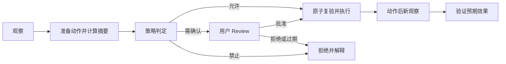

# 计算机操作能力目标产品与交互契约

> 权威状态：已确认的目标设计，尚未实现

本文拥有 Computer Use 的用户价值、模型工具面和 Desktop 交互。当前能力只见 [当前支持边界](./当前支持边界.md)，实现结构见 [目标架构与 CUA 集成契约](./目标架构与CUA集成契约.md)。

## 1. 产品结论

Awaken Computer Use 是现有主智能体在缺少可靠 typed tool/API 时，受控操作本机 GUI 的最后一级执行能力。它不是第二个 Agent、通用 RPA 平台，也不是任意脚本执行器。

能力选择顺序固定为：

1. typed 本地工具或业务 API；
2. Connector/MCP 中有明确 schema 和副作用合同的工具；
3. 浏览器 DOM/accessibility 语义动作；
4. Computer accessibility 元素动作；
5. 最后才使用像素坐标动作。

屏幕、网页、弹窗和文档中的内容一律是不可信输入，不能改变工具暴露、allowlist、risk policy、review 或数据分类。

## 2. 首版范围

首版只覆盖用户正在使用的本机 Desktop：

- 观察已授权应用的窗口截图与 accessibility 状态；
- 枚举、选择并绑定一个明确窗口，必要时显式升级到全桌面范围；
- 点击、双击、滚动、拖拽、按键、非秘密文本输入和等待；
- 动作前绑定新鲜 observation，动作后重新观察并验证结果；
- 对有外部后果的动作发起专用 review；
- 允许用户从常态顶部悬浮条立即停止 Computer session；需要用户接管的敏感步骤通过专用 handoff gate 完成交还；
- 保留结构化轨迹和受控截图引用，用于解释、恢复和只读 replay。

首版不包含：

- CUA Sandbox/Lume 或第三方云桌面池；
- 多租户调度、跨用户桌面共享或 Autonomous Department 容量指标；
- 自动读取或填写密码、OTP、支付信息、API key 等秘密；
- 自动点击系统隐私授权、管理员提权、安全警告或绕过访问控制；
- 真实桌面的历史动作自动重放；
- 无人值守支付、签约、对外发布、批量删除或账号安全变更。

隔离环境若进入后续范围，继续实现同一 `ComputerDriver` 合同，不能改变首版模型工具和宿主控制语义。

## 3. 模型工具面

模型只看到三个稳定 strict-v2 工具；CUA 的原始 MCP/CLI/SDK 方法永不直接进入 Tool Catalog。

### 3.1 `computer_observe`

用途：获取当前授权范围的新鲜状态。

输入至少包含：

- `scope`: `window` 或 `desktop`；
- `target_ref`: `desktop` 时省略；`window` 时必须使用上一条 desktop observation 的 `available_windows` 返回的精确 `pid:<pid>/window:<window_id>`，不得按标题或进程名重建；
- `include`: `screenshot`、`accessibility` 的受控组合；
- `reason`: 本次观察与当前任务的关系。

输出至少包含 `observation_id`、`session_id`、`scope`、`target_generation`、窗口元数据、可引用元素、截图媒体引用和 `captured_at`。省略 `scope` 时默认解析为 `desktop` discovery，并始终返回 `available_windows` 数组；枚举失败必须使 observation 明确失败，不能用缺字段伪装成成功。选定精确 `target_ref` 后显式使用 `window`，输出窗口局部 screenshot、模型可见的结构化 AX tree、`window_pixel` 坐标空间和同一 observation 可使用的 `element_token`。元素树不能只存入媒体仓而不进入模型工具输出，否则 background 元素路径不可达。宿主无法建立精确 window target 时必须返回明确错误，不能静默伪装成窗口隔离。策略固定允许 `window` 与 `desktop`，不向用户暴露范围偏好项。Retina 等高密度屏幕必须把发给模型的截图归一化为系统屏幕点尺寸，并返回 `coordinate_unit=screen_point`、画布宽高、原始截图宽高和 backing scale；模型使用的截图像素坐标与 `computer_act` 输入坐标必须一一对应。

### 3.2 `computer_act`

用途：基于某次 observation 提议一个强类型动作。

输入至少包含：

- `observation_id`；
- `action`: `click`、`double_click`、`scroll`、`drag`、`key`、`type_text` 或 `wait`；
- `target`: 优先 `element_ref`，像素坐标只作降级；
- `parameters`；
- `expected_context`；
- `intent` 和 `expected_effect`；
- `idempotency_key`。

工具调用不等于立即注入输入。Computer Runtime 先 prepare、评估风险、必要时等待 review，再执行 checked action。成功动作后立即捕获 fresh observation，返回 `action_id`、决策、执行结果、后续 `observation_id`、`post_action_observation` 和 verification 状态；`post_action_observation` 必须把该新快照的结构化 AX tree 与 fresh `element_token` 直接交给模型，旧 `source_observation_id` 的 token 自此不得复用。对 `stale_element_token`、参数 validation 等已确认零输入失败不得再捕获隐藏 AX 快照，以免无界地替换当前仍可用的 token。

window 动作由 run 开始时固定的“允许后台窗口动作”设置决定默认投递：开启时为 `background`，关闭时为 `foreground`；显式 background 在设置关闭时必须拒绝。background click/double-click 必须使用同一 observation 返回的精确 `element_token`，不能用 `synthetic_events` 的“Posted click”作为成功证据；缺少令牌时在 OS 输入前失败，并提示重新请求 accessibility observation。background 不能移动真实鼠标、抬升目标窗口或改变前台窗口；若 CUA 返回 `background_unavailable`，本次动作失败并要求调用方决定是否以新的显式 foreground 动作重试，Awaken 不得自动升级。动作输出必须回传实际 `cua_delivery_mode`、`cua_route` 与 `cua_effect`，不能只按请求参数声称后台成功。desktop target 只支持 foreground。

### 3.3 `computer_verify`

用途：针对已执行动作进行独立的结果判断，不接受“点击成功”作为任务成功的充分证据。

输入至少包含 `action_id`、`expected_effect` 和可机器检查的 `assertions`。Runtime 必须基于动作后的新 observation 计算结果，返回 `verified`、`not_verified` 或 `inconclusive` 及证据引用。

## 4. Session 与宿主控制

session 的创建、目标选择、暂停、接管、交还和关闭都属于宿主控制面，不暴露为模型工具。首版仅允许 root agent 获得 run-scoped `ComputerBinding`；subagent、guardian、Skill 和 MCP server 不继承该 binding。

每个 run 开始前，用户必须能看见：

- Computer Use 是否启用；
- 是否允许背景窗口动作；
- 当前权限与 Host readiness。

应用、窗口和桌面范围固定全部允许；哪些动作需要复核或禁止由产品安全策略拥有；媒体固定最多保留 24 小时且总量不超过 500 MiB。这三项是可说明的产品默认值，不是用户设置。

运行中改变这些条件会产生新的 policy/session generation；旧 observation、review 和 action authorization 全部失效。

## 5. Observe–Act–Verify 闭环

目标闭环固定为：

关键交互规则：

- observation 只在其 session、target generation、control epoch 和 freshness window 内有效；
- review 批准的是一个不可变 action digest，不是“接下来随便操作”；
- 批准后若窗口、元素、截图摘要或 policy 发生变化，Runtime 必须废弃批准并重新 prepare；
- 每个有副作用的动作后必须生成新 observation；
- verification 失败时，模型可以重新观察和规划，但不能盲目重试原动作；
- timeout/disconnect 导致结果未知时，必须先 reconcile，禁止自动重放。

## 6. 风险与 Review 体验

目标风险分类为：

| 等级 | 产品语义 | 例子 |
| --- | --- | --- |
| `low` | allowlist 内可直接执行并记录 | 聚焦窗口、滚动、选择无副作用控件 |
| `review` | 必须展示精确动作并由用户批准 | 发送、提交、下载、删除、购买意图、对外发布或不涉及秘密/安全权限的业务确认 |
| `handoff` | Agent 必须暂停采集和输入，由用户亲自完成 | 密码、OTP、支付资料、登录/身份验证、账号安全、管理员提权、软件安装确认、系统/浏览器隐私或安全授权 |
| `forbidden` | 即使用户口头要求也不由 Computer Runtime 执行 | 绕过安全警告、规避访问控制、隐藏审计或策略 |

Review 不是通用 ApprovalCard。卡片至少展示：

- 应用、窗口和账号/环境上下文；
- 动作类型、目标、关键参数和预期外部后果；
- 触发 review 的风险规则；
- 对应 observation 截图或局部证据；
- action digest、有效期和“批准一次/拒绝”选择。

不得提供“本次运行以后都允许此类高风险动作”的模糊授权。

`review` 只批准 Awaken 已有权限内的一个业务动作，不能替用户创建新的安全 authority。任何需要凭据、身份确认、操作系统/浏览器安全许可、管理员权力或秘密输入的步骤都必须进入 `handoff`；若该步骤还要求绕过警告或访问控制，则直接 `forbidden`。

## 7. 用户接管

用户点击“接管”后必须立即发生：

1. Runtime 进入 quiescing，停止接受新动作；
2. Host 排空或终止正在注入的输入，并增加 `control_epoch`；
3. Agent 输入被硬阻断；默认暂停截图，避免记录用户输入的秘密；
4. UI 明确显示“由你控制”；
5. 用户交还后重新检查权限、目标和 policy，并强制 fresh observation；
6. 旧 observation、prepared action 和 review 不得继续使用。

“暂停”只停止 Agent 动作；“终止”关闭 session 并撤销能力；二者不能用隐藏窗口或仅改变 UI 文案实现。

## 8. Desktop 信息架构

Computer 控制面属于既有 Workbench 运行体验，不新建第二套会话或任务窗口。目标界面包括：

- Composer 输入 `@` 时提供 `Computer Use` capability token，选择后输入框与 prompt bubble 只显示带显示器图标的 token；Core 校验固定 capability identity 后只向 model-facing effective input 加入引导，display persistence 不暴露引导；`/` 只保留 Skill，且该入口不绕过 readiness；
- run 开始前的能力范围与权限检查；
- 设置页“计算机操作”分区在右侧工作区的 820px focused content column 中居中展示全局 Host/Node runtime/权限状态、全局设置和能力限制；卡片使用紧凑密度，窄窗口回退为可用宽度；
- 一个 run 第一次调用三个 Computer 工具之一时，由 Electron Main 在当前屏幕顶部居中显示独立于 Awaken 主窗口的置顶深色胶囊悬浮条，显示“Awaken 正在操作您的计算机”和唯一停止按钮；同一阶段再显示一枚黑底白边的独立虚拟鼠标，与用户自己的系统光标分开，不拦截点击；后续 Computer 调用及其间的模型推理阶段连续显示，直到 session 关闭、run 终态或事件流关闭后自动消失，不在 RunStage 或 Composer 内重复常态提示；停止按钮只中断并终止本次 run 的 Computer Use，禁止自动重开 session，不取消 run 或停止模型回答；虚拟鼠标在 handoff 期间隐藏，交还后恢复；
- 专用 action review；
- handoff 时的交还控制专用 gate；
- 完成后的只读轨迹、验证结果和失败解释。

RunStage 继续拥有中间区域的滚动、overlay、composer 和 narrative。实现任何画面、review 或 takeover overlay 前，必须先更新 [01 桌面工作台](../01_桌面工作台/索引.md) 的架构契约、专项文档和复核清单，并完成真实 Electron 视觉验收。

## 9. 用户可理解的失败

产品必须区分并提供下一步：

- Accessibility 或 Screen Recording 未授权；
- 目标窗口关闭、被替换或 generation 变化；
- 当前平台/应用不支持背景输入或 accessibility；
- policy 拒绝、review 拒绝/过期或进入 handoff；
- session 被其他控制者占用或 fence 过期；
- CUA Host 不可用、升级中或版本不兼容；
- 动作明确失败；
- 动作结果未知，需要用户查看并决定是否继续；
- 动作完成但 verification 未通过。

不得把这些情况统一显示为“工具执行失败”，也不得在未知结果时声称任务已完成。
