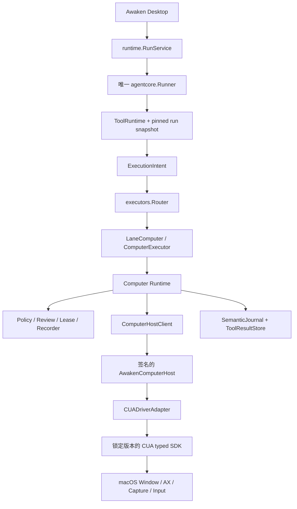

# 计算机操作能力目标架构与 CUA 集成契约

> 权威状态：已确认的目标设计，尚未实现

本文拥有 Computer Use 的模块边界、执行主链、CUA 集成形态、Driver 合同和依赖发布策略。状态与 wire 见 [目标状态、数据与事件契约](./目标状态、数据与事件契约.md)，安全不变量见 [目标安全、审计与恢复契约](./目标安全、审计与恢复契约.md)。

## 1. 已确认技术选择

Awaken 首个本机 Computer Driver 采用 MIT 许可的开源 [trycua/cua](https://github.com/trycua/cua)。目标是把 CUA 的桌面采集、accessibility、窗口定位和输入能力纳入 Awaken 现有 Agent/Tool/Runtime 主链，不是把 CUA 当作用户自行安装的普通 MCP Connector。

CUA 只拥有设备层事实和动作执行。以下能力始终由 Awaken 拥有：

- 唯一 Agent loop、任务规划和模型调用；
- Tool Catalog、run 快照和模型可见工具面；
- app/window/action policy 与风险分类；
- action review、human takeover 和控制身份；
- session lease、fencing、幂等与未知结果恢复；
- SemanticJournal、媒体策略、只读 replay 和产品 UI。

原始 `cua-driver mcp`、`cua-driver call` 和完整 SDK 方法不注册为 Awaken Tool，也不向模型暴露。CUA 自带 recording 只能作为底层诊断证据，不能替代 Awaken 真相。

## 2. 当前上游事实与采用范围

设计依据是 CUA 官方公开合同：

- [Process Model](https://cua.ai/docs/reference/cua-driver/process-model)：同进程 `CuaDriver.create()`、daemon 和下游 CLI/MCP 的关系；
- [SDK Reference](https://cua.ai/docs/reference/cua-driver/sdk-reference) 与 [Interface Contracts](https://cua.ai/docs/reference/cua-driver/contracts)：session、window/desktop scope、state 和 action；
- [Platform Support](https://cua.ai/docs/reference/cua-driver/platform-support) 与 [Known Limits](https://cua.ai/docs/reference/cua-driver/limits)：平台能力与降级；
- [Permission Modes](https://cua.ai/docs/reference/cua-driver/permission-modes) 与 [Permission Policies](https://cua.ai/docs/reference/cua-driver/permission-policies)：CUA 自身的风险和授权层；
- [Browser Profile Attachment](https://cua.ai/docs/reference/cua-driver/browser-profile-attachment) 与 [Browser Semantic Snapshots](https://cua.ai/docs/reference/cua-driver/browser-semantic-snapshots)：浏览器 generation 和 snapshot 生命周期；
- [Electron app hosting](https://cua.ai/docs/how-to-guides/driver/expose-mcp-from-desktop-app) 与 [Install](https://cua.ai/docs/how-to-guides/driver/install)：macOS TCC、可执行文件、签名和打包要求。

首版采用 CUA Driver 的本机能力，不采用 CUA Sandbox/Lume 作为产品运行环境。CUA 当前没有公开保证 Awaken 需要的 lease/fence、原子 `perform_checked`、quiesce/takeover、通用动作幂等或 unknown-outcome 自动恢复；这些必须由 Awaken Host/Runtime 补齐。

上游文档描述不能直接升级为 Awaken 当前支持。实现时必须把实际采用的 commit、包版本、原生二进制 checksum 和本地 conformance 结果写入依赖清单。

## 3. 目标主链



唯一允许的模型执行入口是 `ToolRuntime -> executors.Router -> LaneComputer`。Renderer、LLM adapter、Skill、Connector、MCP server 和 CUA 本身都不能直接触发输入。

## 4. 本机进程模型

### 4.1 首选形态

首版 macOS 目标采用由 Desktop Main 管理、随 Awaken 一起签名和发布的 `AwakenComputerHost`：

- Host 是 Awaken app bundle 内的专用 helper/sidecar，拥有稳定 bundle/code-sign identity 和 TCC 权限；
- Host 使用锁定版本的 CUA typed SDK 同进程创建 Driver；
- Desktop Main 负责安装完整性、启动、健康检查、崩溃重启、权限引导和停止；
- Core 的 `ComputerHostClient` 只调用 Awaken 自有最小 IPC，不连接公开 CUA daemon；
- Host 的 IPC 只接受当前 Runtime 身份和 run-bound capability，不监听公网；
- CUA 需要 protected consent 时，Host 只接受从 Desktop Main 的已认证 review 控制链回传的决定；模型消息、MCP prompt、TTY、环境变量或文件都不能充当同意；
- Renderer 只能经 typed Electron IPC 调用 Main，再由 Main 调用已认证的 `/v1/control/computer/*`，不能拿到 Host 地址或密钥。

选择专用 Host 而不是把 CUA native runtime 直接装入 Electron Renderer，是为了稳定 TCC 身份、隔离 native crash、限制调用面并在输入注入处执行 fence/precondition 检查。实现 POC 可以比较“Electron Main 内嵌”和“签名 helper”两种托管方式，但发布形态必须满足上述身份、隔离和原子检查不变量；不得退化为用户手工启动的无认证 daemon。

### 4.2 当前 interim 实现

Phase 4 的当前实现把 CUA Host 作为 Core（`cmd/awaken-core`）管理的 Node.js 子进程：

- `src/computer/cua/host_manager.go` 在 awaken-core 生命周期内持有单一 `HostManager`；
- 启动时自动发现 host 脚本（`AWAKEN_CUA_HOST_SCRIPT`、bundled resources、`apps/desktop/resources/cua-driver`、PoC workspace），不再要求 `AWAKEN_CUA_ENABLED`；
- CUA Host 脚本与 `package.json` 已迁入 `apps/desktop/resources/cua-driver`，`scripts/prepare-cua-driver.mjs` 在构建/开发准备阶段为该目录安装 `@trycua/cua-driver` 依赖；
- Node runtime 由 `scripts/prepare-node-runtime.mjs` 按目标平台下载并解压到 `apps/desktop/resources/bin/<target>/node`，`HostManager.resolveNodePath` 优先发现 bundled Node，不再要求目标机器已安装 Node.js；
- `RunService.StartRun` 通过 `computerDriverFactory` 获取 driver；Host 不可用时回退到 `NewUnavailableDriver()`；
- 后台健康检查与失败重启由 Core 负责，应用关闭时 `HostManager.Close()` 停止子进程；
- Desktop Main 当前不直接管理 Host 子进程，只通过现有 `/v1/control/computer/*` 控制面转发用户 review/handoff 决定。
- macOS 权限请求由 Node Host 内锁定的 CUA native SDK 发起，确保检查、弹出请求与真正执行 capture/input 的进程身份一致；Desktop Main 只经 authenticated Core route 触发该调用并负责打开精确的系统设置页，不再用 Electron 主进程代替 Host 请求 TCC；

这是向 4.1 首选形态迁移的 interim 步骤：Core 直接 spawn Node host 并把 Host 脚本放入产品资源目录，简化了开发验证与资源分发；但生产发布仍需把 Node runtime 与 Host 一起打包签名，并最终由 Desktop Main 管理 TCC/生命周期，把 Core-Host IPC 约束为 Awaken 自有最小合同。

### 4.2 不采用的形态

- 不要求用户全局安装 `/Applications/CuaDriver.app` 才能使用 Awaken 核心能力；
- 不把 `cua-driver mcp` 加到 Connector 列表后直接宣称集成完成；
- 不允许 Core/Bash 通过环境变量、磁盘 token 或公开端口访问原始 CUA surface；
- 不让 CUA daemon 自行更新、改变 policy 或发送未由 Awaken 明示的遥测；
- 不允许 Renderer 加载 native CUA SDK 或直接拥有 Screen Recording/Accessibility 调用权。

CUA 的 permission mode 和低层 policy 按 Host/Driver generation 固定，模型 tool call 不能切换。Awaken policy 变化若需要改变 CUA 低层 policy，必须先 quiesce 并重建 Host/Driver generation；不能在活动 session 中悄悄放宽。

## 5. 目标模块 ownership

命名可在实现时按仓库惯例微调，但职责和依赖方向不能变化。

| 目标模块 | 唯一职责 |
| --- | --- |
| `src/computer` | 模型无关 domain 类型、Runtime、policy、lease/fence、review、recorder 和 Driver contract |
| `src/agentcore/executors/computer.go` | 把 `ExecutionIntent` 交给 run-bound Computer Runtime，并转成 `ExecutionOutcome` |
| `src/tools/computer` 与 `src/tool` profile/capability | 三个 strict-v2 工具、capability class、`LaneComputer` 和 run availability 事实 |
| `src/runtime` | 为 root run 创建/恢复/关闭 `ComputerBinding`，将语义记录纳入正式 session |
| `src/server` | 实现状态契约定义的 review/takeover/session 控制 route 和安全契约定义的鉴权；不得承载 raw Driver API |
| `src/protocol/agui` | 从 SemanticJournal 投影 Computer live/replay 事件 |
| `src/computer/cua` | CUA SDK 适配层、HostClient JSON-RPC 和 `HostManager`（当前 interim 由 Core 持有） |
| `apps/desktop/src/main` | 目标：Host lifecycle、TCC/readiness、control token 调用和 Renderer 隔离；当前还由 `ComputerOverlayManager` 独立订阅 run event、管理跨应用置顶提示与自身可见性恢复，并从专用 overlay IPC 终止 Computer Use 而不取消 run；不得借用 `PetWindowManager` 的窗口、IPC 或状态 |
| `apps/desktop/src/shared` | Main/Renderer 共享的判别联合与 typed IPC contract |
| `apps/desktop/src/renderer` | 主窗口只消费 review、takeover 和只读 replay，不拥有 policy，也不拥有跨应用 Computer 调用提示 |
| `AwakenComputerHost` | 验证调用身份/fence/precondition，适配 CUA 并注入输入 |

`executors.Router` 必须改为可注入 Computer executor，不能继续在 `ToolRuntime` 内用不可替换的默认实例掩盖 run binding。

进程级构造和 run 注入顺序当前实现为：

1. `cmd/awaken-core/main.go` 构造 `MediaVault`（`computerMediaVault`）和 `HostManager`（`cuaHostManager`），并通过 `buildCUADriverFactory` 把二者绑定为 run-bound Driver factory；
2. `RunService.SetComputerDriverFactory` 与 `RunService.SetComputerMediaVault` 把 factory 和 vault 注入 runtime；
3. `RunService.StartRun` 在模型声明 `SupportsComputerUse` 与 `SupportsVision` 时创建 `ComputerBinding` 与 `computer.Runtime`，调用 factory 获取 driver（CUA Host 不可用时回退到 `NewUnavailableDriver`）；
4. `Runtime` 绑定 session recorder，Computer 事实写入 `SemanticJournal`；
5. Agent 的 `ToolRuntime` 通过注入的 `ComputerExecutor` 处理 `computer_*` 工具；
6. run cancel/terminal 和 Core shutdown 关闭 `ComputerRuntime`（revoke binding、quiesce Host、提升 fence、释放 lease、`PurgeSession`），并调用 `HostManager.Close()` 停止共享 Host。

目标形态（4.1）应把第 1 步中的 Host 管理从 Core 移到 Desktop Main，Core 只通过 Awaken 自有 IPC 调用 Main 托管的 Host。当前 interim 实现允许 Core 直接 spawn Node host，作为向目标形态迁移的中间状态。

## 6. `ComputerDriver` 与 Host 合同

Awaken-facing 最小合同至少包含：

```text
Health()
OpenSession(binding, policy_snapshot, fence_token)
Observe(session, scope, target, options)
Prepare(session, observation, action)
PerformChecked(session, prepared_action, precondition, fence_token, control_epoch)
Quiesce(session, next_control_epoch)
Resume(session, policy_snapshot, fence_token, control_epoch)
CloseSession(session, reason)
```

语义要求：

- `OpenSession` 固定 capture scope、policy/version 和资源身份；
- `Observe` 返回 CUA 原始状态经 Awaken 规范化后的 `Observation`；
- `Prepare` 只解析目标和生成前置条件，不产生外部副作用；
- `PerformChecked` 必须在输入注入的同一可信进程内复验 session、fence、control epoch、target generation、freshness 和 action digest；
- 任一复验失败都必须在发送鼠标/键盘事件前 fail closed；
- `Quiesce` 返回后不得再有旧 epoch 输入在途；
- `Resume` 必须要求 fresh observation；
- Host crash、IPC timeout 或 response 丢失不能被包装成明确失败，必须返回 `unknown_outcome`；
- CUA opaque session 自然到期时，下一次只读 `Observe` 可以关闭旧 session、重新建立同 scope session 并重试一次；任何可能已经注入输入的 `PerformChecked` 都不得自动重放。

CUA 上游若没有单个原子 primitive，`CUADriverAdapter` 必须在 Host 内把复验与最后一次输入调用放进同一串行 critical section。仅在 Core 检查后再通过网络调用 CUA 存在 TOCTOU，不满足发布要求。

## 7. CUA 语义映射

### 7.1 Capture scope

- 当前锁定的 `@trycua/cua-driver@0.22.0` 把 session 生命周期与逐动作 capture/input target 分离。Awaken 的 capture/action 主链继续创建与 run/fence/control epoch 绑定的显式命名 session；desktop 输入传 `ActionTarget.Desktop(display_id="primary")`，window observation 与输入传 desktop discovery 选定的 `ActionTarget.Window(pid, window_id)`，不再依赖 deprecated `DesktopScope` 动作字段。CUA 的 `list_windows` 接口没有显式 session 参数，内部仍使用会空闲到期的隐式 session，因此 Host 必须用独立 discovery driver 调用它，并仅在明确的 session-ended 错误后重建该 discovery driver、只读重试一次；不得以重开 capture/action 命名 session 冒充恢复，也不得让 discovery 重建作废活动动作 session。Host 只通过受限 `callTool` 代理 `list_windows`、`get_window_state` 与白名单输入动作，raw MCP/daemon 不进入产品面。desktop 坐标转换必须按平台隔离：Windows Awaken Host 运行于普通 `node.exe`，CUA 返回的 primary-display 截图宽高、`screen_width/screen_height` 和进程内 `scale_factor` 都可能是 DPI 虚拟化结果；Electron Main 必须从 `screen.getPrimaryDisplay().scaleFactor` 提供 Windows 专用权威倍率，Host 返回 `unit=logical_pixel`，模型和 adapter 保持截图尺寸不变，仅在 `ActionTarget.Desktop` 输入边界乘该倍率转为 `SendInput` 使用的物理屏幕像素。window target 使用 CUA 返回的窗口局部截图与 `window_pixel` 坐标，不套用 desktop DPI 放大。`screen_width == screenshot_width` 或 CUA 内部 `scale_factor=1` 不能作为 DPI-aware 或无需转换的判断。macOS 不提供 Windows 倍率，继续返回系统屏幕点、原始截图 backing pixels 和 backing scale，adapter 在进入模型媒体链前把截图降采样到屏幕点尺寸，Host 在输入注入时再按同一 scale 换回 Driver 输入坐标。不得用 Windows DPI scale 改写 macOS 路径，也不得把 macOS 的 point/backing-pixel 转换套到 Windows；0.22.0 是当前 Windows 键盘输入、高 DPI desktop 点击与后台 window delivery 的精确升级基线，不能回退到已知会误报输入成功的 0.12.5；
- Windows desktop session 的普通 key、`type_text`、不含 Windows 键的应用 hotkey 与 pointer route 仍按上述 Driver 合同执行；`win`/`windows`/`meta`/`cmd`/`command` 参与的 Shell 全局快捷键在上游虽然可解析，但 desktop route 只保证向前台窗口发送且 effect 为 `unverifiable`，当前不在可靠支持面内。Host 必须在注入前确定性拒绝，调用方必须从 fresh observation 选择可见系统 UI；
- `WINDOW` 是显式 scope，必须携带 Host 枚举并由 desktop observation 返回的精确 `target_ref`。background 设置在 `PolicySnapshot -> Binding -> PreparedAction digest` 中固定：开启时 window 动作默认 `background`，关闭时默认 `foreground` 并拒绝显式 background；desktop background 一律拒绝。background click/double-click 的 target 必须是同一 observation 的 `element_token`，坐标 `synthetic_events` 不能越过 adapter 进入 Host。CUA 返回 `background_unavailable` 时保持结构化失败，不自动重试 foreground；
- `AUTO` 只可用于探测/兼容，正式 session 建立后必须记录解析出的不可变 scope；
- macOS 无 Screen Recording 时可降级为 accessibility/tree-only 观察，但不得伪造截图已获取；缺少 Accessibility 时禁止动作。

### 7.2 Target 与 observation

`get_window_state` 的截图与 accessibility tree 进入同一 observation。元素引用必须绑定：

- CUA session；
- PID/window identity；
- target generation；
- observation ID 与 capture time；
- accessibility locator 或 window-local pixel fallback；
- 内容摘要和坐标空间。

优先 accessibility 动作：window click/double-click 可直接使用同一 observation 返回的 `element_token`；无法稳定定位时才允许窗口局部像素动作。当前 CUA adapter 的默认 observation freshness window 为 5 分钟，以覆盖真实模型在截图与大工具目录下超过 2 分钟的往返；任何 session、fence、control epoch 或 target generation 变化仍立即作废 observation。Host 注册 prepared action 时保存 observation 的 exact target，perform 时忽略模型重构的窗口身份，只能向该 target 投递。

### 7.3 浏览器能力

现有 profile attachment 是附加能力，不是首版桌面控制的必需入口。采用时必须保留 CUA 的 generation 语义：新 snapshot、navigation、reconnect、进程替换或 session 结束会使旧 browser refs 失效。Awaken action 还必须同时绑定自己的 observation、fence 和 control epoch。

首版不能把 Chromium typed mutation 能力宣传为 Safari/Firefox 等价支持；不支持时降级为普通 accessibility/像素路径并明确风险。

## 8. Run binding 与工具暴露

Computer readiness 必须在 run 创建时进入 `ExecutionEnvironmentSnapshot` 和 `RunToolAvailabilitySnapshot`，至少记录：

- Driver/Host 版本、协议版本和健康状态；
- OS、TCC 权限和 capture/action capability；
- 允许的应用、窗口、scope 和 action classes；
- policy snapshot ID；
- session resource key、fence 和 root-agent ownership；
- provider 是否支持 tool calling 与所需图像输入；
- Computer media policy readiness。

任何硬依赖不满足时，三个 Computer 工具都不得暴露。运行中 Host 崩溃只能把当前 binding 标为不可用并进入恢复，不能从全局 registry 偷换 Driver 或临时开启原始 MCP。

当前模型能力只有 vision/native-PDF 等媒体位，尚无统一 `supports_tools`。`SupportsComputerUse` 已进入 Go model profile，但 Desktop capability sync 与编辑面仍未闭环；interim Runtime 使用全局开关、vision 与真实 Driver health 共同门控，不能据此宣称任意 vision 模型已经过 Computer conformance。目标实现仍须把显式能力贯穿用户配置、Desktop capability sync、run config 和 profile cache key。

## 9. 媒体与 Provider

截图必须复用 `ExecutionOutcome.ModelContent -> ToolResultStore -> context.Message.ModelContent -> provider adapter`。不得引入 Computer 私有 Base64 message 通道。

目标实现扩展现有媒体存储的 `computer` policy namespace，提供按 session/thread 访问、摘要校验、保留期、删除和访问审计；Journal 只记录 `storage_key`、MIME、尺寸、hash、redaction 和 policy metadata。当前模型媒体最终由通用 `ToolResultStore` 持久化，故不对 Computer 前置副本单独声称 at-rest 加密；未来若采用加密，必须统一覆盖整条持久化/水合链并使用 OS keychain 管理密钥。模型不支持图像或媒体策略未 ready 时，Computer 工具不暴露。

## 10. 依赖、更新与发布

CUA 作为产品内开源依赖管理：

1. 锁定 upstream commit、语言包版本、native artifact checksum 和许可证清单；
2. 维护 Awaken adapter conformance，不直接依赖未锁定的 `main`；
3. 需要补 `PerformChecked`、身份验证或 quiesce 时，补丁保持最小、可审阅，并记录对应 upstream issue/PR；
4. 上游更新先在独立验证矩阵通过，再随 Awaken 发布；禁止运行时自更新；
5. CUA 遥测和 release check 在产品构建中默认关闭，任何外发必须进入 Awaken 隐私设置和文档；
6. native/helper 文件必须位于 ASAR 外、保留 executable bit，先签 helper/native library，再签/notarize app；
7. helper identity 在升级中保持稳定，避免无理由丢失 TCC 授权；
8. 开发模式与正式签名模式分别验收，未签名 POC 不能证明正式包可用。

上游 0.22.0 的隐式生命周期不进入 Awaken 的 capture/action authority；唯一例外是没有显式 session 参数的 `list_windows` 在隔离 discovery driver 内将其作为实现细节使用。Computer History、raw MCP、stable/nightly release channel 和运行时更新不进入 Awaken 产品能力：session 与 replay 继续由 Awaken Runtime/SemanticJournal 唯一拥有，更新只随锁定依赖和 Awaken 发布发生，Computer History 保持关闭，避免形成第二套轨迹、媒体保留或安全 authority。

Windows/Linux 是同一 Driver 合同的后续平台实现。不得用 macOS 验收结果替代其 capture、background delivery、权限和完整性边界验证。
