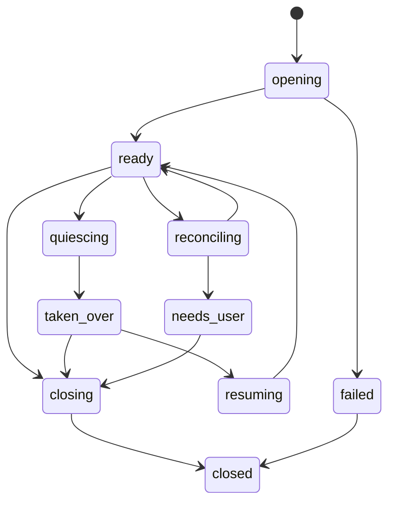

# 计算机操作能力目标状态、数据与事件契约

> 权威状态：已确认的目标设计，尚未实现

本文拥有 Computer Use 的目标实体、状态机、持久化顺序、控制 route 和 AG-UI 投影。通用 session/Journal 与 wire 规则继续由 [03 运行时与本地服务](../03_运行时与本地服务/索引.md) 和 [09 AGUI 与 A2UI 协议](../09_AGUI与A2UI协议/索引.md) 拥有。

本文件的 route/payload 是 schema 权威；用户可见 review/handoff 含义由 [目标产品与交互契约](./目标产品与交互契约.md) 拥有，鉴权、digest 有效性、fence 和 fail-closed 条件由 [目标安全、审计与恢复契约](./目标安全、审计与恢复契约.md) 拥有。

## 1. 事实层级

Computer 事实分三层：

1. `SemanticJournal`：session、observation、action、review、control transfer、verification、恢复和 terminal 的 durable truth；
2. Computer policy namespace 下的 `ToolResultStore`：截图、局部图像和可选底层诊断文件，只通过稳定引用关联；
3. AG-UI/Desktop view state：由 Journal projector 生成的 live/replay 投影，不是第二真相。

CUA recording、daemon 日志、Renderer state 和模型自然语言都不能决定“动作是否已授权/执行/验证”。

## 2. 核心实体

### 2.1 `ComputerBinding`

在 root run 创建时固定：

- `binding_id`、`thread_id`、`run_id`、`root_agent_id`；
- `environment_id`、`resource_key`、Driver/Host/protocol version；
- `policy_snapshot_id`、允许的 app/window/scope/action；
- `fence_token`、初始 `control_epoch`；
- capability/readiness 和媒体策略；
- created/expires 时间。

Binding 不存入全局 Tool 实例，不能被 subagent 或另一个 run 复用。

### 2.2 `ComputerSession`

至少包含：

- `session_id` 与 `binding_id`；
- CUA opaque session reference；
- `capture_scope` 与当前 target identity/generation；
- `state`、`fence_token`、`control_epoch`；
- policy/driver/media version；
- last observation/action/heartbeat；
- close/recovery reason。

不得把 CUA opaque handle 当作跨重启稳定 ID；Awaken ID 才是持久化关联键。

### 2.3 `Observation`

至少包含：

- `observation_id`、session/fence/control epoch；
- target PID、app、window、generation、scope 和 coordinate space；
- capture timestamp、fresh-until 与完整性状态；
- screenshot/tree refs、hash、redaction 和缺失原因；
- 可引用元素及其 locator；
- browser capability/snapshot generation（采用时）。

Observation 不可修改。导航、窗口替换、权限变化、takeover、session 恢复或 freshness 到期后，旧 observation 只能用于历史显示。

### 2.4 `PreparedAction`

至少包含：

- `action_id`、`idempotency_key`；
- source observation、session/fence/control epoch；
- action kind、规范化参数与 target locator；
- precondition、expected context/effect；
- `action_digest`；
- risk decision、匹配规则和 review requirement；
- prepared/expires 时间。

`action_digest` 必须覆盖所有会改变用户决策或实际输入的字段。任何字段变化都生成新 action。

### 2.5 `ComputerReview`

至少包含：

- `review_id`、action/digest、policy snapshot；
- 展示给用户的 target/effect/evidence；
- requested/decided/expires 时间；
- decision：`approved_once`、`denied`、`expired` 或 `cancelled`；
- authenticated actor 与 control route request ID。

批准只对同一 digest、session、fence、control epoch 和有效期生效一次。

### 2.6 `ActionResult` 与 `VerificationResult`

ActionResult 区分：

- `succeeded`：Host 明确确认输入调用完成；
- `failed`：确认未产生目标副作用或在输入前失败；action-specific 参数预检失败属于此类，并同时标记 `transport=not_started`、`side_effect_state=not_started`；
- `unknown_outcome`：输入可能发生，但响应/确认丢失；
- `cancelled_before_perform`：在输入前安全取消。

结果至少包含 Host request ID、开始/结束时间、CUA 规范化结果、error taxonomy 和动作后 observation 引用。

VerificationResult 只允许 `verified`、`not_verified` 或 `inconclusive`，并绑定 action、动作后 observation、assertions 和 evidence。`succeeded` 不自动等于 `verified`。

## 3. Session 状态机



规则：

- `ready` 是唯一允许 prepare/perform 的状态；
- `quiescing` 起不再接受新动作；
- `taken_over` 禁止 Agent 输入，默认禁止 capture；
- `resuming` 必须刷新 policy、target 和 observation；
- `reconciling` 禁止新动作，先解决 unknown outcome/Host restart；
- `needs_user` 只能由用户选择继续新计划或关闭，不能自动回到 ready；
- closed session 不恢复 CUA handle，只能创建新 session/generation。

## 4. Action 状态机

```text
proposed
  -> failed                  # 参数/动作组合在 prepare 前被确定性拒绝，零输入
  -> prepared
  -> allowed | review_pending | denied | handoff_required
review_pending
  -> authorized | denied | expired | cancelled
allowed/authorized
  -> performing
  -> succeeded | failed | unknown_outcome | cancelled_before_perform
succeeded
  -> verified | not_verified | inconclusive
unknown_outcome
  -> reconciled_succeeded | reconciled_not_performed | needs_user
```

终态不可反向修改；reconciliation 和 verification 通过新记录关联原 action。相同 `idempotency_key` 只能返回原 action 或冲突，不能产生第二次输入。

## 5. Journal 语义记录

目标 semantic kinds 至少包括：

```text
computer_session_opened
computer_state_changed          # 当前实现：takeover/return 等状态迁移
computer_observation_captured
computer_action_prepared
computer_review_requested
computer_review_resolved
computer_action_started
computer_action_completed
computer_control_transfer_started
computer_control_transfer_completed
computer_session_closed
computer_media_accessed         # 当前实现：session media 读取访问审计
computer_verification_completed # 当前实现：基于动作后的新 screenshot/AX observation 写入
computer_reconciliation_completed # 目标：unknown outcome 协调后写入（尚未实现）
```

每条记录带 schema version、run/tool call correlation、session/fence/control epoch、policy version 和因果 ID。大截图只记录 storage reference 和 hash；媒体读取产生 `computer_media_accessed` 审计记录。

持久化顺序：

- session opened 必须在模型看到首个 observation 前落盘；
- action-specific 参数预检发生在 action prepared 之前；预检失败只产生本次工具 Outcome，不得写 `computer_action_prepared` / `computer_action_started`，也不得调用 Driver/Host 输入；
- action prepared 与 review requested 必须在 UI 展示前落盘；
- review resolved 必须在 Host 收到 perform 前 flush；
- action started 必须在输入注入前 flush；
- Host 返回后立即 append completed；若连接中断则 append unknown outcome；
- verification completed 必须在把结果交给下一轮模型前 flush；
- terminal 前关闭或明确挂起 session，不留无解释的 active controller。

当前 live recorder 对普通非终态记录可能是 append 后先发布、尚未 flush，`artifactBufferingSink` 也不是 Computer review awaiter。实现必须新增 Computer 专用 run-bound coordinator 和严格的 `append -> flush -> publish/perform` 路径；不能假设调用现有普通 record 方法就满足上述顺序。恢复扫描若看到 `computer_action_started` 而没有明确 completion，必须生成 unknown-outcome/reconciliation 事实，作废旧 review，并禁止动作 replay。

## 6. Tool Outcome 与媒体关联

三个工具统一返回 `ExecutionOutcome`：

- `Details["computer"]` 放结构化 ID、状态、target、risk、verification 和恢复提示；
- desktop observation 的模型结果可包含 `available_windows[]`，每项至少有不可改写的 `target_ref`、`pid`、`window_id`、应用名、窗口标题、minimized 与 z-index；window observation 回传已绑定的 `target_ref/pid/window_id`；
- checked action 结果回传 Host 解析的 `cua_delivery_mode`、`cua_route` 与 `cua_effect`；它们表示实际 CUA 结果而非调用方请求值，`background_unavailable` 不得改写为 foreground 成功；
- `ModelContent` 放模型被允许看到的截图或局部图像；
- 用户可见 summary 不包含秘密、原始 AX dump 或内部 token；
- failure taxonomy 保持 structured failure，不用自由文本决定重试。

Journal 和 transcript 只保存媒体引用；截图与 accessibility tree 进入 session-scoped 私有文件存储，目录/文件权限为 `0700`/`0600`，读取时校验 session ownership 与 SHA-256 并写入 `computer_media_accessed` 审计记录，session 关闭时调用 `PurgeSession` 清理。后台 goroutine 固定按 24 小时、500 MiB 与 5 分钟扫描周期清理，并对 1 分钟内新文件设安全保留期；这些是产品安全默认值，不是设置项。截图随后会进入现有 `ToolResultStore` 的模型媒体链，因此首版不在前置副本上单独叠加 AES；若未来要求真正的 at-rest 加密，必须统一覆盖 `ToolResultStore`、replay 水合和 OS keychain 密钥生命周期。屏幕敏感区域若被 policy redaction，模型和 replay 必须看到同一经过处理的版本。

## 7. 控制 route

用户控制面进入现有 bearer-authenticated `/v1/control/*`，当前实现 route：

```text
GET  /v1/control/computer/sessions/{run_id}
GET  /v1/control/computer/status
POST /v1/control/computer/permissions/request
POST /v1/control/computer/runs/{run_id}/reviews/{review_id}/resolve
POST /v1/control/computer/sessions/{run_id}/pause
POST /v1/control/computer/sessions/{run_id}/takeover
POST /v1/control/computer/sessions/{run_id}/return
POST /v1/control/computer/sessions/{run_id}/terminate
# 兼容旧 body run_id 的遗留 route（仍注册）
POST /v1/control/computer/reviews/{review_id}/resolve
```

约束：

- route 只接受 Desktop Main 的 `RuntimeControlClient`；
- 身份使用 `RuntimeIdentity.ControlToken` 的 Bearer 链；当前仅用于 Connector CLI readiness 的 `AWAKEN_DESKTOP_CONTROL_TOKEN` 不是 Computer control credential；
- Renderer 通过判别联合的 typed IPC 请求 Main，不持有 ControlToken；
- `permissions/request` 只能让真实 Host 发起 Screen Recording/Accessibility 请求并返回该 Host 随后测得的状态，不能替用户切换 macOS 权限开关；
- resolve/takeover/return 都要求 request ID 和期望版本，重复请求幂等；
- stale review、fence 或 control epoch 返回 typed conflict，不静默成功；
- raw observe/act 不做公共 HTTP route；模型动作只能通过 ToolRuntime。

Core 到 `AwakenComputerHost` 使用独立的私有 Host IPC 合同，不复用这些用户控制 route，也不暴露到 Renderer。

## 8. AG-UI 与 Desktop 投影

Semantic projector 从上述 records 生成 Computer 专用 live/replay 事件，至少覆盖：

- session/readiness/state；
- observation available；
- action prepared/performing/result；
- review requested/resolved；
- control transfer；
- verification；
- reconciliation/needs-user。

wire 事件携带稳定 ID、枚举、轻量 metadata 和媒体引用，不发送 ControlToken、Host credential、CUA opaque capability、完整 AX tree 或未受控截图 bytes。

live 与 replay 必须共享同一 projector。replay 只能重建界面和轨迹，不能调用 Host、重新批准 review 或重放输入。

Desktop Main 为每个活动 run 建立独立事件订阅，并在首次收到三个 `computer_*` 工具之一的 `TOOL_CALL_START` 后把该 run 标记为 Computer 活动 run。`TOOL_CALL_END` 只表示模型完成工具参数输出，`TOOL_CALL_RESULT` 也不能证明后面没有 observe/act/verify，因此两者都不得清除提示；提示必须覆盖连续 Computer 调用及其间的模型推理阶段。活动期间窗口自己的可见性 watchdog 只恢复该 Computer overlay 的置顶与显示，不读取或修改宠物窗口状态。`computer_action_started` 投影为 `AWAKEN_COMPUTER_POINTER_HINT`：desktop 坐标使用 `primary_display_dip`，window 坐标仅在 Host 从 `list_windows` bounds 得到可信 origin 后转为 `screen_dip`；accessibility 点击优先用同一 observation 中该 `element_token` 的 `frame`（屏幕绝对）或窗口局部几何中心，不得把缺少 origin 的 window-local 像素当成桌面坐标。只有 `AWAKEN_COMPUTER_SESSION_CHANGED(closed)`、`RUN_FINISHED`、`RUN_ERROR`、terminal `RUN_STATUS_CHANGED` 或事件流关闭才能清空该 run 的提示状态。这个投影只存在于 Main 内存，不进入 transcript 或 replay 的输入重放。提示窗口的停止 IPC 只能由该窗口自己的 WebContents 调用，并终止绑定 run 的 Computer Runtime；该 run 保持活动、模型继续回答，且本次 run 后续 Computer 调用必须返回用户已停止的明确错误而不能自动重开 session。虚拟鼠标窗口始终 `ignoreMouseEvents`，handoff 期间隐藏。

Computer review 是专用交互，不新增“所有工具通用 approval”语义。若 run 需要等待 review，可以保持现有公开 run 状态并由 Computer session/action 状态表达等待；任何新增通用 run 状态必须先更新 02/03/09 权威，不能只在本目录定义。

## 9. 版本与兼容

所有持久化实体、Host IPC、Journal payload 和 AG-UI payload 都必须有独立 schema version。升级规则：

- 未知字段向前兼容忽略，未知枚举 fail closed；
- 旧 action/review 不迁移为可执行对象，只可历史展示；
- Host/Runtime 协议不兼容时 Computer readiness 为 false，工具不暴露；
- CUA opaque handles 永不跨 Host restart 或 Awaken version 迁移；
- replay migration 不能修改原 Journal，只能在 projector 读取层兼容。
