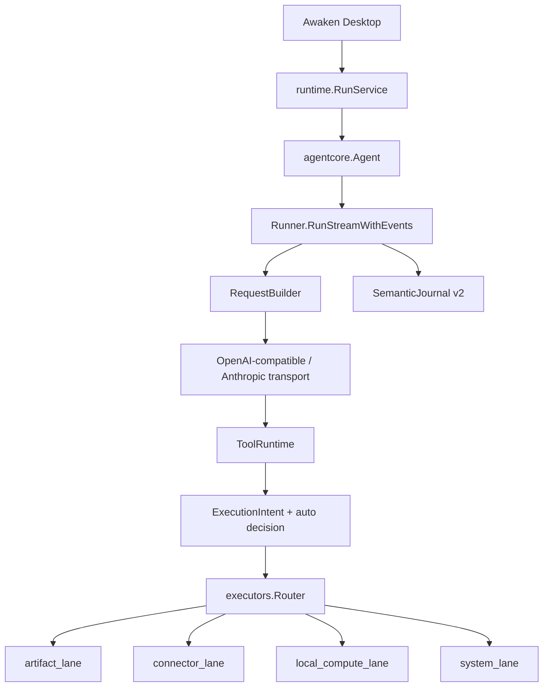
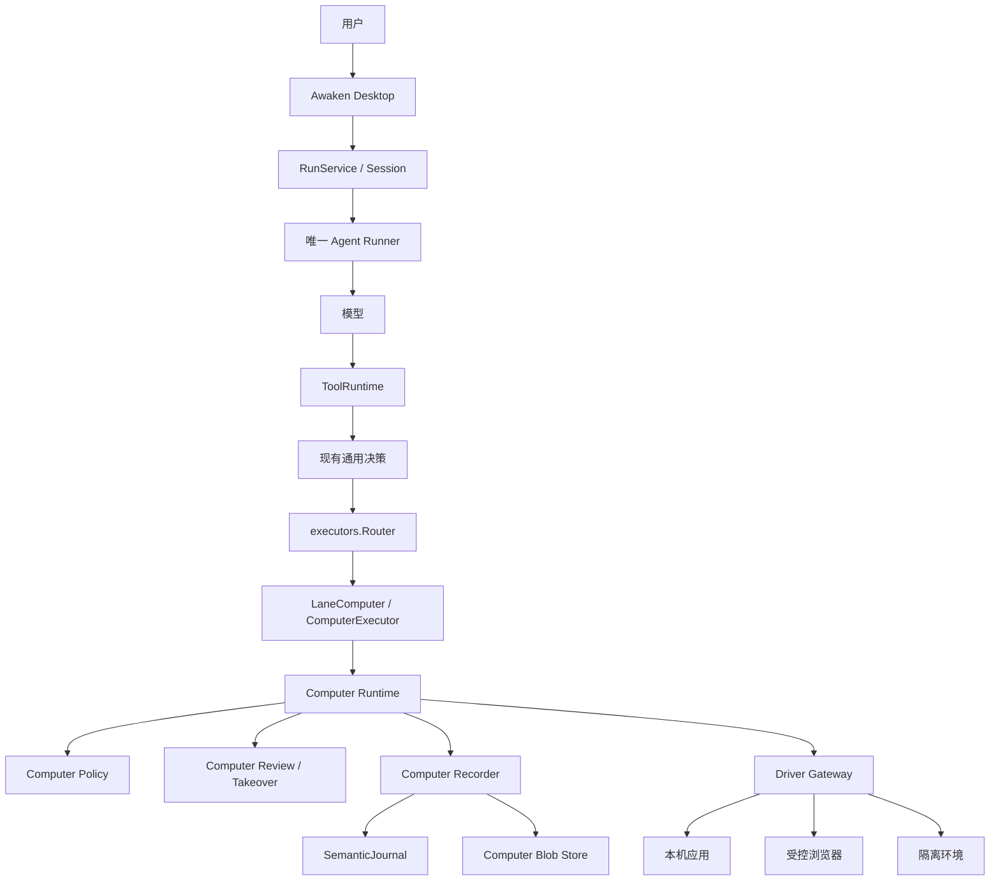
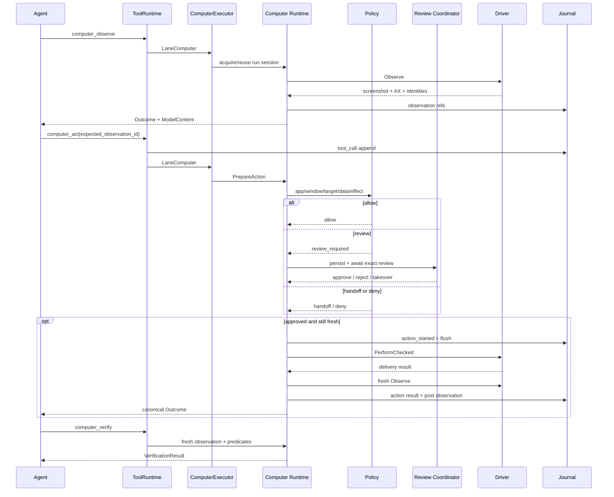
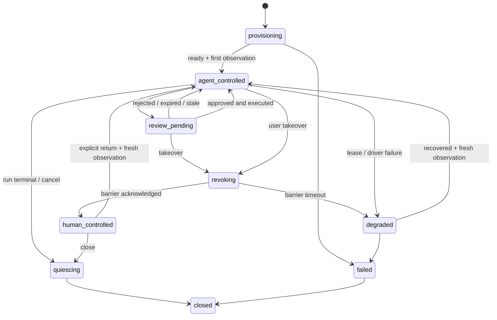

# Awaken Computer Use 计算机操作能力设计契约

> 权威状态：已确认的目标设计，尚未实现
>
> 当前代码基线：2026-07-28
>
> 当前产品边界：[当前支持边界](./当前支持边界.md)
>
> 适用范围：未来 Awaken Agent Core、Tool Runtime、Runtime/Server、Desktop 与可替换 Computer Driver 的实现

本文只定义未来实现 Computer Use 时不得绕过的产品与工程合同，不表示当前 Awaken 已经具备观察或操作本机桌面的能力。当前支持与不支持只由 [当前支持边界](./当前支持边界.md) 拥有。

截至本基线，仓库中仍不存在 `src/computer`、`LaneComputer`、`ComputerExecutor`、`computer_observe`、`computer_act`、`computer_verify`、Computer 专属语义记录、控制 route 或 Desktop 控制面。本文出现的目标类型、事件、route 和文件路径均为**尚未实现的设计约束**。

本文按三层事实书写：

1. **当前已存在、可复用的底座**：能由当前代码和正式文档证明；
2. **Computer Use 仍缺失的能力**：实现前必须补齐；
3. **目标不变量**：未来可以调整命名或拆包，但不能削弱 ownership、隔离、幂等、持久化和 fail-closed 语义。

## 0. 结论

Computer Use 在 Awaken 中必须是：

```text
模型边界：三个稳定 Tool
执行边界：有状态、run-scoped 的 Computer Runtime
驱动边界：模型无关、可替换、受 fencing 约束的 Driver
产品边界：唯一 Agent loop + 专用 review/takeover + Desktop 受控投影
事实边界：SemanticJournal + 受控媒体存储 + unknown-outcome 恢复
```

目标主链为：

```text
Runner
  -> RequestBuilder / pinned RunToolAvailabilitySnapshot
  -> ToolRuntime
  -> ExecutionIntent
  -> executors.Router
  -> LaneComputer / ComputerExecutor
  -> Computer Runtime
  -> Driver
```

不新增第二个会调用模型、规划任务或维护记忆的 Computer Agent。Driver、MCP、CLI 或 sidecar 只提供环境观察与动作执行，不能拥有 Awaken 的任务规划、权限、review、重试、审计或恢复真相。

首版模型工具面固定为：

```text
computer_observe
computer_act
computer_verify
```

Computer session 的创建、租约、暂停、接管、交还和关闭是宿主控制面，不默认暴露给模型。旧方案中的 `computer_pause`、`computer_request_takeover`、`computer_close_session` 不再作为首版模型工具；它们由 Desktop 与 Runtime 的 typed control surface 拥有。

## 1. 当前代码基线

### 1.1 当前主循环

当前真实主链为：



当前 owner：

| 能力 | 当前 owner |
| --- | --- |
| thread/run、正式 session、恢复 | `src/runtime/run_service.go`、`src/runtime/session.go` |
| Agent loop、模型请求和工具续轮 | `src/agentcore/runner.go`、`request_builder.go` |
| Tool 执行编排 | `src/agentcore/tool_runtime*.go` |
| Tool 定义、catalog、run 快照、Outcome | `src/tool` |
| execution lane | `src/tool/profile/intent.go`、`src/agentcore/executors` |
| provider 编码 | `src/llm/openai_chat.go`、`anthropic_messages.go` |
| durable truth | `src/agentcore/semantic_record.go`、`src/runtime` |
| wire 投影 | `src/protocol/agui` |
| Desktop consumer | `apps/desktop/src/shared`、`renderer/runtime`、`run-narrative` |

Computer Use 只能接入这条主链，不能在 Electron Renderer、LLM adapter、Skill 或普通 MCP tool 旁边建立平行执行循环。

### 1.2 当前已经落地、应直接复用的能力

#### ToolDefinition v2 与固定 run 快照

当前 `ToolDefinition` 已区分模型选择、输入/输出 schema、安全事实、capability 和 provider；内建工具使用 strict v2 校验。`RunToolAvailabilitySnapshot` 在 run 边界固定 runtime instance、definition、provider、readiness、dependency 和环境 identity，RequestBuilder 与 ToolRuntime 使用同一份快照。

因此 Computer 实现不再需要：

- 新建第二套 tool registry；
- 为 Computer 重新设计一套通用 output schema provider；
- 在运行中重新查全局 registry 选择 Driver 或 provider；
- 把可变 session 指针存入全局 Tool 实例。

Computer 的 Tool facade 必须是 strict v2 定义；运行时对象通过 run binding 注入。

#### ExecutionOutcome v2 与多模态工具结果

旧契约曾把“工具结果只能是字符串”列为前置缺口，这一判断已经失效。当前代码已具备：

- `tool.ExecutionOutcome` canonical envelope；
- `ExecutionOutcome.ModelContent []ModelContentPart`；
- `context.Message.ModelContent`；
- tool-call/result pairing；
- `ToolResultStore.PersistToolResult` / `HydrateToolResult`；
- OpenAI-compatible tool media 投影；
- Anthropic `tool_result` image/document block；
- provider 请求前的 vision/native-PDF capability admission；
- Journal、compaction 和 transcript 中只保存 `storage_key` 与 metadata，不保存 Base64。

Computer 截图必须复用这条链：

```text
Computer Observation
  -> ExecutionOutcome.Details["computer"]
  -> ExecutionOutcome.ModelContent
  -> ToolResultStore / 后续 ComputerBlobStore
  -> context.Message.ModelContent
  -> provider adapter
```

不得再引入与 `ExecutionOutcome` 平行的 `ContentPart` 或私有 provider message 通道。

当前 `ModelContentPart` 只表达 type、MIME、display name、size、page 和 storage key。Computer 实现可以补充稳定的 `purpose` / `reference_id` metadata，或在 `Outcome.Details` 中关联 `observation_id`；无论选哪种方式，媒体 bytes 仍只能在持久化和 provider 水合的受控调用栈内存在。

#### SemanticJournal v2

当前正式 run 已以 `SemanticRecord` 为 durable truth，live 与 replay 共用 `src/protocol/agui/semantic_projector.go`。副作用 tool call、model request、compaction 和 terminal 均有明确 append/flush 顺序。

Computer 不建立独立历史数据库替代 Journal。结构化 session、observation、action、review、control 和 verification 事实必须进入 SemanticJournal；大媒体只存引用。

#### 专用交互 gate 的既有范式

当前已有三类相邻但语义不同的交互范式：

| 当前能力 | 可复用之处 | 不能复用之处 |
| --- | --- | --- |
| `ask_user` | run-bound wait/resolve、取消唤醒、原 tool call 续轮 | 它是任务信息提问，不是安全批准 |
| `interaction_required` / `ExternalActionGate` | typed wait、Main/Renderer 安全投影、同一调用继续 | 它只承载外部授权完成，不绑定 GUI action digest |
| ACP permission | 专用请求/解决事件、独立 manager | 它属于外部 ACP runner，不是本机 Computer policy |

Computer Action Review 必须新建独立类型和状态机。不得把 `ask_user`、`ExternalActionGate`、ACP permission 或 legacy `ApprovalCard` 改名后充当 Computer review。

#### Desktop/Core 控制身份

当前 Core 已有：

- `RuntimeIdentity`；
- 每次启动生成的 `ControlToken`；
- `Authorization: Bearer <token>` 的 `/v1/control/*` middleware；
- Desktop Main 的 `RuntimeControlClient`；
- runtime manifest、进程 identity 与 bridge/Desktop lease。

Computer 的高风险控制 route 必须复用现有 `/v1/control` 身份链，不再新增第二个 loopback secret 或把 token 交给 Renderer。

### 1.3 当前相邻能力不能冒充 Computer 能力

| 当前对象 | 为什么不能直接复用为 Computer 真相 |
| --- | --- |
| `src/runtime/lease.go` | 它管理 Desktop/bridge 对 Core 的存活租约，没有 environment resource key、单调 fencing token、control epoch 或 Driver 注入门 |
| `tool.ToolSessionState` | 它是 thread-local cwd/file 状态，不是 ComputerSession，也不具备独占、观察或恢复语义 |
| `ExecutionProfile` | 当前只拥有通用 lane/sandbox/network/visibility 等规则，没有 app/window/domain/action policy |
| `PermissionDecision` / `ExecutionDecision` | 当前没有通用人工 review；不能用 legacy `review_required` 恢复 Approval |
| `ToolAuditRecord` | 生产 Runner 默认仍是 `NoopSink`，`GET /v1/runs/{id}/audit` 返回空数组 |
| `ToolResultStore` | 已能保存媒体，但当前是 thread-owned、路径型、`0600` 明文文件，没有 Computer 所需的加密、retention、访问审计和 legal-hold policy |
| MCP 浏览器或自动化工具 | 没有统一 Computer session、fence、takeover、轨迹和跨 provider 不变量 |
| `Bash` | 是当前登录用户的 direct shell，不提供受控截图、AX、动作验证或 Computer review |

### 1.4 仍然缺失的硬能力

| 缺口 | 当前事实 | Computer 准入要求 |
| --- | --- | --- |
| Computer domain | 不存在 `src/computer` | 新建模型无关 domain/runtime/driver contract |
| 专用 lane | 只有四个通用 lane | 增加 `LaneComputer` 和 `ComputerExecutor` |
| run binding | ToolRuntime 只绑定现有 snapshot、profile、model media 等 | 增加 run-scoped Computer capability binding 和可注入 Router |
| tool-calling capability | profile 尚无统一 `supports_tools` | Computer 工具暴露前必须先补齐并验证 |
| 资源独占 | 只有 Core attachment lease | 增加 environment-scoped lease、单调 fence 和 Driver watchdog |
| checked action | 普通 executor 直接调用 Tool | 增加 prepare、precondition、atomic checked perform |
| 高风险 review | 当前无通用 approval | 增加 Computer 专用 review，不改变普通工具零审批 |
| takeover | 当前无 Driver control barrier | 增加 quiesce、control epoch、交还后 fresh observation |
| Computer trajectory | 当前无 Computer kind | 增加 durable semantic kinds 与恢复 |
| 安全媒体 | 当前 tool media 未加密、无 retention | 真实主机产品化前增加 ComputerBlobStore / policy |
| Desktop surface | 当前无 Computer 控制面 | 在既有 RunStage ownership 内新增目标交互并同步 01 域 |

## 2. 范围与非目标

### 2.1 目标

本契约覆盖：

- 观察授权范围内的应用、窗口、截图和 accessibility 状态；
- 在 macOS、本地/远程浏览器或隔离环境中执行强类型鼠标键盘动作；
- 每次动作前绑定观察和 precondition，动作后强制新观察；
- 对高风险外部后果执行专用 review 或 human handoff；
- 在 Agent 与用户之间安全转移控制权；
- 将 session、observation、action、review、verification 和恢复事实耐久化；
- 允许替换本机 Driver、受控浏览器或 VM provider，而不改变 Agent loop。

### 2.2 非目标

- 不把 Computer Use 写成当前能力；
- 不让 Computer Runtime 自己调用模型或规划任务；
- 不把 GUI 自动化作为 API、typed Tool、Connector 或 MCP 的默认替代；
- 不让模型读取或输入密码、OTP、支付信息、API key 等秘密；
- 不用 Computer 点击系统安全、管理员权限、隐私授权或浏览器安全警告；
- 不在真实主机自动重放历史动作；
- 不把本机 POC 描述为隔离、多租户或无人值守能力；
- 不在本文承诺 SaaS 用户数、Autonomous Department 数量、并发或成本指标；
- 不预先锁定 CUA、Playwright、原生 AX sidecar 或某个 VM 厂商为唯一 Driver。

`trycua/cua`、浏览器自动化服务或自研 sidecar 都只能是 `Driver` / `EnvironmentProvider` 的候选实现。未进入本仓库依赖、构建、签名、测试和发布链之前，不能写成 Awaken 已选定或已支持的基础设施。

### 2.3 能力选择优先级

Agent 应按以下顺序选择：

1. typed 本地工具、业务 API 或 Connector；
2. MCP 或浏览器 DOM/accessibility 语义工具；
3. Computer accessibility 元素动作；
4. 最后才是像素坐标动作。

屏幕、网页、弹窗和远端应用中的文本一律是不可信内容，不能修改 Tool exposure、app/domain allowlist、数据分类、review 规则或 tenant/host policy。

## 3. 已确认目标架构

### 3.1 总体结构



通用 `ExecutionDecision` 只决定某个 Computer Tool 是否能进入 `ComputerExecutor`。具体 GUI 动作的 `allow / deny / review / handoff` 由 Computer Policy 在解析真实 app/window/target/effect 后决定。

因此首版不向通用 `PermissionDecision` 增加 `needs_computer_action_review`，也不恢复 `awaiting_approval` run 状态。等待 review 时：

- run 仍为 `running`；
- 原 `computer_act` tool call 保持 pending；
- Computer 专属 semantic record 表达 requested/resolved；
- 用户拒绝时该 tool call 返回 canonical `denied`；
- 用户接管时旧 action 失效，不会在交还后自动执行。

### 3.2 目标目录

```text
src/
├── computer/
│   ├── types.go
│   ├── runtime/
│   │   ├── service.go
│   │   ├── session.go
│   │   ├── lease.go
│   │   └── recovery.go
│   ├── driver/
│   │   ├── driver.go
│   │   ├── fake.go
│   │   └── <provider-adapter>.go
│   ├── observer/
│   ├── action/
│   ├── policy/
│   ├── recorder/
│   └── verification/
├── tools/computer/
│   ├── observe.go
│   ├── act.go
│   └── verify.go
└── agentcore/executors/
    └── computer.go
```

这些是目标 ownership，不是当前文件。

### 3.3 模块职责

| 模块 | 必须负责 | 不负责 |
| --- | --- | --- |
| `tools/computer` | strict ToolDefinition、schema、稳定模型名称 | 保存 session、直接调用 OS |
| `ComputerExecutor` | 校验 lane/binding，连接 ToolRuntime 与 Computer Runtime | 任务规划、Driver 私有协议 |
| `computer/runtime` | session、lease、control、prepare/execute/recover | 模型调用 |
| `computer/driver` | observe、checked perform、quiesce、health | 风险判断、业务完成判断 |
| `computer/observer` | 坐标、窗口/AX 归一化、裁剪、脱敏、hash | 授权动作 |
| `computer/policy` | app/domain/target/data/effect 风险与决定 | 信任模型自报 risk |
| `computer/recorder` | durable step、blob ref、retention、完整性 | 把明文秘密写入日志 |
| `computer/verification` | fresh observation、确定性 predicate | 第二套 Agent 或最终业务判断 |
| Desktop Main | control token、typed IPC、媒体代理、sidecar 生命周期 | 把 token/Driver/path 暴露给 Renderer |
| Renderer | 展示 run-bound 状态和提交用户选择 | 重新计算安全策略 |

### 3.4 依赖方向

```text
src/tool
  ↑
src/tools/computer      src/computer
          \              /
           \            /
        src/agentcore/executors
                 ↑
          src/agentcore
                 ↑
            src/runtime
```

硬边界：

- `src/tool` 不依赖 `src/computer`；
- `src/computer` 不依赖 `src/agentcore`、`src/llm` 或 Renderer；
- Driver 不依赖 Agent、Skill、Journal schema 或模型 provider；
- Renderer 不持有 Driver handle、control token、storage key 对应真实路径；
- Skill 不能创建 session、签发 proof、扩大 policy 或开启隐藏工具；
- MCP/CLI Driver transport 必须位于 Computer Runtime 后面，不能把原始 Driver tools 直接注册给模型。

### 3.5 Run-scoped binding

当前 ToolRuntime 在 `Runner.RunStreamWithEvents` 中于 run identity 确定后创建，并绑定 `runID`、`threadID`、model capabilities、tool snapshot 和 media store。这是 Computer 接入点。

目标增加一个 run-scoped binding，语义至少包含：

```text
thread_id
run_id
session_id
root_agent_identity
effective_computer_policy
computer_runtime
computer_recorder
computer_media_resolver
computer_review_coordinator
```

具体 Go 名称可以调整，但必须满足：

- 不写回 thread-scoped 全局 Tool；
- 不由模型参数提供；
- 不在不同 run 之间复用 ComputerSession；
- root run 终态、取消或 Core shutdown 时可统一 revoke；
- child/subagent 默认不继承。

当前 `executors.NewRouter()` 在 ToolRuntime 内部直接构造，不能注入 Computer 依赖。实现时应让 `ToolRuntimeConfig` 接收 Router 或 `ComputerExecutor` 依赖，再由 Runner/RunService 传入 run binding。不得让 Computer facade 靠 package global 获取 session。

### 3.6 Root-only 与替代通道

首版 Computer tools 只允许 root Agent。当前原生 Subagent 是只读 explore/review；child、guardian、ACP child 和 Skill fork 不继承 Computer capability。

未来若允许 child，必须显式委派：

```text
environment
+ app/window/domain 子集
+ action/risk 上限
+ 时间/调用预算
+ parent session/fence 关系
```

且不得超过父边界。Guardian 永久禁止 `computer_act`。

Computer review 只能证明经 `ComputerExecutor -> Driver Gateway` 执行的动作。当前 `Bash` 是 direct shell，理论上可能调用其他 GUI automation；外部 MCP/Connector 也可能提供截图或点击。若同一 run 仍允许这些替代通道，产品不能宣称“所有 GUI 副作用均经过 Computer review”。

真实主机产品化前必须至少满足其一：

1. Computer 权限只授予独立签名 sidecar，Core、Bash 子进程和普通 MCP 不具备 Screen Recording/Accessibility/输入注入能力；或
2. 使用隔离环境并由 host-generated Computer execution profile 从 run 快照排除可绕过同一 GUI 边界的工具/provider。

仅靠 prompt、工具描述或命令关键词黑名单不能构成该安全保证。

## 4. 核心状态与值对象

### 4.1 ComputerSession

一个 run 最多绑定一个 ComputerSession；环境可以被保留，但 session、lease、fence 和首个观察不能跨 run 自动复用。

Session 至少保存：

```text
session_id
thread_id
run_id
environment_id
driver_session_id
state
state_version
lease_resource_key
fencing_token
control_epoch
controller
last_observation_id
created_at / updated_at / expires_at
```

`controller` 只允许 `agent | human | none`。`state` 必须为 named enum，不允许 Go、JSON、TypeScript 和数据库各拼裸字符串。

### 4.2 Observation

Observation 至少包含：

```text
observation_id
session_id
sequence
captured_at
target_scope
trusted_application_identity
trusted_window_identity
trusted_origin_attestation
coordinate_space
screenshot_ref
accessibility_ref / bounded accessibility summary
element_refs
redactions
state_hash
fencing_token
control_epoch
completeness
```

约束：

- 默认观察 active window 或明确授权窗口，不默认全桌面；
- app/window/origin identity 必须来自 Driver/受控浏览器通道，不信任 OCR 或页面文本；
- 坐标始终绑定具体 Observation；
- screenshot 与 AX 先在捕获端裁剪/脱敏，再进入存储；
- `element_id` 是 observation-scoped locator，不是可跨帧使用的永久 handle；
- AX 缺失、截断或多候选时保持 `partial/indeterminate`，不能伪造完整语义。

### 4.3 PreparedAction

每个 `computer_act` 只允许一个动作。PreparedAction 至少绑定：

```text
action_id
tool_call_id
session_id
expected_observation_id
resolved_action
resolved_action_digest
execution_preconditions
preconditions_digest
effect_assessment
policy_version
review_requirement
fencing_token
control_epoch
expires_at
status / version
```

模型传入的 `intent` 与 `expected_effect` 只是不可信 rationale。真正的 target、数据分类、外部后果和可逆性由 host 根据当前观察、app、window、origin 和元素语义解析。

### 4.4 ActionResult

ActionResult 必须区分：

```text
status                 # succeeded | failed | cancelled | denied | stale | unknown
driver_delivery        # not_started | delivered | failed | unknown
side_effect_state      # not_started | none | applied | partial | unknown
pre_observation_id
post_observation_id
fencing_token
control_epoch
error_code
retryability
```

“输入事件已送达”不等于“业务动作已成功”。所有可变更动作完成后都尽量生成 post-observation；没有 post-observation 时不能返回完整成功。

### 4.5 VerificationResult

Verification 只做确定性或有界判断：

- app/window 是否存在或聚焦；
- 可信 URL/origin 是否匹配；
- text/AX property 是否出现；
- element 是否可重定位；
- visual state 是否变化；
- 是否取得新的 evidence。

下载文件、数据库记录、订单号、消息是否真实送达等业务事实仍应由现有 file/API/Connector 工具验证。`computer_verify` 不启动第二个模型调用；需要视觉判断时返回 fresh observation 和 `indeterminate`，由主 Agent 下一轮判断。

## 5. Lease、fencing 与 Driver

### 5.1 Computer lease 不是 Core attachment lease

Computer resource lease 必须独立于当前 `src/runtime/lease.go`。本机桌面 resource key 示例：

```text
host-desktop:<stable-machine-id>:<interactive-session-id>
```

隔离环境示例：

```text
computer-environment:<environment-id>
```

必须满足：

- 同一 resource 同时只有一个 agent controller；
- 每次新 owner 或控制权转移产生单调递增的 fencing token；
- 续租不改变 generation；
- release/expiry 后 generation 不回退、不复用；
- 旧进程即使仍存活，也不能用旧 token 注入输入；
- Driver 有短 heartbeat watchdog，失去 Runtime/fence 后立即停止输入。

### 5.2 Driver contract

Driver 最小接口语义：

```text
Capabilities
Start / Attach
Observe
PerformChecked
Quiesce
Resume
Health
Stop
```

`PerformChecked` 必须在同一个可信输入注入临界区内检查：

```text
driver session
+ fencing token
+ control epoch
+ app identity
+ window identity/generation
+ origin
+ focus
+ coordinate space
+ target locator/fingerprint
+ secure/editable state
```

只在 Runtime 先检查一次、随后通过普通 CLI/MCP 调用 Driver 会留下 TOCTOU 窗口，不能进入真实应用 mutation。

Driver 若不能提供 atomic precondition check 与 quiesce barrier，必须声明类似：

```text
atomic_precondition_check=false
quiesce_barrier=false
trust_level=unsafe_fixture
```

该 Driver 只能用于独立 fixture app 和无外部后果的验证，不能执行真实 high-risk/destructive action。

### 5.3 Driver capability

Driver 必须显式声明：

- screenshot scope；
- accessibility 支持；
- trusted app/window identity；
- trusted browser origin；
- checked perform；
- background/foreground input；
- quiesce barrier；
- clipboard；
- recording；
- supported action kinds；
- platform 权限 readiness。

Runtime 不对缺失能力做乐观推断。Clipboard 首版默认关闭；Computer 不因此获得 shell、filesystem 或 network 权限。

## 6. 模型侧工具合同

### 6.1 暴露门

Computer tools 只有在以下条件全部满足时才进入模型请求：

| 门 | 条件 |
| --- | --- |
| 当前产品开关 | host 明确启用 Computer，不能由模型或 Skill 打开 |
| Model | `supports_vision=true` 且未来统一 `supports_tools=true` |
| Profile | host-resolved Computer ceiling 允许当前 environment/risk |
| Runtime | Driver ready，lease/state/media/review 依赖 ready |
| Agent | root Agent；child/guardian 默认无权 |
| Tool snapshot | 三个 strict facade 和 runtime binding 来自同一 run 快照 |

当前 profile 还没有统一 `supports_tools` 字段，因此即使某模型配置了 vision，也不能据此开放 Computer。

如果未来接入 provider-native computer action，额外 capability 只决定 LLM adapter 如何解析 action；所有 action 仍必须转换为同一 `PreparedAction` 并经过 Awaken policy、review、fence 和 Driver。Native provider 不能绕过 ToolRuntime。

### 6.2 `computer_observe`

输入方向：

```json
{
  "target": {
    "kind": "active_window | window | application"
  },
  "include": ["screenshot", "accessibility", "windows"],
  "redaction": "policy_default | strict",
  "timeout_ms": 10000
}
```

约束：

- `session_id`、environment 和 tenant/subject 不由模型提交；
- `desktop` target 首版不进入普通 schema；需要时由高权限 host profile 单独启用；
- screenshot format/size 由 host policy 和 provider budget 归一化；
- observe 也是隐私敏感操作，必须先经过 app/window allowlist 和 capture policy；
- 返回 fresh `observation_id`、坐标、element refs、redaction 和 completeness。

### 6.3 `computer_act`

输入方向：

```json
{
  "expected_observation_id": "obs_...",
  "intent": "打开搜索结果",
  "expected_effect": "进入结果详情页",
  "action": {
    "type": "click",
    "target": {"element_id": "el_..."}
  },
  "timeout_ms": 30000
}
```

首版 action union：

```text
click
type_text
key_chord
scroll
drag
focus_window
```

约束：

- 一个 tool call 只允许一个 action；
- 优先 `element_id`，坐标仅作为 fallback；
- 坐标解释在被引用 Observation 的 local coordinate space；
- 所有默认值在 Tool parser 中归一化后进入 action digest；
- `type_text` 只接受普通非敏感文本，不接受 secret/OTP/payment/API key；
- key 必须来自 Driver capability allowlist；
- action 后必须产生 fresh observation；
- 同一模型响应若给出多个动作，Runtime 逐个执行；后续动作若仍引用旧 observation 必须 stale fail，而不是批量直通。

### 6.4 `computer_verify`

输入方向：

```json
{
  "after_action_id": "act_...",
  "assertions": [
    {"type": "text_present", "text": "保存成功"},
    {"type": "window_state", "application_id": "com.example.app", "state": "focused"}
  ],
  "timeout_ms": 30000,
  "poll_interval_ms": 500
}
```

首版 predicate：

```text
text_present
element_state
window_state
trusted_origin_matches
visual_state_changed
capture_visual_evidence
```

`element_state` 必须在 fresh observation 中重新匹配旧 locator；零匹配只有在观察完整、app/window identity 稳定时才能判定 `exists=false`，否则返回 `indeterminate`。

### 6.5 输出与当前 Outcome v2 的关系

Computer tool 不创建平行 envelope。示意：

```json
{
  "schema_version": 2,
  "status": "succeeded",
  "transport_status": "completed",
  "semantic_status": "success",
  "content": "Observed the active ERP window.",
  "summary": "Computer observation captured.",
  "details": {
    "computer": {
      "schema_version": 1,
      "type": "observation",
      "session_id": "cs_...",
      "observation_id": "obs_...",
      "sequence": 12,
      "coordinate_space": {
        "kind": "window_local",
        "width": 1440,
        "height": 900,
        "scale_factor": 2
      },
      "state_hash": "...",
      "completeness": "complete",
      "redactions": []
    }
  },
  "model_content": [
    {
      "type": "image",
      "mime_type": "image/png",
      "display_name": "computer-observation-12.png",
      "storage_key": "..."
    }
  ]
}
```

`ToolDefinition.OutputSchema` 只验证 `details` 中的 Computer payload，canonical status/transport/semantic/errors/changes 等仍由 `ExecutionOutcome` 拥有。输出 schema mismatch 必须按当前 normalizer 降级，不能在失败后仍把截图或 action 宣称为成功。

当前 provider 编码规则继续有效：

- Anthropic：text/image 放在同一 `tool_result`；
- OpenAI-compatible：先发送同批全部 tool role 结果，再追加关联 tool call IDs 的多模态 user message；
- Base64 只在请求内存中出现；
- vision=false 时 request clone 清除 image bytes，但 durable history 不丢失。

Computer 还必须增加上下文准入策略：默认只水合当前决策所需的最新观察，旧图片保留 observation ID、digest、summary 和 storage ref，不在每轮把整个轨迹重新发送给模型。Compaction 不能破坏 tool pairing、最后一个有效 observation 或 unknown-outcome recovery evidence。

## 7. 观察—动作—验证流程



执行顺序必须是：

1. Runner 先按现有规则耐久 `tool_call`；
2. Computer Runtime 解析并持久化 PreparedAction；
3. 若需 review，review request 必须 durable + flush 后才显示；
4. review resolution 必须 durable + flush 后才可 claim action；
5. `action_started` 必须 durable + flush 后才调用 Driver；
6. Driver PerformChecked 原子校验 fence/precondition 后输入；
7. post-observation 与 action terminal 持久化；
8. 最后由 Runner 写普通 `tool_result`，保持原 tool-call pairing。

当前 `artifactBufferingSink` 会批量缓存普通 tool semantic facts，不能满足 Computer “review/action_started 必须在 Driver 前独立 flush”的要求。Computer 实现必须获得受限的 run-bound recorder/coordinator，不得等普通 terminal batch 才补写副作用前事实；同时 `artifactBufferingSink` 必须显式转发新的 Computer wait capability，不能像普通事件一样吞掉。

## 8. 状态机、接管与恢复

### 8.1 Session 状态



`paused` 不再作为模型动作；Runtime 可以有内部暂停状态，但产品控制权只认 agent/human/none。

### 8.2 Takeover barrier

用户接管不是普通暂停：

1. 拒绝新 action；
2. 清空未开始队列；
3. 使 pending review 和 approval proof 失效；
4. 等待在途 action 到已知终态，无法证明则标记 unknown；
5. 调用 Driver `Quiesce`；
6. 收到 barrier ack 后递增 control epoch/fence；
7. 才进入 `human_controlled`。

超时进入 `degraded`，不能在旧输入仍可能到达时把界面写成“已接管”。

用户交还控制后：

- 获取新的 control epoch/fence；
- 重新观察；
- 丢弃接管前所有 element refs、prepared actions 和 review proofs；
- 当前 pending `computer_act` 不自动执行；
- 主 Agent 从 fresh observation 决定下一步。

### 8.3 Action 与崩溃语义

```text
proposed
  -> prepared
  -> denied | review_pending | executable
review_pending
  -> approved | rejected | expired | takeover
approved/executable
  -> started
  -> succeeded | failed | cancelled | unknown
```

若存在 `started` 而没有 terminal，恢复必须得到 `unknown`。提交、发送、支付、删除、安装、发布等非幂等动作禁止自动 replay；新 run 先通过 API、文件或 fresh observation 回读外部状态。

Runtime 启动恢复：

1. 枚举非终态 ComputerSession，先标记 reconciling；
2. bump/reconcile fence 并 quiesce Driver；
3. 使 prepared/review/proof 全部失效；
4. 将 started 无 terminal 的 action 标记 unknown；
5. 向旧 run 写 recovery/terminal interrupted 事实；
6. 关闭旧 ComputerSession，清理 orphan sidecar/媒体；
7. 后续 run 创建新 session 和首个 observation。

进程内 waiter 不跨 Core 重启恢复。持久化 review 的目的，是证明当时发生过什么并安全终止，而不是复活旧批准按钮。

## 9. Computer Policy 与专用 Review

### 9.1 决策层

Computer Policy 的动作决定为：

```text
allow
deny
review_required
human_handoff_required
```

它是 Computer domain 的枚举，不是通用 `ExecutionDecisionAction`。

风险输入至少包括：

```text
host/organization policy
+ Computer profile ceiling
+ environment isolation level
+ Driver trust/capabilities
+ app/process identity
+ window identity
+ browser origin
+ target role/label/region
+ typed data classification
+ expected external effect
+ reversibility
+ observation freshness
+ root/child boundary
```

### 9.2 风险与默认决定

| 类别 | 示例 | 默认 |
| --- | --- | --- |
| observe | 授权窗口截图、AX、窗口列表 | allow，但先脱敏和审计 |
| low-risk | 滚动、切换页签、普通搜索输入、无提交点击 | 稳定 identity/precondition 下 allow |
| high-risk | 上传敏感文件、修改账号/业务设置、跨域、安装软件 | review 或 deny |
| destructive/external commitment | 提交订单、发送/发布、删除、支付、合同确认 | 逐次 review、handoff 或组织策略 deny |
| secret/security | 密码、OTP、银行卡、API key、系统安全/隐私授权 | 模型 action deny，必须 human handoff |

同一个 `click` 的风险取决于目标和后果。无法语义归因的像素点击至少升级为 high-risk；外部后果仍未知时 deny。

### 9.3 Review binding

Review 至少绑定：

```text
review_id / version
authenticated user
thread/run/session/tool_call/action
environment/driver session
resolved_action_digest
preconditions_digest
observation/state hash
policy version
fencing token
control epoch
risk/effect/data classification
expires_at
```

批准是单次 proof，只允许 `approve_once`。首版不支持“始终允许此类动作”；低风险长期策略应由 host/organization policy 管理，不由 review 卡写入。

review UI 展示：

- host 解析的应用、窗口、域名和目标；
- 操作前裁剪截图与目标高亮；
- host 解析的外部后果和可逆性；
- 风险原因和数据分类；
- `[批准本次] [拒绝] [我来接管]`。

模型 rationale 可显示但必须标为“不可信意图说明”，不能替代 host effect。

批准后必须重新检查全部 precondition。应用、窗口、origin、focus、target、coordinate、fence、epoch 或 policy 任一变化都使 proof stale。

### 9.4 Prompt injection 与 capability laundering

- 屏幕上的指令不能扩大 app/domain/action allowlist；
- 禁止通过 Terminal、IDE console、DevTools、脚本控制台、`file://` 或自定义 scheme 获得任意命令能力；
- file picker/upload 只能使用 TaskScope 已授权的 typed FileRef/broker，不允许浏览任意磁盘；
- 下载先进入隔离/临时区，再由文件工具验证和发布；
- Clipboard 默认关闭；
- Computer 不能操作 Awaken、Driver 控制台、review UI 或同一安全控制面；
- app/process/origin 变化时 Driver gateway 立即重新检查，未知目标直接 quiesce。

TaskScope 是文件边界，不是 GUI 授权；ComputerPolicy 是 GUI 上限，也不能反向扩大 Bash、network、file 或 MCP 权限。

## 10. 媒体、隐私与轨迹

### 10.1 当前 ToolResultStore 的复用边界

当前 `ToolResultStore` 已能：

- 把 image/PDF Base64 写入 thread-owned `tool-results`；
- 用 `0600` 文件保存；
- 验证 storage key 不逃逸 sessions root；
- 限制单 part 20 MiB；
- 删除 thread 时删除工具媒体；
- 在模型请求前水合。

这足以支持 deterministic fake-driver 和不含真实用户数据的 fixture 测试，不足以成为真实主机 Computer evidence store。

### 10.2 真实主机媒体门

进入真实主机产品能力前，Computer media 必须具备：

- at-rest encryption；
- content digest / integrity；
- thread/run/session/observation ownership；
- 授权读取与访问审计；
- 默认短 retention；
- 显式 delete、orphan GC 和 quota；
- 捕获端裁剪/脱敏；
- 不向 Renderer/模型暴露真实路径；
- 媒体缺失时稳定文本降级；
- 敏感窗口的 capture deny；
- 可版本化的 retention/hold policy。

可以在现有 `ModelContentStore` 之下实现 Computer 专用存储，也可以新增 `ComputerBlobStore + MediaResolver`；但 provider 最终仍消费 `ModelContentPart`，Journal 仍只保存引用。

### 10.3 Journal kinds

目标稳定 kind：

```text
computer_session
computer_observation
computer_action
computer_review
computer_control
computer_verification
```

每条记录至少携带：

```text
schema_version
record_id / seq
thread_id / run_id / tool_call_id
computer_session_id
state_version
trajectory_sequence
object id/ref
timestamp
```

截图、视频、完整 AX 和秘密不进入 JSONL、SSE、audit 或日志。

### 10.4 通用 audit 不是 Computer 轨迹 authority

当前生产 `ToolAuditRecord` 链未接通，Computer 不得把它当合规保证。Computer trajectory 以 SemanticJournal + Computer state/media records 为真相；以后可以再把有界摘要投影到通用 audit query，但不能反向依赖异步 `FileSink`。

## 11. Runtime route、AG-UI 与 Desktop

### 11.1 控制 route

高风险写 route 使用现有 Bearer-protected `/v1/control` 平面，示例方向：

```text
GET  /v1/control/computer/runs/{run_id}/session
POST /v1/control/computer/runs/{run_id}/reviews/{review_id}/resolve
POST /v1/control/computer/runs/{run_id}/takeover
POST /v1/control/computer/runs/{run_id}/return-control
POST /v1/control/computer/runs/{run_id}/close
GET  /v1/control/computer/runs/{run_id}/media/{media_id}
```

约束：

- Renderer 不直接调用这些 route；
- Desktop Main 用现有 RuntimeControlClient/control token 代理；
- Preload 只暴露 typed IPC；
- 请求不能携带任意 filesystem path、Driver command 或 token；
- review resolve 必须有 idempotency key 和 expected version；
- media route 只接受 opaque media ID，并重新核对 run/session ownership；
- 同 idempotency key 不同 body digest 返回 conflict；
- loopback 不是授权，不能绕过 control middleware。

只读 Computer 状态可通过 durable SSE/transcript 投影；是否保留独立只读 HTTP query 由实现时的 09 域契约决定。

### 11.2 AG-UI extension

目标 event family：

```text
AWAKEN_COMPUTER_SESSION_CHANGED
AWAKEN_COMPUTER_OBSERVATION_AVAILABLE
AWAKEN_COMPUTER_ACTION_CHANGED
AWAKEN_COMPUTER_REVIEW_REQUESTED
AWAKEN_COMPUTER_REVIEW_RESOLVED
AWAKEN_COMPUTER_CONTROL_CHANGED
AWAKEN_COMPUTER_VERIFICATION
```

Go `src/protocol/agui/events.go` 仍是 wire authority，TypeScript shared type 只同步消费。live/replay 统一从 Computer semantic records 投影；base64 screenshot 不进入 event。Renderer 按 `(computerSessionId, trajectorySequence, event type, object id)` 幂等处理，不能只按到达顺序猜状态。

### 11.3 Workbench ownership

当前 Workbench 只允许：

- `ExecutionFeed`：narrative/turn；
- `RunStage.overlay`：已声明的 overlay；
- `RunStage.composer`：ComposerDock 与当前专用 gate；
- `WorkbenchShell.inspector`：当前文件/原生 Subagent surface。

Computer 实现前必须同步更新 01 域产品、架构、状态和验收文档，明确：

- observation/action/verification 的有界摘要进入 narrative；
- Computer Review 作为新的专用 gate 进入 composer stack；
- takeover/return/close 不能创建第二 Composer；
- 若需要受控画面，必须先决定是 `RunStage.overlay` 还是新的明确 surface；
- 不得把 Driver 控制、review policy 或 session authority 塞进现有文件 Inspector；
- 文件 surface 激活期间出现 review/takeover 时，必须强制完整 Composer gate，不能被紧凑态隐藏。

本文不直接修改当前 01 域 ownership；它只规定 Computer 实现合并前必须与 01 域同步。没有同步契约、自动化和真实 Desktop 视觉证据时，不得上线 UI。

### 11.4 Desktop Main 与 sidecar

如果 Driver 需要 sidecar：

- `runtime-supervisor.ts` 或独立 manager 拥有启动、健康、watchdog、退出清理；
- sidecar 必须有固定签名 identity、版本和 manifest digest；
- macOS Screen Recording/Accessibility TCC 必须落在预期进程身份；
- 打包、升级、签名、notarization、tamper rejection 和卸载后清理都要单独验收；
- sidecar 只提供 Computer 能力，不能借此恢复已移除的通用 Work runtime；
- 外部系统已安装的 CLI/MCP 不能自动晋升为受信 sidecar。

## 12. 对当前代码的目标修改面

### 12.1 新增 owner

| 目标路径 | 责任 |
| --- | --- |
| `src/computer/types.go` | named enums、稳定 IDs、Observation/Action/Review/Result |
| `src/computer/runtime/*` | session、lease、control、recovery |
| `src/computer/driver/*` | Driver contract、fake、provider adapter |
| `src/computer/observer/*` | capture/AX/coordinate/redaction |
| `src/computer/action/*` | parser、prepare、checked execution |
| `src/computer/policy/*` | host policy、risk、review binding |
| `src/computer/recorder/*` | semantic/media/retention |
| `src/computer/verification/*` | fresh observation 与 predicates |
| `src/tools/computer/*` | 三个 strict Tool facade |
| `src/agentcore/executors/computer.go` | LaneComputer enforcement |

### 12.2 修改现有 Go 主链

| 当前文件 | 目标变化 |
| --- | --- |
| `src/tool/tool.go`、`capability.go` | 增加 Computer observe/interact capability class/capability |
| `src/tool/model_content.go` | 如需要，增加 observation purpose/ref metadata；不重建媒体体系 |
| `src/tool/profile/intent.go` | 增加 `LaneComputer` 和 Computer ToolKind/action summary |
| `src/agentcore/executors/router.go` | 注入并路由 `ComputerExecutor` |
| `src/agentcore/executors/executor.go` | 显式 request/binding，避免 hidden global |
| `src/agentcore/types.go` | 增加 run-scoped Computer binding；扩充验证后的 model capability |
| `src/agentcore/agent.go`、`runner.go` | run identity 后绑定；终态 revoke；Computer context admission |
| `src/agentcore/request_builder.go` | 按 host/model/profile/runtime/root-agent 门暴露三个 Tool |
| `src/agentcore/tool_runtime*.go` | Computer lane、专用 wait/coordinator、Outcome 贯通 |
| `src/agentcore/semantic_record.go`、`semantic_journal.go` | Computer kinds、direct durable flow、awaiter forwarding |
| `src/agentcore/context_compactor.go`、`context_window.go` | 旧 observation 媒体裁剪与摘要保留 |
| `src/runtime/run_service.go`、`session.go` | 创建 binding、review/takeover pending、取消/终态清理 |
| `src/runtime/tool_result_store.go` 或新 store | Computer 加密/retention/授权媒体实现 |
| `src/modelprofile`、`src/runtime/run_service.go` | 增加并传播统一 `supports_tools`；native/evaluated 位按实际 adapter 再加 |
| `cmd/awaken-core/main.go` | 构造 Driver/Runtime/store/policy 并注入，不在 handler 内临时 new |

`ExecutionOutcome.ModelContent`、provider tool media、ToolDefinition.OutputSchema 和 RunToolAvailabilitySnapshot 已存在，不再列为“从零实现”。

### 12.3 Runtime、Server 与协议

| 当前文件 | 目标变化 |
| --- | --- |
| `src/server/router.go` | 注册 `/v1/control/computer/*` |
| 新 `src/server/handlers_computer.go` | authz、idempotency、expected version、opaque media |
| `src/protocol/agui/events.go` | typed Computer event payload |
| `src/protocol/agui/semantic_projector.go` | live/replay 同投影 |
| `src/protocol/agui/mapper.go` | 只处理确需的 ephemeral event；durable 优先 projector |
| `src/runtime/transcript_store.go` | 恢复 Computer outcome/media refs；不反查当前 Driver |

现有 `ControlTokenMiddleware` 和 `RuntimeIdentity` 直接复用；不要新建 `local_auth.go` 第二套 token。

### 12.4 Desktop

| 当前文件 | 目标变化 |
| --- | --- |
| `apps/desktop/src/shared/agui.ts` | 同步 typed Computer events |
| `apps/desktop/src/shared/runtime.ts` | typed review/control/media DTO |
| `apps/desktop/src/main/runtime-control.ts` | Computer control route client |
| `apps/desktop/src/main/index.ts` | typed IPC 代理，不泄露 token |
| `apps/desktop/src/preload/index.ts` | 最小 typed bridge |
| `apps/desktop/src/renderer/runtime/reducer.ts` | session/trajectory/review projection |
| `apps/desktop/src/renderer/run-narrative/projector.ts` | 有界 Computer narrative |
| `apps/desktop/src/renderer/App.tsx` | 专用 review/takeover surface 编排 |
| `apps/desktop/src/main/model-capabilities.ts`、`model-capability-sync.ts`、`model-profile-store.ts` | 统一 tool-calling capability；其他位按真实 adapter |
| `apps/desktop/src/main/runtime-supervisor.ts` | 若采用 sidecar，负责生命周期与健康 |

Design System 只接收 props/callbacks，不读取 Driver、runtime、control token 或 policy。

## 13. 能力准入门

### 13.1 Gate A：deterministic fixture

必须具备：

- fake Driver；
- strict 三 Tool schema；
- LaneComputer/ComputerExecutor；
- session/action/observation state machine；
- 每 action fresh observation；
- Tool Outcome/ModelContent/provider 编码；
- semantic live/replay；
- 取消、stale 和 unknown 测试。

限制：

- 只操作独立 fixture app/本地测试站点；
- 不处理真实用户数据；
- 不提交、发送、删除、安装或输入秘密；
- 不进入正式 Desktop 产品能力声明。

### 13.2 Gate B：本机低风险开发 POC

在 Gate A 上增加：

- 跨进程 lease/fencing；
- Driver checked perform/quiesce；
- TCC/签名/退出清理；
- app/window allowlist；
- capture redaction；
- Computer 专用 review/takeover；
- 受控 Desktop surface；
- 无替代 GUI 控制通道的证明。

仍只允许 low-risk allowlist；high-risk/destructive 保持 deny。

### 13.3 Gate C：本机产品能力

还必须具备：

- 加密、授权、retention Computer media；
- 完整 restart reconciliation；
- 生产 trajectory query/导出边界；
- tool-calling capability gate；
- 受支持模型 eval；
- 真实应用兼容矩阵；
- 高风险 review binding；
- 正式打包/升级/签名验收；
- 01/02/03/04/05/09 域同步；
- 真实 Desktop 完整验收证据。

只有满足具体应用、动作和风险级别的证据，才能把对应项迁入“当前支持”；不能一次性宣称“可操作任意应用”。

### 13.4 Gate D：隔离或远程环境

如果以后增加 VM/container/browser pool，还需：

- `EnvironmentProvider` provision/snapshot/destroy；
- 独立网络、文件、cookie、clipboard、download 边界；
- 远程 control/takeover；
- 分布式 lease/fence；
- 租户/主体授权和 quota；
- 环境清理证明。

本地 Desktop 架构不自动等于多租户控制面，本文不为该层承诺规模。

## 14. 测试与验收

### 14.1 自动化矩阵

| 层 | 必须覆盖 |
| --- | --- |
| schema/parser | action union 正反例、unknown field、跨字段校验、坐标/key/text limit |
| snapshot/exposure | host/model/profile/runtime/root-agent 任一门失败时不暴露 |
| Driver | checked perform、quiesce、fence、stale、capability fail closed |
| lease/session | 双 Core 竞争、续租、过期、watchdog、取消、接管、交还 |
| policy | app/domain/target/data/effect 组合、prompt injection、client tamper |
| review | Driver 在批准前 0 调用；reject/expiry/replay/cross-run proof 失败 |
| action | mutation 串行、每步 post-observation、unknown 不自动 replay |
| media | provider 实收目标图片、旧媒体裁剪、blob missing、secret/base64 不进 Journal |
| recovery | started 无 terminal -> unknown；旧 run interrupted；新 run fresh session |
| protocol | semantic live/replay parity、同 record 多 frame、idempotent reducer |
| Desktop | review/takeover/stop、Composer ownership、切 thread、reopen、文件 surface |
| packaging | sidecar 来源、hash、签名、TCC、升级、退出与 orphan cleanup |

目标测试 owner：

```text
src/computer/driver/contract_test.go
src/computer/runtime/session_test.go
src/computer/runtime/recovery_test.go
src/computer/policy/classifier_test.go
src/computer/policy/review_test.go
src/agentcore/computer_tool_flow_test.go
src/runtime/computer_semantic_replay_test.go
src/server/computer_handlers_test.go
apps/desktop/src/renderer/runtime/computer-reducer.test.ts
apps/desktop/src/renderer/ComputerActionReview.test.tsx
```

这些路径当前不存在。

### 14.2 关键验收场景

1. **观察闭环**：fixture app 的 active window 生成 screenshot + AX，模型真实收到 image part。
2. **低风险动作**：点击/输入/滚动后生成新 observation，旧 element ref 不能跨帧直接复用。
3. **高风险拦截**：review request 已 durable，Driver Perform 调用数仍为 0。
4. **状态漂移**：批准期间切换窗口，proof stale，动作不执行。
5. **接管**：用户接管、人工输入、交还；旧 action/proof 失效，Agent 从新 observation 继续。
6. **取消**：provisioning、review wait、Driver blocked 均退出并释放 lease。
7. **崩溃**：`action_started` 后退出；重启标 unknown，不重放。
8. **跨进程 fencing**：两个 Core 争抢同一桌面，旧 generation 无法注入。
9. **媒体安全**：Journal/SSE/log/audit 无 Base64、真实路径或 secret。
10. **旁路验证**：Computer-enabled profile 下 Bash/MCP 不能使用同一 GUI 控制权限绕过 review。

### 14.3 真实 Desktop

实现触及产品路径时，必须按根 README：

```bash
npm run open:desktop
npm run close:desktop
```

在真实 Awaken Desktop 完成对应验收，保留：

- 当前 HEAD 的录屏或连续关键帧；
- thread/run/computer session/trajectory identity；
- review requested/resolved 证据；
- TCC/Driver readiness；
- 结束后 lease 释放、sidecar 无孤儿进程；
- live 与 reopen/replay 一致性。

Gallery、浏览器 Renderer、fake provider 或直接调用 Driver 只能作为辅助证据。

## 15. 不变量

1. 当前没有 Computer Use；设计类型不能进入当前 route/event/能力清单。
2. Computer 在模型侧是 Tool，在执行侧是 Runtime；不建立第二 Agent loop。
3. 只复用当前 ToolDefinition/Outcome/ModelContent/SemanticJournal 主链，不建立平行协议。
4. session、policy、Driver 和 media binding 只能由 host 按 run 注入。
5. 一个 run 最多一个 ComputerSession；session 不跨 run 自动复用。
6. 一个 action 必须绑定一个 observation；每个 mutation 后必须 fresh observe。
7. Driver 必须在输入注入临界区校验 fence、epoch 和 precondition。
8. review 是 Computer 专用 gate，不恢复通用 Approval，也不改变普通工具零审批。
9. takeover 必须 quiesce、递增 control epoch、废弃旧 action/proof，交还后 fresh observe。
10. started 无 terminal 一律 unknown；非幂等动作不自动 replay。
11. screenshot/AX bytes 不进入 Journal、SSE、日志、audit 或 Renderer path。
12. 当前 ToolResultStore 只可支撑 fixture；真实主机媒体必须补加密、retention 和授权。
13. Skill、Renderer、MCP/CLI Driver 和模型参数都不能扩大 Computer policy。
14. Computer review 只覆盖 Computer lane；替代 GUI 通道未隔离时不得作全局安全声明。
15. 真实 Desktop 能力必须同步 01/02/03/04/05/09 权威文档、自动化与视觉证据。

## 16. 当前代码与文档依据

- 根 [README](../../README.md)：当前产品形态、正式入口和 Computer Use 非能力边界。
- [当前支持边界](./当前支持边界.md)：当前支持/不支持的唯一权威。
- [对话运行与线程](../02_主智能体闭环/对话运行与线程.md)：run snapshot、主循环与恢复。
- [SemanticJournal 与重放](../03_运行时与本地服务/SemanticJournal与重放.md)：durable kind、媒体 ref 与 live/replay。
- [工具定义与暴露](../04_工具权限与审批/工具定义与暴露.md)：ToolDefinition v2、provider、run snapshot。
- [工具决策、Outcome 与失败监督](../04_工具权限与审批/工具决策、Outcome与失败监督.md)：零通用审批、Outcome v2、audit 现状。
- [模型配置与调用](../05_模型与供应商配置/模型配置与调用.md)：vision/tool media 已支持和 `supports_tools` 缺口。
- [Workbench 架构契约](../01_桌面工作台/中间交互区域/架构契约.md)：RunStage、composer、overlay、gate ownership。
- [事件与字段契约](../09_AGUI与A2UI协议/事件与字段契约.md)、[HTTP 与 SSE 接口契约](../09_AGUI与A2UI协议/HTTP与SSE接口契约.md)：wire、route 与 control 边界。
- `src/tool/model_content.go`、`outcome.go`、`catalog_snapshot.go`。
- `src/agentcore/runner.go`、`request_builder.go`、`tool_runtime*.go`、`executors/*`。
- `src/runtime/run_service.go`、`session.go`、`tool_result_store.go`、`lease.go`、`identity.go`。
- `src/llm/openai_chat.go`、`anthropic_messages.go`。
- `src/server/control_auth.go`、`router.go`。
- `apps/desktop/src/main/runtime-control.ts`、`runtime-supervisor.ts`。
