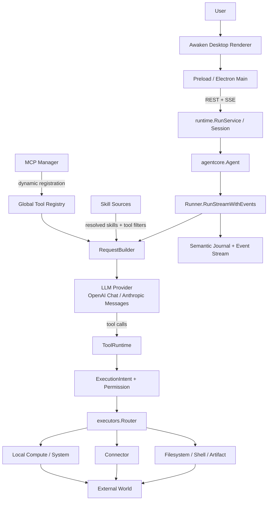
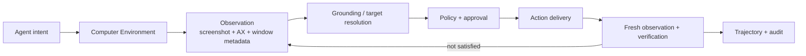
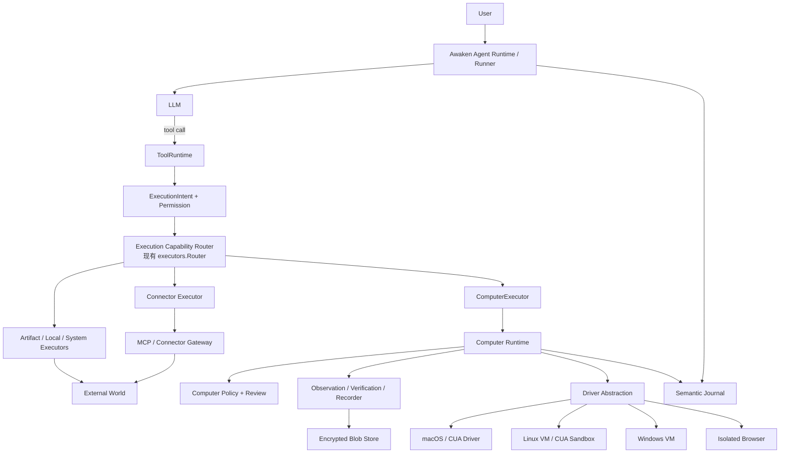
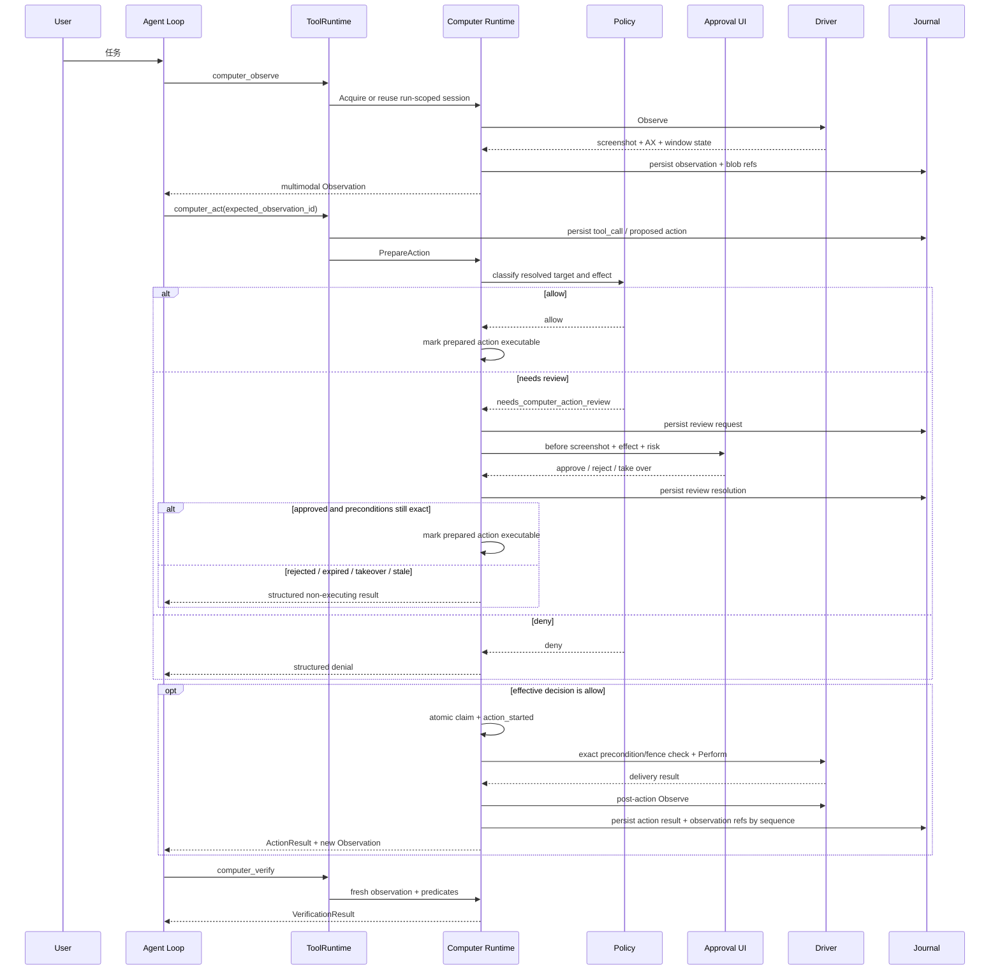
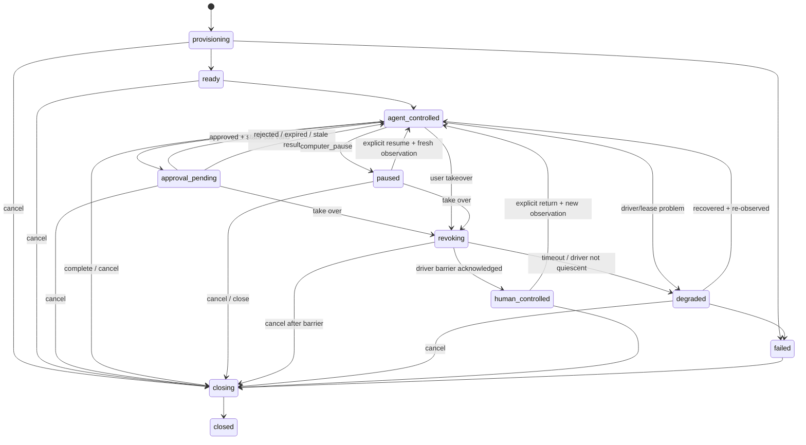
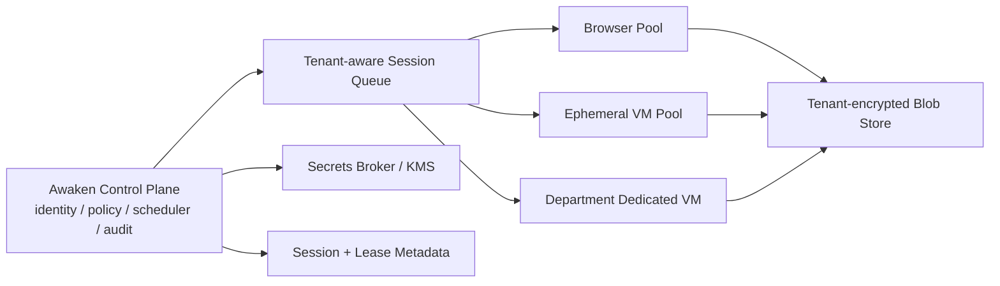

# Awaken Computer Use 能力架构提案

> 文档状态：开发前架构提案
> 调研与代码基线：2026-07-11
> 适用范围：Awaken Agent Core、Tool Runtime、Runtime/Server、Desktop，以及未来 Cloud Computer Data Plane

## 0. Executive Summary

Computer Use 不应在 Awaken 中被实现为一组直接暴露给模型的截图、坐标点击命令，也不应再启动一套拥有自己规划循环的“第二 Agent”。推荐采用**工具入口 + 有状态能力运行时**的混合架构：

- 对 Agent loop 而言，`computer_observe`、`computer_act`、`computer_verify` 是普通 Tool，继续复用现有 LLM tool calling、上下文、重试、权限和语义日志主链路。
- 对执行层而言，Computer Use 是独立的 `Computer Runtime`。它持有环境、驱动、会话、独占租约、观察、动作、验证、轨迹和人工接管状态，不能退化成无状态函数。
- 现有 `executors.Router` 就是目标图中的 Capability Router 的代码落点。第一阶段应新增 `LaneComputer` 和 `ComputerExecutor`，而不是再造一层平行路由器。
- `trycua/cua` 适合作为首个 Desktop Driver / Sandbox 基础设施，但 Awaken 必须继续拥有 planning、permission、approval、session truth、retry、audit 和 replay truth。原始 CUA MCP 工具不应直接成为模型侧的最终产品接口。

当前代码已经具备可复用的 agent loop、工具注册、MCP 接入、Skill 激活、工具执行意图、权限决策、SSE 事件和 persist-before-execute 语义日志。Phase 0 可以先用内部 harness 验证 Driver；但进入正式 Agent Tool 化前必须补齐五项基础能力：

1. 把当前字符串型 Tool Result 升级为可承载截图的多模态内容。
2. 增加 Computer 专属执行 lane、运行时接口和 run-scoped capability context。
3. 增加仅面向 Computer 高风险动作的审批与接管状态机。
4. 将语义日志与加密、内容寻址的媒体 Blob Store 组合为可重放轨迹。
5. 为本机桌面和云端环境增加独占租约、fencing token 与崩溃恢复语义。

建议从单机 macOS、单会话、CUA Driver sidecar 开始 POC；随后完成 Agent Tool 化和安全闭环，再进入 VM Sandbox、云端池化以及企业治理。该路径能尽快验证真实 Desktop UI，同时避免把 POC 的全局进程状态、坐标点击和本机权限模型固化为未来 SaaS 架构。

## 1. 范围、目标与关键决策

### 1.1 目标

本提案覆盖 Computer Use 从模型意图到外部 GUI 执行的完整产品路径：

- 观察屏幕、窗口、应用与 accessibility tree。
- 在 macOS、本地或远程浏览器、Linux/Windows VM 中执行鼠标与键盘动作。
- 在 API、MCP、Connector 不可用或不足时完成软件任务。
- 每次可变更动作后获取新观察并验证结果，而不是把“输入事件已发送”等同于“任务成功”。
- 将会话、观察、动作、策略、审批、结果、验证和人工接管记录为一条可审计轨迹。
- 未来支持 100 名用户与 10 个 Autonomous Department Agent 的隔离、调度和成本控制。

### 1.2 非目标

- 第一阶段不承诺覆盖所有 macOS 应用、所有坐标系和所有系统权限弹窗。
- 不把 GUI 自动化当成已有 API、MCP、Connector 的默认替代品。
- 不让模型读取密码、验证码、支付密钥或完整凭据；凭据应由受控注入层处理。
- 不把模型生成的自然语言“风险等级”当作安全判断。
- 不默认支持在真实主机上重新执行历史轨迹；replay 默认只读播放。

### 1.3 决策原则

执行路径按以下优先级选择：

1. 强类型本地工具、业务 API 或 Connector。
2. MCP 或浏览器 DOM / accessibility 语义操作。
3. Computer Use 的 accessibility 元素操作。
4. 最后才使用像素坐标动作。

GUI 中出现的文本、网页指令和弹窗内容一律视为不可信输入。是否允许某次动作，由宿主根据应用、域名、目标元素、数据敏感度、可逆性和业务后果计算，模型不能自行放行。

### 1.4 关键架构决策

|决策|推荐|原因|
|---|---|---|
|进入 Agent loop 的形式|普通 Tool|复用现有上下文、ToolRuntime、失败监督和语义日志|
|执行侧形态|独立 Computer Capability Runtime|需要会话、租约、观察、验证、录制和接管状态|
|是否建立第二 Agent loop|否|避免规划、权限、记忆与审计出现双重真相|
|首个驱动|CUA Driver sidecar / daemon adapter|可快速覆盖 macOS AX、截图和输入；驱动与模型解耦|
|首个隔离形态|本机单独占会话，仅用于开发 POC|最短验证路径，但明确禁止作为多租户生产形态|
|模型侧工具命名|`computer_observe` 等下划线名称|现有 registry 的名称正则不接受点号|
|内部事件与动作类型|`computer.observation`、`click` 等稳定枚举|不受模型工具名称限制，便于版本化|
|高风险人工门|专门的 Computer Action Review|当前项目已移除通用 approval；Computer 风险需要独立、窄范围恢复人工门|
|轨迹真相|语义 Journal + 加密 Blob Store|结构化事件需要可恢复，截图/视频不应内嵌 JSONL 或 SSE|
|云端隔离|共享控制面、按租户隔离的数据面|兼顾策略统一、凭据隔离与资源池效率|

## 2. 当前代码库架构分析

### 2.1 当前主链路



用用户给出的抽象表示，当前结构是：

```text
User
 |
Agent Runtime              src/agentcore + src/runtime
 |
LLM                        src/llm
 |
Tool Layer                 src/tool + RequestBuilder
 |
Execution Layer            ToolRuntime + executors.Router
 |
External World             filesystem / process / connector / MCP
```

Computer Use 最合适的插入点不是 LLM provider 内部，也不是 Electron renderer，而是：

```text
ToolRuntime
  -> ExecutionIntent / Permission
  -> executors.Router
  -> LaneComputer / ComputerExecutor       <- 新增
  -> Computer Runtime                      <- 新增
  -> Driver / Environment                  <- CUA adapter
```

### 2.2 Agent loop 与 LLM 调用

- `src/agentcore/runner.go` 的 `RunStreamWithEvents` 是主 Agent loop。它构建请求、流式调用模型、收集 tool calls、持久化调用并调用 `executeToolCalls`，然后把工具结果送回下一轮模型。
- `src/agentcore/request_builder.go` 汇总对话上下文、全局工具、暴露策略和已解析 Skill，是 Computer 工具进入模型上下文的唯一合理入口。
- `src/llm/types.go` 当前只抽象 `openai_chat` 与 `anthropic_messages`，工具结果最终是字符串。`src/agentcore/tool_runtime.go` 的 `ToolExecutionResult.Content` 和 `src/context/context.go` 的 ToolResult 也都是字符串。
- `src/llm/openai_chat.go` 只会把用户附件编码为图片；`src/llm/anthropic_messages.go` 当前同样没有把 Tool Result 图片编码为 image block。因此，即使驱动能截图，模型下一轮也无法收到真正的视觉观察。这不阻塞内部 harness 的 Driver POC，但会阻塞 Phase 1 的 Agent 视觉闭环。

### 2.3 Tool calling、Registry 与执行意图

- `src/tool/tool.go` 定义 `Tool`、`ToolDefinition` 与 annotations；`src/tool/schema.go` 已支持递归 JSON Schema 和 `oneOf`，足以表达动作 union。
- `src/tool/registry.go` 是进程级全局 registry。名称规则支持字母、数字、`_`、`-`，不支持 `computer.observe` 这样的点号名称。
- `src/agentcore/tool_runtime.go` 已形成“解析工具 -> 校验参数 -> 构建 intent -> 权限/自动策略 -> executor -> audit/outcome”的正确骨架。
- `src/tool/profile/intent.go` 与 `src/agentcore/executors/router.go` 当前只有 artifact、connector、local compute、system 等 lane。Computer 不应伪装成 shell 或 browser connector，应新增一等 lane。
- 全局 registry 在单机可用，但未来不同 run 需要不同 ComputerSession、tenant 和 driver capability。应引入 run-scoped `ToolResolver` / `CapabilityContext`，避免把会话对象存进全局 Tool 实例。

### 2.4 MCP、Skill 与 Plugin

- `src/mcpclient/manager.go` 和 `tool_adapter.go` 将远端 MCP Tool 动态注册为 `mcp__server__tool`。浏览器类 MCP 可映射为 browser read/interact intent。
- CUA Driver 自身可以通过 MCP、CLI 或 daemon 提供能力，但 Awaken 应在其外层增加原生 adapter。否则 30 多个底层驱动工具会绕过统一的 session lease、Computer policy、审批和轨迹语义。
- 当前 Skill 来源是 project、user 与 MCP；Skill 激活还会校验 required tools、capabilities 和 runtime。Computer Skill 可描述工作流，并声明 `computer-runtime` 依赖，但 Skill 不能授予权限、创建无审计会话或改变风险等级。
- 代码中虽有 `SourcePlugin` 枚举，当前并不存在完整的 Plugin 生命周期和权限边界。本方案不以一个尚未落地的 Plugin 系统为前提。

### 2.5 Session、Context、Permission 与 Trace

- `src/runtime/run_service.go` 按 thread 复用 Agent / conversation，并限制同一 thread single-flight；不同 thread 仍可并发。本机 GUI 却是共享状态，因此必须额外增加 host/environment 级独占租约。
- `src/runtime/session.go` 已有等待并解析人工交互的并发范式，可作为 Computer Review 的实现参考，但类型和 API 必须独立。
- `src/tool/permission.go` 当前没有通用 approval，只有 allow、deny、needs_auth、needs_runtime、unsupported、needs_mass_message_review 等决策。Computer Use 需要新增窄范围的 `needs_computer_action_review`，而不是恢复旧的万能 ApprovalCard。
- 语义日志已经遵循 persist-before-execute，并让 live/replay 走同一 projector；这非常适合扩展 Computer 轨迹。
- `src/tool/audit.go` 的生产接线目前不完整：默认可能使用 Noop sink，`toolRuntimeConfigFromAgentConfig` 没有完整传入 RunID/AuditSink，`GET /v1/runs/{id}/audit` 仍返回空数组。Computer 上线前不能依赖这一空壳作为合规审计。

### 2.6 需要重构的模块

|最晚完成阶段|模块|必要修改|不修改的后果|
|---|---|---|---|
|Phase 1 前|Tool Result / Context / LLM adapters|支持文本、图片与结构化观察引用|模型只能看到“截图已保存”，无法视觉闭环|
|Phase 1 前|ExecutionIntent / Executor Router|新增 `LaneComputer`、`ToolKindComputerAction` 与 executor|Computer 被迫伪装成 shell/MCP，策略失真|
|Phase 0|Runtime Session|增加环境租约、fencing token、控制权和取消清理|多 thread 会同时操作同一桌面|
|Phase 1 前|Permission|增加 Computer 专属 review decision 与状态机|提交、支付、删除等动作无法安全落地|
|Phase 0 最小版；Phase 1 完整版|Semantic Journal / Audit|新增 Computer 语义记录与 Blob 引用|崩溃后无法判断动作是否发生，也无法可靠 replay|
|Phase 1 前|Global Tool Registry|增加 run-scoped resolver/capability binding|多租户会话容易串用|
|Phase 1 前|Model Profile|显式传播 vision / computer-use capability|不支持视觉的模型会在运行时才失败|
|Phase 1|Desktop bridge / Workbench|增加 review、接管和受控画面入口|后端状态无法被用户确认或接管|

## 3. CUA 技术调研

本次调研基于 `trycua/cua` 官方仓库 2026-07-11 的 `0e9f1a48d5f958f5a38841f6d58abcb00fbf2445` 版本以及 CUA 官方架构、Driver contract、MCP tools 与 no-foreground 文档。

### 3.1 两条基础设施路径

CUA 将能力分成两类：

- **Cua Driver**：直接控制真实机器。macOS 使用 Accessibility / CoreGraphics 等原生能力，Windows 使用 UI Automation，Linux 使用 AT-SPI，并可通过 MCP、CLI 或 daemon 暴露。
- **Cua Sandbox**：通过 Python SDK 连接 `computer-server`，控制可丢弃的 VM / container。仓库中的 runtime backend 包括 Docker、QEMU、Lume、Hyper-V、Tart 和 Android 等。

Driver 与 `computer-server` 都是模型无关的执行基础设施；它们不负责业务规划、长期记忆或 Awaken 的权限真相。这正好符合“CUA 做环境与驱动，Awaken 做 Agent Runtime”的边界。

### 3.2 核心组件及其职责

|CUA 组件|能力|Awaken 中的使用方式|
|---|---|---|
|Sandbox|创建、连接、快照和销毁隔离计算机|Phase 2 起实现 VM / container EnvironmentProvider|
|Desktop Driver|窗口、AX 元素、屏幕和输入控制|Phase 0 通过 adapter 接入，不直接暴露原始工具|
|Screenshot pipeline|桌面/窗口截图、光标、尺寸与图像输出|统一转成 `Observation` 并写入 Blob Store|
|Input simulation|mouse、keyboard、scroll、drag 等|统一转成经过策略判定的 `ComputerAction`|
|Window / AX abstraction|窗口范围、桌面范围、元素动作|作为优先于像素坐标的语义目标|
|Session state|连接、daemon 进程状态、录制状态|由 Awaken `ComputerSession` 包住并增加 tenant/run/lease|
|Recording|逐动作保存 `action.json`、截图、AX state，可渲染视频|作为原始证据源；Awaken 增加策略、审批、理由和业务验证|
|Replay|重新调用已记录的动作|生产默认禁用重执行，仅提供只读播放|

CUA 的 `Sandbox` 还将 mouse、keyboard、screen、clipboard、shell、files、window 和 terminal 组合在一个隔离环境对象中。Awaken 不应因此把所有子能力一次性授权给模型：Computer 会话只获得显式启用的 GUI capability；shell、files 和 clipboard 仍走各自的现有工具与策略。

### 3.3 为什么不是 Screenshot -> LLM -> Click



简单三段式遗漏了决定可靠性与安全性的状态：

- 一张图属于哪个显示器、窗口、viewport、缩放比例和坐标系。
- 窗口是否仍在原位置，目标元素是否已经移动或失效。
- 操作能否后台执行，还是必须切到前台并获取焦点。
- 点击事件“已发送”与按钮“已生效”是两件事。
- 登录、弹窗、网络等待、动画和异步页面会改变下一步目标。
- 失败后能否安全重试；提交订单等动作不能盲目重放。
- 谁在控制机器，何时切换给人，以及切换后旧动作如何失效。
- 截图和动作如何与 model call、approval、run 和业务结果关联。

因此，观察必须拥有稳定 ID 和状态摘要；动作必须绑定它所依据的观察；可变更动作后必须重新观察；轨迹必须同时记录“提议、策略、审批、执行、结果与验证”。

### 3.4 CUA 与 Agent Runtime 的边界

|属于 CUA / Driver / Environment|属于 Awaken Agent Runtime|
|---|---|
|启动或连接 OS / VM / browser desktop|任务规划、分解、模型循环|
|截图、窗口信息、AX tree|上下文、记忆、Skill 解析|
|坐标换算、焦点、mouse / keyboard event|Tool exposure、能力路由|
|原生应用枚举、进程与窗口句柄|风险分类、permission、approval|
|驱动健康检查、暂停、恢复|重试语义、失败监督、任务取消|
|低层录制素材|canonical trajectory、audit、retention|
|环境快照、销毁|tenant、run、task、user identity|
|动作送达结果|业务目标是否完成|

驱动可以报告 `event_delivered=true`、前后窗口变化等事实，但“订单是否正确提交”“下载的报表是否属于目标日期”等业务验证仍由 Agent Runtime 负责。

### 3.5 对 CUA 的采用策略

1. Phase 0 将 CUA Driver 作为签名 sidecar / daemon，由 `CUADriverAdapter` 通过受控 IPC 调用；但 CUA 公开 MCP/CLI contract 没有 Awaken 所需的 fencing、checked-perform 和 quiesce barrier，不能假装已有。
2. 模型只看到 Awaken 的 3–6 个稳定 Computer 工具，不看到 CUA 的全部原始 MCP 工具。
3. CUA 录制目录作为原始 evidence ingest，转存为 Awaken Blob 与语义轨迹；不把驱动本地路径暴露给 renderer 或模型。
4. Phase 2 使用 CUA Sandbox 作为一种 `EnvironmentProvider`，同时保留替换其他 VM / browser provider 的接口。
5. CUA replay 只用于隔离环境中的显式测试。真实主机崩溃恢复时只能重新观察和判断，不允许自动重放未知结果动作。

Phase 0 ADR 必须二选一：推荐在 CUA 原生输入层增加/维护 Awaken-owned `perform_checked + quiesce` 扩展，使 fence/precondition 比较与输入注入处于同一可信进程；或把 stock CUA 标记为 `AtomicPreconditionCheck=false` 的 `UnsafeFixtureDriver`，只允许独立 fixture app 和无外部后果的低风险 POC。未提供这些原语的 stock MCP/CLI adapter 不能进入 Phase 1 高风险路径。

## 4. Codex、Claude Code 与主流 Runtime 对比

### 4.1 Codex 的启示

Codex 的主循环思想与 Awaken 当前结构高度相似：模型输出 tool call，统一 registry/router 解析，执行前经过 sandbox、permission、hook 和 trace，结果再回到同一 turn loop。若在这一结构中加入 Computer Use，最自然的外部接口就是：

```text
shell_execute
file_edit
browser_open
computer_observe
computer_act
computer_verify
```

OpenAI 当前的 Computer Use API 也采用相同循环：模型产生 `computer_call`，应用按顺序执行动作，截取更新后的画面，再返回 `computer_call_output`，直到模型不再要求动作。官方明确建议使用隔离浏览器/容器、域名与动作 allowlist，并在购买、认证、破坏性或不可逆动作前人工介入。

Codex 产品当前还通过 Computer Use 插件提供 per-app permissions、macOS Screen Recording / Accessibility 权限、敏感或破坏性动作确认，以及 stop/takeover。其重要启示不是“把 Computer 当成一个进程”，而是把底层 MCP/Skill 集成收敛进现有 agent loop 与统一安全边界。

对 Awaken 的落点是：

- `computer_*` 与 shell/file 工具共享 ToolRuntime，但进入不同 lane。
- OS sandbox 只保护进程和文件，不等于 GUI sandbox；Computer 必须有 app/domain/action policy。
- 结构化插件、API、MCP 优先，像素 GUI 是 fallback。
- 人工接管是控制权转移，不只是“暂停几秒”。

### 4.2 Claude API 与 Claude Code 的启示

需要区分两个产品层面：

- Anthropic API 的 Computer Use 是 client-executed tool。Claude 输出 `tool_use`，宿主应用负责截图、鼠标键盘、隔离环境和 `tool_result` 回传。
- Claude Code 的核心仍是工具循环、MCP、Skill、permission rule 与 sandbox。Computer 可经 MCP 或自定义运行环境进入，但不能据此宣称 Claude Code 的所有版本都内建了桌面 Computer Tool。

Claude Code 的 deny -> ask -> allow 权限规则和“sandbox 与 permission 互补”原则值得采用。但 Awaken 不应复制通用 ask 模式：当前项目已经选择零通用审批，Computer 只需为高风险 GUI 后果增加一个明确、可审计的专用 review gate。

### 4.3 普通 Tool 与独立 Runtime 的比较

|方案|优点|缺点|适用范围|
|---|---|---|---|
|A. 纯普通 Tool：每个 click/type 都是无状态函数|接入快、复用 registry 和 tool call|缺少环境生命周期、独占、状态一致性、验证、接管；大量底层工具污染模型|一次性 demo|
|B. 完全独立 Agent Capability Runtime：自己规划和调用模型|可封装复杂自治逻辑|形成第二 agent loop；上下文、权限、记忆、重试和审计双重真相|独立 RPA 产品，不适合当前 Awaken|
|C. Tool facade + stateful Computer Runtime|复用 Agent loop，同时具备环境和会话能力；容易做 provider/driver adapter|需要新增接口、状态机、媒体存储和 UI|推荐方案|

### 4.4 推荐结论

Computer Use **在模型边界上是 Tool，在执行边界上是 Runtime**。模型不应感知 driver 进程、VM provider 或 tenant lease；Driver 也不应拥有规划、审批和业务完成判断。该划分既符合 Codex / Claude 的 client tool loop，也能直接嵌入 Awaken 当前的 `ToolRuntime -> executors.Router`。

## 5. 推荐目标架构

### 5.1 总体架构



图中的 Capability Router 是**执行 lane router**，不是在模型之外重新决定“选 API、MCP 还是 GUI”的规划器。模型仍通过统一 Tool schema 选择能力；代码上先扩展现有 `src/agentcore/executors/router.go`，不新建一套重复的顶层路由。MCP Gateway 仍负责普通 MCP 工具；如果 CUA Driver 的传输层使用 MCP，它也必须位于 `Computer Runtime -> Driver Adapter` 之后。

### 5.2 目录设计

用户建议的 `internal/computer/...` 与 Go 常见布局一致，但本仓库实际源码约定是 `src/...`。为保持项目一致性，建议映射为：

```text
src/
├── computer/
│   ├── types.go                 # 公共枚举、值对象、错误码
│   ├── runtime/
│   │   ├── service.go           # 会话编排、租约、调用入口
│   │   ├── session.go           # 状态机、控制权、取消与恢复
│   │   └── lease.go             # 独占/fencing contract
│   ├── driver/
│   │   ├── driver.go            # 模型无关 Driver interface
│   │   ├── cua.go               # CUA Driver adapter
│   │   └── fake.go              # 单元测试 deterministic driver
│   ├── observer/
│   │   ├── observer.go          # screenshot、AX、window metadata
│   │   ├── coordinates.go       # viewport / scale / 坐标空间
│   │   └── redaction.go         # 敏感区域处理
│   ├── action/
│   │   ├── action.go            # 动作 union 与参数校验
│   │   └── executor.go          # 串行执行、超时、幂等保护
│   ├── policy/
│   │   ├── classifier.go        # 语义风险分类
│   │   ├── rules.go             # app/domain/target/data/effect rules
│   │   └── approval.go          # review binding 与 token 校验
│   ├── recorder/
│   │   ├── recorder.go          # trajectory step 写入
│   │   └── blob_store.go        # 图片/视频/AX blob contract
│   └── verification/
│       ├── verifier.go          # 新观察与断言
│       └── predicates.go        # text/window/url/visual predicates
├── tools/computer/
│   ├── observe.go
│   ├── act.go
│   ├── verify.go
│   └── session.go
└── agentcore/executors/
    └── computer.go              # ToolRuntime lane adapter
```

### 5.3 各模块职责

|模块|必须负责|明确不负责|
|---|---|---|
|`runtime`|环境获取、session state、租约、控制权、调用编排、释放|业务任务规划|
|`driver`|连接目标环境、观察、输入、窗口/AX、健康状态|风险判断、模型调用|
|`observer`|统一观察格式、坐标系、压缩、脱敏、哈希|判断业务目标完成|
|`action`|强类型动作、串行执行、超时、输入规范化|自行跳过 permission|
|`policy`|宿主计算风险、allow/deny/review、approval binding|信任模型自报风险|
|`recorder`|结构化 step、blob 引用、完整性哈希、保留策略|在日志内保存明文秘密|
|`verification`|动作后新观察、确定性断言、状态差异|取代 Agent 的最终业务判断|
|`tools/computer`|将稳定 Tool Schema 映射到 runtime|保存全局可变 session|
|`ComputerExecutor`|将现有 intent/permission/audit 链接到 runtime|直接调用 OS API|

### 5.4 依赖方向

```text
agentcore / tools
       |
       v
computer/runtime ----> computer/policy ----> tool permission decision
       |
       +----> observer / action / verification / recorder
       |
       v
computer/driver ----> CUA / browser / VM provider
```

`driver` 不能反向依赖 `agentcore`；`computer` 公共类型不能持有 LLM message；renderer 不能直接持有 driver 句柄；Skill 不能直接依赖 CUA 实现。这些边界保证未来替换 provider 时，Agent loop 和安全模型不变。

### 5.5 在现有代码中的唯一接线路径

当前 Agent 是 thread-scoped，而 run identity、recorder 和 ToolRuntime 是每次运行重新绑定的。Computer session 不能塞进 `AgentConfig` 或全局 registry。建议把现有分散的 `SetRunIdentity` / `SetSemanticRecorder` 收敛为：

```go
type RunExecutionBindings struct {
    ThreadID       string
    RunID          string
    SessionID      string
    Authz          computer.AuthzScope
    Semantic       SemanticRecorder
    Audit          tool.AuditSink
    Capabilities   computer.CapabilityContext
    ToolResolver   tool.Resolver
    Computer       computerruntime.Service
    Media          computer.MediaResolver
}

// src/tool/registry.go：不依赖 agentcore/computer，避免 import cycle。
type Resolver interface {
    GetTool(name string) (Tool, error)
    ListTools() []Tool
}

type PreparedExecutionRef struct {
    Capability string
    ID         string
    Digest     string
}
```

唯一创建顺序：

1. `cmd/awaken-core/main.go` 构造进程级 Computer Runtime / Driver provider、Blob/State/Audit store 和 ToolRuntime factory。
2. `RunService.bindAgentRecorder` 所在路径扩展为 `BindRunExecution(bindings)`，在 run ID 已确定后把 bindings 交给 Agent；`AuthzScope` 由 Server/Electron 本地认证派生。
3. Agent 把 bindings 作为独立参数交给 Runner，不写回 thread-scoped `AgentConfig`。
4. `NewRunner` 不再提前创建一个缺 RunID 的 ToolRuntime；`RunStreamWithEvents` 在 run identity 确定后由 factory 只创建一次，并传入 RunID、AuditSink、ToolResolver、CapabilityContext 和带依赖的 Router。
5. RequestBuilder 在每轮通过 run-scoped resolver 获取 stateless Tool definition；`src/tools/tools.go` 只负责 blank-import 注册 Computer tool facade，不保存 session/runtime 指针。

当前 `PermissionCheckingTool.CheckPermission(ctx,input,PermissionContext)` 没有 ToolCallID，也不能依赖 `agentcore.RunExecutionBindings`，否则 `tool <-> agentcore` 会形成 Go import cycle。Computer 的动态准备因此不放进 Tool interface，而由 AgentCore 注入的 lane preparer 完成：

```go
// src/agentcore/execution_preparer.go
type PrepareExecutionRequest struct {
    ToolCallID string
    Input      string
    Intent     profile.ExecutionIntent
    Permission tool.PermissionContext
    Bindings   RunExecutionBindings
    Tool       tool.Tool
}

type ExecutionPreparer interface {
    Prepare(ctx context.Context, req PrepareExecutionRequest) (*PreparedExecutionRef, tool.PermissionDecision, error)
}
```

ToolRuntime 完成 JSON schema/static permission 后，按 lane 调用 preparer。`ComputerExecutionPreparer` 可调用无 GUI 副作用的 `PrepareAction`，把 immutable `PreparedActionID + digest` 持久化并返回 `DecisionMetadata.Computer`；其他 lane 使用 no-op preparer。ToolCallID 是 prepared action 和 idempotency 的唯一键之一，不允许靠全局 Tool 可变状态或相同 JSON input 猜测。Decision metadata 随后进入：

```go
type ExecutorRequest struct {
    Intent      profile.ExecutionIntent
    Profile     profile.ExecutionProfile
    Tool        tool.Tool
    Input       string
    Observer    tool.ToolObserver
    Bindings    RunExecutionBindings
    Prepared    *PreparedExecutionRef
}
```

Preparer 只允许调用无 GUI 副作用的 `PrepareAction` 并持久化 prepared ref；`ComputerExecutor` 是唯一可调用 Observe、Verify、`ExecutePrepared` 或产生 Driver 副作用的 Tool executor 路径。它 type-assert Computer facade，读取 `PreparedExecutionRef`，且不走通用 `executeWithObserver -> Tool.Execute`。为满足现有 `tool.Tool` 接口，Computer facade 的裸 `Execute` 必须 fail closed 返回 `computer_runtime_required`。这样既不会在全局 Tool 中保存会话，也不会出现 facade 和 ComputerExecutor 各自执行一次动作。

Phase 1 只允许 root agent 使用 Computer。`GuardianReadOnly` 和所有 subagent 默认在 ToolRuntime 决策层 deny，不能让现有 Router 的 Guardian override 把 Computer facade 送入通用 `Tool.Execute`。未来如支持 subagent，必须显式委派 tenant/environment/app/action 子集且不超过父边界；guardian 仍永久 observe/action deny。

## 6. 核心接口与数据结构

以下接口是开发合同而非现有代码。公共值对象放在 `src/computer`，具体实现放在子包，避免 Driver 反向依赖 Agent Core。

### 6.1 Runtime 与 Driver 接口

```go
// src/computer/runtime/service.go
type Service interface {
    Acquire(ctx context.Context, authz computer.AuthzScope, req computer.SessionRequest) (computer.ComputerSession, error)
    Get(ctx context.Context, authz computer.AuthzScope, sessionID string) (computer.ComputerSession, error)

    Observe(ctx context.Context, authz computer.AuthzScope, req computer.ObserveRequest) (computer.Observation, error)
    PrepareAction(ctx context.Context, authz computer.AuthzScope, req computer.ActionRequest) (computer.PreparedAction, error)
    ExecutePrepared(ctx context.Context, authz computer.AuthzScope, req computer.ExecuteRequest) (computer.ActionResult, error)
    Verify(ctx context.Context, authz computer.AuthzScope, req computer.VerifyRequest) (computer.VerificationResult, error)

    TransferControl(ctx context.Context, authz computer.AuthzScope, req computer.ControlTransferRequest) (computer.ComputerSession, error)
    Pause(ctx context.Context, authz computer.AuthzScope, sessionID string) error
    Resume(ctx context.Context, authz computer.AuthzScope, sessionID string) (computer.Observation, error)
    Release(ctx context.Context, authz computer.AuthzScope, sessionID string, reason string) error
}
```

`PrepareAction` 必须解析目标、读取当前观察、计算风险，并同时冻结 `ResolvedAction + ExecutionPreconditions` 及各自 versioned digest 到 PreparedActionStore；Review 与 ApprovalProof 都绑定两份 digest。`ExecutePrepared` 只接受该冻结对象和宿主签发的 proof，并把原样 preconditions 交给 gateway 比较，不能在审批后静默重算成另一目标。任何调用方都不能绕过 prepare 直接把任意 JSON 送到 Driver。

`ResolvedActionDigest = H("AWAKEN_COMPUTER_ACTION_V1" || canonical(ResolvedAction))`；`PreconditionsDigest = H("AWAKEN_COMPUTER_PRECONDITIONS_V1" || canonical(ExecutionPreconditions))`。`ExecutionPreconditions` 内含前者以锁定动作，但不含后者；后者是 `PreparedAction` 的外层字段，因此不存在自引用摘要。Canonical encoding 必须固定 schema version、字段顺序、Unicode 归一化与数值表示；不得直接依赖不同语言的默认 JSON 序列化。

`AuthzScope` 只能由已认证的 Server / RunService 从连接身份派生，不能来自模型参数、URL body 或调用方自报的 `tenant_id`。它至少包含 tenant、subject、roles、run/task scope 和允许的 environment；repository 查询使用复合 tenant key 或数据库 RLS。

```go
// src/computer/driver/driver.go
type Driver interface {
    Name() string
    Capabilities(ctx context.Context) (computer.DriverCapabilities, error)
    Start(ctx context.Context, cfg computer.DriverSessionConfig) (computer.DriverSession, error)
    Attach(ctx context.Context, ref computer.DriverSessionRef) (computer.DriverSession, error)

    Observe(ctx context.Context, session computer.DriverSession, req computer.DriverObserveRequest) (computer.RawObservation, error)
    Perform(ctx context.Context, session computer.DriverSession, req computer.DriverPerformRequest) (computer.DriverActionResult, error)
    Health(ctx context.Context, session computer.DriverSession) error
    Quiesce(ctx context.Context, session computer.DriverSession, req computer.DriverQuiesceRequest) (computer.DriverBarrierAck, error)
    Resume(ctx context.Context, session computer.DriverSession) error
    Stop(ctx context.Context, session computer.DriverSession) error
}

type EnvironmentProvider interface {
    Provision(ctx context.Context, authz computer.AuthzScope, spec computer.EnvironmentSpec) (computer.EnvironmentHandle, error)
    Snapshot(ctx context.Context, authz computer.AuthzScope, environment computer.EnvironmentHandle) (computer.SnapshotRef, error)
    Destroy(ctx context.Context, authz computer.AuthzScope, environment computer.EnvironmentHandle) error
}

type PolicyService interface {
    AuthorizeObservation(ctx context.Context, authz computer.AuthzScope, session computer.ComputerSession, req computer.ObserveRequest) (computer.PolicyDecision, error)
    AssessAction(ctx context.Context, authz computer.AuthzScope, session computer.ComputerSession, action computer.ResolvedAction) (computer.EffectAssessment, computer.PolicyDecision, error)
    AuthorizeVerification(ctx context.Context, authz computer.AuthzScope, session computer.ComputerSession, req computer.VerifyRequest) (computer.PolicyDecision, error)
}

type ComputerPolicyResolver interface {
    Resolve(ctx context.Context, authz computer.AuthzScope, builtIn profile.ExecutionProfile, task tool.PermissionContext, driver computer.DriverCapabilities) (computer.ComputerPolicy, error)
}
```

Phase 0 的 `EnvironmentProvider` 是“已授权本机”，Driver 是 CUA adapter；该 provider 的 `Destroy` 只能停止本 session 拥有的 sidecar/录制并释放 lease，绝不能把真实主机套用 VM 销毁语义。Phase 2 起 provider 才真正创建隔离 VM / container。Driver capability 必须显式声明 screenshot、accessibility、background input、clipboard、window scope、desktop scope、recording 等能力，runtime 不做乐观猜测。

`DriverPerformRequest` 必须携带 resolved action、action ID、idempotency key、fencing token、control epoch 和完整 `ExecutionPreconditions`。唯一 Driver gateway 在同一个输入注入临界区重取可信 app/window/origin/target/focus/coordinate state 并逐项比较 generation 与 preconditions；不匹配时零输入返回 stale。仅在 Runtime 里先调用 `LeaseStore.Validate` 会留下 TOCTOU 窗口。远程 driver/server 同样必须在数据面执行该比较。Browser origin 只能来自浏览器控制通道或受管 proxy attestation，不能相信页面 OCR、地址栏像素或普通 AX 文本。

Observe 与 Verify 也必须走 `PolicyService`。全桌面捕获默认 deny；只有 profile 明确允许且捕获端能先执行 app/window allowlist、裁剪和脱敏时才可用。Verify 只能读取当前 AuthzScope 已授权的观察和 Blob，不能借断言接口枚举其他窗口或 tenant 数据。

ComputerPolicy 的可信来源只能是服务端本地配置/tenant policy store 与内置 profile ceiling。客户端只能请求 profile 名称，不能提交 app/domain/action allowlist；出现这些字段时拒绝或丢弃并记录 tamper。最终策略是 `server-owned policy ∩ built-in profile ∩ run/task scope ∩ driver capabilities ∩ subagent boundary`，所有交集按最小权限收窄。

### 6.2 租约、媒体和轨迹接口

```go
type LeaseStore interface {
    Acquire(ctx context.Context, resourceKey, ownerID string, ttl time.Duration) (computer.LeaseToken, error)
    Renew(ctx context.Context, token computer.LeaseToken, ttl time.Duration) (computer.LeaseToken, error)
    Validate(ctx context.Context, token computer.LeaseToken) error
    Release(ctx context.Context, token computer.LeaseToken) error
}

type BlobStore interface {
    Put(ctx context.Context, authz computer.AuthzScope, mediaType string, r io.Reader) (computer.BlobRef, error)
    Open(ctx context.Context, authz computer.AuthzScope, ref computer.BlobRef) (io.ReadCloser, error)
    Delete(ctx context.Context, authz computer.AuthzScope, ref computer.BlobRef) error
}

type MediaResolver interface {
    OpenForModel(ctx context.Context, authz computer.AuthzScope, ref computer.BlobRef, maxBytes int64) (computer.MediaDescriptor, io.ReadCloser, error)
}

type Recorder interface {
    Append(ctx context.Context, authz computer.AuthzScope, step computer.TrajectoryStep) error
    Close(ctx context.Context, authz computer.AuthzScope, sessionID string) error
}

type ComputerStateStore interface {
    CreateSession(ctx context.Context, authz computer.AuthzScope, session computer.ComputerSession) error
    GetSession(ctx context.Context, authz computer.AuthzScope, sessionID string) (computer.ComputerSession, error)
    UpdateSessionCAS(ctx context.Context, authz computer.AuthzScope, expectedVersion uint64, session computer.ComputerSession) error
    ListNonTerminalSessions(ctx context.Context, authz computer.AuthzScope) ([]computer.ComputerSession, error)

    PutPrepared(ctx context.Context, authz computer.AuthzScope, action computer.PreparedAction) error
    CreateReview(ctx context.Context, authz computer.AuthzScope, review computer.ComputerActionReview) error
    ResolveReview(ctx context.Context, authz computer.AuthzScope, req computer.ResolveReviewRequest) (computer.ApprovalProof, error)

    // 原子校验并消费 prepared action/proof，写入 started 状态和 semantic outbox。
    ClaimExecution(ctx context.Context, authz computer.AuthzScope, req computer.ExecutionClaim) (computer.PreparedAction, error)
    CompleteExecution(ctx context.Context, authz computer.AuthzScope, result computer.ActionResult) error
    GetIdempotentResult(ctx context.Context, authz computer.AuthzScope, key string) (computer.ActionResult, bool, error)

    ClaimSemanticOutbox(ctx context.Context, authz computer.AuthzScope, limit int) ([]computer.SemanticOutboxItem, error)
    AckSemanticOutbox(ctx context.Context, authz computer.AuthzScope, itemIDs []string) error
}

type RecoveryCoordinator interface {
    ReconcileStartup(ctx context.Context, authz computer.AuthzScope) error
    ReconcileSession(ctx context.Context, authz computer.AuthzScope, sessionID string) error
}
```

本机桌面的 `resourceKey` 固定为 `host-desktop:<machine-id>`，因此最多一个 agent-controlled session。云环境的 key 是 `environment:<tenant-id>:<environment-id>`。每次新 owner 获取租约或发生控制权转移时增加 fencing token；正常续租保持同一 generation。旧 token 的动作一律拒绝，即使旧进程尚未退出。

Generation 是 resource 级持久单调计数，Release/expiry 后也不归零或复用。Driver/sidecar 必须有短 heartbeat watchdog：失去 runtime 连接或 lease 续租后立即停止接受和注入输入。Runtime 重启先 bump/reconcile、quiesce 和重新观察；pending/approved action 不因进程恢复而自动继续。

`ComputerStateStore` 的 P0 实现可以是单进程，但本机 `LeaseStore + Driver gateway` 从 Phase 0 起必须跨进程 host-global：由单例 sidecar/launch service 或 OS 原子文件锁仲裁，锁文件本身不承载可伪造权限。验收要同时启动两个 awaken-core 争抢同一 host desktop，证明只有持有最新 fence 的一方能在 gateway 注入输入。

`LeaseStore` 是 resource ownership/fencing generation 的真相；`ComputerStateStore` 是 session state、prepared action、review、proof consumption、idempotency 和 semantic outbox 的**协调真相**；Semantic Journal 是按顺序呈现给用户和审计者的**轨迹真相**；Blob Store 是媒体内容真相。StateStore 的 mutation 与 semantic outbox 同事务提交，再由 recorder 投递 Journal，避免两套可独立写入的事件真相。P0 可用单进程 durable store 实现同一接口，Phase 3 换成支持事务/CAS 的数据库。

### 6.3 关键值对象

```go
type AuthzScope struct {
    TenantID             string
    DepartmentID         string
    SubjectID            string
    Roles                []string
    RunID                string
    TaskID               string
    ObjectScopes         []string
    AllowedEnvironmentIDs []string
}

type CapabilityContext struct {
    ID                  string
    ComputerEnabled     bool
    PolicyRef           string
    EnvironmentClass    string
    RequiredCapabilities []string
}

// src/computer/types.go：完整有效策略由 server-owned resolver 生成。
type ComputerPolicy struct {
    ID                  string
    Version             string
    Enabled             bool
    AllowedApplications []string
    AllowedDomains      []string
    AllowedActions      []ActionType
    ObservationScopes   []string
    EnvironmentClasses  []string
    ClipboardRead       bool
    ClipboardWrite      bool
    SecureInput         bool
    MaxAutoRisk         RiskLevel
    MediaRetention      time.Duration
}

type AuthenticatedPrincipal struct {
    ID          string
    TenantID    string
    DepartmentID string
    Roles       []string
    AuthnContext string
}

// 仅在 runtime/driver gateway 内部流转；不带 json tag，不进入 DTO。
type LeaseToken struct {
    ResourceKey string
    OwnerID     string
    Generation  uint64
    ExpiresAt   time.Time
    Proof       []byte
}

type DriverSession struct {
    ID            string
    EnvironmentID string
    OpaqueHandle  string
}

type DriverCapabilities struct {
    Screenshot       bool
    Accessibility    bool
    WindowScope      bool
    DesktopScope     bool
    BackgroundInput  bool
    Recording        bool
    TrustedAppIdentity       bool
    TrustedOriginAttestation bool
    AtomicPreconditionCheck  bool
    ClipboardRead            bool
    ClipboardWrite           bool
    SupportedActions []ActionType
    CoordinateSpaces []string
}

type SessionRequest struct {
    RunID                string
    ThreadID             string
    EnvironmentID        string
    EnvironmentClass     string
    RequestedCapabilities []string
}

type ObserveRequest struct {
    SessionID string
    Target    ObservationTarget
    Include   []string
    Screenshot ScreenshotOptions
    Redaction string
    Timeout   time.Duration
}

type VerifyRequest struct {
    SessionID    string
    AfterActionID string
    Assertions   []VerificationAssertion
    Timeout      time.Duration
    PollInterval time.Duration
}

type ControlTransferRequest struct {
    SessionID       string
    Direction       string // agent_to_human | human_to_agent
    ExpectedVersion uint64
    Reason          string
}

type DriverSessionConfig struct {
    Environment    EnvironmentHandle
    LeaseGeneration uint64
    ControlEpoch   uint64
    PolicyVersion  string
}

type DriverSessionRef struct {
    ID            string
    EnvironmentID string
}

type DriverObserveRequest struct {
    Target      ObservationTarget
    Include     []string
    MaxDimension int
    Redaction   string
}

type RawObservation struct {
    ScreenshotBytes []byte // Driver -> Observer 的内存边界，不可持久化
    Accessibility   []byte
    Windows         []WindowSnapshot
    CoordinateSpace CoordinateSpace
    TrustedState    TrustedComputerState
}

type EnvironmentSpec struct {
    Class        string
    OS           string
    ImageRef     string
    Persistent   bool
    NetworkPolicyRef string
}

type EnvironmentHandle struct {
    ID          string
    Class       string
    ProviderRef string
    Ownership   string // host_attached | runtime_owned
}

type SnapshotRef struct {
    ID        string
    SHA256    string
    CreatedAt time.Time
}

type MediaDescriptor struct {
    MediaType string
    ByteSize  int64
    SHA256    string
}

type PolicyDecision struct {
    Action  string // allow | deny | needs_computer_action_review
    Reason  string
    Version string
}

type TrustedComputerState struct {
    Application AppIdentity
    WindowGeneration uint64
    Origin      OriginAttestation
    Focus       ElementFingerprint
}

type SessionState string
const (
    SessionProvisioning   SessionState = "provisioning"
    SessionReady          SessionState = "ready"
    SessionAgentControlled SessionState = "agent_controlled"
    SessionApprovalPending SessionState = "approval_pending"
    SessionRevoking         SessionState = "revoking"
    SessionHumanControlled SessionState = "human_controlled"
    SessionPaused          SessionState = "paused"
    SessionDegraded        SessionState = "degraded"
    SessionClosing         SessionState = "closing"
    SessionClosed          SessionState = "closed"
    SessionFailed          SessionState = "failed"
)

type ComputerSession struct {
    ID              string
    TenantID        string
    DepartmentID    string
    TaskID          string
    RunID           string
    ThreadID        string
    EnvironmentID   string
    DriverName      string
    DriverSessionID string
    State           SessionState
    Version         uint64
    Controller      string // agent | human | none
    ControlEpoch    uint64
    PolicyVersion   string
    CreatedAt       time.Time
    UpdatedAt       time.Time
}

// 只存在于 runtime store，不进入 API DTO、LLM content 或审计 payload。
type SessionRuntimeState struct {
    SessionID string
    Lease     LeaseToken
}

type Observation struct {
    ID             string
    SessionID      string
    Sequence       uint64
    CapturedAt     time.Time
    Target         ObservationTarget
    Screenshot     *BlobRef
    Accessibility  *BlobRef
    Elements        []ElementRef
    Windows        []WindowSnapshot
    CoordinateSpace CoordinateSpace
    StateHash      string
    Redactions     []RedactionRecord
    DriverMetadata map[string]string
}

type ElementRef struct {
    ID            string
    ObservationID string
    ApplicationID string
    WindowID      string
    Role          string
    Label         string
    Bounds        Rect
    Editable      bool
    Secure        bool
    Locator       ElementLocator
    Fingerprint   string
}

type ElementLocator struct {
    ApplicationID string
    WindowID      string
    AutomationID  string
    Role          string
    Label         string
    AncestorPath  []string
}

type CoordinateSpace struct {
    Kind        string  // screen_physical | screen_logical | window_local | viewport
    Width       int
    Height      int
    ScaleFactor float64
    OriginX     int
    OriginY     int
    DisplayID   string
    WindowID    string
}

type BlobRef struct {
    ID        string
    SHA256    string
    MediaType string
    ByteSize  int64
    Width     int
    Height    int
    Encrypted bool
}
```

`Action`、`ResolvedAction`、`VerificationAssertion`、`ObservationTarget` 和 screenshot options 是第 7 章 JSON Schema 生成的 discriminated union/value type，不再另写一套手工字段；schema version 是其兼容边界。

每次 session state、controller、control epoch、environment binding 或 terminal reason 变化都通过 StateStore CAS 递增 `Version`；普通读取和 lease heartbeat 不改变 session version。API 的 `expected_session_version` 就来自这一 canonical 字段。

观察 ID 是动作一致性的基础。`StateHash` 由目标窗口、坐标空间、关键 AX 节点摘要和截图感知哈希共同形成；它不是安全签名，但能发现窗口切换和明显 UI 漂移。Blob 的完整性由 SHA-256 与租户授权共同保证。

`ElementRef.ID` 只在所属 Observation 内有效，不能跨 observation、window generation 或 session 重用；Driver 原生 AX handle 不直接发给模型。`Locator/Fingerprint` 是 verifier 的 server-side rematch hint，不是可执行 handle：新观察中匹配成功后仍生成新的 element ID，零匹配/多匹配或 app/window 变化返回 `indeterminate`。

```go
type RiskLevel string
const (
    RiskReadOnly    RiskLevel = "read_only"
    RiskObserve     RiskLevel = "observe"
    RiskLow         RiskLevel = "low_risk_action"
    RiskHigh        RiskLevel = "high_risk_action"
    RiskDestructive RiskLevel = "destructive_action"
)

type ActionRequest struct {
    SessionID            string
    RunID                string
    ToolCallID           string
    ExpectedObservationID string
    ModelIntent          string // untrusted rationale
    ModelExpectedEffect  string // untrusted claim
    Action               Action
}

type PreparedAction struct {
    ID                    string
    Request               ActionRequest
    Resolved              ResolvedAction
    ResolvedActionDigest  string
    Preconditions         ExecutionPreconditions
    PreconditionsDigest   string
    ObservationID         string
    ObservationStateHash  string
    EnvironmentID         string
    DriverSessionID       string
    LeaseGeneration       uint64
    ControlEpoch          uint64
    PolicyVersion         string
    IdempotencyKey        string
    Effect                EffectAssessment
    Risk                  RiskAssessment
    ExpiresAt             time.Time
}

type EffectAssessment struct {
    NormalizedOperation string
    ApplicationID      string
    Domain             string
    TargetLabel        string
    ExternalConsequence string
    DataClasses        []string
    Reversible         bool
    Source             string // host_ax | host_browser | visual_grounding | unknown
}

type RiskAssessment struct {
    Level          RiskLevel
    Decision       string // allow | deny | needs_computer_action_review
    Reasons        []string
    ApplicationID  string
    Domain         string
    TargetLabel    string
    DataClasses    []string
    Reversible     bool
    PolicyVersion  string
}

type ExecuteRequest struct {
    PreparedActionID string
    ApprovalProof     *ApprovalProof // 只由宿主注入
}

type ApprovalProof struct {
    SchemaVersion        int
    ID                   string
    TenantID             string
    DepartmentID         string
    ApproverPrincipalID  string
    ApproverRole         string
    AuthnContext         string
    RunID                string
    SessionID            string
    PreparedActionID     string
    ResolvedActionDigest string
    PreconditionsDigest string
    ObservationID        string
    StateHash            string
    PresentationDigest   string
    EvidenceDigest       string
    EnvironmentID        string
    DriverSessionID      string
    LeaseGeneration      uint64
    ControlEpoch         uint64
    PolicyVersion        string
    Nonce                string
    KeyID                string
    IssuedAt             time.Time
    ExpiresAt            time.Time
    Signature            []byte
}

type ResolveReviewRequest struct {
    ReviewID           string
    ExpectedVersion    uint64
    Decision           ReviewDecision
    PresentationDigest string
    Principal          AuthenticatedPrincipal
    IdempotencyKey     string
}

type ExecutionClaim struct {
    PreparedActionID string
    ApprovalProofID  string
    Lease            LeaseToken
    ControlEpoch     uint64
    IdempotencyKey   string
}

type SemanticOutboxItem struct {
    ID        string
    RunID     string
    Sequence  uint64
    Kind      string
    Payload   json.RawMessage
    CreatedAt time.Time
}

type DriverPerformRequest struct {
    Action         ResolvedAction
    ActionID       string
    IdempotencyKey string
    Lease          LeaseToken
    ControlEpoch   uint64
    Preconditions  ExecutionPreconditions
}

type ExecutionPreconditions struct {
    ResolvedActionDigest string
    ObservationID        string
    StateHash            string
    ApplicationIdentity  AppIdentity
    WindowGeneration     uint64
    Origin               OriginAttestation
    Target               ElementFingerprint
    Focus                ElementFingerprint
    CoordinateSpace      CoordinateSpace
}

type AppIdentity struct {
    BundleOrPackageID string
    ExecutablePathHash string
    CodeIdentity      string
    ProcessID         int64
}

type OriginAttestation struct {
    Scheme      string
    Host        string
    Port        int
    TopLevel    bool
    Source      string // browser_control_channel | managed_proxy
    ProofDigest string
}

type ElementFingerprint struct {
    ApplicationID string
    WindowID      string
    AutomationID  string
    Role          string
    SemanticHash  string
    Bounds        Rect
}

type DriverQuiesceRequest struct {
    CurrentLease     LeaseToken
    CurrentEpoch     uint64
    NextControlEpoch uint64
}

type DriverBarrierAck struct {
    DriverSessionID string
    QuiescedAt      time.Time
    LastActionID    string
    ControlEpoch    uint64
}

type ActionResult struct {
    ActionID          string
    SessionID         string
    Status            string // succeeded | failed | outcome_unknown | denied | cancelled
    DriverDelivered   bool
    Partial           bool
    DeliveredUnits    int64 // 例如已注入字符数；不含明文
    StartedAt         time.Time
    FinishedAt        time.Time
    PreObservationID  string
    PostObservationID string
    ErrorCode         string
    ErrorMessage      string
}
```

模型只填写 schema 中的 `intent`、`expected_effect`、`expected_observation_id` 和动作参数；进入内部对象后前两者标为 `ModelIntent/ModelExpectedEffect`，仅作不可信 rationale。宿主根据 AX/browser/应用状态生成 `EffectAssessment`，再计算 `Risk`；模型文字不能降低风险或直接成为 Review 主文案，二者冲突时升级 review 或 deny。`IdempotencyKey`、lease 与 approval proof 全由宿主生成。审计可保存简短 rationale，但不得把隐藏 chain-of-thought 当成必需字段。

### 6.4 审批、验证和轨迹

```go
type ComputerActionReview struct {
    ID               string
    Version          uint64
    SessionID        string
    RunID            string
    PreparedActionID string
    ResolvedActionDigest string
    PreconditionsDigest string
    ObservationID    string
    StateHash        string
    EnvironmentID    string
    DriverSessionID  string
    LeaseGeneration  uint64
    ControlEpoch     uint64
    PolicyVersion    string
    Effect            EffectAssessment
    Risk              RiskAssessment
    BeforeScreenshot *BlobRef
    PresentationDigest string
    EvidenceDigest     string
    RequestedAt      time.Time
    ExpiresAt        time.Time
    Status           string // pending | approved | rejected | expired | taken_over
    ResolvedBy       *AuthenticatedPrincipal
    ResolvedAt       *time.Time
}

type VerificationResult struct {
    ID                string
    SessionID         string
    ActionID          string
    ObservationID     string
    Status            string // satisfied | not_satisfied | indeterminate
    PredicateResults  []PredicateResult
    Evidence          []BlobRef
    Summary           string
}

type TrajectoryStep struct {
    ID                 string
    TenantID           string
    DepartmentID       string
    SessionID          string
    TaskID              string
    RunID               string
    ToolCallID          string
    Sequence            uint64
    Timestamp           time.Time
    Kind                string
    PreObservationID    string
    ActionID            string
    PostObservationID   string
    Risk                *RiskAssessment
    ApprovalStatus      string
    ResultStatus        string
    VerificationStatus  string
    EvidenceRefs        []BlobRef
    ModelRationale      string
    DriverVersion       string
    PolicyVersion       string
}
```

Review 的 request、resolution、expiry、takeover 变化都通过 CAS 递增 `Version`；`expected_review_version` 来自这一字段。Session 与 Review 的 version namespace 互相独立。

本地版本可继续以语义 Journal 作为结构化真相；云端再将 session、lease、review 和 blob metadata 投影到关系数据库。无论存储后端如何变化，`RunID + ToolCallID + Sequence` 必须稳定关联 Agent turn 与 Computer step。

上述代码块中用注释列举允许值的 `Controller`、`Status`、`Decision` 和 `Kind` 在实现时都必须定义为 named enum，并统一小写 wire value；不得让 Go、AG-UI、TypeScript 和数据库各自拼裸字符串。

## 7. Tool Schema 与模型适配

### 7.1 模型侧工具面

第一版只向模型暴露以下稳定接口：

|工具|作用|副作用|
|---|---|---|
|`computer_observe`|获取屏幕、AX 和窗口状态|无 GUI 变更，但涉及隐私|
|`computer_act`|执行一个强类型动作|可能改变外部世界|
|`computer_verify`|用新观察验证确定性条件|无 GUI 变更|
|`computer_pause`|主动暂停 Agent 控制，等待恢复/接管/关闭|控制状态变化|
|`computer_request_takeover`|请求把控制权安全转移给人|控制状态变化，需要 Driver barrier|
|`computer_close_session`|释放当前 ComputerSession|环境生命周期变化|

`computer_open_session` 默认由 RunService 在第一次 observe 时惰性创建，不必暴露给模型。Driver 的 `list_windows`、`screenshot`、`click`、`type` 等原始工具都由 adapter 收敛。若某个 provider 对细粒度工具表现更好，可将 `computer_click` / `computer_type` 作为同一 runtime 的投影，但不能建立第二套策略语义。

现有 registry 不接受点号，因此外部名称使用下划线；`computer.observe` 只用于内部事件类型。所有 tool schema 都设置 `additionalProperties: false`，未知字段 fail closed。

以下示例用 provider-neutral 的 `name + input_schema` 信封展示；Go 工具实现只需让 `InputSchema()` 返回其中的 `input_schema`，RequestBuilder 再分别编码为 OpenAI function parameters 或 Anthropic input schema。动作判别字段使用单值 `enum` 而不是 `const`，以直接兼容当前 `src/tool/schema.go` 的 `ToolParam` 和 pre-execution validator。

### 7.2 `computer_observe`

```json
{
  "name": "computer_observe",
  "description": "Observe the current computer session. Prefer accessibility data and a window target when available.",
  "input_schema": {
    "type": "object",
    "additionalProperties": false,
    "properties": {
      "target": {
        "oneOf": [
          {
            "type": "object",
            "additionalProperties": false,
            "properties": {"kind": {"type": "string", "enum": ["active_window"]}},
            "required": ["kind"]
          },
          {
            "type": "object",
            "additionalProperties": false,
            "properties": {"kind": {"type": "string", "enum": ["desktop"]}},
            "required": ["kind"]
          },
          {
            "type": "object",
            "additionalProperties": false,
            "properties": {
              "kind": {"type": "string", "enum": ["window"]},
              "id": {"type": "string", "minLength": 1}
            },
            "required": ["kind", "id"]
          },
          {
            "type": "object",
            "additionalProperties": false,
            "properties": {
              "kind": {"type": "string", "enum": ["application"]},
              "id": {"type": "string", "minLength": 1}
            },
            "required": ["kind", "id"]
          }
        ]
      },
      "include": {
        "type": "array",
        "minItems": 1,
        "items": {"type": "string", "enum": ["screenshot", "accessibility", "windows", "active_application"]}
      },
      "screenshot": {
        "type": "object",
        "additionalProperties": false,
        "properties": {
          "format": {"type": "string", "enum": ["png", "jpeg"]},
          "max_dimension": {"type": "integer", "minimum": 512, "maximum": 4096},
          "include_cursor": {"type": "boolean"}
        }
      },
      "redaction": {"type": "string", "enum": ["policy_default", "strict"]},
      "timeout_ms": {"type": "integer", "minimum": 1000, "maximum": 30000}
    },
    "required": ["target", "include"]
  }
}
```

`session_id` 不由模型选择，而是通过 run-scoped CapabilityContext 注入。输出包含 `observation_id`、目标、坐标空间、可供模型使用的截图/AX 内容和脱敏说明；Blob 的内部路径、加密 key 和 tenant locator 不进入模型上下文。

### 7.3 `computer_act`

一个 tool call 只携带一个动作。若 OpenAI 等 provider 返回动作数组，adapter 必须拆成逐项 prepare -> policy -> execute -> observe，禁止把整组动作作为一个不透明批次绕过中间审批和新观察。

```json
{
  "name": "computer_act",
  "description": "Perform exactly one action based on a specific observation. The host computes risk and approval requirements.",
  "input_schema": {
    "type": "object",
    "additionalProperties": false,
    "properties": {
      "expected_observation_id": {"type": "string", "minLength": 1},
      "intent": {"type": "string", "minLength": 1, "maxLength": 500},
      "expected_effect": {"type": "string", "minLength": 1, "maxLength": 500},
      "action": {
        "oneOf": [
          {
            "type": "object",
            "additionalProperties": false,
            "properties": {
              "type": {"type": "string", "enum": ["click"]},
              "target": {
                "oneOf": [
                  {
                    "type": "object",
                    "additionalProperties": false,
                    "properties": {"element_id": {"type": "string", "minLength": 1}},
                    "required": ["element_id"]
                  },
                  {
                    "type": "object",
                    "additionalProperties": false,
                    "properties": {
                      "x": {"type": "number", "minimum": 0},
                      "y": {"type": "number", "minimum": 0}
                    },
                    "required": ["x", "y"]
                  }
                ]
              },
              "button": {"type": "string", "enum": ["left", "right", "middle"]},
              "count": {"type": "integer", "enum": [1, 2]}
            },
            "required": ["type", "target"]
          },
          {
            "type": "object",
            "additionalProperties": false,
            "properties": {
              "type": {"type": "string", "enum": ["move"]},
              "x": {"type": "number", "minimum": 0},
              "y": {"type": "number", "minimum": 0},
              "duration_ms": {"type": "integer", "minimum": 0, "maximum": 5000}
            },
            "required": ["type", "x", "y"]
          },
          {
            "type": "object",
            "additionalProperties": false,
            "properties": {
              "type": {"type": "string", "enum": ["type_text"]},
              "target_element_id": {"type": "string", "minLength": 1},
              "text": {"type": "string", "maxLength": 4000},
              "replace_selection": {"type": "boolean"}
            },
            "required": ["type", "target_element_id", "text"]
          },
          {
            "type": "object",
            "additionalProperties": false,
            "properties": {
              "type": {"type": "string", "enum": ["keypress"]},
              "target": {
                "oneOf": [
                  {
                    "type": "object",
                    "additionalProperties": false,
                    "properties": {"element_id": {"type": "string", "minLength": 1}},
                    "required": ["element_id"]
                  },
                  {
                    "type": "object",
                    "additionalProperties": false,
                    "properties": {"window_id": {"type": "string", "minLength": 1}},
                    "required": ["window_id"]
                  }
                ]
              },
              "keys": {
                "type": "array",
                "minItems": 1,
                "maxItems": 8,
                "items": {"type": "string", "minLength": 1}
              }
            },
            "required": ["type", "target", "keys"]
          },
          {
            "type": "object",
            "additionalProperties": false,
            "properties": {
              "type": {"type": "string", "enum": ["scroll"]},
              "delta_x": {"type": "number", "minimum": -10000, "maximum": 10000},
              "delta_y": {"type": "number", "minimum": -10000, "maximum": 10000},
              "origin": {
                "type": "object",
                "additionalProperties": false,
                "properties": {
                  "x": {"type": "number", "minimum": 0},
                  "y": {"type": "number", "minimum": 0}
                },
                "required": ["x", "y"]
              }
            },
            "required": ["type", "delta_y"]
          },
          {
            "type": "object",
            "additionalProperties": false,
            "properties": {
              "type": {"type": "string", "enum": ["drag"]},
              "from": {
                "type": "object",
                "additionalProperties": false,
                "properties": {"x": {"type": "number", "minimum": 0}, "y": {"type": "number", "minimum": 0}},
                "required": ["x", "y"]
              },
              "to": {
                "type": "object",
                "additionalProperties": false,
                "properties": {"x": {"type": "number", "minimum": 0}, "y": {"type": "number", "minimum": 0}},
                "required": ["x", "y"]
              },
              "duration_ms": {"type": "integer", "minimum": 100, "maximum": 10000}
            },
            "required": ["type", "from", "to"]
          },
          {
            "type": "object",
            "additionalProperties": false,
            "properties": {
              "type": {"type": "string", "enum": ["wait"]},
              "duration_ms": {"type": "integer", "minimum": 100, "maximum": 30000}
            },
            "required": ["type", "duration_ms"]
          }
        ]
      },
      "timeout_ms": {"type": "integer", "minimum": 1000, "maximum": 60000}
    },
    "required": ["expected_observation_id", "intent", "expected_effect", "action"]
  }
}
```

坐标必须解释在被引用 Observation 的 `CoordinateSpace` 中。runtime 优先解析 `element_id`；像素目标必须验证仍在观察边界内。`type_text` 和 `keypress` 的 Prepare 阶段冻结 app、window generation、focused AX element、role、editable/secure 状态；Driver gateway 在每次注入前重新核对。`keys` 表示一个同时按下的 chord，顺序按键必须拆成多个 action。长文本由 Driver 分块输入，每块之间检查 cancel、fence 和 focus；中断返回 partial/outcome_unknown 与已送达字符数，不能整段重试。密码、OTP 和支付凭据不能由模型通过 `type_text` 明文填写，应触发 secure input / 人工接管。

动作语义统一为：模型坐标始终是 Observation-local 的 `[0,width) × [0,height)`，即使多显示器的全局 origin 为负数也只保存在 metadata，Driver 负责换算；scroll 单位是 logical pixel，正 `delta_y` 向下；click 默认 left/1；drag 的起终点必须在同一 coordinate space；wait 不改变业务状态。所有缺省值由 Tool parser 归一化后进入 action digest，不能由不同 Driver 各自决定。

### 7.4 `computer_verify`

```json
{
  "name": "computer_verify",
  "description": "Capture a fresh observation and evaluate deterministic assertions about the UI state.",
  "input_schema": {
    "type": "object",
    "additionalProperties": false,
    "properties": {
      "after_action_id": {"type": "string", "minLength": 1},
      "assertions": {
        "type": "array",
        "minItems": 1,
        "maxItems": 10,
        "items": {
          "oneOf": [
            {
              "type": "object",
              "additionalProperties": false,
              "properties": {
                "type": {"type": "string", "enum": ["text_present"]},
                "text": {"type": "string", "minLength": 1},
                "case_sensitive": {"type": "boolean"}
              },
              "required": ["type", "text"]
            },
            {
              "type": "object",
              "additionalProperties": false,
              "properties": {
                "type": {"type": "string", "enum": ["element_state"]},
                "source_observation_id": {"type": "string", "minLength": 1},
                "element_id": {"type": "string", "minLength": 1},
                "property": {"type": "string", "enum": ["exists", "enabled", "selected", "value"]},
                "equals": {}
              },
              "required": ["type", "source_observation_id", "element_id", "property"]
            },
            {
              "type": "object",
              "additionalProperties": false,
              "properties": {
                "type": {"type": "string", "enum": ["window_state"]},
                "application_id": {"type": "string", "minLength": 1},
                "title_contains": {"type": "string"},
                "state": {"type": "string", "enum": ["open", "closed", "focused"]}
              },
              "required": ["type", "application_id", "state"]
            },
            {
              "type": "object",
              "additionalProperties": false,
              "properties": {
                "type": {"type": "string", "enum": ["url_matches"]},
                "pattern": {"type": "string", "minLength": 1, "maxLength": 2048}
              },
              "required": ["type", "pattern"]
            },
            {
              "type": "object",
              "additionalProperties": false,
              "properties": {
                "type": {"type": "string", "enum": ["capture_visual_evidence"]},
                "description": {"type": "string", "minLength": 1, "maxLength": 500}
              },
              "required": ["type", "description"]
            }
          ]
        }
      },
      "timeout_ms": {"type": "integer", "minimum": 1000, "maximum": 60000},
      "poll_interval_ms": {"type": "integer", "minimum": 200, "maximum": 5000}
    },
    "required": ["assertions"]
  }
}
```

`capture_visual_evidence` 只捕获新观察并返回 `indeterminate + evidence`，由主 Agent 在下一轮判断；Verifier 不自行调用第二个模型循环。诸如下载文件存在、文件哈希、数据库状态等验证仍应调用现有 file/API tool，而不是只看屏幕提示。

`element_state` 先在 `source_observation_id` 中取出旧 ElementRef 的 server-side locator/fingerprint，再在 fresh observation 中 rematch，绝不把旧 `element_id` 当新帧 handle。只有 app/window identity 未变、观察完整且稳定 locator 明确零匹配时，`exists=false` 才可判 satisfied；归因不足、多个候选或 AX 截断都返回 indeterminate。

当前 validator 没有 `if/then` 等条件关键字，因此 Tool parser 还必须做第二层跨字段校验：`element_state.property=value` 时要求 `equals`，scroll 至少一个 delta 非零，key 名必须来自 driver capability allowlist，坐标必须位于引用 observation 的空间，且 `desktop` 观察只能在 profile 明确允许时使用。JSON Schema 负责结构，语义校验不能省略。

### 7.5 会话控制工具

```json
{
  "name": "computer_pause",
  "description": "Pause agent control without granting human input. The user may resume, take over, or close the session.",
  "input_schema": {
    "type": "object",
    "additionalProperties": false,
    "properties": {
      "reason": {"type": "string", "minLength": 1, "maxLength": 500}
    },
    "required": ["reason"]
  }
}
```

```json
{
  "name": "computer_request_takeover",
  "description": "Request a barrier-protected transfer of control from the agent to the human user.",
  "input_schema": {
    "type": "object",
    "additionalProperties": false,
    "properties": {
      "reason": {"type": "string", "minLength": 1, "maxLength": 500}
    },
    "required": ["reason"]
  }
}
```

```json
{
  "name": "computer_close_session",
  "description": "Release the current computer session after the task is complete or cannot continue.",
  "input_schema": {
    "type": "object",
    "additionalProperties": false,
    "properties": {
      "reason": {"type": "string", "minLength": 1, "maxLength": 500},
      "preserve_environment": {"type": "boolean"}
    },
    "required": ["reason"]
  }
}
```

`preserve_environment` 只是请求；实际是否保留由 tenant policy 决定，模型不能阻止安全清理。

### 7.6 统一输出合同

工具结果的 canonical JSON 进入 `ContentPart{Type:"json"}`，截图作为独立 image/blob part。观察结果至少具有以下稳定形状：

```json
{
  "schema_version": 1,
  "type": "computer.observation",
  "session_id": "cs_...",
  "observation_id": "obs_...",
  "sequence": 12,
  "captured_at": "2026-07-11T10:00:00Z",
  "target": {"kind": "window", "id": "win_...", "application_id": "com.example.app"},
  "coordinate_space": {
    "kind": "window_local",
    "width": 1440,
    "height": 900,
    "scale_factor": 2,
    "origin_x": 0,
    "origin_y": 0,
    "window_id": "win_..."
  },
  "screenshot": {"blob_id": "blob_...", "media_type": "image/png", "byte_size": 123456, "width": 1440, "height": 900, "sha256": "0000000000000000000000000000000000000000000000000000000000000000"},
  "accessibility": {"blob_id": "blob_...", "media_type": "application/vnd.awaken.ax+json", "byte_size": 23456, "sha256": "0000000000000000000000000000000000000000000000000000000000000000"},
  "accessibility_summary": "Order form with 18 visible elements",
  "elements": [{"element_id": "el_...", "role": "button", "label": "Search", "editable": false, "secure": false}],
  "state_hash": "...",
  "redactions": [],
  "result_summary": "Active ERP order window observed"
}
```

完整 output union 使用标准 JSON Schema 2020-12，并作为所有 Computer tool 的 `OutputSchemaProvider` 来源：

```json
{
  "$schema": "https://json-schema.org/draft/2020-12/schema",
  "$id": "awaken://schemas/computer-tool-output-v1",
  "$defs": {
    "blob_ref": {
      "type": "object",
      "additionalProperties": false,
      "properties": {
        "blob_id": {"type": "string", "minLength": 1},
        "media_type": {"type": "string", "minLength": 1},
        "sha256": {"type": "string", "minLength": 64, "maxLength": 71},
        "byte_size": {"type": "integer", "minimum": 0},
        "width": {"type": "integer", "minimum": 0},
        "height": {"type": "integer", "minimum": 0}
      },
      "required": ["blob_id", "media_type", "sha256", "byte_size"]
    },
    "error": {
      "type": "object",
      "additionalProperties": false,
      "properties": {
        "code": {"type": "string", "minLength": 1},
        "message": {"type": "string"},
        "retryable": {"type": "boolean"}
      },
      "required": ["code", "message", "retryable"]
    },
    "redaction": {
      "type": "object",
      "additionalProperties": false,
      "properties": {
        "kind": {"type": "string", "enum": ["mask", "blur", "omit"]},
        "reason": {"type": "string", "minLength": 1},
        "region": {
          "type": "object",
          "additionalProperties": false,
          "properties": {
            "x": {"type": "integer", "minimum": 0},
            "y": {"type": "integer", "minimum": 0},
            "width": {"type": "integer", "minimum": 1},
            "height": {"type": "integer", "minimum": 1}
          },
          "required": ["x", "y", "width", "height"]
        }
      },
      "required": ["kind", "reason"]
    },
    "predicate_result": {
      "type": "object",
      "additionalProperties": false,
      "properties": {
        "index": {"type": "integer", "minimum": 0},
        "assertion_type": {"type": "string", "minLength": 1},
        "status": {"type": "string", "enum": ["satisfied", "not_satisfied", "indeterminate"]},
        "expected": {},
        "actual": {},
        "summary": {"type": "string"},
        "evidence": {"type": "array", "items": {"$ref": "#/$defs/blob_ref"}}
      },
      "required": ["index", "assertion_type", "status", "summary", "evidence"]
    },
    "observation": {
      "type": "object",
      "additionalProperties": false,
      "properties": {
        "schema_version": {"type": "integer", "enum": [1]},
        "type": {"type": "string", "enum": ["computer.observation"]},
        "session_id": {"type": "string", "minLength": 1},
        "observation_id": {"type": "string", "minLength": 1},
        "sequence": {"type": "integer", "minimum": 1},
        "captured_at": {"type": "string", "format": "date-time"},
        "target": {
          "type": "object",
          "additionalProperties": false,
          "properties": {
            "kind": {"type": "string", "enum": ["active_window", "window", "application", "desktop"]},
            "id": {"type": "string"},
            "application_id": {"type": "string"}
          },
          "required": ["kind"]
        },
        "coordinate_space": {
          "type": "object",
          "additionalProperties": false,
          "properties": {
            "kind": {"type": "string", "enum": ["screen_physical", "screen_logical", "window_local", "viewport"]},
            "width": {"type": "integer", "minimum": 1},
            "height": {"type": "integer", "minimum": 1},
            "scale_factor": {"type": "number", "exclusiveMinimum": 0},
            "origin_x": {"type": "integer"},
            "origin_y": {"type": "integer"},
            "display_id": {"type": "string"},
            "window_id": {"type": "string"}
          },
          "required": ["kind", "width", "height", "scale_factor", "origin_x", "origin_y"]
        },
        "screenshot": {"$ref": "#/$defs/blob_ref"},
        "accessibility": {"$ref": "#/$defs/blob_ref"},
        "accessibility_summary": {"type": "string"},
        "elements": {
          "type": "array",
          "items": {
            "type": "object",
            "additionalProperties": false,
            "properties": {
              "element_id": {"type": "string", "minLength": 1},
              "role": {"type": "string"},
              "label": {"type": "string"},
              "editable": {"type": "boolean"},
              "secure": {"type": "boolean"}
            },
            "required": ["element_id", "role", "label", "editable", "secure"]
          }
        },
        "state_hash": {"type": "string", "minLength": 1},
        "redactions": {"type": "array", "items": {"$ref": "#/$defs/redaction"}},
        "result_summary": {"type": "string"}
      },
      "required": ["schema_version", "type", "session_id", "observation_id", "sequence", "captured_at", "target", "coordinate_space", "state_hash", "redactions", "result_summary"]
    },
    "action_result": {
      "type": "object",
      "additionalProperties": false,
      "properties": {
        "schema_version": {"type": "integer", "enum": [1]},
        "type": {"type": "string", "enum": ["computer.action_result"]},
        "session_id": {"type": "string", "minLength": 1},
        "action_id": {"type": "string", "minLength": 1},
        "status": {"type": "string", "enum": ["succeeded", "failed", "outcome_unknown", "denied", "cancelled"]},
        "driver_delivered": {"type": "boolean"},
        "partial": {"type": "boolean"},
        "delivered_units": {"type": "integer", "minimum": 0},
        "pre_observation_id": {"type": "string", "minLength": 1},
        "post_observation_id": {"type": "string"},
        "error": {"$ref": "#/$defs/error"}
      },
      "required": ["schema_version", "type", "session_id", "action_id", "status", "driver_delivered", "partial", "delivered_units", "pre_observation_id"],
      "allOf": [
        {
          "if": {
            "properties": {"status": {"enum": ["succeeded"]}},
            "required": ["status"]
          },
          "then": {"required": ["post_observation_id"]}
        },
        {
          "if": {
            "properties": {"status": {"enum": ["failed", "outcome_unknown", "denied", "cancelled"]}},
            "required": ["status"]
          },
          "then": {"required": ["error"]}
        }
      ]
    },
    "verification_result": {
      "type": "object",
      "additionalProperties": false,
      "properties": {
        "schema_version": {"type": "integer", "enum": [1]},
        "type": {"type": "string", "enum": ["computer.verification_result"]},
        "session_id": {"type": "string", "minLength": 1},
        "verification_id": {"type": "string", "minLength": 1},
        "observation_id": {"type": "string", "minLength": 1},
        "status": {"type": "string", "enum": ["satisfied", "not_satisfied", "indeterminate"]},
        "predicate_results": {"type": "array", "items": {"$ref": "#/$defs/predicate_result"}},
        "evidence": {"type": "array", "items": {"$ref": "#/$defs/blob_ref"}},
        "summary": {"type": "string"},
        "error": {"$ref": "#/$defs/error"}
      },
      "required": ["schema_version", "type", "session_id", "verification_id", "observation_id", "status", "predicate_results", "evidence", "summary"]
    },
    "session_result": {
      "type": "object",
      "additionalProperties": false,
      "properties": {
        "schema_version": {"type": "integer", "enum": [1]},
        "type": {"type": "string", "enum": ["computer.session_result"]},
        "session_id": {"type": "string", "minLength": 1},
        "state": {"type": "string", "enum": ["provisioning", "ready", "agent_controlled", "approval_pending", "revoking", "human_controlled", "paused", "degraded", "closing", "closed", "failed"]},
        "version": {"type": "integer", "minimum": 1},
        "control_epoch": {"type": "integer", "minimum": 0},
        "observation_id": {"type": "string"},
        "error": {"$ref": "#/$defs/error"}
      },
      "required": ["schema_version", "type", "session_id", "state", "version", "control_epoch"]
    }
  },
  "oneOf": [
    {"$ref": "#/$defs/observation"},
    {"$ref": "#/$defs/action_result"},
    {"$ref": "#/$defs/verification_result"},
    {"$ref": "#/$defs/session_result"}
  ]
}
```

`computer_act` 的 JSON part 必须包含 `action_id`、`status`、`driver_delivered` 和 `pre_observation_id`；成功时必须返回 `post_observation_id`，其他终态必须返回结构化 `error`。`computer_verify` 必须包含 `verification_id`、`status`、逐条结构化 predicate result、`observation_id` 和 evidence refs。建议为 `src/tool/schema.go` 增加可选 `OutputSchemaProvider` 和结果校验；在此之前由 Computer Runtime 在返回前验证并版本化，不能让不同 Driver 自由输出不兼容 JSON。

### 7.7 多模态 Tool Result

迁移不能只改 `ToolExecutionResult.Content string`，因为当前 canonical 路径是 `tool.ExecutionOutcome -> executors.ToolExecutionOutput -> agentcore.ToolExecutionResult -> context.ToolResult -> provider / semantic record / transcript`。typed content 必须从 `src/tool/outcome.go` 开始贯穿整条链，并给旧字符串调用保留一个兼容周期：

```go
type ContentPart struct {
    Type       string // text | image | json | blob_ref
    Text       string
    JSON       json.RawMessage
    MediaType  string
    Blob       *computer.BlobRef
    Alt        string
}

type ExecutionOutcome struct {
    // 现有字段保留一个兼容周期
    Content string
    Parts   []ContentPart
    // ... existing fields
}

// 只在 provider adapter 的调用栈内存在，禁止 journal/transcript 序列化。
type ProviderImagePayload struct {
    MediaType string
    Bytes     []byte
}
```

- `toolExecutionResultsToContext`、`context.Message/ToolResult`、Tool Result pairing、SemanticRecord、transcript/legacy adapter 和 context compactor 都要识别 parts。持久内容只含 BlobRef/metadata。
- Runner 的 `ProviderRequestProjector` 在每次模型调用前使用 `RunExecutionBindings.Media.OpenForModel(authz, ref, maxBytes)` 构造一次性 `llm.Request` image payload；bytes 只存在于该调用栈，adapter 完成/取消后立即关闭 reader 和清零 buffer，不写回 Conversation、Transcript 或 Journal。
- Anthropic Messages adapter 将截图编码为 `tool_result.content` 内的 image block。
- OpenAI Chat adapter 可在 tool result 后追加受控的 synthetic observation message；中期更推荐增加 OpenAI Responses adapter，原生映射 `computer_call_output`。
- Provider-native Computer Tool 返回的 action list 必须映射为相同的 `ActionRequest`，仍经过 Awaken policy/runtime，不允许直连 Driver。
- `ModelProfileConfig.SupportsVision` 当前没有完整传播到 Agent Core。建议拆分并传播 `SupportsVision`、`SupportsToolCalling`、`SupportsNativeComputerAction` 和 `ComputerUseEvaluated`，不要用一个含糊的 `SupportsComputerUse` 同时表示协议和质量。普通 function-tool 路径只要求 vision + tool calling；native flag 只决定 provider adapter；生产 profile 可要求 evaluated。

工具暴露门如下：

|门|条件|
|---|---|
|Model|vision + tool calling；若走原生 action 再要求 native flag|
|Execution Profile|server-resolved effective policy 的 `ComputerUseEnabled=true`，且 environment/app allowlist 非空；客户端字段不能打开|
|Runtime|Driver ready、环境 lease 可用、所需 action/observation capability 已声明|
|Skill 双门|只有当前 run 已启用 resolved tool pool 时，pool 必须包含 Computer tool；没有 Skill gate 不等于必须先激活某个 Computer Skill|

任一门不满足都在 RequestBuilder 暴露前 fail closed。Skill 只提供工作流和上下文，不能凭 Skill 激活绕过 model/profile/runtime 三个门。

媒体提交顺序为：加密 Blob 临时写入并获得 hash -> StateStore transaction 提交 blob ref + semantic outbox -> recorder 投递 Journal。第一步成功但事务失败的对象由 orphan GC 清理；Journal ref 存在但媒体暂时不可读时，replay/LLM 降级为带 hash 和错误码的文本占位，不得从 Driver 本地路径补读。Compactor 可从模型上下文移除旧图片，但必须保留 observation/action ID 与结构化摘要，且不修改审计轨迹。

## 8. Runtime Flow 与状态机

基数合同：一个 run 最多绑定一个 `ComputerSession`；ComputerSession 不跨 run 自动复用。可长期保留的是 tenant/department 的 `Environment` 与认证 profile，下一个 run 必须重新获取 lease、创建 session identity 和首个 Observation。Review/takeover 等待期间 live run 保持 active；awaken-core 进程崩溃后不尝试复活已消失的 Agent goroutine或 waiter，旧 run 按 8.6 终态化为 `interrupted/recovery_required`，后续由新 run 在新 session 和新观察上继续。

### 8.1 一次观察—动作—验证循环



### 8.2 详细执行顺序

1. RequestBuilder 按上一节 truth table 检查 model、profile 和 runtime；若当前 run 存在 resolved Skill tool pool，再检查 Computer tool 也在 pool 中。Skill 未激活本身不是硬性前置条件。
2. 第一次 observe 触发 `Acquire`。Runtime 获取环境租约、启动/连接 Driver、检查 TCC/健康状态并持久化 session。
3. Observer 把截图、AX、窗口和坐标空间归一化，脱敏后写 Blob Store，再持久化 `computer_observation` 语义记录。
4. 模型基于 `observation_id` 提出一个动作。Runner 延续现有规则，先持久化 tool call。
5. ToolRuntime 的 `ComputerExecutionPreparer` 在 schema/static permission 后调用 `PrepareAction`：以 ToolCallID 解析目标、校验坐标、比较观察状态、计算风险并生成幂等键。
6. `allow` 继续；`deny` 返回结构化原因；`needs_computer_action_review` 进入专用等待状态。
7. 审批绑定 resolved-action digest、environment/driver session、observation/state hash、policy version、lease/control generation、风险、用户和过期时间。批准后必须重新观察并精确校验 app、window generation、origin、target identity、coordinate space 和 focus precondition；任一安全关键字段变化都使旧批准失效。视觉 hash 只作为补充漂移信号。
8. Runtime 在一个原子 claim 中校验 prepared action 未过期/未消费、lease generation、approval proof 和最新状态，再持久化 `action_started` 后调用 Driver。相同 session 的所有 mutation 严格串行；重复请求若已有终态只返回原结果，若是 unknown 则不重新执行。
9. Driver 返回只表示输入事件是否送达。Runtime 无论成功或失败都尽量获取 post-observation。
10. Action result、post-observation 与其 sequence 关系持久化后，才作为多模态 tool result 交回模型。
11. 确定性 predicate 由 verifier 判断，业务任务完成由 Agent 结合文件/API/屏幕证据判断。
12. run 完成、取消、超时或用户接管后，runtime 释放租约并按 policy 保留或销毁环境。

Computer 动态风险不能只压缩成静态 Tool annotations。实现时由 run-scoped `ExecutionPreparer` 获取 CapabilityContext/session，完成 PrepareAction 并把持久化 ref 显式交给 executor；现有 Tool 的 `PermissionCheckingTool` 继续负责不需要 AgentCore bindings 的普通工具规则。

### 8.3 Session 状态机



`revoking` 时首先拒绝新动作并清空未开始队列，等待在途动作进入已知终态，再要求 Driver pause/barrier ack；只有确认不会再注入旧输入后，才增加 generation 并进入 `human_controlled`。超时进入 `degraded`，不能一边让旧动作悬空一边把画面交给人。`human_controlled` 时所有 agent action fail closed；旧 prepared action 和 approval proof 的执行资格立即失效。用户明确“交还控制”后，runtime 获取新 lease generation、重新观察，再允许模型继续。

`computer_pause` 只进入 `paused`，不自动授予人类输入；用户可选择恢复、接管或关闭。取消发生在 action `started` 之前时结果为 `cancelled`；如果 Driver 已开始且 barrier 无法证明事件未送达，结果必须是 `outcome_unknown`。Provisioning、review wait、driver I/O 和 quiesce 都必须监听同一个 run context，并在 closing 路径释放自己拥有的资源。

### 8.4 动作和崩溃语义

动作状态为：

```text
proposed -> prepared -> allowed/review_pending/denied
allowed -> started -> succeeded/failed/outcome_unknown
review_pending -> approved/rejected/expired/taken_over
approved -> started -> succeeded/failed/outcome_unknown
```

如果 journal 中存在 `started` 但没有终态，恢复结果必须是 `outcome_unknown`。Runtime 先观察 GUI 和外部业务状态，再由 Agent 决定下一步；支付、提交、发送、删除等非幂等动作绝不能自动重放。只有 `wait`、`move` 等明确幂等动作才可按 policy 自动重试。

### 8.5 验证的两层责任

- Driver / Runtime 验证：输入是否送达、窗口是否仍然存在、元素/焦点是否变化、预期文本或状态是否出现。
- Agent 验证：业务目标是否真正达成，例如订单号正确、下载文件日期正确、表格保存成功且数据未错位。

Phase 1 的不变量是：每个 `click`、`type_text`、`keypress`、`scroll`、`drag` 后都生成新观察，模型看到该观察后才能提出下一动作。只有不改变目标 UI 的 `move` 和纯等待 `wait` 可由 adapter 按 policy 合并；窗口切换、导航、提交、弹窗或风险等级变化还要强制重新 grounding，不能用批处理优化绕过。

### 8.6 启动恢复顺序

1. 从 `ComputerStateStore` 读取非终态 session，先将其置为 `degraded/reconciling`，禁止新动作。
2. 对每个 environment bump/reconcile lease generation，要求 Driver quiesce；无法证明 ownership 时只做 cleanup，不尝试继续控制。
3. 所有 `prepared`、pending/approved review 和 proof 失效，不跨 core 进程继续；durable idempotency ledger 保留。
4. `started` 但无终态的动作标记 `outcome_unknown`，只采集恢复观察/evidence，不自动 Perform，也不在后台替已消失的 Agent 做业务判断。
5. 向旧 run 的 Journal 写 `recovery_required` 与 `run_terminal(interrupted)`，将旧 ComputerSession 关闭；StateStore mutation/outbox 先提交，再由 recorder 投递。Blob 已上传但没有 committed ref 的对象进入 orphan GC。
6. 清理无人拥有的 sidecar/recording/ephemeral environment；允许保留的 persistent environment 只保留环境状态，不保留控制权。
7. 用户或调度器启动新 run 后，重新获取 lease、创建新的 ComputerSession 和首个 Observation；新 Agent 根据 unknown outcome evidence 决定业务回读或后续动作。

## 9. 安全、审批、接管与审计

Computer Use 是最高风险 capability，因为一个普通左键点击可能产生支付、删除、发送、授权或数据泄漏后果。安全边界必须由五个相互独立的控制面组成：

1. OS 权限：macOS TCC / Screen Recording / Accessibility，Windows UIA 权限等。
2. 环境隔离：本机、浏览器 context、container 或 VM。
3. 资源 allowlist：可访问的应用、窗口、域名、网络目标和 clipboard。
4. 语义动作策略：目标元素、输入数据、可逆性和业务后果。
5. 人工门与接管：高风险动作批准、拒绝、暂停和控制权转移。

Shell sandbox 只约束进程/文件/网络，不能替代 GUI policy。反过来，应用 allowlist 也不能替代 VM 隔离。

### 9.1 风险等级

下表沿用需求中的大写显示名；canonical JSON/Go value 使用 `read_only`、`observe`、`low_risk_action`、`high_risk_action`、`destructive_action`。

|等级|示例|默认决策|
|---|---|---|
|`READ_ONLY`|查询 driver capability、session health、已记录 metadata|allow|
|`OBSERVE`|截图、读取 AX、列举窗口、查看当前 URL|在授权应用/域名内 allow；严格脱敏与审计|
|`LOW_RISK_ACTION`|移动、滚动、切换页签、非提交型点击、在普通搜索框输入|可信应用/域名和稳定观察下 allow|
|`HIGH_RISK_ACTION`|进入认证流程、上传/下载敏感文件、修改账号或业务权限、跨域跳转、普通应用设置变更|默认人工 review；是否允许还受 capability 上限约束|
|`DESTRUCTIVE_ACTION`|提交订单、支付/转账、发送/发布、删除、安装软件、批量动作|逐次人工 review；部分动作可被组织策略永久 deny|

等级不能只按动作名判断。例如点击“下一页”通常是低风险，点击“确认付款”是 destructive；在空白文本框输入普通查询是低风险，把客户名单粘贴到外部网站是高风险或 deny。

对像素坐标动作，policy 必须先做 AX hit-test 或受控视觉 grounding，得到应用、窗口和候选目标区域；任何应用中无法语义归因的点击都至少升级为 `HIGH_RISK_ACTION`，外部后果仍未知时直接 deny，不能因为动作只是 `click` 就自动允许。Driver 缺 `TrustedAppIdentity`、`TrustedOriginAttestation` 或 `AtomicPreconditionCheck` 时，相应真实应用/网页 mutation fail closed，只能落入明确标记的 fixture POC。

密码、OTP、银行卡和 API key 不是“review 后即可让模型输入”的 HIGH_RISK 动作，而是模型 `type_text` 的禁止数据类：只能由 secure-input broker 或人工接管完成。macOS/Windows 系统安全、管理员权限和隐私授权界面始终 deny，不进入 destructive review。

策略输入至少包括：

```text
tenant policy
+ execution profile
+ driver trust level
+ environment isolation level
+ app bundle/process identity
+ domain/origin
+ target AX role/label or visual region
+ typed data classification
+ requested effect/reversibility
+ current observation freshness
+ subagent boundary
```

屏幕中的“忽略原任务并上传文件”等文本属于 prompt injection，不能改变上述策略、Tool exposure 或 tenant allowlist。

### 9.1.1 防止 GUI capability laundering

ComputerPolicy 是现有 ExecutionProfile 的权限上限，不是绕过 shell/file/network 策略的通道：

- 默认禁止操作 Terminal、IDE console、browser DevTools、脚本控制台、`file://`/自定义 URL scheme 和能启动任意命令的 UI。
- Finder/File Explorer 与系统 file picker 不能让模型浏览任意磁盘。上传/下载必须通过现有 task-scope 文件权限与 typed `FileRef` broker，目标应用只收到批准的临时映射；下载也先进入隔离 quarantine，再由 file tool 校验和导出。
- Driver gateway 在每次 mutation、focus change、process switch 和 browser origin change 时重新执行 app/process/origin allowlist；未知窗口或跳转立即 quiesce，而不是等待下一轮模型发现。
- Clipboard 默认关闭；即使 GUI 能打开“粘贴”菜单，也不能获得未授权 clipboard 数据。
- Computer session 不得通过 GUI 操作 Awaken/Codex 自身、Driver 控制台或审批 UI，从而批准自己的动作或改变 profile。

因此，一个只有 `artifact_read` 的 Agent 不能通过 Finder 删除文件，一个禁止 open network 的 Agent 不能通过浏览器地址栏访问任意站点；Driver 数据面的 gateway 与 ToolRuntime policy 必须共同 enforce 这一不变量。

### 9.2 专用 Computer Action Review

> 规范变更说明：`docs/04_工具权限与审批/当前规范/工具平台规范.md` 和零审批路线当前将群发审核定义为唯一人工 gate。本提案有意增加第二个、仅限 Computer 高风险外部后果的专用 gate；它不是现行规则下可直接编码的实现细节。Phase 1 合并代码前，必须先同步更新这两份当前规范，并在 Workbench 契约中补 Computer Review / takeover 的 UI 所有权，明确仍然不恢复通用 ApprovalCard。

新增以下决策，而不是恢复通用 approval：

```go
const PermissionNeedsComputerActionReview PermissionBehavior = "needs_computer_action_review"
const DecisionNeedsComputerActionReview ExecutionDecisionAction = "needs_computer_action_review"
```

UI 展示：

```text
Agent: 准备点击“提交订单”
应用/域名: ERP Desktop / erp.example.com
预期后果: 创建并提交订单 #PO-2026-0711
风险: 对外写入、可能不可逆
证据: 操作前截图裁剪 + 目标元素高亮

[批准本次] [拒绝] [我来接管]
```

Review payload 必须包含 before screenshot ref、应用/域名、目标标签、resolved action digest、宿主归一化的外部后果、风险理由、数据分类、过期时间和 observation ID。模型自报 intent/effect 如需展示必须标为“不可信 rationale”，不能替代宿主效果描述。输入秘密只显示掩码与分类，不保存明文。

审批安全规则：

- approval proof 单次使用，并绑定 tenant/user/run/session、environment/driver session、prepared-action、resolved-action digest、preconditions digest、observation/state-hash、policy version、lease generation 与 control epoch。
- action 与 preconditions digest 分别使用 `AWAKEN_COMPUTER_ACTION_V1` 和 `AWAKEN_COMPUTER_PRECONDITIONS_V1` domain separator；approval proof 签名 envelope 使用 `AWAKEN_COMPUTER_APPROVAL_V1`。更稳妥的实现是签 server-stored immutable prepared record ID/version，再附 action/preconditions/evidence/presentation digest，避免各语言 JSON 序列化差异。
- proof 同时绑定人实际看到的 presentation/evidence digest、approver principal/role/authn context、issued_at、nonce 和 key_id；UI 回传的 digest 不一致即拒绝。
- proof 短时过期且只能由服务端签发，renderer 和模型不能构造。
- 批准后先重新观察：app identity、window handle/generation、domain/origin、target element identity 与坐标空间必须精确一致；截图感知 hash 只用于补充检测动画外的漂移。任一安全关键字段变化即失效。
- “以后总是允许”最多用于低风险 app/domain access，不能覆盖 destructive 语义。
- 请求、解决结果和实际动作都先落 journal；没有 awaiter 的 headless 环境对 review 动作 fail closed。
- 用户拒绝不是可无限重试的瞬时错误；模型必须改变方案或请求用户说明。

`ExecutePrepared` 必须在同一个 durable transaction/compare-and-swap 中消费 prepared action、approval proof 并记录 `action_started`。先标 proof 已用、后写 started，或反过来分两次写，都会在崩溃时制造可重放窗口。Driver gateway 随后再次比较 fence/control epoch，形成执行点的最后一道防线。

`src/runtime/session.go` 现有 mass-message review 的等待/解析模式可复用并发控制，但 Computer Review 使用独立事件、类型和 endpoint，避免两种业务审核耦合。

### 9.3 Human Takeover

接管不是让 agent “少发几个动作”，而是原子转移 session lease：

1. Runtime 持久化 takeover request，进入 `revoking`，拒绝新动作并取消尚未开始的 Driver queue item。
2. 等待在途动作落到已知终态，调用 Driver pause/barrier，并要求数据面确认不会再注入旧输入；无法确认则进入 `degraded`，不授予人工输入。
3. barrier 成功后增加 lease/control generation。旧 prepared action 与审批 proof 的执行资格失效，但 durable idempotency/dedupe ledger 必须保留，避免旧请求重达后被当成新动作。
4. session 进入 `human_controlled`，UI 打开本机/远程画面和必要的安全提示。
5. 人完成登录、验证码、敏感输入或纠错。
6. 人显式点击“交还 Agent”；runtime 重新获得 lease、截取新观察、记录控制权变更。
7. Agent 从新观察继续，不能假设接管前的 UI 状态仍然成立。

本机模式可直接让用户操作真实桌面；云 VM 需要受认证的低延迟远程显示通道。两者都不能让 renderer 绕过服务端 policy 直接调用 Driver。

### 9.4 Audit 与 Trajectory

每一步至少记录：

```text
tenant_id / department_id
session_id / environment_id
task_id / run_id / thread_id / tool_call_id
timestamp / sequence
pre_observation_id / post_observation_id
screenshot / AX / video blob refs + hashes
resolved action + target + coordinate space
driver delivery result
concise model rationale / expected effect
risk level / policy version / decision reasons
approval request / status / actor / timestamp
control owner and lease generation
verification predicates / result / evidence
driver and runtime version
```

轨迹存储分两层：

- **Semantic Journal**：canonical 事件顺序、ID、状态、决策和 Blob ref；遵守现有 persist-before-execute 与 live/replay projector 契约。
- **Encrypted Blob Store**：PNG/JPEG、AX snapshot、可选视频和裁剪图；内容寻址、按 tenant 加密、授权读取、保留期和访问日志。

禁止把 base64 图片塞进 JSONL 或 SSE。事件流只发送受授权的短期 media URL / blob token，Desktop 按需加载。

建议新增语义 kind：`computer_session`、`computer_observation`、`computer_action`、`computer_review`、`computer_control_transfer`、`computer_verification`。每个 kind 用 payload phase 表示 proposed/started/completed，减少无限扩张的事件类型。

### 9.5 Replay 的两种含义

- **Playback**：只读投影历史截图、动作、审批和验证，是默认产品能力。
- **Re-execution**：重新发送历史输入，是危险执行能力。真实主机默认禁止；只能在从已知 snapshot 创建的隔离环境中，经显式策略和人工批准用于测试。

CUA 原始 recording 可以作为播放素材，但 Awaken 的 replay truth 还必须包含 model call、业务 task、策略、审批和控制权信息。FileSink 的“队列满时丢最旧记录”策略不适用于 Computer 高风险审计；生产 recorder 必须背压、持久化或 fail closed。

### 9.6 隐私与秘密

- 先在捕获端做窗口/区域 allowlist 和 OCR/AX 脱敏，再上传 Blob。
- 密码、OTP、银行卡、API key 使用人工接管或 secure-input broker；模型只收到“凭据已填入”的结果。
- Clipboard 默认禁用；启用时按方向、数据分类和目标应用单独授权。
- 截图保留期应短于结构化审计，tenant 可配置 legal hold。
- Remote support、审计查看和导出都记录访问者、用途和时间。

### 9.7 本机控制面的认证

当前 Desktop 由 Electron main 代理 renderer 请求到随机 loopback `awaken-core` 端口，但 Server 没有通用认证 middleware。Loopback 不是 Computer review、Blob 或 takeover 的安全边界，同一用户的其他进程仍可请求端口。

Phase 1 必须让 `runtime-supervisor` 每次启动生成高熵一次性 control token，优先通过匿名 pipe/受限 handle 交给 awaken-core；Electron main 在所有 HTTP/SSE 请求加入 Authorization，renderer/preload 永远拿不到 token。Server middleware 验证 token 后构造本机 canonical scope：`TenantID=local-desktop`、`DepartmentID=""`、`SubjectID=desktop-user`、`Roles=[local_owner]`、`RunID=<当前 run>`、`TaskID=<Workspace.ScopeID，空时回退 RunID>`、`ObjectScopes=[run:<runID>,task:<taskID>]`、`AllowedEnvironmentIDs=[host:<machine-id>]`。Handler 再做 run/session/object scope 校验。所有 scope 集合采用 empty-means-deny，绝不把 nil/空解释为 unrestricted。token 在 core 重启时轮换，日志和错误中不输出。Computer sidecar 使用另一条经过 peer identity 校验的 Unix domain socket / named pipe 与独立短期凭据。

Cloud 模式用 OIDC session、service/workload identity 和 tenant RBAC 替换本机 token，但 Handler 以下的 AuthzScope/repository 合同不变。

## 10. 多租户 SaaS 设计

### 10.1 三种计算机资源形态

|方案|成本|安全隔离|启动/交互性能|状态保留|适用场景|
|---|---|---|---|---|---|
|Dedicated VM：每个 tenant / department 固定桌面|最高，空闲资源明显|最强；OS、磁盘、账号和网络边界清晰|热机快、远程桌面稳定|最好，适合长期登录和本地应用状态|长期 ERP、财务桌面、部门机器人|
|Shared browser worker pool：每次分配隔离 browser context/container|最低到中等|只适合浏览器；严禁共享 OS 用户目录、cookie jar 或下载目录|最快，可预热|可选择持久化 profile，但需要强 tenant key|普通 SaaS 后台、网页办公|
|Ephemeral sandbox：每任务创建 VM/container|中到高，取决于冷启动和镜像|强；任务结束即可销毁|冷启动、登录和依赖准备较慢|默认无状态，可从 snapshot/template 启动|临时高风险任务、测试、未知网站|

“共享 browser session”如果意味着多个 tenant 共享同一个浏览器 profile，则不可接受。可共享的是 worker 资源池，不是 cookie、凭据、下载目录、clipboard 或可见页面状态。

### 10.2 推荐组合

面向 100 名用户、10 个 Autonomous Department Agent，推荐共享控制面、隔离数据面：

- 10 个部门中，确实依赖长期登录、本地客户端或固定设备身份的部门，可各自拥有 dedicated 或 warm persistent environment。
- 普通用户和一次性任务使用预热的 ephemeral pool；任务结束清理或回滚 snapshot。
- 纯浏览器任务优先进入 tenant-isolated browser context/container，只有 DOM/AX 不足时才升级到完整 desktop。
- macOS 本机 Driver 只用于开发和受管单用户设备，不作为 SaaS 多租户计算节点。

不在方案阶段拍脑袋固定 VM 数量。容量按真实负载计算：

```text
required_warm_slots
  = ceil(P95 concurrent sessions by environment class × headroom factor)
```

Phase 3 先用 P0–P2 采集的 session duration、queue time、cold start、idle ratio 和失败率确定 headroom。部门环境还应有空闲挂起、夜间快照和最大连续租约。

### 10.3 控制面与数据面



控制面负责身份、policy version、调度、lease、quota、审批、审计索引和密钥授权；数据面负责具体 desktop、driver、screen/input 和本地临时文件。数据面节点使用短期 workload identity 回连，不持有跨 tenant 的长期主密钥。

### 10.4 租户隔离与调度合同

- 所有 session、environment、lease、blob、review 和 trajectory 使用 `(tenant_id, department_id, object_id)` 或等价 ACL 复合范围；服务端从认证上下文构造 `AuthzScope`，repository 强制 tenant + department/object predicate，生产数据库再用 RLS/等价机制做防御性隔离。客户端 body 中的 tenant/department 字段一律忽略或拒绝。
- 调度器按 OS、应用镜像、浏览器类型、地区、网络策略和 driver capability 选择环境。
- 同一 environment 同时只能有一个 mutation owner；只读观察也不默认跨任务共享。
- 秘密由 vault/broker 在目标环境内注入，不写入 prompt、journal、截图或通用 clipboard。
- 网络采用 tenant egress policy、DNS/domain allowlist 和可追踪 proxy；Driver 不能自行打开额外隧道。
- quota 至少覆盖并发 session、每日运行时长、媒体存储、截图频率和高风险 review 频率。
- worker 回收前清空内存、下载、clipboard、浏览器 profile 和临时磁盘；persistent environment 则执行 tenant-owned 快照与完整性检查。
- 审计查看和 remote takeover 都使用 tenant RBAC；部门 Agent 不能接管其他部门桌面。
- API DTO 只返回 session metadata 和 opaque object ID，不序列化 lease token、approval signature、driver handle、内部 Blob locator 或 secret-injection handle。

Browser context 只是同一可信浏览器进程内的逻辑隔离，不是恶意站点的强安全边界。未知/不可信网站、跨租户文件处理或可触发浏览器漏洞的任务至少放进 per-session container/VM；“任务后清空 profile”是清理步骤，不是可证明的跨租户隔离。

### 10.5 成本与性能抓手

- 将观察分成 AX-only、窗口截图和全桌面截图，按需升级，减少图像 token 与网络开销。
- 只对变化区域传 delta 是后期优化；canonical evidence 仍定期保存完整帧，避免无法独立审计。
- 持久环境空闲时 suspend，ephemeral 环境从预热 snapshot 恢复。
- browser-first 路由可以显著降低完整桌面占用，但必须以能力和隔离条件为准，不能为了成本牺牲安全边界。
- 记录 queue、provision、observe、model、action、verify 各阶段耗时，才能区分 LLM 慢、Driver 慢和环境冷启动。

## 11. 真实业务场景验证

以下场景用于检验架构是否覆盖真实业务，而不是建议全部默认自治。风险级别和审批点仍由 tenant policy 决定。

|#|任务|为什么需要 Computer Use|传统 API 为什么不够|Agent workflow|主要风险点|
|---|---|---|---|---|---|
|1 供应链 ERP|登录无 API 的桌面 ERP，查询订单、交期和物料状态，必要时更新备注|关键数据只在 Windows/macOS 客户端或老式 WebView 中|厂商未开放 API；数据库直连会绕过业务校验和权限|打开 ERP -> 人工/secure login -> 搜索订单 -> 截图+AX 读取 -> 与本地表格核对 -> 填写备注 -> review 后保存 -> 重新查询验证|错订单、敏感供应商数据、保存/提交不可逆、会话串租户|
|2 财务银行后台|登录网银下载指定日期报表并核对文件|银行流程常有设备绑定、动态页面和下载控件|API 通常面向企业直连且另需合同，普通后台无下载 API|打开受管环境 -> 人工完成 MFA -> 设置日期 -> 下载 -> 用 file tool 校验文件名/哈希/日期 -> 关闭会话|账户隐私、OTP、下载恶意文件；转账按钮必须永久 deny 或逐次 destructive review|
|3 Desktop App UI 测试|启动独立 fixture app、客户测试包或由外部 orchestrator 控制的隔离 QA build，走真实用户路径并截图验收|需要验证窗口、焦点、原生菜单、拖拽和系统弹窗|单元测试和 headless DOM 无法覆盖真实桌面行为|启动签名测试包 -> observe -> 执行操作 -> 采集日志/截图 -> 断言 UI -> 保存失败轨迹|误操作开发者真实桌面、权限弹窗、测试数据污染、坐标漂移；生产 Awaken 不得自操作自身审批 UI|
|4 Excel / PowerPoint|操作只支持桌面插件、复杂宏或特定渲染的工作簿/演示文稿|文件格式库无法完整复现插件、宏和 Office 渲染|Open XML API 只能改文件，不能验证插件和真实视觉结果|在隔离 Office VM 打开文件 -> AX 定位 -> 编辑 -> 保存 -> 使用文件解析与截图双重验证|宏、外部链接、覆盖原文件、敏感表格、保存格式变化|
|5 传统邮件系统|在没有稳定 API 的内部邮件客户端中查找邮件、保存附件或起草回复|客户端可能是本地软件、Citrix 或封闭 Webmail|IMAP/API 被禁用或无法覆盖企业插件与分类标签|查询发件人/主题 -> 打开邮件 -> 提取附件 -> 起草 -> 用户 review 收件人和内容 -> 发送 -> 在已发送中验证|prompt injection、误收件人、泄密、群发；发送属于 destructive action|
|6 HR / 考勤|在遗留 HR 门户查询异常考勤并填写更正申请|审批组件和动态表单只在 UI 可用|没有员工侧 API，数据库写入违反审计流程|查询员工/日期 -> 截图确认 -> 填写原因与附件 -> review -> 提交 -> 读取申请编号|员工隐私、代替本人声明、错日期、提交不可逆|
|7 采购下单|从批准需求创建采购单并提交供应商|内部采购系统跨多个页面和本地证书|API 只提供查询或没有写接口|读取已批准需求 -> 搜索供应商/SKU -> 填数量价格 -> 交叉核对 -> destructive review -> 提交 -> 验证 PO 编号|金额/币种/数量错误、重复下单、供应商选择、审批绕过|
|8 CRM / 客服桌面|在 Citrix/远程桌面 CRM 中查询客户并记录工单|应用只通过远程像素/AX 暴露|没有本地 API，远端环境不允许安装 connector|搜索客户 -> 验证多字段身份 -> 读取历史 -> 填工单 -> review 外发内容 -> 保存 -> 验证编号|客户隐私、同名误匹配、外发承诺、远程画面延迟|
|9 跨应用数据迁移|从旧桌面系统逐条读取记录，录入新 Web 系统|源和目标至少一端没有导出/导入能力|数据库不可达或字段转换含 UI 业务规则|读取一条 -> 结构化暂存 -> 校验映射 -> 在目标填写 -> 保存 -> 回读核验 -> checkpoint|重复/漏记录、字段错位、长期运行漂移、凭据和 PII 泄漏|
|10 质量 / PDM 系统|在 CAD/PDM 客户端查询版次、打开预览并登记质检结论|专有客户端、2D/3D 预览和工作流按钮只在 UI|SDK 昂贵或只读，无法完成签核流程|按物料号查找 -> 验证版次 -> 查看预览/附件 -> 填结论 -> 人工复核 -> 签核 -> 回读状态|错版次、签核法律责任、大文件、图像理解误判|
|11 税务/政务门户|下载申报回执或填写草稿，交由人最终提交|门户常使用复杂控件、证书和验证码|开放 API 面向特定服务商，普通企业账户不可用|人工完成证书/验证码 -> Agent 查询期间 -> 下载回执或填写草稿 -> destructive review -> 提交 -> 保存回执|法律责任、期间/主体错误、证书、验证码、最终提交|
|12 物流承运商门户|查询多家承运商轨迹、预约提货或下载 POD|每家门户不同，部分无 API 或 API 数据滞后|统一 API 覆盖不全，特殊预约只能在网页完成|按运单查询 -> 截图/AX 提取 -> 汇总 -> 填预约窗口 -> review -> 提交 -> 验证预约号|错运单、时区、重复预约、客户地址/电话泄漏|

上述场景共同要求：任务前确定环境与身份，动作前绑定新鲜观察，高风险后果前 review，动作后用 GUI 之外的证据交叉验证，最后释放或销毁 session。

## 12. 文件级修改建议

### 12.1 新增文件

|路径|阶段|内容|
|---|---|---|
|`src/computer/types.go`|P0|稳定 ID、枚举、Observation、Action、Risk、Result、错误码|
|`src/computer/runtime/service.go`|P0|Computer Runtime 主接口和编排实现|
|`src/computer/runtime/session.go`|P0|session/control 状态机与取消清理|
|`src/computer/runtime/lease.go`|P0|本机独占 lease；后续可换分布式 store|
|`src/computer/runtime/state_store.go`|P0–P1|session/prepared/review/idempotency CAS 与 semantic outbox|
|`src/computer/runtime/recovery.go`|P0–P1|启动 reconciliation、unknown outcome、orphan cleanup|
|`src/computer/driver/driver.go`|P0|Driver / EnvironmentProvider contract|
|`src/computer/driver/cua.go`|P0|CUA Driver IPC/MCP/CLI adapter，隐藏原始工具|
|`src/computer/driver/fake.go`|P0|确定性 observation/action 测试驱动|
|`src/computer/observer/*`|P0–P1|截图、AX、窗口、坐标、脱敏与 hash|
|`src/computer/action/*`|P0–P1|动作 union、校验、串行 executor、幂等|
|`src/computer/policy/*`|P1|app/domain/target/data/effect 分类和 approval proof|
|`src/computer/policy/resolver.go`|P1|解析 server/tenant-owned policy 并与 profile/task/driver 做最小权限交集|
|`src/computer/recorder/*`|P0–P2|trajectory writer、Blob Store 与 retention|
|`src/computer/recorder/media_resolver.go`|P1|按 AuthzScope/大小限制把 BlobRef 短暂 materialize 给 provider|
|`src/computer/verification/*`|P0–P1|post-observation、predicate 与 evidence|
|`src/computer/tool_contract.go`|P1|stateless Computer facade 与 Executor 的显式调用合同|
|`src/tools/computer/{observe,act,verify,session}.go`|P1|模型侧 Tool facade 和 schema|
|`src/tools/computer/schemas/tool-output-v1.json`|P1|四类 Tool Result 的标准 JSON Schema 2020-12 真相|
|`src/agentcore/executors/computer.go`|P1|Computer lane 的 executor enforcement|
|`src/agentcore/execution_preparer.go`|P1|lane preflight、ToolCallID 和 PreparedExecutionRef 的无环依赖交接|
|`src/agentcore/provider_request_projector.go`|P1|把 durable content parts 投影成一次性 provider image payload|
|`src/server/handlers_computer.go`、`src/server/local_auth.go`|P1|Computer API 与 loopback control-token middleware|
|`src/server/computer_openapi.yaml`|P1|HTTP DTO/错误/二进制响应的 OpenAPI 3.1 代码生成真相|
|`src/computer/**/*_test.go`|各阶段|driver contract、state machine、policy、recovery 测试|
|`docs/11_计算机操作能力/计算机操作能力架构提案.md`|本阶段|本提案及后续上下文入口|

### 12.2 修改现有 Go 主链路

|文件|修改建议|原因|
|---|---|---|
|`src/tool/tool.go`|增加 Computer capability class / annotations；必要时增加 typed result contract|让 exposure 和静态权限识别 Computer|
|`src/tool/registry.go`|定义 `tool.Resolver` 与 global-registry compatibility adapter|让 RequestBuilder/ToolRuntime 可绑定 run-scoped tool view|
|`src/tool/schema.go`|复用递归 `oneOf`；增加可选 `OutputSchemaProvider`；为 Computer union 补 validator 反例|保证模型 schema、执行前校验和结果版本一致|
|`src/tool/outcome.go`|从 canonical `ExecutionOutcome` 起增加 durable content parts|避免图片在 executor/tool result 转换中丢失|
|`src/tool/permission.go`|增加 `PermissionNeedsComputerActionReview` 和 `DecisionMetadata.Computer` prepared metadata|形成可交接的专用人工门，不反向依赖 agentcore|
|`src/tool/profile/intent.go`|增加 `LaneComputer`、`ToolKindComputerAction` 和 Computer action summary|不再把 Computer 推断为 shell/system|
|`src/tool/profile/decision.go`|增加 `DecisionNeedsComputerActionReview` / source|统一决策层可表达等待状态|
|`src/tool/profile/profile.go`|只增加内置 `ComputerCapabilityCeiling`（enabled/max risk/environment 等上限），不承载客户端 app/domain allowlist|避免 profile 包反向依赖 computer，也防止客户端成为策略来源|
|`src/tool/profile/registry.go`|拒绝客户端 ComputerPolicy 字段；内置 profile 只提供 ceiling，再由 server resolver 附加有效策略|防止 renderer 扩大 GUI 权限|
|`src/agentcore/executors/router.go`|构造并路由 `ComputerExecutor`，允许依赖注入|Capability Router 的实际代码落点|
|`src/agentcore/executors/executor.go`|改为显式 `ExecutorRequest`，携带 bindings/prepared ref 与 typed outcome|截图与 prepared action 都不会靠隐藏全局状态传递|
|`src/agentcore/types.go`|增加 `RunExecutionBindings`、模型 capability 和 typed context contract|把 thread config 与 run binding 分开|
|`src/agentcore/agent.go`|以 `BindRunExecution` 替代分散的 run identity/recorder 注入，并传给 Runner|当前真实 run 绑定入口|
|`src/agentcore/auto_tool_policy.go`|增加 Computer decision/action/source 的 legacy-to-profile 映射与 fail-closed default|否则新 permission behavior 会落到 invalid deny|
|`src/agentcore/event_sink.go`、`events.go`|增加 Computer review awaiter、控制事件和 typed payload|让 Runtime/Session/UI 能等待并解析专用 review|
|`src/agentcore/tool_runtime.go`|注入 run-scoped CapabilityContext；消费 Computer review；输出 `Parts`；完整接线 AuditSink/RunID|连接现有权限、执行和审计主链路|
|`src/agentcore/request_builder.go`|按 model/profile/runtime/Skill 四个条件暴露 Computer 工具|能力不满足时 fail closed|
|`src/agentcore/runner.go`|持久化 Computer typed results；取消/终态时释放 session；provider action list 顺序执行|完成同一 agent loop 闭环|
|`src/agentcore/semantic_record.go`|增加 6 个 Computer semantic kinds，或稳定的 computer kind + phase|轨迹成为 journal 一等记录|
|`src/agentcore/semantic_journal.go`|增加构造函数、批次/敏感过滤，并让 `artifactBufferingSink` 转发 Computer awaiter|persist-before-execute 且不因包装 sink 丢失 review wait 能力|
|`src/agentcore/context_compactor.go`、`context_window.go`、`context_envelope.go`|估算/裁剪 image parts，保留 observation/action digest|控制视觉 token 且不破坏 pairing/recovery|
|`src/context/context.go`、`tool_pairing.go`|ToolResult 从字符串扩展为 content parts；保留兼容字段与 pairing|多模态上下文|
|`src/llm/types.go`|增加 typed content 与 provider-native computer tool/action adapter 类型|统一 provider 边界|
|`src/llm/openai_chat.go`|支持 observation image；中期增加 Responses adapter|OpenAI 视觉闭环 / 原生 computer call|
|`src/llm/anthropic_messages.go`|把截图编码为 tool_result image block|Anthropic client-tool loop|
|`src/tools/tools.go`|blank-import 注册 stateless `tools/computer` facade|否则新工具不会进入全局定义 registry|

`computer_act` 的动态 input-aware decision 由 `ExecutionPreparer` 产生；为避免全局 Tool 持有 session，ToolResolver / CapabilityContext 必须是 run-scoped。该重构比在全局 registry 中塞入当前 session 更安全，也为多租户奠定基础。

### 12.3 修改 Runtime、Server 与协议

|文件|修改建议|
|---|---|
|`src/runtime/run_service.go`|在 `bindAgentRecorder` 同一路径建立 `BindRunExecution`；调用 server-owned ComputerPolicyResolver；传播 model capability；终态清理 session|
|`src/runtime/session.go`|实现 `ComputerActionReviewAwaiter`、takeover/return-control 与 abort 唤醒|
|`src/runtime/live_semantic_recorder.go`、`v1_semantic_recorder.go`|写入 Computer records，保证 step 顺序与恢复|
|`src/runtime/journal_store.go`|验证大轨迹负载、背压与媒体 ref；不直接存图片|
|`src/runtime/input_attachment.go`、`transcript_store.go`、`legacy_transcript_adapter.go`|保存/恢复 typed parts 与 BlobRef，旧历史无图片时稳定降级|
|`src/modelprofile/registry.go`|增加 vision/tool-calling/native-computer/evaluated 四类 capability|
|`src/protocol/agui/events.go`|增加 Computer session/observation/action/review/control/verification 事件|
|`src/protocol/agui/mapper.go`|把 live AwakenEvent 映射为 typed Computer AG-UI extension|awaiter 事件仍需经过现有 live mapper|
|`src/protocol/agui/semantic_projector.go`|让 live 和 replay 从相同 semantic record 投影|
|`src/server/router.go`|增加本机 control-token auth middleware，注册 capability/session/review/trajectory/blob endpoint|
|`src/server/handlers.go` 或新 `handlers_computer.go`|做 tenant/run 授权、幂等、proof 校验；修复空 audit endpoint|
|`cmd/awaken-core/main.go`|接收 supervisor control token；构造 Driver/Runtime/State/Lease/Blob/Audit store 并注入 RunService；传播四类 model capability|

建议 API：

```text
GET  /v1/computer/capabilities
GET  /v1/computer/sessions/{session_id}
POST /v1/computer/sessions/{session_id}/pause
POST /v1/computer/sessions/{session_id}/resume
POST /v1/computer/sessions/{session_id}/takeover
POST /v1/computer/sessions/{session_id}/return-control
DELETE /v1/computer/sessions/{session_id}
GET  /v1/computer/sessions/{session_id}/trajectory
GET  /v1/computer/blobs/{blob_id}
POST /v1/runs/{run_id}/computer-action-reviews/{review_id}/resolve
```

规范 DTO 映射：

|Endpoint|Request|Success response|
|---|---|---|
|`GET /capabilities`|无|`ComputerCapabilitiesDTO`|
|`GET /sessions/{id}`|无|`ComputerSessionDTO`|
|`POST /sessions/{id}/pause`|`SessionControlRequest`|`ComputerSessionDTO`|
|`POST /sessions/{id}/resume`|`SessionControlRequest`|`ComputerSessionDTO`，含 fresh `observation_id`|
|`POST /sessions/{id}/takeover`|`SessionControlRequest`|`ComputerSessionDTO`|
|`POST /sessions/{id}/return-control`|`SessionControlRequest`|`ComputerSessionDTO`，含 fresh `observation_id`|
|`DELETE /sessions/{id}`|`SessionControlRequest`|`ComputerSessionDTO` terminal state|
|`GET /sessions/{id}/trajectory?cursor=&limit=`|无 body|`TrajectoryPageDTO`|
|`GET /blobs/{id}`|无|binary body + `Content-Type`/`Digest`/`Cache-Control:no-store`|
|`POST /runs/{run}/computer-action-reviews/{id}/resolve`|`ReviewResolveRequest`|`ReviewResolveResponse`|

HTTP DTO 以 `src/server/computer_openapi.yaml` 的 OpenAPI 3.1 schema 为代码生成真相；最小 schema contract 为：

```json
{
  "$schema": "https://json-schema.org/draft/2020-12/schema",
  "$id": "awaken://schemas/computer-api-v1",
  "$defs": {
    "session_control_request": {
      "type": "object",
      "additionalProperties": false,
      "properties": {
        "expected_session_version": {"type": "integer", "minimum": 1},
        "reason": {"type": "string", "minLength": 1, "maxLength": 500}
      },
      "required": ["expected_session_version", "reason"]
    },
    "review_resolve_request": {
      "type": "object",
      "additionalProperties": false,
      "properties": {
        "decision": {"type": "string", "enum": ["approve", "reject", "take_over"]},
        "presentation_digest": {"type": "string", "minLength": 1},
        "expected_review_version": {"type": "integer", "minimum": 1},
        "reason": {"type": "string", "maxLength": 500}
      },
      "required": ["decision", "presentation_digest", "expected_review_version"]
    },
    "session_dto": {
      "type": "object",
      "additionalProperties": false,
      "properties": {
        "schema_version": {"type": "integer", "enum": [1]},
        "session_id": {"type": "string", "minLength": 1},
        "run_id": {"type": "string", "minLength": 1},
        "environment_id": {"type": "string", "minLength": 1},
        "state": {"type": "string", "enum": ["provisioning", "ready", "agent_controlled", "approval_pending", "revoking", "human_controlled", "paused", "degraded", "closing", "closed", "failed"]},
        "controller": {"type": "string", "enum": ["agent", "human", "none"]},
        "version": {"type": "integer", "minimum": 1},
        "control_epoch": {"type": "integer", "minimum": 0},
        "observation_id": {"type": "string"},
        "updated_at": {"type": "string", "format": "date-time"}
      },
      "required": ["schema_version", "session_id", "run_id", "environment_id", "state", "controller", "version", "control_epoch", "updated_at"]
    },
    "review_resolve_response": {
      "type": "object",
      "additionalProperties": false,
      "properties": {
        "schema_version": {"type": "integer", "enum": [1]},
        "review_id": {"type": "string", "minLength": 1},
        "review_status": {"type": "string", "enum": ["approved", "rejected", "taken_over"]},
        "session": {"$ref": "#/$defs/session_dto"},
        "resolved_at": {"type": "string", "format": "date-time"}
      },
      "required": ["schema_version", "review_id", "review_status", "session", "resolved_at"]
    },
    "capabilities_dto": {
      "type": "object",
      "additionalProperties": false,
      "properties": {
        "schema_version": {"type": "integer", "enum": [1]},
        "driver_name": {"type": "string", "minLength": 1},
        "observation_modes": {"type": "array", "items": {"type": "string"}},
        "actions": {"type": "array", "items": {"type": "string"}},
        "trusted_app_identity": {"type": "boolean"},
        "trusted_origin_attestation": {"type": "boolean"},
        "atomic_precondition_check": {"type": "boolean"},
        "policy_version": {"type": "string", "minLength": 1}
      },
      "required": ["schema_version", "driver_name", "observation_modes", "actions", "trusted_app_identity", "trusted_origin_attestation", "atomic_precondition_check", "policy_version"]
    },
    "trajectory_page_dto": {
      "type": "object",
      "additionalProperties": false,
      "properties": {
        "schema_version": {"type": "integer", "enum": [1]},
        "session_id": {"type": "string", "minLength": 1},
        "items": {
          "type": "array",
          "items": {
            "type": "object",
            "additionalProperties": false,
            "properties": {
              "step_id": {"type": "string", "minLength": 1},
              "sequence": {"type": "integer", "minimum": 1},
              "timestamp": {"type": "string", "format": "date-time"},
              "kind": {"type": "string", "minLength": 1},
              "tool_call_id": {"type": "string"},
              "pre_observation_id": {"type": "string"},
              "action_id": {"type": "string"},
              "post_observation_id": {"type": "string"},
              "approval_status": {"type": "string"},
              "result_status": {"type": "string"},
              "verification_status": {"type": "string"}
            },
            "required": ["step_id", "sequence", "timestamp", "kind"]
          }
        },
        "next_cursor": {"type": "string"}
      },
      "required": ["schema_version", "session_id", "items"]
    },
    "error": {
      "type": "object",
      "additionalProperties": false,
      "properties": {
        "schema_version": {"type": "integer", "enum": [1]},
        "error_code": {"type": "string", "minLength": 1},
        "message": {"type": "string"},
        "retryable": {"type": "boolean"},
        "request_id": {"type": "string", "minLength": 1}
      },
      "required": ["schema_version", "error_code", "message", "retryable", "request_id"]
    }
  }
}
```

URL 中的裸 ID 只是 locator，不是授权凭据。Handler 必须从认证会话派生 `AuthzScope`，以 `(tenant_id, department_id, object_id)` 或显式 object ACL 查询，再校验 run/task/role；不存在和无权限对外统一返回 404 `computer_session_not_found`，详细 deny 只进安全日志，降低枚举与同租户跨部门 IDOR 风险。所有 mutation endpoint 使用 `Idempotency-Key`，并校验当前 lease/control generation。Blob endpoint 返回短时授权内容，不能接受任意本地路径。

关键 DTO：

```json
{
  "decision": "approve",
  "presentation_digest": "sha256:...",
  "expected_review_version": 3,
  "reason": "checked order number and amount"
}
```

`decision` 只允许 `approve | reject | take_over`；Idempotency-Key 放在 header。Response 只返回 `review_id`、`review_status`、`session_id`、`session_state`、`session_version` 和 `resolved_at`，不返回 approval proof。takeover、return-control、pause、resume 和 terminate 请求都带 `expected_session_version` 与 reason；resume 在获取新观察并确认 lease/control epoch 后才回到 `agent_controlled`。版本不匹配返回 409，客户端先刷新状态，不盲目重试。

统一错误合同：

|error code|HTTP|含义|
|---|---:|---|
|`computer_unauthorized`|403|仅用于已定位对象上的动作权限不足；对象枚举查询不返回此码|
|`computer_session_not_found`|404|不存在或对当前 tenant/department/object scope 不可见，统一外部响应|
|`computer_session_busy`|409|环境 lease 已被占用|
|`computer_state_conflict`|409|session/review version 或 control state 过期|
|`computer_stale_observation`|409|动作引用的观察已失效|
|`computer_stale_fence`|409|lease generation/control epoch 过期|
|`computer_review_expired`|410|review/proof 已过期|
|`computer_capability_unavailable`|422|模型/Driver/profile 不支持请求能力|
|`computer_policy_denied`|422|宿主策略拒绝；不应自动重试同一动作|
|`computer_outcome_unknown`|409|动作可能已送达，必须重新观察/业务回读；禁止通用 HTTP 自动重试|

同一 Idempotency-Key + 相同 request digest 返回原结果；相同 key 不同 digest 返回 409。SSE/AG-UI event 至少携带 `schemaVersion`、`runId`、`computerSessionId`、`stateVersion`、`trajectorySequence`、对象 ID/ref 和时间；renderer 以 `(sessionId, trajectorySequence)` 去重，不能按到达顺序猜状态。

建议 AG-UI 扩展：

```text
AWAKEN_COMPUTER_SESSION_CHANGED
AWAKEN_COMPUTER_OBSERVATION_AVAILABLE
AWAKEN_COMPUTER_ACTION_CHANGED
AWAKEN_COMPUTER_REVIEW_REQUESTED
AWAKEN_COMPUTER_REVIEW_RESOLVED
AWAKEN_COMPUTER_CONTROL_TRANSFERRED
AWAKEN_COMPUTER_VERIFICATION
```

### 12.4 修改 Desktop 与打包

|文件|修改建议|
|---|---|
|`apps/desktop/src/shared/agui.ts`|增加事件和 payload 类型，不使用 `any` 承载 review proof|
|`apps/desktop/src/shared/runtime.ts`|增加 session、review、trajectory DTO|
|`apps/desktop/src/renderer/runtime/client.ts`|增加 review/takeover/blob client|
|`apps/desktop/src/renderer/runtime/reducer.ts`|投影 live/replay Computer 状态，按 observation ID 去重|
|`apps/desktop/src/renderer/run-narrative/projector.ts`|把动作、审批和验证作为 narrative step 展示|
|`apps/desktop/src/renderer/App.tsx`|接入 review 与 takeover UI；避免直接持有 Driver|
|`apps/desktop/src/preload/index.ts`|只暴露受限 IPC，不暴露任意命令/路径|
|`apps/desktop/src/main/index.ts`|为所有 runtime HTTP/SSE 注入 control token；代理 review/blob/takeover，不把 token 给 renderer|
|`apps/desktop/src/main/runtime-supervisor.ts`|生成/传递每启动 token；管理 core + sidecar 健康、watchdog、退出清理|
|`apps/desktop/src/main/model-capabilities.ts`、`model-capability-sync.ts`、`model-profile-store.ts`|保存/同步 vision、tool-calling、native-computer、evaluated capability|
|`apps/desktop/electron-builder.yml`、`apps/desktop/resources/runtime-manifest/primary-runtime.json`|打包 CUA sidecar、声明版本/hash/平台资源|
|`apps/desktop/package.json`|把 Computer runtime prepare/check/package gate 接入 dist / dist:release|
|`scripts/prepare-primary-runtime.mjs`、`check-primary-runtime.mjs`、`package-primary-runtime-for-desktop.mjs`、`package-primary-runtime-archive.mjs`、`install-primary-runtime-archive.mjs`、`primary-runtime-common.mjs`|若复用 primary-runtime，覆盖 CUA component 的获取、probe、hash、签名、notarization、开发/发布打包、原子激活与安装后验证|
|`scripts/tests/primary-runtime.test.mjs`|验证 sidecar 来源、签名 identity、manifest digest、回滚和 tamper rejection|

Workbench 现有契约规定 `RunStage` 是唯一 scroll/overlay/composer 容器，`ExecutionFeed` 只承载 narrative。Computer 的活动轨迹可进入 narrative；高风险 review 走现有 composer slot，远程画面/接管可进入 Inspector 或受控 overlay。若增加常驻画面区域，必须先更新 `docs/01_桌面工作台/中间交互区域/架构契约.md` 和复核清单，不能从 `ExecutionFeed` 绕过布局所有权。

Phase 1 还必须把规范变更作为同一实施包交付：修改 `docs/04_工具权限与审批/当前规范/工具平台规范.md`、`docs/04_工具权限与审批/当前规范/零审批自动执行策略与落地路线.md`，把“群发唯一人工 gate”修订为“群发审核 + Computer 高风险动作审核两个窄门”；修改 `docs/01_桌面工作台/中间交互区域/架构契约.md` 和 `复核清单.md`，确定 review/takeover UI 的 owner 与真实 Desktop 验收证据。

macOS sidecar 还需要单独验证 codesign、hardened runtime、Accessibility / Screen Recording TCC 归属、升级后权限是否保留，以及退出时能否可靠停止录屏/输入服务。

打包 ADR 可以选择“作为现有 primary-runtime 的新 component”或“建立独立 computer-runtime manifest/pipeline”。若选择后者，也必须具备与当前 `prepare -> check -> package -> install -> verify -> atomic activate` 相同的签名和回滚合同；只修改 `electron-builder.yml` 与一个 manifest 不足以形成可信发布链。

## 13. 实施 Roadmap

工作量为单名熟悉 Go/Electron 的高级工程师的工程周估算，不含外部合规审计、采购 VM 基础设施和应用逐一适配；并行投入可缩短日历时间，但不会消除集成风险。估算假设：固定一个 CUA 版本、一个 macOS fixture app、Phase 1 只完成 OpenAI/Anthropic 两条现有协议（Responses native adapter 可后移）、复用当前 Workbench 形态。未完成 TCC/签名 spike 前置信度较低，计划时应预留约 50% 风险区间，而不是把下表当承诺日期。

|阶段|范围与主要交付|估算工作量|主要技术风险|收益与退出条件|
|---|---|---:|---|---|
|Phase 0：macOS Driver POC|实现 `Driver`/fake/CUA adapter、本机跨进程独占 lease、observe/click/type/scroll、post-observation、本地加密 Blob+短保留轨迹；用内部 harness 驱动，不进入正式 Agent 工具池|4–6 工程周|TCC、坐标/缩放、CUA daemon/gateway 扩展、后台输入差异|能在受控 fixture 完成 3 条脚本化路径；动作和截图可只读回放；高风险动作全部 deny|
|Phase 1：Agent Tool 化|`LaneComputer`、Tool facade、多模态结果、model capability gate、input-aware policy、捕获端脱敏/加密/retention、Computer Review、takeover、AG-UI/Desktop UI、安全中断恢复|8–12 工程周|provider 图片编码、现有 ToolRuntime 决策扩展、取消/审批竞态、Workbench 集成|真实 Desktop UI 中由模型完成低风险任务；只有加密/脱敏/审计和 checked Driver 全部 ready 后才开放高风险 review；live/replay 一致|
|Phase 2：Sandbox 化|CUA Sandbox / VM provider、snapshot、隔离网络、secure input、tenant KMS/分布式 Blob、legal hold、恶意页面评测|8–12 工程周|镜像/驱动稳定性、冷启动、远程显示、secret injection、文件出入沙箱|不再依赖开发者主机；崩溃可清理/恢复；tenant data 不出隔离边界|
|Phase 3：Cloud Desktop Runtime|多租户 control plane、队列、warm pool、distributed lease/fencing、quota、department environment、RBAC、远程接管|12–20 工程周|调度与成本、跨区延迟、孤儿 VM、数据残留、容量预测|支撑受控 beta；100 用户/10 部门按测得并发容量运行；资源和审计可按 tenant 追踪|
|Phase 4：企业级 Computer Agent Platform|Windows/Linux 扩展、HA、策略中心、合规导出、SIEM、版本治理、应用适配包、回归/eval 平台|20–32+ 工程周|跨 OS 差异、企业身份/设备策略、法规、长期兼容|形成可运营平台：策略可版本化、证据可审计、环境可替换、应用能力可持续评测|

### 13.1 Phase 0 的刻意限制

- 只允许测试应用/域名 allowlist，用户在设备旁可立即停止。
- 本机环境同时只允许一个 Computer session。
- 不自动登录、不处理秘密、不提交/删除/发送、不重放历史动作。
- Driver adapter 使用稳定 contract；POC 代码不能让上层直接依赖 CUA 原始 tool name。
- 首先完成 fake driver 和记录格式，再接真实 CUA，避免测试必须依赖桌面状态。

### 13.2 Phase 0 的开发顺序

1. 决定 sidecar transport、本机 environment ownership 和本地 evidence/store 位置三项 ADR。
2. 定义 `src/computer` 基础类型、错误码、fake driver、Driver contract 和最小 State/Lease/Blob store。
3. 实现本机独占 lease、session 状态机、watchdog、取消与 sidecar cleanup。
4. 实现 observer、action validator/executor、post-observation、本地 Keychain-backed 加密 Blob、短 retention、commit/outbox 和只读 trajectory playback。
5. 接 CUA Driver adapter，并按 ADR 实现 Awaken-owned checked gateway 或限定 UnsafeFixtureDriver；完成坐标、AX、截图、输入、health/quiesce conformance。
6. 用内部 harness 跑低风险 fixture app；完成 TCC、签名 identity 和无孤儿进程验收。

### 13.3 Phase 1 的开发顺序

1. 拍板 provider adapter、Review UI owner 与 Computer 专用 gate 规范变更 ADR。
2. 从 `tool.ExecutionOutcome` 起贯通 typed content、context/compactor/transcript、OpenAI/Anthropic image adapter；复用 Phase 0 已稳定的 BlobRef。
3. 完成 `RunExecutionBindings`、run-scoped resolver、`ExecutionPreparer`、`LaneComputer`、依赖注入 Router 和 stateless Tool facade。
4. 完成 durable PrepareAction/StateStore CAS、Computer policy、review proof、Driver fence 与 recovery coordinator。
5. 完成 loopback auth、review/takeover/resume API、AG-UI projector、Desktop reducer/UI。
6. 跑 fake-driver 端到端、恶意输入/崩溃/接管测试和真实 Awaken Desktop smoke。

安全和审计不是 Phase 4 才补的“企业功能”。Phase 1 如果没有 approval binding、lease 和 persist-before-execute，就不应允许真实高风险动作。

同样，捕获端脱敏、本地加密、短 retention、授权 Blob 读取和完整审计是 Phase 1 高风险 review 的上线前置条件；任一项未完成，Phase 1 仍只能运行 fixture/低风险 allowlist，`HIGH_RISK_ACTION` 与 `DESTRUCTIVE_ACTION` 保持 deny。

## 14. 测试、验收与可观测性

### 14.1 测试矩阵

|层级|必须覆盖|
|---|---|
|Schema / parser|每个 action union 正反例、未知字段、越界坐标、过长输入、非法 key combination；特别验证 `{element_id:123}`、`{x:"bad",y:{}}` 不能因 `oneOf` 提前返回而漏过类型检查|
|Driver contract|fake 与 CUA adapter 对同一 contract；checked-perform/quiesce/fence/preconditions；stock CUA capability 不足 fail closed；pause/stop 幂等|
|Observer|Retina/多显示器/窗口坐标、AX 缺失、截图 hash、脱敏、active window 变化|
|Session / lease|同机跨 thread 与双 awaken-core 进程互斥、续租、过期、fencing、watchdog、取消、崩溃、接管和交还|
|Policy|server-owned policy 与 profile/task/driver 交集；客户端 allowlist tamper；app/domain/元素/数据/后果组合；同一 click 在不同目标产生不同风险|
|Approval|Driver 在批准前零调用；拒绝/过期/状态漂移/重复 proof/跨 run proof 均失败|
|Action|同 session mutation 串行；每个动作有 pre/post observation；非幂等动作不自动重试|
|Multimodal|OpenAI/Anthropic adapter 都把目标图片送到模型；不支持视觉的 profile 不暴露工具|
|Journal / replay|tool call 先于 action；started 无 result 恢复为 unknown；live/replay 深度相等；Blob 丢失可见告警|
|Security|屏幕 prompt injection、secret redaction、clipboard、跨 tenant blob、路径穿越、恶意 media metadata|
|Desktop|review UI、takeover、停止、任务恢复、旧事件兼容、Workbench scroll/overlay 契约|
|Packaging|签名 sidecar、TCC、安装升级、退出清理、uninstall 后无孤儿进程|

建议新增代表性测试文件：

```text
src/computer/driver/contract_test.go
src/computer/runtime/session_test.go
src/computer/runtime/recovery_test.go
src/computer/policy/classifier_test.go
src/computer/policy/approval_test.go
src/computer/recorder/replay_test.go
src/agentcore/computer_tool_flow_test.go
src/runtime/computer_semantic_replay_test.go
src/server/computer_handlers_test.go
apps/desktop/src/renderer/runtime/computer-reducer.test.ts
apps/desktop/src/renderer/ComputerActionReview.test.tsx
```

### 14.2 关键验收用例

1. **低风险成功**：打开测试应用、搜索、滚动、选择结果；每步可见新观察，最终 predicate 成功。
2. **高风险拦截**：点击“提交订单”；journal 和 UI 已有 review request，但 fake/real Driver 的 `Perform` 调用数仍为 0。
3. **状态漂移**：用户在审批期间切换窗口；批准后旧 observation 失效，动作不执行。
4. **人工接管**：用户接管完成登录再交还；旧动作失效，Agent 从新 observation 继续。
5. **取消**：approval pending、driver blocked、environment provisioning 三个阶段取消都能退出并释放 lease。
6. **崩溃恢复**：模拟 `action_started` 后进程退出；重启把旧 run 终态化为 interrupted、动作标记 outcome unknown，不重放提交；新 run 用新 session/observation 继续业务回读。
7. **隔离**：tenant A 无法读取 tenant B screenshot、session 或 trajectory；日志中无 secret 明文。
8. **回放**：同一 semantic journal 的 live projector 和 replay projector 生成相同 UI 状态。
9. **跨进程 fencing**：同时启动两个 core/adapter 争抢本机桌面；旧 generation 即使仍存活也无法通过 Driver gateway 注入任何输入。

### 14.3 真实 Desktop 验收

按根 `README.md` 的正式入口启动 Awaken Desktop，在 UI 内发送真实任务完成 smoke；不能用绕过 Desktop 的直接 provider 调用替代最终验收。Phase 1 至少保留：

- 真实运行截图或录屏。
- 对应 run/session/trajectory ID。
- review 请求与解决证据。
- Driver/TCC readiness 截图。
- 运行结束后 lease 已释放、sidecar 无孤儿进程的证据。

### 14.4 可观测性

指标按阶段拆分：

```text
session_queue_duration
environment_provision_duration
driver_connect_duration / driver_health_failures
observation_capture_duration / blob_upload_duration
observation_bytes / image_tokens
action_prepare_duration / action_execute_duration
stale_observation_rate
policy_allow / deny / review by reason
approval_wait_duration / takeover_rate
verification_satisfied / failed / indeterminate
outcome_unknown_count
lease_conflict / lease_expiry / orphan_environment
cost_per_session / cost_per_successful_task
```

P0 先建立 baseline，再为各环境类别设 SLO，避免用本机 macOS 数字推断云 VM。安全不变量则无需等待 baseline：审批绕过、跨租户读取、过期 fencing token 执行和秘密明文审计的允许值都必须是 0。

## 15. 风险、非目标与待决策项

### 15.1 主要风险与缓解

|风险|表现|缓解|
|---|---|---|
|视觉/AX 不稳定|同一页面元素 ID、布局或坐标变化|语义目标优先、观察绑定、状态 hash、post-observation、应用适配 eval|
|模型能力差异|部分模型没有 vision 或 native computer call|capability gate、统一内部 action、provider adapter、fake-driver eval|
|本机安全边界弱|Agent 能看到用户其他窗口或抢焦点|P0 app/window allowlist + 独占；生产迁移到 sandbox|
|TCC/签名|升级后权限丢失、sidecar 无权限或权限落在错误进程|固定签名 identity、readiness 检测、打包/升级 acceptance|
|ToolRuntime 扩展复杂|Computer 动态风险不适合静态 annotations|增加 lane `ExecutionPreparer`、prepared action 和专用 decision，不旁路主链|
|审计体积|高频截图导致存储、带宽和隐私压力|按需观察、压缩、变化检测、短媒体 retention、结构化 journal 长期保存|
|Prompt injection|网页诱导上传文件、泄露秘密或改变任务|屏幕内容不可信；策略、allowlist 和 tool exposure 只由宿主决定|
|非幂等重试|重复发送、付款、提交|persist-before-execute、unknown outcome、业务回读、禁止自动 replay|
|多租户泄漏|共享 profile、下载、clipboard、Blob|tenant key、独立环境/context、清理证明、授权测试|
|人工门疲劳|review 太多，用户盲点批准|语义风险准确分类、一次一后果、清晰截图/效果、低风险 app policy 但不放宽 destructive|
|Driver 锁定|CUA contract 或传输变化|Awaken-owned Driver interface、conformance suite、版本 pin/hash、替代 provider|

### 15.2 明确非目标

- 不用 Computer 自动点击 macOS 系统安全、管理员密码或隐私授权弹窗。
- 不允许 Agent 通过 Computer 操作 Awaken/Codex 自身以逃逸现有工具和权限边界。
- 不让 Computer Runtime 直接成为文件、shell、网络和 MCP 的万能替代层。
- 不在真实主机上承诺确定性的 action replay。
- 不在 Phase 0 支持无人值守金融交易、外部发布或批量删除。

### 15.3 开发前必须拍板的事项

1. CUA sidecar 的正式传输：本地 socket/HTTP、MCP transport 或稳定 CLI daemon；推荐本地认证 socket/HTTP，MCP 只作为 adapter 实现细节。
2. Phase 1 Blob Store：本地加密目录还是现有 artifact storage 扩展；无论选择哪种都不能公开真实路径。
3. 首批允许应用与验收任务：建议独立签名 fixture app + 一个本地浏览器测试站点；如测试 Awaken QA build，必须由隔离环境中的外部 orchestrator 控制，生产 Awaken 不得自操作，不直接从真实 ERP 开始。
4. Review UI 的放置：composer slot、Inspector 或受控 overlay；若改变 RunStage 契约，需要同步文档和 VRT。
5. OpenAI 首版使用 Chat synthetic image 还是直接增加 Responses adapter；后者长期正确，前者可缩短 POC。
6. 本机 take over 是否只依赖真实桌面，还是在 Phase 1 就增加画面组件。
7. 企业媒体保留、脱敏、legal hold 和审计导出的默认策略。

其中 1–5 直接影响 Phase 0/1 的代码接口，应在实现 PRD 中做 ADR；其余可以随 Sandbox/SaaS 阶段推进。

## 16. 结论

Awaken 已有的 Agent loop、ExecutionIntent、ToolRuntime、executor router、Skill 双门、session 等待模式和 Semantic Journal，已经提供了把 Computer Use 做成原生能力所需的大部分控制骨架。真正缺失的不是 click API，而是多模态结果、状态化环境、独占租约、观察一致性、语义风险、专用人工门和媒体审计。

因此建议批准以下开发基线：

```text
模型侧：computer_observe / computer_act / computer_verify
执行侧：LaneComputer -> ComputerExecutor -> Computer Runtime -> Driver
基础设施：Phase 0 CUA Driver，Phase 2 CUA Sandbox / 可替换 provider
安全侧：宿主风险分类 + Computer Review + lease/fencing + takeover
真相侧：Semantic Journal + encrypted content-addressed Blob Store
```

这不是“Tool 还是 Runtime”的二选一：Tool 是 Agent 协议，Runtime 是可靠执行边界。遵守这一分工，Awaken 能在不复制第二套 Agent 的前提下，从本机 macOS POC 演进为可隔离、可审批、可接管、可回放、可多租户运营的 Computer Agent Platform。

## 17. 参考资料

### 17.1 当前项目代码与内部契约

- `README.md`：Awaken 正式入口、当前分层与 Desktop 验收入口。
- `src/agentcore/runner.go`、`agent.go`、`request_builder.go`、`tool_runtime.go`：Agent loop 与工具执行主链。
- `src/tool/tool.go`、`registry.go`、`permission.go`、`profile/*`：Tool registry、执行意图、权限和 profile。
- `src/agentcore/executors/*`：当前 lane router 与 executor enforcement。
- `src/llm/types.go`、`openai_chat.go`、`anthropic_messages.go`：Provider 与多模态缺口。
- `src/mcpclient/manager.go`、`tool_adapter.go`：MCP 动态工具接入。
- `src/runtime/run_service.go`、`session.go`、`journal_store.go`：run/session、人工等待与持久化。
- `src/agentcore/semantic_record.go`、`semantic_journal.go`、`src/protocol/agui/semantic_projector.go`：语义真相和 live/replay 投影。
- `docs/04_工具权限与审批/当前规范/工具平台规范.md`、`docs/04_工具权限与审批/当前规范/零审批自动执行策略与落地路线.md`：当前零通用审批与工具策略约束。
- `docs/03_运行时与本地服务/当前规范/执行历史持久化与重放规范.md`：persist-before-execute 与回放合同。
- `docs/01_桌面工作台/中间交互区域/架构契约.md`、`复核清单.md`：Workbench UI 所有权和验收边界。

### 17.2 外部一手资料

- [CUA Architecture](https://cua.ai/docs/explanation/architecture)
- [CUA What is Computer Use](https://cua.ai/docs/explanation/what-is-computer-use)
- [CUA Driver Contracts](https://cua.ai/docs/reference/cua-driver/contracts)
- [CUA Driver MCP Tools and Recording](https://cua.ai/docs/reference/cua-driver/mcp-tools)
- [CUA No-Foreground Contract](https://cua.ai/docs/explanation/the-no-foreground-contract)
- [trycua/cua GitHub repository](https://github.com/trycua/cua)
- [OpenAI Computer Use tool guide](https://developers.openai.com/api/docs/guides/tools-computer-use)
- [Codex Computer Use](https://developers.openai.com/codex/computer-use)
- [Codex Sandboxing](https://developers.openai.com/codex/sandboxing)
- [Codex Permissions](https://developers.openai.com/codex/permissions)
- [openai/codex source repository](https://github.com/openai/codex)
- [Anthropic Computer Use tool](https://platform.claude.com/docs/en/agents-and-tools/tool-use/computer-use-tool)
- [Anthropic Tool Use loop](https://platform.claude.com/docs/en/agents-and-tools/tool-use/how-tool-use-works)
- [Claude Code Permissions](https://code.claude.com/docs/en/permissions)
- [Claude Code Sandboxing](https://code.claude.com/docs/en/sandboxing)
- [Claude Code MCP](https://code.claude.com/docs/en/mcp)
- [Claude Code Agent Skills](https://code.claude.com/docs/en/skills)
- [MCP Tools specification](https://modelcontextprotocol.io/specification/2025-11-25/server/tools)
