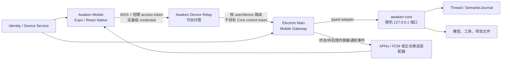

# 手机远程访问 · 实现方案

本文说明代码职责、数据与接口、异常恢复和验证方法。功能范围及用户操作见[需求文档](需求文档.md)。

**实现状态：尚未实现。下文是目标设计，不能作为当前能力或验收通过的依据。**

## 外部项目调研结论

### Cindy：本机执行，手机作为纯控制端

Cindy 的移动端是 Expo / React Native 原生应用，使用 Expo Router。手机不运行 Agent、不拥有桌面会话数据库或工作区；Desktop 是会话、文件、副作用和工具执行的权威。手机与 Desktop 登录同一账号，通过官方云端 `device-link` WebSocket relay 互联，而不是把 Desktop 本地端口直接开放给手机。

链路为：

```text
Mobile controller -> WSS relay -> Desktop device-link host -> 本机 Agent/文件/工具
```

关键实现：

- [`packages/device-link/README.md`](https://github.com/makecindy/cindy/blob/a034e93a84cc4321b518e578cbff28e59c8749bb/packages/device-link/README.md) 定义同账号设备发现、presence、`link-open`、`invoke`、`push` 和默认拒绝的远程 IPC allowlist；
- [`packages/device-link/src/client.ts`](https://github.com/makecindy/cindy/blob/a034e93a84cc4321b518e578cbff28e59c8749bb/packages/device-link/src/client.ts) 提供 hello、心跳、指数退避、请求配对、分片、ACK、重传和背压；这里的“可靠传输”不等同于所有业务 payload 另有端到端加密；
- [`apps/mobile/src/device-link/DeviceLinkContext.tsx`](https://github.com/makecindy/cindy/blob/a034e93a84cc4321b518e578cbff28e59c8749bb/apps/mobile/src/device-link/DeviceLinkContext.tsx) 在退后台时释放重量级 session 订阅并有界断开，回前台后立即重连、重新订阅和向 Desktop 拉权威快照；
- [`apps/mobile/docs/remote-control-plan.md`](https://github.com/makecindy/cindy/blob/a034e93a84cc4321b518e578cbff28e59c8749bb/apps/mobile/docs/remote-control-plan.md) 明确共享业务展示模型而不强行共享 Electron/RN UI 组件，手机首页对齐桌面会话列表，会话页保留消息流和输入区，复杂功能下沉到 sheet/独立页面；
- [`apps/mobile/src/notifications/pushNotifications.ts`](https://github.com/makecindy/cindy/blob/a034e93a84cc4321b518e578cbff28e59c8749bb/apps/mobile/src/notifications/pushNotifications.ts) 的移动推送当前以 iOS/APNs 为已接通路径，Android FCM/国内厂商通道后置。

Cindy 开源仓库包含 Desktop、Mobile 和共享协议包，但 README 明确说明官方后端另仓、不在该 monorepo。因此公开代码足以研究客户端和 device-link 合同，但不能单靠该仓库完整自建官方账号、relay 与推送服务。

### MonkeyCode：中央控制面与云端开发环境

MonkeyCode 的移动端同样是 Expo / React Native + Expo Router，但其权威不在用户 Desktop。手机直接连接 MonkeyCode 中央 Backend，任务实际在服务端开发环境/VM 执行：

```text
Mobile -> HTTPS/WSS Backend -> taskflow/control plane -> development host/VM -> Agent/仓库
```

移动端当前提供的主要能力：

- 登录与可配置 Backend base URL；
- 项目列表、项目详情、新建项目；
- 任务的进行中/已结束列表、新建、停止和删除；
- 任务历史轮次与实时消息流、继续对话、取消、回答 Agent 提问；
- 图片附件、语音转文字、模型切换、技能选择、上下文/token 展示、Agent 重启/重置；
- 云端工作区文件树、文本预览、diff、上传、下载；
- 转发端口和 WebView 预览；
- Git 身份、模型配置、账号与主题设置；
- 自建 Expo Updates OTA 示例和原生版本检查。

实现依据：

- [`mobile/src/api/stream.ts`](https://github.com/chaitin/MonkeyCode/blob/fcc5320b15a10dfec4d5891ce44d9d1470e10c2b/mobile/src/api/stream.ts) 通过任务 WebSocket 处理实时流、断线退避、序号去重、取消和 `ask_user` 回答；
- [`mobile/src/api/control.ts`](https://github.com/chaitin/MonkeyCode/blob/fcc5320b15a10dfec4d5891ce44d9d1470e10c2b/mobile/src/api/control.ts) 使用独立控制 WebSocket 完成模型切换、Agent 重启、端口和文件查询；
- [`mobile/app/task/[id].tsx`](https://github.com/chaitin/MonkeyCode/blob/fcc5320b15a10dfec4d5891ce44d9d1470e10c2b/mobile/app/task/%5Bid%5D.tsx) 组合任务历史、实时流、composer、附件、技能、模型、文件和预览；
- [`mobile/src/components/FilesPanel.tsx`](https://github.com/chaitin/MonkeyCode/blob/fcc5320b15a10dfec4d5891ce44d9d1470e10c2b/mobile/src/components/FilesPanel.tsx) 实现云端工作区浏览、diff、上传和下载；
- [`backend/biz/task/handler/v1/task.go`](https://github.com/chaitin/MonkeyCode/blob/fcc5320b15a10dfec4d5891ce44d9d1470e10c2b/backend/biz/task/handler/v1/task.go) 和 [`task_control.go`](https://github.com/chaitin/MonkeyCode/blob/fcc5320b15a10dfec4d5891ce44d9d1470e10c2b/backend/biz/task/handler/v1/task_control.go) 提供任务 REST、stream 与 control WebSocket；
- [`backend/docker-compose.yml`](https://github.com/chaitin/MonkeyCode/blob/fcc5320b15a10dfec4d5891ce44d9d1470e10c2b/backend/docker-compose.yml) 编排 PostgreSQL、Redis、ClickHouse、对象存储、ingress、frontend、backend、taskflow 和 preview。

#### MonkeyCode 是否有完整后端

结论必须区分“可部署产品栈”和“仓库内完整执行面源码”：

- **有开源且可自托管的业务控制面后端。** Go Backend、用户/团队/项目/任务/模型/文件业务、数据库 schema/migration、对象存储接线、HTTP/WebSocket handler、镜像构建文件和 Compose 均在仓库；移动端可以修改 base URL 连接私有部署。
- **有官方可部署栈的编排。** Compose 列出了控制面和执行所需服务，因此按官方镜像/安装器可以部署产品栈。
- **但当前仓库不是执行面源码的完整闭环。** `backend/pkg/taskflow` 是访问 taskflow 的客户端；Compose 中 `TASKFLOW_IMAGE` 和 `PREVIEW_IMAGE` 是外部镜像变量，仓库没有 taskflow server 源码；Runner 安装脚本还会从 `release.baizhi.cloud` 下载官方二进制。空的 `agent/` 目录也不能证明 Agent/Runner 实现已开源。
- 因此准确表述是：**MonkeyCode 提供完整的开源业务后端和可部署产品栈配置，但仓库不包含所有云端执行面实现源码；脱离官方 taskflow/runner/preview 产物，不能仅凭仓库源码复现完整任务执行链。**

另有两项不应照搬的安全实现：该移动端把登录密码和测试环境 Basic Auth 保存到 AsyncStorage；生产 Awaken 必须使用 Keychain/Keystore 类安全存储，并避免持久化账号密码。其 OTA 文档也把更新代码签名列为待办；Awaken 上线 OTA 前必须先完成签名和回滚，不能把无签名 OTA 当生产基线。

### 两种模式的取舍

| 维度 | Cindy | MonkeyCode | Awaken 采用 |
|---|---|---|---|
| 执行权威 | 用户 Desktop | 云端 VM/开发主机 | 用户 Desktop/Core |
| 手机角色 | 纯远程控制端 | 中央平台原生客户端 | 纯远程控制端 |
| 连接 | 同账号 relay 路由到 Desktop | 直连统一 Backend | Gateway + 可自托管 relay |
| 数据权威 | Desktop 会话与文件 | 服务端数据库与 VM | SemanticJournal、thread/project 与本机文件 |
| 断线恢复 | 重连后向 Desktop 重新取快照 | REST 历史 + WebSocket 重连 | transcript snapshot + cursor event resume |
| 文件能力 | 远程受控浏览/预览 | 云工作区浏览、上传、下载、diff | 首版只读 Artifact；项目文件浏览列为后续候选，写入后置 |
| 部署形态 | 官方后端未开源 | 可自托管控制面与官方执行产物 | relay、身份和推送必须可自托管 |

Awaken 不改成 MonkeyCode 的云端 VM 产品。把当前用户的工作区、模型凭据和工具执行迁到中央服务器会改变本地优先定位、Desktop 生命周期、TaskScope、凭据和 Computer Use 的权威，成本远大于移动端本身。MonkeyCode 值得吸收的是中央 API 的移动功能组织、任务/项目/文件/预览体验和私有部署入口；传输与权威模型采用 Cindy 路线。

## 目标架构



### Desktop Mobile Gateway

Gateway 位于 Electron Main，不进入 Renderer 或 Design System，也不改变 Core 监听地址。它负责：

- 向 relay 建立出站 WSS，避免入站端口、NAT 和公网暴露；
- 维护 Desktop device identity、远控开关、设备授权、presence 和受控状态；
- 验证来自 relay 的账号、设备、session、capability、request identity 和时效；
- 将 mobile capability 映射到 Main/Core 现有 typed 行为；
- 订阅 Core SSE，将允许的 AG-UI projection 转为移动 wire；
- 在重连时用 transcript/projector 和 cursor 恢复，不重放已经可能产生费用或副作用的请求；
- 对远程动作记录 actor、设备、request、thread/run 和结果。

Gateway 不能：

- 把 `runtime/core.json`、随机 loopback URL 或 Core control token 发送给 relay/手机；
- 把 relay 请求转成任意 `fetch(path)`；
- 复用 `/v1/control/*` 的高权限 token 作为移动设备凭据；
- 根据 Renderer state、文件展示名或手机提交的绝对路径作授权判断。

### Relay 与身份服务

Relay 只负责认证后的 presence、设备路由、有界转发和断线状态，不执行模型/工具，不读取 Awaken 本地凭据。服务端至少需要：

- user、device、device grant 与撤权；
- 短期 access token、refresh rotation、设备 credential 轮换；
- WSS 会话、心跳、重复连接处理、速率/帧大小/队列限制；
- request/response correlation、协议版本与 capability 协商；
- 最小化的通知路由；
- 审计元数据和明确的数据保留策略；
- 单机开发适配器及可自托管部署、备份、升级和回滚说明。

relay 默认不持久化 prompt、回答、工具参数、文件正文或 Artifact bytes。若为离线列表/通知保存摘要，字段、TTL、加密、删除和用户开关必须先形成独立数据契约；没有契约时一律不保存。

### 移动 wire 与恢复

移动协议复用 Awaken 的语义 identity，不直接复用 Core 本地 HTTP surface。至少包含：

- `hello / hello-ack / ping / pong / presence`；
- `capability-request / result / error`；
- `subscribe / unsubscribe / event`；
- `ack`、协议版本、frame/request 上限和错误码；
- `device_id`、`request_id`、`thread_id`、可选 `run_id`、actor 和幂等键。

事件源继续由 `src/protocol/agui` 的 canonical projection 定义。移动 adapter 只能删减/净化字段，不能重新解释 tool/run 终态。恢复顺序：

1. 重连并重新验证设备授权；
2. 拉 thread 列表和选中 thread 的 transcript snapshot；
3. 用最后确认的 `streamCursor` 订阅 active run；
4. reducer 按稳定 `recordId/streamCursor/toolCallId` 去重；
5. snapshot 与 cursor 不能证明连续时，以完整 snapshot 覆盖本地镜像，再订阅新事件。

手机不得自动重发 `start_run`、follow-up、cancel、interaction resolve 或文件写操作。请求超时只能显示“结果待确认”，随后向 Desktop 查询 request/run 权威结果。

## 远程 capability 基线

首版 capability 必须是默认拒绝、版本化的显式集合。建议分组：

```text
device.status
project.list
thread.list
thread.transcript.read
run.get
run.start
run.events.subscribe
run.cancel
run.user_question.answer
run.external_interaction.resolve_safe
subagent.list
subagent.get
subagent.cancel
artifact.list
artifact.preview_safe
artifact.download_safe
```

每项都要定义输入 schema、响应、超时、幂等性、重试规则、审计字段、数据上限、所需 Desktop 设置和可见用户提示。`run.start` 只能引用 Desktop 已返回的 opaque project/thread/profile preference；手机不能提交 workspace 绝对路径、provider URL、API key、工具列表或 permission profile。

以下 route/能力不得通过通配映射进入移动面：`/v1/control/*`、`/v1/shutdown`、MCP/connector/Skill 安装与认证、Hook trust/revoke、Memory 正文读写、Computer 设置与控制、项目删除/Trash 操作以及任何未来新增 route。新增 Core route 默认不进入移动 allowlist。

## 安全与隐私必须保持的规则

1. **默认关闭与显式授权**：Desktop “允许手机访问”默认关闭；首次设备绑定需要 Desktop 本地确认，单纯拥有同账号登录态不能自动获得本机控制权。
2. **设备级撤权**：授权绑定 user + Desktop device + mobile device + capability generation；任一端可撤权，撤权立即关闭活动链路并使 refresh credential 失效。
3. **凭据分层**：账号 token、设备 credential、relay session token、Core control token 四者不可复用。移动凭据只存 Keychain/Keystore，不保存账号密码、provider key 或 Desktop control token。
4. **最小能力**：relay/Gateway/Core 三层都校验 capability；只在 UI 隐藏按钮不构成授权。
5. **远程来源不可提升权限**：手机 prompt 与本地 prompt 在 Agent 能力上当前等价且可能触发 unrestricted Bash，因此 Desktop 必须常驻显示远程来源，并允许一键停止。若未来需要远程受限 profile，必须由 Core 权限域实现，不能由 Renderer/Gateway 伪造。
6. **危险 gate 回电脑**：涉及凭据、Hook trust、Computer takeover、不可恢复删除或未知副作用时，手机只显示“请回到电脑处理”，不得自动批准。
7. **路径不信任**：手机/relay 传入的路径、文件名、MIME、URL、project ID 和 artifact ID 都是不可信输入；Main/Core 重新解析 authority。
8. **内容最小化**：presence、push 和普通日志不得包含 prompt、回答、reasoning、命令、绝对路径、secret、文件正文或截图。
9. **传输与存储**：公网只允许 TLS/WSS；定义帧/消息/附件上限、速率限制和队列背压。服务端存储需要逐字段 TTL、加密和删除合同。
10. **审计**：每个远程 mutation 记录 actor device、request、thread/run、capability、decision、结果和时间，不记录 secret 或完整正文。
11. **供应链**：移动包、relay 镜像和 OTA 均需签名、SBOM、版本兼容、灰度与回滚；OTA 不能绕过原生权限/安全审查。

## 模块依赖

### 协议与威胁模型

- 建立移动功能域、数据分类、actor/设备模型和 capability registry；
- 完成 STRIDE/滥用案例：被盗手机、被盗 refresh token、恶意 relay、重复 mutation、Desktop 离线、版本错位、附件炸弹、路径逃逸；
- 产出可执行 wire fixture、错误码、幂等与恢复测试；
- 不开发正式 UI 前先通过安全评审。

### 本地开发闭环

- 开发用 relay、Desktop Gateway 和简单 controller harness；
- 打通 device presence、thread list、transcript、run events、start/cancel、ask_user；
- 保持 Core loopback，不做公网暴露；
- 用断网、重复帧、乱序、超时和 Core 重启测试权威恢复。

### 移动 V1

- Expo/React Native 原生 App；
- 设备、线程列表、线程详情、composer、附件、gate、Artifact 和通知；
- iOS 真机先行，同时保留 Android build/type/E2E 检查要求；
- Desktop Settings 接入远控开关、配对、撤权和被控提示。

### 生产与自托管

- 托管/自托管 Identity/Relay、TLS、可观测性、备份、升级和区域策略；
- APNs/FCM、商店发布、隐私/账号删除、签名 OTA 与强制最低版本；
- 双平台真机弱网、后台、升级和撤权验收。

### 扩展能力

- 只读项目文件、diff、定时任务、语音、更多 Artifact 预览；
- 每项仍走独立 capability、安全评审和真实 Desktop + 真机证据；
- Computer Use、远程 shell 和写文件不因阶段推进自动进入范围。

## 验收基线

自动化至少覆盖：

- 协议 schema/version、未知 capability fail closed、跨版本 fixture；
- user/device 隔离、来源防伪、撤权、token rotation 和过期；
- 重复/乱序/丢帧、帧上限、背压、断线重连和 cursor heal；
- mutation request 幂等与“结果待确认”，证明不会重复启动 run；
- Gateway allowlist 反向测试：所有非显式 capability 的 Core route 均不可达；
- transcript snapshot + cursor 的 exactly-once 展示；
- 附件/Artifact ownership、MIME/size/digest、路径与 symlink 攻击；
- 日志/presence/push 不泄漏正文、绝对路径、token 或 control credential；
- Desktop 退出、Core crash、relay outage、账号切换和设备撤权后的清理；
- iOS/Android 前后台、网络切换、低内存、推送深链和版本升级。

真实验收必须同时包含：

1. 按 README 正式入口启动真实 Awaken Desktop；
2. 真机通过生产等价 TLS relay 配对，不以 mock/Gallery/浏览器替代；
3. 在手机启动 run，在 Desktop 观察同一 thread/run 和远程来源提示；
4. 两端分别处理 follow-up、cancel、ask_user，确认状态一致；
5. 在输出中途断网、切后台、重启 App，确认 transcript/cursor 补齐且不重复 mutation；
6. 撤权后确认活动 socket、refresh credential、缓存和推送全部失效；
7. Desktop/Core 退出后手机明确显示离线，不声称任务仍在运行；
8. 检查服务端日志、数据库和 push payload 没有不允许保存的正文或凭据。

只有上述实现、自动化和真实双端证据齐全，才可把对应阶段从“目标设计”改为“当前支持”。

## 代码位置 与文档同步

目标 owner：

- `apps/mobile`：未来 React Native 原生壳、navigation、触控 UI、本地安全存储和移动生命周期；
- `apps/desktop/src/main`：Mobile Gateway、设备授权、被控提示和 Core typed adapter；
- `src/server` / `src/runtime`：只承接经评审的 typed 查询、幂等 request 结果和耐久 authority，不拥有公网 relay；
- `src/protocol/agui`：canonical 事件语义，移动 adapter 不反向定义；
- 新的独立 server package/repository：Identity/Relay/Push；不得塞进 Renderer 或 Design System；
- `Awaken Design System`：只有未来明确建立 RN-compatible primitives 时才共享视觉 token/展示模型；不得让 RN 依赖 Electron/DOM 组件。

实现时必须同步：

- README 当前产品形态和能力地图；
- 01 Desktop 设置、Workbench 远程来源提示和真实验收；
- 03 Core/Desktop 生命周期与 Gateway；
- 04 远程来源、TaskScope/Bash 风险和 capability；
- 09 移动 wire、字段、cursor 与 route 边界；
- 10 Computer Use 明确的移动端不支持项；
- 12 Desktop 离线时定时任务不运行的跨端展示。

## Awaken 目标产品的实现

1. Desktop/Core 继续拥有本机执行、thread/run、SemanticJournal、项目、文件和副作用事实；
2. 手机只保存登录/设备凭据、展示缓存、草稿、最近 cursor 和本机 UI 偏好，不成为业务 authority；
3. Desktop 完全退出或主机离线时，手机可以查看 relay/cache 明确允许保存的有界摘要，但不能新建或继续本机 run；定时任务也继续遵守“Desktop 完全退出后不运行”；
4. 手机端信息架构以线程列表、线程详情和 composer 为主，复杂能力进入 sheet 或独立页面；不复制三栏 Workbench；
5. 手机端每个动作必须映射到一个 typed mobile capability，不能代理任意 Core URL、HTTP route、Electron IPC、shell 命令或文件路径。

## 功能范围的实现

### V1 当前目标

| 面 | V1 能力 | 权威与限制 |
|---|---|---|
| 设备 | 登录、Desktop 列表、在线/远控关闭/忙碌、撤权 | Identity/relay + Desktop presence；远控默认关闭 |
| 首页 | 项目与 thread 列表、进行中/待处理/终态、下拉刷新 | Core thread/project metadata；不显示任意本机路径 |
| Thread | Prompt、最终回答、精简 Thought/Tool/Artifact、历史分页/重放 | transcript + AG-UI mobile projection |
| Composer | 新建独立对话、选择已有项目、follow-up、文本与图片附件 | 项目只能从 Desktop 返回的 opaque project ID 选择；附件先进入受控上传协议 |
| Run | 启动、停止、连接恢复、结果待确认 | request idempotency；超时不自动重试 |
| Gate | 回答 `ask_user`、处理明确列入 allowlist 的 ExternalActionGate | 通用审批仍不恢复；危险交互要求回电脑 |
| Subagent | 任务组摘要、只读详情、单任务取消 | 复用当前 root run/task identity；message route 当前仍不支持 |
| Artifact | 列表、图片/文本类安全预览、受控下载/分享 | opaque artifact identity；不接受绝对路径 |
| 通知 | run 终态、需要回答、连接/授权异常 | 脱敏；正文默认不进 push payload |
| 设置 | 账号、设备、通知、外观、诊断与退出 | 凭据存安全存储；不提供模型 key/MCP/Hook 管理 |

### 明确后置或不支持

- 手机运行本地 Awaken Core、模型或普通工具；
- 将 Core 改为 `0.0.0.0`、固定端口或公网服务；
- 任意远程 Bash、任意 Core route、任意 Electron IPC；
- 手机配置或导出模型 key、connector 凭据、MCP secret；
- Hook trust/revoke、Computer Use takeover/return、屏幕流和远程桌面；
- 项目/文件永久删除、Trash attest、Memory 正文编辑；
- 通用审批卡；
- 在 relay 保存完整 transcript、工具正文或本机文件镜像；
- 无签名 OTA；
- Desktop 退出后由云端替代本机继续执行。
