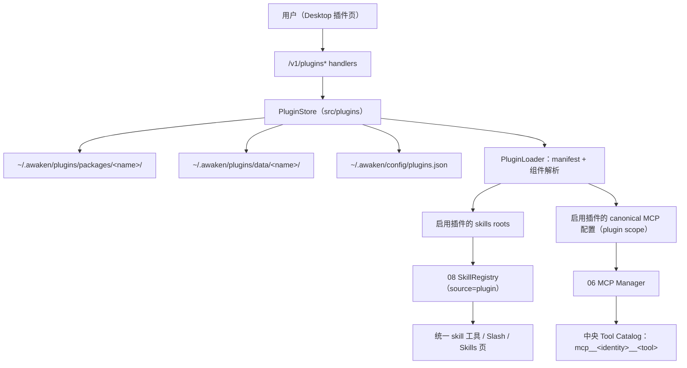

# 插件设计与实施方案

## 1. 文档状态

本文是 Awaken 插件（Agent Plugin）能力的目标设计与可执行实施方案。除 1.1 节列出的既有地基外，本文所有能力均为**已确认但尚未实现的设计约束**；在对应阶段落地并通过验收前，任何文档不得把它们写成当前支持。

### 1.1 当前支持（既有地基，均由原域拥有）

- Skill 来源枚举已含 `plugin`（优先级位于 user 之后、agents 之前），由 `AWAKEN_PLUGIN_SKILL_DIRS` 环境变量提供 source root；这只是目录发现占位，没有安装、启停或包语义（owner：[08 技能](../08_技能/技能包与加载契约.md)，`src/skills/discovery.go`、`src/skills/types.go`）。
- `skill_install` 已提供 content/local_path/remote_url/remote_git 受控来源、staging 解包、symlink/逃逸拒绝、原子替换与 Trash backup 的安装管线（owner：[08 安装与激活契约](../08_技能/安装与激活契约.md)，`src/skillruntime/install_tool.go`、`src/skills/install.go`）。
- MCP 配置已有 user/project/dynamic 三个 scope 的 `MergeScoped` 合并、canonical `servers.*.{stdio,http,sse}` 磁盘形态、`mcp__<server>__<tool>` 动态工具命名与管理面（owner：[06 MCP 运行时](../06_MCP运行时/配置、传输与生命周期.md)，`src/mcpclient/config.go`、`manager.go`）。
- `mcp__` 已是 Skill 名的保留前缀，本地包不能冒用动态命名空间（`src/skills/frontmatter.go` 的 `ValidateNameReserved`）。
- Desktop 扩展导航已有技能页与连接器页；连接器 CLI 安装已提供“固定来源下载 → SHA-256 校验 → 安全解包 → 原子激活”的受管安装先例（owner：[01 技能页产品与架构](../01_桌面工作台/扩展管理/技能页产品与架构.md)、[07 连接器](../07_连接器/产品与架构契约.md)）。
- Tool Catalog 的 `ToolSource` 枚举已包含 `SourcePlugin` 预留值（`src/tool/tool.go`）。

### 1.2 当前不支持

- 不存在插件包格式、`plugin.json` 解析、插件安装/卸载/升级、插件启停、插件存储目录或 `plugins.json` 状态文件；
- 不存在把一个包内的 Skills 与 MCP servers 作为整体接入/移除的机制；
- MCP 配置没有 `plugin` scope，`PLUGIN_ROOT`/`PLUGIN_DATA` 环境变量与占位符展开不存在；
- Desktop 没有插件管理页，`/v1/plugins*` route 不存在；
- Hook 契约明确不支持 Plugin 自动 Hook（[Hook 产品与架构契约](../04_工具权限与审批/Hook产品与架构契约.md) 3.2 节），本方案不改变该边界。

### 1.3 调研基线

- Awaken：分支 `main`，提交 `b901afaf`。
- Agent Plugins 标准：`https://agent-plugins.org/specification`，Spec Version **1.0.0**（Published）；manifest schema `https://agent-plugins.org/schemas/1.0.0/plugin.schema.json`；MCP schema `https://agent-plugins.org/schemas/1.0.0/mcp.schema.json`。
- Agent Skills 标准：`https://agentskills.io/specification`（Agent Plugins §7.1 引用其为 Skill 格式唯一权威）。
- Codex：`Agent_up` 仓库 `Codex/` 快照（上游 `openai/codex`），重点 `codex-rs/core-plugins`、`codex-rs/plugin`、`codex-rs/utils/plugins`。
- Claude Code：`Agent_up` 仓库 `Claude code/claudecode源代码/` 冻结快照，重点 `src/services/plugins`、`src/utils/plugins`。

## 2. 背景与目标

插件已形成厂商中立的全球标准：Agent Plugins 1.0.0 把「一个目录 = `plugin.json` manifest + `skills/` + `mcp.json` + 反向域名 extension 目录」定为可移植包格式，Skills 与 MCP servers 是 v1 仅有的两类可移植组件；分发、安装、启停、信任与 UI 明确留给各客户端自定义。Codex 已按该标准实现 loader，并以 marketplace/config 管理安装与启停。

Awaken 当前能分别安装 Skill（`skill_install`）与配置 MCP server（06 域管理面），但不能把「一个第三方插件」作为整体安装、启用、禁用、升级或卸载。生态里已经出现按标准打包的插件，Awaken 无法接纳。

本方案解决以下问题：

1. 用户能从本地目录/zip、HTTPS zip 或 HTTPS Git 仓库安装一个符合 Agent Plugins 1.0.0 的插件；
2. 插件内 Skills 进入现有 Universal Skill Catalog，可被 composer/Slash 与模型统一 `skill` 工具调用；
3. 插件内 MCP servers 进入现有 MCP Manager 与中央 Tool Catalog，工具按现有动态命名直通；
4. 插件可整体启停、升级、卸载；卸载走 Trash，不永久删除；数据目录跨升级保留；
5. 安装、加载与运行全程满足标准的路径 containment 与组件级失败隔离，安装阶段零代码执行；
6. Awaken 作为 conformant client 通过标准附录 A 的全部适用检查项。

### 2.1 首期验收场景

用户在 Desktop 扩展导航打开「插件」页，粘贴一个插件 Git URL（例如 `agentplugins/agent-plugins-example` 或自建示例插件：一个 skill + 一个 stdio MCP server）。安装完成后：技能页与插件详情出现该插件的 skill，composer 选择后正常激活并注入正文；插件的 MCP server 连接成功，模型可调用其工具，`PLUGIN_ROOT`/`PLUGIN_DATA` 在子进程环境中生效。用户随后禁用插件（下一 run 起 skill 与工具消失）、重新启用、最后卸载（包进入平台 Trash，Catalog 恢复原状）。

## 3. 非目标与边界（首期）

- 不自建插件市场、registry 或后端目录；不实现 Codex 的 curated 同步、remote bundle、npm 来源与 marketplace 策略层。marketplace 目录（`marketplace.json`）列为后续阶段。
- 不兼容 legacy manifest（`.codex-plugin/`、`.claude-plugin/`、`.cursor-plugin/` 下的 `plugin.json`）；首期只接受标准 root `plugin.json`。兼容层列为后续阶段。
- 组件只支持标准 v1 的 Skills 与 MCP servers。不支持 commands、agents、apps、LSP、output styles 等客户端私有组件类型；发现到未支持内容时按标准忽略。
- 不实现任何 extension namespace 行为。Awaken 保留 `io.awaken` 命名空间（与 MCP tool `_meta["io.awaken.tool/provider/v1"]` 的既有命名一致）供未来使用；首期对 `extensions` 字段与全部 extension 目录只做“忽略未实现命名空间”的标准动作。
- 不提供插件自动 Hook。插件内 Skill 的 frontmatter hooks 沿用 08/04 现有链路：仅 composer 显式激活后注册，模型调用与 fork 不注册。`io.awaken/hooks` 之类的 extension 目录首期一律忽略。
- 不新增模型可调用的 `plugin_install` 工具；首期安装入口只有 Desktop 插件页（用户显式动作）。
- 不支持 project scope 插件；首期只有 user scope（`~/.awaken/plugins`）。
- 不对插件的 MCP stdio 子进程宣称沙盒；其执行边界与现有 MCP server 完全一致（见 06 域当前缺口），插件不放大也不缩小该事实。
- 不因插件声明任何内容而扩大权限：`plugin.json`、`mcp.json`、SKILL.md frontmatter 都不是权限声明，这延续 08 域「Skill 声明不改变工具快照」的既有不变量。

## 4. 参考实现结论

### 4.1 Codex 可复用的设计

| Codex 设计 | 位置 | Awaken 采用方式 |
| --- | --- | --- |
| 标准 root `plugin.json` 按 `$schema` 选择本地校验规则，closed schema，未知顶层字段报告并忽略 | `codex-rs/core-plugins/src/agent_plugin_manifest.rs`、`utils/plugins/src/plugin_namespace.rs` | 原样采用标准语义；schema URI 白名单常量化，不在加载时联网取 schema |
| 标准包固定映射 `./skills` 与 `./mcp.json`，manifest 不允许改位置或内联组件 | 同上（`resolve_raw_plugin_manifest` 固定注入） | 原样采用 |
| manifest 路径必须 `./` 开头、禁 `..`、解析后必须留在 plugin root；manifest 文件拒绝 symlink | `manifest.rs` 的 `resolve_manifest_path`、`find_plugin_manifest_path` | 原样采用，并叠加 Awaken 既有 realpath/os.Root 校验模式 |
| 安装与运行分离：安装态 = 落盘目录 + 配置项 enabled；loader 每次会话从配置 + 磁盘重建 | `store.rs`、`loader.rs`、`config` crate `[plugins."name@market"]` | 采用“落盘 + 状态文件”模型，状态放 `plugins.json` 而不是 TOML |
| 插件 skill 以插件名命名空间化，避免跨插件同名互相吞没 | `ext/skills` 的 `ResolvedSkillNamespace::Plugin` | 采用命名空间化，但用 Awaken 既有 `xxx__a__b` 保留前缀风格（见 8.1） |
| 插件 MCP 与用户配置合并时用户同名优先 | `codex_mcp::catalog::ResolvedMcpCatalog` 优先级 Plugin < Config | 采用“plugin scope 优先级最低”的同语义（见 8.2） |
| 解包安全：拒 symlink/hardlink、防 zip-slip、总解压大小上限；npm `--ignore-scripts`；安装期零代码执行 | `plugin_bundle_archive.rs`、`npm_source.rs` | 原样采用（Awaken 首期无 npm，来源见 7 节） |
| Git 来源隔离：清 `GIT_*` 环境、防宿主 git 配置劫持 | `git_policy.rs` | 与 `skill_install` 的 `remote_git` 既有合同合并采用 |
| 组件级失败隔离：单 skill/单 server 失败不拖垮插件，`mcp.json` 顶层失败只停用该插件 MCP | loader 各层 | 原样采用（这是标准 §6.2/§7.2.2/§11.3 的硬性要求） |

### 4.2 不应照搬的部分

1. Codex 的 marketplace 体系（curated 同步、remote bundle、npm、share、政策 allowlist、`<plugin>@<marketplace>` 复合 ID）服务于其商业分发面。Awaken 首期没有分发后端，引入会制造无 owner 的半成品；首期插件 identity 就是标准 manifest `name`。
2. Codex 用 `config.toml` 表管理插件状态。Awaken 配置 canonical 形态是 `AWAKEN_HOME/config` 下的 JSON（如 `mcp-servers.json`、`hooks.json`），插件状态用同模式的 `plugins.json`，不引入第二种配置格式。
3. Codex 的 apps（`.app.json`）、commands 迁移、executor 白名单 hooks 是其 legacy 私有组件，标准 v1 明确不含这些类型；Awaken 不实现。
4. Codex/Claude Code 的 plugin hooks 自动注册与 Awaken 的 Hook 契约冲突（04 域明确 Plugin 自动 Hook 不支持、Skill Hook 只在 composer 显式激活后注册）。不照搬；未来若做必须先改 04 契约。
5. Claude Code 的 settings 声明式 marketplace reconcile（启动时后台 clone/更新）引入启动期网络副作用与隐式信任。Awaken 插件的安装与升级都必须是用户显式动作，启动时只读本地已装内容。
6. Codex 把插件配置权威放在 user 层单文件而无独立安装记录（安装态靠 cache 目录存在推断）。Awaken 需要显式安装记录（来源、版本、digest）支撑升级与 Desktop 展示，且 fail closed 语义要求状态文件损坏时不猜测。

## 5. 方案比较与结论

| 方案 | 优点 | 缺点 | 结论 |
| --- | --- | --- | --- |
| A. 拆包安装：把插件 skills 复制进 `~/.awaken/skills`，`mcp.json` 翻译后写进 user `mcp-servers.json` | 零新增运行时 | 插件 identity 消失：无法整体启停/升级/卸载；违反标准的包 containment 与 `PLUGIN_ROOT` 语义；污染用户自有配置的 ownership | 否决 |
| B. Desktop Main 拥有插件安装与注入（类似 CLI 连接器管线） | 复用现成下载/校验代码 | owner 错位：Skill 发现、MCP 配置合并、Tool Catalog 都在 Core；Main 拥有会迫使 Renderer/Main 反向写 Core 配置，违反“Renderer 不拥有后端策略”的项目硬边界 | 否决 |
| C. Core 新增 `src/plugins` 拥有包格式、存储与生命周期；以“提供 source root 给 08、提供 scope 配置给 06”的方式注入既有运行时；Desktop 只投影 | owner 正确；Skills/MCP 各自的既有安全边界、readiness、run snapshot 语义全部复用；未安装插件时零行为变化 | 需要 08/06 各开一个受控注入点 | **选定** |

选定方案的核心原则：插件层是**包管理与来源层**，不是第二套 Skill runtime 或第二套 MCP runtime。插件安装后，Skill 仍走 08 域统一 registry/catalog/激活链，MCP server 仍走 06 域 Manager/adapter/工具注册链；插件层只决定“哪些根目录、哪些 server 配置、以什么 identity、在启用时进入这两条既有链”。

## 6. 总体架构



责任边界：

- `src/plugins`（新包）：manifest/`mcp.json` 合规解析、安装来源、staging/原子落盘/Trash、`plugins.json` 状态、启停/升级/卸载、`PLUGIN_DATA` 生命周期、组件 root 与配置的对外提供。
- `src/skills`：接受 PluginStore 提供的 skills roots 作为既有 `plugin` 来源的 root 供给（替代 `AWAKEN_PLUGIN_SKILL_DIRS`），拥有发现、优先级、shadowed、预览与激活，不感知安装来源细节。
- `src/mcpclient`：接受 `plugin` scope 的 canonical server 配置参与 `MergeScoped`，拥有 transport、生命周期、认证与动态工具注册，不解析 `mcp.json` 原始格式。
- `src/server`：`/v1/plugins*` DTO 与装配。
- `apps/desktop`：扩展导航「插件」页、安装/详情/启停/卸载交互投影；不直接读写插件目录或状态文件。
- `Awaken Design System`：插件页 UI-only 组件（卡片、详情、安装弹窗），只收 props/callbacks。

## 7. 包格式合规与安装

### 7.1 标准合规目标（Agent Plugins 1.0.0）

Awaken 按标准实现 conformant client，关键裁决固定如下：

- **manifest**：只认 plugin root 的 `plugin.json`；必填 `$schema` + `name`。`$schema` 必须命中本地白名单（首期仅 1.0.0 canonical URI），不联网取 schema；不支持的版本拒绝整个插件。未知顶层字段与非 object 的 `extensions` 报告并忽略；其余 schema 违规为 fatal，拒绝插件且不发现任何组件。
- **name 约束**：1–64 字符、`a-z0-9.-`、首尾字母数字、禁 `--` 与 `..`。`name` 同时是 Awaken 的插件 identity 与安装目录名。
- **组件发现**：Skills 只发现 `skills/` 的直接子目录（含普通文件 `SKILL.md` 者），不递归；MCP 只读 root `mcp.json`。固定位置缺失不是错误；存在但文件系统类型不符时仅该组件类型 invalid，其余继续加载。
- **路径 containment**：包内一切被发现/读取/执行的路径，经 symlink 解析后必须仍在 plugin root 内；违规按标准最窄边界处理（拒插件 / 该组件类型 invalid / 跳过单 skill / 跳过单 server / 拒绝访问）。
- **mcp.json**：closed schema，顶层仅 `$schema` + `mcpServers`；`$schema` 版本必须与 `plugin.json` 一致，否则该插件 MCP 整体停用但不影响 Skills。server 条目为 stdio / streamable-http / sse 三种 closed 变体；未知 `type`、未知字段、跨变体字段都使该条目 invalid 并跳过。
- **stdio**：`command` 是单 token（bare 名走平台可执行搜索，`./` 相对路径解析到 plugin root 内且强制 containment），不做占位符展开；`cwd` 缺省为 plugin root，显式值只接受 `./`、`${PLUGIN_ROOT}`、`${PLUGIN_DATA}` 三种锚定形态并校验解析后 containment。
- **remote**：`url` 必须是无 userinfo/fragment 的绝对 HTTP(S)，非 loopback 必须 HTTPS；headers 是字面量，不做任何展开，同名不同大小写视为 invalid；Awaken 生成的协议/授权 header 优先于配置 header；重定向不跨 origin 转发配置 header。
- **占位符**：仅 `${PLUGIN_ROOT}`、`${PLUGIN_DATA}` 两个占位符，仅在 `args` 元素、`env` 值、`cwd` 中做单遍、非递归文本替换；`env` 键、`command`、`url`、headers 不展开；`env` 出现保留名条目即该 server invalid。
- **子进程环境**：启动 stdio server 前创建专属 `PLUGIN_DATA` 目录，先叠加配置 `env`，最后由宿主设置 `PLUGIN_ROOT`/`PLUGIN_DATA` 覆盖同名项；该目录跨升级保留，卸载时随包进入 Trash。
- **transport 支持**：Awaken 现有 stdio + Streamable HTTP + SSE 全部映射（超过标准“至少其一”的下限）；按条目声明的 transport 做首次连接，不做失败后的自动降级。

### 7.2 安装来源与管线

首期来源沿用 `skill_install` 已验证的合同形态：

| 来源 | 输入 | 约束 |
| --- | --- | --- |
| `local_path` | 本机目录或 zip | 目录整体复制；zip 走安全解包 |
| `remote_url` | HTTPS zip URL | 拒绝非 HTTPS 与 inline credential |
| `remote_git` | HTTPS Git URL + 可选安全 ref/subpath | 禁 credential helper、禁交互、禁 file/ssh/git/http protocol、最小环境（与 `skill_install` remote_git 及 Codex `git_policy` 同边界） |

安装管线（全程零包代码执行）：

1. 取源到 staging（`~/.awaken/plugins/.staging/<uuid>/`）；
2. 解包/复制校验：只接受普通文件与目录，拒绝 symlink/hardlink/特殊文件，拒绝 `..`、绝对路径与盘符逃逸；上限（设计值，实施时定稿）：下载 ≤ 100 MiB、解包 ≤ 500 MiB、≤ 10,000 个文件；
3. manifest 校验（7.1 的 fatal/non-fatal 规则），确定插件 `name`；`mcp.json` 与 skills 做静态合规检查并生成组件级诊断（诊断不阻断安装，fatal manifest 才阻断）；
4. 同名已装插件默认 `abort`；显式 `replace` 走 backup + 原子 swap，旧包移入平台 Trash，Trash 失败回滚并 fail closed（与 `skill_install` 同语义）；
5. 原子落盘到 `~/.awaken/plugins/packages/<name>/`，创建 `~/.awaken/plugins/data/<name>/`（replace 时保留既有 data）；
6. 以锁 + 临时文件 + fsync + 原子 rename 写 `plugins.json` 记录（与 `mcp-servers.json` 管理写入同模式），默认 `enabled: true`；
7. 触发 Skill registry reload 与 MCP Manager 配置重建；对已开始的 run 无影响（run 工具/技能快照固定的既有不变量）。

### 7.3 升级与卸载

- **升级**：按 `plugins.json` 记录的来源重取 → staging 校验 → 与已装 digest 比较，无变化则 no-op → 原子 swap（旧包 Trash）→ `data/<name>` 保留 → 状态记录更新 version/digest/时间。`local_path` 目录来源以“重新导入”语义执行同一管线。
- **卸载**：`packages/<name>` 与 `data/<name>` 均移入平台 Trash，成功后删除状态记录并 reload；Trash 不可用、包是 symlink/特殊文件或路径不在受控根内时 fail closed，不回退永久删除（与 08 域 Skill 删除同语义）。
- 卸载不抹除已完成 run 的历史事实（`skill_activated`、工具 Outcome 照旧可回放）；后续新 run 与目录刷新不再看到该插件。

## 8. 组件注入

### 8.1 Skills 注入

- PluginStore 把每个启用插件的 `<packages>/<name>/skills` 作为 source root 提供给 08 域既有 `plugin` 来源；root 指向 `skills/` 本身，因此“直接子包”的既有扫描语义天然等于标准的“直接子目录”发现规则。`AWAKEN_PLUGIN_SKILL_DIRS` 环境变量退役，root 供给唯一 owner 变为 PluginStore（实施时同步修改 08 技能包与加载契约的来源表）。
- **Catalog ID 命名空间**：plugin 来源条目的 ID 固定为 `plugin__<plugin-name>__<skill-name>`，展示名保留 skill 短名并标注所属插件。`plugin__` 成为第二个保留前缀，`ValidateNameReserved` 同步拒绝本地非插件包冒用（与既有 `mcp__` 保留完全同构）。这样两个插件携带同名 skill 时互不吞没，避免 08 现有 shadowed 机制把整个低序插件的能力静默盖掉；`<plugin-name>` 中的 `.` 在 ID 中规范化为 `-`，规范化后仍冲突的条目保留 shadowed 诊断。
- Skill 短名与目录名不一致、frontmatter 不满足 Agent Skills 规范时，按标准跳过该 skill 并保留 invalid 诊断，不影响同插件其他 skill 与 MCP。
- 优先级沿用现有 first-wins 序（managed > project > additional > user > **plugin** > agents > mcp > bundled > legacy）；由于 ID 已命名空间化，plugin 条目实际只会与显式冒用保留前缀的条目竞争，该类条目已被 reserved-name 校验拒绝。
- 激活、正文注入、`skill_resource_read`、composer 绑定、Hook 注册边界全部复用 08 现有契约，无新增语义。禁用/卸载插件后条目从 discovery 消失，等价于现有“包从磁盘删除”路径。
- Skills 页对 plugin 来源条目展示所属插件与版本；删除入口保持禁用（既有契约：非安装根来源禁用删除），生命周期动作只在插件页执行。

### 8.2 MCP 注入

- `PluginLoader` 在加载启用插件时把 `mcp.json` 的合法条目翻译为 Awaken canonical `servers.*.{stdio,http,sse}` 配置，进入新增的 `plugin` scope；`MergeScoped` 顺序变更为 **plugin → user → project → dynamic**（plugin 优先级最低，用户/项目显式同名配置总能覆盖，语义与 Codex 的 Plugin < Config 一致）。
- **Server identity**：`plugin__<plugin-name>__<server-name>`。工具随既有规则注册为 `mcp__plugin__<plugin>__<server>__<tool>`。选择前缀 identity 而不是 Codex 的裸名 + 优先级裁决，原因是 Awaken 的 credential store、readiness、`RestartWithConfig` 与动态 Skill bridge 都以 server 名为 key：两个插件同名 server 若共用裸名，会发生凭据与状态串写。展示层显示 server 短名 + 所属插件。
- 翻译时执行 7.1 的全部校验与占位符展开；`command` 的 `./` 形态在翻译时解析为绝对路径并复核 containment，bare 名保留给现有 stdio transport 的 PATH 解析。`PLUGIN_ROOT`/`PLUGIN_DATA` 由 stdio transport 在既有“显式 env 最后覆盖宿主派生环境”步骤之后注入，保证保留变量不可被配置覆盖。
- 连接生命周期、重连、认证、needs-auth readiness、list_changed、动态工具与 prompt/resource Skill bridge 全部复用 06 现有契约。插件 MCP server 的 prompt/resource 动态 Skill 沿用既有 `mcp__<server>__...` ID（server 即前缀 identity），不再叠加第二层命名。
- 插件页拥有其 server 条目的启停（写 `plugins.json` 的 per-server `enabled`，重建 Manager entry；disabled 条目保留管理可见、不建 transport，与 06 既有 `enabled:false` 语义一致）。连接器页「用户安装」列表排除 `plugin__` 前缀 server，不重复投影（与 connector 认领 server 的既有模式同构，实施时同步 07 契约）。
- 诚实边界：插件 MCP stdio 子进程与现有 MCP server 一样未接入 WorkspaceExecutionBroker/Seatbelt，可自行读写宿主文件与联网；插件页安装确认必须向用户呈现这一事实，且文档不得因“来自插件”而宣称额外沙盒。

### 8.3 Hook 与其他组件

- 插件不注册任何自动 Hook；`plugin.json.extensions` 与所有 extension 目录首期忽略（含 `io.awaken/`）。
- 插件内 Skill 的 frontmatter `hooks` 沿用现状：仅 composer 显式激活该 Skill 后注册到当前 run，包内相对路径 + realpath 锚定校验不变。
- 未来若实施插件级 Hook，必须先修改 04 Hook 契约（新增来源、信任模型与审查面），本方案不预支该能力。

## 9. 核心数据模型

### 9.1 目录布局

```text
~/.awaken/plugins/
├── packages/<name>/        # 插件包（PLUGIN_ROOT），安装副本
├── data/<name>/            # PLUGIN_DATA，跨升级保留，卸载随包 Trash
└── .staging/<uuid>/        # 安装/升级暂存，启动时清理孤儿

~/.awaken/config/plugins.json   # 安装记录与启停状态（0600/0700，locked atomic write）
```

### 9.2 `plugins.json`（version 1 目标形状）

```json
{
  "version": 1,
  "plugins": {
    "acme.tools": {
      "enabled": true,
      "version": "1.2.0",
      "source": {
        "kind": "remote_git",
        "url": "https://github.com/acme/tools-plugin.git",
        "ref": "v1.2.0",
        "subpath": ""
      },
      "installedAt": "2026-08-23T12:00:00Z",
      "digest": "sha256:…",
      "mcpServers": {
        "validator": { "enabled": true }
      }
    }
  }
}
```

- `digest` 是包文件表的 SHA-256（POSIX 相对路径排序后逐文件哈希，与 Desktop bundled `.manifest.json` 同法），用于升级 no-op 判断与漂移诊断；
- `mcpServers` 只保存 per-server 启停覆盖，不复制 transport 配置（transport 事实唯一来源是包内 `mcp.json`）；
- 未知 version、schema 违规、非 UTF-8 或超限一律 fail closed：插件层整体不加载并出结构化诊断，不猜测、不当空文件覆盖；
- 状态文件损坏不影响 Skills/MCP 的非插件来源与 Desktop 启动。

### 9.3 关键 Go 类型（目标）

```go
// src/plugins
type PluginManifest struct {
    Schema      string   // $schema，白名单校验
    Name        string   // identity，name 约束校验
    Version     string
    Description string
    Author      *PluginAuthor
    Homepage    string
    Repository  string
    License     string
    Keywords    []string
    // extensions 原样保留为 raw JSON，首期不解释
}

type InstalledPlugin struct {
    Name       string
    Root       string            // packages/<name> 绝对路径
    DataDir    string            // data/<name> 绝对路径
    Manifest   PluginManifest
    Enabled    bool
    Source     PluginSource       // local_path | remote_url | remote_git
    Digest     string
    SkillRoot  string             // <root>/skills，存在且为目录时有效
    McpServers []PluginMcpServer  // 翻译后的 canonical 配置 + 条目级诊断
    Diagnostics []PluginDiagnostic // 组件级失败隔离的可见结果
}

type PluginMcpServer struct {
    ShortName string
    Identity  string                     // plugin__<plugin>__<server>
    Config    mcpclient.McpServerConfig  // canonical stdio/http/sse
    Enabled   bool
    Invalid   *PluginDiagnostic          // 条目 invalid 时保留原因，不进入 merge
}
```

## 10. 配置与本地 API

新增 route（实施时同步 09 域 HTTP 契约的 route 清单）：

```text
GET    /v1/plugins                     # 列表 + 组件摘要 + 诊断
POST   /v1/plugins/install             # {source: {...}, replace?: bool}
GET    /v1/plugins/{name}              # 详情：manifest、skills、servers、readiness 投影
POST   /v1/plugins/{name}/enable
POST   /v1/plugins/{name}/disable
POST   /v1/plugins/{name}/upgrade
DELETE /v1/plugins/{name}
POST   /v1/plugins/{name}/servers/{short}/enable
POST   /v1/plugins/{name}/servers/{short}/disable
```

- Renderer → Main `requestRuntime` → Core loopback 的既有链路，Renderer 不读写插件目录与状态文件；
- 详情 DTO 中 server readiness 复用 06 Manager snapshot 投影（pending/connected/needs-auth/failed/disabled），skill 条目复用 08 Catalog DTO 与 `catalogEntryId` 预览链；
- 所有 mutation route 由 PluginStore 单 owner 执行 locked read-modify-write，与 MCP user config 管理写入同模式。

## 11. Desktop 产品设计

- 扩展导航新增「插件」页，与技能页、连接器页并列。
- 列表卡：插件名、版本、developer/description（来自 manifest metadata）、组件计数（N skills / M servers）、启停开关、诊断角标。
- 安装弹窗：本地目录/zip 与 URL（zip/git）两种输入模式；安装前确认页明确列出插件将带来的 skills 与 MCP servers 清单，以及“MCP 子进程以当前用户身份运行、不受沙盒约束”的固定风险说明（与 Hook 设置页风险说明同风格）。
- 详情页：manifest 元数据、skills 列表（可跳 `SKILL.md` 预览，复用既有预览 Dialog 链）、MCP servers 列表（短名 + readiness + 单 server 启停）、升级与卸载入口；卸载确认说明“移入回收站，数据目录一并移入”。
- 技能页：plugin 来源条目显示所属插件小字；连接器页「用户安装」不显示插件认领的 server。
- UI 组件进入 Design System（如 `AwakenPluginCard`、`AwakenPluginDetailDialog`、`AwakenPluginInstallDialog`），仅 props/callbacks，不读 runtime。

## 12. 错误分类与恢复

| 异常 | 行为 |
| --- | --- |
| `$schema` 缺失/不支持版本 | 拒绝安装/加载整个插件，报告 `plugin_unsupported_schema` |
| manifest fatal 违规（必填缺失、类型错、name 非法） | 拒绝插件，不发现组件，`plugin_manifest_invalid` |
| 未知顶层字段 / 非 object `extensions` | 报告并忽略，继续加载（标准 non-fatal） |
| `skills/` 存在但不是目录 | Skills 组件类型 invalid，MCP 继续 |
| 单个 skill 不合规/逃逸 | 跳过该 skill，保留诊断，其余继续 |
| `mcp.json` 顶层无效/版本与 manifest 不一致 | 该插件 MCP 整体停用，Skills 继续，`plugin_mcp_invalid` |
| 单个 server 条目无效/transport 不支持/containment 失败 | 跳过该条目，其余 server 与组件继续 |
| server 启动/连接/认证失败 | 按 06 既有 failed/needs-auth 状态处理，不影响其他组件 |
| 安装源不可达/校验失败/超限 | 安装失败，staging 清理，不落盘不写状态 |
| replace/卸载时 Trash 不可用 | 回滚并 fail closed，不永久删除 |
| `plugins.json` 损坏 | 插件层整体不加载 + 结构化诊断；不覆盖、不影响其他来源 |
| 升级后包 fatal invalid | 保留 backup 回滚到旧包，报告失败 |

## 13. 分阶段实施清单

### Phase 0：包格式与合规层

- `src/plugins/manifest.go`：`plugin.json` closed-schema 解析、`$schema` 白名单、name 约束、fatal/non-fatal 分层；
- `src/plugins/mcpjson.go`：`mcp.json` closed 变体解析、占位符展开、cwd/command containment、版本一致性；
- 以标准附录 A conformance checklist 为纲的 golden 测试（含官方示例 manifest/mcp.json 解析）。

### Phase 1：存储与安装生命周期

- `src/plugins/store.go`：目录布局、`plugins.json` locked atomic 读写、fail closed；
- `src/plugins/install.go`：local_path/remote_url/remote_git 三来源、staging 安全解包、digest、replace/Trash、孤儿 staging 清理；
- upgrade/uninstall 与 `PLUGIN_DATA` 生命周期。

### Phase 2：运行时注入

- 08：`plugin` 来源 root 供给切换到 PluginStore，`AWAKEN_PLUGIN_SKILL_DIRS` 退役；`plugin__` 保留前缀与 ID 组装；Skills 页归属展示；
- 06：`MergeScoped` 增加最低优先级 `plugin` scope；stdio transport 注入 `PLUGIN_ROOT`/`PLUGIN_DATA`（配置 env 之后、最终覆盖）；`RestartWithConfig` 接入插件启停；
- 07/Desktop：「用户安装」排除 `plugin__` 认领 server。

### Phase 3：管理面与 Desktop

- `src/server/handlers_plugins.go` 与 route 装配；
- Desktop 插件页、安装/详情/启停/卸载交互、Design System 组件与 Gallery；
- Main `requestRuntime` 转发面。

### Phase 4：验收与文档同步

- 2.1 首期验收场景在真实 Desktop 完成并留证；
- 文档同步清单（15 节）逐项落地；README 能力地图行从“当前不支持”改写为实际能力。

### 后续阶段（本方案确认方向、不承诺排期）

- legacy manifest 兼容（`.claude-plugin/` 等，仅投影 skills+MCP）；
- marketplace 目录（`marketplace.json` 解析与浏览）；
- project scope 插件；
- 模型可调用 `plugin_install` 工具（需先补安装信任门设计）；
- `io.awaken` extension namespace 行为；
- 插件级 Hook（前置条件：修改 04 Hook 契约）。

## 14. 测试矩阵

### 14.1 Go 单元测试

- manifest：最小/完整/fatal/non-fatal/name 约束/未知字段/`extensions` 非 object/`$schema` 版本矩阵；
- mcp.json：三 transport 变体、未知字段/类型、版本不一致、占位符展开（含不递归、不展开 `command`/`url`/headers/env 键）、cwd 三形态与 containment、`env` 保留名拒绝、header 大小写重复拒绝、非 loopback HTTP 拒绝；
- containment：symlink/hardlink/`..`/绝对路径/盘符逃逸在安装与加载两阶段的拒绝；
- store：locked atomic 写、损坏 fail closed、digest 稳定性、replace/Trash 回滚；
- 注入：`plugin__` 保留前缀拒绝冒用、skill ID 组装与规范化冲突诊断、MergeScoped 四 scope 顺序、user 显式同名覆盖 plugin。

### 14.2 集成测试

- 安装 → discovery → Catalog 出现 → composer/模型激活 → 卸载后消失；
- 安装 → MCP server 连接（stdio fixture）→ `PLUGIN_ROOT`/`PLUGIN_DATA` 在子进程环境断言 → 工具调用 → 禁用后 disabled 条目保留可见不建 transport；
- 组件级失败隔离：坏 skill + 好 server、坏 mcp.json + 好 skills 的双向验证；
- 升级保留 data 目录、digest no-op、升级失败回滚。

### 14.3 真实 Desktop 验收

按 2.1 场景在 macOS 真实 Desktop 全链路执行并留可追溯证据（隔离 `AWAKEN_HOME`）：安装（三种来源各至少一次）、技能调用、MCP 工具调用、启停、升级、卸载、重启 Desktop 后状态与 Catalog 一致、`plugins.json` 损坏注入后的 fail closed 展示。Gallery 与 mock 仅作辅助证据。

## 15. 文档同步清单（实施各阶段随代码更新）

| 文档 | 变更 |
| --- | --- |
| [08 技能包与加载契约](../08_技能/技能包与加载契约.md) | `plugin` 来源 root 供给改为 PluginStore、`AWAKEN_PLUGIN_SKILL_DIRS` 退役、`plugin__` 保留前缀、来源表与删除边界 |
| [06 配置、传输与生命周期](../06_MCP运行时/配置、传输与生命周期.md) | 新 `plugin` scope、合并顺序、identity 规则、`PLUGIN_ROOT`/`PLUGIN_DATA` 注入点 |
| [07 产品与架构契约](../07_连接器/产品与架构契约.md) | 「用户安装」排除插件认领 server |
| [09 HTTP 与 SSE 接口契约](../09_AGUI与A2UI协议/HTTP与SSE接口契约.md) | `/v1/plugins*` route 清单 |
| [01 扩展管理](../01_桌面工作台/扩展管理/技能页产品与架构.md) 同级新增插件页文档 | 插件页产品与架构 |
| 根 README | 能力地图第 14 行按真实进度改写 |
| 本文 | 每阶段完成后把对应内容从“目标设计”改写为“当前支持”，验收缺口如实保留 |

## 16. 风险与缓解

- **生态兼容风险**：现存第三方插件大量使用 Claude Code legacy 格式。缓解：首期严格标准化换取实现面最小，legacy 兼容列为明确后续阶段，不静默半兼容。
- **MCP 子进程无沙盒**：插件让“安装陌生人代码并运行”更易发生。缓解：安装确认页固定风险说明、安装期零代码执行、来源约束（HTTPS/无凭据）、包 containment 与 Trash 可恢复卸载；不在文档上伪称沙盒。
- **命名占用与仿冒**：无中心 registry，`name` 无全局唯一性。缓解：同名安装默认 abort、详情页展示来源 URL 与 digest、identity 前缀隔离凭据与状态。
- **scope 蔓延**：marketplace、legacy、hooks 都有明确诱惑。缓解：3 节非目标 + 13 节后续阶段把边界写死，越界必须先改本文。
- **回滚**：插件层未安装任何插件时零行为变化；整体回滚 = 停用 route 装配与两处注入点，08/06 恢复原 root/scope 供给，不影响既有用户数据。

## 17. 完成定义

同时满足以下条件才能宣称插件功能完成并改写能力地图：

- Phase 0–3 代码与测试全部落地，14.1/14.2 在工作区实际通过；
- 2.1 场景在真实 Desktop 完成并留下可追溯证据；
- 标准附录 A conformance checklist 逐项核对通过（含失败隔离与占位符规则）；
- 15 节文档同步清单全部落地，无断链、无旧 env 变量残留引用；
- 安装/卸载/升级不越权触碰用户既有 `~/.awaken/skills`、`mcp-servers.json`、`hooks.json`；
- 已明确报告尚存缺口（如 Windows/Linux 实机矩阵）而不是混写成已完成。

## 18. 参考资料

- Agent Plugins Specification 1.0.0：`https://agent-plugins.org/specification`（schemas：`/schemas/1.0.0/plugin.schema.json`、`/schemas/1.0.0/mcp.schema.json`；示例仓库 `github.com/agentplugins/agent-plugins-example`）。
- Agent Skills Specification：`https://agentskills.io/specification`。
- Codex 快照：`Agent_up/Codex/codex-rs/{core-plugins,plugin,utils/plugins,config}`（manifest 合规、store/loader、marketplace、安全边界）。
- Claude Code 快照：`Agent_up/Claude code/claudecode源代码/src/{services,utils}/plugins`（marketplace reconcile 与插件加载，作为“不照搬”依据）。
- Awaken 既有权威：[08 技能](../08_技能/索引.md)、[06 MCP 运行时](../06_MCP运行时/索引.md)、[07 连接器](../07_连接器/索引.md)、[04 工具、权限与安全执行](../04_工具权限与审批/索引.md)、[01 桌面工作台](../01_桌面工作台/索引.md)、[09 AG-UI 与 A2UI 协议](../09_AGUI与A2UI协议/索引.md)。
