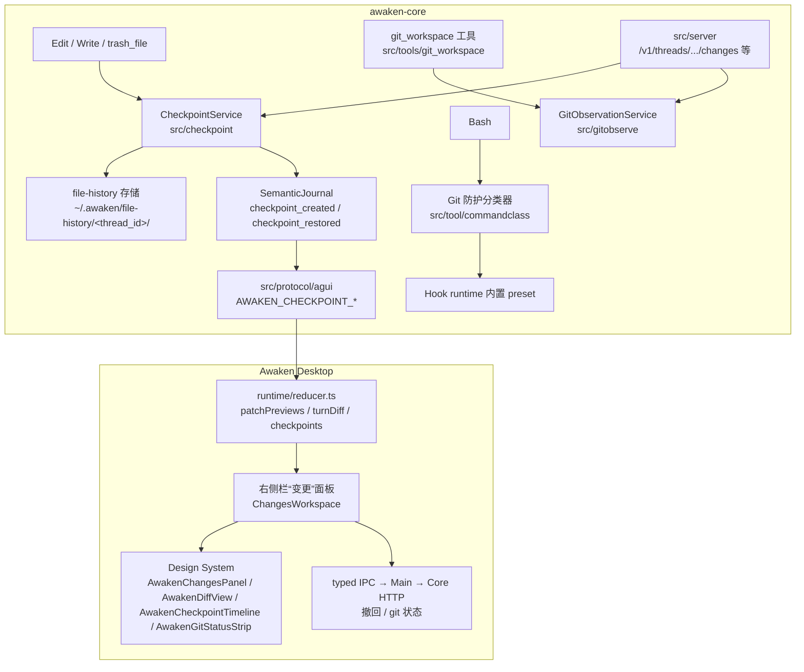

# 编码场景能力设计与实施方案

## 1. 文档状态

本文属于 AGENTS.md 事实三层中的**已确认但尚未实现的设计约束**。除 §5 现状底座中标注“当前支持”的条目外，本文所有能力在当前代码与真实 Desktop 中都不存在，不得被其他文档引用为当前能力。

- 权威范围：编码工作台功能域的目标产品行为、工具合同、数据模型、事件流、右侧栏“变更”面板、Git 防护与环境契约，以及分阶段实施与验收要求。
- 引用现状事实时以对应功能域权威为准：工具见 [04 工具、权限与安全执行](../04_工具权限与审批/索引.md)，右侧栏见 [01 右侧栏当前支持边界](../01_桌面工作台/右侧栏/当前支持边界.md)，事件见 [03 SemanticJournal 与重放](../03_运行时与本地服务/SemanticJournal与重放.md) 与 [09 事件与字段契约](../09_AGUI与A2UI协议/事件与字段契约.md)。
- 实施过程中若某 Phase 落地，必须把对应事实迁入相应功能域权威文档并同步验收，本文相应章节改写为已实现事实的指针，不保留第二份独立描述。

## 2. 背景与目标

Awaken 当前定位是通用本地桌面智能体，编码场景只有“能跑”的水平：模型能用 `Read`/`Edit`/`Write`/`Glob`/`Grep`/`Bash` 改代码，但产品层没有变更可视化、没有撤回、没有 Git 状态、没有环境契约。对照 OpenAI Codex 与 Anthropic Claude Code 两个成熟编码智能体（对标事实来自 `NolanGrant556/Agent_up` 仓库的 `Codex/` 与 `Claude code/claudecode源代码/` 快照，见 §4 与 §20），差距集中在四块：

1. **变更可观察**：Codex 有 `TurnDiffTracker` + `turn/diff/updated` 协议把每个 turn 的净变更推给 GUI；Claude Code 有 IDE `openDiff` RPC。Awaken 的 `turn_diff`/`file_change` journal kind、`AWAKEN_TURN_DIFF`/`AWAKEN_PATCH_UPDATED` wire 事件和 Desktop reducer 的 `patchPreviews`/`turnDiff` 数据都已存在，但右侧栏没有任何消费面。
2. **变更可撤回**：Claude Code 用 `~/.claude/file-history/<sessionId>/` 文件快照 + `/rewind` 提供代码级回滚；Codex 曾尝试 ghost commit 方案后已整体移除（feature `GhostCommit` 标记 `Stage::Removed`），其 `thread/rollback` 只截断对话不还原文件。Awaken 没有任何撤回机制，`trash_file` 只覆盖显式删除。
3. **Git 产品化**：两个对标产品都以 shell git 为变更执行面，再各自补结构化观察（Codex `git-utils` crate、Claude Code `/commit`、`/commit-push-pr` prompt + `Bash(git ...:*)` 权限规则）。Awaken 只有 typed `git_remote`（HTTPS 只读/浅克隆）与 Subagent `git_worktree` 服务，没有状态、diff、分支的产品呈现，也没有敏感 Git 命令防护。
4. **环境契约**：Codex 有 `config.toml` 的 `shell_environment_policy`、项目信任与 AGENTS.md 层级；Claude Code 有 settings.json 层级与 sandbox 配置。Awaken 只有 run 期只读的 `ExecutionEnvironmentSnapshot` 与 typed `dependency_install`，项目没有可声明的构建/测试/防护契约。

上述差距在一次真实编码会话中得到验证（2026-08-25，本机 thread「添慧ERP插件开发」：模型用 23 次 `Write`、10 次 `Edit`、18 次 `Bash` 从零实现并安装了一个 Go MCP Server Plugin）。该链路暴露了两个必须纳入本方案的额外事实：

- **当前 `turn_diff` 依赖 git**：`collectWorkspaceDiff`（`src/agentcore/runner.go`）直接调用 `git diff`，该会话的工作区不是 git 仓库，33 条 `file_change` 对应 0 条 `turn_diff`；且发射点只在 turn/run 边界，`aborted_streaming` 取消会丢失整段 diff。若不重建 diff 来源，“变更”面板在非 git 项目上线即空白。
- **模型高频用 `Bash` 做文本替换**：同一会话出现 2 次 `perl -pi -e 's///'` 批量替换与 heredoc 写盘；`perl` 改盘直接导致下一次 `Edit` 报 `The file changed after Read`，多耗 2 次调用恢复，且这些变更全部落在 checkpoint 盲区。

**目标**：分阶段把 Awaken 的编码场景能力提升到与 Codex、Claude Code 同等水平，具体判据为 §19 完成定义中的能力对照表全绿。首期交付判据（Phase 1–3）：

- 任意 run 中经 `Edit`/`Write`/`trash_file` 发生的文件变更，在右侧栏“变更”面板可按 turn 与文件两级查看行级 diff；
- 用户可在“变更”面板对单文件或整个 turn 执行撤回，撤回本身可再撤回（redo）；
- Git 项目在“变更”面板看到分支、ahead/behind、dirty 计数，模型可通过 typed 只读 `git_workspace` 工具获得同一结构化事实；
- 破坏历史类 Git 命令默认被内置防护拦截，用户可显式放行。

## 3. 非目标与边界

- **不做 IDE**：不提供多光标编辑器、LSP、断点调试、终端面板。右侧栏代码文件继续只读预览（CodeMirror 6），代码编辑的执行者是 Agent，不是用户手工在 Inspector 改代码。
- **不引入 `apply_patch`**：编辑原语维持 `Edit`（精确替换 + `replace_all`）与 `Write`（整文件），与 Claude Code 同构。Codex 的 freeform Lark 语法 patch 依赖特定模型的 freeform tool 训练，Awaken 是多 provider 产品，不具备该前提。[04 工具定义与暴露](../04_工具权限与审批/工具定义与暴露.md) 中“注册快照不得出现 `apply_patch`”的约束保持不变。
- **不做 OS 沙箱**：Codex 的 Seatbelt/bubblewrap/Windows token 沙箱是独立的大型安全工程，不在本方案范围。`Bash` 维持 [Bash 本机执行面](../04_工具权限与审批/Bash本机执行面.md) 的当前登录用户直执行合同；本方案的防护是命令级拦截（Hook 层），不冒充 OS 隔离。
- **不新建通用审批 UI**：Awaken 零审批契约保持。敏感 Git 命令防护通过既有 Hook runtime 的内置 preset 实现 block + 改道 `ask_user`，不新增 `awaiting_approval` run 状态或逐工具审批面板。
- **不自动 merge**：Subagent `git_worktree` 的“host 不自动合并”不变量保持；“变更”面板对 worktree 只做审阅呈现，整合仍由主 Agent 显式执行。
- **撤回不覆盖 Bash 写盘**：与 Claude Code 完全相同的边界——checkpoint 只跟踪 typed mutation 工具（`Edit`/`Write`/`trash_file`）以及被 §8.2 文本编辑拦截改道 typed `Edit` 的 Bash 单文件替换；其余 `Bash` 写盘、外部编辑器、Git 命令造成的文件变化不进 checkpoint，UI 必须明示（§8.4）。
- **不做云端执行、CI、PR 评论集成**：`gh`/`glab` 等由模型经 `Bash` 使用用户自己的环境与凭据，与两个对标产品一致。

## 4. 参考实现结论

### 4.1 采纳的设计

| 来源 | 设计 | 采纳理由 |
| --- | --- | --- |
| Claude Code | 文件快照式 checkpoint（`utils/fileHistory.ts`：`~/.claude/file-history/<sessionId>/<sha256(path)16>@v<N>`，上限 100 快照，snapshot 同时写 transcript） | 实现简单、与 git 解耦（非 git 项目同样可撤回）、不污染用户仓库；Codex 移除 ghost commit 是同一结论的反向证据 |
| Claude Code | checkpoint 触发点：用户消息提交时建 snapshot，mutation 工具写盘前把文件登记进最近 snapshot | 与 Awaken “journal-before-transport” 的耐久顺序天然契合 |
| Claude Code | `/rewind` 三选一：仅对话 / 仅代码 / 两者 | Awaken 首期只做“仅代码”（对话回滚牵动 thread 契约，见 §17 风险） |
| Claude Code | 敏感命令识别进入权限判定（injection 检测 → ask，git safety 写入 prompt + `Bash(git commit:*)` 窄放行） | Awaken 已有命令分类器（服务摘要/监督），本方案将其扩展为 Git 防护分类并接入内置 Hook preset |
| Codex | `TurnDiffTracker`（`core/src/turn_diff_tracker.rs`）：`baseline_by_path` 内存基线自算 unified diff，**不依赖 git 仓库**；且在每次 apply_patch 后由 `emit_patch_end`（`core/src/tools/events.rs`）**增量发射** `TurnDiff` 事件，turn 被中断也不丢失已发射的 diff | Awaken 现有 `turn_diff` 依赖 `git diff` 且只在边界发射（§2 真实会话已证明其在非 git 项目失效），本方案按 Codex 模式重建 diff 引擎：以 checkpoint 文件基线为主来源、每次 mutation 后增量发射（§9.1、§9.2） |
| Claude Code | `sedEditParser.ts` + `BashTool` 内部字段 `_simulatedSedEdit`（不进模型 schema）：把 `sed` 单文件替换解析为模拟 Edit，走权限预览与 fileHistory 跟踪 | 映射为 Awaken 的 Bash 文本编辑拦截（§8.2）：`sed -i`/`perl -pi -e 's///'` 单文件替换改道 typed `Edit` 路径，消除真实会话中出现的 stale-read 失败与 checkpoint 盲区 |
| Claude Code | `microCompact.ts`：只清除 Read/Bash/Grep/Glob/Edit/Write 等旧工具结果（替换为占位文本），与 full compact 分层 | 编码 run 工具结果churn 远高于普通任务（真实会话 70 次模型请求）；作为 02 域配套需求提出（§13），本域不实现 |
| Claude Code / Codex | `ToolSearch`（乐观启用）/ `tool_search` + MCP resource 工具按需挂载 | 真实会话每请求固定携带约 24k tokens 工具 schema（内建 15.4k + MCP 8.4k）；作为 06 域候选提出（§13），不阻塞本域主线 |
| Codex | `git-utils` 的结构化只读观察（branch/remote/merge-base/recent commits）与 worktree 信任根解析 | 映射为 Awaken typed `git_workspace` 工具 + Desktop Git 状态条共用的 Core GitObservationService |
| Codex | `shell_environment_policy`（inherit core/all/none、默认剔除 `*KEY*`/`*SECRET*`/`*TOKEN*`、exclude/set/include_only） | 映射为项目编码环境契约 `.awaken/coding.json` 的 `env` 段（§12） |
| Codex | review 结构化产物（findings：title/body/confidence/priority 0–3/code_location；overall_correctness） | 映射为 Subagent `review` 角色的可选结构化 findings 输出（Phase 5） |
| 两者 | Git 变更执行走 shell（模型直接跑 `git add/commit/checkout`），不做 typed git mutation 工具 | 保持 `Bash` 合同不变，避免为每个 git 子命令发明第二套 schema |

### 4.2 明确不照搬的设计

| 来源 | 设计 | 不照搬理由 |
| --- | --- | --- |
| Codex | freeform `apply_patch` + Lark grammar + fuzzy seek | 见 §3；多 provider 下不可依赖 freeform 工具训练 |
| Codex | Seatbelt/bubblewrap OS 沙箱与 approval policy 两轴 | 超出范围；Awaken 用 Hook 防护 + 零审批契约 |
| Codex | 会话化 `exec_command`/`write_stdin` PTY 工具替代 read/list | Awaken 的 typed `Read`/`Glob`/`Grep` 快照与并发保护是既有优势，不回退 |
| Codex | ghost commit / `/undo`（已被上游移除） | 上游已验证失败的路线，不复活 |
| Claude Code | `bypassPermissions`/`acceptEdits` 等五档权限 mode 与 `Tool(pattern:*)` 规则语法 | Awaken 是零审批模型，没有 ask 常态；防护收敛为“Git 防护”一个开关族，不引入整套规则语言 |
| Claude Code | IDE MCP RPC `openDiff` | Awaken Desktop 自有 Inspector，diff 在产品内呈现，不依赖外部 IDE |
| Claude Code | checkpoint 备份写 transcript | Awaken 的 SemanticJournal 只记 identity 与摘要（§9.1），内容留在 file-history 目录，避免 journal 膨胀 |

## 5. 现状底座（当前支持，作为设计输入）

以下为当前代码已存在、本方案直接复用的事实，权威在括号内文档：

1. 七个模型基础工具 `Bash`/`Read`/`Edit`/`Write`/`Glob`/`Grep`/`WebSearch`；`Edit` 要求先 `Read` 且宿主快照未变化、默认唯一匹配；`Edit`/`Write` 成功后产出结构化 hunks 与 SHA-256/size/mtime 快照（[Typed 文件工具与可恢复删除](../04_工具权限与审批/Typed文件工具与可恢复删除.md)，`src/tools/edit`、`src/tools/write`）。
2. `Bash` 以当前登录用户直执行，thread 级 cwd，前台 120s/600s 超时，50,000 bytes 输出截断，`run_in_background` 后台任务（[Bash 本机执行面](../04_工具权限与审批/Bash本机执行面.md)，`src/tools/bash`）。
3. `trash_file` 平台回收站合同与 broker 覆盖前 Trash（[Typed 文件工具与可恢复删除](../04_工具权限与审批/Typed文件工具与可恢复删除.md)，`src/tools/trash_file`、`src/tool/trash`）。
4. `git_remote`：HTTPS-only `ls_remote`/`clone`，Git executable attestation 与 destination-only staging（[工具定义与暴露](../04_工具权限与审批/工具定义与暴露.md) §git_remote，`src/tools/git_remote`）。
5. Subagent `git_worktree`：host-owned worktree 创建（`awaken/subagent-<shortId>` 分支）、`WorktreeReceipt`（path/branch/base_commit/head_commit/dirty/needs_review/changed_paths）、dirty 保留不自动 merge（[02 原生 Subagent 产品与架构契约](../02_主智能体闭环/原生Subagent产品与架构契约.md)，`src/subagentruntime/worktree/worktree.go`）。
6. SemanticJournal 稳定 kind 已含 `file_change`、`turn_diff`（`src/agentcore/semantic_record.go`），turn 结束在 `src/agentcore/runner.go` 持久化 `turn_diff`；AG-UI 已有 `AWAKEN_PATCH_UPDATED`、`AWAKEN_TURN_DIFF`（`src/protocol/agui/events.go`）；Desktop reducer 已持有 `patchPreviews: PatchPreviewRecord[]` 与 `turnDiff?: TurnDiffRecord`（`apps/desktop/src/renderer/runtime/reducer.ts`），右侧未接线（[右侧栏当前支持边界](../01_桌面工作台/右侧栏/当前支持边界.md) §5）。
7. Hook runtime：`PreToolUse` 可在 executor 前 `block`/`add_context`/`updatedInput`，user/project/local 三 scope，run 固定快照（[Hook 产品与架构契约](../04_工具权限与审批/Hook产品与架构契约.md)，`src/hookruntime`）。
8. 右侧栏文件工作区：`ProjectFilesWorkspace` + `FilePreviewHost`，代码只读 CodeMirror 6（`@codemirror/state`/`view`/`language` 已在 `apps/desktop/package.json`），Markdown 可编辑保存；交付物中的文档、图片和视频统一通过右侧“文件”工作区的临时 Artifact 标签承载，入口和边界以 [右侧栏当前支持边界](../01_桌面工作台/右侧栏/当前支持边界.md) 为准。
9. `dependency_install`：仅消费 host 生成的 `plan_id`，broker staging 执行固定包管理器（[工具定义与暴露](../04_工具权限与审批/工具定义与暴露.md)）。
10. Core HTTP 面：`/v1/threads/{thread_id}/...`、`/v1/runs/{run_id}/...`、`/v1/projects/{project_id}/...` 命名风格（`src/server/router.go`）。

## 6. 总体架构



模块 ownership（新增部分）：

| 模块 | 层 | 职责 |
| --- | --- | --- |
| `src/checkpoint` | Core | checkpoint 建立、文件登记、restore、GC；file-history 目录唯一 owner |
| `src/gitobserve` | Core | 只读 git 观察（status/diff/log/branch/blame），供 `git_workspace` 工具与 HTTP 面共用；复用 `git_remote` 的 executable attestation |
| `src/tools/git_workspace` | Core | 模型侧 typed 只读工具，薄封装 `src/gitobserve` |
| `src/tool/commandclass`（扩展） | Core | Git 敏感命令分类；分类结果供内置 Hook preset 与活动摘要消费 |
| `src/hookruntime` 内置 preset | Core | “Git 防护”preset 的注册与默认启用 |
| `src/server` 新 handler | Core | changes/restore/git-status HTTP 面 |
| `src/protocol/agui` | Core | `AWAKEN_CHECKPOINT_CREATED`/`AWAKEN_CHECKPOINT_RESTORED` 映射与 `AWAKEN_TURN_DIFF` 字段扩展 |
| `apps/desktop/src/main/coding-bridge.ts`（新） | Electron Main | 撤回与 git 状态的 typed IPC 代理；Renderer 输入不作授权事实 |
| `apps/desktop/src/renderer/ChangesWorkspace.tsx`（新） | Renderer | “变更”面板产品编排、reducer 数据消费、确认对话 |
| `Awaken Design System` 新组件 | DS | UI-only diff/时间线/状态条组件，只收 props/callbacks |

依赖方向不变量：`src/agentcore` 依旧不依赖 `src/protocol/agui`；`src/checkpoint`、`src/gitobserve` 不依赖 Desktop；Design System 不读取 runtime。

## 7. Checkpoint 与撤回设计

### 7.1 存储布局

```text
~/.awaken/file-history/
  <thread_id>/
    manifest.jsonl          # 每行一个 CheckpointRecord 或 FileVersionRecord，append-only
    blobs/
      <sha256(abs_path) 前 16 位>@v<N>   # 文件内容原样字节
```

- 目录属于 Core 唯一 owner，不进入任何 TaskScope root，模型工具与 Renderer 不能直接读写；`Glob`/`Grep` 的 roots 不包含它。
- blob 按“路径哈希 + 递增版本号”命名（Claude Code 同构）；同一 checkpoint 内同一文件只登记一次（copy-on-first-write）。
- 上限：每 thread 最多 100 个 checkpoint（超出淘汰最旧且级联删除其独占 blob）；单文件超过 10 MiB 或探测为二进制时不复制内容，登记 `unsnapshotted=true` 并记录原因，撤回时该文件跳过并在 receipt 中明示。
- thread 删除时随 thread 数据一并清理；Core 启动时对孤儿目录做惰性 GC。

### 7.2 数据模型

```jsonc
// CheckpointRecord（manifest.jsonl 行类型一）
{
  "type": "checkpoint",
  "checkpoint_id": "cp_<ulid>",
  "thread_id": "…",
  "run_id": "…",              // 建立该 checkpoint 的 run
  "user_message_id": "…",     // 触发的用户消息 identity
  "created_at": "RFC3339",
  "label": "用户消息前快照"     // 产品文案，非 identity
}

// FileVersionRecord（行类型二）
{
  "type": "file_version",
  "checkpoint_id": "cp_…",
  "abs_path": "/…",           // 建立时的绝对路径
  "existed": true,             // false = 该文件在 checkpoint 时不存在（撤回时应删除）
  "blob": "a1b2c3d4e5f60718@v3",  // existed=false 或 unsnapshotted 时为空
  "sha256": "…", "size": 1234, "mode": "0644",
  "unsnapshotted": false, "reason": ""   // too_large | binary_undecodable
}
```

### 7.3 建立时机（与既有耐久顺序的关系）

1. **turn checkpoint**：`StartRun` 处理用户消息时，在首个模型请求前由 CheckpointService 建立空 checkpoint 并写 journal `checkpoint_created`；失败不阻塞 run，但 run 内后续 mutation 的登记降级为“无 checkpoint 可用”，撤回入口对该 turn 灰显并注明原因。
2. **文件登记**：`Edit`/`Write`/`trash_file` 的 executor 在既有“`tool_call` + decision 耐久之后、写盘之前”的窗口调用 `TrackFile(checkpoint_id, abs_path)`。登记失败按工具失败合同 fail closed（不写盘），保证“已写盘的 typed 变更必然可撤回（除 `unsnapshotted` 明示外）”这一不变量。
3. `Write` 创建新文件时登记 `existed=false`；`trash_file` 登记删除前内容。
4. `Bash` 本身不登记（§3 边界），但被 §8.2 拦截改道 typed `Edit` 的单文件替换按 `Edit` 正常登记；Subagent child 在 worktree 模式写自己的 worktree，不进入父 thread 的 checkpoint；`shared` 可写 child 的 typed mutation 与父共用同一 thread file-history。

### 7.4 撤回（restore）语义

- 入口：右侧栏“变更”面板（§10），两级粒度：
  - **文件级**：把单个文件还原到指定 checkpoint 的登记版本；
  - **turn 级**：还原该 checkpoint 登记的全部文件。
- 执行前，CheckpointService 先把每个目标文件的**当前内容**作为新版本登记进一个系统生成的 `restore checkpoint`（label “撤回前状态”），因此撤回本身可再次撤回（redo 由同一机制自然获得，不做独立 redo 栈）。
- 还原动作：`existed=true` → 原子写回 blob 内容（同目录临时文件 + fsync + rename，复用 `src/tools/internal/filemutation`）；`existed=false` → 当前文件经 `src/tool/trash` 平台合同进回收站，不直接 unlink。
- 运行中的 run 不允许撤回（按钮灰显，避免与 executor 并发写）；撤回成功后写 journal `checkpoint_restored` + per-file receipt，并使相关文件的 thread 读快照失效（下次 `Edit` 前必须重新 `Read`）。
- 撤回不改写对话历史、不产生新的 run，不回滚 journal；它是一次用户拥有的、可审计的文件系统操作。

## 8. 模型工具合同

### 8.1 `git_workspace`（新增，typed 只读）

- 注册名 `git_workspace`，内建辅助工具（同 `git_remote` 类别），只在当前 `WorkspaceRoot` 或其祖先能解析出 git 仓库时进入 run 快照；非 git 项目不暴露。
- 复用 `git_remote` 的 Git executable attestation（同一 `ExecutionEnvironmentSnapshot` 绝对路径 + SHA-256 复核）；子进程 `GIT_EXEC_PATH` 与 PATH 净化规则同 `git_remote`；一律 `--no-pager`，禁用 hooks（`-c core.hooksPath=` 指向空目录）与外部 diff/textconv 驱动，杜绝仓库内配置借只读观察执行代码。
- 无网络、无写入：broker 声明零可写根，任何 workspace delta 拒绝。

输入（strict schema，`action` 判别）：

```text
action      status | diff | log | show | branch | blame
path        可选；diff/blame/log 限定单文件（workspace-relative）
staged      可选 bool；diff 时 true=--cached
base        可选；diff 的比较基（commit-ish 或分支名，经 rev-parse 校验后以 SHA 传参）
max_lines   可选；diff/show 输出上限，默认 4000 行，硬上限 20000 行
count       可选；log/branch 条数，默认 20，上限 200
revision    show/blame 的 commit-ish
```

输出（结构化，按 action `oneOf`）：

- `status`：`branch`、`upstream`、`ahead`/`behind`、`staged[]`/`unstaged[]`/`untracked[]`（相对路径 + change kind）、`conflicted[]`、`repo_root`、`head_sha`、`detached`；
- `diff`：unified diff 文本 + `truncated` + 每文件 `additions`/`deletions` 汇总；
- `log`：`[{sha, subject, author, date, ref_names}]`；
- `branch`：本地/远端分支列表 + 当前分支；
- `show`/`blame`：有界文本 + `truncated`。

失败码：`not_a_repository`、`needs_runtime`（无可信 git）、`revision_not_found`、`output_truncated`（部分成功标记）、`git_failed`（带 stderr 摘要）。

### 8.2 既有工具的合同变化

- `Edit`/`Write`/`trash_file`：新增 §7.3 的 checkpoint 登记步骤；对模型可见的输入输出 schema **不变**，登记失败映射为既有结构化失败。
- `Bash`：schema 不变；新增 Git 防护分类（§9.3）作用于 PreToolUse 阶段，对模型表现为 Hook block 反馈文本。
- **Bash 文本编辑拦截**（对标 Claude Code `sedEditParser.ts` + `_simulatedSedEdit`）：`Bash` executor 在真实执行前解析命令，识别**单文件、无管道、无重定向**的 `sed -i 's///'` 与 `perl -pi -e 's///'` 替换；解析成功时不启动 shell，改为在宿主内按同等正则语义执行 typed `Edit` 等价变换——建立/复用文件快照、产出结构化 hunks 与 `file_change`、完成 checkpoint 登记，工具结果对模型仍以 Bash 结果形状返回并标注 `intercepted_as_edit=true`。解析失败、多文件、含管道/重定向/子命令的情况一律按原 raw Bash 合同执行（fail open，不新增失败模式）；拦截产生的变更进入“变更”面板与撤回范围。该拦截同时消除“Bash 改盘导致后续 `Edit` stale-read 失败”的整类摩擦（§2 真实会话证据）。
- `git_remote`：不变。
- 模型侧**不提供** revert/checkpoint 工具：撤回是用户拥有的动作，模型需要回滚时应显式用 `Bash` git 或重新编辑，避免模型静默抹掉用户手工改动。

### 8.3 run 快照与暴露

- `git_workspace` 进入 `RunToolAvailabilitySnapshot` 的条件：项目主文件夹（或当前锚定 WorkspaceRoot）向上解析到 `.git`（含 worktree `gitdir` 文件），且环境快照有可信 git。
- 只读 Subagent（explore/plan/review）暴露 `git_workspace`（只读符合角色约束）；`general` child 同父。
- Hook agent 执行器（只读）不暴露。

### 8.4 模型上下文提示

run system context 注入一段固定说明（与 AGENTS.md 快照同机制）：checkpoint 只覆盖 `Edit`/`Write`/`trash_file`；`Bash` 写盘不可被产品撤回；Git 项目中重要节点应建议用户 commit 或由模型显式 commit。该文案属于本域 owner，不复制进 04 文档正文。

## 9. 事件、Journal 与协议

### 9.1 SemanticJournal 新增 kind

| kind | 载荷要点 | 时机 |
| --- | --- | --- |
| `checkpoint_created` | `checkpoint_id`、`run_id`、`user_message_id`、`label`、`origin`（`turn` \| `restore`） | §7.3 建立成功后 |
| `checkpoint_restored` | `checkpoint_id`、`scope`（`file` \| `turn`）、`files[]`（path、result：`restored`/`deleted_to_trash`/`skipped_unsnapshotted`/`failed`）、`restore_checkpoint_id` | 撤回执行完成后 |

- 内容 blob 不进 journal，只记 identity 与结果，重放时按 identity 呈现回执。
- 既有 `file_change`、`turn_diff` kind 不改名；`turn_diff` 载荷扩展 per-file `additions`/`deletions`/`change_kind` 汇总（向后兼容：旧记录无该字段按空处理）。
- **turn diff 引擎去 git 化**（对标 Codex `TurnDiffTracker` 的 `baseline_by_path` 内存基线）：`turn_diff` 的计算来源从 `collectWorkspaceDiff` 的 `git diff` 改为 **checkpoint 文件基线 vs 当前内容**——`Edit`/`Write`/`trash_file` 与 §8.2 拦截编辑在登记时已持有旧内容，Core 据此自算 unified diff，非 git 工作区同样产出完整 turn diff（§2 真实会话中 33 条 `file_change` 对应 0 条 `turn_diff` 的缺陷由此修复）。git 项目中可另经 `git_workspace` 观察补充 Bash/外部写盘造成的变更，但 `turn_diff` 本身不再依赖 git 存在。

### 9.2 AG-UI wire 新增事件

| 事件 | 字段 | 消费 |
| --- | --- | --- |
| `AWAKEN_CHECKPOINT_CREATED` | checkpointId、runId、label、origin | reducer `checkpoints[]` |
| `AWAKEN_CHECKPOINT_RESTORED` | checkpointId、scope、files[]、restoreCheckpointId | reducer + 中间叙事紧凑回执（同 Memory 回执样式，不进 ExecutionFeed 详情） |

`AWAKEN_TURN_DIFF`、`AWAKEN_PATCH_UPDATED` 复用并按 §9.1 扩展字段。live 与 replay 共用同一 projector（`src/protocol/agui/semantic_projector.go`），重放后“变更”面板必须与 live 一致。

**发射时机改为增量**（对标 Codex `emit_patch_end`：每次 apply_patch 后即刻更新 tracker 并发 `TurnDiff`）：`AWAKEN_TURN_DIFF` 不再只在 turn/run 边界发射，而是在每次进入 checkpoint 的 mutation（含 §8.2 拦截编辑）完成后按当前累计净 diff 增量发射，同一 turn 内后发覆盖先发；run 被取消（`aborted_streaming` 等）时最后一次已发射的 diff 与已持久化的 `turn_diff` 记录保持可用，不因终态非 finished 而丢失（§2 真实会话的取消场景由此修复）。持久化频率不变（turn 内最多按 mutation 节流为每次一条，重放取每 turn 最后一条投影）。

### 9.3 Git 防护事件

Git 防护是 Hook 事实，复用既有 `hook_invocation_*` journal 与 `AWAKEN_HOOK_*` wire，不新增事件族。内置 preset 识别分类（`src/tool/commandclass` 扩展）：

| 分类 | 命令特征（解析 argv，不做子串猜测） | 默认动作 |
| --- | --- | --- |
| `git_history_destructive` | `push --force`/`--force-with-lease` 到受保护分支、`reset --hard`、`clean -fd`、`branch -D`、`checkout -- .`/`restore` 全量丢弃、`commit --amend`（非用户显式要求）、`rebase`（交互/改写已推送历史） | block，反馈要求改用安全替代或经 `ask_user` 获得用户明确同意后重试 |
| `git_remote_mutation` | `push`（非 force、非保护分支） | 放行，写活动摘要 |
| `git_local_mutation` | `add`/`commit`/`checkout -b`/`stash`/`merge`/普通 `checkout` | 放行 |
| `git_read` | `status`/`diff`/`log`/`show`/`blame` | 放行（活动摘要归类只读） |

受保护分支默认 `main`/`master` + 项目 `.awaken/coding.json` 的 `protected_branches`（§12）。preset 属于 user scope 内置项，Settings“编码”分区可整体停用；项目可在 `coding.json` 收紧或放宽。分类器只服务防护与摘要，不改变 `Bash` 的授权模型（分类失败时放行并按未分类记摘要，fail open——防护是辅助而非安全边界，安全边界仍是 §3 声明的用户 OS 权限）。

### 9.4 HTTP 面（`src/server`）

| Method + Route | 语义 |
| --- | --- |
| `GET /v1/threads/{thread_id}/changes` | checkpoint 列表 + 每 checkpoint 的 file entries + 关联 run/turn diff identity；分页 `after_cursor` |
| `GET /v1/threads/{thread_id}/changes/{checkpoint_id}/files/{file_index}/diff` | 单文件 blob 与当前磁盘内容的有界 unified diff（Core 计算，Renderer 不读磁盘） |
| `POST /v1/threads/{thread_id}/changes/{checkpoint_id}/restore` | body `{scope: "turn"} \| {scope: "file", path}`；run 运行中返回 409 `run_active` |
| `GET /v1/projects/{project_id}/git/status` | GitObservationService 的 status 结构（§8.1），带 `observed_at`；查询失败返回 typed 错误不缓存 |

Desktop 侧一律 Renderer → typed preload bridge → Main → Core；Main 复验 thread/project 归属，Renderer 输入不作授权事实。

## 10. 右侧栏“变更”面板

### 10.1 入口与信息架构

Inspector 入口顺序改为：

```text
文件
浏览器
变更 4        ← 新增；badge = 当前 thread 可撤回的已变更文件数
子任务 3
媒体
```

“变更”入口在当前 thread 存在至少一个 checkpoint 或 turn diff 时出现；空 thread 不出现。点击进入变更工作区（复用文件工作区的扩展/收起、宽度与折叠规则，不新建第二套布局状态机）。

面板自上而下：

1. **Git 状态条**（仅 git 项目）：当前分支、ahead/behind、staged/unstaged/untracked 计数、head 短 SHA；数据来自 §9.4 status 接口，进入面板时拉取 + 每次 run 终态后刷新，不做常驻轮询。存在 Subagent worktree receipt 时追加一行“子任务分支 awaken/subagent-…（待审阅）”，点击展开该分支相对 base 的 diff（经 status 接口的 worktree 扩展查询）。
2. **turn 时间线**：按 run 倒序列出 checkpoint 节点：用户消息摘要、时间、变更文件数、+n/−m 行汇总；节点展开显示文件列表（路径、change kind、行数徽标、`unsnapshotted` 警示）。+n/−m 与文件列表来自 §9.1 去 git 化后的 checkpoint 基线 turn diff，**非 git 项目功能完整**；Git 状态条缺席不影响时间线与 diff 视图。
3. **diff 视图**：选中文件后右侧（或扩展态主区）显示行级 diff，unified/side-by-side 可切换，语法高亮沿用现有 CodeMirror 语言包。

### 10.2 撤回交互

- 文件行悬停出现“撤回此更改”；时间线节点提供“撤回到此处”（还原该 checkpoint 全部登记文件）。
- 点击后模态确认：列出将被改写/删除的文件、`unsnapshotted` 跳过项，以及固定提示“Bash 或外部程序造成的修改不在撤回范围”。
- run 运行中所有撤回按钮灰显（tooltip 说明）；确认后经 typed IPC 执行，成功 toast + 中间叙事紧凑回执；失败展示 per-file receipt，不静默部分成功。
- 撤回后时间线追加“撤回前状态”系统节点，用户可再次撤回实现 redo。

### 10.3 组件与 ownership

| 组件 | 层 | 说明 |
| --- | --- | --- |
| `AwakenChangesPanel` | Design System | 面板骨架、时间线列表、文件行；只收 props/callbacks |
| `AwakenDiffView` | Design System | 基于 `@codemirror/merge`（新增 DS 依赖）的只读 diff 渲染，unified/side-by-side、大 diff 折叠（>4000 行折叠 hunk） |
| `AwakenCheckpointTimeline` | Design System | 时间线节点与展开态 |
| `AwakenGitStatusStrip` | Design System | 状态条 UI |
| `ChangesWorkspace.tsx` | Desktop Renderer | 编排、reducer 消费、确认对话、IPC 调用 |
| `coding-bridge.ts` | Desktop Main | IPC 代理与复验 |

### 10.4 与既有右侧栏契约的关系

- 本面板落地即撤销 [右侧栏当前支持边界](../01_桌面工作台/右侧栏/当前支持边界.md) 中“patch/turn diff 面板不支持”的条目，并把 §5“已有但未接线的数据”中 `patchPreviews`/`turnDiff` 改为已接线——实施时同步改写该文档（§18 文档同步清单）。
- 继续遵守其硬边界：变更详情不进 `ExecutionFeed`；新 Inspector 只消费 reducer identity（`checkpoints[]`、`turnDiff`、`patchPreviews`），不从 DOM/文本重新解析；diff 内容由 Core 计算下发，Renderer 不自行读磁盘；面板交互不改变 run streaming/replay state。
- “Changes 不得把 preview 等同已执行 diff”不变量保持：`patchPreviews`（预览）与 checkpoint diff（已执行）在 UI 分区呈现，不混排。

## 11. 状态机

### 11.1 Checkpoint 生命周期

```text
(建立) pending → active                     # journal checkpoint_created 后
active → superseded                          # 更新的 checkpoint 建立后仍可撤回，仅 UI 排序变化
active/superseded → evicted                  # 超过 100 上限 GC；UI 移除节点
active/superseded --restore--> (产生新 restore checkpoint，自身状态不变)
```

### 11.2 撤回操作

```text
idle → confirming → executing → succeeded | partial | failed
executing 中 Core 持 thread 级互斥；同 thread 并发 restore 返回 409。
partial：至少一个文件 failed/skipped；receipt 必须逐文件呈现。
```

### 11.3 Git 状态观察

无持久状态机：每次查询即时执行，失败返回 typed 错误；“变更”面板显示最后成功 `observed_at`，超过 60s 的数据标记为“可能过期”，用户可手动刷新。

## 12. 项目编码环境契约 `.awaken/coding.json`

位置：项目主文件夹 `<folder>/.awaken/coding.json`（与 `hooks.json` 同级，project scope；同样支持 `coding.local.json` 本地覆盖，合并规则同 Hook 的 project/local 关系）。

```jsonc
{
  "version": 1,
  "commands": {                     // 全部为固定 argv 数组，禁止 shell 字符串
    "setup":  [["npm", "install"]],
    "build":  [["npm", "run", "build"]],
    "test":   [["go", "test", "./..."]],
    "lint":   [["npm", "run", "lint"]]
  },
  "env": {                          // 借 Codex shell_environment_policy 语义
    "inherit": "all",               // core | all | none
    "exclude": ["*_TOKEN", "AWS_*"],// glob；默认在 inherit 基础上追加 *KEY*/*SECRET*/*TOKEN* 剔除
    "set": {"NODE_ENV": "development"},
    "include_only": []              // 非空时为白名单
  },
  "git": {
    "protected_branches": ["main", "release/*"],
    "guard": "default"              // default | strict | off；off 需用户在 Desktop 明示确认
  }
}
```

- **消费方式**：run 开始时 Core 读取并做 schema 校验，摘要（commands 列表 + guard 等级）作为运行快照注入 system context（同 AGENTS.md 快照机制，untrusted 场景暂不适用——Awaken 无项目信任分级，见 §17 风险）；`env` 段作用于该项目全部 `Bash` 与后台任务的子进程环境（在既有 login 快照之上做过滤/注入）。
- **commands 不是 typed runner**：模型仍经 `Bash` 执行这些命令，契约只解决“模型不知道该跑什么”的问题（对标 Codex AGENTS.md 惯例 + Claude Code CLAUDE.md 惯例的结构化版本）。
- **创建入口**：右侧栏文件列表在 git 项目缺少该文件时提供受控创建入口（沿用 AGENTS.md 创建入口模式）；Desktop 不提供表单编辑器，直接以 JSON 文本编辑（复用项目 Markdown 编辑管线扩展到该固定路径的 JSON，Main 校验 schema 后写回）。
- **Settings“编码”分区**（Desktop 全局默认）：Git 防护总开关与默认等级、checkpoint 保留策略（数量上限/单文件上限展示，首期只读展示不可调）、“变更”面板 diff 行数上限。分区按 [左侧栏/Settings 既有模式](../01_桌面工作台/索引.md) 新增 `coding` section。

## 13. 与既有域的边界

- **04 工具域**：`git_workspace` 归入内建辅助工具清单；`Edit`/`Write`/`trash_file` 合同追加 checkpoint 登记事实；Bash 文档追加 Git 防护分类说明（分类不授权）与 §8.2 文本编辑拦截合同。
- **02 主智能体闭环**：Subagent worktree receipt 进入“变更”面板呈现，不改变其“不自动 merge”不变量；checkpoint 与 child 的关系按 §7.3 第 4 条。另外两项本方案观察到、归属 02 域的配套修正（本域只提出需求，契约与实施由 02 域拥有）：
  - **`update_plan` 跨 run 恢复**：§2 真实会话中，中断后恢复 run 的首次 `update_plan` 报 `plan_version_conflict: first update of a run requires base_version 0, got 3`，模型需重试才通过。对标 Codex `update_plan`（无版本、整体覆盖），建议新 run 首次更新接受“继承上一 run 计划终版”或放宽 base_version 校验；
  - **编码 run 的工具结果微压缩**：对标 Claude Code `microCompact.ts`（只清 Read/Bash/Grep/Glob/Edit/Write 旧结果、替换为占位文本），在既有 full auto-compact 之外为高churn 编码 run 增加 tool-result 级微压缩。
- **06 MCP runtime**：候选优化（不阻塞本域主线）——MCP 工具 schema 延迟暴露或按需检索（对标 Claude Code `ToolSearch` 与 Codex `tool_search`/MCP resource 工具按需挂载），压缩 §2 真实会话观察到的每请求约 8k tokens MCP schema 常量开销。
- **03 运行时**：file-history 目录、journal 新 kind、GC 与 thread 删除清理进入该域权威。
- **01 桌面工作台**：右侧栏文档新增“变更”入口事实；中间叙事只有紧凑回执。
- **09 协议**：新事件与 HTTP route 进入接口契约。
- **08/14 技能与插件**：不变；Skill/Plugin 经 Bash 的写盘同样不进 checkpoint。

## 14. 分阶段实施清单

### Phase 0：Design System 组件（无产品状态）

1. DS 新增 `@codemirror/merge` 依赖与 `AwakenDiffView`（unified/side-by-side、行级高亮、大 diff 折叠、暗色 token 适配）；
2. `AwakenChangesPanel`、`AwakenCheckpointTimeline`、`AwakenGitStatusStrip` 骨架与 states 文件；
3. Gallery 覆盖空态/小 diff/4000+ 行折叠/unsnapshotted 警示/受保护分支徽标。

### Phase 1：Core checkpoint 与事件

1. `src/checkpoint`：manifest/blob 存储、建立/登记/restore/GC、thread 删除清理；
2. `Edit`/`Write`/`trash_file` executor 接入登记（fail closed）；
3. journal `checkpoint_created`/`checkpoint_restored` 与 AG-UI `AWAKEN_CHECKPOINT_*` 映射、replay 一致性；
4. **turn diff 引擎去 git 化 + 增量发射（本 Phase 硬要求，不得延后）**：`turn_diff` 计算源切换为 checkpoint 文件基线（§9.1），`AWAKEN_TURN_DIFF` 改为每次 mutation 后增量发射且取消不丢失（§9.2），并扩展 per-file 汇总载荷；非 git 工作区与取消 run 两个场景必须有自动化覆盖；
5. Bash 文本编辑拦截（§8.2）：`sed -i`/`perl -pi` 单文件替换改道 typed `Edit` 路径，解析失败 fail open 回 raw Bash；
6. HTTP：changes 列表、单文件 diff、restore（含 `run_active` 409 与 thread 互斥）。

### Phase 2：右侧栏“变更”面板

1. reducer 新增 `checkpoints[]` 与 restore receipt 状态；接线既有 `patchPreviews`/`turnDiff`；
2. `ChangesWorkspace.tsx` + `coding-bridge.ts` + preload typed IPC；
3. 入口 badge、时间线、diff 视图、文件级/turn 级撤回与确认对话、紧凑叙事回执；
4. 同步改写右侧栏“当前支持边界”文档与其测试。

### Phase 3：Git 观察与防护

1. `src/gitobserve` + `git_workspace` 工具（attestation、hooks 禁用、有界输出、非 git 项目不暴露）；
2. Git 状态条 + worktree receipt 审阅视图；
3. `commandclass` Git 分类 + 内置“Git 防护”Hook preset + Settings“编码”分区开关；
4. 04 域文档同步。

### Phase 4：环境契约

1. `.awaken/coding.json` schema、加载、local 覆盖、run 快照注入；
2. `env` 策略作用于 Bash 子进程环境；
3. 右侧栏创建入口 + Main 校验写回；
4. `protected_branches` 接入防护分类。

### Phase 5：审查增强（可选，视前四期验收后排期）

1. Subagent `review` 角色可选结构化 findings 输出（title/body/confidence/priority 0–3/code_location/overall_correctness，对标 Codex `ReviewOutputEvent`）；
2. “变更”面板对 findings 的锚点跳转（file+line → diff 定位）。

每个 Phase 独立可交付、可回滚；后一 Phase 不得以“前一 Phase 已写文档”替代其真实验收。

## 15. 测试矩阵

### 15.1 Go 单元/集成

- `src/checkpoint`：建立/登记/restore/redo 链、`existed=false` 删除走 Trash、unsnapshotted（>10 MiB、二进制）、100 上限 GC、thread 删除清理、并发 restore 互斥、manifest 损坏行跳过恢复；
- `Edit`/`Write`/`trash_file`：登记失败 fail closed、schema 不变回归；
- turn diff 引擎：非 git 工作区产出完整 `turn_diff`、增量发射覆盖/节流、取消 run 保留最后一条、与 git 工作区结果对齐的一致性用例；
- Bash 文本编辑拦截：`sed -i`/`perl -pi` 单文件替换的解析矩阵（BSD/GNU sed `-i` 变体、正则分隔符、flags）、多文件/管道/重定向/子命令一律回退 raw Bash、拦截结果的 hunks/`file_change`/checkpoint 登记与 `intercepted_as_edit` 标记、拦截后不再出现 stale-read 连锁失败；
- `src/gitobserve` + `git_workspace`：真实临时 git fixture 的 status/diff/log/branch/blame、worktree 仓库、非 git 项目不暴露、hooks/textconv 禁用生效、输出截断、`revision_not_found`；
- `commandclass`：Git 分类矩阵（argv 解析而非子串，含 `git -C`、alias 逃逸、`push origin +main` 强推变体）；
- Hook preset：block 反馈、`ask_user` 放行重试路径、preset 停用；
- server handler：changes 分页、restore 409、project/thread 归属复验；
- protocol：`AWAKEN_CHECKPOINT_*` 编码与 replay 幂等；
- `coding.json`：schema 校验、local 合并、env 过滤/注入、`protected_branches` 生效。

### 15.2 Desktop 单元

- reducer：`AWAKEN_CHECKPOINT_*` 归约、badge 计数、restore receipt、replay 后与 live 一致；
- `ChangesWorkspace`：时间线渲染、灰显规则（run 运行中）、确认对话文案含 Bash 边界提示；
- Main bridge：Renderer 伪造 thread/project 拒绝。

### 15.3 真实 Desktop 验收（AC-CW）

| 编号 | 场景 | 通过标准 |
| --- | --- | --- |
| AC-CW-01 | 让 Agent 用 `Edit`/`Write` 改 3 个文件 | “变更”入口出现且 badge=3；时间线节点展开见文件与 +n/−m；diff 行级正确 |
| AC-CW-02 | 文件级撤回后再撤回“撤回前状态” | 磁盘内容两次都精确还原；叙事出现两条紧凑回执；journal 有两条 `checkpoint_restored` |
| AC-CW-03 | turn 级撤回含 `Write` 新建文件 | 新建文件进回收站而非直接消失；receipt 标 `deleted_to_trash` |
| AC-CW-04 | run 运行中打开面板 | 撤回按钮灰显；run 结束后自动可用 |
| AC-CW-05 | Agent 经 `Bash` 用 heredoc（`cat > file <<EOF`）或脚本写文件 | 该变更不出现在 checkpoint 时间线；确认对话中“Bash 或外部程序造成的修改不在撤回范围”提示语存在 |
| AC-CW-06 | git 项目状态条 | 分支/ahead-behind/dirty 计数与终端 `git status` 一致；非 git 项目无状态条且 `git_workspace` 不在工具快照 |
| AC-CW-07 | 模型调用 `git_workspace` status/diff | 工具卡结果与状态条同源一致；带恶意 `core.hooksPath`/diff driver 的 fixture 仓库不执行任何外部程序 |
| AC-CW-08 | 模型执行 `git push --force origin main` | 被 preset block；模型收到反馈后经 `ask_user` 征求同意，用户同意后重试成功 |
| AC-CW-09 | worktree Subagent 产生未合并改动 | 面板出现待审阅分支与 diff；主工作区文件未被改动 |
| AC-CW-10 | 配置 `coding.json` 后新 run | 模型 system context 可见 test/lint 命令；`Bash` 子进程环境剔除 `*_TOKEN` 变量（用 `env` 命令验证） |
| AC-CW-11 | 超 10 MiB 文件被 `Write` 覆盖 | 时间线标 `unsnapshotted` 警示；turn 级撤回跳过该文件并在 receipt 明示 |
| AC-CW-12 | 重启 Desktop 后回到该 thread | 时间线、diff、badge 经 replay 完整恢复且可继续撤回 |
| AC-CW-13 | **非 git 文件夹**项目中让 Agent 改 3 个文件 | 时间线、+n/−m、行级 diff、撤回全部可用；无 Git 状态条、`git_workspace` 不在工具快照；复刻 §2 真实会话场景不再出现“33 条 file_change / 0 条 turn_diff” |
| AC-CW-14 | Agent 执行 `perl -pi -e 's/…/g' 单文件` 与 `sed -i 's/…/' 单文件` | 命令被拦截改道 typed Edit：变更出现在时间线并可撤回，结果标 `intercepted_as_edit`；随后对同一文件的 `Edit` 不出现 stale-read 失败 |
| AC-CW-15 | run 中途取消（含流式中断） | 已发生 mutation 的 diff 与时间线节点保留，重启 replay 后仍在；撤回可用 |

每条 AC 需真实 macOS Desktop 录屏/截图证据；Gallery 与 reducer 测试只作辅助证据。

## 16. 错误码

| 错误码 | 场景 |
| --- | --- |
| `checkpoint_unavailable` | turn checkpoint 建立失败后的登记/撤回请求 |
| `checkpoint_restore_conflict` | 同 thread 并发 restore / run 运行中（HTTP 409 `run_active`） |
| `checkpoint_blob_missing` | manifest 有记录但 blob 丢失；该文件标 failed，不中断其他文件 |
| `checkpoint_file_unsnapshotted` | 撤回时跳过超限/二进制文件 |
| `not_a_repository` / `needs_runtime` / `revision_not_found` / `git_failed` | `git_workspace` 与状态条 |
| `coding_config_invalid` | `coding.json` schema 校验失败；run 继续但注入降级说明 |
| `git_guard_blocked` | 防护 block 的 Hook 反馈稳定码 |

## 17. 风险与回滚

| 风险 | 缓解 |
| --- | --- |
| checkpoint 登记拖慢高频 `Edit` | 登记为同 thread 串行但 O(文件大小) 一次拷贝；>10 MiB 直接 unsnapshotted；性能测试纳入 Phase 1 |
| file-history 磁盘膨胀 | 100 checkpoint 上限 + thread 删除清理 + 启动 GC；Settings 展示占用（后续可加手动清理） |
| 撤回与用户手工编辑竞态 | 撤回前对每个文件比对登记时之后是否出现非 typed 变更（磁盘 SHA vs 最近 tool 快照），发现外部修改时在确认对话逐文件标警示，用户仍可强制 |
| Git 防护误拦合法操作 | fail open 的分类哲学 + `ask_user` 放行通道 + preset 可停用；分类矩阵测试先行 |
| `git_workspace` 被恶意仓库配置利用 | 禁 hooks/pager/外部 driver + attestation + 零可写 broker；AC-CW-07 固定为 P0 |
| 对话级 rewind 诉求（Claude Code 有、本方案未做） | 明确列为已知缺口；如后续要做，牵动 thread/journal 截断契约，需独立方案，不在本文范围内静默扩张 |
| 项目信任分级缺失（Codex untrusted 不加载项目文档） | `coding.json` 的 `env.set` 与 `commands` 都不会被自动执行（模型仍经 Bash 决策），首期接受；若引入自动执行入口则必须先补信任分级 |

回滚：Phase 1–2 特性由 Core config 开关（默认开）控制；关闭后工具登记步骤跳过、事件不发、入口不出现，`Edit`/`Write` 回到当前合同，无数据迁移负担（file-history 目录留存不影响运行）。

## 18. 文档同步清单（各 Phase 落地时执行）

- [README 核心能力地图](../../README.md)：能力摘要从“当前不支持”逐步改写；
- [04 工具定义与暴露](../04_工具权限与审批/工具定义与暴露.md)：`git_workspace` 入辅助工具清单；
- [04 Typed 文件工具](../04_工具权限与审批/Typed文件工具与可恢复删除.md)：checkpoint 登记事实；
- [04 Bash 本机执行面](../04_工具权限与审批/Bash本机执行面.md)：Git 防护分类说明；
- [04 Hook 产品与架构契约](../04_工具权限与审批/Hook产品与架构契约.md)：内置 preset；
- [01 右侧栏当前支持边界](../01_桌面工作台/右侧栏/当前支持边界.md)：“变更”入口、撤销“patch/turn diff 不支持”条目、`patchPreviews`/`turnDiff` 接线状态；
- [03 SemanticJournal 与重放](../03_运行时与本地服务/SemanticJournal与重放.md)：新 kind 与 file-history 存储；
- [09 事件与字段契约](../09_AGUI与A2UI协议/事件与字段契约.md)、[09 HTTP 与 SSE 接口契约](../09_AGUI与A2UI协议/HTTP与SSE接口契约.md)：新事件与 route；
- [02 原生 Subagent 产品与架构契约](../02_主智能体闭环/原生Subagent产品与架构契约.md)：worktree receipt 的面板呈现引用；
- 本文：已落地章节改写为指向权威的指针。

## 19. 完成定义

全部满足才可宣称编码工作台达到对标水平：

1. §15.3 AC-CW-01–15 在真实 macOS Desktop 全部通过并留存证据；
2. 能力对照表全绿：

| 能力 | Codex | Claude Code | Awaken（本方案后） |
| --- | --- | --- | --- |
| 精确文件编辑 | apply_patch | Edit/replace_all | Edit/Write（已有） |
| turn 级 diff 推送 | turn/diff/updated（内存基线、逐 patch 增量） | IDE openDiff | AWAKEN_TURN_DIFF（checkpoint 基线、逐 mutation 增量、非 git 可用）+ 变更面板 |
| 行级 diff GUI | VSCode 扩展 | IDE RPC | AwakenDiffView（产品内） |
| 代码撤回 | 无（ghost 已移除） | file-history + /rewind | checkpoint + 面板撤回/redo |
| Git 结构化观察 | git-utils | Bash | git_workspace 工具 + 状态条 |
| 敏感 Git 命令防护 | approval/execpolicy | injection→ask + prompt safety | 内置 Hook preset + ask_user |
| 环境/命令契约 | config.toml + AGENTS.md | settings.json + CLAUDE.md | coding.json + AGENTS.md（已有） |
| 隔离写工作区 | 无产品路径 | worktree isolation | Subagent git_worktree（已有）+ 面板审阅 |
| 代码审查 | review mode findings | /review prompt | Subagent review（已有）+ Phase 5 findings |

3. §18 文档同步清单逐项完成，无断链与旧路径残留；
4. 相关 Go/Desktop 自动化在工作区实际通过，`git diff --check` 干净；
5. 撤回、防护、环境注入的边界文案（Bash 不可撤回、防护非沙箱、commands 非自动执行）在产品 UI 与文档中一致。

## 20. 参考资料

对标事实唯一来源是 GitHub 私有仓库 **`NolanGrant556/Agent_up`**（AI Agent 产品源代码对照库，调研于本方案撰写与真实会话复核两轮；本机副本与其同树）。两棵源码树在该仓库内的根目录为：

- Codex：`Agent_up` 仓库的 `Codex/` 目录（上游 `openai/codex` 快照），下列路径均相对该目录；
- Claude Code：`Agent_up` 仓库的 `Claude code/claudecode源代码/` 目录（无公开上游的冻结真实源码，不要用任何公开仓替代），下列路径均相对该目录。

- Codex：`codex-rs/core/src/tools/spec_plan.rs`（工具组装）、`codex-rs/apply-patch/src/parser.rs`（patch 格式）、`codex-rs/core/src/turn_diff_tracker.rs`（`baseline_by_path` 内存基线、git-free unified diff）、`codex-rs/core/src/tools/events.rs`（`emit_patch_end` 逐 patch 增量发射 `TurnDiff`）、`codex-rs/features/src/lib.rs`（GhostCommit Removed）、`codex-rs/git-utils/`、`codex-rs/protocol/src/protocol.rs`（SandboxPolicy/AskForApproval/ReviewOutputEvent）、`codex-rs/app-server-protocol/src/protocol/common.rs`（requestApproval/turn diff 通知）、`codex-rs/core/src/agents_md.rs`、`protocol/src/config_types.rs`（shell_environment_policy）。
- Claude Code：`src/tools.ts`（工具池）、`src/tools/FileEditTool/`（Edit 校验链）、`src/utils/fileHistory.ts`（checkpoint）、`src/commands/rewind/`、`src/utils/permissions/`（mode 与规则）、`src/tools/BashTool/bashSecurity.ts`、`src/tools/BashTool/sedEditParser.ts` 与 `BashTool.tsx` 的 `_simulatedSedEdit`（Bash 文本编辑拦截）、`src/services/compact/microCompact.ts`（工具结果微压缩）、`src/utils/hooks/`（exit 2 阻断 / updatedInput）、`src/commands/commit.ts`、`commit-push-pr.ts`（git safety）、`src/hooks/useDiffInIDE.ts`（openDiff RPC）、`src/utils/claudemd.ts`、`src/utils/settings/`。
- Awaken 现状：§5 所列各权威文档与代码路径；真实会话证据为 2026-08-25 本机 thread「添慧ERP插件开发」的 SemanticJournal（687 条记录，§2 引用的失败与缺失均可在其中复核）。
