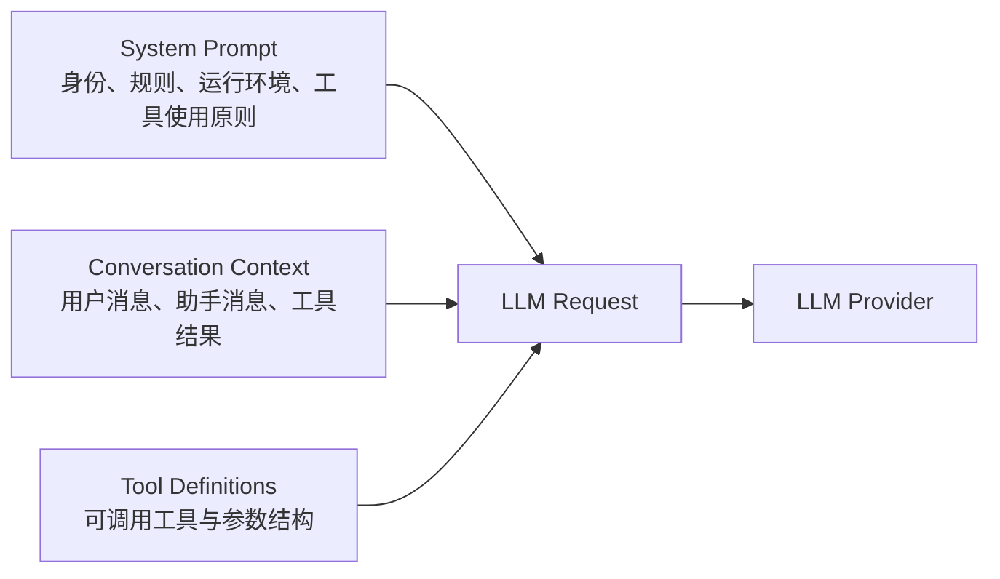
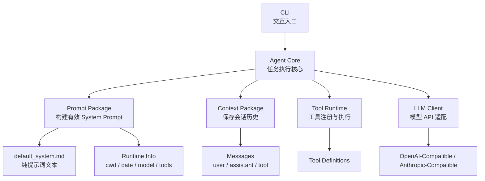
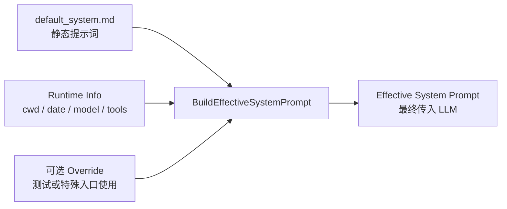
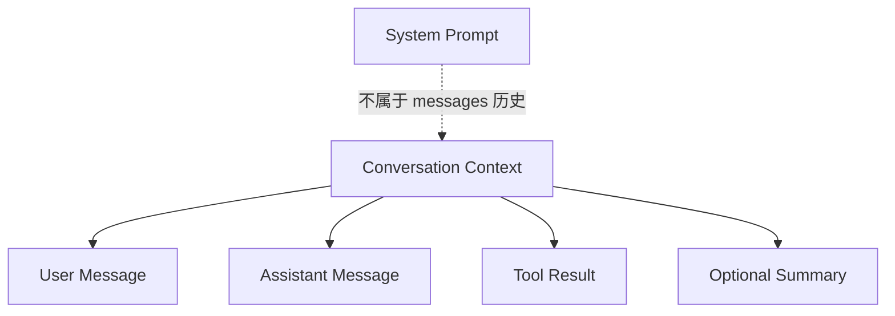
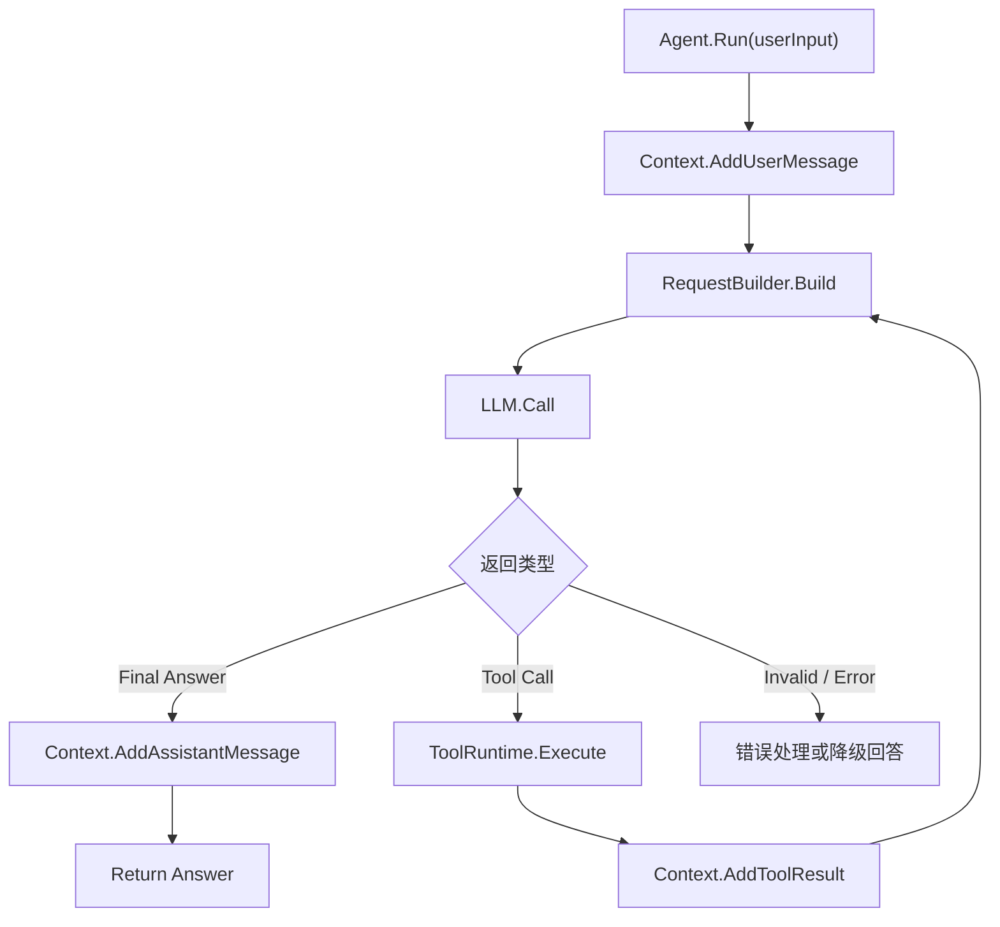
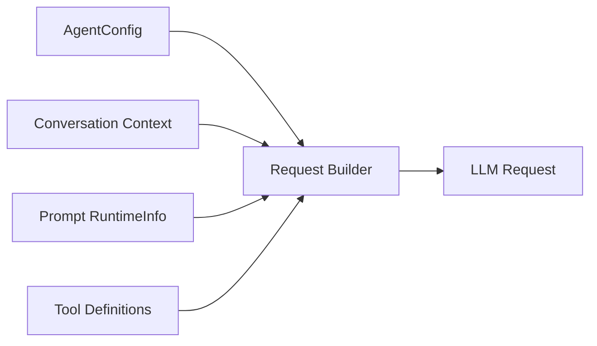
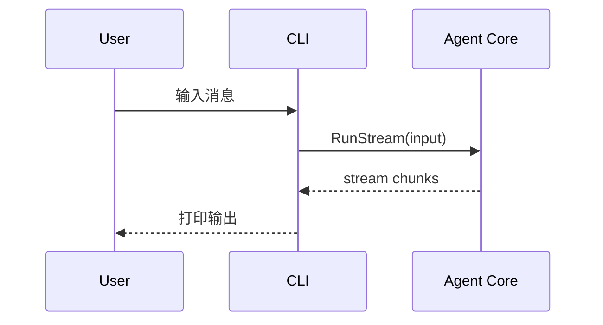
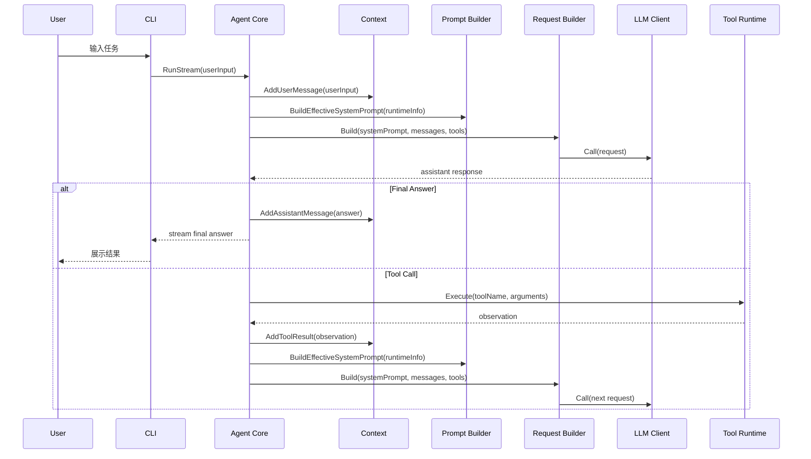
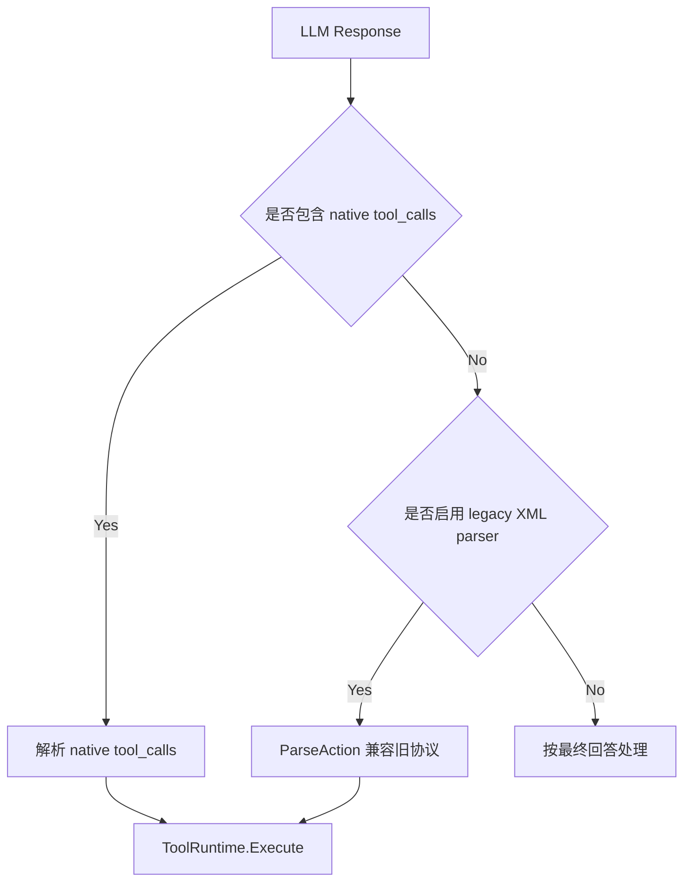

# Awaken Agent Core 与 System Prompt 设计

日期：2026-06-12

状态：设计稿

## 设计目标

Awaken 的目标不是把 CLI 写成一个聊天壳，而是建立一个可以被 CLI、桌面端、后台任务等不同入口复用的 Agent Core。

本设计要解决四个边界问题：

1. CLI 只是交互入口，不拥有 Agent 架构。
2. System Prompt 是运行时指令层，不是对话历史本身。
3. Context 是会话状态层，保存用户、模型、工具结果等历史。
4. Agent Core 是唯一负责把 System Prompt、Context、Tools、LLM 请求组装起来的核心执行层。

## 核心结论

System Prompt 与 Context 最后都会进入 LLM 请求，但它们不是同一个东西。

System Prompt 描述“这个 Agent 应该如何工作”。

Context 描述“这一次会话已经发生了什么”。

Tool Definitions 描述“当前模型可以调用什么能力”。

Agent Core 负责在每一轮调用 LLM 前，把三者组装成一次完整请求。



## 当前状态

当前仓库已经有这些模块：

```text
/Users/nolangrant/Awaken
├── CLI/
│   └── main.go
└── src/
    ├── agentcore/
    │   ├── action_parser.go
    │   ├── agent.go
    │   └── types.go
    ├── context/
    │   └── context.go
    ├── llm/
    │   └── llm.go
    ├── prompt/
    │   ├── system_prompt.go
    │   └── system_prompt_test.go
    ├── tool/
    │   ├── tool.go
    │   ├── schema.go
    │   ├── registry.go
    │   └── tool_test.go
    └── tools/
        ├── apply_patch/
        ├── calculator/
        ├── file_read/
        ├── grep_search/
        ├── list_files/
        ├── shell/
        ├── web_search/
        └── tools.go
```

当前主要问题：

1. `src/prompt/system_prompt.go` 已经独立出来，但静态 prompt 文本仍写在 Go 代码里。
2. `src/context/context.go` 当前会把 system prompt 作为第一条 system message 保存进 messages。
3. `src/agentcore/agent.go` 已经是核心入口，但请求组装逻辑仍散在执行循环里。
4. `src/agentcore/action_parser.go` 是旧 XML action 协议兼容层，不应该成为新架构核心。

## 目标目录结构

目标结构应该让“提示词内容”和“提示词装配代码”分开。

```text
/Users/nolangrant/Awaken
├── docs/
│   └── agent-core-system-prompt-design.md
├── CLI/
│   └── main.go
└── src/
    ├── agentcore/
    │   ├── agent.go
    │   ├── request_builder.go
    │   ├── runner.go
    │   ├── types.go
    │   └── action_parser.go
    ├── context/
    │   └── context.go
    ├── prompt/
    │   ├── system_prompt.go
    │   ├── effective.go
    │   ├── runtime.go
    │   ├── loader.go
    │   └── templates/
    │       └── default_system.md
    ├── llm/
    │   └── llm.go
    ├── tool/
    │   ├── tool.go
    │   ├── schema.go
    │   ├── registry.go
    │   └── tool_test.go
    └── tools/
        ├── apply_patch/
        ├── calculator/
        ├── file_read/
        ├── grep_search/
        ├── list_files/
        ├── shell/
        ├── web_search/
        └── tools.go
```

说明：

| 路径 | 职责 |
| --- | --- |
| `CLI/main.go` | 用户交互入口，只负责读取输入、展示输出、创建 Agent |
| `src/agentcore/agent.go` | Agent 生命周期、Run 入口、对外 API |
| `src/agentcore/request_builder.go` | 每轮 LLM 请求组装 |
| `src/agentcore/runner.go` | Agent 执行循环，处理 LLM 返回、工具调用、最终回答 |
| `src/agentcore/action_parser.go` | 旧 XML action 协议兼容层，后续替换 |
| `src/prompt/templates/default_system.md` | 默认系统提示词文本，纯 Markdown |
| `src/prompt/system_prompt.go` | SystemPrompt 类型和基础 API |
| `src/prompt/effective.go` | 生成最终传入 LLM 的有效 system prompt |
| `src/prompt/runtime.go` | 当前 cwd、模型、日期、工具摘要等动态信息 |
| `src/prompt/loader.go` | 加载 Markdown prompt 模板 |
| `src/context/context.go` | 只保存 conversation messages，不负责 system prompt |
| `src/llm/llm.go` | LLM Provider 适配层 |
| `src/tool/tool.go` | 本地工具接口与工具参数 |
| `src/tool/schema.go` | 暴露给 LLM 的工具 schema |
| `src/tool/registry.go` | 工具注册、查找、排序、校验 |
| `src/tools/*` | 具体工具实现与内置工具聚合注册 |

文件 CRUD 工具面采用组合设计：

1. `read_file` 负责读取文件。
2. `list_files` 负责按 glob 模式查找文件。
3. `grep_search` 负责搜索文件内容。
4. `apply_patch` 负责新增、修改、移动、删除文件，是文件变更的统一入口，支持 Codex 风格的 `Add File`、`Update File`、`Move to`、`Delete File` 和 `End of File`。
5. `shell` 只作为高级命令兜底，不作为普通文件 CRUD 首选。

## 模块关系



## System Prompt 设计

System Prompt 由两部分组成：

1. 静态部分：长期稳定的 Agent 身份、行为规则、输出风格。
2. 动态部分：当前工作目录、日期、模型、可用工具、运行入口等运行时信息。

静态部分放在 Markdown 文件中。

```text
/Users/nolangrant/Awaken/src/prompt/templates/default_system.md
```

这个文件只写 prompt 内容，不写 Go 代码。

Go 代码只做三件事：

1. 读取 Markdown。
2. 收集动态运行时信息。
3. 拼出最终传给 LLM 的 system prompt。



### 静态 Prompt

静态 prompt 应该包含：

1. Identity：Awaken 是什么。
2. Operating Principles：任务执行原则。
3. Tool Use Rules：工具使用规则。
4. File/System Safety：本地文件与命令执行边界。
5. Output Style：默认回答风格。

静态 prompt 不应该包含：

1. 当前工作目录。
2. 当前日期。
3. 当前模型名。
4. 当前有哪些工具。
5. 当前用户输入。
6. 当前对话历史。

### 动态 Prompt

动态 prompt 由代码生成，因为它依赖运行时。

动态内容可以包含：

1. 当前日期与时区。
2. 当前工作目录。
3. 当前入口，例如 CLI、desktop、background job。
4. 当前模型名。
5. 可用工具摘要。
6. 当前权限模式。
7. 当前项目边界。

动态内容不应该污染 Markdown 模板。

## Context 设计

Context 只保存会话历史。

它应该保存：

1. 用户输入。
2. 模型输出。
3. 工具调用请求。
4. 工具返回结果。
5. 必要的压缩摘要。

它不应该负责：

1. 构建 system prompt。
2. 保存默认 system prompt 文本。
3. 决定可用工具。
4. 调用 LLM。
5. 执行工具。

目标状态下，`Context.GetMessages()` 不应该把 system prompt 当作第一条历史消息返回。



## Agent Core 设计

Agent Core 是整个系统的执行核心。

它负责：

1. 接收用户输入。
2. 把用户输入写入 Context。
3. 调用 Request Builder 组装 LLM 请求。
4. 调用 LLM。
5. 判断模型返回是最终回答还是工具调用。
6. 执行工具。
7. 把工具结果写回 Context。
8. 继续循环，直到得到最终回答或达到限制。



## Request Builder 设计

`src/agentcore/request_builder.go` 是关键文件。

它不写 prompt 内容，也不执行工具。

它只做请求装配。

输入：

1. `AgentConfig`
2. `Conversation Context`
3. `Prompt RuntimeInfo`
4. `Tool Definitions`

输出：

1. `SystemPrompt`
2. `Messages`
3. `Tools`
4. `Model`
5. `Temperature`
6. `MaxTokens`



这样做的好处是：

1. CLI 不需要知道 system prompt。
2. Prompt package 不需要知道 conversation。
3. Context package 不需要知道 LLM provider。
4. LLM package 不需要知道 Agent 执行策略。
5. Agent Core 可以清楚控制每一轮请求到底包含什么。

## CLI 设计

CLI 是最薄的一层。

CLI 负责：

1. 读取 `.env` 或命令参数。
2. 创建 Agent。
3. 把用户输入传给 Agent。
4. 展示 streaming 输出。
5. 提供 `reset`、`exit` 等交互命令。

CLI 不负责：

1. 写 system prompt。
2. 管理 prompt 模板。
3. 判断工具调用协议。
4. 组装 LLM 请求。
5. 执行工具。



## 一次 CLI 输入后的完整流程



## 工具调用协议设计

当前 `src/agentcore/action_parser.go` 解析 XML 风格 action：

```xml
<action>
  <name>tool_name</name>
  <input>tool_input</input>
</action>
```

这是兼容层，不是目标设计。

目标设计应该优先支持 LLM 原生 tool calls。



迁移策略：

1. 短期保留 `action_parser.go`，避免当前 CLI 立即断裂。
2. 新的 Request Builder 和 Runner 先支持 native tool calls。
3. 当 native tool calls 稳定后，把 XML action parser 标记为 deprecated。
4. 最后删除 `action_parser.go`。

## 与 Claude Code 思路的关系

Awaken 应该学习的是架构思想，而不是照抄文件树。

可借鉴的点：

1. Effective System Prompt 在运行时构建，而不是入口层写死。
2. 静态 prompt 与动态环境信息要有清晰边界。
3. 对话 Context 与 System Prompt 分离。
4. 工具能力是 Agent Runtime 的一部分，不应该只靠 prompt 伪装。
5. CLI 是一种入口，不是 Agent 本身。

不应该照搬的点：

1. 不必复制 Claude Code 的完整目录结构。
2. 不必把 Codex/Claude Code 的所有运行时机制一次性搬进来。
3. 不应该为了像某个项目而引入 Awaken 当前不需要的抽象。

## 设计后的运行时数据结构

建议把一次 LLM 调用看成四类输入：

```text
LLMRequest
├── systemPrompt       # prompt.BuildEffectiveSystemPrompt(...)
├── messages           # context.GetMessages()
├── tools              # tool.ListDefinitions()
└── modelConfig        # AgentConfig.ModelConfig
```

System Prompt 不存入 messages。

Messages 不负责描述 Agent 规则。

Tools 不通过自然语言伪装成唯一协议，而是尽量走 provider 支持的工具调用结构。

## 实施顺序

### 第一阶段：文档与边界确认

产出本文档。

目标是确认：

1. CLI 不拥有 prompt。
2. prompt 文本从 Go 代码移动到 Markdown。
3. Context 不再内嵌 system prompt。
4. Agent Core 负责请求装配。
5. XML action parser 只是兼容层。

### 第二阶段：Prompt Package 重构

新增：

```text
src/prompt/templates/default_system.md
src/prompt/loader.go
src/prompt/runtime.go
src/prompt/effective.go
```

调整：

```text
src/prompt/system_prompt.go
```

成功标准：

1. 默认 system prompt 文本在 Markdown 文件中。
2. Go 代码不硬编码大段 prompt 文本。
3. 动态信息由 RuntimeInfo 注入。
4. 测试能证明动态边界不会泄漏到最终 prompt 文本。

### 第三阶段：Agent Core Request Builder

新增：

```text
src/agentcore/request_builder.go
```

调整：

```text
src/agentcore/agent.go
src/context/context.go
src/llm/llm.go
```

成功标准：

1. Context messages 不包含 system prompt。
2. 每次 LLM 调用前动态生成 effective system prompt。
3. Agent Core 是唯一组装 LLM 请求的地方。
4. CLI 不需要改 prompt 逻辑。

### 第四阶段：Runner 与 Tool Calls

新增或调整：

```text
src/agentcore/runner.go
src/llm/llm.go
src/tool/tool.go
src/tool/schema.go
src/tool/registry.go
src/tools/*
```

成功标准：

1. 优先处理 native tool calls。
2. XML action parser 仅作为 fallback。
3. 工具调用、工具结果、最终回答都明确写入 Context。
4. 测试覆盖 final answer、tool call、tool error、max iteration。

### 第五阶段：删除旧兼容层

删除条件：

1. native tool calls 已经完成。
2. CLI 测试通过。
3. 不再有代码引用 `ParseAction`。
4. 不再要求模型输出 XML action。

届时可以删除：

```text
src/agentcore/action_parser.go
```

## 成功标准总表

| 目标 | 验证方式 |
| --- | --- |
| CLI 不包含 system prompt | `rg "SystemPrompt|system prompt|你是" CLI` |
| prompt 文本在 Markdown | 检查 `src/prompt/templates/default_system.md` |
| Context 不存 system prompt | `Context.GetMessages()` 不返回 system message |
| Agent Core 统一组装请求 | LLM 调用只通过 `request_builder.go` 产物 |
| 动态信息每轮构建 | 修改 cwd/model/date 后 effective prompt 变化 |
| XML parser 可替换 | native tool calls 测试通过后 `ParseAction` 无引用 |
| 旧功能不回退 | `go test ./...` 通过 |

## 最终设计判断

Awaken 的 System Prompt 不应该是散落在 CLI、Agent、Context 里的字符串。

它应该是：

1. 一个纯 Markdown 的静态行为定义。
2. 一组由代码生成的动态运行时片段。
3. 一个由 Agent Core 在每次 LLM 调用前组装出来的 Effective System Prompt。

Awaken 的 Context 不应该是“什么都塞进去的 messages 数组”。

它应该只表示会话已经发生的事实。

Agent Core 才是系统中心：它连接 prompt、context、tools、LLM，并负责让一次用户输入变成一段可验证的执行流程。
